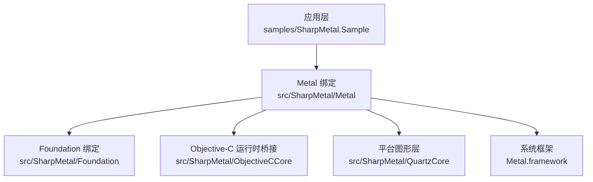
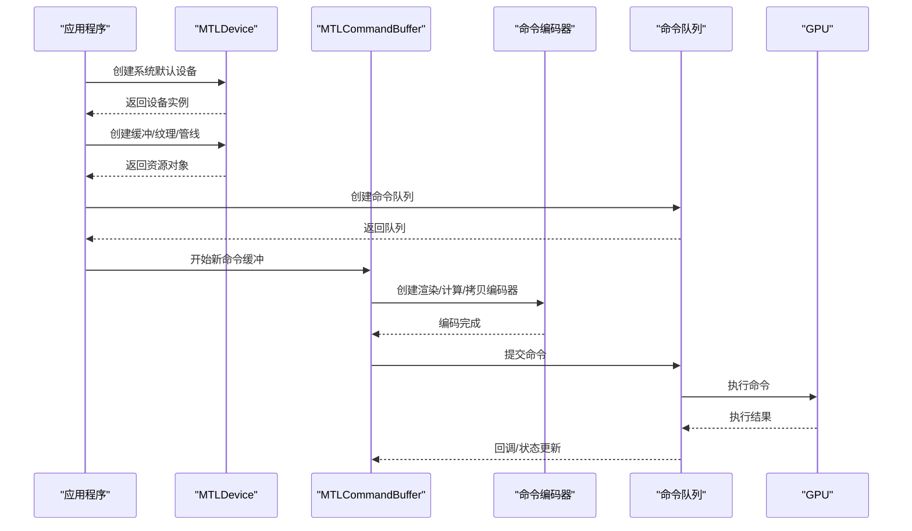
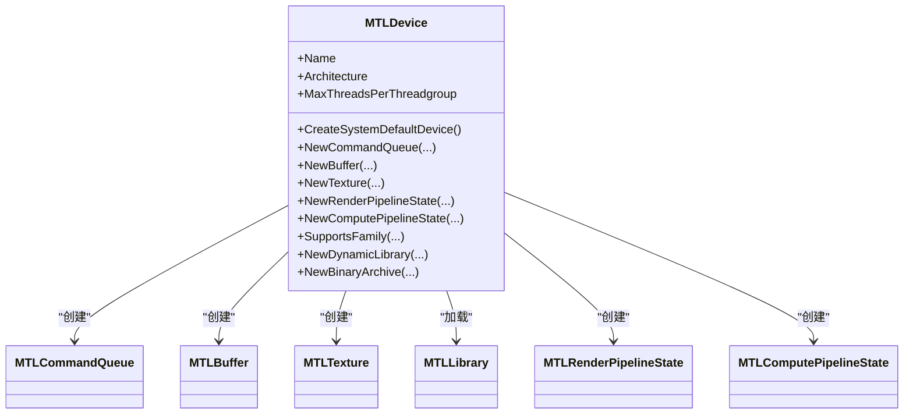
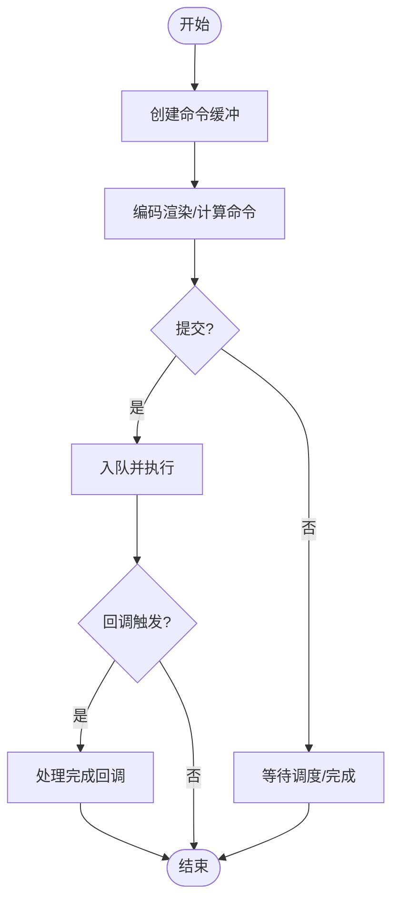
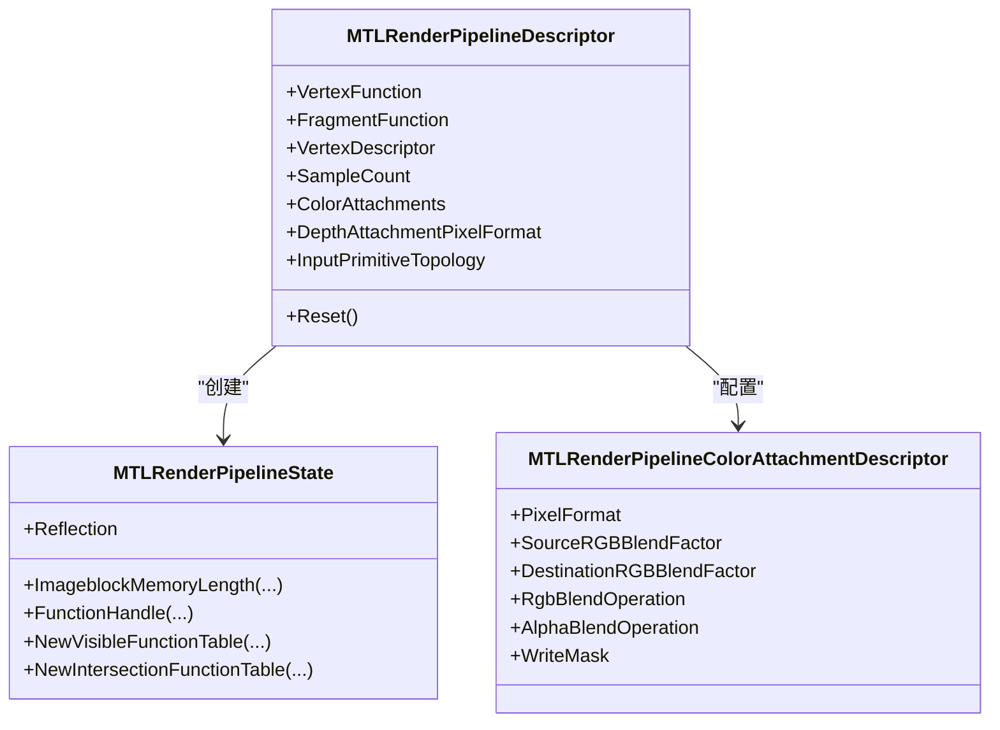
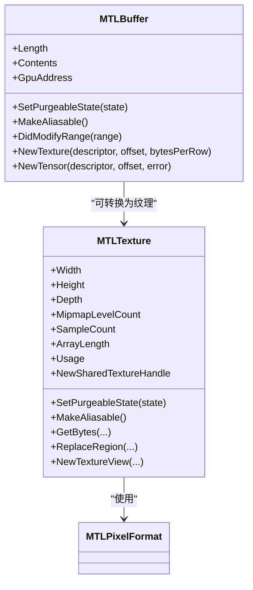
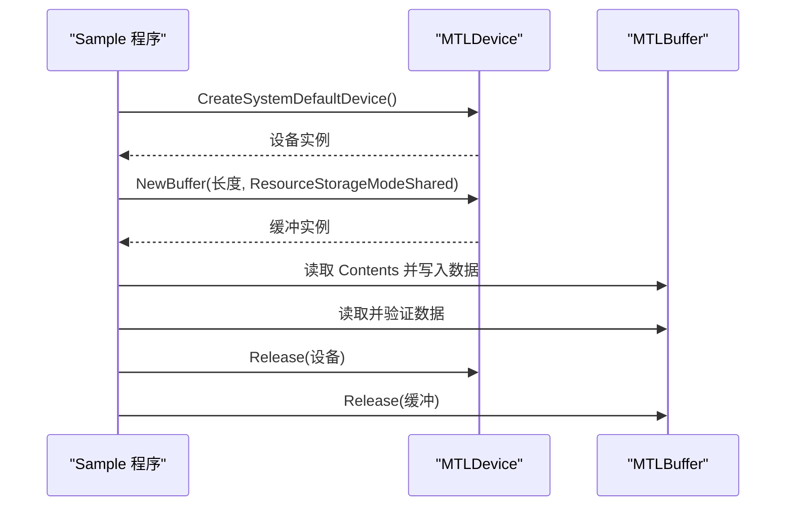
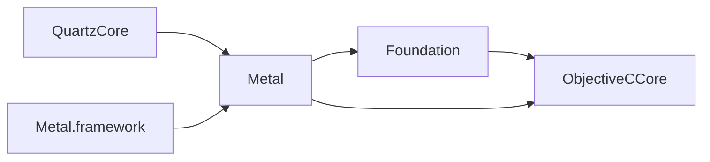

# API 参考文档

<cite>
**本文引用的文件**
- [README.md](file://README.md)
- [DESIGN.md](file://DESIGN.md)
- [SharpMetal.csproj](file://src/SharpMetal/SharpMetal.csproj)
- [MTLDevice.cs](file://src/SharpMetal/Metal/MTLDevice.cs)
- [MTLCommandBuffer.cs](file://src/SharpMetal/Metal/MTLCommandBuffer.cs)
- [MTLRenderPipeline.cs](file://src/SharpMetal/Metal/MTLRenderPipeline.cs)
- [MTLBuffer.cs](file://src/SharpMetal/Metal/MTLBuffer.cs)
- [MTLTexture.cs](file://src/SharpMetal/Metal/MTLTexture.cs)
- [MTLPixelFormat.cs](file://src/SharpMetal/Metal/MTLPixelFormat.cs)
- [MTLTypes.cs](file://src/SharpMetal/Metal/MTLTypes.cs)
- [NSObject.cs](file://src/SharpMetal/Foundation/NSObject.cs)
- [Program.cs](file://samples/SharpMetal.Sample/Program.cs)
</cite>

## 目录
1. [简介](#简介)
2. [项目结构](#项目结构)
3. [核心组件](#核心组件)
4. [架构总览](#架构总览)
5. [详细组件分析](#详细组件分析)
6. [依赖关系分析](#依赖关系分析)
7. [性能注意事项](#性能注意事项)
8. [故障排查指南](#故障排查指南)
9. [结论](#结论)
10. [附录](#附录)

## 简介
本 API 参考文档面向使用 SharpMetal 的开发者，系统化梳理 .NET 与 Apple Metal、Foundation、QuartzCore、Objective-C 运行时之间的绑定接口。文档按模块组织，覆盖类型定义、枚举、常量、类/结构体、方法签名、参数与返回值说明、异常行为提示以及典型用法路径。所有说明均基于仓库中的实际代码实现，确保与实际代码同步。

## 项目结构
- 根目录包含 README、设计说明、工程配置与示例程序。
- src/SharpMetal 为产品库，包含 Foundation、Metal、MetalFX、ObjectiveCCore、QuartzCore 等命名空间下的绑定类型。
- samples/SharpMetal.Sample 提供最小可运行示例，演示设备获取、缓冲区分配与读写。

**图表来源**
- [README.md:1-23](file://README.md#L1-L23)
- [DESIGN.md:1-12](file://DESIGN.md#L1-L12)
- [SharpMetal.csproj:1-47](file://src/SharpMetal/SharpMetal.csproj#L1-L47)

**章节来源**
- [README.md:1-23](file://README.md#L1-L23)
- [DESIGN.md:1-12](file://DESIGN.md#L1-L12)
- [SharpMetal.csproj:1-47](file://src/SharpMetal/SharpMetal.csproj#L1-L47)

## 核心组件
本节概述关键 API 模块的职责与边界：
- 设备与资源管理：MTLDevice 负责创建命令队列、缓冲、纹理、管线状态、动态库、归档等；同时暴露设备能力查询。
- 命令执行：MTLCommandBuffer 封装渲染、计算、拷贝等命令编码与提交，支持回调与调试分组。
- 渲染管线：MTLRenderPipelineState/Descriptor 描述顶点/片段/瓦片着色器、混合、采样、拓扑等。
- 数据资源：MTLBuffer 与 MTLTexture 提供 GPU/CPU 内存访问、视图、共享句柄、压缩与稀疏支持。
- 基础类型：MTLTypes 提供尺寸、区域、采样点等通用结构；MTLPixelFormat 定义像素格式枚举。
- 基础对象：NSObject 提供哈希、描述、相等性、选择器响应检查等基础能力。

**章节来源**
- [MTLDevice.cs:187-721](file://src/SharpMetal/Metal/MTLDevice.cs#L187-L721)
- [MTLCommandBuffer.cs:116-319](file://src/SharpMetal/Metal/MTLCommandBuffer.cs#L116-L319)
- [MTLRenderPipeline.cs:208-629](file://src/SharpMetal/Metal/MTLRenderPipeline.cs#L208-L629)
- [MTLBuffer.cs:6-113](file://src/SharpMetal/Metal/MTLBuffer.cs#L6-L113)
- [MTLTexture.cs:75-438](file://src/SharpMetal/Metal/MTLTexture.cs#L75-L438)
- [MTLTypes.cs:5-107](file://src/SharpMetal/Metal/MTLTypes.cs#L5-L107)
- [MTLPixelFormat.cs:3-144](file://src/SharpMetal/Metal/MTLPixelFormat.cs#L3-L144)
- [NSObject.cs:48-90](file://src/SharpMetal/Foundation/NSObject.cs#L48-L90)

## 架构总览
下图展示从应用到系统框架的关键调用链：应用通过 Sample 获取默认设备，创建缓冲并提交命令进行渲染或计算。

**图表来源**
- [Program.cs:21-45](file://samples/SharpMetal.Sample/Program.cs#L21-L45)
- [MTLDevice.cs:305-339](file://src/SharpMetal/Metal/MTLDevice.cs#L305-L339)
- [MTLCommandBuffer.cs:150-218](file://src/SharpMetal/Metal/MTLCommandBuffer.cs#L150-L218)

## 详细组件分析

### 设备与能力（MTLDevice）
- 作用：设备是 Metal 资源的工厂与能力查询入口，用于创建命令队列、缓冲、纹理、管线、动态库、归档、加速结构等。
- 关键能力：
  - 设备属性：名称、架构、最大线程组大小、是否低功耗、位置、传输速率、统一内存、推荐工作集大小等。
  - 能力检测：是否支持特定 GPU Family、MSAA、BCTexture 压缩、函数指针、光线追踪、顶点放大计数等。
  - 资源创建：NewBuffer/NewTexture/NewSamplerState/NewDefaultLibrary/NewLibrary/NewRenderPipelineState/NewComputePipelineState 等。
  - 高级特性：堆分配、间接命令缓冲、共享事件、IO 命令队列、二进制归档、计数器堆、张量、纹理视图池、MTL4 系列 API。
- 重要枚举与结构：
  - MTLGPUFamily、MTLDeviceLocation、MTLPipelineOption、MTLReadWriteTextureTier、MTLArgumentBuffersTier、MTLSparsePageSize、MTLCounterSamplingPoint。
  - MTLAccelerationStructureSizes、MTLSizeAndAlign。
- 错误处理：多数创建方法通过 NSError 引用返回错误信息；调用前需检查 NativePtr 有效性。
- 典型用法路径：
  - 获取默认设备并创建命令队列与缓冲。
  - 查询能力后按需创建管线与纹理。
  - 使用堆或间接命令缓冲优化批量操作。

**图表来源**
- [MTLDevice.cs:187-721](file://src/SharpMetal/Metal/MTLDevice.cs#L187-L721)

**章节来源**
- [MTLDevice.cs:16-185](file://src/SharpMetal/Metal/MTLDevice.cs#L16-L185)
- [MTLDevice.cs:187-721](file://src/SharpMetal/Metal/MTLDevice.cs#L187-L721)

### 命令缓冲与执行（MTLCommandBuffer）
- 作用：封装一组命令的编码、提交与生命周期管理，支持渲染、计算、拷贝、资源状态转换、加速结构等编码器。
- 关键成员：
  - 状态与时间：Status、KernelStartTime/EndTime、GPUStartTime/GPUEndTime、Error。
  - 生命周期：Enqueue、Commit、WaitUntilScheduled、WaitUntilCompleted。
  - 呈现：PresentDrawable、PresentDrawableAtTime、PresentDrawableAfterMinimumDuration。
  - 回调：AddScheduledHandler、AddCompletedHandler。
  - 编码器：RenderCommandEncoder、ComputeCommandEncoder、BlitCommandEncoder、ResourceStateCommandEncoder、AccelerationStructureCommandEncoder。
  - 调试：PushDebugGroup、PopDebugGroup。
- 错误与异常：
  - 错误选项 ErrorOptions 控制编码器执行状态收集。
  - 错误码 MTLCommandBufferError 涵盖内部错误、超时、缺页、设备移除等。
- 典型流程：
  - 创建命令缓冲 -> 编码渲染/计算命令 -> 提交 -> 等待完成或注册回调。

**图表来源**
- [MTLCommandBuffer.cs:59-319](file://src/SharpMetal/Metal/MTLCommandBuffer.cs#L59-L319)

**章节来源**
- [MTLCommandBuffer.cs:9-58](file://src/SharpMetal/Metal/MTLCommandBuffer.cs#L9-L58)
- [MTLCommandBuffer.cs:59-319](file://src/SharpMetal/Metal/MTLCommandBuffer.cs#L59-L319)

### 渲染管线（MTLRenderPipeline）
- 作用：描述渲染阶段的着色器、输入拓扑、混合、采样、瓦片/网格管线等。
- 关键类型：
  - MTLRenderPipelineDescriptor：设置顶点/片段函数、顶点描述、采样数、混合、拓扑、预加载库、链接函数、二进制归档等。
  - MTLRenderPipelineColorAttachmentDescriptor：颜色附件的像素格式、混合因子与操作、写入掩码。
  - MTLRenderPipelineState：管线状态实例，提供反射、函数句柄、可见/相交函数表创建、图像块内存估算等。
  - 相关枚举：MTLBlendFactor、MTLBlendOperation、MTLColorWriteMask、MTLPrimitiveTopologyClass、细分相关枚举。
- 典型用法：
  - 构建 Descriptor -> 设置着色器与附件 -> 创建 RenderPipelineState -> 在渲染编码器中绑定并使用。

**图表来源**
- [MTLRenderPipeline.cs:87-170](file://src/SharpMetal/Metal/MTLRenderPipeline.cs#L87-L170)
- [MTLRenderPipeline.cs:208-492](file://src/SharpMetal/Metal/MTLRenderPipeline.cs#L208-L492)
- [MTLRenderPipeline.cs:530-629](file://src/SharpMetal/Metal/MTLRenderPipeline.cs#L530-L629)

**章节来源**
- [MTLRenderPipeline.cs:6-85](file://src/SharpMetal/Metal/MTLRenderPipeline.cs#L6-L85)
- [MTLRenderPipeline.cs:87-170](file://src/SharpMetal/Metal/MTLRenderPipeline.cs#L87-L170)
- [MTLRenderPipeline.cs:208-492](file://src/SharpMetal/Metal/MTLRenderPipeline.cs#L208-L492)
- [MTLRenderPipeline.cs:530-629](file://src/SharpMetal/Metal/MTLRenderPipeline.cs#L530-L629)

### 缓冲与纹理（MTLBuffer / MTLTexture）
- MTLBuffer：
  - 属性：Label、Device、CpuCacheMode、StorageMode、HazardTrackingMode、ResourceOptions、Heap、HeapOffset、AllocatedSize、IsAliasable、Length、Contents、GpuAddress。
  - 方法：SetPurgeableState、MakeAliasable、DidModifyRange、NewTexture、NewTensor、AddDebugMarker、RemoveAllDebugMarkers、NewRemoteBufferViewForDevice。
  - 用途：CPU/GPU 共享内存、直接访问内容、作为纹理或张量的底层存储。
- MTLTexture：
  - 属性：Label、Device、CpuCacheMode、StorageMode、HazardTrackingMode、ResourceOptions、Heap、HeapOffset、AllocatedSize、IsAliasable、RootResource、ParentTexture、Buffer、Iosurface、TextureType、PixelFormat、Width/Height/Depth、MipmapLevelCount、SampleCount、ArrayLength、Usage、Shareable、FramebufferOnly、FirstMipmapInTail、TailSizeInBytes、IsSparse、SparseTextureTier、AllowGPUOptimizedContents、CompressionType、Swizzle。
  - 方法：SetPurgeableState、MakeAliasable、GetBytes/ReplaceRegion、NewTextureView、NewSharedTextureHandle、NewRemoteTextureViewForDevice。
  - 用途：二维/三维/立方体/数组纹理、多重采样、压缩格式、稀疏纹理、视图重解释、跨进程共享。
- 像素格式：MTLPixelFormat 提供广泛的颜色、深度、模板与压缩格式枚举。

**图表来源**
- [MTLBuffer.cs:6-113](file://src/SharpMetal/Metal/MTLBuffer.cs#L6-L113)
- [MTLTexture.cs:75-438](file://src/SharpMetal/Metal/MTLTexture.cs#L75-L438)
- [MTLPixelFormat.cs:3-144](file://src/SharpMetal/Metal/MTLPixelFormat.cs#L3-L144)

**章节来源**
- [MTLBuffer.cs:6-113](file://src/SharpMetal/Metal/MTLBuffer.cs#L6-L113)
- [MTLTexture.cs:7-438](file://src/SharpMetal/Metal/MTLTexture.cs#L7-L438)
- [MTLPixelFormat.cs:3-144](file://src/SharpMetal/Metal/MTLPixelFormat.cs#L3-L144)

### 基础类型与对象（MTLTypes / NSObject）
- MTLTypes：
  - CGSize/CGPoint/CGRect：屏幕坐标与矩形。
  - MTLOrigin/MTLSize/MTLRegion：三维原点、尺寸与区域。
  - MTLSamplePosition：可编程采样位置。
  - MTLResourceID：GPU 资源标识。
- NSObject：
  - 哈希、描述、调试描述、相等性、类型检查、选择器响应检查。
  - 为其他绑定对象提供基础能力。

**章节来源**
- [MTLTypes.cs:5-107](file://src/SharpMetal/Metal/MTLTypes.cs#L5-L107)
- [NSObject.cs:48-90](file://src/SharpMetal/Foundation/NSObject.cs#L48-L90)

### 示例用法（Sample）
- 平台检查：仅在 macOS/iOS/Mac Catalyst 上执行原生 Metal 负载。
- 设备获取：CreateSystemDefaultDevice 获取默认设备。
- 缓冲分配：NewBuffer(长度, 选项) 创建共享模式缓冲。
- CPU 读写：通过 Contents 指针以 Span<int> 读写数据并校验一致性。
- 资源释放：显式 Release 原生指针，遵循显式所有权模型。

**图表来源**
- [Program.cs:10-45](file://samples/SharpMetal.Sample/Program.cs#L10-L45)

**章节来源**
- [Program.cs:10-45](file://samples/SharpMetal.Sample/Program.cs#L10-L45)

## 依赖关系分析
- 模块耦合：
  - Metal 模块依赖 Foundation 与 ObjectiveCCore 进行对象管理与运行时消息发送。
  - QuartzCore 提供 CAMetalDrawable 等显示相关类型，供命令缓冲呈现。
  - 系统框架 Metal.framework 通过 LibraryImport 或直接 objc_msgSend 调用。
- 外部依赖：
  - 目标平台限制：仅 macOS/iOS/Mac Catalyst。
  - 运行时要求：.NET 10；编译器生成器保持 netstandard 目标。
- 潜在循环依赖：未发现明显循环引用；各模块职责清晰。

**图表来源**
- [DESIGN.md:1-12](file://DESIGN.md#L1-L12)
- [SharpMetal.csproj:1-47](file://src/SharpMetal/SharpMetal.csproj#L1-L47)

**章节来源**
- [DESIGN.md:1-12](file://DESIGN.md#L1-L12)
- [SharpMetal.csproj:1-47](file://src/SharpMetal/SharpMetal.csproj#L1-L47)

## 性能注意事项
- 资源复用：优先使用堆（Heap）与间接命令缓冲（IndirectCommandBuffer）减少重复分配与编码开销。
- 内存布局：合理设置 CpuCacheMode、StorageMode、HazardTrackingMode 与 Usage，避免不必要的缓存与同步。
- 纹理优化：启用 AllowGPUOptimizedContents、选择合适的 PixelFormat 与压缩类型；使用纹理视图重解释降低复制。
- 管线预热：预加载库与二进制归档可减少首次编译延迟；使用 ShaderValidation 控制验证级别。
- 并发与批处理：利用并行渲染编码器与顶点放大计数提升吞吐；合理使用线程组大小与图像块内存。

[本节为通用指导，不直接分析具体文件]

## 故障排查指南
- 设备为空：CreateSystemDefaultDevice 返回空指针时，检查平台与驱动可用性。
- 缓冲分配失败：确认 ResourceOptions 与长度；共享模式下 Contents 必须非空。
- 数据不一致：写入后需确保内存可见性；必要时使用 DidModifyRange 通知修改范围。
- 命令错误：检查 CommandBuffer.Error 与 ErrorOptions；根据 MTLCommandBufferError 定位问题。
- 平台限制：在非 Apple 平台将跳过原生负载；确保运行环境满足要求。

**章节来源**
- [Program.cs:10-45](file://samples/SharpMetal.Sample/Program.cs#L10-L45)
- [MTLCommandBuffer.cs:9-58](file://src/SharpMetal/Metal/MTLCommandBuffer.cs#L9-L58)
- [MTLBuffer.cs:50-63](file://src/SharpMetal/Metal/MTLBuffer.cs#L50-L63)

## 结论
SharpMetal 提供了对 Apple Metal 与相关框架的低层绑定，强调显式原生所有权与平台边界。通过设备、命令缓冲、管线、缓冲与纹理等核心组件，开发者可以高效构建高性能图形与计算应用。建议遵循最佳实践进行资源管理、性能调优与错误处理，并在支持的平台上进行测试与验证。

[本节为总结，不直接分析具体文件]

## 附录
- 构建与运行：
  - 安装 .NET SDK（由 global.json 指定）。
  - 源码开发：复制 stack.local.props.example 并调整路径。
  - 包消费：使用 StackReferenceMode=Package 并提供匹配版本源。
- 许可证与来源：
  - MPL-2.0；上游为 IsaacMarovitz/SharpMetal。
  - 提取记录位于 docs/provenance。

**章节来源**
- [README.md:5-17](file://README.md#L5-L17)
- [README.md:18-23](file://README.md#L18-L23)