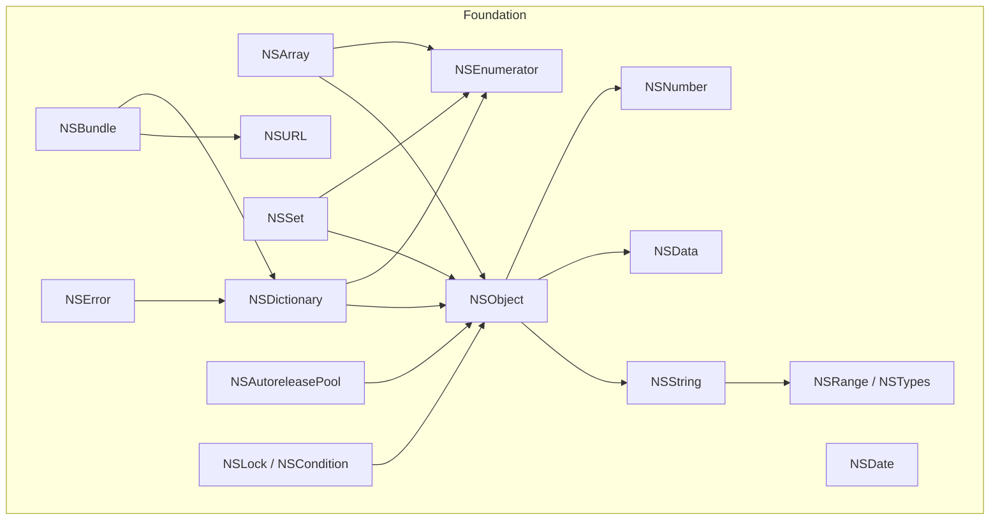
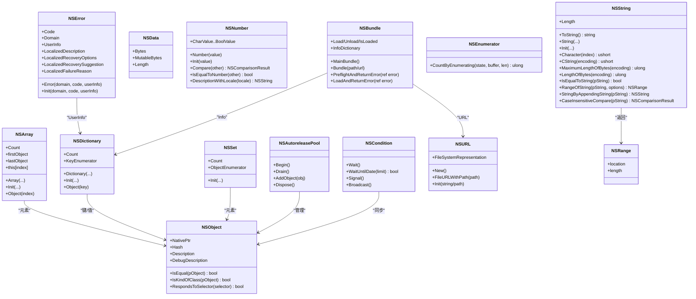
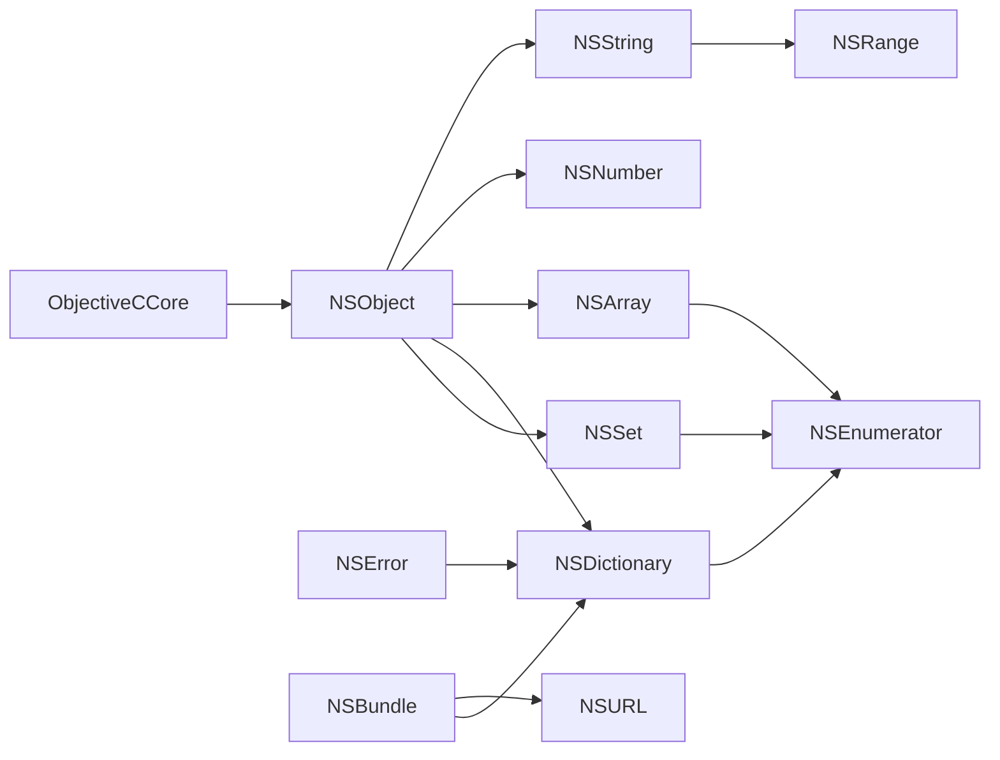

# Foundation 框架 API

<cite>
**本文引用的文件**
- [NSObject.cs](file://src/SharpMetal/Foundation/NSObject.cs)
- [NSArray.cs](file://src/SharpMetal/Foundation/NSArray.cs)
- [NSDictionary.cs](file://src/SharpMetal/Foundation/NSDictionary.cs)
- [NSSet.cs](file://src/SharpMetal/Foundation/NSSet.cs)
- [NSString.cs](file://src/SharpMetal/Foundation/NSString.cs)
- [NSData.cs](file://src/SharpMetal/Foundation/NSData.cs)
- [NSNumber.cs](file://src/SharpMetal/Foundation/NSNumber.cs)
- [NSError.cs](file://src/SharpMetal/Foundation/NSError.cs)
- [NSLock.cs](file://src/SharpMetal/Foundation/NSLock.cs)
- [NSAutoreleasePool.cs](file://src/SharpMetal/Foundation/NSAutoreleasePool.cs)
- [NSEnumerator.cs](file://src/SharpMetal/Foundation/NSEnumerator.cs)
- [NSTypes.cs](file://src/SharpMetal/Foundation/NSTypes.cs)
- [NSRange.cs](file://src/SharpMetal/Foundation/NSRange.cs)
- [NSBundle.cs](file://src/SharpMetal/Foundation/NSBundle.cs)
- [NSDate.cs](file://src/SharpMetal/Foundation/NSDate.cs)
- [NSURL.cs](file://src/SharpMetal/Foundation/NSURL.cs)
</cite>

## 目录
1. [简介](#简介)
2. [项目结构](#项目结构)
3. [核心组件](#核心组件)
4. [架构总览](#架构总览)
5. [详细组件分析](#详细组件分析)
6. [依赖关系分析](#依赖关系分析)
7. [性能注意事项](#性能注意事项)
8. [故障排除指南](#故障排除指南)
9. [结论](#结论)
10. [附录：公共接口参考](#附录公共接口参考)

## 简介
本文件为 SharpMetal 项目中 Foundation 子系统的完整 API 参考，聚焦于 Objective-C 运行时桥接层提供的常用类型与工具类。内容涵盖基元对象、集合、字符串与数据、错误处理、线程同步、自动释放池以及资源包等。每个公共接口均提供方法签名、参数说明、返回值类型与使用示例（以“调用路径”形式给出），并辅以架构图与时序图帮助理解。

## 项目结构
Foundation 模块采用按类型划分的扁平结构，每个 .cs 文件对应一个 Objective-C 类型或一组相关类型，通过 ObjectiveCCore 的运行时封装进行消息派发。

图表来源
- [NSObject.cs:48-90](file://src/SharpMetal/Foundation/NSObject.cs#L48-L90)
- [NSArray.cs:5-64](file://src/SharpMetal/Foundation/NSArray.cs#L5-L64)
- [NSDictionary.cs:5-53](file://src/SharpMetal/Foundation/NSDictionary.cs#L5-L53)
- [NSSet.cs:5-34](file://src/SharpMetal/Foundation/NSSet.cs#L5-L34)
- [NSString.cs:65-186](file://src/SharpMetal/Foundation/NSString.cs#L65-L186)
- [NSData.cs:5-20](file://src/SharpMetal/Foundation/NSData.cs#L5-L20)
- [NSNumber.cs:61-271](file://src/SharpMetal/Foundation/NSNumber.cs#L61-L271)
- [NSError.cs:5-49](file://src/SharpMetal/Foundation/NSError.cs#L5-L49)
- [NSAutoreleasePool.cs:5-39](file://src/SharpMetal/Foundation/NSAutoreleasePool.cs#L5-L39)
- [NSLock.cs:5-47](file://src/SharpMetal/Foundation/NSLock.cs#L5-L47)
- [NSEnumerator.cs:12-44](file://src/SharpMetal/Foundation/NSEnumerator.cs#L12-L44)
- [NSBundle.cs:5-148](file://src/SharpMetal/Foundation/NSBundle.cs#L5-L148)
- [NSDate.cs:5-17](file://src/SharpMetal/Foundation/NSDate.cs#L5-L17)
- [NSURL.cs:5-37](file://src/SharpMetal/Foundation/NSURL.cs#L5-L37)
- [NSRange.cs:5-10](file://src/SharpMetal/Foundation/NSRange.cs#L5-L10)
- [NSTypes.cs:5-11](file://src/SharpMetal/Foundation/NSTypes.cs#L5-L11)

章节来源
- [NSObject.cs:48-90](file://src/SharpMetal/Foundation/NSObject.cs#L48-L90)
- [NSArray.cs:5-64](file://src/SharpMetal/Foundation/NSArray.cs#L5-L64)
- [NSDictionary.cs:5-53](file://src/SharpMetal/Foundation/NSDictionary.cs#L5-L53)
- [NSSet.cs:5-34](file://src/SharpMetal/Foundation/NSSet.cs#L5-L34)
- [NSString.cs:65-186](file://src/SharpMetal/Foundation/NSString.cs#L65-L186)
- [NSData.cs:5-20](file://src/SharpMetal/Foundation/NSData.cs#L5-L20)
- [NSNumber.cs:61-271](file://src/SharpMetal/Foundation/NSNumber.cs#L61-L271)
- [NSError.cs:5-49](file://src/SharpMetal/Foundation/NSError.cs#L5-L49)
- [NSAutoreleasePool.cs:5-39](file://src/SharpMetal/Foundation/NSAutoreleasePool.cs#L5-L39)
- [NSLock.cs:5-47](file://src/SharpMetal/Foundation/NSLock.cs#L5-L47)
- [NSEnumerator.cs:12-44](file://src/SharpMetal/Foundation/NSEnumerator.cs#L12-L44)
- [NSBundle.cs:5-148](file://src/SharpMetal/Foundation/NSBundle.cs#L5-L148)
- [NSDate.cs:5-17](file://src/SharpMetal/Foundation/NSDate.cs#L5-L17)
- [NSURL.cs:5-37](file://src/SharpMetal/Foundation/NSURL.cs#L5-L37)
- [NSRange.cs:5-10](file://src/SharpMetal/Foundation/NSRange.cs#L5-L10)
- [NSTypes.cs:5-11](file://src/SharpMetal/Foundation/NSTypes.cs#L5-L11)

## 核心组件
- NSObject：Objective-C 对象的根桥接类型，暴露哈希、描述、相等性判断、类型检查与选择器响应能力。
- NSString：字符串类型，支持编码转换、长度查询、字符访问、比较与范围查找。
- NSData：原始字节容器，提供只读/可变指针与长度访问。
- NSNumber：数值包装，支持多种原生类型的存取与比较。
- NSArray/NSDictionary/NSSet：集合类型，提供计数、枚举、构造与元素访问。
- NSError：错误对象，包含域、代码、用户信息与本地化文本。
- NSAutoreleasePool：自动释放池，用于管理生命周期内的临时对象释放。
- NSLock/NSCondition：线程同步原语，条件变量等待/信号/广播。
- NSEnumerator/NSFastEnumeration：迭代协议与枚举器。
- NSBundle/NSURL/NSDate：资源定位、URL 构建与时间戳。
- NSRange/NSTypes：基础数据结构与系统版本信息。

章节来源
- [NSObject.cs:48-90](file://src/SharpMetal/Foundation/NSObject.cs#L48-L90)
- [NSString.cs:65-186](file://src/SharpMetal/Foundation/NSString.cs#L65-L186)
- [NSData.cs:5-20](file://src/SharpMetal/Foundation/NSData.cs#L5-L20)
- [NSNumber.cs:61-271](file://src/SharpMetal/Foundation/NSNumber.cs#L61-L271)
- [NSArray.cs:5-64](file://src/SharpMetal/Foundation/NSArray.cs#L5-L64)
- [NSDictionary.cs:5-53](file://src/SharpMetal/Foundation/NSDictionary.cs#L5-L53)
- [NSSet.cs:5-34](file://src/SharpMetal/Foundation/NSSet.cs#L5-L34)
- [NSError.cs:5-49](file://src/SharpMetal/Foundation/NSError.cs#L5-L49)
- [NSAutoreleasePool.cs:5-39](file://src/SharpMetal/Foundation/NSAutoreleasePool.cs#L5-L39)
- [NSLock.cs:5-47](file://src/SharpMetal/Foundation/NSLock.cs#L5-L47)
- [NSEnumerator.cs:12-44](file://src/SharpMetal/Foundation/NSEnumerator.cs#L12-L44)
- [NSBundle.cs:5-148](file://src/SharpMetal/Foundation/NSBundle.cs#L5-L148)
- [NSDate.cs:5-17](file://src/SharpMetal/Foundation/NSDate.cs#L5-L17)
- [NSURL.cs:5-37](file://src/SharpMetal/Foundation/NSURL.cs#L5-L37)
- [NSRange.cs:5-10](file://src/SharpMetal/Foundation/NSRange.cs#L5-L10)
- [NSTypes.cs:5-11](file://src/SharpMetal/Foundation/NSTypes.cs#L5-L11)

## 架构总览
Foundation 类型通过 ObjectiveCClass 与 Selector 组合，将 C# 侧调用转换为 Objective-C 消息发送。所有对象均以 NativePtr 作为底层句柄，配合隐式转换实现无缝互操作。

图表来源
- [NSObject.cs:48-90](file://src/SharpMetal/Foundation/NSObject.cs#L48-L90)
- [NSString.cs:65-186](file://src/SharpMetal/Foundation/NSString.cs#L65-L186)
- [NSData.cs:5-20](file://src/SharpMetal/Foundation/NSData.cs#L5-L20)
- [NSNumber.cs:61-271](file://src/SharpMetal/Foundation/NSNumber.cs#L61-L271)
- [NSArray.cs:5-64](file://src/SharpMetal/Foundation/NSArray.cs#L5-L64)
- [NSDictionary.cs:5-53](file://src/SharpMetal/Foundation/NSDictionary.cs#L5-L53)
- [NSSet.cs:5-34](file://src/SharpMetal/Foundation/NSSet.cs#L5-L34)
- [NSError.cs:5-49](file://src/SharpMetal/Foundation/NSError.cs#L5-L49)
- [NSAutoreleasePool.cs:5-39](file://src/SharpMetal/Foundation/NSAutoreleasePool.cs#L5-L39)
- [NSLock.cs:12-47](file://src/SharpMetal/Foundation/NSLock.cs#L12-L47)
- [NSEnumerator.cs:28-44](file://src/SharpMetal/Foundation/NSEnumerator.cs#L28-L44)
- [NSBundle.cs:5-148](file://src/SharpMetal/Foundation/NSBundle.cs#L5-L148)
- [NSURL.cs:5-37](file://src/SharpMetal/Foundation/NSURL.cs#L5-L37)
- [NSRange.cs:5-10](file://src/SharpMetal/Foundation/NSRange.cs#L5-L10)

## 详细组件分析

### NSObject 基类
- 作用：Objective-C 对象的统一桥接基元，提供哈希、描述、相等性、类型检查与选择器响应能力。
- 关键成员
  - Hash：返回哈希值。
  - Description/DebugDescription：返回可读描述。
  - IsEqual(IsKindOfClass/RespondsToSelector)：对象比较与能力探测。
- 使用要点
  - 所有 Foundation 类型均可隐式转换为 IntPtr，便于与运行时交互。
  - 通过 Selector 与 ObjectiveCRuntime 完成消息派发。

章节来源
- [NSObject.cs:48-90](file://src/SharpMetal/Foundation/NSObject.cs#L48-L90)

### NSString 字符串
- 作用：不可变字符串，支持多编码、长度、字符访问、比较与范围查找。
- 关键成员
  - 构造：从 C# string、C 字符串（带编码）、字节缓冲（无拷贝）创建。
  - 访问：Length、Character(index)、UTF8String、cStringUsingEncoding。
  - 比较：IsEqualToString、CaseInsensitiveCompare、RangeOfString(options)。
  - 拼接：StringByAppendingString。
- 复杂度
  - Length/Character：O(1)。
  - RangeOfString：取决于选项与实现，通常为 O(n)。
- 使用示例（调用路径）
  - 从 UTF-8 字节创建并获取 C# 字符串：[NSString.Init(in bytes, len, encoding, freeBuffer):120-123](file://src/SharpMetal/Foundation/NSString.cs#L120-L123) → [NSString.ToString():91-98](file://src/SharpMetal/Foundation/NSString.cs#L91-L98)
  - 大小写不敏感比较：[NSString.CaseInsensitiveCompare:160-163](file://src/SharpMetal/Foundation/NSString.cs#L160-L163)

章节来源
- [NSString.cs:65-186](file://src/SharpMetal/Foundation/NSString.cs#L65-L186)

### NSData 数据
- 作用：二进制数据容器，提供只读/可变指针与长度。
- 关键成员
  - Bytes/MutableBytes：指向底层缓冲的指针。
  - Length：数据长度。
- 使用示例（调用路径）
  - 读取长度与指针：[NSData.Length:15-15](file://src/SharpMetal/Foundation/NSData.cs#L15-L15) → [NSData.Bytes:11-11](file://src/SharpMetal/Foundation/NSData.cs#L11-L11)

章节来源
- [NSData.cs:5-20](file://src/SharpMetal/Foundation/NSData.cs#L5-L20)

### NSNumber 数值
- 作用：任意基本数值类型的包装，支持取值、比较与本地化描述。
- 关键成员
  - 取值：char/short/int/long/float/double/bool 等 Value 属性。
  - 构造：Number(value)/Init(value)。
  - 比较：Compare、IsEqualToNumber。
  - 描述：DescriptionWithLocale。
- 使用示例（调用路径）
  - 从 int 构造并比较：[NSNumber.Number(int):120-123](file://src/SharpMetal/Foundation/NSNumber.cs#L120-L123) → [NSNumber.Compare:210-213](file://src/SharpMetal/Foundation/NSNumber.cs#L210-L213)

章节来源
- [NSNumber.cs:61-271](file://src/SharpMetal/Foundation/NSNumber.cs#L61-L271)

### NSArray 数组
- 作用：有序对象集合，支持索引访问、计数与批量构造。
- 关键成员
  - Count、firstObject、lastObject、this[index]、Object(index)。
  - 构造：Array(object)/Array(objects,count)/Init(objects,count)。
- 使用示例（调用路径）
  - 创建单元素数组并访问首项：[NSArray.Array(NSObject):27-30](file://src/SharpMetal/Foundation/NSArray.cs#L27-L30) → [NSArray.firstObject:17-17](file://src/SharpMetal/Foundation/NSArray.cs#L17-L17)

章节来源
- [NSArray.cs:5-64](file://src/SharpMetal/Foundation/NSArray.cs#L5-L64)

### NSDictionary 字典
- 作用：键值对集合，支持键枚举、计数与按键取值。
- 关键成员
  - Count、KeyEnumerator、Object(key)。
  - 构造：Dictionary(object,key)/Dictionary(objects,keys,count)/Init(...).
- 使用示例（调用路径）
  - 创建一对键值并取值：[NSDictionary.Dictionary(object,key):17-20](file://src/SharpMetal/Foundation/NSDictionary.cs#L17-L20) → [NSDictionary.Object(key):37-40](file://src/SharpMetal/Foundation/NSDictionary.cs#L37-L40)

章节来源
- [NSDictionary.cs:5-53](file://src/SharpMetal/Foundation/NSDictionary.cs#L5-L53)

### NSSet 集合
- 作用：无序唯一对象集合，支持计数与枚举。
- 关键成员
  - Count、ObjectEnumerator、Init(objects,count)。
- 使用示例（调用路径）
  - 初始化并枚举：[NSSet.Init(objects,count):17-20](file://src/SharpMetal/Foundation/NSSet.cs#L17-L20) → [NSSet.ObjectEnumerator:15-15](file://src/SharpMetal/Foundation/NSSet.cs#L15-L15)

章节来源
- [NSSet.cs:5-34](file://src/SharpMetal/Foundation/NSSet.cs#L5-L34)

### NSError 错误
- 作用：结构化错误对象，包含域、代码、用户信息与本地化文本。
- 关键成员
  - Code、Domain、UserInfo、LocalizedDescription/RecoveryOptions/Suggestion/FailureReason。
  - 构造：Error(domain,code,userInfo)/Init(...)。
- 使用示例（调用路径）
  - 创建错误并读取本地化描述：[NSError.Error:27-30](file://src/SharpMetal/Foundation/NSError.cs#L27-L30) → [NSError.LocalizedDescription:19-19](file://src/SharpMetal/Foundation/NSError.cs#L19-L19)

章节来源
- [NSError.cs:5-49](file://src/SharpMetal/Foundation/NSError.cs#L5-L49)

### NSAutoreleasePool 自动释放池
- 作用：管理生命周期内自动释放对象的收集与释放。
- 关键成员
  - Begin()：创建新池。
  - Drain()：触发释放。
  - AddObject(obj)：手动加入待释放对象。
  - Dispose()：释放底层句柄。
- 使用示例（调用路径）
  - 典型用法：[NSAutoreleasePool.Begin():11-11](file://src/SharpMetal/Foundation/NSAutoreleasePool.cs#L11-L11) → ... → [NSAutoreleasePool.Drain():13-16](file://src/SharpMetal/Foundation/NSAutoreleasePool.cs#L13-L16)

章节来源
- [NSAutoreleasePool.cs:5-39](file://src/SharpMetal/Foundation/NSAutoreleasePool.cs#L5-L39)

### NSLock/NSCondition 线程同步
- 作用：提供条件变量等待/信号/广播能力（当前暴露 NSCondition）。
- 关键成员
  - Wait()/WaitUntilDate(limit)/Signal()/Broadcast()。
- 使用示例（调用路径）
  - 等待直到超时：[NSCondition.WaitUntilDate:25-28](file://src/SharpMetal/Foundation/NSLock.cs#L25-L28)

章节来源
- [NSLock.cs:5-47](file://src/SharpMetal/Foundation/NSLock.cs#L5-L47)

### NSEnumerator/NSFastEnumeration 迭代
- 作用：实现快速枚举协议与枚举器，供集合遍历。
- 关键成员
  - CountByEnumerating(state, buffer, len)：批量拉取元素。
- 使用示例（调用路径）
  - 通过枚举器遍历：[NSEnumerator.CountByEnumerating:34-37](file://src/SharpMetal/Foundation/NSEnumerator.cs#L34-L37)

章节来源
- [NSEnumerator.cs:12-44](file://src/SharpMetal/Foundation/NSEnumerator.cs#L12-L44)

### NSBundle 资源包
- 作用：加载与查询应用/框架资源，提供路径、URL 与信息字典。
- 关键成员
  - MainBundle()/Bundle(path/url)：获取包实例。
  - Load/Unload/IsLoaded：加载状态控制。
  - InfoDictionary/LocalizedInfoDictionary：元数据访问。
  - PreflightAndReturnError/LoadAndReturnError：带错误返回的加载流程。
- 使用示例（调用路径）
  - 主包加载并读取信息：[NSBundle.MainBundle:63-66](file://src/SharpMetal/Foundation/NSBundle.cs#L63-L66) → [NSBundle.InfoDictionary:59-59](file://src/SharpMetal/Foundation/NSBundle.cs#L59-L59)

章节来源
- [NSBundle.cs:5-148](file://src/SharpMetal/Foundation/NSBundle.cs#L5-L148)

### NSURL 统一资源定位符
- 作用：构建与表示文件/网络 URL。
- 关键成员
  - FileURLWithPath(path)/Init(string/path)：构造 URL。
  - FileSystemRepresentation：文件系统路径表示。
- 使用示例（调用路径）
  - 由路径构造文件 URL：[NSURL.FileURLWithPath:15-18](file://src/SharpMetal/Foundation/NSURL.cs#L15-L18)

章节来源
- [NSURL.cs:5-37](file://src/SharpMetal/Foundation/NSURL.cs#L5-L37)

### NSDate 日期时间
- 作用：基于时间间隔的时间点表示。
- 关键成员
  - DateWithTimeIntervalSinceNow(secs)：相对当前时间的日期。
- 使用示例（调用路径）
  - 获取当前时间：[NSDate.DateWithTimeIntervalSinceNow:11-14](file://src/SharpMetal/Foundation/NSDate.cs#L11-L14)

章节来源
- [NSDate.cs:5-17](file://src/SharpMetal/Foundation/NSDate.cs#L5-L17)

### NSRange 与 NSTypes
- NSRange：位置与长度的结构体，常用于字符串/缓冲区范围。
- NSOperatingSystemVersion：操作系统主/次/补丁版本。
- 使用示例（调用路径）
  - 字符串范围查找：[NSString.RangeOfString:150-153](file://src/SharpMetal/Foundation/NSString.cs#L150-L153)

章节来源
- [NSRange.cs:5-10](file://src/SharpMetal/Foundation/NSRange.cs#L5-L10)
- [NSTypes.cs:5-11](file://src/SharpMetal/Foundation/NSTypes.cs#L5-L11)
- [NSString.cs:150-153](file://src/SharpMetal/Foundation/NSString.cs#L150-L153)

## 依赖关系分析
- 所有 Foundation 类型均依赖 ObjectiveCCore 的运行时能力（ObjectiveCClass、Selector、ObjectiveCRuntime）。
- 集合类型依赖 NSEnumerator/NSFastEnumeration 进行遍历。
- 字符串类型依赖 NSRange 表达范围。
- 资源包依赖 NSURL/NSDictionary 表达路径与元数据。
- 错误对象依赖 NSDictionary 承载附加信息。

图表来源
- [NSObject.cs:48-90](file://src/SharpMetal/Foundation/NSObject.cs#L48-L90)
- [NSString.cs:65-186](file://src/SharpMetal/Foundation/NSString.cs#L65-L186)
- [NSNumber.cs:61-271](file://src/SharpMetal/Foundation/NSNumber.cs#L61-L271)
- [NSArray.cs:5-64](file://src/SharpMetal/Foundation/NSArray.cs#L5-L64)
- [NSDictionary.cs:5-53](file://src/SharpMetal/Foundation/NSDictionary.cs#L5-L53)
- [NSSet.cs:5-34](file://src/SharpMetal/Foundation/NSSet.cs#L5-L34)
- [NSEnumerator.cs:12-44](file://src/SharpMetal/Foundation/NSEnumerator.cs#L12-L44)
- [NSError.cs:5-49](file://src/SharpMetal/Foundation/NSError.cs#L5-L49)
- [NSBundle.cs:5-148](file://src/SharpMetal/Foundation/NSBundle.cs#L5-L148)
- [NSURL.cs:5-37](file://src/SharpMetal/Foundation/NSURL.cs#L5-L37)
- [NSRange.cs:5-10](file://src/SharpMetal/Foundation/NSRange.cs#L5-L10)

章节来源
- [NSObject.cs:48-90](file://src/SharpMetal/Foundation/NSObject.cs#L48-L90)
- [NSEnumerator.cs:12-44](file://src/SharpMetal/Foundation/NSEnumerator.cs#L12-L44)
- [NSError.cs:5-49](file://src/SharpMetal/Foundation/NSError.cs#L5-L49)
- [NSBundle.cs:5-148](file://src/SharpMetal/Foundation/NSBundle.cs#L5-L148)
- [NSURL.cs:5-37](file://src/SharpMetal/Foundation/NSURL.cs#L5-L37)
- [NSRange.cs:5-10](file://src/SharpMetal/Foundation/NSRange.cs#L5-L10)

## 性能注意事项
- 字符串操作
  - 频繁拼接建议使用一次性分配策略；避免在循环中重复创建中间字符串。
  - 范围查找 RangeOfString 可能产生 O(n) 开销，尽量复用结果。
- 集合遍历
  - 优先使用枚举器批量拉取（CountByEnumerating）减少跨语言调用次数。
- 数值转换
  - 按需选择最小足够精度的数值类型，避免不必要的装箱/拆箱。
- 自动释放池
  - 在高并发或高频分配场景下，合理划分池边界以减少峰值内存占用。
- 资源加载
  - NSBundle 的预检与加载应合并调用，避免重复 IO。

## 故障排除指南
- 常见错误
  - 空指针：访问 NativePtr 前确保对象已正确初始化。
  - 越界访问：NSArray/NSString 索引需校验范围。
  - 编码不匹配：NSString 构造与解码需一致编码。
- 调试建议
  - 使用 Description/DebugDescription 输出对象状态。
  - 借助 NSError 的 LocalizedDescription/LocalizedFailureReason 获取可读错误信息。
  - 使用 NSAutoreleasePool 包裹高风险分配区域，观察内存行为。
- 线程问题
  - 使用 NSCondition 协调多线程等待/唤醒，避免忙等。

章节来源
- [NSError.cs:5-49](file://src/SharpMetal/Foundation/NSError.cs#L5-L49)
- [NSAutoreleasePool.cs:5-39](file://src/SharpMetal/Foundation/NSAutoreleasePool.cs#L5-L39)
- [NSLock.cs:12-47](file://src/SharpMetal/Foundation/NSLock.cs#L12-L47)
- [NSString.cs:65-186](file://src/SharpMetal/Foundation/NSString.cs#L65-L186)
- [NSArray.cs:5-64](file://src/SharpMetal/Foundation/NSArray.cs#L5-L64)

## 结论
本参考文档梳理了 SharpMetal 中 Foundation 的核心类型与 API，覆盖对象模型、集合、字符串与数据、错误处理、线程同步与资源管理等关键领域。通过统一的 NativePtr 与运行时消息派发机制，实现了与 Objective-C 生态的高效互操作。建议在开发中遵循合理的内存与线程模型，充分利用枚举器与自动释放池优化性能。

## 附录：公共接口参考
以下为各类型的关键公共接口摘要（以“调用路径”形式呈现，便于查阅具体实现位置）：

- NSObject
  - Hash → [NSObject.Hash:54-54](file://src/SharpMetal/Foundation/NSObject.cs#L54-L54)
  - Description → [NSObject.Description:56-56](file://src/SharpMetal/Foundation/NSObject.cs#L56-L56)
  - DebugDescription → [NSObject.DebugDescription:58-58](file://src/SharpMetal/Foundation/NSObject.cs#L58-L58)
  - IsEqual → [NSObject.IsEqual:60-63](file://src/SharpMetal/Foundation/NSObject.cs#L60-L63)
  - IsKindOfClass → [NSObject.IsKindOfClass:65-68](file://src/SharpMetal/Foundation/NSObject.cs#L65-L68)
  - RespondsToSelector → [NSObject.RespondsToSelector:70-79](file://src/SharpMetal/Foundation/NSObject.cs#L70-L79)

- NSString
  - 构造：[NSString(string):71-81](file://src/SharpMetal/Foundation/NSString.cs#L71-L81), [NSString.String(cstr, enc):105-108](file://src/SharpMetal/Foundation/NSString.cs#L105-L108), [NSString.Init(bytes,len,enc,free):120-123](file://src/SharpMetal/Foundation/NSString.cs#L120-L123)
  - 访问：[NSString.Length:85-85](file://src/SharpMetal/Foundation/NSString.cs#L85-L85), [NSString.Character(index):125-128](file://src/SharpMetal/Foundation/NSString.cs#L125-L128), [NSString.UTF8String:87-87](file://src/SharpMetal/Foundation/NSString.cs#L87-L87)
  - 比较/范围：[NSString.IsEqualToString:145-148](file://src/SharpMetal/Foundation/NSString.cs#L145-L148), [NSString.RangeOfString:150-153](file://src/SharpMetal/Foundation/NSString.cs#L150-L153), [NSString.CaseInsensitiveCompare:160-163](file://src/SharpMetal/Foundation/NSString.cs#L160-L163)
  - 拼接：[NSString.StringByAppendingString:155-158](file://src/SharpMetal/Foundation/NSString.cs#L155-L158)

- NSData
  - [NSData.Bytes:11-11](file://src/SharpMetal/Foundation/NSData.cs#L11-L11), [NSData.MutableBytes:13-13](file://src/SharpMetal/Foundation/NSData.cs#L13-L13), [NSData.Length:15-15](file://src/SharpMetal/Foundation/NSData.cs#L15-L15)

- NSNumber
  - 取值：[NSNumber.IntValue:81-81](file://src/SharpMetal/Foundation/NSNumber.cs#L81-L81), [NSNumber.DoubleValue:95-95](file://src/SharpMetal/Foundation/NSNumber.cs#L95-L95), [NSNumber.BoolValue:97-97](file://src/SharpMetal/Foundation/NSNumber.cs#L97-L97)
  - 构造：[NSNumber.Number(value):105-153](file://src/SharpMetal/Foundation/NSNumber.cs#L105-L153), [NSNumber.Init(value):160-208](file://src/SharpMetal/Foundation/NSNumber.cs#L160-L208)
  - 比较/描述：[NSNumber.Compare:210-213](file://src/SharpMetal/Foundation/NSNumber.cs#L210-L213), [NSNumber.DescriptionWithLocale:220-223](file://src/SharpMetal/Foundation/NSNumber.cs#L220-L223)

- NSArray
  - 访问：[NSArray.Count:13-13](file://src/SharpMetal/Foundation/NSArray.cs#L13-L13), [NSArray.this[index]](file://src/SharpMetal/Foundation/NSArray.cs#L19-L25), [NSArray.Object(index):47-50](file://src/SharpMetal/Foundation/NSArray.cs#L47-L50)
  - 构造：[NSArray.Array(object):27-30](file://src/SharpMetal/Foundation/NSArray.cs#L27-L30), [NSArray.Array(objects,count):32-35](file://src/SharpMetal/Foundation/NSArray.cs#L32-L35), [NSArray.Init(objects,count):37-40](file://src/SharpMetal/Foundation/NSArray.cs#L37-L40)

- NSDictionary
  - 访问：[NSDictionary.Count:15-15](file://src/SharpMetal/Foundation/NSDictionary.cs#L15-L15), [NSDictionary.KeyEnumerator:13-13](file://src/SharpMetal/Foundation/NSDictionary.cs#L13-L13), [NSDictionary.Object(key):37-40](file://src/SharpMetal/Foundation/NSDictionary.cs#L37-L40)
  - 构造：[NSDictionary.Dictionary(object,key):17-20](file://src/SharpMetal/Foundation/NSDictionary.cs#L17-L20), [NSDictionary.Dictionary(objects,keys,count):22-25](file://src/SharpMetal/Foundation/NSDictionary.cs#L22-L25), [NSDictionary.Init(objects,keys,count):27-30](file://src/SharpMetal/Foundation/NSDictionary.cs#L27-L30)

- NSSet
  - 访问：[NSSet.Count:13-13](file://src/SharpMetal/Foundation/NSSet.cs#L13-L13), [NSSet.ObjectEnumerator:15-15](file://src/SharpMetal/Foundation/NSSet.cs#L15-L15)
  - 构造：[NSSet.Init(objects,count):17-20](file://src/SharpMetal/Foundation/NSSet.cs#L17-L20)

- NSError
  - 访问：[NSError.Code:13-13](file://src/SharpMetal/Foundation/NSError.cs#L13-L13), [NSError.Domain:15-15](file://src/SharpMetal/Foundation/NSError.cs#L15-L15), [NSError.UserInfo:17-17](file://src/SharpMetal/Foundation/NSError.cs#L17-L17), [NSError.LocalizedDescription:19-19](file://src/SharpMetal/Foundation/NSError.cs#L19-L19)
  - 构造：[NSError.Error(domain,code,userInfo):27-30](file://src/SharpMetal/Foundation/NSError.cs#L27-L30), [NSError.Init(domain,code,userInfo):32-35](file://src/SharpMetal/Foundation/NSError.cs#L32-L35)

- NSAutoreleasePool
  - [NSAutoreleasePool.Begin:11-11](file://src/SharpMetal/Foundation/NSAutoreleasePool.cs#L11-L11), [NSAutoreleasePool.Drain:13-16](file://src/SharpMetal/Foundation/NSAutoreleasePool.cs#L13-L16), [NSAutoreleasePool.AddObject:18-21](file://src/SharpMetal/Foundation/NSAutoreleasePool.cs#L18-L21), [NSAutoreleasePool.Dispose:23-26](file://src/SharpMetal/Foundation/NSAutoreleasePool.cs#L23-L26)

- NSCondition
  - [NSCondition.Wait:20-23](file://src/SharpMetal/Foundation/NSLock.cs#L20-L23), [NSCondition.WaitUntilDate:25-28](file://src/SharpMetal/Foundation/NSLock.cs#L25-L28), [NSCondition.Signal:30-33](file://src/SharpMetal/Foundation/NSLock.cs#L30-L33), [NSCondition.Broadcast:35-38](file://src/SharpMetal/Foundation/NSLock.cs#L35-L38)

- NSEnumerator/NSFastEnumeration
  - [NSEnumerator.CountByEnumerating:34-37](file://src/SharpMetal/Foundation/NSEnumerator.cs#L34-L37), [NSFastEnumeration.CountByEnumerating:18-21](file://src/SharpMetal/Foundation/NSEnumerator.cs#L18-L21)

- NSBundle
  - [NSBundle.MainBundle:63-66](file://src/SharpMetal/Foundation/NSBundle.cs#L63-L66), [NSBundle.Bundle(path/url):68-76](file://src/SharpMetal/Foundation/NSBundle.cs#L68-L76), [NSBundle.Load/Unload/IsLoaded:21-25](file://src/SharpMetal/Foundation/NSBundle.cs#L21-L25), [NSBundle.InfoDictionary:59-59](file://src/SharpMetal/Foundation/NSBundle.cs#L59-L59), [NSBundle.PreflightAndReturnError:88-91](file://src/SharpMetal/Foundation/NSBundle.cs#L88-L91), [NSBundle.LoadAndReturnError:93-96](file://src/SharpMetal/Foundation/NSBundle.cs#L93-L96)

- NSURL
  - [NSURL.New:11-11](file://src/SharpMetal/Foundation/NSURL.cs#L11-L11), [NSURL.FileURLWithPath:15-18](file://src/SharpMetal/Foundation/NSURL.cs#L15-L18), [NSURL.Init(string/path):20-28](file://src/SharpMetal/Foundation/NSURL.cs#L20-L28), [NSURL.FileSystemRepresentation:13-13](file://src/SharpMetal/Foundation/NSURL.cs#L13-L13)

- NSDate
  - [NSDate.DateWithTimeIntervalSinceNow:11-14](file://src/SharpMetal/Foundation/NSDate.cs#L11-L14)

- NSRange/NSTypes
  - [NSRange.location/length:8-9](file://src/SharpMetal/Foundation/NSRange.cs#L8-L9), [NSOperatingSystemVersion:6-11](file://src/SharpMetal/Foundation/NSTypes.cs#L6-L11)