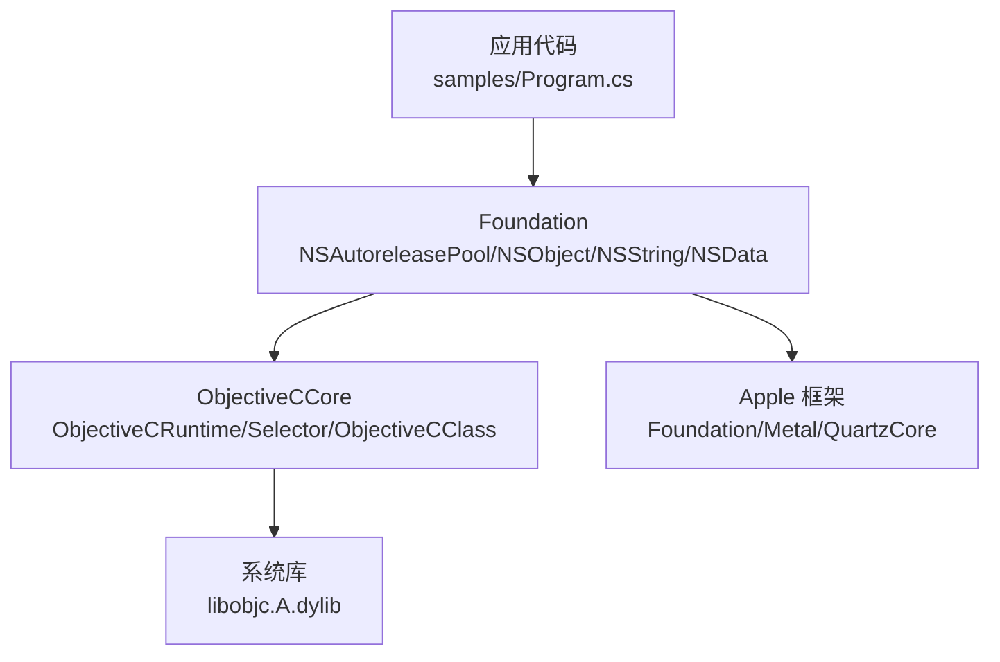
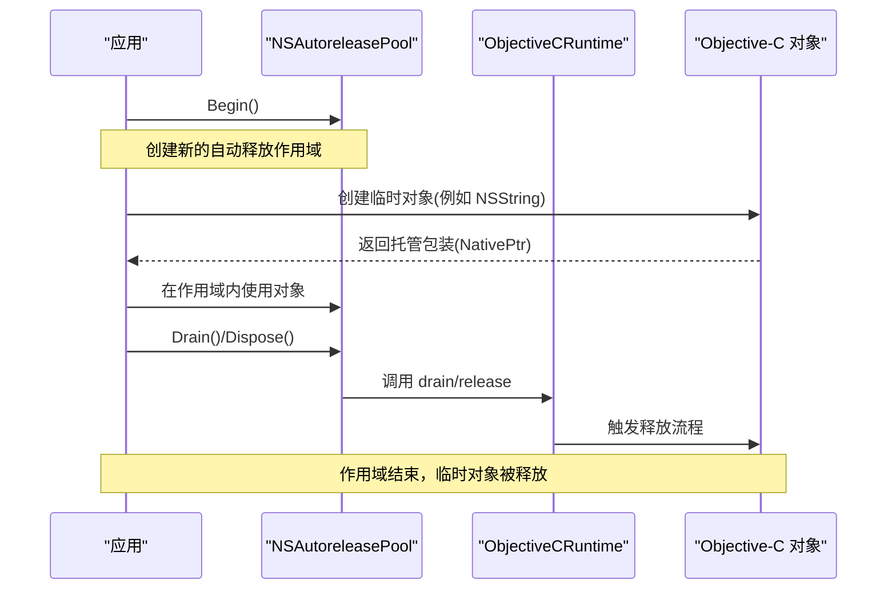
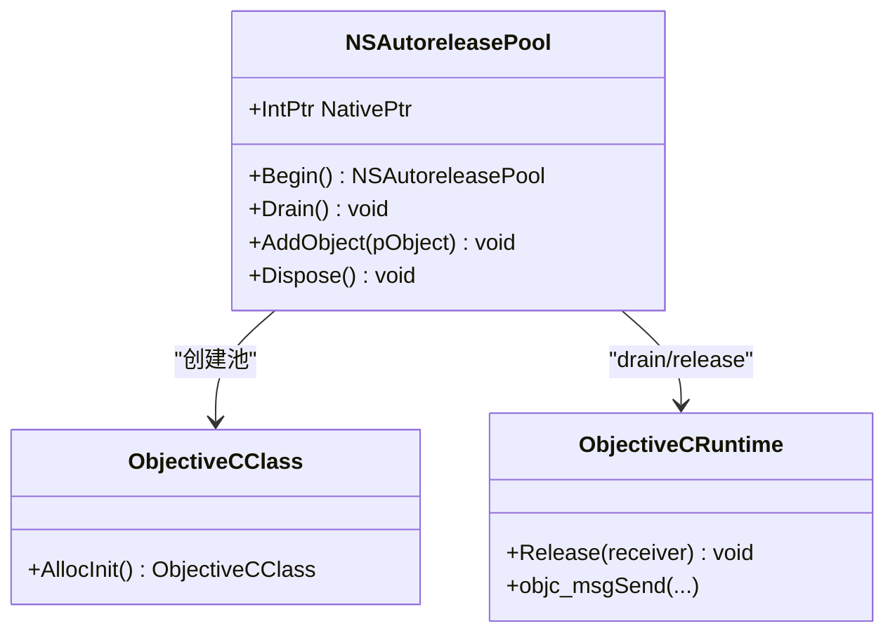
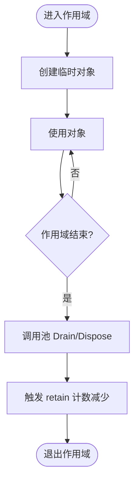
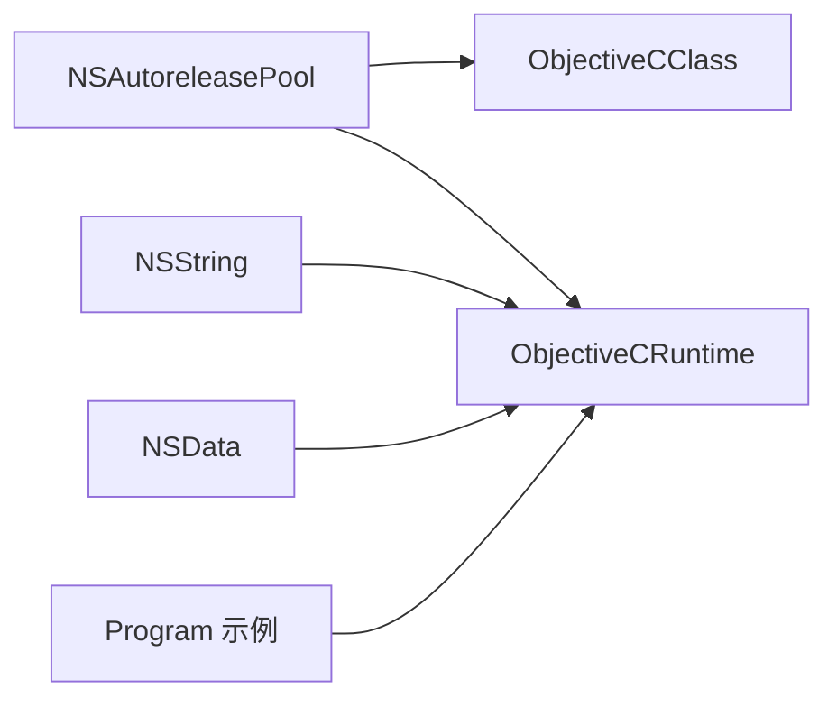

# 内存管理

<cite>
**本文引用的文件**
- [NSAutoreleasePool.cs](file://src/SharpMetal/Foundation/NSAutoreleasePool.cs)
- [NSObject.cs](file://src/SharpMetal/Foundation/NSObject.cs)
- [ObjectiveCRuntime.cs](file://src/SharpMetal/ObjectiveCCore/ObjectiveCRuntime.cs)
- [ObjectiveCClass.cs](file://src/SharpMetal/ObjectiveCCore/ObjectiveCClass.cs)
- [Selector.cs](file://src/SharpMetal/ObjectiveCCore/Selector.cs)
- [NSString.cs](file://src/SharpMetal/Foundation/NSString.cs)
- [NSData.cs](file://src/SharpMetal/Foundation/NSData.cs)
- [Program.cs](file://samples/SharpMetal.Sample/Program.cs)
</cite>

## 目录
1. [简介](#简介)
2. [项目结构](#项目结构)
3. [核心组件](#核心组件)
4. [架构总览](#架构总览)
5. [详细组件分析](#详细组件分析)
6. [依赖关系分析](#依赖关系分析)
7. [性能考量](#性能考量)
8. [故障排查指南](#故障排查指南)
9. [结论](#结论)
10. [附录](#附录)

## 简介
本文件面向使用 SharpMetal 的开发者，系统性说明 Foundation 层的内存管理机制，重点围绕 NSAutoreleasePool 自动释放池的工作原理、与 Objective-C 运行时 retain/release 的交互、长生命周期对象中的正确用法，以及循环引用检测与内存监控的实践建议。文档同时提供基于仓库代码的示例路径与优化建议，帮助你在 .NET 环境中安全、高效地管理 Objective-C/Foundation/Metal 资源。

## 项目结构
SharpMetal 将 Objective-C 运行时桥接与 Apple 框架绑定分层组织：
- ObjectiveCCore：封装 libobjc 调用（消息发送、类/选择器、retain/release）。
- Foundation：对 NSObject、NSString、NSData、NSAutoreleasePool 等基础类型进行托管包装。
- Metal/QuartzCore/MetalFX：GPU 与图形相关的高层绑定。
- samples：可运行示例，展示资源分配与释放的正确模式。

图表来源
- [Program.cs:21-45](file://samples/SharpMetal.Sample/Program.cs#L21-L45)
- [NSAutoreleasePool.cs:5-39](file://src/SharpMetal/Foundation/NSAutoreleasePool.cs#L5-L39)
- [ObjectiveCRuntime.cs:33-800](file://src/SharpMetal/ObjectiveCCore/ObjectiveCRuntime.cs#L33-L800)

章节来源
- [README.md:1-23](file://README.md#L1-L23)

## 核心组件
- NSAutoreleasePool：自动释放池的托管包装，提供 Begin()、Drain()、AddObject()、Dispose() 等方法，底层通过 Objective-C 消息驱动。
- ObjectiveCRuntime：统一封装 objc_msgSend、Retain、Release、GetRetainCount 等运行时能力。
- ObjectiveCClass：提供 Alloc/AllocInit 等工厂方法，用于创建 Objective-C 对象。
- Selector：封装选择器名称到 SEL 指针的转换。
- NSObject/NSString/NSData：Foundation 基础类型的托管包装，持有 NativePtr 并暴露常用 API。

章节来源
- [NSAutoreleasePool.cs:5-39](file://src/SharpMetal/Foundation/NSAutoreleasePool.cs#L5-L39)
- [ObjectiveCRuntime.cs:769-782](file://src/SharpMetal/ObjectiveCCore/ObjectiveCRuntime.cs#L769-L782)
- [ObjectiveCClass.cs:54-78](file://src/SharpMetal/ObjectiveCCore/ObjectiveCClass.cs#L54-L78)
- [Selector.cs:5-43](file://src/SharpMetal/ObjectiveCCore/Selector.cs#L5-L43)
- [NSObject.cs:48-90](file://src/SharpMetal/Foundation/NSObject.cs#L48-L90)
- [NSString.cs:64-186](file://src/SharpMetal/Foundation/NSString.cs#L64-L186)
- [NSData.cs:5-20](file://src/SharpMetal/Foundation/NSData.cs#L5-L20)

## 架构总览
SharpMetal 的内存管理以“显式所有权”为核心原则：所有原生资源由托管侧显式负责生命周期。自动释放池作为辅助机制，用于批量延迟释放短期对象；而关键资源（如 Metal 设备、缓冲区）需显式 Release。

图表来源
- [NSAutoreleasePool.cs:11-26](file://src/SharpMetal/Foundation/NSAutoreleasePool.cs#L11-L26)
- [ObjectiveCRuntime.cs:769-782](file://src/SharpMetal/ObjectiveCCore/ObjectiveCRuntime.cs#L769-L782)

## 详细组件分析

### NSAutoreleasePool 自动释放池
- 职责：封装 Objective-C 自动释放池的生命周期，支持 Begin() 创建新池、Drain() 清空池、AddObject() 手动加入对象、Dispose() 释放池本身。
- 关键点：
  - Begin() 通过 ObjectiveCClass.AllocInit 创建底层池对象。
  - Drain() 通过 objc_msgSend 调用 drain 选择器。
  - Dispose() 调用 Release 释放池句柄。
  - AddObject() 允许将特定对象加入当前池，便于细粒度控制。

图表来源
- [NSAutoreleasePool.cs:5-39](file://src/SharpMetal/Foundation/NSAutoreleasePool.cs#L5-L39)
- [ObjectiveCClass.cs:60-65](file://src/SharpMetal/ObjectiveCCore/ObjectiveCClass.cs#L60-L65)
- [ObjectiveCRuntime.cs:769-782](file://src/SharpMetal/ObjectiveCCore/ObjectiveCRuntime.cs#L769-L782)

章节来源
- [NSAutoreleasePool.cs:5-39](file://src/SharpMetal/Foundation/NSAutoreleasePool.cs#L5-L39)

### Objective-C 运行时与 retain/release
- ObjectiveCRuntime 提供 Retain、Release、GetRetainCount 等基础能力，并通过 objc_msgSend 调用各种选择器。
- 这些方法是 Foundation 与 Metal 资源管理的基石，确保跨语言边界的安全释放。

图表来源
- [ObjectiveCRuntime.cs:769-782](file://src/SharpMetal/ObjectiveCCore/ObjectiveCRuntime.cs#L769-L782)
- [NSAutoreleasePool.cs:13-26](file://src/SharpMetal/Foundation/NSAutoreleasePool.cs#L13-L26)

章节来源
- [ObjectiveCRuntime.cs:769-782](file://src/SharpMetal/ObjectiveCCore/ObjectiveCRuntime.cs#L769-L782)

### 基础类型与内存语义
- NSObject：提供 Hash、Description、IsEqual、RespondsToSelector 等基础能力，所有 Foundation 对象均继承自它。
- NSString：字符串构造与访问，内部通过 ObjectiveCClass.Alloc 和 initWithCharacters 初始化，注意其返回的托管包装需要遵循池或显式释放策略。
- NSData：数据缓冲访问，Bytes/MutableBytes/Length 等属性通过消息获取。

章节来源
- [NSObject.cs:48-90](file://src/SharpMetal/Foundation/NSObject.cs#L48-L90)
- [NSString.cs:64-186](file://src/SharpMetal/Foundation/NSString.cs#L64-L186)
- [NSData.cs:5-20](file://src/SharpMetal/Foundation/NSData.cs#L5-L20)

### 长生命周期对象的自动释放池使用模式
- 问题：在长时间运行的任务中，若大量创建临时对象而不及时释放，可能导致内存峰值升高甚至泄漏。
- 方案：在每个工作批次或回调中使用 NSAutoreleasePool.Begin() 创建作用域，并在结束时调用 Drain()/Dispose()，使该作用域内的临时对象得到集中释放。
- 实践要点：
  - 将池的作用域限定在最小必要范围，避免过早或过晚释放。
  - 对于非临时对象（如 Metal 设备、缓冲区），仍需显式 Release，不依赖自动释放池。
  - 结合异常处理，确保 finally 块中释放资源。

章节来源
- [NSAutoreleasePool.cs:11-26](file://src/SharpMetal/Foundation/NSAutoreleasePool.cs#L11-L26)
- [Program.cs:21-45](file://samples/SharpMetal.Sample/Program.cs#L21-L45)

### 内存分配、释放与垃圾回收的交互
- 托管侧：.NET GC 管理托管堆上的对象；但 SharpMetal 中的 NativePtr 指向的是 Objective-C/Foundation/Metal 原生资源，不受 .NET GC 直接管理。
- 原生侧：Objective-C 使用 retain/release 计数管理生命周期；自动释放池在作用域结束时批量减少 retain 计数。
- 交互点：
  - 通过 ObjectiveCRuntime.Retain/Release 显式控制原生对象生命周期。
  - 通过 NSAutoreleasePool.Drain/Dispose 触发池的释放逻辑。
  - 对于 Metal 等资源，应在 finally 中显式 Release，避免泄漏。

章节来源
- [ObjectiveCRuntime.cs:769-782](file://src/SharpMetal/ObjectiveCCore/ObjectiveCRuntime.cs#L769-L782)
- [NSAutoreleasePool.cs:13-26](file://src/SharpMetal/Foundation/NSAutoreleasePool.cs#L13-L26)
- [Program.cs:41-45](file://samples/SharpMetal.Sample/Program.cs#L41-L45)

## 依赖关系分析
- NSAutoreleasePool 依赖 ObjectiveCClass 创建池实例，依赖 ObjectiveCRuntime 执行 drain/release。
- NSObject/NSString/NSData 依赖 ObjectiveCRuntime 进行消息发送与属性访问。
- 示例 Program 展示了在 finally 中显式 Release 的模式，体现“显式所有权”的设计原则。

图表来源
- [NSAutoreleasePool.cs:11-26](file://src/SharpMetal/Foundation/NSAutoreleasePool.cs#L11-L26)
- [ObjectiveCClass.cs:60-65](file://src/SharpMetal/ObjectiveCCore/ObjectiveCClass.cs#L60-L65)
- [ObjectiveCRuntime.cs:769-782](file://src/SharpMetal/ObjectiveCCore/ObjectiveCRuntime.cs#L769-L782)
- [NSString.cs:64-186](file://src/SharpMetal/Foundation/NSString.cs#L64-L186)
- [NSData.cs:5-20](file://src/SharpMetal/Foundation/NSData.cs#L5-L20)
- [Program.cs:21-45](file://samples/SharpMetal.Sample/Program.cs#L21-L45)

章节来源
- [NSAutoreleasePool.cs:5-39](file://src/SharpMetal/Foundation/NSAutoreleasePool.cs#L5-L39)
- [ObjectiveCClass.cs:54-78](file://src/SharpMetal/ObjectiveCCore/ObjectiveCClass.cs#L54-L78)
- [ObjectiveCRuntime.cs:33-800](file://src/SharpMetal/ObjectiveCCore/ObjectiveCRuntime.cs#L33-L800)
- [NSString.cs:64-186](file://src/SharpMetal/Foundation/NSString.cs#L64-L186)
- [NSData.cs:5-20](file://src/SharpMetal/Foundation/NSData.cs#L5-L20)
- [Program.cs:21-45](file://samples/SharpMetal.Sample/Program.cs#L21-L45)

## 性能考量
- 合理使用自动释放池：在高频分配场景（如渲染循环、批处理）中，使用 NSAutoreleasePool 包裹短生命周期对象，降低峰值内存与频繁释放开销。
- 避免过度嵌套：多层池嵌套会增加调度复杂度，尽量保持单一清晰的作用域。
- 显式释放关键资源：Metal 设备、缓冲区、命令队列等应始终在 finally 中显式 Release，不依赖自动释放池。
- 减少不必要的字符串/数据拷贝：NSString/NSData 的构造与访问应尽量复用已有对象，避免重复分配。
- 监控 retain 计数：在调试阶段可使用 GetRetainCount 检查对象是否被意外持有，定位潜在泄漏。

[本节为通用指导，不直接分析具体文件]

## 故障排查指南
- 症状：内存持续增长或崩溃。
- 可能原因：
  - 未使用自动释放池导致临时对象堆积。
  - 关键资源未在 finally 中显式 Release。
  - 循环引用导致 retain 计数无法归零。
- 排查步骤：
  - 确认每个工作批次都使用 NSAutoreleasePool.Begin()/Drain()。
  - 在 finally 中调用 ObjectiveCRuntime.Release 释放 Metal/设备资源。
  - 使用 GetRetainCount 检查可疑对象的引用计数变化。
  - 检查是否有强引用链未断开（如委托、回调闭包持有对象）。

章节来源
- [NSAutoreleasePool.cs:11-26](file://src/SharpMetal/Foundation/NSAutoreleasePool.cs#L11-L26)
- [ObjectiveCRuntime.cs:769-782](file://src/SharpMetal/ObjectiveCCore/ObjectiveCRuntime.cs#L769-L782)
- [Program.cs:41-45](file://samples/SharpMetal.Sample/Program.cs#L41-L45)

## 结论
SharpMetal 采用“显式所有权”的内存管理模式，结合 NSAutoreleasePool 的自动释放机制，既保证了高性能又提供了可控的资源生命周期。对于长生命周期对象与关键资源，务必显式 Release；对于短期临时对象，合理使用自动释放池可有效避免内存泄漏与峰值压力。配合循环引用检测与 retain 计数监控，可在复杂场景中稳定运行。

[本节为总结性内容，不直接分析具体文件]

## 附录
- 示例参考：
  - 自动释放池作用域：参考 NSAutoreleasePool 的 Begin/Dra in/Dispose 用法。
  - 显式释放模式：参考 Program.cs 中 finally 块的 Release 调用。
- 最佳实践清单：
  - 使用 using/try-finally 确保资源释放。
  - 在高频分配处使用自动释放池。
  - 避免在回调中持有强引用形成循环。
  - 定期使用 GetRetainCount 验证对象生命周期。

章节来源
- [NSAutoreleasePool.cs:11-26](file://src/SharpMetal/Foundation/NSAutoreleasePool.cs#L11-L26)
- [Program.cs:41-45](file://samples/SharpMetal.Sample/Program.cs#L41-L45)