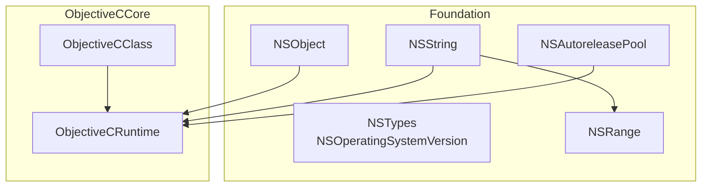
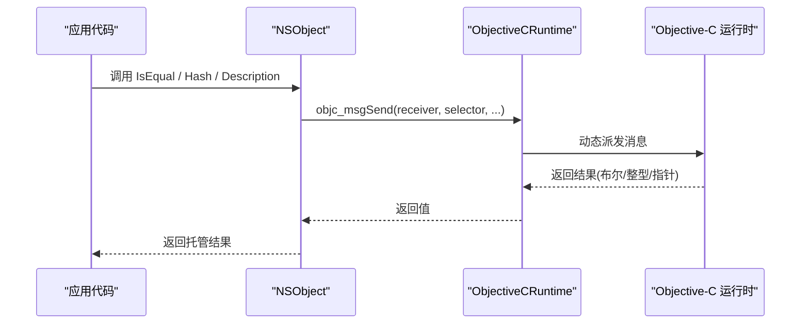
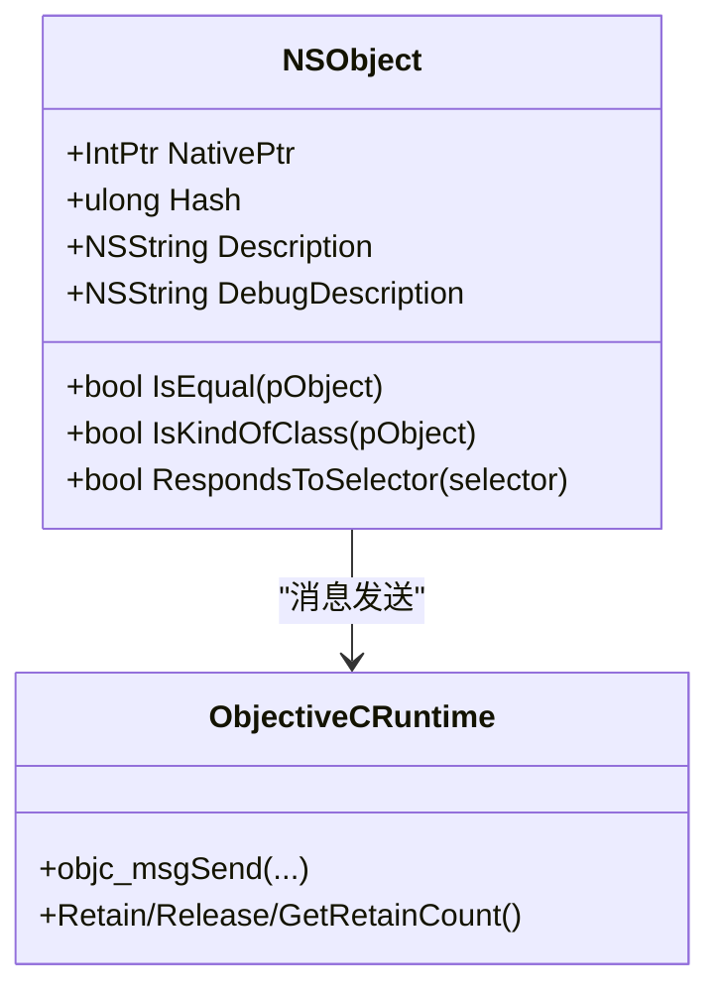
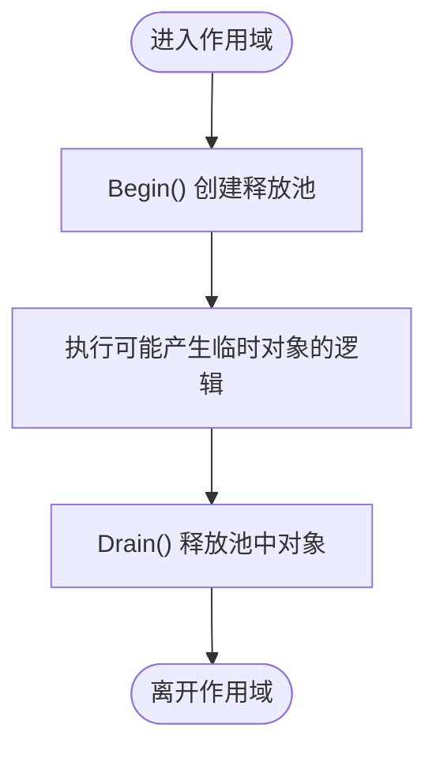
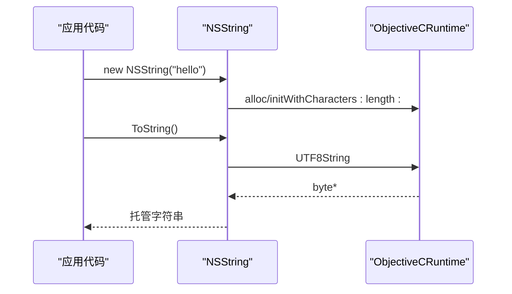
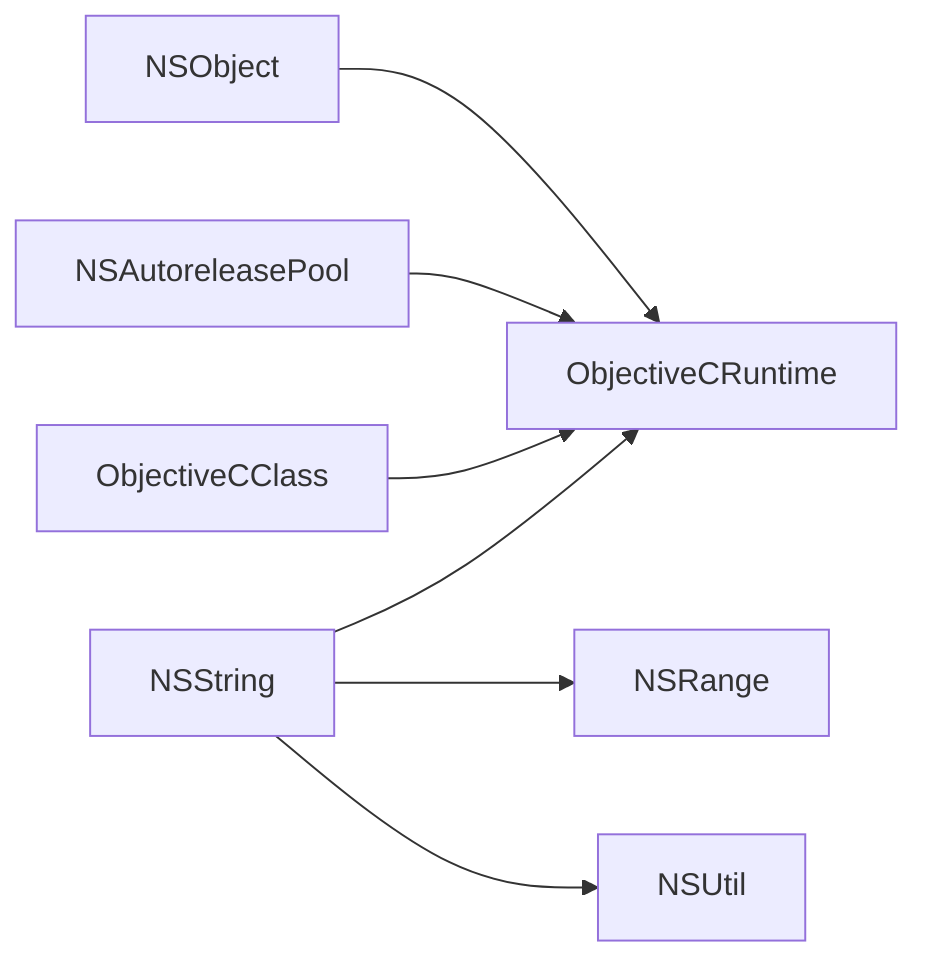

# 基础对象系统

<cite>
**本文引用的文件**
- [NSObject.cs](file://src/SharpMetal/Foundation/NSObject.cs)
- [NSTypes.cs](file://src/SharpMetal/Foundation/NSTypes.cs)
- [NSString.cs](file://src/SharpMetal/Foundation/NSString.cs)
- [NSAutoreleasePool.cs](file://src/SharpMetal/Foundation/NSAutoreleasePool.cs)
- [ObjectiveCRuntime.cs](file://src/SharpMetal/ObjectiveCCore/ObjectiveCRuntime.cs)
- [ObjectiveCClass.cs](file://src/SharpMetal/ObjectiveCCore/ObjectiveCClass.cs)
</cite>

## 目录
1. [简介](#简介)
2. [项目结构](#项目结构)
3. [核心组件](#核心组件)
4. [架构总览](#架构总览)
5. [详细组件分析](#详细组件分析)
6. [依赖关系分析](#依赖关系分析)
7. [性能注意事项](#性能注意事项)
8. [故障排查指南](#故障排查指南)
9. [结论](#结论)
10. [附录](#附录)

## 简介
本文件面向在 C# 中使用 SharpMetal 的 Foundation 基础对象系统的开发者，系统性说明 NSObject 基类的设计模式与核心能力：NativePtr 指针管理、内存生命周期控制、类型检查与比较操作；并详细说明 NSComparisonResult 排序结果、NS_NS_EXPORT/NSCopying/NSSecureCoding 结构体的用途与转换机制；同时记录 NSUtil 工具类的字符串处理方法。文档提供完整的类型定义、方法签名、参数说明与使用示例路径，帮助你在 C# 中正确、安全地使用这些基础对象类型。

## 项目结构
Foundation 层围绕 Objective-C 运行时进行桥接，核心由 NSObject 及其相关类型构成，并通过 ObjectiveCCore 提供的运行时封装完成消息发送、类查找、内存管理等底层操作。

图表来源
- [NSObject.cs:48-90](file://src/SharpMetal/Foundation/NSObject.cs#L48-L90)
- [NSString.cs:64-186](file://src/SharpMetal/Foundation/NSString.cs#L64-L186)
- [NSAutoreleasePool.cs:5-39](file://src/SharpMetal/Foundation/NSAutoreleasePool.cs#L5-L39)
- [NSTypes.cs:5-11](file://src/SharpMetal/Foundation/NSTypes.cs#L5-L11)
- [ObjectiveCRuntime.cs:33-800](file://src/SharpMetal/ObjectiveCCore/ObjectiveCRuntime.cs#L33-L800)
- [ObjectiveCClass.cs:18-87](file://src/SharpMetal/ObjectiveCCore/ObjectiveCClass.cs#L18-L87)

章节来源
- [NSObject.cs:1-92](file://src/SharpMetal/Foundation/NSObject.cs#L1-L92)
- [NSString.cs:1-188](file://src/SharpMetal/Foundation/NSString.cs#L1-L188)
- [NSAutoreleasePool.cs:1-41](file://src/SharpMetal/Foundation/NSAutoreleasePool.cs#L1-L41)
- [NSTypes.cs:1-13](file://src/SharpMetal/Foundation/NSTypes.cs#L1-L13)
- [ObjectiveCRuntime.cs:1-839](file://src/SharpMetal/ObjectiveCCore/ObjectiveCRuntime.cs#L1-L839)
- [ObjectiveCClass.cs:1-89](file://src/SharpMetal/ObjectiveCCore/ObjectiveCClass.cs#L1-L89)

## 核心组件
- NSObject：Foundation 对象的基元，持有 NativePtr，暴露哈希、描述、相等性、类型检查、选择器响应等能力。
- NSString：字符串封装，提供构造、编码转换、长度、字符访问、子串范围、拼接、比较等方法。
- NSAutoreleasePool：自动释放池，用于批量释放临时对象，支持 Begin/Drain/AddObject/Dispose。
- ObjectiveCRuntime：Objective-C 运行时封装，提供 objc_msgSend 的各种重载、Retain/Release/retainCount、类/方法/属性查询等。
- ObjectiveCClass：对 Objective-C 类的轻量封装，提供 Alloc/AllocInit/获取类名/方法列表等。
- NSTypes/NSRange：基础值类型与 NSRange 结构体，用于跨语言传递范围信息。

章节来源
- [NSObject.cs:6-90](file://src/SharpMetal/Foundation/NSObject.cs#L6-L90)
- [NSString.cs:6-186](file://src/SharpMetal/Foundation/NSString.cs#L6-L186)
- [NSAutoreleasePool.cs:5-39](file://src/SharpMetal/Foundation/NSAutoreleasePool.cs#L5-L39)
- [ObjectiveCRuntime.cs:33-800](file://src/SharpMetal/ObjectiveCCore/ObjectiveCRuntime.cs#L33-L800)
- [ObjectiveCClass.cs:18-87](file://src/SharpMetal/ObjectiveCCore/ObjectiveCClass.cs#L18-L87)
- [NSTypes.cs:5-11](file://src/SharpMetal/Foundation/NSTypes.cs#L5-L11)
- [NSRange.cs:5-10](file://src/SharpMetal/Foundation/NSRange.cs#L5-L10)

## 架构总览
Foundation 通过 ObjectiveCCore 与 Objective-C 运行时交互。所有托管类型以 struct 形式存在，内部仅包含一个 NativePtr，配合隐式转换简化调用。NSObject 作为基元，统一了哈希、描述、相等性、类型检查等行为；NSString 在其之上实现字符串语义；NSAutoreleasePool 负责生命周期管理。

图表来源
- [NSObject.cs:54-79](file://src/SharpMetal/Foundation/NSObject.cs#L54-L79)
- [ObjectiveCRuntime.cs:118-141](file://src/SharpMetal/ObjectiveCCore/ObjectiveCRuntime.cs#L118-L141)

## 详细组件分析

### NSObject 基类
- 设计要点
  - 以 struct 承载 NativePtr，并提供隐式转换为 IntPtr，便于与运行时互操作。
  - 暴露 Hash、Description、DebugDescription、IsEqual、IsKindOfClass、RespondsToSelector 等常用能力。
  - 通过 ObjectiveCRuntime 的消息发送接口与 Objective-C 对象交互。
- 关键成员
  - NativePtr：指向底层 Objective-C 对象的指针。
  - Hash：调用 hash 选择器，返回 ulong。
  - Description/DebugDescription：返回 NSString，用于调试输出。
  - IsEqual(in NSObject pObject)：调用 isEqual: 进行相等性判断。
  - IsKindOfClass(in IntPtr pObject)：调用 isKindOfClass: 进行类型检查。
  - RespondsToSelector(in Selector selector)：调用 respondsToSelector: 检查是否响应某选择器。
- 内存与生命周期
  - NSObject 本身不持有所有权，需结合 NSAutoreleasePool 或显式 Retain/Release 管理。
- 使用示例（路径）
  - 创建与销毁：[NSObject.cs:48-90](file://src/SharpMetal/Foundation/NSObject.cs#L48-L90)
  - 类型检查与比较：[NSObject.cs:60-79](file://src/SharpMetal/Foundation/NSObject.cs#L60-L79)

图表来源
- [NSObject.cs:48-90](file://src/SharpMetal/Foundation/NSObject.cs#L48-L90)
- [ObjectiveCRuntime.cs:769-782](file://src/SharpMetal/ObjectiveCCore/ObjectiveCRuntime.cs#L769-L782)

章节来源
- [NSObject.cs:6-90](file://src/SharpMetal/Foundation/NSObject.cs#L6-L90)

### NSComparisonResult 枚举
- 含义
  - OrderedAscending：小于（升序时前者较小）。
  - OrderedSame：等于。
  - OrderedDescending：大于（降序时前者较大）。
- 典型用法
  - 字符串比较、集合排序回调等场景，返回该枚举指示相对顺序。
- 使用示例（路径）
  - 字符串大小写不敏感比较：[NSString.cs:160-163](file://src/SharpMetal/Foundation/NSString.cs#L160-L163)

章节来源
- [NSObject.cs:6-11](file://src/SharpMetal/Foundation/NSObject.cs#L6-L11)
- [NSString.cs:160-163](file://src/SharpMetal/Foundation/NSString.cs#L160-L163)

### NS_NS_EXPORT、NSCopying、NSSecureCoding 结构体
- 用途
  - 作为“协议”标记的轻量包装，内部仅包含 NativePtr 与隐式到 IntPtr 的转换，便于将实现了相应协议的 Objective-C 对象传入需要这些“协议句柄”的方法。
- 转换机制
  - 提供构造函数从 IntPtr 构造，以及隐式 operator 将结构体转为 IntPtr，方便与运行时 API 无缝对接。
- 使用示例（路径）
  - 结构体定义与转换：[NSObject.cs:13-32](file://src/SharpMetal/Foundation/NSObject.cs#L13-L32)

章节来源
- [NSObject.cs:13-32](file://src/SharpMetal/Foundation/NSObject.cs#L13-L32)

### NSAutoreleasePool 自动释放池
- 职责
  - 管理一组对象的自动释放生命周期，常用于短期作用域内减少手动 Release 的负担。
- 关键成员
  - Begin()：创建并返回一个自动释放池实例。
  - Drain()：释放池中对象（通常与 using 或 finally 搭配）。
  - AddObject(NSObject)：将对象加入池管理。
  - Dispose()：释放池自身引用。
- 使用建议
  - 在频繁创建临时对象的循环或方法中，使用 Begin/Drain 包裹以减少峰值内存。
- 使用示例（路径）
  - 生命周期管理：[NSAutoreleasePool.cs:5-39](file://src/SharpMetal/Foundation/NSAutoreleasePool.cs#L5-L39)

图表来源
- [NSAutoreleasePool.cs:11-26](file://src/SharpMetal/Foundation/NSAutoreleasePool.cs#L11-L26)

章节来源
- [NSAutoreleasePool.cs:5-39](file://src/SharpMetal/Foundation/NSAutoreleasePool.cs#L5-L39)

### NSString 字符串
- 设计要点
  - 以 struct 承载 NativePtr，提供多种构造方式（从 string、UTF-8/UTF-16/UTF-32 编码、字节缓冲等）。
  - 提供长度、字符访问、编码转换、范围查找、拼接、比较等操作。
- 关键成员
  - 构造：NSString(string)、NSString(IntPtr)、String(...静态工厂)。
  - 访问：Length、Character(index)、Utf8String、FileSystemRepresentation。
  - 转换：CString(encoding)、MaximumLengthOfBytes/LengthOfBytes(encoding)。
  - 比较与搜索：IsEqualToString、RangeOfString(options)、CaseInsensitiveCompare。
  - 拼接：StringByAppendingString。
- 使用示例（路径）
  - 构造与 ToString：[NSString.cs:71-98](file://src/SharpMetal/Foundation/NSString.cs#L71-L98)
  - 编码与字节长度：[NSString.cs:130-143](file://src/SharpMetal/Foundation/NSString.cs#L130-L143)
  - 比较与范围：[NSString.cs:145-163](file://src/SharpMetal/Foundation/NSString.cs#L145-L163)

图表来源
- [NSString.cs:71-98](file://src/SharpMetal/Foundation/NSString.cs#L71-L98)
- [ObjectiveCRuntime.cs:118-141](file://src/SharpMetal/ObjectiveCCore/ObjectiveCRuntime.cs#L118-L141)

章节来源
- [NSString.cs:6-186](file://src/SharpMetal/Foundation/NSString.cs#L6-L186)

### NSUtil 工具类
- 职责
  - 提供从 UTF-8 字节指针构建托管字符串的高效方法。
- 关键成员
  - GetUtf8String(byte* stringStart)：扫描空终止符，使用 Encoding.UTF8 解码为托管字符串。
- 使用示例（路径）
  - 字符串解码：[NSObject.cs:34-46](file://src/SharpMetal/Foundation/NSObject.cs#L34-L46)

章节来源
- [NSObject.cs:34-46](file://src/SharpMetal/Foundation/NSObject.cs#L34-L46)

### ObjectiveCClass 与 ObjectiveCRuntime 辅助
- ObjectiveCClass
  - 提供 Alloc/AllocInit/Alloc<T>/AllocInit<T> 等便捷方法，简化对象创建流程。
  - 可获取类名、属性与方法列表。
- ObjectiveCRuntime
  - 提供大量 objc_msgSend 重载，覆盖不同参数与返回类型。
  - 提供 Retain/Release/GetRetainCount 等内存管理原语。
- 使用示例（路径）
  - 类分配与初始化：[ObjectiveCClass.cs:54-78](file://src/SharpMetal/ObjectiveCCore/ObjectiveCClass.cs#L54-L78)
  - 内存管理原语：[ObjectiveCRuntime.cs:769-782](file://src/SharpMetal/ObjectiveCCore/ObjectiveCRuntime.cs#L769-L782)

章节来源
- [ObjectiveCClass.cs:18-87](file://src/SharpMetal/ObjectiveCCore/ObjectiveCClass.cs#L18-L87)
- [ObjectiveCRuntime.cs:33-800](file://src/SharpMetal/ObjectiveCCore/ObjectiveCRuntime.cs#L33-L800)

## 依赖关系分析
- 耦合关系
  - NSObject/NSString/NSAutoreleasePool 均依赖 ObjectiveCRuntime 进行消息发送与内存管理。
  - NSString 依赖 NSRange 表示范围，依赖 NSUtil 进行 UTF-8 解码。
  - ObjectiveCClass 依赖 ObjectiveCRuntime 进行类与方法的底层访问。
- 外部依赖
  - 直接链接 Objective-C 运行时库（libobjc.A.dylib），通过 LibraryImport 调用原生函数。
- 潜在风险
  - 未正确使用 NSAutoreleasePool 可能导致内存泄漏或过早释放。
  - 错误使用编码或越界访问 NSRange 会导致崩溃或数据损坏。

图表来源
- [NSObject.cs:48-90](file://src/SharpMetal/Foundation/NSObject.cs#L48-L90)
- [NSString.cs:64-186](file://src/SharpMetal/Foundation/NSString.cs#L64-L186)
- [NSAutoreleasePool.cs:5-39](file://src/SharpMetal/Foundation/NSAutoreleasePool.cs#L5-L39)
- [ObjectiveCClass.cs:18-87](file://src/SharpMetal/ObjectiveCCore/ObjectiveCClass.cs#L18-L87)
- [ObjectiveCRuntime.cs:33-800](file://src/SharpMetal/ObjectiveCCore/ObjectiveCRuntime.cs#L33-L800)

章节来源
- [NSObject.cs:48-90](file://src/SharpMetal/Foundation/NSObject.cs#L48-L90)
- [NSString.cs:64-186](file://src/SharpMetal/Foundation/NSString.cs#L64-L186)
- [NSAutoreleasePool.cs:5-39](file://src/SharpMetal/Foundation/NSAutoreleasePool.cs#L5-L39)
- [ObjectiveCClass.cs:18-87](file://src/SharpMetal/ObjectiveCCore/ObjectiveCClass.cs#L18-L87)
- [ObjectiveCRuntime.cs:33-800](file://src/SharpMetal/ObjectiveCCore/ObjectiveCRuntime.cs#L33-L800)

## 性能注意事项
- 避免在热路径上频繁创建 NSString 与临时对象；必要时使用 NSAutoreleasePool 包裹以减少峰值内存。
- 使用 LengthOfBytes/MaximumLengthOfBytes 预先估算缓冲区大小，避免重复计算。
- 尽量复用 ObjectiveCClass 实例，避免重复查找类。
- 谨慎使用 unsafe 指针与 byte* 转换，确保生命周期与编码正确。

## 故障排查指南
- 常见问题
  - 访问已释放对象导致崩溃：确认是否在 NSAutoreleasePool 作用域外使用了临时对象。
  - 字符串乱码或截断：检查使用的 NSStringEncoding 是否与源数据一致。
  - 类型检查失败：确认传入的类指针是否正确，且目标对象确实属于该类或其子类。
- 定位手段
  - 使用 DebugDescription 打印对象状态。
  - 使用 GetRetainCount 跟踪引用计数变化（调试阶段）。
  - 使用 RangeOfString 验证子串位置与长度。
- 参考路径
  - 自动释放池：[NSAutoreleasePool.cs:11-26](file://src/SharpMetal/Foundation/NSAutoreleasePool.cs#L11-L26)
  - 字符串编码与长度：[NSString.cs:130-143](file://src/SharpMetal/Foundation/NSString.cs#L130-L143)
  - 内存管理原语：[ObjectiveCRuntime.cs:769-782](file://src/SharpMetal/ObjectiveCCore/ObjectiveCRuntime.cs#L769-L782)

章节来源
- [NSAutoreleasePool.cs:11-26](file://src/SharpMetal/Foundation/NSAutoreleasePool.cs#L11-L26)
- [NSString.cs:130-143](file://src/SharpMetal/Foundation/NSString.cs#L130-L143)
- [ObjectiveCRuntime.cs:769-782](file://src/SharpMetal/ObjectiveCCore/ObjectiveCRuntime.cs#L769-L782)

## 结论
Foundation 基础对象系统以 NSObject 为核心，通过轻量 struct 与 ObjectiveCRuntime 的紧密协作，提供了高效的 Objective-C 对象桥接能力。借助 NSAutoreleasePool 的生命周期管理、NSString 的丰富字符串操作、以及 NSComparisonResult 的统一比较语义，开发者可以在 C# 中以接近原生的性能与安全的方式使用 Foundation 能力。遵循本文的最佳实践与排错指引，可有效避免常见陷阱并提升稳定性。

## 附录
- 类型与成员速查（路径）
  - NSComparisonResult：[NSObject.cs:6-11](file://src/SharpMetal/Foundation/NSObject.cs#L6-L11)
  - NS_NS_EXPORT/NSCopying/NSSecureCoding：[NSObject.cs:13-32](file://src/SharpMetal/Foundation/NSObject.cs#L13-L32)
  - NSObject 核心方法：[NSObject.cs:48-90](file://src/SharpMetal/Foundation/NSObject.cs#L48-L90)
  - NSString 构造与转换：[NSString.cs:71-118](file://src/SharpMetal/Foundation/NSString.cs#L71-L118)
  - NSString 比较与范围：[NSString.cs:145-163](file://src/SharpMetal/Foundation/NSString.cs#L145-L163)
  - NSAutoreleasePool 生命周期：[NSAutoreleasePool.cs:11-26](file://src/SharpMetal/Foundation/NSAutoreleasePool.cs#L11-L26)
  - ObjectiveCClass 分配与初始化：[ObjectiveCClass.cs:54-78](file://src/SharpMetal/ObjectiveCCore/ObjectiveCClass.cs#L54-L78)
  - ObjectiveCRuntime 内存管理：[ObjectiveCRuntime.cs:769-782](file://src/SharpMetal/ObjectiveCCore/ObjectiveCRuntime.cs#L769-L782)