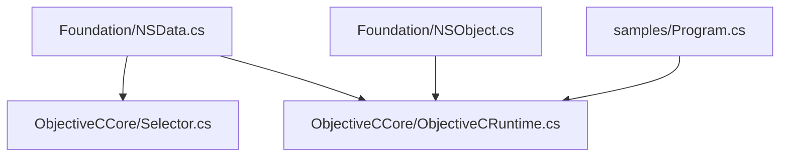
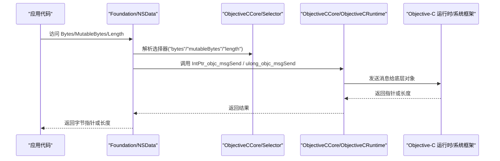
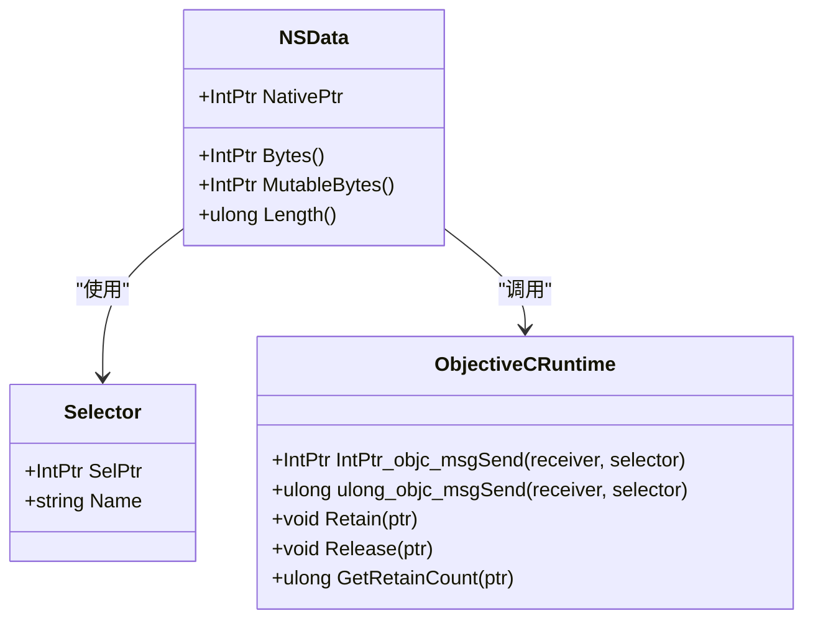
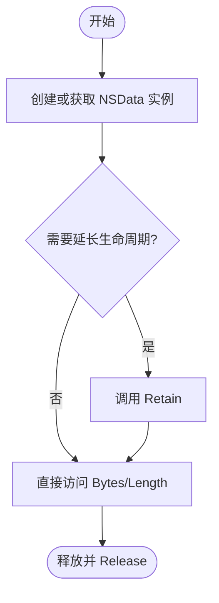
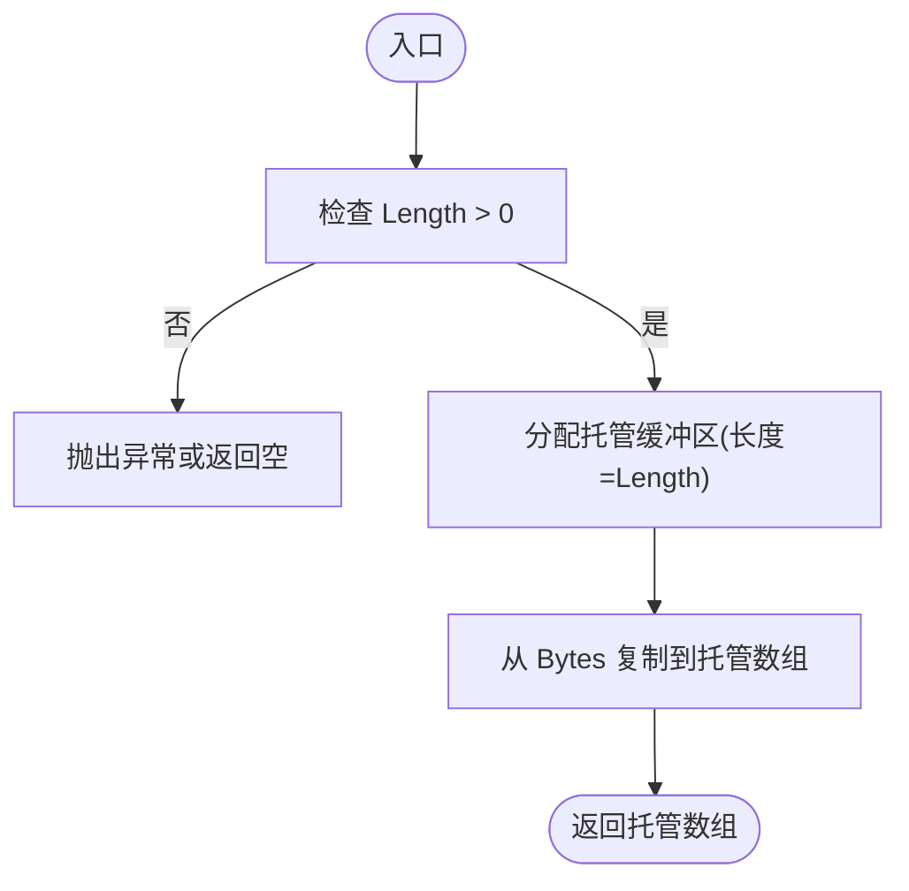
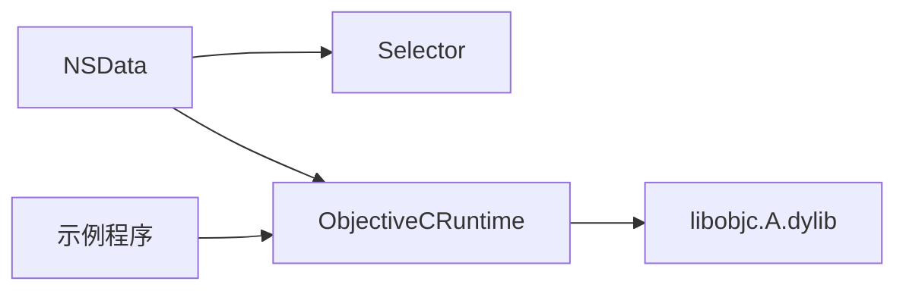

# NSData 二进制数据类型

<cite>
**本文引用的文件**
- [NSData.cs](file://src/SharpMetal/Foundation/NSData.cs)
- [ObjectiveCRuntime.cs](file://src/SharpMetal/ObjectiveCCore/ObjectiveCRuntime.cs)
- [Selector.cs](file://src/SharpMetal/ObjectiveCCore/Selector.cs)
- [NSObject.cs](file://src/SharpMetal/Foundation/NSObject.cs)
- [Program.cs](file://samples/SharpMetal.Sample/Program.cs)
</cite>

## 目录
1. [简介](#简介)
2. [项目结构](#项目结构)
3. [核心组件](#核心组件)
4. [架构总览](#架构总览)
5. [详细组件分析](#详细组件分析)
6. [依赖关系分析](#依赖关系分析)
7. [性能考虑](#性能考虑)
8. [故障排查指南](#故障排查指南)
9. [结论](#结论)
10. [附录](#附录)

## 简介
本文件为 SharpMetal 项目中 Foundation 层的 NSData 二进制数据类型的 API 文档。重点说明：
- 内存管理与所有权模型（基于 Objective-C 引用计数）
- 数据的创建、读取、写入、复制与转换方式
- 与 C# 字节数组的互操作性（从托管内存创建 NSData，以及将 NSData 转换为托管数组）
- 安全拷贝机制与内存对齐要求
- 典型使用场景（文件 I/O、网络数据传输、内存映射）及性能优化建议

注意：当前仓库中的 NSData 以“薄包装”形式存在，通过 Objective-C 运行时调用底层方法暴露基本能力。更高级的构造与生命周期管理需结合 ObjectiveC 运行时与宿主框架能力实现。

## 项目结构
与 NSData 相关的代码主要位于 Foundation 层，并通过 ObjectiveCCore 提供的运行时桥接访问 Objective-C 对象与方法。

图表来源
- [NSData.cs:5-19](file://src/SharpMetal/Foundation/NSData.cs#L5-L19)
- [Selector.cs:5-42](file://src/SharpMetal/ObjectiveCCore/Selector.cs#L5-L42)
- [ObjectiveCRuntime.cs:33-141](file://src/SharpMetal/ObjectiveCCore/ObjectiveCRuntime.cs#L33-L141)
- [NSObject.cs:48-90](file://src/SharpMetal/Foundation/NSObject.cs#L48-L90)
- [Program.cs:10-45](file://samples/SharpMetal.Sample/Program.cs#L10-L45)

章节来源
- [NSData.cs:5-19](file://src/SharpMetal/Foundation/NSData.cs#L5-L19)
- [ObjectiveCRuntime.cs:33-141](file://src/SharpMetal/ObjectiveCCore/ObjectiveCRuntime.cs#L33-L141)
- [Selector.cs:5-42](file://src/SharpMetal/ObjectiveCCore/Selector.cs#L5-L42)
- [NSObject.cs:48-90](file://src/SharpMetal/Foundation/NSObject.cs#L48-L90)
- [Program.cs:10-45](file://samples/SharpMetal.Sample/Program.cs#L10-L45)

## 核心组件
- NSData（Foundation）
  - 表示不可变二进制数据的轻量级值类型包装，内部持有原生指针
  - 提供只读访问：原始字节指针、可变字节指针（若底层支持）、长度
  - 通过 Selector 与 ObjectiveCRuntime 调用底层方法
- ObjectiveCRuntime（ObjectiveCCore）
  - 封装对 libobjc.A.dylib 的导入与消息发送
  - 提供 Retain/Release/retainCount 等引用计数操作
  - 提供多种返回值类型的 objc_msgSend 重载
- Selector（ObjectiveCCore）
  - 封装 Objective-C 选择器名称到指针的注册与获取
- NSObject（Foundation）
  - 通用基元包装，展示引用计数的常见模式（供参考）

章节来源
- [NSData.cs:5-19](file://src/SharpMetal/Foundation/NSData.cs#L5-L19)
- [ObjectiveCRuntime.cs:769-782](file://src/SharpMetal/ObjectiveCCore/ObjectiveCRuntime.cs#L769-L782)
- [Selector.cs:5-42](file://src/SharpMetal/ObjectiveCCore/Selector.cs#L5-L42)
- [NSObject.cs:48-90](file://src/SharpMetal/Foundation/NSObject.cs#L48-L90)

## 架构总览
下图展示了 NSData 在运行时的调用路径：托管代码通过 Selector 定位方法名，再经 ObjectiveCRuntime 向 Objective-C 对象发送消息，最终由系统框架完成实际的数据访问。

图表来源
- [NSData.cs:11-15](file://src/SharpMetal/Foundation/NSData.cs#L11-L15)
- [ObjectiveCRuntime.cs:124-141](file://src/SharpMetal/ObjectiveCCore/ObjectiveCRuntime.cs#L124-L141)
- [Selector.cs:20-29](file://src/SharpMetal/ObjectiveCCore/Selector.cs#L20-L29)

## 详细组件分析

### NSData 结构与成员
- NativePtr：指向底层 Objective-C 对象的指针
- Bytes：返回只读字节指针
- MutableBytes：返回可写字节指针（取决于底层对象是否可变）
- Length：返回数据长度（字节数）
- 隐式转换：可直接转换为 IntPtr，便于与原生 API 交互

图表来源
- [NSData.cs:5-19](file://src/SharpMetal/Foundation/NSData.cs#L5-L19)
- [ObjectiveCRuntime.cs:124-141](file://src/SharpMetal/ObjectiveCCore/ObjectiveCRuntime.cs#L124-L141)
- [ObjectiveCRuntime.cs:769-782](file://src/SharpMetal/ObjectiveCCore/ObjectiveCRuntime.cs#L769-L782)
- [Selector.cs:5-42](file://src/SharpMetal/ObjectiveCCore/Selector.cs#L5-L42)

章节来源
- [NSData.cs:5-19](file://src/SharpMetal/Foundation/NSData.cs#L5-L19)

### 内存管理与所有权
- 所有原生资源遵循显式所有权模型：通过 ObjectiveCRuntime.Retain/Release 管理引用计数
- 建议在创建后按需 Retain，并在不再使用时 Release，避免悬垂指针或泄漏
- 可通过 GetRetainCount 辅助诊断生命周期问题

图表来源
- [ObjectiveCRuntime.cs:769-782](file://src/SharpMetal/ObjectiveCCore/ObjectiveCRuntime.cs#L769-L782)

章节来源
- [ObjectiveCRuntime.cs:769-782](file://src/SharpMetal/ObjectiveCCore/ObjectiveCRuntime.cs#L769-L782)

### 数据读取、写入、复制与转换
- 读取：通过 Bytes 属性获取只读指针，结合 Length 进行遍历或处理
- 写入：通过 MutableBytes 获取可写指针（仅当底层对象支持可变时），按 Length 范围写入
- 复制：如需独立副本，应在托管侧分配缓冲区并从 Bytes 拷贝；或调用底层复制方法（若可用）
- 转换：
  - 从托管 byte[] 到 NSData：在托管侧分配缓冲并填充，再通过合适的构造或底层工厂创建 NSData（当前仓库未提供直接构造器，需结合运行时扩展）
  - 从 NSData 到托管 byte[]：根据 Length 分配托管数组，再从 Bytes 拷贝数据

图表来源
- [NSData.cs:11-15](file://src/SharpMetal/Foundation/NSData.cs#L11-L15)

章节来源
- [NSData.cs:11-15](file://src/SharpMetal/Foundation/NSData.cs#L11-L15)

### 与 C# 字节数组的互操作性
- 从托管内存创建 NSData：
  - 在托管侧准备 byte[] 或 Span<byte>
  - 通过合适的底层工厂或运行时方法创建 NSData（当前仓库未包含该构造器，需在运行时层扩展）
- 将 NSData 转换为托管数组：
  - 读取 Length 并分配托管数组
  - 使用 Bytes 指针进行一次性拷贝（推荐大块连续拷贝以提升性能）

章节来源
- [NSData.cs:11-15](file://src/SharpMetal/Foundation/NSData.cs#L11-L15)

### 安全拷贝机制与内存对齐
- 安全拷贝：
  - 始终先校验 Length，再进行拷贝，防止越界访问
  - 对可变数据写入前确认 MutableBytes 有效且目标范围合法
- 内存对齐：
  - 不同平台与 ABI 下结构体布局可能不同，示例中通过断言验证关键结构体大小（如 MTLSize），确保跨平台一致性
  - 对于自定义结构体或混合编组，应明确指定布局并验证尺寸

章节来源
- [Program.cs:12-15](file://samples/SharpMetal.Sample/Program.cs#L12-L15)

## 依赖关系分析
- NSData 依赖 Selector 与 ObjectiveCRuntime 以访问底层对象
- ObjectiveCRuntime 依赖 libobjc.A.dylib 的消息发送与内存管理原语
- 示例程序演示了正确的释放流程（Release）

图表来源
- [NSData.cs:11-15](file://src/SharpMetal/Foundation/NSData.cs#L11-L15)
- [ObjectiveCRuntime.cs:33-141](file://src/SharpMetal/ObjectiveCCore/ObjectiveCRuntime.cs#L33-L141)
- [Program.cs:41-45](file://samples/SharpMetal.Sample/Program.cs#L41-L45)

章节来源
- [NSData.cs:11-15](file://src/SharpMetal/Foundation/NSData.cs#L11-L15)
- [ObjectiveCRuntime.cs:33-141](file://src/SharpMetal/ObjectiveCCore/ObjectiveCRuntime.cs#L33-L141)
- [Program.cs:41-45](file://samples/SharpMetal.Sample/Program.cs#L41-L45)

## 性能考虑
- 批量拷贝优于逐字节处理：尽量使用一次性拷贝（例如从 Bytes 到托管数组）减少边界检查与函数调用开销
- 复用缓冲区：对频繁转换的场景，复用托管缓冲区以降低 GC 压力
- 避免不必要的可变性：仅在确需修改时使用 MutableBytes，否则优先只读访问
- 合理分块：大文件 I/O 或网络传输时，分块读写可降低峰值内存占用
- 对齐与零拷贝：在可能的情况下，尽量保持数据对齐并使用零拷贝策略（如直接传递指针）

[本节为通用指导，不直接分析具体文件]

## 故障排查指南
- 崩溃或访问违规：
  - 检查 Length 是否为 0，避免对空数据进行访问
  - 确认 Bytes/MutableBytes 非空后再访问
- 内存泄漏：
  - 确保每次 Retain 都有对应的 Release
  - 使用 GetRetainCount 辅助定位未释放的对象
- 平台/ABI 不匹配：
  - 在启动时验证关键结构体大小（如示例中对 MTLSize 的检查），确保托管与原生布局一致

章节来源
- [ObjectiveCRuntime.cs:769-782](file://src/SharpMetal/ObjectiveCCore/ObjectiveCRuntime.cs#L769-L782)
- [Program.cs:12-15](file://samples/SharpMetal.Sample/Program.cs#L12-L15)

## 结论
当前仓库中的 NSData 提供了对底层二进制数据的基本访问能力（指针与长度），并通过 ObjectiveCCore 实现了与 Objective-C 运行时的桥接。在实际使用中，应严格遵循显式所有权与引用计数管理，谨慎处理内存对齐与拷贝策略，以获得稳定且高性能的二进制数据处理体验。

[本节为总结性内容，不直接分析具体文件]

## 附录
- 相关类与运行时接口
  - NSData：二进制数据包装
  - Selector：选择器封装
  - ObjectiveCRuntime：运行时消息发送与内存管理
  - NSObject：基础包装与常用模式参考
- 示例程序展示了正确的资源释放流程，可作为参考

章节来源
- [NSData.cs:5-19](file://src/SharpMetal/Foundation/NSData.cs#L5-L19)
- [Selector.cs:5-42](file://src/SharpMetal/ObjectiveCCore/Selector.cs#L5-L42)
- [ObjectiveCRuntime.cs:33-141](file://src/SharpMetal/ObjectiveCCore/ObjectiveCRuntime.cs#L33-L141)
- [Program.cs:10-45](file://samples/SharpMetal.Sample/Program.cs#L10-L45)