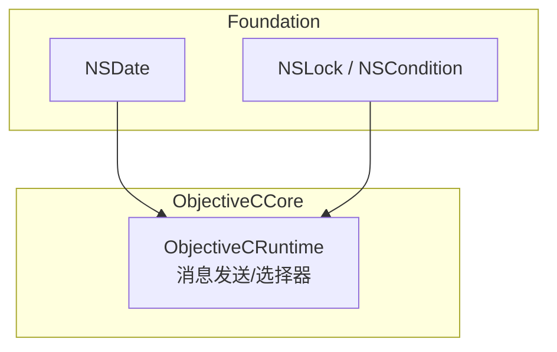
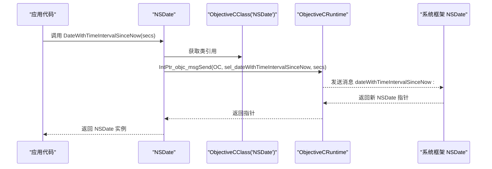
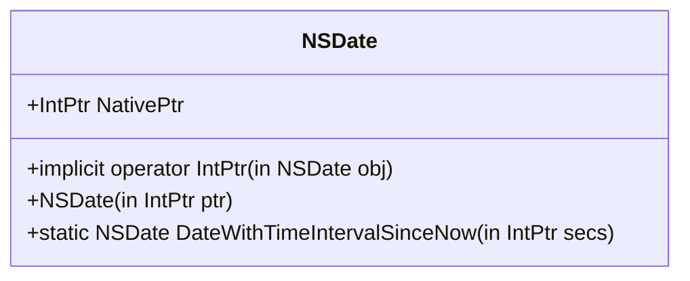
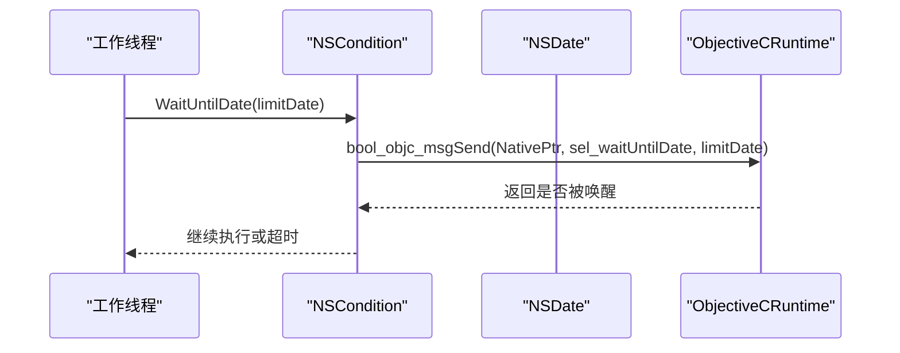
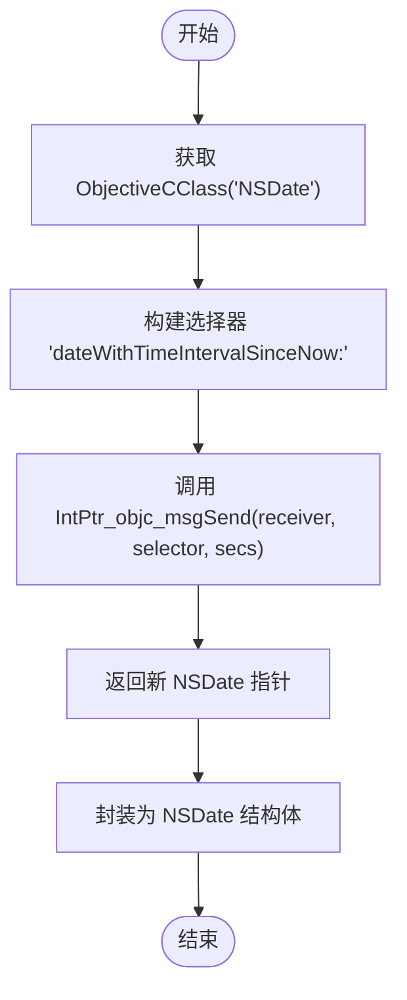
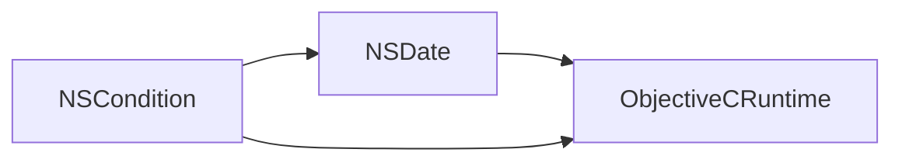

# NSDate 日期时间类型

<cite>
**本文引用的文件**
- [src/SharpMetal/Foundation/NSDate.cs](file://src/SharpMetal/Foundation/NSDate.cs)
- [src/SharpMetal/ObjectiveCCore/ObjectiveCRuntime.cs](file://src/SharpMetal/ObjectiveCCore/ObjectiveCRuntime.cs)
- [src/SharpMetal/Foundation/NSLock.cs](file://src/SharpMetal/Foundation/NSLock.cs)
- [README.md](file://README.md)
</cite>

## 目录
1. [简介](#简介)
2. [项目结构](#项目结构)
3. [核心组件](#核心组件)
4. [架构总览](#架构总览)
5. [详细组件分析](#详细组件分析)
6. [依赖关系分析](#依赖关系分析)
7. [性能考虑](#性能考虑)
8. [故障排查指南](#故障排查指南)
9. [结论](#结论)
10. [附录](#附录)

## 简介
本文件为 SharpMetal 项目中 Foundation 层的 NSDate 日期时间类型的 API 文档。内容涵盖：
- NSDate 的日期时间表示与创建方式
- 当前仓库中可用的操作方法（基于 Objective-C 运行时桥接）
- 与 NSCondition 等基础类型的交互点
- 在 C#/.NET 环境中的使用建议、性能注意事项与最佳实践
- 与 C# DateTime 的互转思路（通用指导，非直接绑定）

说明：当前仓库仅提供了 NSDate 的最小化绑定，用于通过 Objective-C 运行时调用系统框架方法。更丰富的格式化、解析、时区与日历能力通常由系统框架提供，可通过扩展 Selector 的方式进一步封装。

## 项目结构
- Foundation 层包含对 Apple 系统框架的轻量级托管包装，如 NSDate、NSLock、NSData 等。
- ObjectiveCCore 层提供与 libobjc 的互操作原语（消息发送、类查找、选择器等）。
- 示例工程展示了如何在 Apple 平台上运行 Metal 工作负载；NSDate 的使用可遵循相同模式。

图表来源
- [src/SharpMetal/Foundation/NSDate.cs:5-16](file://src/SharpMetal/Foundation/NSDate.cs#L5-L16)
- [src/SharpMetal/Foundation/NSLock.cs:12-47](file://src/SharpMetal/Foundation/NSLock.cs#L12-L47)
- [src/SharpMetal/ObjectiveCCore/ObjectiveCRuntime.cs:33-800](file://src/SharpMetal/ObjectiveCCore/ObjectiveCRuntime.cs#L33-L800)

章节来源
- [README.md:1-23](file://README.md#L1-L23)

## 核心组件
- NSDate：一个托管结构体，持有 Objective-C 对象的 NativePtr，并提供静态工厂方法以通过运行时调用系统方法创建实例。
- ObjectiveCRuntime：提供底层消息发送、选择器注册、内存管理辅助等能力，是 Foundation 类型与系统框架之间的桥梁。
- NSCondition：展示 NSDate 在等待超时场景中的使用方式（作为截止时间参数）。

章节来源
- [src/SharpMetal/Foundation/NSDate.cs:5-16](file://src/SharpMetal/Foundation/NSDate.cs#L5-L16)
- [src/SharpMetal/ObjectiveCCore/ObjectiveCRuntime.cs:33-800](file://src/SharpMetal/ObjectiveCCore/ObjectiveCRuntime.cs#L33-L800)
- [src/SharpMetal/Foundation/NSLock.cs:12-47](file://src/SharpMetal/Foundation/NSLock.cs#L12-L47)

## 架构总览
NSDate 本身不实现复杂逻辑，而是通过 ObjectiveCClass 和 Selector 将调用转发到系统框架的 NSDate 类。所有跨语言边界的数据传递均通过 ObjectiveCRuntime 完成。

图表来源
- [src/SharpMetal/Foundation/NSDate.cs:11-16](file://src/SharpMetal/Foundation/NSDate.cs#L11-L16)
- [src/SharpMetal/ObjectiveCCore/ObjectiveCRuntime.cs:118-163](file://src/SharpMetal/ObjectiveCCore/ObjectiveCRuntime.cs#L118-L163)

## 详细组件分析

### NSDate 结构与方法
- 结构体字段
  - NativePtr：指向底层 Objective-C 对象的指针。
- 隐式转换
  - 支持隐式转换为 IntPtr，便于与原生 API 互操作。
- 构造函数
  - 从 IntPtr 构造 NSDate 实例。
- 静态工厂
  - DateWithTimeIntervalSinceNow：根据自当前时间的秒数创建 NSDate 实例。内部通过 ObjectiveCClass("NSDate") 与 Selector 调用系统方法。

图表来源
- [src/SharpMetal/Foundation/NSDate.cs:5-16](file://src/SharpMetal/Foundation/NSDate.cs#L5-L16)

章节来源
- [src/SharpMetal/Foundation/NSDate.cs:5-16](file://src/SharpMetal/Foundation/NSDate.cs#L5-L16)

### 与 NSCondition 的协作（超时等待）
- NSCondition.WaitUntilDate：接受 NSDate 作为截止时间，阻塞直到信号或到达指定时间。
- 该用法体现了 NSDate 在并发控制中的典型场景：作为绝对时间点参与同步原语。

图表来源
- [src/SharpMetal/Foundation/NSLock.cs:20-28](file://src/SharpMetal/Foundation/NSLock.cs#L20-L28)
- [src/SharpMetal/ObjectiveCCore/ObjectiveCRuntime.cs:351-368](file://src/SharpMetal/ObjectiveCCore/ObjectiveCRuntime.cs#L351-L368)

章节来源
- [src/SharpMetal/Foundation/NSLock.cs:12-47](file://src/SharpMetal/Foundation/NSLock.cs#L12-L47)

### 运行时与选择器机制
- ObjectiveCClass：用于获取系统类的句柄（例如 "NSDate"）。
- Selector：字符串形式的选择器名（例如 "dateWithTimeIntervalSinceNow:"）。
- 消息发送：通过 ObjectiveCRuntime 的多重载方法将托管参数传递给原生对象并接收返回值。

图表来源
- [src/SharpMetal/Foundation/NSDate.cs:11-16](file://src/SharpMetal/Foundation/NSDate.cs#L11-L16)
- [src/SharpMetal/ObjectiveCCore/ObjectiveCRuntime.cs:118-163](file://src/SharpMetal/ObjectiveCCore/ObjectiveCRuntime.cs#L118-L163)

章节来源
- [src/SharpMetal/ObjectiveCCore/ObjectiveCRuntime.cs:33-800](file://src/SharpMetal/ObjectiveCCore/ObjectiveCRuntime.cs#L33-L800)

## 依赖关系分析
- NSDate 依赖 ObjectiveCCore 的消息发送能力与类/选择器抽象。
- NSCondition 依赖 NSDate 作为超时参数，体现跨类型协作。
- 整体耦合度低：NSDate 仅负责创建与持有指针，具体行为由系统框架实现。

图表来源
- [src/SharpMetal/Foundation/NSDate.cs:5-16](file://src/SharpMetal/Foundation/NSDate.cs#L5-L16)
- [src/SharpMetal/Foundation/NSLock.cs:12-47](file://src/SharpMetal/Foundation/NSLock.cs#L12-L47)
- [src/SharpMetal/ObjectiveCCore/ObjectiveCRuntime.cs:33-800](file://src/SharpMetal/ObjectiveCCore/ObjectiveCRuntime.cs#L33-L800)

章节来源
- [src/SharpMetal/Foundation/NSDate.cs:5-16](file://src/SharpMetal/Foundation/NSDate.cs#L5-L16)
- [src/SharpMetal/Foundation/NSLock.cs:12-47](file://src/SharpMetal/Foundation/NSLock.cs#L12-L47)
- [src/SharpMetal/ObjectiveCCore/ObjectiveCRuntime.cs:33-800](file://src/SharpMetal/ObjectiveCCore/ObjectiveCRuntime.cs#L33-L800)

## 性能考虑
- 避免频繁跨边界调用：每次调用都会触发 Objective-C 消息发送，建议在批量处理时缓存结果或减少调用次数。
- 合理复用 NSDate：对于同一时刻的多次比较或传递，尽量复用同一实例，减少重复创建。
- 注意平台限制：运行需要 Apple 主机环境与系统框架可用；在非 Apple 平台会失败。
- 资源生命周期：NSDate 由系统框架管理，通常无需手动释放；若持有其他自定义对象，请遵循相应的释放策略。

[本节为通用指导，不直接分析具体文件]

## 故障排查指南
- 平台错误：在非 Apple 平台运行可能导致无法加载系统框架或找不到类。检查运行环境与目标平台。
- 选择器不存在：如果扩展了新的 Selector 但系统版本不支持，可能抛出异常或返回空指针。应在调用前进行可用性检查或在捕获异常后降级处理。
- 参数类型不匹配：确保传入的参数类型与系统方法签名一致（例如秒数为 double/long 等），否则可能出现未定义行为。
- 并发问题：在使用 NSCondition 等待 NSDate 超时时，确保线程安全地访问共享状态，避免死锁或饥饿。

章节来源
- [src/SharpMetal/Foundation/NSLock.cs:20-28](file://src/SharpMetal/Foundation/NSLock.cs#L20-L28)
- [src/SharpMetal/ObjectiveCCore/ObjectiveCRuntime.cs:118-163](file://src/SharpMetal/ObjectiveCCore/ObjectiveCRuntime.cs#L118-L163)

## 结论
当前仓库中的 NSDate 提供了最小化的绑定，足以通过 Objective-C 运行时调用系统框架的日期创建方法，并与 NSCondition 等基础类型协作。对于更丰富的日期处理能力（格式化、解析、时区、日历计算），可在现有基础上通过新增 Selector 与消息发送方法进行扩展。使用时应关注平台限制、跨边界调用成本与资源生命周期管理。

[本节为总结性内容，不直接分析具体文件]

## 附录

### 常见使用场景与建议
- 时间戳转换
  - 使用 DateWithTimeIntervalSinceNow 创建“相对于当前时间”的 NSDate。
  - 如需与 Unix 时间戳互转，可将秒数传入该方法；若需毫秒精度，换算为秒后再调用。
- 日期格式化与本地化
  - 当前仓库未提供格式化 API。可通过扩展 Selector 调用系统框架的格式化类（如 DateFormatter）来实现。
- 时区转换
  - 当前仓库未提供时区 API。可通过扩展 Selector 调用系统框架的时区类（如 TimeZone）并结合日期对象进行处理。
- 日历计算与比较
  - 当前仓库未提供日历 API。可通过扩展 Selector 调用系统框架的日历类（如 Calendar）进行加减天数等操作；比较可使用系统提供的比较方法。
- 与 C# DateTime 的相互转换
  - 思路：将 C# DateTime 转换为 Unix 时间戳（秒或毫秒），再调用 DateWithTimeIntervalSinceNow 创建 NSDate；反之，从 NSDate 读取系统时间戳并转换为 C# DateTime。
  - 注意：UTC 与本地时区的差异、闰秒与历法差异需在业务层明确约定。

[本节为概念性指导，不直接分析具体文件]