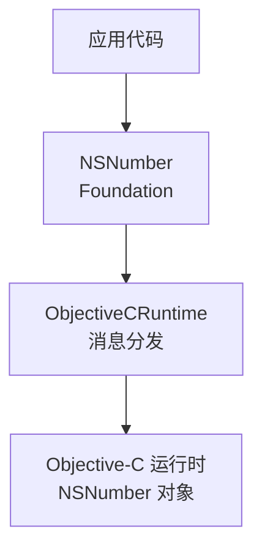
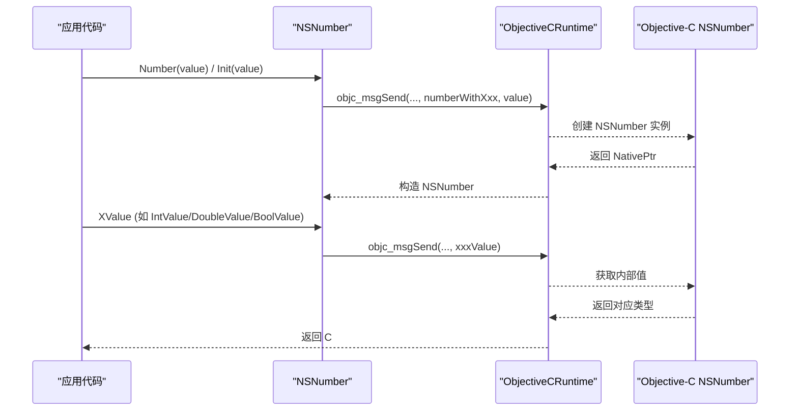
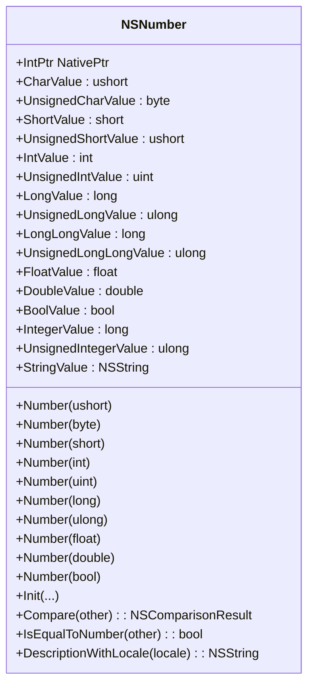
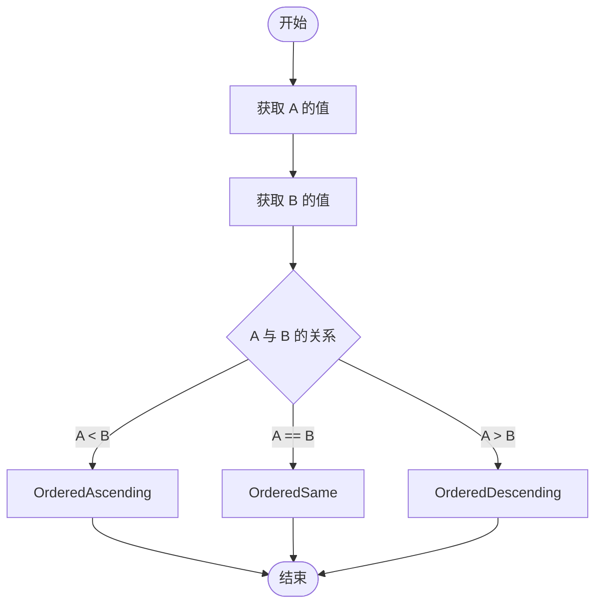
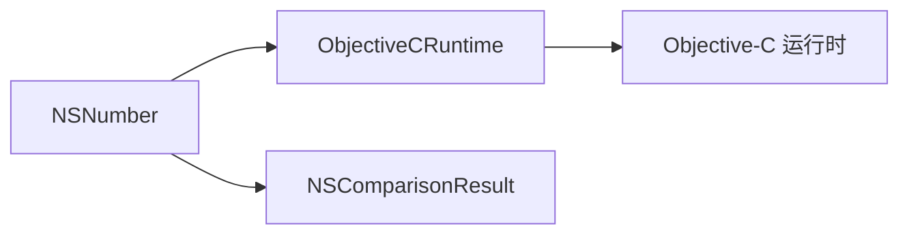

# NSNumber 数值包装器

<cite>
**本文引用的文件**
- [NSNumber.cs](file://src/SharpMetal/Foundation/NSNumber.cs)
- [NSObject.cs](file://src/SharpMetal/Foundation/NSObject.cs)
- [ObjectiveCRuntime.cs](file://src/SharpMetal/ObjectiveCCore/ObjectiveCRuntime.cs)
</cite>

## 目录
1. [简介](#简介)
2. [项目结构](#项目结构)
3. [核心组件](#核心组件)
4. [架构总览](#架构总览)
5. [详细组件分析](#详细组件分析)
6. [依赖关系分析](#依赖关系分析)
7. [性能与精度注意事项](#性能与精度注意事项)
8. [故障排查指南](#故障排查指南)
9. [结论](#结论)
10. [附录：使用示例与最佳实践](#附录使用示例与最佳实践)

## 简介
本文件为 SharpMetal 中 NSNumber 数值包装器的详细 API 文档。NSNumber 用于在 Objective-C/Cocoa 运行时环境中安全地包装各种基本数值类型（整数、浮点数、布尔值），并提供与原生 Objective-C 对象的互操作能力。本文重点说明：
- 支持的数值类型与指针类型包装
- 创建、类型转换与比较操作
- 与 C# 基本类型的自动转换机制
- 不同数值类型之间的安全转换方法
- 数值精度处理与溢出检查建议
- 常见场景（数学计算、配置参数传递、序列化）的最佳实践

## 项目结构
NSNumber 位于 Foundation 命名空间，通过 ObjectiveC 运行时桥接到系统库。其核心实现包括：
- 构造与工厂方法：支持多种 C# 基本类型的创建
- 取值属性：提供从 NSNumber 到各基础类型的读取
- 比较与描述：提供与其他 NSNumber 的比较及本地化描述
- 底层调用：通过 ObjectiveCRuntime 进行消息发送

图表来源
- [NSNumber.cs:61-271](file://src/SharpMetal/Foundation/NSNumber.cs#L61-L271)
- [ObjectiveCRuntime.cs:118-200](file://src/SharpMetal/ObjectiveCCore/ObjectiveCRuntime.cs#L118-L200)

章节来源
- [NSNumber.cs:61-271](file://src/SharpMetal/Foundation/NSNumber.cs#L61-L271)
- [ObjectiveCRuntime.cs:118-200](file://src/SharpMetal/ObjectiveCCore/ObjectiveCRuntime.cs#L118-L200)

## 核心组件
- NSNumber 结构体：封装原生 NSNumber 的 NativePtr，并暴露创建、取值、比较等 API
- NSComparisonResult 枚举：表示比较结果（升序、相等、降序）
- ObjectiveCRuntime：提供与 Objective-C 运行时的消息发送接口

关键职责划分：
- NSNumber：API 层，负责类型安全的包装与解包
- ObjectiveCRuntime：底层桥接，负责将 C# 调用映射到 Objective-C 消息
- NSObject/NSComparisonResult：基础类型与比较语义

章节来源
- [NSNumber.cs:61-271](file://src/SharpMetal/Foundation/NSNumber.cs#L61-L271)
- [NSObject.cs:6-11](file://src/SharpMetal/Foundation/NSObject.cs#L6-L11)
- [ObjectiveCRuntime.cs:118-200](file://src/SharpMetal/ObjectiveCCore/ObjectiveCRuntime.cs#L118-L200)

## 架构总览
NSNumber 的工作流程如下：
- 创建：通过静态工厂方法或构造函数，传入 C# 基本类型，内部调用 Objective-C 的 numberWithXxx 系列方法
- 取值：通过属性访问 NSNumber 的内部存储，调用对应的 value 方法
- 比较：调用 compare 或 isEqualToNumber，返回 NSComparisonResult 或 bool
- 描述：可生成带本地化的字符串描述

图表来源
- [NSNumber.cs:105-218](file://src/SharpMetal/Foundation/NSNumber.cs#L105-L218)
- [ObjectiveCRuntime.cs:118-200](file://src/SharpMetal/ObjectiveCCore/ObjectiveCRuntime.cs#L118-L200)

## 详细组件分析

### NSNumber 类型支持与创建
- 支持的数值类型
  - 整数：short、int、long、ulong、byte、ushort
  - 浮点：float、double
  - 布尔：bool
  - 通用整型：integerValue、unsignedIntegerValue（平台相关宽度）
- 创建方式
  - 静态工厂：Number(value) 针对每种基本类型重载
  - 构造器：Init(value) 针对每种基本类型重载
  - 隐式转换：NSNumber 可隐式转换为 IntPtr，便于与原生 API 交互

图表来源
- [NSNumber.cs:61-271](file://src/SharpMetal/Foundation/NSNumber.cs#L61-L271)

章节来源
- [NSNumber.cs:61-271](file://src/SharpMetal/Foundation/NSNumber.cs#L61-L271)

### 类型转换与取值
- 取值属性：每种数值类型均提供对应的 Value 属性，内部通过 ObjectiveCRuntime 调用相应 selector
- 字符串化：StringValue 返回 NSString，可用于调试或日志
- 本地化描述：DescriptionWithLocale(NSObject locale) 返回本地化字符串

注意：
- 跨类型取值时，若目标类型范围小于源值，可能发生截断或溢出；应谨慎选择目标类型
- 浮点到整数的转换遵循目标类型的舍入规则（由运行时决定）

章节来源
- [NSNumber.cs:73-103](file://src/SharpMetal/Foundation/NSNumber.cs#L73-L103)
- [NSNumber.cs:225-271](file://src/SharpMetal/Foundation/NSNumber.cs#L225-L271)

### 比较操作
- Compare(other)：返回 NSComparisonResult，支持升序、相等、降序
- IsEqualToNumber(other)：返回 bool，判断两个 NSNumber 是否相等
- 比较语义基于 NSNumber 内部存储的值，而非类型标签

图表来源
- [NSNumber.cs:210-218](file://src/SharpMetal/Foundation/NSNumber.cs#L210-L218)
- [NSObject.cs:6-11](file://src/SharpMetal/Foundation/NSObject.cs#L6-L11)

章节来源
- [NSNumber.cs:210-218](file://src/SharpMetal/Foundation/NSNumber.cs#L210-L218)
- [NSObject.cs:6-11](file://src/SharpMetal/Foundation/NSObject.cs#L6-L11)

### 与 C# 基本类型的自动转换机制
- 隐式转换：NSNumber 可隐式转换为 IntPtr，便于直接传递给需要原生指针的 API
- 显式取值：通过 Value 属性将 NSNumber 转换为 C# 基本类型
- 无内置装箱/拆箱到 System.Int32 等的自动转换；需显式调用对应 Value 属性

章节来源
- [NSNumber.cs:64-65](file://src/SharpMetal/Foundation/NSNumber.cs#L64-L65)
- [NSNumber.cs:73-103](file://src/SharpMetal/Foundation/NSNumber.cs#L73-L103)

### 指针类型支持
- NSNumber 本身不直接包装任意指针；如需包装指针，可使用同文件的 NSValue 类型
- NSValue 提供 Value(pPointer) 和 Value(pValue, pType) 等方法，用于包装指针或原始字节数据
- 对于需要传递指针的场景，优先使用 NSValue；对于数值运算与比较，使用 NSNumber

章节来源
- [NSNumber.cs:5-59](file://src/SharpMetal/Foundation/NSNumber.cs#L5-L59)

## 依赖关系分析
NSNumber 依赖 ObjectiveCRuntime 进行消息发送，依赖 NSObject 中的 NSComparisonResult 表达比较结果。

图表来源
- [NSNumber.cs:61-271](file://src/SharpMetal/Foundation/NSNumber.cs#L61-L271)
- [NSObject.cs:6-11](file://src/SharpMetal/Foundation/NSObject.cs#L6-L11)
- [ObjectiveCRuntime.cs:118-200](file://src/SharpMetal/ObjectiveCCore/ObjectiveCRuntime.cs#L118-L200)

章节来源
- [NSNumber.cs:61-271](file://src/SharpMetal/Foundation/NSNumber.cs#L61-L271)
- [NSObject.cs:6-11](file://src/SharpMetal/Foundation/NSObject.cs#L6-L11)
- [ObjectiveCRuntime.cs:118-200](file://src/SharpMetal/ObjectiveCCore/ObjectiveCRuntime.cs#L118-L200)

## 性能与精度注意事项
- 创建开销：频繁创建 NSNumber 会触发多次 Objective-C 分配与释放；建议在批量场景中复用或减少不必要的包装
- 取值开销：每次取值都会进行一次消息发送；对热点路径应尽量减少重复取值
- 精度损失：
  - 浮点到整数：可能丢失小数部分或发生溢出；应先做范围检查再转换
  - 大整数到小整数：可能截断高位；建议使用更大范围的类型承载中间结果
- 溢出检查：
  - 在将外部输入（如用户配置、网络数据）转换为较小整数类型前，先验证范围
  - 对浮点转整数，考虑使用 Math.Clamp 或自定义边界检查后再赋值
- 比较性能：Compare 与 IsEqualToNumber 均为 O(1)，但应避免在极热循环中频繁调用

[本节为通用指导，不直接分析具体文件]

## 故障排查指南
- 空指针异常：确保 NSNumber 的 NativePtr 非零；避免对未初始化或已释放的对象进行操作
- 类型不匹配：当用错误的 Value 属性取值时，可能得到意外结果；请根据实际存储类型选择合适的取值方法
- 比较结果为空：确认传入的 NSNumber 有效且非零；否则比较行为未定义
- 本地化描述为空：传入有效的 locale 对象；否则可能无法生成期望的本地化字符串

章节来源
- [NSNumber.cs:61-271](file://src/SharpMetal/Foundation/NSNumber.cs#L61-L271)
- [NSObject.cs:6-11](file://src/SharpMetal/Foundation/NSObject.cs#L6-L11)

## 结论
NSNumber 在 SharpMetal 中提供了对 Objective-C 数值类型的统一包装与互操作能力。通过丰富的创建与取值 API、可靠的比较机制以及与 ObjectiveCRuntime 的紧密集成，开发者可以安全地在 C# 与原生环境之间传递数值。使用时应关注类型范围、精度损失与性能开销，结合本文的最佳实践，确保在数学计算、配置传递与序列化等场景中稳定可靠。

[本节为总结性内容，不直接分析具体文件]

## 附录：使用示例与最佳实践

- 数学计算
  - 使用合适的数值类型承载中间结果，避免溢出
  - 对浮点运算，注意精度误差；必要时引入容差比较
  - 示例参考：创建 NSNumber 并进行取值与比较
    - 参考路径：[NSNumber.cs:105-218](file://src/SharpMetal/Foundation/NSNumber.cs#L105-L218)

- 配置参数传递
  - 使用 NSNumber 作为配置容器，统一处理不同类型参数
  - 在读取配置时进行范围校验，防止非法值导致异常
  - 示例参考：通过 stringValue 或 DescriptionWithLocale 输出可读配置
    - 参考路径：[NSNumber.cs:103-223](file://src/SharpMetal/Foundation/NSNumber.cs#L103-L223)

- 序列化场景
  - 将 NSNumber 序列化为 JSON 或二进制时，优先使用其字符串表示或原始字节
  - 注意跨平台整数宽度差异，必要时显式指定目标类型
  - 示例参考：StringValue 与本地化描述
    - 参考路径：[NSNumber.cs:103-223](file://src/SharpMetal/Foundation/NSNumber.cs#L103-L223)

- 指针与复杂数据结构
  - 使用 NSValue 包装指针或原始内存块，配合 objCType 指定类型编码
  - 示例参考：NSValue.Value(pPointer) 与 Value(pValue, pType)
    - 参考路径：[NSNumber.cs:21-29](file://src/SharpMetal/Foundation/NSNumber.cs#L21-L29)

- 安全转换与溢出检查
  - 在转换前进行范围检查，避免截断或溢出
  - 对浮点转整数，先判断是否在目标范围内再进行转换
  - 示例参考：取值属性与比较
    - 参考路径：[NSNumber.cs:73-103](file://src/SharpMetal/Foundation/NSNumber.cs#L73-L103)
    - 参考路径：[NSNumber.cs:210-218](file://src/SharpMetal/Foundation/NSNumber.cs#L210-L218)