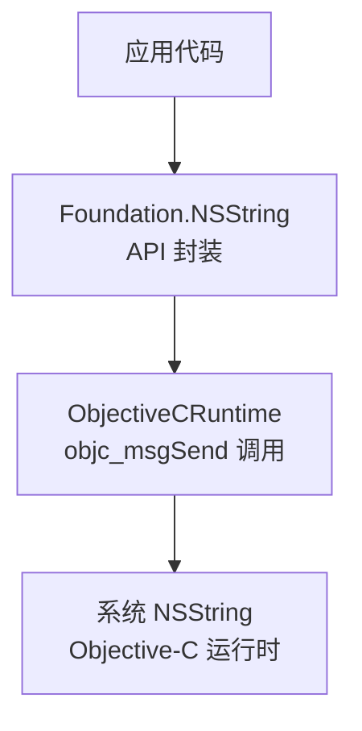
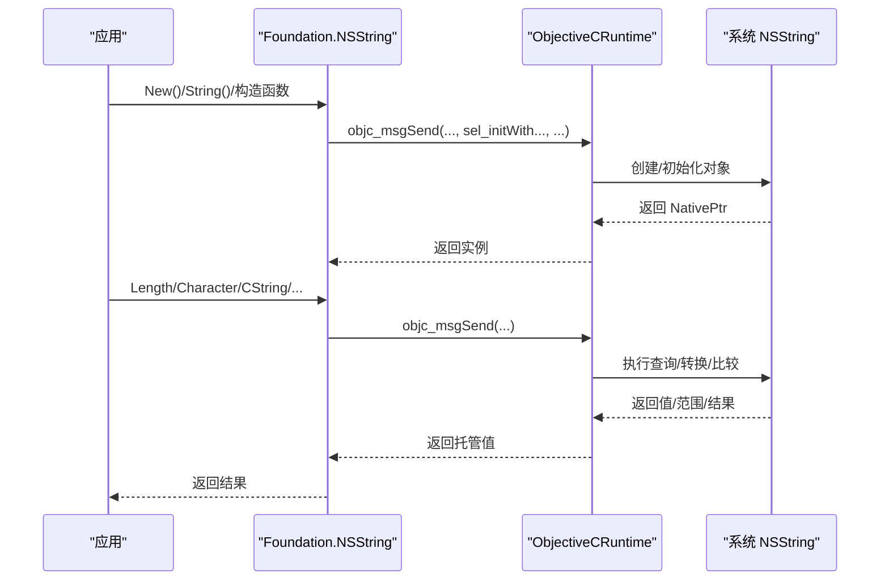
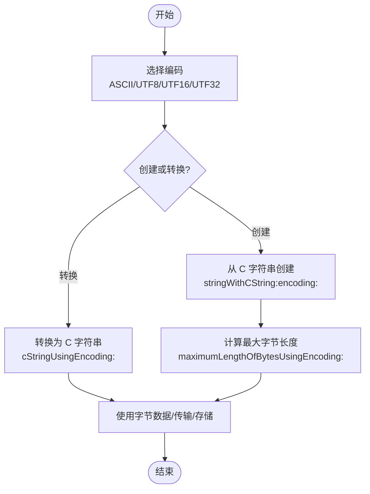
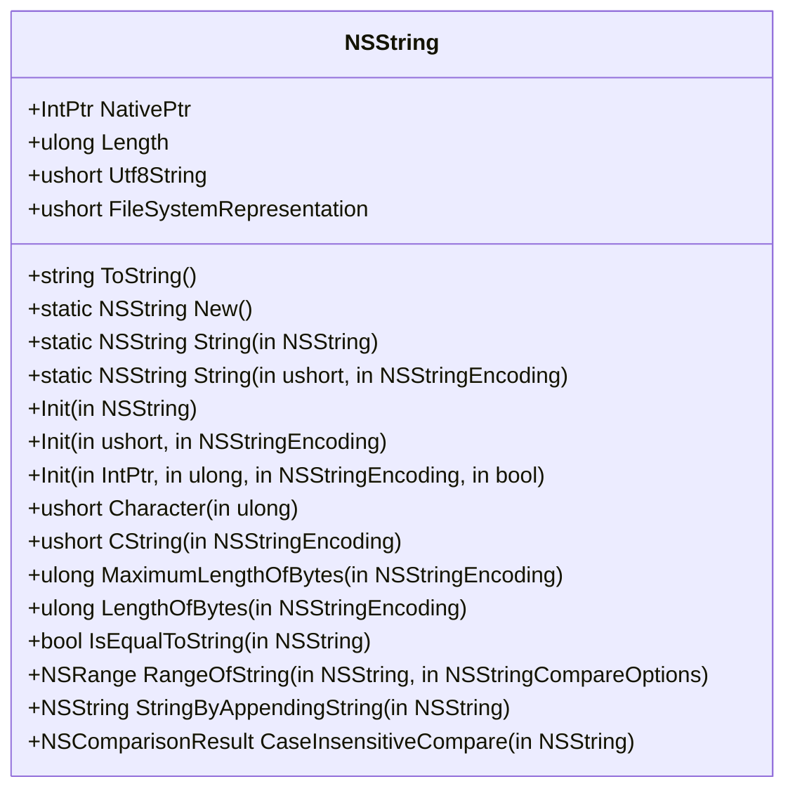
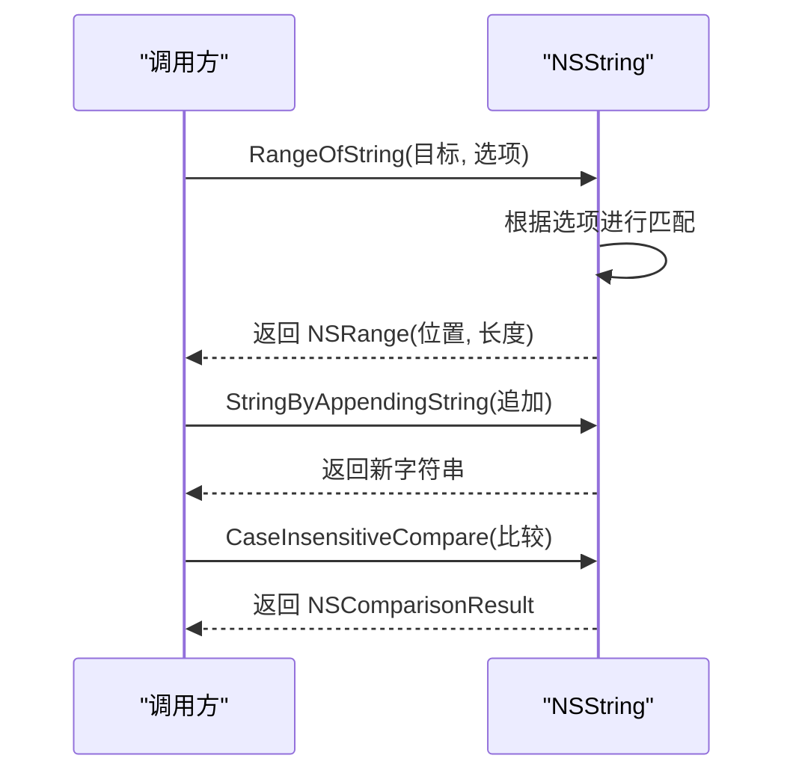
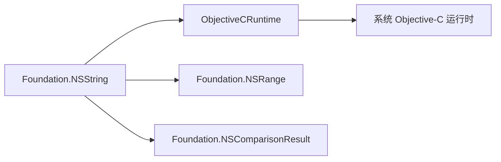

# NSString 字符串类型

<cite>
**本文引用的文件**
- [NSString.cs](file://src/SharpMetal/Foundation/NSString.cs)
- [ObjectiveCRuntime.cs](file://src/SharpMetal/ObjectiveCCore/ObjectiveCRuntime.cs)
- [NSRange.cs](file://src/SharpMetal/Foundation/NSRange.cs)
- [NSObject.cs](file://src/SharpMetal/Foundation/NSObject.cs)
</cite>

## 目录
1. [简介](#简介)
2. [项目结构](#项目结构)
3. [核心组件](#核心组件)
4. [架构总览](#架构总览)
5. [详细组件分析](#详细组件分析)
6. [依赖关系分析](#依赖关系分析)
7. [性能注意事项](#性能注意事项)
8. [故障排查指南](#故障排查指南)
9. [结论](#结论)
10. [附录](#附录)

## 简介
本文件为 SharpMetal 项目中 Foundation 层的 NSString 字符串类型的详细 API 文档。重点覆盖：
- Unicode 支持与编码转换（ASCII、UTF-8、UTF-16、UTF-32 等）
- 字符串创建与生命周期管理（构造函数、New()、String()）
- 长度获取、字符访问、拼接、比较与搜索
- 比较选项（大小写不敏感、数字排序、正则表达式等）
- 最佳实践与性能优化建议

## 项目结构
NSString 位于 Foundation 命名空间，通过 ObjectiveC 运行时桥接到系统 NSString。其核心能力包括：
- 枚举定义：NSStringEncoding、NSStringCompareOptions
- 实例方法：Length、Character、CString、MaximumLengthOfBytes、LengthOfBytes、IsEqualToString、RangeOfString、StringByAppendingString、CaseInsensitiveCompare
- 静态工厂：New()、String(in NSString)、String(in ushort, in NSStringEncoding)
- 初始化器：initWithCharacters:length:、initWithString:、initWithCString:encoding:、initWithBytesNoCopy:length:encoding:freeWhenDone:
- ToString() 将底层 UTF-8 指针转换为托管字符串

图表来源
- [NSString.cs:64-186](file://src/SharpMetal/Foundation/NSString.cs#L64-L186)
- [ObjectiveCRuntime.cs:118-177](file://src/SharpMetal/ObjectiveCCore/ObjectiveCRuntime.cs#L118-L177)

章节来源
- [NSString.cs:6-44](file://src/SharpMetal/Foundation/NSString.cs#L6-L44)
- [NSString.cs:64-186](file://src/SharpMetal/Foundation/NSString.cs#L64-L186)

## 核心组件
- 编码枚举 NSStringEncoding：提供 ASCII、UTF8、UTF16、UTF32 及其大端/小端变体等
- 比较选项 NSStringCompareOptions：支持大小写不敏感、字面量匹配、反向搜索、锚定搜索、数字搜索、忽略重音符号、宽度不敏感、强制顺序、正则表达式搜索
- 字符串对象 NSString：封装原生指针并提供常用操作

章节来源
- [NSString.cs:6-44](file://src/SharpMetal/Foundation/NSString.cs#L6-L44)
- [NSString.cs:64-186](file://src/SharpMetal/Foundation/NSString.cs#L64-L186)

## 架构总览
NSString 作为托管侧的薄封装，所有实际工作委托给系统 NSString。关键路径如下：
- 构造/工厂方法通过 ObjectiveCRuntime 发送消息到 Objective-C 层
- 读取/写入/比较等操作均通过 objc_msgSend 系列重载完成
- 返回的 NSRange、NSComparisonResult 等由 Foundation 类型承载

图表来源
- [NSString.cs:69-186](file://src/SharpMetal/Foundation/NSString.cs#L69-L186)
- [ObjectiveCRuntime.cs:118-177](file://src/SharpMetal/ObjectiveCCore/ObjectiveCRuntime.cs#L118-L177)

## 详细组件分析

### 编码与 Unicode 支持
- 支持的编码：
  - ASCII、UTF8、UTF16（含 BigEndian/LittleEndian）、UTF32（含 BigEndian/LittleEndian）
  - 其他平台相关编码（如 WindowsCP125x、ShiftJIS、MacOSRoman 等）
- 典型用法：
  - 从 C 风格字符串创建：String(in ushort pString, in NSStringEncoding encoding)
  - 以指定编码获取 C 字符串：CString(in NSStringEncoding encoding)
  - 计算字节长度：MaximumLengthOfBytes / LengthOfBytes
  - 直接读取 UTF-8 内容：ToString() 内部使用 UTF-8 指针并转换为托管字符串

图表来源
- [NSString.cs:105-143](file://src/SharpMetal/Foundation/NSString.cs#L105-L143)

章节来源
- [NSString.cs:6-31](file://src/SharpMetal/Foundation/NSString.cs#L6-L31)
- [NSString.cs:105-143](file://src/SharpMetal/Foundation/NSString.cs#L105-L143)

### 字符串创建与生命周期
- 构造函数：
  - 从托管 string 构造：内部固定 char* 并以 UTF-16 调用 initWithCharacters:length:
  - 从 C 字符串构造：initWithCString:encoding:
  - 从原始字节构造：initWithBytesNoCopy:length:encoding:freeWhenDone:
- 工厂方法：
  - New()：分配并初始化空字符串
  - String(in NSString)：复制已有字符串
  - String(in ushort, in NSStringEncoding)：从 C 字符串按编码创建

图表来源
- [NSString.cs:64-186](file://src/SharpMetal/Foundation/NSString.cs#L64-L186)

章节来源
- [NSString.cs:69-123](file://src/SharpMetal/Foundation/NSString.cs#L69-L123)
- [NSString.cs:83-108](file://src/SharpMetal/Foundation/NSString.cs#L83-L108)

### 长度获取与字符访问
- Length：返回字符数量（基于 UTF-16 单元）
- Character(index)：按索引获取 UTF-16 码元
- MaximumLengthOfBytes(encoding)/LengthOfBytes(encoding)：按编码估算/计算字节长度

注意：
- 对于多字节字符（如 Emoji），Length 可能不等于视觉字符数；如需按视觉字符处理，应在更高层做组合处理。

章节来源
- [NSString.cs:85-128](file://src/SharpMetal/Foundation/NSString.cs#L85-L128)

### 字符串拼接与比较
- 拼接：StringByAppendingString(in NSString)
- 相等性：IsEqualToString(in NSString)
- 比较：CaseInsensitiveCompare(in NSString)
- 搜索：RangeOfString(in NSString, in NSStringCompareOptions)

图表来源
- [NSString.cs:145-163](file://src/SharpMetal/Foundation/NSString.cs#L145-L163)

章节来源
- [NSString.cs:145-163](file://src/SharpMetal/Foundation/NSString.cs#L145-L163)

### 比较选项（NSStringCompareOptions）
- CaseInsensitiveSearch：大小写不敏感
- LiteralSearch：字面量匹配
- BackwardsSearch：反向搜索
- AnchoredSearch：锚定搜索（通常用于前缀/后缀匹配）
- NumericSearch：数字排序/比较（例如 "2" < "10"）
- DiacriticInsensitiveSearch：忽略重音符号
- WidthInsensitiveSearch：宽度不敏感（全角/半角）
- ForcedOrderingSearch：强制排序顺序
- RegularExpressionSearch：正则表达式搜索

使用示例（概念说明）：
- 大小写不敏感查找：options = CaseInsensitiveSearch
- 数字排序：options = NumericSearch
- 正则匹配：options = RegularExpressionSearch

章节来源
- [NSString.cs:33-44](file://src/SharpMetal/Foundation/NSString.cs#L33-L44)

### 与 ObjectiveC 运行时的交互
- 所有方法最终通过 ObjectiveCRuntime 的 objc_msgSend 系列重载调用系统 API
- 常见返回类型：
  - NSRange：用于 RangeOfString 返回匹配区间
  - NSComparisonResult：用于比较结果
- 内存模型：
  - 字符串对象由 Objective-C 运行时管理，托管侧持有 NativePtr
  - 释放策略遵循 Objective-C 的引用计数规则（Release/Retain）

章节来源
- [ObjectiveCRuntime.cs:118-177](file://src/SharpMetal/ObjectiveCCore/ObjectiveCRuntime.cs#L118-L177)
- [NSRange.cs:6-6](file://src/SharpMetal/Foundation/NSRange.cs#L6-L6)
- [NSObject.cs:6-6](file://src/SharpMetal/Foundation/NSObject.cs#L6-L6)

## 依赖关系分析
- NSString 依赖：
  - ObjectiveCRuntime：消息派发、类型转换、内存管理
  - Foundation 基础类型：NSRange、NSComparisonResult
- 耦合度：
  - 低耦合：NSString 仅暴露稳定的托管 API，具体实现细节在运行时层
  - 高内聚：字符串相关逻辑集中在 NSString 中

图表来源
- [NSString.cs:64-186](file://src/SharpMetal/Foundation/NSString.cs#L64-L186)
- [ObjectiveCRuntime.cs:118-177](file://src/SharpMetal/ObjectiveCCore/ObjectiveCRuntime.cs#L118-L177)

章节来源
- [NSString.cs:64-186](file://src/SharpMetal/Foundation/NSString.cs#L64-L186)
- [ObjectiveCRuntime.cs:118-177](file://src/SharpMetal/ObjectiveCCore/ObjectiveCRuntime.cs#L118-L177)

## 性能注意事项
- 避免频繁创建临时字符串：尽量复用或批量处理，减少分配与拷贝
- 选择合适的编码：
  - 纯 ASCII 文本可使用 ASCII 编码以减少开销
  - 通用场景优先 UTF-8（ToString 已采用）
- 合理使用 Length/Character：
  - 对包含组合字符的文本，Length 不代表视觉字符数；必要时在更高层做规范化与分组
- 搜索与比较：
  - 使用合适的选项（如 NumericSearch、CaseInsensitiveSearch）可减少后处理
  - 正则表达式搜索功能强大但开销较大，谨慎使用
- 字节长度计算：
  - 使用 MaximumLengthOfBytes 预分配缓冲区可避免多次扩容

[本节为通用指导，不直接分析具体文件]

## 故障排查指南
- 乱码问题：
  - 确认创建/转换时使用的编码与实际数据一致
  - 检查 CString(encoding) 返回的指针是否有效
- 越界访问：
  - 访问 Character(index) 前确保 index < Length
- 比较结果为空或不正确：
  - 检查 RangeOfString 的 options 是否设置正确
  - 确认是否需要大小写不敏感或数字排序
- 内存泄漏或崩溃：
  - 遵循 Objective-C 生命周期：不要手动释放托管持有的 NativePtr，除非明确了解所有权
  - 使用 Release/Retain 时需成对且语义清晰

章节来源
- [NSString.cs:105-163](file://src/SharpMetal/Foundation/NSString.cs#L105-L163)
- [ObjectiveCRuntime.cs:769-782](file://src/SharpMetal/ObjectiveCCore/ObjectiveCRuntime.cs#L769-L782)

## 结论
SharpMetal 的 NSString 提供了对系统 NSString 的高性能、低开销的托管封装。通过明确的编码枚举和比较选项，开发者可以安全地进行 Unicode 文本处理、编码转换与字符串操作。结合合理的性能实践与错误处理策略，可在 Metal 图形栈周边高效地处理字符串数据。

[本节为总结，不直接分析具体文件]

## 附录
- 常用 API 速查
  - 创建：New()、String(in NSString)、String(in ushort, in NSStringEncoding)
  - 初始化：initWithCharacters:length:、initWithString:、initWithCString:encoding:、initWithBytesNoCopy:length:encoding:freeWhenDone:
  - 长度与字符：Length、Character(index)
  - 编码转换：CString(encoding)、MaximumLengthOfBytes(encoding)、LengthOfBytes(encoding)
  - 比较与搜索：IsEqualToString、CaseInsensitiveCompare、RangeOfString(options)
  - 拼接：StringByAppendingString

章节来源
- [NSString.cs:69-186](file://src/SharpMetal/Foundation/NSString.cs#L69-L186)