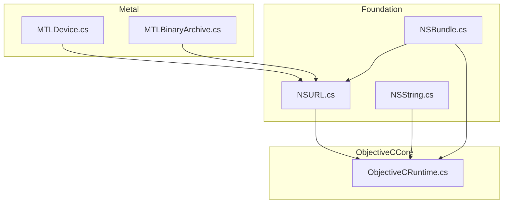
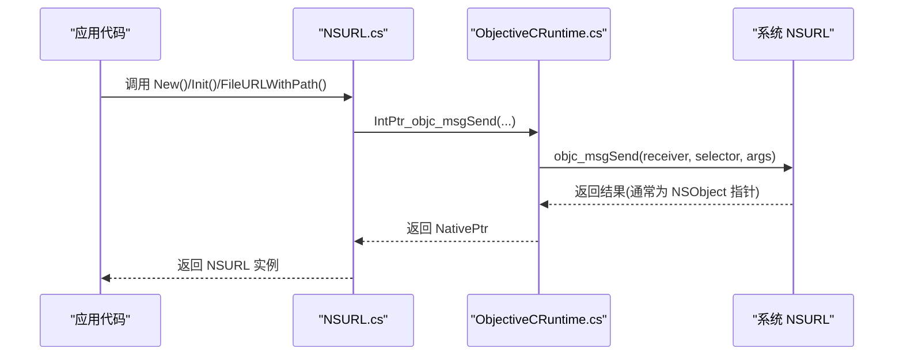
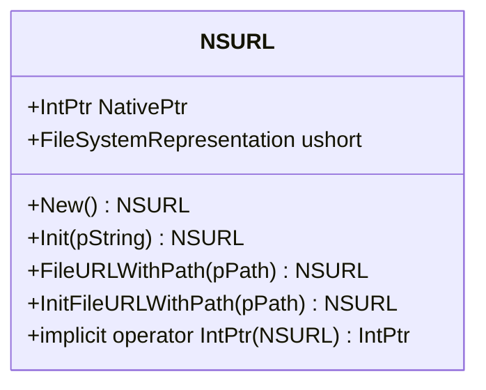
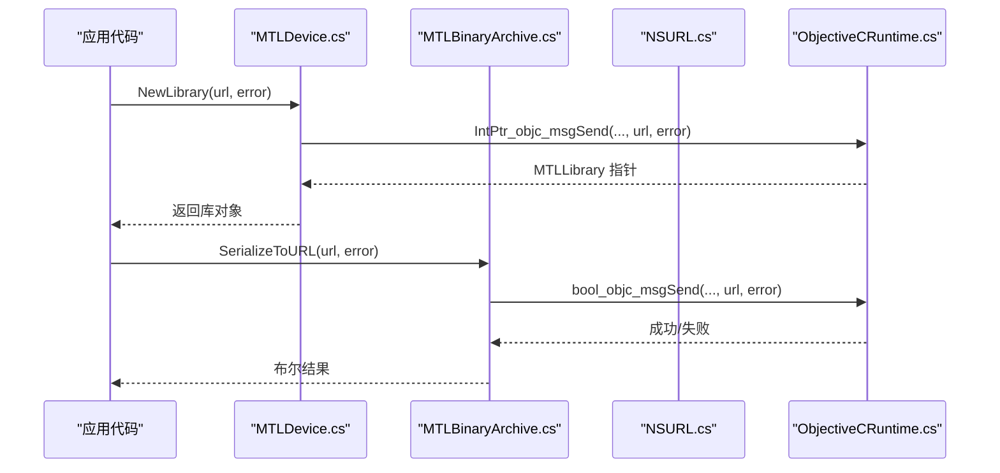
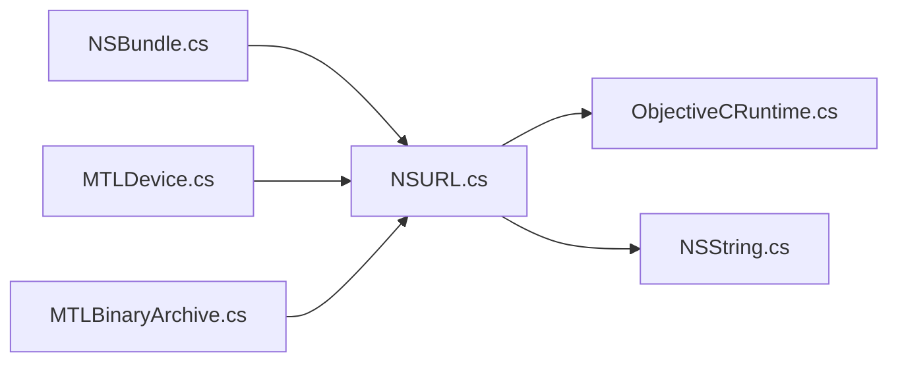

# NSURL URL 类型

<cite>
**本文引用的文件**
- [NSURL.cs](file://src/SharpMetal/Foundation/NSURL.cs)
- [NSString.cs](file://src/SharpMetal/Foundation/NSString.cs)
- [ObjectiveCRuntime.cs](file://src/SharpMetal/ObjectiveCCore/ObjectiveCRuntime.cs)
- [NSBundle.cs](file://src/SharpMetal/Foundation/NSBundle.cs)
- [MTLDevice.cs](file://src/SharpMetal/Metal/MTLDevice.cs)
- [MTLBinaryArchive.cs](file://src/SharpMetal/Metal/MTLBinaryArchive.cs)
</cite>

## 目录
1. [简介](#简介)
2. [项目结构](#项目结构)
3. [核心组件](#核心组件)
4. [架构总览](#架构总览)
5. [详细组件分析](#详细组件分析)
6. [依赖关系分析](#依赖关系分析)
7. [性能注意事项](#性能注意事项)
8. [故障排查指南](#故障排查指南)
9. [结论](#结论)
10. [附录](#附录)

## 简介
本文件针对 SharpMetal 中的 NSURL 类型提供面向开发者的 API 文档，重点覆盖：
- URL 的创建、解析与基本操作（基于 Objective-C 运行时桥接）
- 常见 URL 组件的处理思路（协议、主机名、路径、查询参数等）
- 相对 URL 与绝对 URL 的转换方法
- URL 编码与解码及特殊字符处理
- 网络资源访问场景下的 URL 使用示例（文件 URL、HTTP URL、资源定位），包括在 Metal 库加载、归档序列化等实际用法

说明：当前仓库中 NSURL 的实现以“薄封装”形式存在，直接调用 Objective-C 的 NSURL 对象。因此，关于 URL 组件提取、编码解码、相对/绝对转换等能力，均通过底层 Objective-C 的 NSURL API 暴露。本文在描述这些能力时，会明确其实现位置与调用方式，并给出在 SharpMetal 中的使用建议与注意事项。

## 项目结构
与 NSURL 相关的代码主要位于 Foundation 层，并通过 ObjectiveCCore 的运行时机制与系统 Objective-C 类交互；同时，Foundation 层的 NSBundle 以及 Metal 层的设备、二进制归档等模块广泛使用 NSURL 进行资源定位与 I/O。

图表来源
- [NSURL.cs:1-39](file://src/SharpMetal/Foundation/NSURL.cs#L1-L39)
- [NSString.cs:1-188](file://src/SharpMetal/Foundation/NSString.cs#L1-L188)
- [ObjectiveCRuntime.cs:1-800](file://src/SharpMetal/ObjectiveCCore/ObjectiveCRuntime.cs#L1-L800)
- [NSBundle.cs:1-150](file://src/SharpMetal/Foundation/NSBundle.cs#L1-L150)
- [MTLDevice.cs:410-609](file://src/SharpMetal/Metal/MTLDevice.cs#L410-L609)
- [MTLBinaryArchive.cs:70-97](file://src/SharpMetal/Metal/MTLBinaryArchive.cs#L70-L97)

章节来源
- [NSURL.cs:1-39](file://src/SharpMetal/Foundation/NSURL.cs#L1-L39)
- [NSBundle.cs:1-150](file://src/SharpMetal/Foundation/NSBundle.cs#L1-L150)
- [MTLDevice.cs:410-609](file://src/SharpMetal/Metal/MTLDevice.cs#L410-L609)
- [MTLBinaryArchive.cs:70-97](file://src/SharpMetal/Metal/MTLBinaryArchive.cs#L70-L97)

## 核心组件
- NSURL：轻量包装 struct，持有原生指针，提供构造、初始化与文件系统表示等能力，内部通过 ObjectiveCClass 和 Selector 调用系统 NSURL 方法。
- NSString：字符串类型，用于构建或传递 URL 字符串、路径等。
- ObjectiveCRuntime：提供 objc_msgSend 等底层调用，使 C# 能直接调用 Objective-C 方法。
- NSBundle：返回多种 Bundle URL（如 bundleURL、resourceURL、executableURL 等），常用于应用内资源定位。
- MTLDevice / MTLBinaryArchive：在 Metal 中通过 NSURL 加载库、序列化归档等，体现 URL 在图形资源访问中的关键作用。

章节来源
- [NSURL.cs:1-39](file://src/SharpMetal/Foundation/NSURL.cs#L1-L39)
- [NSString.cs:1-188](file://src/SharpMetal/Foundation/NSString.cs#L1-L188)
- [ObjectiveCRuntime.cs:1-800](file://src/SharpMetal/ObjectiveCCore/ObjectiveCRuntime.cs#L1-L800)
- [NSBundle.cs:1-150](file://src/SharpMetal/Foundation/NSBundle.cs#L1-L150)
- [MTLDevice.cs:410-609](file://src/SharpMetal/Metal/MTLDevice.cs#L410-L609)
- [MTLBinaryArchive.cs:70-97](file://src/SharpMetal/Metal/MTLBinaryArchive.cs#L70-L97)

## 架构总览
NSURL 在 SharpMetal 中作为“桥接点”，将 .NET 侧的类型与系统 NSURL 对象关联起来。所有 URL 相关的高级能力（如组件提取、编码解码、相对/绝对转换）均由系统 NSURL 提供，SharpMetal 通过 ObjectiveCRuntime 转发消息。

图表来源
- [NSURL.cs:11-28](file://src/SharpMetal/Foundation/NSURL.cs#L11-L28)
- [ObjectiveCRuntime.cs:118-134](file://src/SharpMetal/ObjectiveCCore/ObjectiveCRuntime.cs#L118-L134)

## 详细组件分析

### NSURL 类型与能力
- 构造与初始化
  - New：分配并初始化一个 NSURL 实例。
  - Init(in NSString pString)：从字符串初始化 URL。
  - FileURLWithPath(in NSString pPath)：静态工厂方法，根据路径创建 file URL。
  - InitFileURLWithPath(in NSString pPath)：实例化 file URL。
- 文件系统表示
  - FileSystemRepresentation：获取底层文件系统表示（注意：该属性在当前实现中返回 ushort，可能为占位或错误映射，建议使用更安全的字符串转换方式）。
- 隐式转换
  - implicit operator IntPtr：允许将 NSURL 转换为原生指针，便于与其他 Objective-C 对象交互。

图表来源
- [NSURL.cs:5-36](file://src/SharpMetal/Foundation/NSURL.cs#L5-L36)

章节来源
- [NSURL.cs:5-36](file://src/SharpMetal/Foundation/NSURL.cs#L5-L36)

### 字符串与运行时支持
- NSString：提供 UTF-8 字符串、长度、比较、追加等操作，是构建 URL 字符串的基础。
- ObjectiveCRuntime：提供大量重载的 objc_msgSend，用于向 Objective-C 对象发送消息，是 NSURL 与系统类交互的核心通道。

章节来源
- [NSString.cs:64-188](file://src/SharpMetal/Foundation/NSString.cs#L64-L188)
- [ObjectiveCRuntime.cs:118-134](file://src/SharpMetal/ObjectiveCCore/ObjectiveCRuntime.cs#L118-L134)

### 资源定位与 Bundle URL
- NSBundle 提供多个 URL 属性，用于获取应用包、可执行文件、资源目录等的 URL，便于资源定位。
- 典型用途：读取应用内置资源、插件、共享框架等。

章节来源
- [NSBundle.cs:27-41](file://src/SharpMetal/Foundation/NSBundle.cs#L27-L41)
- [NSBundle.cs:68-86](file://src/SharpMetal/Foundation/NSBundle.cs#L68-L86)

### Metal 中的 URL 使用
- MTLDevice.NewLibrary(in NSURL url, ref NSError error)：从 URL 加载 Metal 库。
- MTLDevice.NewIOFileHandle(in NSURL url, ...)：基于 URL 打开文件句柄，用于 I/O。
- MTLBinaryArchive.SerializeToURL(in NSURL url, ref NSError error)：将二进制归档序列化到指定 URL。

图表来源
- [MTLDevice.cs:411-414](file://src/SharpMetal/Metal/MTLDevice.cs#L411-L414)
- [MTLDevice.cs:531-538](file://src/SharpMetal/Metal/MTLDevice.cs#L531-L538)
- [MTLBinaryArchive.cs:75-78](file://src/SharpMetal/Metal/MTLBinaryArchive.cs#L75-L78)

章节来源
- [MTLDevice.cs:410-609](file://src/SharpMetal/Metal/MTLDevice.cs#L410-L609)
- [MTLBinaryArchive.cs:70-97](file://src/SharpMetal/Metal/MTLBinaryArchive.cs#L70-L97)

## 依赖关系分析
- NSURL 依赖 ObjectiveCRuntime 进行消息转发，依赖 NSString 进行字符串构造与传递。
- NSBundle 依赖 NSURL 返回各种资源 URL。
- Metal 模块依赖 NSURL 进行库加载与 I/O 操作。

图表来源
- [NSURL.cs:1-39](file://src/SharpMetal/Foundation/NSURL.cs#L1-L39)
- [NSString.cs:1-188](file://src/SharpMetal/Foundation/NSString.cs#L1-L188)
- [ObjectiveCRuntime.cs:1-800](file://src/SharpMetal/ObjectiveCCore/ObjectiveCRuntime.cs#L1-L800)
- [NSBundle.cs:1-150](file://src/SharpMetal/Foundation/NSBundle.cs#L1-L150)
- [MTLDevice.cs:410-609](file://src/SharpMetal/Metal/MTLDevice.cs#L410-L609)
- [MTLBinaryArchive.cs:70-97](file://src/SharpMetal/Metal/MTLBinaryArchive.cs#L70-L97)

章节来源
- [NSURL.cs:1-39](file://src/SharpMetal/Foundation/NSURL.cs#L1-L39)
- [NSBundle.cs:1-150](file://src/SharpMetal/Foundation/NSBundle.cs#L1-L150)
- [MTLDevice.cs:410-609](file://src/SharpMetal/Metal/MTLDevice.cs#L410-L609)
- [MTLBinaryArchive.cs:70-97](file://src/SharpMetal/Metal/MTLBinaryArchive.cs#L70-L97)

## 性能注意事项
- 避免频繁创建 NSURL 对象：尽量复用已创建的 URL 实例，减少 Objective-C 对象分配与释放开销。
- 谨慎使用文件系统表示：当前 FileSystemRepresentation 返回类型为 ushort，可能存在不匹配风险；如需路径字符串，建议通过 NSString 与 UTF-8 转换方式获取。
- 批量 I/O 与序列化：在 Metal 中使用 NSURL 进行库加载与归档序列化时，建议合并多次小写入为大块写入，减少系统调用次数。

[本节为通用指导，不直接分析具体文件]

## 故障排查指南
- URL 初始化失败
  - 检查传入的 NSString 是否为空或格式不正确。
  - 确认路径是否存在且权限正确（尤其是 file URL）。
- 资源定位失败
  - 使用 NSBundle 的 URL 属性（如 resourceURL、bundleURL）确保路径正确。
  - 验证目标资源是否包含在应用包中。
- Metal 库加载失败
  - 检查 NSURL 指向的库文件是否存在且格式正确。
  - 关注 NSError 返回值，定位具体错误原因。
- 序列化失败
  - 检查输出 URL 对应的目录是否可写。
  - 关注 NSError 返回值，确认序列化过程中的错误信息。

章节来源
- [NSURL.cs:11-28](file://src/SharpMetal/Foundation/NSURL.cs#L11-L28)
- [NSBundle.cs:27-41](file://src/SharpMetal/Foundation/NSBundle.cs#L27-L41)
- [MTLDevice.cs:411-414](file://src/SharpMetal/Metal/MTLDevice.cs#L411-L414)
- [MTLBinaryArchive.cs:75-78](file://src/SharpMetal/Metal/MTLBinaryArchive.cs#L75-L78)

## 结论
SharpMetal 中的 NSURL 类型以最小封装的方式桥接到系统 NSURL，提供了基础的 URL 创建、初始化与文件系统表示能力。结合 NSString 与 ObjectiveCRuntime，开发者可以在应用内完成资源定位、库加载与 I/O 操作。对于更复杂的 URL 操作（组件提取、编码解码、相对/绝对转换），应通过系统 NSURL 的能力实现，并在 SharpMetal 中以相同模式调用。

[本节为总结性内容，不直接分析具体文件]

## 附录

### URL 解析、构建与操作方法
- 解析与构建
  - 使用 Init(in NSString pString) 从字符串构建 URL。
  - 使用 FileURLWithPath(in NSString pPath) 或 InitFileURLWithPath(in NSString pPath) 构建文件 URL。
- 组件提取与修改
  - 由于 NSURL 为薄封装，组件提取与修改需通过系统 NSURL 的方法（如 components、scheme、host、path、query 等）实现。在 SharpMetal 中可通过 ObjectiveCRuntime 发送相应消息。
- 相对 URL 与绝对 URL 转换
  - 使用系统 NSURL 的 relativeURL 与 absoluteURL 方法进行转换。在 SharpMetal 中同样通过 ObjectiveCRuntime 调用。

章节来源
- [NSURL.cs:11-28](file://src/SharpMetal/Foundation/NSURL.cs#L11-L28)
- [ObjectiveCRuntime.cs:118-134](file://src/SharpMetal/ObjectiveCCore/ObjectiveCRuntime.cs#L118-L134)

### URL 编码与解码及特殊字符处理
- 编码与解码
  - 使用系统 NSURL 的 URL 编码/解码方法（如 stringByAddingPercentEncodingWithAllowedCharacters 等）处理特殊字符。
- 注意事项
  - 不同组件（如 query、fragment）允许的字符集不同，需选择合适的编码策略。
  - 避免对已编码的 URL 重复编码。

章节来源
- [NSString.cs:64-188](file://src/SharpMetal/Foundation/NSString.cs#L64-L188)
- [ObjectiveCRuntime.cs:118-134](file://src/SharpMetal/ObjectiveCCore/ObjectiveCRuntime.cs#L118-L134)

### 网络资源访问示例与注意事项
- 文件 URL
  - 使用 FileURLWithPath 或 InitFileURLWithPath 创建本地文件 URL。
  - 适用于读取应用资源、配置文件等。
- HTTP URL
  - 使用 Init 从 http(s) 字符串创建 URL。
  - 适用于网络请求、远程资源下载等。
- 资源定位
  - 使用 NSBundle 的 URL 属性获取应用内资源 URL。
  - 适用于动态加载资源、插件等。
- 注意事项
  - 校验 URL 有效性后再发起网络请求或文件 I/O。
  - 处理权限问题（如沙盒限制）。
  - 关注 NSError 返回值，及时捕获并处理错误。

章节来源
- [NSURL.cs:11-28](file://src/SharpMetal/Foundation/NSURL.cs#L11-L28)
- [NSBundle.cs:27-41](file://src/SharpMetal/Foundation/NSBundle.cs#L27-L41)
- [MTLDevice.cs:411-414](file://src/SharpMetal/Metal/MTLDevice.cs#L411-L414)
- [MTLBinaryArchive.cs:75-78](file://src/SharpMetal/Metal/MTLBinaryArchive.cs#L75-L78)