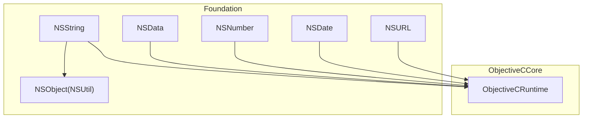
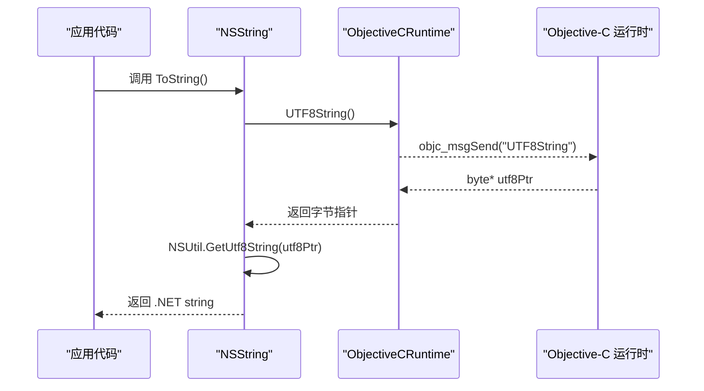
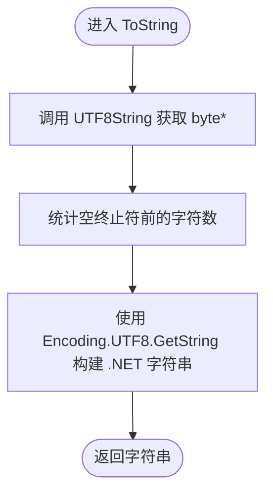
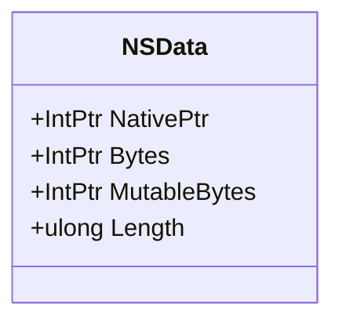
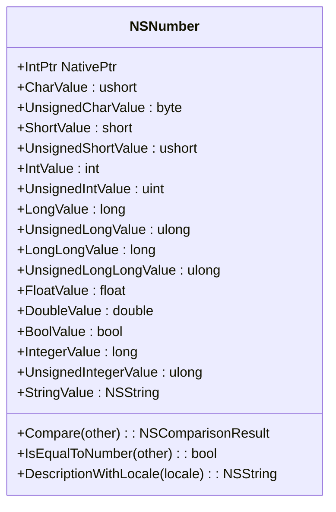
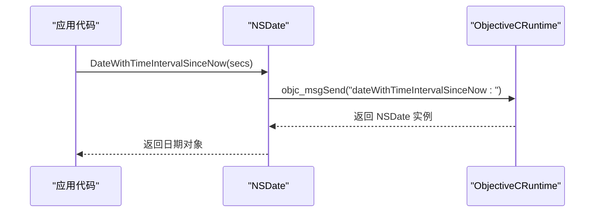
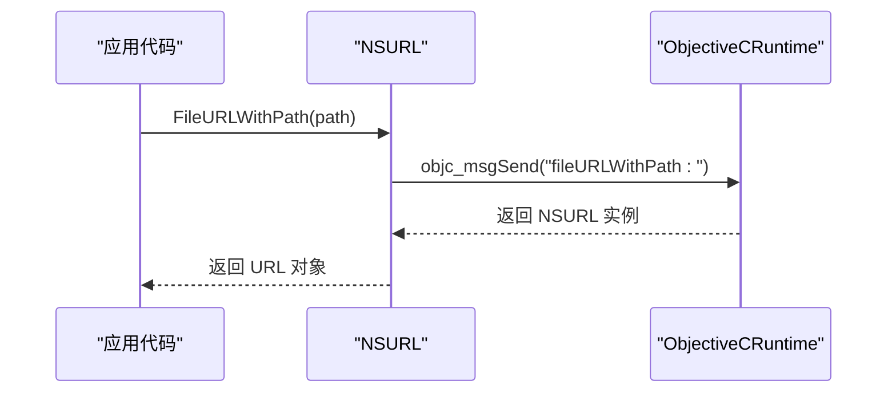
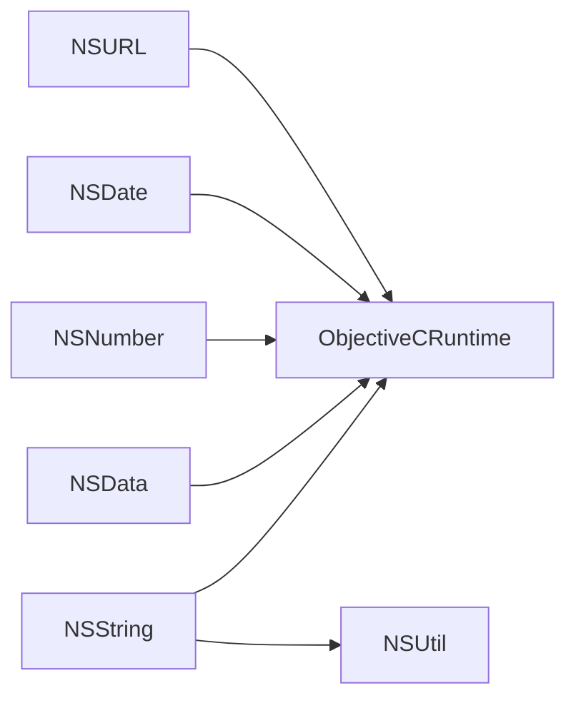

# 数据类型

<cite>
**本文引用的文件**
- [NSString.cs](file://src/SharpMetal/Foundation/NSString.cs)
- [NSData.cs](file://src/SharpMetal/Foundation/NSData.cs)
- [NSNumber.cs](file://src/SharpMetal/Foundation/NSNumber.cs)
- [NSDate.cs](file://src/SharpMetal/Foundation/NSDate.cs)
- [NSURL.cs](file://src/SharpMetal/Foundation/NSURL.cs)
- [NSObject.cs](file://src/SharpMetal/Foundation/NSObject.cs)
- [ObjectiveCRuntime.cs](file://src/SharpMetal/ObjectiveCCore/ObjectiveCRuntime.cs)
</cite>

## 目录
1. [简介](#简介)
2. [项目结构](#项目结构)
3. [核心组件](#核心组件)
4. [架构总览](#架构总览)
5. [详细组件分析](#详细组件分析)
6. [依赖关系分析](#依赖关系分析)
7. [性能注意事项](#性能注意事项)
8. [故障排查指南](#故障排查指南)
9. [结论](#结论)
10. [附录：API 参考与示例](#附录api-参考与示例)

## 简介
本文件为 SharpMetal 项目中 Foundation 框架数据类型的详细 API 文档，聚焦以下类型：
- NSString：字符串类型，包含 Unicode 支持、编码转换与常用操作方法。
- NSData：二进制数据封装，提供底层字节访问能力。
- NSNumber：数值包装器，支持多种基础数值类型及相互转换。
- NSDate：日期时间对象，当前实现提供基于时间间隔的创建方法。
- NSURL：URL 解析与构建，当前实现提供文件系统 URL 与字符串初始化。

每个类型均给出 API 概览、调用流程说明、使用示例路径与性能优化建议，帮助开发者在 C# 中高效、安全地使用 Objective-C 运行时桥接的 Foundation 类型。

## 项目结构
Foundation 相关类型位于 src/SharpMetal/Foundation 目录下，通过 ObjectiveCCore 提供的运行时消息发送机制与系统 Objective-C 运行时交互。关键文件包括：
- NSString.cs：字符串类型定义与操作
- NSData.cs：二进制数据封装
- NSNumber.cs：数值包装器（含 NSValue）
- NSDate.cs：日期时间对象
- NSURL.cs：URL 对象
- NSObject.cs：基础类型与工具（NSUtil 等）
- ObjectiveCRuntime.cs：Objective-C 运行时消息发送与类型桥接

图表来源
- [NSString.cs:65-186](file://src/SharpMetal/Foundation/NSString.cs#L65-L186)
- [NSData.cs:5-20](file://src/SharpMetal/Foundation/NSData.cs#L5-L20)
- [NSNumber.cs:61-271](file://src/SharpMetal/Foundation/NSNumber.cs#L61-L271)
- [NSDate.cs:5-17](file://src/SharpMetal/Foundation/NSDate.cs#L5-L17)
- [NSURL.cs:5-37](file://src/SharpMetal/Foundation/NSURL.cs#L5-L37)
- [NSObject.cs:34-46](file://src/SharpMetal/Foundation/NSObject.cs#L34-L46)
- [ObjectiveCRuntime.cs:33-800](file://src/SharpMetal/ObjectiveCCore/ObjectiveCRuntime.cs#L33-L800)

章节来源
- [NSString.cs:65-186](file://src/SharpMetal/Foundation/NSString.cs#L65-L186)
- [NSData.cs:5-20](file://src/SharpMetal/Foundation/NSData.cs#L5-L20)
- [NSNumber.cs:61-271](file://src/SharpMetal/Foundation/NSNumber.cs#L61-L271)
- [NSDate.cs:5-17](file://src/SharpMetal/Foundation/NSDate.cs#L5-L17)
- [NSURL.cs:5-37](file://src/SharpMetal/Foundation/NSURL.cs#L5-L37)
- [NSObject.cs:34-46](file://src/SharpMetal/Foundation/NSObject.cs#L34-L46)
- [ObjectiveCRuntime.cs:33-800](file://src/SharpMetal/ObjectiveCCore/ObjectiveCRuntime.cs#L33-L800)

## 核心组件
- NSString：提供 UTF-8 字符串获取、长度查询、字符访问、编码转换、比较与查找等操作。
- NSData：暴露原始字节指针与可变字节指针，以及长度属性。
- NSNumber：提供多类型数值构造与读取（char、short、int、long、float、double、bool 等），并支持比较与本地化描述。
- NSDate：提供基于“自当前时间起的时间间隔”创建日期对象的方法。
- NSURL：提供从字符串或文件路径创建 URL 的能力，以及文件系统表示。

章节来源
- [NSString.cs:65-186](file://src/SharpMetal/Foundation/NSString.cs#L65-L186)
- [NSData.cs:5-20](file://src/SharpMetal/Foundation/NSData.cs#L5-L20)
- [NSNumber.cs:61-271](file://src/SharpMetal/Foundation/NSNumber.cs#L61-L271)
- [NSDate.cs:5-17](file://src/SharpMetal/Foundation/NSDate.cs#L5-L17)
- [NSURL.cs:5-37](file://src/SharpMetal/Foundation/NSURL.cs#L5-L37)

## 架构总览
所有 Foundation 类型通过 ObjectiveCRuntime 向系统 Objective-C 运行时发送消息，完成对象的创建、属性访问与方法调用。NSString 还依赖 NSUtil 将 UTF-8 字节序列转换为 .NET 字符串。

图表来源
- [NSString.cs:91-98](file://src/SharpMetal/Foundation/NSString.cs#L91-L98)
- [NSObject.cs:34-46](file://src/SharpMetal/Foundation/NSObject.cs#L34-L46)
- [ObjectiveCRuntime.cs:437-438](file://src/SharpMetal/ObjectiveCCore/ObjectiveCRuntime.cs#L437-L438)

## 详细组件分析

### NSString 字符串类型
- Unicode 支持与编码
  - 支持 ASCII、UTF8、Unicode(UTF16)、UTF16BigEndian、UTF16LittleEndian、UTF32、UTF32BigEndian、UTF32LittleEndian 等多种编码常量。
  - 提供以指定编码从 C 字符串构造字符串的方法，以及将字符串转换为指定编码的 C 字符串。
- 字符串操作
  - 长度查询、按索引取字符、追加字符串、大小写不敏感比较、子串查找（带选项）。
- 与 .NET 字符串互转
  - 通过 UTF-8 原生指针与 NSUtil 转换为 .NET 字符串；也支持从 .NET 字符串直接构造（内部使用 UTF-16 字符缓冲）。

图表来源
- [NSString.cs:91-98](file://src/SharpMetal/Foundation/NSString.cs#L91-L98)
- [NSObject.cs:34-46](file://src/SharpMetal/Foundation/NSObject.cs#L34-L46)

章节来源
- [NSString.cs:6-31](file://src/SharpMetal/Foundation/NSString.cs#L6-L31)
- [NSString.cs:65-186](file://src/SharpMetal/Foundation/NSString.cs#L65-L186)
- [NSObject.cs:34-46](file://src/SharpMetal/Foundation/NSObject.cs#L34-L46)

### NSData 二进制数据
- 功能
  - 提供只读与可变的原始字节指针访问，以及长度属性。
- 使用要点
  - 通过 Bytes/MutableBytes 获取底层内存指针，结合 Length 进行读写。
  - 注意生命周期与内存管理，避免越界访问。

图表来源
- [NSData.cs:5-20](file://src/SharpMetal/Foundation/NSData.cs#L5-L20)

章节来源
- [NSData.cs:5-20](file://src/SharpMetal/Foundation/NSData.cs#L5-L20)

### NSNumber 数值包装器
- 类型支持
  - 支持 char、byte、short、ushort、int、uint、long、ulong、float、double、bool 等类型的构造与读取。
  - 提供整数与无符号整数的便捷读取属性。
- 转换机制
  - 通过对应属性的 getter 将内部存储的值转换为目标 .NET 类型。
  - 支持与其他 NSNumber 的比较与本地化描述。

图表来源
- [NSNumber.cs:61-271](file://src/SharpMetal/Foundation/NSNumber.cs#L61-L271)

章节来源
- [NSNumber.cs:61-271](file://src/SharpMetal/Foundation/NSNumber.cs#L61-L271)

### NSDate 日期时间
- 功能
  - 提供基于“自当前时间起的时间间隔”创建日期对象的方法。
- 使用要点
  - 传入秒级时间间隔（可为负值表示过去时间）。
  - 当前实现未包含格式化与本地化方法，需结合其他工具扩展。

图表来源
- [NSDate.cs:11-14](file://src/SharpMetal/Foundation/NSDate.cs#L11-L14)
- [ObjectiveCRuntime.cs:125-134](file://src/SharpMetal/ObjectiveCCore/ObjectiveCRuntime.cs#L125-L134)

章节来源
- [NSDate.cs:5-17](file://src/SharpMetal/Foundation/NSDate.cs#L5-L17)

### NSURL URL 解析与构建
- 功能
  - 从字符串初始化 URL。
  - 从文件路径创建文件 URL。
  - 获取文件系统表示。
- 使用要点
  - 使用 FileURLWithPath 创建本地文件 URL。
  - 使用 InitWithString 解析通用 URL 字符串。

图表来源
- [NSURL.cs:15-18](file://src/SharpMetal/Foundation/NSURL.cs#L15-L18)
- [ObjectiveCRuntime.cs:125-134](file://src/SharpMetal/ObjectiveCCore/ObjectiveCRuntime.cs#L125-L134)

章节来源
- [NSURL.cs:5-37](file://src/SharpMetal/Foundation/NSURL.cs#L5-L37)

## 依赖关系分析
- 所有 Foundation 类型依赖 ObjectiveCRuntime 进行消息发送与类型桥接。
- NSString 依赖 NSUtil 将 UTF-8 字节序列转换为 .NET 字符串。
- NSNumber 与 NSValue 共享部分底层机制，用于包装任意类型数据。

图表来源
- [NSString.cs:65-186](file://src/SharpMetal/Foundation/NSString.cs#L65-L186)
- [NSData.cs:5-20](file://src/SharpMetal/Foundation/NSData.cs#L5-L20)
- [NSNumber.cs:61-271](file://src/SharpMetal/Foundation/NSNumber.cs#L61-L271)
- [NSDate.cs:5-17](file://src/SharpMetal/Foundation/NSDate.cs#L5-L17)
- [NSURL.cs:5-37](file://src/SharpMetal/Foundation/NSURL.cs#L5-L37)
- [NSObject.cs:34-46](file://src/SharpMetal/Foundation/NSObject.cs#L34-L46)
- [ObjectiveCRuntime.cs:33-800](file://src/SharpMetal/ObjectiveCCore/ObjectiveCRuntime.cs#L33-L800)

章节来源
- [ObjectiveCRuntime.cs:33-800](file://src/SharpMetal/ObjectiveCCore/ObjectiveCRuntime.cs#L33-L800)

## 性能注意事项
- 字符串转换
  - 频繁调用 ToString() 会重复分配 .NET 字符串，建议在循环外缓存结果。
  - 使用 MaximumLengthOfBytes/LengthOfBytes 预估缓冲区大小，减少多次转换开销。
- 二进制数据
  - 直接访问 Bytes/MutableBytes 时务必确保长度正确，避免越界。
  - 对大块数据的读写建议使用一次性拷贝或零拷贝策略（如 initWithBytesNoCopy...）。
- 数值包装
  - 选择合适的数值类型构造 NSNumber，避免不必要的类型转换。
  - 比较时使用 Compare/IsEqualToNumber，减少中间变量。
- 日期与 URL
  - 日期创建尽量复用或批量处理，避免频繁跨运行时调用。
  - URL 构建优先使用专用工厂方法（如 FileURLWithPath），减少解析成本。

[本节为通用指导，无需特定文件引用]

## 故障排查指南
- 字符串为空或乱码
  - 检查使用的编码是否与源数据一致；确认 UTF-8 指针有效且以空终止。
  - 参考：ToString 的实现路径与 NSUtil 的 UTF-8 转换逻辑。
- 二进制数据访问异常
  - 确认 Length 与实际内存范围匹配；避免释放后继续使用指针。
- 数值转换溢出
  - 选择合适的数据类型；必要时先判断范围再转换。
- 日期与 URL 初始化失败
  - 检查输入参数是否为空或格式不正确；使用 IsValid 等价逻辑（如有）进行前置校验。

章节来源
- [NSString.cs:91-98](file://src/SharpMetal/Foundation/NSString.cs#L91-L98)
- [NSData.cs:11-15](file://src/SharpMetal/Foundation/NSData.cs#L11-L15)
- [NSNumber.cs:73-103](file://src/SharpMetal/Foundation/NSNumber.cs#L73-L103)
- [NSDate.cs:11-14](file://src/SharpMetal/Foundation/NSDate.cs#L11-L14)
- [NSURL.cs:15-23](file://src/SharpMetal/Foundation/NSURL.cs#L15-L23)

## 结论
SharpMetal 的 Foundation 数据类型通过 ObjectiveCRuntime 提供了与 Objective-C 运行时的紧密集成。NSString、NSData、NSNumber、NSDate、NSURL 在当前实现中覆盖了常见的字符串、二进制、数值、日期与 URL 操作。开发者应关注编码选择、内存管理与类型转换的性能影响，并结合 NSUtil 与 ObjectiveCRuntime 的能力进行高效开发。

[本节为总结性内容，无需特定文件引用]

## 附录：API 参考与示例

### NSString API 参考
- 构造与初始化
  - 从 .NET 字符串构造（内部使用 UTF-16 缓冲）
  - 从 C 字符串与编码构造
  - 从字节缓冲构造（可选择是否复制与释放）
- 属性与方法
  - 长度、字符访问、UTF-8 字符串获取
  - 编码转换（cStringUsingEncoding）、最大字节长度、实际字节长度
  - 相等性比较、子串查找（带选项）、字符串拼接、大小写不敏感比较
- 使用示例路径
  - 构造与转换：[NSString.cs:71-123](file://src/SharpMetal/Foundation/NSString.cs#L71-L123)
  - 字符串操作：[NSString.cs:125-163](file://src/SharpMetal/Foundation/NSString.cs#L125-L163)
  - 与 .NET 字符串互转：[NSString.cs:91-98](file://src/SharpMetal/Foundation/NSString.cs#L91-L98)

章节来源
- [NSString.cs:6-31](file://src/SharpMetal/Foundation/NSString.cs#L6-L31)
- [NSString.cs:65-186](file://src/SharpMetal/Foundation/NSString.cs#L65-L186)
- [NSObject.cs:34-46](file://src/SharpMetal/Foundation/NSObject.cs#L34-L46)

### NSData API 参考
- 属性
  - Bytes：只读字节指针
  - MutableBytes：可变字节指针
  - Length：数据长度
- 使用示例路径
  - 访问与长度：[NSData.cs:11-15](file://src/SharpMetal/Foundation/NSData.cs#L11-L15)

章节来源
- [NSData.cs:5-20](file://src/SharpMetal/Foundation/NSData.cs#L5-L20)

### NSNumber API 参考
- 构造
  - 支持 char、byte、short、ushort、int、uint、long、ulong、float、double、bool
- 读取
  - 对应 Value 属性（如 IntValue、DoubleValue、BoolValue 等）
  - 整数与无符号整数便捷属性
  - 字符串表示（stringValue）
- 比较与本地化
  - Compare、IsEqualToNumber
  - DescriptionWithLocale
- 使用示例路径
  - 构造与读取：[NSNumber.cs:73-153](file://src/SharpMetal/Foundation/NSNumber.cs#L73-L153)
  - 比较与描述：[NSNumber.cs:210-223](file://src/SharpMetal/Foundation/NSNumber.cs#L210-L223)

章节来源
- [NSNumber.cs:61-271](file://src/SharpMetal/Foundation/NSNumber.cs#L61-L271)

### NSDate API 参考
- 构造
  - 基于当前时间的时间间隔创建日期对象
- 使用示例路径
  - 创建日期：[NSDate.cs:11-14](file://src/SharpMetal/Foundation/NSDate.cs#L11-L14)

章节来源
- [NSDate.cs:5-17](file://src/SharpMetal/Foundation/NSDate.cs#L5-L17)

### NSURL API 参考
- 构造
  - 从字符串初始化
  - 从文件路径创建文件 URL
- 属性
  - 文件系统表示
- 使用示例路径
  - 构造与表示：[NSURL.cs:11-23](file://src/SharpMetal/Foundation/NSURL.cs#L11-L23)

章节来源
- [NSURL.cs:5-37](file://src/SharpMetal/Foundation/NSURL.cs#L5-L37)