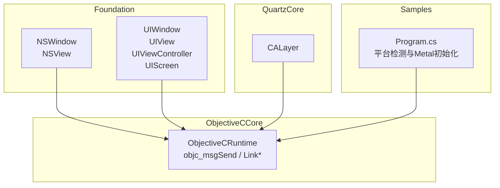
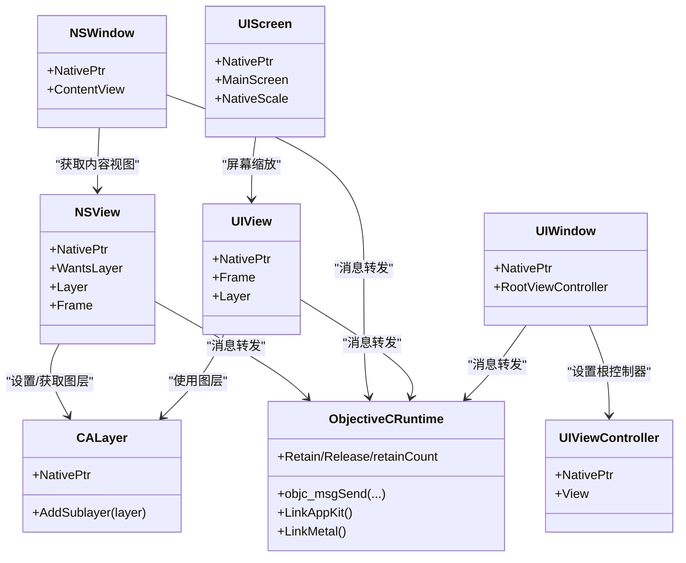
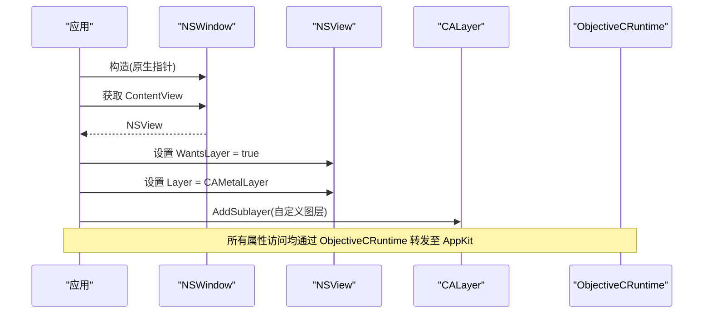
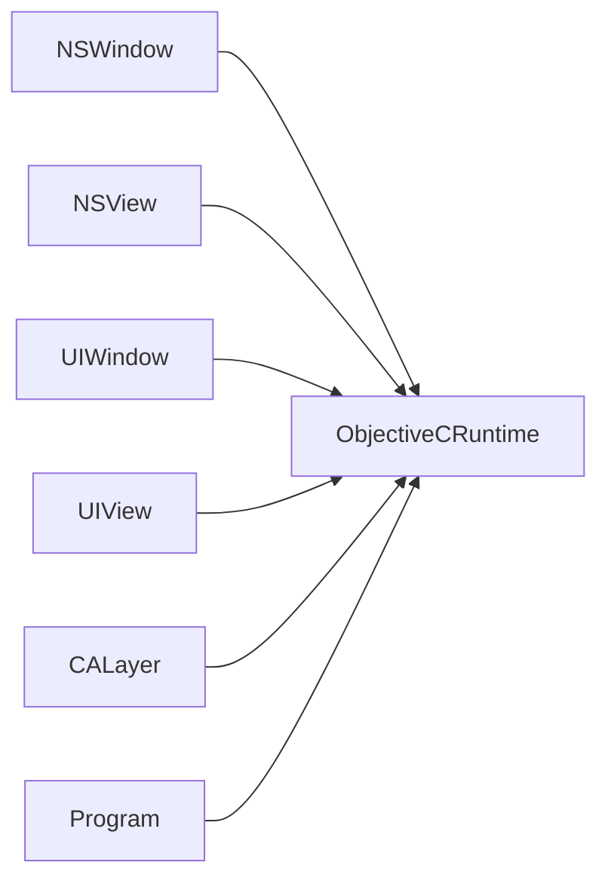

# 窗口管理

<cite>
**本文引用的文件**
- [NSWindow.cs](file://src/SharpMetal/Foundation/NSWindow.cs)
- [UIWindow.cs](file://src/SharpMetal/Foundation/UIWindow.cs)
- [ObjectiveCRuntime.cs](file://src/SharpMetal/ObjectiveCCore/ObjectiveCRuntime.cs)
- [CALayer.cs](file://src/SharpMetal/QuartzCore/CALayer.cs)
- [Program.cs](file://samples/SharpMetal.Sample/Program.cs)
</cite>

## 目录
1. [简介](#简介)
2. [项目结构](#项目结构)
3. [核心组件](#核心组件)
4. [架构总览](#架构总览)
5. [详细组件分析](#详细组件分析)
6. [依赖关系分析](#依赖关系分析)
7. [性能考虑](#性能考虑)
8. [故障排查指南](#故障排查指南)
9. [结论](#结论)
10. [附录](#附录)

## 简介
本文件面向使用 SharpMetal 进行跨平台（macOS/iOS/MacCatalyst）图形应用开发的工程师，聚焦于“窗口管理”能力。仓库当前提供了对 macOS AppKit 与 iOS UIKit 的底层桥接类型：
- NSWindow 与 NSView：用于 macOS 下的窗口与视图容器，支持设置内容视图、图层、帧等基础属性。
- UIWindow、UIView、UIViewController、UIScreen：用于 iOS 下的窗口、视图、控制器与屏幕信息。
- ObjectiveCRuntime：提供 Objective-C 运行时调用封装，用于访问系统框架（AppKit/UIKit/CoreGraphics/Metal）。
- CALayer：用于图层层次结构的子层添加。

本文档将基于现有代码，梳理窗口创建、显示/隐藏、生命周期、尺寸与位置、视图层次、事件处理与用户交互的可用能力，并给出跨平台注意事项与兼容性建议。

## 项目结构
与窗口管理直接相关的源码位于 Foundation 与 QuartzCore 命名空间，并通过 ObjectiveCCore 与系统框架交互；示例程序位于 samples 目录，展示了在 Apple 平台上初始化 Metal 设备与共享缓冲的基本流程。

图表来源
- [NSWindow.cs:8-54](file://src/SharpMetal/Foundation/NSWindow.cs#L8-L54)
- [UIWindow.cs:7-57](file://src/SharpMetal/Foundation/UIWindow.cs#L7-L57)
- [CALayer.cs:5-19](file://src/SharpMetal/QuartzCore/CALayer.cs#L5-L19)
- [ObjectiveCRuntime.cs:33-839](file://src/SharpMetal/ObjectiveCCore/ObjectiveCRuntime.cs#L33-L839)
- [Program.cs:10-45](file://samples/SharpMetal.Sample/Program.cs#L10-L45)

章节来源
- [NSWindow.cs:8-54](file://src/SharpMetal/Foundation/NSWindow.cs#L8-L54)
- [UIWindow.cs:7-57](file://src/SharpMetal/Foundation/UIWindow.cs#L7-L57)
- [ObjectiveCRuntime.cs:33-839](file://src/SharpMetal/ObjectiveCCore/ObjectiveCRuntime.cs#L33-L839)
- [CALayer.cs:5-19](file://src/SharpMetal/QuartzCore/CALayer.cs#L5-L19)
- [Program.cs:10-45](file://samples/SharpMetal.Sample/Program.cs#L10-L45)

## 核心组件
- NSWindow（macOS）
  - 通过 NativePtr 持有原生指针，暴露 ContentView 以获取内容视图。
  - 配合 NSView 可设置 WantsLayer、Layer、Frame 等属性，从而接入 CALayer 与渲染管线。
- NSView（macOS）
  - 提供 Frame 读写、WantsLayer 开关、Layer 获取/设置，便于将 Metal 渲染目标挂载到视图层级。
- UIWindow（iOS）
  - 暴露 RootViewController，用于建立基于控制器的 UI 层次。
- UIView（iOS）
  - 提供 Frame 与 Layer，便于配置视图几何与图层树。
- UIScreen（iOS）
  - 提供 mainScreen 与 nativeScale，用于适配不同密度屏幕。
- CALayer（通用）
  - 提供 AddSublayer，用于构建图层层次。
- ObjectiveCRuntime
  - 提供 objc_msgSend 重载族、LinkAppKit/LinkMetal/LinkCoreGraphics 等动态加载方法，以及 Retain/Release/retainCount 内存管理辅助。

章节来源
- [NSWindow.cs:8-54](file://src/SharpMetal/Foundation/NSWindow.cs#L8-L54)
- [UIWindow.cs:7-57](file://src/SharpMetal/Foundation/UIWindow.cs#L7-L57)
- [CALayer.cs:5-19](file://src/SharpMetal/QuartzCore/CALayer.cs#L5-L19)
- [ObjectiveCRuntime.cs:33-839](file://src/SharpMetal/ObjectiveCCore/ObjectiveCRuntime.cs#L33-L839)

## 架构总览
下图展示窗口与视图、图层、运行时之间的依赖关系，以及示例程序如何驱动平台能力。

图表来源
- [NSWindow.cs:8-54](file://src/SharpMetal/Foundation/NSWindow.cs#L8-L54)
- [UIWindow.cs:7-57](file://src/SharpMetal/Foundation/UIWindow.cs#L7-L57)
- [CALayer.cs:5-19](file://src/SharpMetal/QuartzCore/CALayer.cs#L5-L19)
- [ObjectiveCRuntime.cs:33-839](file://src/SharpMetal/ObjectiveCCore/ObjectiveCRuntime.cs#L33-L839)

## 详细组件分析

### NSWindow（macOS）
- 作用：表示一个窗口实例，提供对内容视图的访问，以便在其上放置视图和图层。
- 关键成员
  - ContentView：返回 NSView，作为窗口的内容容器。
- 关联能力（通过 NSView）
  - WantsLayer：是否启用图层化视图。
  - Layer：获取或设置 CALayer，用于 Metal 渲染。
  - Frame：设置窗口/视图的尺寸与位置。
- 典型用法
  - 创建 NSWindow 后，获取 ContentView，设置其 Frame 与 Layer，并将 CAMetalLayer 作为子层加入，完成渲染目标绑定。

图表来源
- [NSWindow.cs:47-54](file://src/SharpMetal/Foundation/NSWindow.cs#L47-L54)
- [NSWindow.cs:8-45](file://src/SharpMetal/Foundation/NSWindow.cs#L8-L45)
- [CALayer.cs:13-18](file://src/SharpMetal/QuartzCore/CALayer.cs#L13-L18)
- [ObjectiveCRuntime.cs:33-839](file://src/SharpMetal/ObjectiveCCore/ObjectiveCRuntime.cs#L33-L839)

章节来源
- [NSWindow.cs:8-54](file://src/SharpMetal/Foundation/NSWindow.cs#L8-L54)

### NSView（macOS）
- 作用：窗口内容容器，承载视图与图层。
- 关键成员
  - WantsLayer：布尔值，决定是否使用图层。
  - Layer：CALayer 引用，用于 Metal 渲染。
  - Frame：CGRect 结构体，描述位置与尺寸。
- 注意
  - Frame 读取在不同架构下采用不同的消息发送方式（stret），以保证返回值正确传递。

章节来源
- [NSWindow.cs:8-45](file://src/SharpMetal/Foundation/NSWindow.cs#L8-L45)

### UIWindow（iOS）
- 作用：iOS 应用的顶层窗口，负责承载根视图控制器。
- 关键成员
  - RootViewController：获取根控制器，用于组织视图层次。
- 配套类型
  - UIView：提供 Frame 与 Layer。
  - UIViewController：提供 View 属性。
  - UIScreen：提供 mainScreen 与 nativeScale，用于屏幕缩放与分辨率适配。

章节来源
- [UIWindow.cs:7-57](file://src/SharpMetal/Foundation/UIWindow.cs#L7-L57)

### CALayer（通用）
- 作用：图层容器，支持添加子层，常用于 Metal 渲染目标（如 CAMetalLayer）。
- 关键成员
  - AddSublayer：向图层树中添加子层。

章节来源
- [CALayer.cs:5-19](file://src/SharpMetal/QuartzCore/CALayer.cs#L5-L19)

### ObjectiveCRuntime（运行时桥接）
- 作用：封装 Objective-C 消息发送与框架动态加载，使 C# 能调用 AppKit/UIKit/CoreGraphics/Metal。
- 关键能力
  - objc_msgSend 重载族：按参数类型与返回类型分派消息。
  - LinkAppKit/LinkMetal/LinkCoreGraphics：按需加载系统框架。
  - Retain/Release/retainCount：对象生命周期辅助。
  - CGRect_objc_msgSend：用于获取 CGRect 返回值。
- 重要说明
  - 所有窗口与视图的属性访问最终都通过此模块转发到系统框架。

章节来源
- [ObjectiveCRuntime.cs:33-839](file://src/SharpMetal/ObjectiveCCore/ObjectiveCRuntime.cs#L33-L839)

### 示例程序（Platform 检测与 Metal 初始化）
- 作用：演示在 Apple 平台上运行，并验证 Metal 设备与共享缓冲的读写。
- 关键点
  - 平台检测：仅在 macOS/iOS/MacCatalyst 上继续执行。
  - 资源释放：在 finally 中释放设备与缓冲的原生指针。

章节来源
- [Program.cs:10-45](file://samples/SharpMetal.Sample/Program.cs#L10-L45)

## 依赖关系分析
- NSWindow/NSView/UIWindow/UIView 均依赖 ObjectiveCRuntime 进行消息转发。
- NSView 与 UIView 通过 CALayer 接入图层体系，进而与 Metal 渲染管线对接。
- 示例程序依赖 ObjectiveCRuntime.Link* 系列方法确保所需框架已加载。

图表来源
- [NSWindow.cs:8-54](file://src/SharpMetal/Foundation/NSWindow.cs#L8-L54)
- [UIWindow.cs:7-57](file://src/SharpMetal/Foundation/UIWindow.cs#L7-L57)
- [CALayer.cs:5-19](file://src/SharpMetal/QuartzCore/CALayer.cs#L5-L19)
- [ObjectiveCRuntime.cs:33-839](file://src/SharpMetal/ObjectiveCCore/ObjectiveCRuntime.cs#L33-L839)
- [Program.cs:10-45](file://samples/SharpMetal.Sample/Program.cs#L10-L45)

章节来源
- [NSWindow.cs:8-54](file://src/SharpMetal/Foundation/NSWindow.cs#L8-L54)
- [UIWindow.cs:7-57](file://src/SharpMetal/Foundation/UIWindow.cs#L7-L57)
- [CALayer.cs:5-19](file://src/SharpMetal/QuartzCore/CALayer.cs#L5-L19)
- [ObjectiveCRuntime.cs:33-839](file://src/SharpMetal/ObjectiveCCore/ObjectiveCRuntime.cs#L33-L839)
- [Program.cs:10-45](file://samples/SharpMetal.Sample/Program.cs#L10-L45)

## 性能考虑
- 避免频繁更改 Frame/Layer：批量更新几何属性后再提交渲染，减少重绘与布局开销。
- 合理使用 WantsLayer：仅对需要图层能力的视图开启，降低内存占用。
- 谨慎使用 AddSublayer：图层树过深会影响合成性能，尽量扁平化。
- 利用 nativeScale：在 iOS 上根据屏幕缩放因子计算逻辑像素，避免过度绘制。
- 及时释放原生资源：遵循 Retain/Release 语义，防止内存泄漏。

[本节为通用指导，不直接分析具体文件]

## 故障排查指南
- 平台不支持：若不在 macOS/iOS/MacCatalyst，示例程序会直接退出。请确认运行环境。
- 无 Metal 设备：当 MTLDevice 创建失败时，检查 GPU 驱动与系统版本。
- 共享缓冲读写异常：确认缓冲区大小与写入范围一致，并在 finally 中释放资源。
- 框架未加载：如需使用 AppKit/UIKit/CoreGraphics，请先调用对应的 Link* 方法。

章节来源
- [Program.cs:10-45](file://samples/SharpMetal.Sample/Program.cs#L10-L45)
- [ObjectiveCRuntime.cs:814-832](file://src/SharpMetal/ObjectiveCCore/ObjectiveCRuntime.cs#L814-L832)

## 结论
当前仓库提供了跨平台窗口管理的底层基元：
- macOS：NSWindow/NSView 结合 CALayer，可用于挂载 Metal 渲染目标。
- iOS：UIWindow/UIView/UIViewController/UIScreen 提供完整的视图与屏幕抽象。
- 所有操作通过 ObjectiveCRuntime 与系统框架交互，具备高内聚、低耦合的特点。
对于更高级的窗口生命周期（如初始化、激活、退出）、显示/隐藏、事件处理与用户交互，可在上述基元基础上扩展更多 API 封装。

[本节为总结性内容，不直接分析具体文件]

## 附录

### 窗口生命周期与事件处理的现状与建议
- 现状
  - 仓库未提供显式的“初始化/激活/退出”生命周期钩子或“显示/隐藏”API 的直接封装。
  - 事件处理与用户交互也未在当前文件中暴露。
- 建议
  - 在 NSWindow/NSView 之上封装生命周期回调（如 didBecomeKey、willResignActive、windowWillClose 等），通过 ObjectiveCRuntime 注册代理或选择器。
  - 在 UIWindow/UIViewController 之上封装生命周期（viewDidLoad、viewWillAppear、viewWillDisappear 等）。
  - 统一封装显示/隐藏（如 makeKeyAndOrderFront、orderOut）与事件分发（鼠标/触摸/键盘）。

[本节为概念性建议，不直接分析具体文件]

### 窗口尺寸、位置与视图层次设置要点
- 尺寸与位置
  - macOS：通过 NSView.Frame 设置 CGRect，注意坐标系与缩放。
  - iOS：通过 UIView.Frame 与 UIScreen.nativeScale 进行适配。
- 视图层次
  - 使用 CALayer.AddSublayer 将渲染目标（如 CAMetalLayer）加入视图层级。
  - 保持图层树简洁，避免过深的嵌套。

章节来源
- [NSWindow.cs:27-45](file://src/SharpMetal/Foundation/NSWindow.cs#L27-L45)
- [UIWindow.cs:23-35](file://src/SharpMetal/Foundation/UIWindow.cs#L23-L35)
- [CALayer.cs:13-18](file://src/SharpMetal/QuartzCore/CALayer.cs#L13-L18)

### 跨平台注意事项与兼容性
- 平台检测：参考示例程序的 OperatingSystem 判断，确保只在 Apple 平台运行。
- 架构差异：NSView.Frame 读取在 Arm64 与非 Arm64 下采用不同消息发送路径，需保证 ABI 一致。
- 框架加载：按需调用 LinkAppKit/LinkMetal/LinkCoreGraphics，避免不必要的依赖。
- 内存管理：遵循 Retain/Release，避免悬垂指针与内存泄漏。

章节来源
- [Program.cs:10-20](file://samples/SharpMetal.Sample/Program.cs#L10-L20)
- [NSWindow.cs:27-36](file://src/SharpMetal/Foundation/NSWindow.cs#L27-L36)
- [ObjectiveCRuntime.cs:814-832](file://src/SharpMetal/ObjectiveCCore/ObjectiveCRuntime.cs#L814-L832)