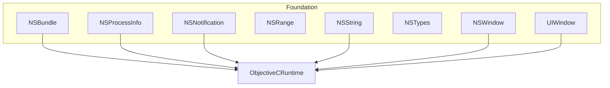
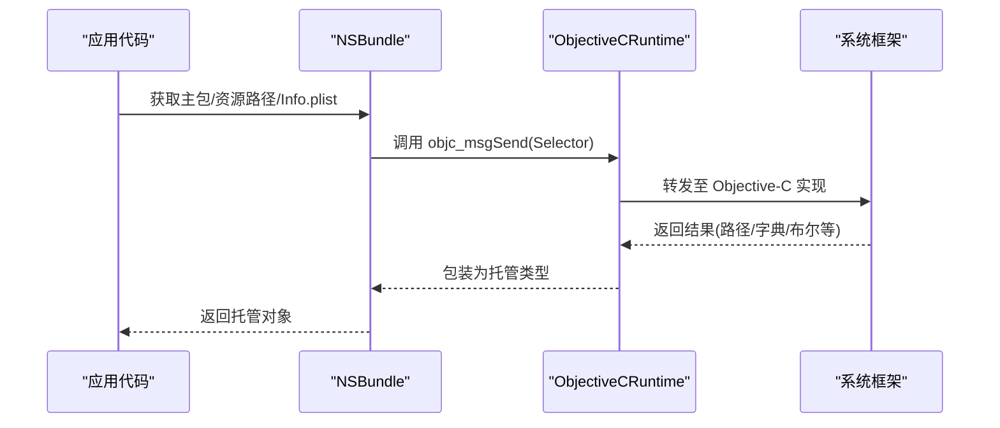
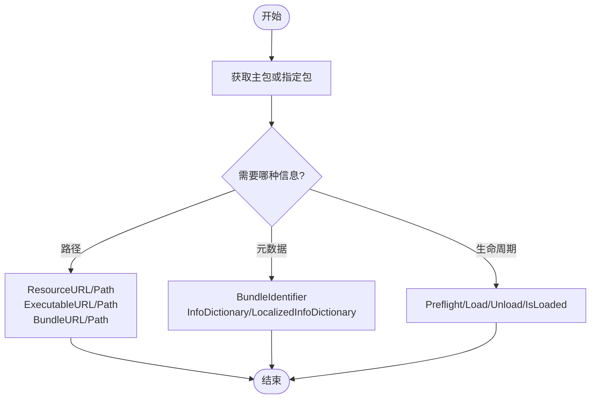
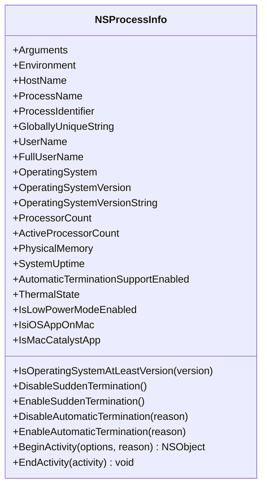
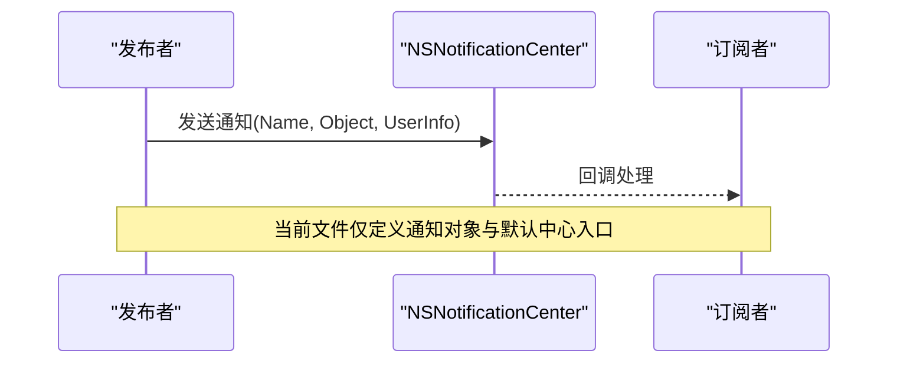
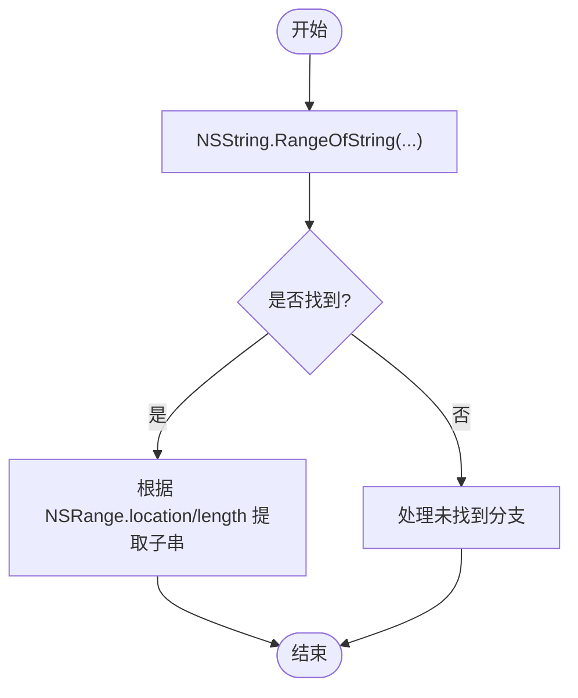
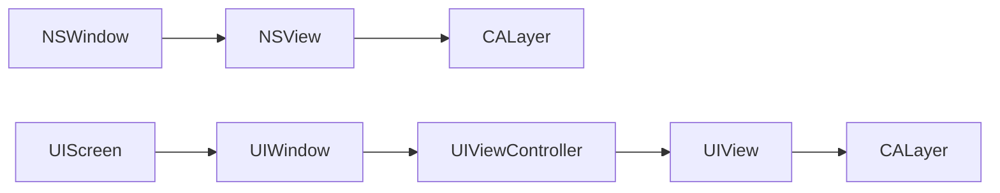
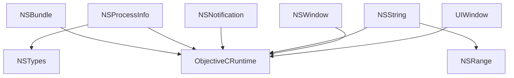

# 系统集成

<cite>
**本文引用的文件**
- [NSBundle.cs](file://src/SharpMetal/Foundation/NSBundle.cs)
- [NSProcessInfo.cs](file://src/SharpMetal/Foundation/NSProcessInfo.cs)
- [NSNotification.cs](file://src/SharpMetal/Foundation/NSNotification.cs)
- [NSRange.cs](file://src/SharpMetal/Foundation/NSRange.cs)
- [NSString.cs](file://src/SharpMetal/Foundation/NSString.cs)
- [NSTypes.cs](file://src/SharpMetal/Foundation/NSTypes.cs)
- [NSWindow.cs](file://src/SharpMetal/Foundation/NSWindow.cs)
- [UIWindow.cs](file://src/SharpMetal/Foundation/UIWindow.cs)
- [ObjectiveCRuntime.cs](file://src/SharpMetal/ObjectiveCCore/ObjectiveCRuntime.cs)
</cite>

## 目录
1. [简介](#简介)
2. [项目结构](#项目结构)
3. [核心组件](#核心组件)
4. [架构总览](#架构总览)
5. [详细组件分析](#详细组件分析)
6. [依赖关系分析](#依赖关系分析)
7. [性能注意事项](#性能注意事项)
8. [故障排查指南](#故障排查指南)
9. [结论](#结论)
10. [附录](#附录)

## 简介
本文件聚焦于 SharpMetal 的 Foundation 层系统集成功能，围绕以下主题提供 API 级说明与最佳实践：
- NSBundle：资源包管理与应用程序信息获取
- NSProcessInfo：进程信息与系统环境访问
- NSNotification：事件发布订阅机制（通知中心）
- NSRange：范围结构与字符串处理集成
- NSWindow / UIWindow：窗口管理的基本能力
- 系统集成最佳实践与常见问题解决方案

## 项目结构
Foundation 子系统位于 src/SharpMetal/Foundation，通过 ObjectiveC 运行时桥接到系统框架。关键文件职责如下：
- NSBundle.cs：封装资源包、可执行体、框架路径与信息字典等
- NSProcessInfo.cs：暴露进程参数、环境变量、系统版本、CPU/内存、热状态等
- NSNotification.cs：定义通知对象与默认通知中心
- NSRange.cs：定义 location/length 的范围结构
- NSString.cs：字符串类型及与 NSRange 的集成方法
- NSTypes.cs：系统版本结构等基础类型
- NSWindow.cs：macOS 窗口与视图相关能力
- UIWindow.cs：iOS/mac Catalyst 屏幕、视图控制器与窗口能力
- ObjectiveCRuntime.cs：底层消息发送与类型转换支撑

图表来源
- [NSBundle.cs:1-150](file://src/SharpMetal/Foundation/NSBundle.cs#L1-L150)
- [NSProcessInfo.cs:1-148](file://src/SharpMetal/Foundation/NSProcessInfo.cs#L1-L148)
- [NSNotification.cs:1-37](file://src/SharpMetal/Foundation/NSNotification.cs#L1-L37)
- [NSRange.cs:1-12](file://src/SharpMetal/Foundation/NSRange.cs#L1-L12)
- [NSString.cs:1-188](file://src/SharpMetal/Foundation/NSString.cs#L1-L188)
- [NSTypes.cs:1-13](file://src/SharpMetal/Foundation/NSTypes.cs#L1-L13)
- [NSWindow.cs:1-56](file://src/SharpMetal/Foundation/NSWindow.cs#L1-L56)
- [UIWindow.cs:1-58](file://src/SharpMetal/Foundation/UIWindow.cs#L1-L58)
- [ObjectiveCRuntime.cs:1-200](file://src/SharpMetal/ObjectiveCCore/ObjectiveCRuntime.cs#L1-L200)

章节来源
- [NSBundle.cs:1-150](file://src/SharpMetal/Foundation/NSBundle.cs#L1-L150)
- [NSProcessInfo.cs:1-148](file://src/SharpMetal/Foundation/NSProcessInfo.cs#L1-L148)
- [NSNotification.cs:1-37](file://src/SharpMetal/Foundation/NSNotification.cs#L1-L37)
- [NSRange.cs:1-12](file://src/SharpMetal/Foundation/NSRange.cs#L1-L12)
- [NSString.cs:1-188](file://src/SharpMetal/Foundation/NSString.cs#L1-L188)
- [NSTypes.cs:1-13](file://src/SharpMetal/Foundation/NSTypes.cs#L1-L13)
- [NSWindow.cs:1-56](file://src/SharpMetal/Foundation/NSWindow.cs#L1-L56)
- [UIWindow.cs:1-58](file://src/SharpMetal/Foundation/UIWindow.cs#L1-L58)
- [ObjectiveCRuntime.cs:1-200](file://src/SharpMetal/ObjectiveCCore/ObjectiveCRuntime.cs#L1-L200)

## 核心组件
- NSBundle：提供主包、资源路径、可执行体路径、框架路径、应用商店收据路径、Info.plist 键值读取、预检与加载等能力。
- NSProcessInfo：提供进程名、标识符、主机名、用户信息、操作系统版本、处理器数量、物理内存、系统运行时间、热状态、低功耗模式、自动终止控制、活动生命周期管理等。
- NSNotification：通知对象包含名称、对象、用户信息；NSNotificationCenter 提供默认中心入口。
- NSRange：由 location 与 length 组成的范围结构，用于字符串与集合操作。
- NSString：字符串构造、长度、编码转换、查找子串返回 NSRange、拼接、比较等。
- NSWindow/UIWindow：macOS 与 iOS/Catalyst 的窗口、视图、控制器与屏幕能力。

章节来源
- [NSBundle.cs:1-150](file://src/SharpMetal/Foundation/NSBundle.cs#L1-L150)
- [NSProcessInfo.cs:1-148](file://src/SharpMetal/Foundation/NSProcessInfo.cs#L1-L148)
- [NSNotification.cs:1-37](file://src/SharpMetal/Foundation/NSNotification.cs#L1-L37)
- [NSRange.cs:1-12](file://src/SharpMetal/Foundation/NSRange.cs#L1-L12)
- [NSString.cs:1-188](file://src/SharpMetal/Foundation/NSString.cs#L1-L188)
- [NSWindow.cs:1-56](file://src/SharpMetal/Foundation/NSWindow.cs#L1-L56)
- [UIWindow.cs:1-58](file://src/SharpMetal/Foundation/UIWindow.cs#L1-L58)

## 架构总览
Foundation 组件通过 ObjectiveC 运行时进行消息转发，统一使用 ObjectiveCRuntime 提供的 objc_msgSend 变体完成跨语言调用。各组件以 struct 形式持有 NativePtr，并通过 Selector 常量映射到 Objective-C 方法名。

图表来源
- [NSBundle.cs:1-150](file://src/SharpMetal/Foundation/NSBundle.cs#L1-L150)
- [ObjectiveCRuntime.cs:1-200](file://src/SharpMetal/ObjectiveCCore/ObjectiveCRuntime.cs#L1-L200)

## 详细组件分析

### NSBundle：资源包管理与应用信息
- 主要能力
  - 获取主包：MainBundle()
  - 按路径或 URL 创建包实例：Bundle(in NSString), Bundle(in NSURL)
  - 资源与可执行体路径：ResourceURL/Path, ExecutableURL/Path, BundleURL/Path
  - 框架路径：PrivateFrameworksURL/Path, SharedFrameworksURL/Path, SharedSupportURL/Path, BuiltInPlugInsURL/Path
  - 应用商店收据：AppStoreReceiptURL
  - 包元数据：BundleIdentifier, InfoDictionary, LocalizedInfoDictionary, ObjectForInfoDictionaryKey
  - 包生命周期：Load/Unload/IsLoaded, PreflightAndReturnError, LoadAndReturnError
  - 辅助可执行体：URLForAuxiliaryExecutable, PathForAuxiliaryExecutable
- 典型用法
  - 读取应用信息：通过 InfoDictionary 或 ObjectForInfoDictionaryKey 获取版本号、名称等
  - 定位资源：优先使用 ResourceURL/Path 组合，避免硬编码路径
  - 安全加载：使用 PreflightAndReturnError/LoadAndReturnError 捕获错误并回退
- 复杂度与性能
  - 路径查询与 Info.plist 读取通常为 O(1)~O(n)（取决于字典大小），频繁调用建议缓存结果
  - 预检与加载可能涉及磁盘 IO，应避免在热路径中重复调用

图表来源
- [NSBundle.cs:1-150](file://src/SharpMetal/Foundation/NSBundle.cs#L1-L150)

章节来源
- [NSBundle.cs:1-150](file://src/SharpMetal/Foundation/NSBundle.cs#L1-L150)

### NSProcessInfo：进程信息与系统环境
- 主要能力
  - 进程与环境：Arguments, Environment, HostName, ProcessName(get/set), ProcessIdentifier, GloballyUniqueString, UserName, FullUserName
  - 系统与硬件：OperatingSystem, OperatingSystemVersion, OperatingSystemVersionString, ProcessorCount, ActiveProcessorCount, PhysicalMemory, SystemUptime
  - 行为控制：AutomaticTerminationSupportEnabled(get/set), DisableSuddenTermination/EnableSuddenTermination, DisableAutomaticTermination/EnableAutomaticTermination
  - 活动生命周期：BeginActivity(options, reason), EndActivity(activity)
  - 设备特性：ThermalState, IsLowPowerModeEnabled, IsiOSAppOnMac, IsMacCatalystApp
  - 版本判断：IsOperatingSystemAtLeastVersion(version)
- 典型用法
  - 根据 CPU/内存自适应策略：依据 ProcessorCount/PhysicalMemory 调整渲染线程数或资源占用
  - 热节流适配：根据 ThermalState 降低功耗或降级功能
  - 平台分支：基于 IsiOSAppOnMac/IsMacCatalystApp 选择不同 UI/输入逻辑
- 复杂度与性能
  - 属性读取多为 O(1)，但频繁轮询会影响功耗；建议按需缓存或监听变化
  - 活动生命周期需成对调用 Begin/End，避免泄漏

图表来源
- [NSProcessInfo.cs:1-148](file://src/SharpMetal/Foundation/NSProcessInfo.cs#L1-L148)

章节来源
- [NSProcessInfo.cs:1-148](file://src/SharpMetal/Foundation/NSProcessInfo.cs#L1-L148)

### NSNotification：事件发布订阅机制
- 主要能力
  - NSNotification：Name, Object, UserInfo
  - NSNotificationCenter：DefaultCenter()
- 事件模型说明
  - 当前文件定义了通知对象与默认中心的入口，但未暴露发布/订阅方法。实际发布/订阅通常由系统框架提供，可通过扩展或后续版本补充。
  - 建议在应用中封装统一的“事件总线”，将业务事件映射为通知名称，并通过 DefaultCenter 进行分发。
- 典型用法
  - 订阅：注册监听特定 Name 的通知，回调中处理 Object/UserInfo
  - 发布：构造 NSNotification 并发送到 DefaultCenter
  - 解绑：在适当生命周期移除监听，避免内存泄漏

图表来源
- [NSNotification.cs:1-37](file://src/SharpMetal/Foundation/NSNotification.cs#L1-L37)

章节来源
- [NSNotification.cs:1-37](file://src/SharpMetal/Foundation/NSNotification.cs#L1-L37)

### NSRange：范围结构与字符串处理集成
- 数据结构
  - NSRange：location, length 均为无符号整数，表示起始位置与长度
- 与 NSString 的集成
  - RangeOfString(pString, options)：返回匹配子串的范围
  - 结合 Length、Character(index)、CString(encoding) 可实现高效子串提取与比较
- 复杂度与性能
  - 查找操作通常为 O(n)，大量文本处理建议批量预处理或使用更高级算法
  - 注意边界检查，避免越界访问

图表来源
- [NSRange.cs:1-12](file://src/SharpMetal/Foundation/NSRange.cs#L1-L12)
- [NSString.cs:1-188](file://src/SharpMetal/Foundation/NSString.cs#L1-L188)

章节来源
- [NSRange.cs:1-12](file://src/SharpMetal/Foundation/NSRange.cs#L1-L12)
- [NSString.cs:1-188](file://src/SharpMetal/Foundation/NSString.cs#L1-L188)

### NSWindow 与 UIWindow：窗口管理基本功能
- macOS (NSWindow)
  - NSView：WantsLayer/Layer 设置，Frame 读写
  - NSWindow：ContentView 获取，便于嵌入自定义内容
- iOS/mac Catalyst (UIWindow)
  - UIScreen：MainScreen, NativeScale
  - UIView：Frame, Layer
  - UIViewController：View
  - UIWindow：RootViewController
- 典型用法
  - 在 macOS 上通过 NSWindow.ContentView 挂载视图层级
  - 在 iOS/Catalyst 上通过 UIWindow.RootViewController 初始化界面树
  - 使用 UIScreen.MainScreen.NativeScale 处理高分屏缩放

图表来源
- [NSWindow.cs:1-56](file://src/SharpMetal/Foundation/NSWindow.cs#L1-L56)
- [UIWindow.cs:1-58](file://src/SharpMetal/Foundation/UIWindow.cs#L1-L58)

章节来源
- [NSWindow.cs:1-56](file://src/SharpMetal/Foundation/NSWindow.cs#L1-L56)
- [UIWindow.cs:1-58](file://src/SharpMetal/Foundation/UIWindow.cs#L1-L58)

## 依赖关系分析
- 所有 Foundation 组件均依赖 ObjectiveCRuntime 进行消息发送与类型转换
- NSString 与 NSRange 紧密耦合，常用于字符串检索与切片
- NSBundle 与 NSString/NSURL/NSDictionary 协作，完成资源与元数据访问
- NSProcessInfo 与 NSTypes(NSOperatingSystemVersion) 协作，完成系统版本判断
- NSWindow/UIWindow 依赖 QuartzCore 的 CALayer 与 Metal 的类型（如 CGRect）

图表来源
- [NSBundle.cs:1-150](file://src/SharpMetal/Foundation/NSBundle.cs#L1-L150)
- [NSProcessInfo.cs:1-148](file://src/SharpMetal/Foundation/NSProcessInfo.cs#L1-L148)
- [NSNotification.cs:1-37](file://src/SharpMetal/Foundation/NSNotification.cs#L1-L37)
- [NSString.cs:1-188](file://src/SharpMetal/Foundation/NSString.cs#L1-L188)
- [NSRange.cs:1-12](file://src/SharpMetal/Foundation/NSRange.cs#L1-L12)
- [NSWindow.cs:1-56](file://src/SharpMetal/Foundation/NSWindow.cs#L1-L56)
- [UIWindow.cs:1-58](file://src/SharpMetal/Foundation/UIWindow.cs#L1-L58)
- [NSTypes.cs:1-13](file://src/SharpMetal/Foundation/NSTypes.cs#L1-L13)
- [ObjectiveCRuntime.cs:1-200](file://src/SharpMetal/ObjectiveCCore/ObjectiveCRuntime.cs#L1-L200)

章节来源
- [ObjectiveCRuntime.cs:1-200](file://src/SharpMetal/ObjectiveCCore/ObjectiveCRuntime.cs#L1-L200)

## 性能注意事项
- 减少重复的系统调用：对 Bundle 路径、Info.plist、进程信息等做合理缓存
- 避免热路径中的 IO：预检与加载仅在必要时执行，并捕获错误快速失败
- 合理使用活动生命周期：BeginActivity/EndActivity 成对使用，避免长时间占用系统资源
- 字符串处理优化：大范围搜索前考虑分块或索引；注意 NSRange 边界检查
- 多平台差异：macOS 与 iOS/Catalyst 的窗口与屏幕 API 不同，应条件编译或运行时分支

## 故障排查指南
- 资源路径为空或不可用
  - 检查是否通过 ResourceURL/Path 而非硬编码路径
  - 使用 PreflightAndReturnError/LoadAndReturnError 捕获错误并记录
- 进程信息异常
  - 确认权限与环境变量可用；对于敏感信息（用户名等）做好空值处理
  - 热状态与低功耗模式变化时，及时降级功能
- 通知未触发
  - 确认订阅已注册且未提前释放；确保发布与订阅的名称一致
  - 当前文件未暴露发布/订阅方法，需在更高层实现或等待扩展
- 字符串越界
  - 使用 RangeOfString 后校验 location/length 是否在有效范围内
  - 结合 Length 与 Character(index) 进行边界保护
- 窗口与视图问题
  - macOS：确保 NSView.WantsLayer 与 Layer 正确设置后再绘制
  - iOS/Catalyst：先设置 UIWindow.RootViewController，再访问其 View

章节来源
- [NSBundle.cs:1-150](file://src/SharpMetal/Foundation/NSBundle.cs#L1-L150)
- [NSProcessInfo.cs:1-148](file://src/SharpMetal/Foundation/NSProcessInfo.cs#L1-L148)
- [NSNotification.cs:1-37](file://src/SharpMetal/Foundation/NSNotification.cs#L1-L37)
- [NSString.cs:1-188](file://src/SharpMetal/Foundation/NSString.cs#L1-L188)
- [NSWindow.cs:1-56](file://src/SharpMetal/Foundation/NSWindow.cs#L1-L56)
- [UIWindow.cs:1-58](file://src/SharpMetal/Foundation/UIWindow.cs#L1-L58)

## 结论
SharpMetal 的 Foundation 层提供了与系统交互的关键能力：资源与元数据访问（NSBundle）、进程与环境信息（NSProcessInfo）、通知机制骨架（NSNotification）、字符串与范围处理（NSString/NSRange）、以及跨平台的窗口能力（NSWindow/UIWindow）。通过 ObjectiveCRuntime 的统一桥接，开发者可以在 .NET 环境中高效地调用系统 API。建议在实际项目中结合缓存、错误处理与平台分支，构建健壮的系统集成方案。

## 附录
- 常用组合示例（概念性）
  - 启动阶段：获取主包与 Info.plist，读取应用版本与名称
  - 运行时：根据 NSProcessInfo 的热状态与内存情况动态调整资源加载
  - 字符串处理：使用 NSString.RangeOfString 定位关键字，并用 NSRange 提取片段
  - 窗口初始化：macOS 使用 NSWindow.ContentView，iOS/Catalyst 使用 UIWindow.RootViewController
- 参考文件路径
  - [NSBundle.cs](file://src/SharpMetal/Foundation/NSBundle.cs)
  - [NSProcessInfo.cs](file://src/SharpMetal/Foundation/NSProcessInfo.cs)
  - [NSNotification.cs](file://src/SharpMetal/Foundation/NSNotification.cs)
  - [NSRange.cs](file://src/SharpMetal/Foundation/NSRange.cs)
  - [NSString.cs](file://src/SharpMetal/Foundation/NSString.cs)
  - [NSTypes.cs](file://src/SharpMetal/Foundation/NSTypes.cs)
  - [NSWindow.cs](file://src/SharpMetal/Foundation/NSWindow.cs)
  - [UIWindow.cs](file://src/SharpMetal/Foundation/UIWindow.cs)
  - [ObjectiveCRuntime.cs](file://src/SharpMetal/ObjectiveCCore/ObjectiveCRuntime.cs)