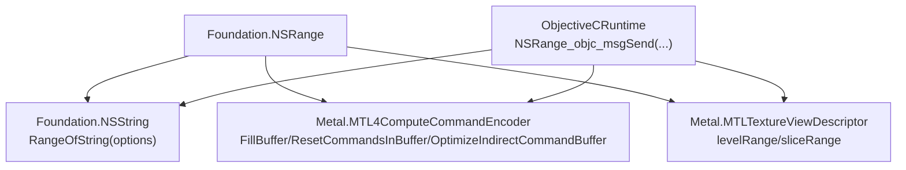
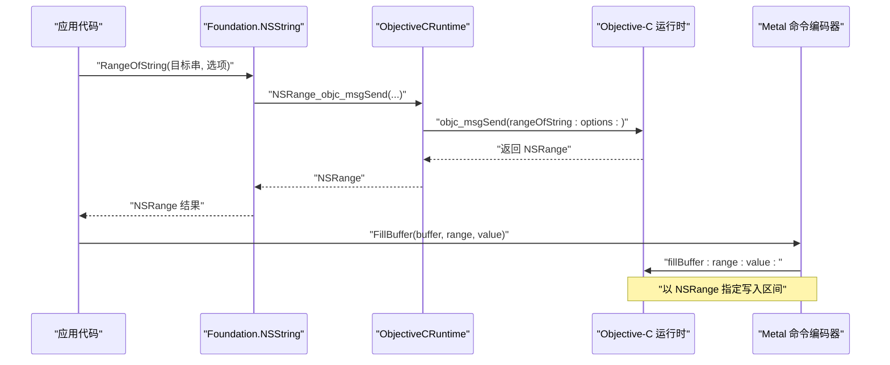
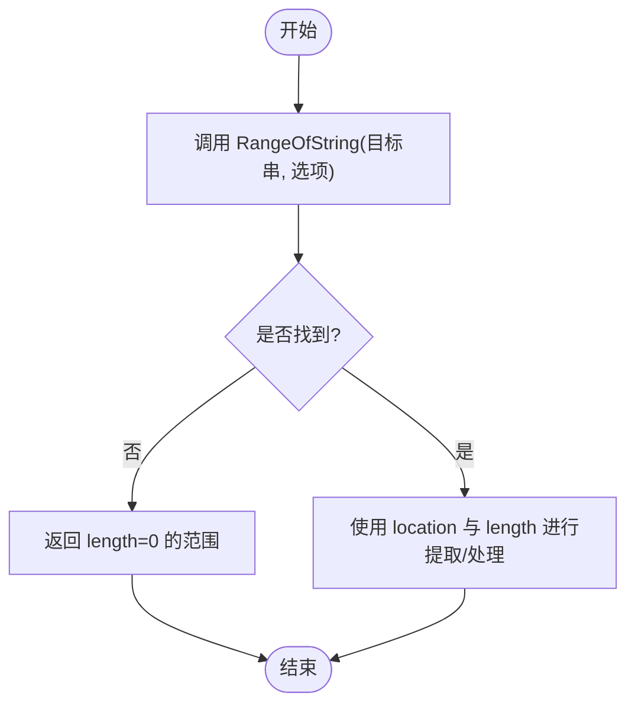
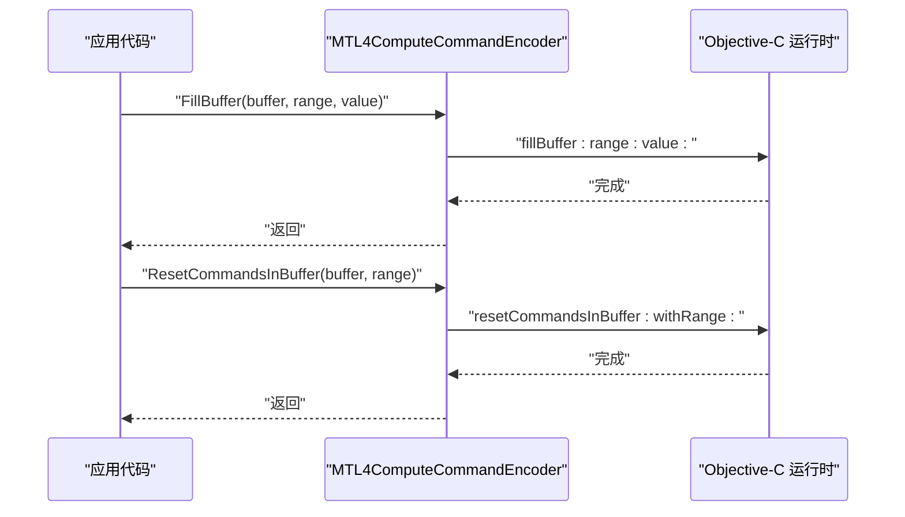
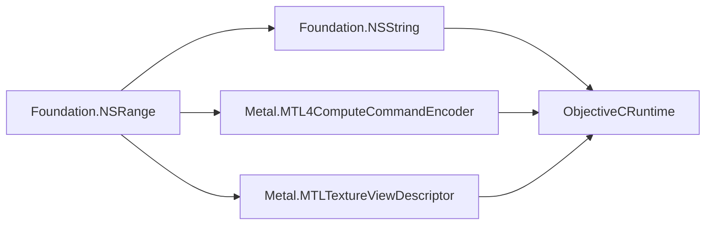

# 范围操作

<cite>
**本文引用的文件**
- [NSRange.cs](file://src/SharpMetal/Foundation/NSRange.cs)
- [NSString.cs](file://src/SharpMetal/Foundation/NSString.cs)
- [NSArray.cs](file://src/SharpMetal/Foundation/NSArray.cs)
- [NSTypes.cs](file://src/SharpMetal/Foundation/NSTypes.cs)
- [ObjectiveCRuntime.cs](file://src/SharpMetal/ObjectiveCCore/ObjectiveCRuntime.cs)
- [MTL4ComputeCommandEncoder.cs](file://src/SharpMetal/Metal/MTL4ComputeCommandEncoder.cs)
- [MTLTextureViewDescriptor.cs](file://src/SharpMetal/Metal/MTLTextureViewDescriptor.cs)
</cite>

## 目录
1. [简介](#简介)
2. [项目结构](#项目结构)
3. [核心组件](#核心组件)
4. [架构总览](#架构总览)
5. [详细组件分析](#详细组件分析)
6. [依赖关系分析](#依赖关系分析)
7. [性能注意事项](#性能注意事项)
8. [故障排查指南](#故障排查指南)
9. [结论](#结论)
10. [附录](#附录)

## 简介
本文件围绕 NSRange 的范围操作，提供面向开发者的 API 文档与使用指南。内容涵盖：
- NSRange 结构体的定义与用途（location、length 的含义）
- 字符串处理中的范围用法（子串提取、字符查找等）
- 与 Foundation 框架其他组件的集成方式
- 在数组与集合中的范围使用示例
- 常见范围计算模式与最佳实践
- 在 Metal 命令编码中基于范围的批量操作

## 项目结构
本项目将 NSRange 作为 Foundation 层的基础类型，广泛用于字符串、集合以及 Metal 命令编码等场景。关键文件组织如下：
- Foundation 层：NSRange、NSString、NSArray、NSTypes
- ObjectiveC 运行时桥接：ObjectiveCRuntime（负责消息转发与 NSRange 返回值封装）
- Metal 层：大量命令编码器方法以 NSRange 指定作用域（如填充缓冲区、重置间接命令缓冲、优化间接命令缓冲等）

图表来源
- [NSRange.cs:5-10](file://src/SharpMetal/Foundation/NSRange.cs#L5-L10)
- [NSString.cs:150-153](file://src/SharpMetal/Foundation/NSString.cs#L150-L153)
- [ObjectiveCRuntime.cs:345-348](file://src/SharpMetal/ObjectiveCCore/ObjectiveCRuntime.cs#L345-L348)
- [MTL4ComputeCommandEncoder.cs:114-151](file://src/SharpMetal/Metal/MTL4ComputeCommandEncoder.cs#L114-L151)
- [MTLTextureViewDescriptor.cs:28-34](file://src/SharpMetal/Metal/MTLTextureViewDescriptor.cs#L28-L34)

章节来源
- [NSRange.cs:5-10](file://src/SharpMetal/Foundation/NSRange.cs#L5-L10)
- [ObjectiveCRuntime.cs:345-348](file://src/SharpMetal/ObjectiveCCore/ObjectiveCRuntime.cs#L345-L348)

## 核心组件
- NSRange 结构体
  - 字段：
    - location：起始位置（从 0 开始的索引）
    - length：长度（元素个数）
  - 用途：统一表示“一段连续区间”，用于字符串、数组、纹理层级/切片、Metal 命令缓冲等
- NSString 对 NSRange 的使用
  - RangeOfString：根据选项返回匹配子串的范围
- NSArray 对 NSRange 的使用
  - 通过索引访问元素；可结合 NSRange 进行批量遍历或切片逻辑
- ObjectiveCRuntime 对 NSRange 的支持
  - NSRange_objc_msgSend：接收并返回 NSRange 的结构体值（通过 struct return 机制）
- Metal 命令编码器对 NSRange 的使用
  - FillBuffer、ResetCommandsInBuffer、OptimizeIndirectCommandBuffer 等方法以 NSRange 指定作用域
- MTLTextureViewDescriptor 对 NSRange 的使用
  - levelRange、sliceRange：用 NSRange 描述纹理视图的层级和切片范围

章节来源
- [NSRange.cs:5-10](file://src/SharpMetal/Foundation/NSRange.cs#L5-L10)
- [NSString.cs:150-153](file://src/SharpMetal/Foundation/NSString.cs#L150-L153)
- [NSArray.cs:19-25](file://src/SharpMetal/Foundation/NSArray.cs#L19-L25)
- [ObjectiveCRuntime.cs:345-348](file://src/SharpMetal/ObjectiveCCore/ObjectiveCRuntime.cs#L345-L348)
- [MTL4ComputeCommandEncoder.cs:114-151](file://src/SharpMetal/Metal/MTL4ComputeCommandEncoder.cs#L114-L151)
- [MTLTextureViewDescriptor.cs:28-34](file://src/SharpMetal/Metal/MTLTextureViewDescriptor.cs#L28-L34)

## 架构总览
下图展示了 NSRange 在系统中的角色与数据流：Foundation 层定义基础类型；NSString 通过 ObjectiveC 运行时调用底层方法返回 NSRange；Metal 命令编码器接收 NSRange 以限定操作范围；纹理视图描述符也用 NSRange 表达层级/切片范围。

图表来源
- [NSString.cs:150-153](file://src/SharpMetal/Foundation/NSString.cs#L150-L153)
- [ObjectiveCRuntime.cs:345-348](file://src/SharpMetal/ObjectiveCCore/ObjectiveCRuntime.cs#L345-L348)
- [MTL4ComputeCommandEncoder.cs:114-117](file://src/SharpMetal/Metal/MTL4ComputeCommandEncoder.cs#L114-L117)

## 详细组件分析

### NSRange 结构体
- 定义要点
  - 顺序布局，包含两个无符号整数：location 与 length
  - 语义：[location, location + length) 半开区间
- 复杂度与内存
  - 固定大小结构体，零分配，适合栈上快速传递
- 典型校验
  - 确保 length >= 0
  - 确保 location + length <= 容器容量（例如字符串长度、数组计数）

章节来源
- [NSRange.cs:5-10](file://src/SharpMetal/Foundation/NSRange.cs#L5-L10)

### NSString 与 NSRange：字符串查找与范围
- 查找子串
  - 使用 RangeOfString 获取匹配子串的范围
  - 支持多种比较选项（大小写、数字排序、正则等）
- 子串提取
  - 拿到 NSRange 后，可用 Character(index) 逐个读取或通过长度截取
- 边界检查建议
  - 若 length == 0，表示未找到或空匹配
  - 若 location + length > 字符串长度，需修正或报错

图表来源
- [NSString.cs:150-153](file://src/SharpMetal/Foundation/NSString.cs#L150-L153)

章节来源
- [NSString.cs:150-153](file://src/SharpMetal/Foundation/NSString.cs#L150-L153)

### NSArray 与 NSRange：数组/集合中的范围使用
- 基本访问
  - 通过索引访问元素（this[index] / Object(index)）
- 与 NSRange 的结合
  - 可使用 NSRange 描述要遍历或处理的元素区间
  - 注意：当前 NSArray 未直接暴露基于 NSRange 的批量方法，可在上层封装
- 安全访问
  - 确保 index < Count
  - 对于 NSRange 区间，确保 location + length <= Count

章节来源
- [NSArray.cs:13-25](file://src/SharpMetal/Foundation/NSArray.cs#L13-L25)

### Metal 命令编码器中的 NSRange：批量操作
- 填充缓冲区
  - FillBuffer(buffer, range, value)：按 NSRange 写入字节
- 重置间接命令缓冲
  - ResetCommandsInBuffer(buffer, range)：按 NSRange 重置命令
- 优化间接命令缓冲
  - OptimizeIndirectCommandBuffer(indirectBuffer, range)：按 NSRange 优化
- 复制间接命令缓冲
  - CopyIndirectCommandBuffer(source, sourceRange, destination, destinationIndex)

图表来源
- [MTL4ComputeCommandEncoder.cs:114-151](file://src/SharpMetal/Metal/MTL4ComputeCommandEncoder.cs#L114-L151)

章节来源
- [MTL4ComputeCommandEncoder.cs:114-151](file://src/SharpMetal/Metal/MTL4ComputeCommandEncoder.cs#L114-L151)

### MTLTextureViewDescriptor：纹理视图的层级/切片范围
- levelRange：用 NSRange 描述纹理层级范围
- sliceRange：用 NSRange 描述纹理切片范围
- 用途：限制渲染/采样时可见的层级与切片集合

章节来源
- [MTLTextureViewDescriptor.cs:28-34](file://src/SharpMetal/Metal/MTLTextureViewDescriptor.cs#L28-L34)

### ObjectiveCRuntime：NSRange 的消息传递
- NSRange_objc_msgSend
  - 无参重载：返回 NSRange
  - 带参重载：返回 NSRange，参数包括指针与长度等
- 作用：桥接 Objective-C 方法的 struct 返回值，保证跨语言边界的数据正确传递

章节来源
- [ObjectiveCRuntime.cs:345-348](file://src/SharpMetal/ObjectiveCCore/ObjectiveCRuntime.cs#L345-L348)

## 依赖关系分析
- 耦合关系
  - NSString 依赖 ObjectiveCRuntime 以调用底层方法并接收 NSRange
  - Metal 命令编码器依赖 ObjectiveCRuntime 以发送包含 NSRange 参数的消息
  - MTLTextureViewDescriptor 通过 ObjectiveCRuntime 获取 NSRange 属性
- 内聚性
  - NSRange 本身为纯数据结构，内聚度高、职责单一
- 外部依赖
  - 依赖 Objective-C 运行时库进行消息分发与结构体返回

图表来源
- [NSString.cs:150-153](file://src/SharpMetal/Foundation/NSString.cs#L150-L153)
- [MTL4ComputeCommandEncoder.cs:114-151](file://src/SharpMetal/Metal/MTL4ComputeCommandEncoder.cs#L114-L151)
- [MTLTextureViewDescriptor.cs:28-34](file://src/SharpMetal/Metal/MTLTextureViewDescriptor.cs#L28-L34)
- [ObjectiveCRuntime.cs:345-348](file://src/SharpMetal/ObjectiveCCore/ObjectiveCRuntime.cs#L345-L348)

章节来源
- [NSString.cs:150-153](file://src/SharpMetal/Foundation/NSString.cs#L150-L153)
- [MTL4ComputeCommandEncoder.cs:114-151](file://src/SharpMetal/Metal/MTL4ComputeCommandEncoder.cs#L114-L151)
- [MTLTextureViewDescriptor.cs:28-34](file://src/SharpMetal/Metal/MTLTextureViewDescriptor.cs#L28-L34)
- [ObjectiveCRuntime.cs:345-348](file://src/SharpMetal/ObjectiveCCore/ObjectiveCRuntime.cs#L345-L348)

## 性能注意事项
- 避免重复创建 NSRange：尽量复用已计算好的范围，减少临时对象
- 边界检查前置：在调用 FillBuffer/ResetCommandsInBuffer 前，确保 location + length 不越界
- 批量操作优先：利用 NSRange 指定大块区域一次性处理，减少多次小范围调用开销
- 字符串查找优化：选择合适的比较选项，避免不必要的正则搜索
- 纹理视图范围最小化：仅设置必要的 levelRange/sliceRange，减少渲染状态切换

## 故障排查指南
- 常见错误
  - 越界访问：location + length 超出容器长度（字符串、数组、缓冲区）
  - 空范围误用：length == 0 时不应进行提取或写入
  - 无效选项：NSStringCompareOptions 组合不当导致意外行为
- 定位步骤
  - 打印 NSRange.location 与 NSRange.length，核对容器容量
  - 逐步缩小范围，确认问题区间
  - 检查 ObjectiveC 方法签名与参数顺序是否正确
- 修复建议
  - 增加边界保护：Math.Min(location + length, capacity)
  - 对空范围分支处理：跳过或返回默认值
  - 使用更严格的比较选项，避免模糊匹配

章节来源
- [NSString.cs:150-153](file://src/SharpMetal/Foundation/NSString.cs#L150-L153)
- [MTL4ComputeCommandEncoder.cs:114-151](file://src/SharpMetal/Metal/MTL4ComputeCommandEncoder.cs#L114-L151)

## 结论
NSRange 在本项目中作为统一的“区间”抽象，贯穿 Foundation 字符串、集合以及 Metal 命令编码等多个层面。通过 ObjectiveCRuntime 的桥接，NSRange 能够安全地在托管与非托管代码之间传递。合理使用 NSRange 可以显著提升批量操作的效率与代码可读性。建议在所有涉及区间的场景中，坚持边界检查、最小化范围、复用范围对象的最佳实践。

## 附录

### 常见范围计算模式
- 重叠检测
  - 两范围 A=[a0,a0+a1)、B=[b0,b0+b1) 重叠条件：a0 < b0+b1 且 b0 < a0+a1
- 合并范围
  - 合并 A、B 得到 [min(a0,b0), max(a0+a1,b0+b1))
- 裁剪到容器
  - 将任意范围裁剪至 [0, capacity)，即 location = max(0, min(location, capacity)), length = min(length, capacity - location)
- 步长遍历
  - 使用 step 步进，每次移动 step 个单位，直到覆盖整个 range

### 字符串处理示例
- 子串提取
  - 使用 RangeOfString 获取匹配范围，再根据 location 与 length 提取子串
- 字符查找
  - 逐字符扫描或使用内置查找方法，返回 NSRange 后进行处理

### 数组与集合示例
- 区间遍历
  - 使用 NSRange 控制遍历起点与长度，避免手动维护索引
- 批量更新
  - 将 NSRange 传递给自定义扩展方法，实现批量赋值或变换

### 与 Foundation 其他组件集成
- 与 NSTypes
  - 虽然 NSTypes 主要定义系统版本结构，但可与 NSRange 配合进行版本相关的路径选择
- 与 ObjectiveCRuntime
  - 通过 NSRange_objc_msgSend 系列方法，安全地收发 NSRange 结构体

章节来源
- [NSTypes.cs:5-11](file://src/SharpMetal/Foundation/NSTypes.cs#L5-L11)
- [ObjectiveCRuntime.cs:345-348](file://src/SharpMetal/ObjectiveCCore/ObjectiveCRuntime.cs#L345-L348)