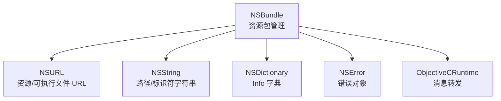
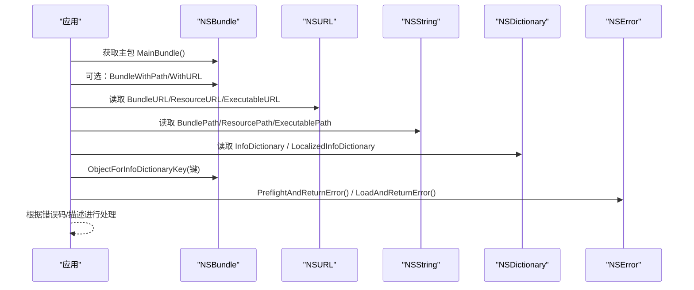
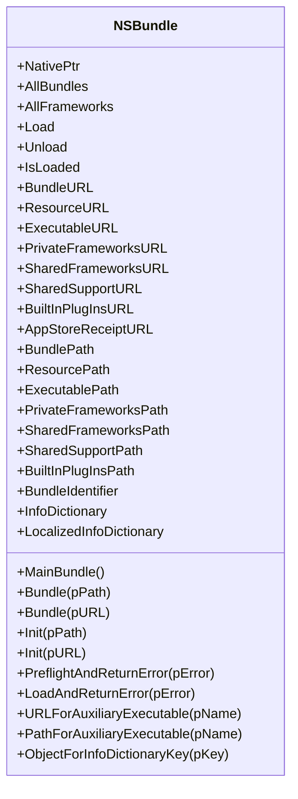
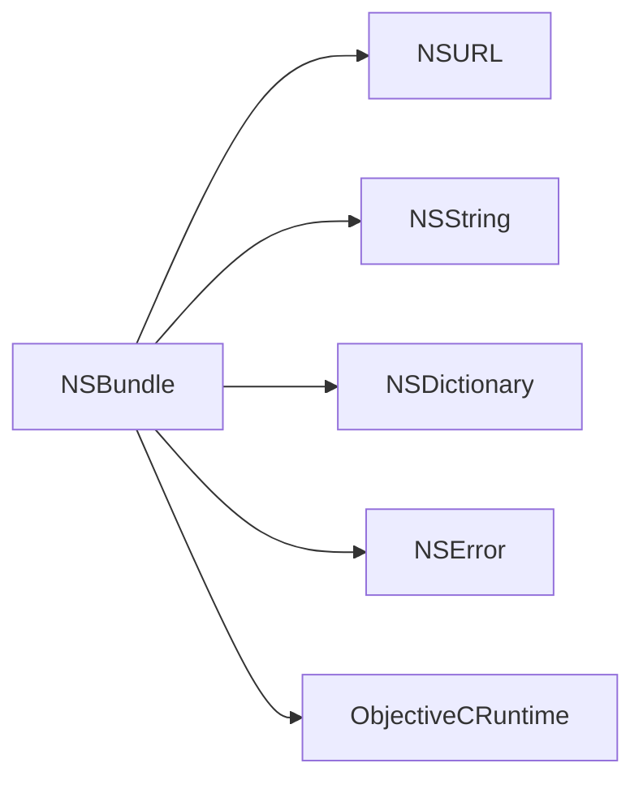

# 资源包管理

<cite>
**本文引用的文件**
- [NSBundle.cs](file://src/SharpMetal/Foundation/NSBundle.cs)
- [NSURL.cs](file://src/SharpMetal/Foundation/NSURL.cs)
- [NSString.cs](file://src/SharpMetal/Foundation/NSString.cs)
- [NSDictionary.cs](file://src/SharpMetal/Foundation/NSDictionary.cs)
- [NSError.cs](file://src/SharpMetal/Foundation/NSError.cs)
</cite>

## 目录
1. [简介](#简介)
2. [项目结构](#项目结构)
3. [核心组件](#核心组件)
4. [架构总览](#架构总览)
5. [详细组件分析](#详细组件分析)
6. [依赖关系分析](#依赖关系分析)
7. [性能注意事项](#性能注意事项)
8. [故障排查指南](#故障排查指南)
9. [结论](#结论)
10. [附录](#附录)

## 简介
本章节面向使用 SharpMetal 的开发者，提供 NSBundle 资源包管理的 API 文档。内容覆盖应用程序主包获取、资源包加载与卸载、框架管理、URL/路径属性访问、InfoDictionary 与本地化字典访问、通过 ObjectForInfoDictionaryKey 获取配置信息，以及 BundleIdentifier 的使用方式。同时给出资源包预检查与错误处理的完整示例流程说明（以步骤形式呈现，不直接粘贴代码）。

## 项目结构
NSBundle 位于 Foundation 命名空间下，作为对 Objective-C 运行时中 NSBundle 的托管封装。其通过 ObjectiveCRuntime 调用原生方法，并与其他 Foundation 类型（如 NSURL、NSString、NSDictionary、NSError）协作完成资源定位、配置读取与错误处理。

图表来源
- [NSBundle.cs:1-150](file://src/SharpMetal/Foundation/NSBundle.cs#L1-L150)
- [NSURL.cs:1-39](file://src/SharpMetal/Foundation/NSURL.cs#L1-L39)
- [NSString.cs:1-188](file://src/SharpMetal/Foundation/NSString.cs#L1-L188)
- [NSDictionary.cs:1-55](file://src/SharpMetal/Foundation/NSDictionary.cs#L1-L55)
- [NSError.cs:1-51](file://src/SharpMetal/Foundation/NSError.cs#L1-L51)

章节来源
- [NSBundle.cs:1-150](file://src/SharpMetal/Foundation/NSBundle.cs#L1-L150)

## 核心组件
- NSBundle：资源包入口，提供主包获取、按路径/URL 获取包、加载/卸载、查询 URL/路径、读取 Info 字典、获取辅助可执行文件位置等能力。
- NSURL：用于表示资源包、资源、可执行文件、框架等的统一地址。
- NSString：用于表示路径、BundleIdentifier、键名等字符串。
- NSDictionary：用于表示 Info.plist 映射的键值集合。
- NSError：用于承载预检查或加载过程中的错误信息。

章节来源
- [NSBundle.cs:1-150](file://src/SharpMetal/Foundation/NSBundle.cs#L1-L150)
- [NSURL.cs:1-39](file://src/SharpMetal/Foundation/NSURL.cs#L1-L39)
- [NSString.cs:1-188](file://src/SharpMetal/Foundation/NSString.cs#L1-L188)
- [NSDictionary.cs:1-55](file://src/SharpMetal/Foundation/NSDictionary.cs#L1-L55)
- [NSError.cs:1-51](file://src/SharpMetal/Foundation/NSError.cs#L1-L51)

## 架构总览
下图展示了 NSBundle 在资源访问中的关键交互：从主包或指定路径/URL 获取包实例，随后通过 URL/Path 属性定位资源，并通过 InfoDictionary/LocalizedInfoDictionary/ObjectForInfoDictionaryKey 读取配置；加载/卸载过程配合 NSError 进行错误处理。

图表来源
- [NSBundle.cs:63-111](file://src/SharpMetal/Foundation/NSBundle.cs#L63-L111)
- [NSURL.cs:15-28](file://src/SharpMetal/Foundation/NSURL.cs#L15-L28)
- [NSString.cs:71-98](file://src/SharpMetal/Foundation/NSString.cs#L71-L98)
- [NSDictionary.cs:13-40](file://src/SharpMetal/Foundation/NSDictionary.cs#L13-L40)
- [NSError.cs:13-25](file://src/SharpMetal/Foundation/NSError.cs#L13-L25)

## 详细组件分析

### NSBundle 类能力与用法
- 主包获取：MainBundle() 返回当前应用程序的主包实例。
- 按路径/URL 获取包：Bundle(in NSString pPath)、Bundle(in NSURL pURL)。
- 初始化：Init(in NSString pPath)、Init(in NSURL pURL)。
- 生命周期：Load、Unload、IsLoaded 控制包的加载状态。
- 枚举：AllBundles、AllFrameworks 列出所有包和框架。
- URL 属性：BundleURL、ResourceURL、ExecutableURL、PrivateFrameworksURL、SharedFrameworksURL、SharedSupportURL、BuiltInPlugInsURL、AppStoreReceiptURL。
- 路径属性：BundlePath、ResourcePath、ExecutablePath、PrivateFrameworksPath、SharedFrameworksPath、SharedSupportPath、BuiltInPlugInsPath。
- 配置访问：InfoDictionary、LocalizedInfoDictionary、ObjectForInfoDictionaryKey(in NSString pKey)。
- 辅助可执行文件：URLForAuxiliaryExecutable、PathForAuxiliaryExecutable。
- 预检与加载：PreflightAndReturnError(ref NSError pError)、LoadAndReturnError(ref NSError pError)。
- 标识符：BundleIdentifier 获取应用的唯一标识。

章节来源
- [NSBundle.cs:17-111](file://src/SharpMetal/Foundation/NSBundle.cs#L17-L111)

#### 类图（代码级）

图表来源
- [NSBundle.cs:5-111](file://src/SharpMetal/Foundation/NSBundle.cs#L5-L111)

### URL 与路径属性
- URL 属性：
  - BundleURL：返回包本身的 URL。
  - ResourceURL：返回资源目录的 URL。
  - ExecutableURL：返回可执行文件的 URL。
  - PrivateFrameworksURL/SharedFrameworksURL/SharedSupportURL/BuiltInPlugInsURL/AppStoreReceiptURL：分别指向私有框架、共享框架、共享支持、内置插件、App Store 收据的位置。
- 路径属性：
  - BundlePath/ResourcePath/ExecutablePath/PrivateFrameworksPath/SharedFrameworksPath/SharedSupportPath/BuiltInPlugInsPath：对应上述 URL 的路径字符串形式。

使用建议：
- 优先使用 URL 属性进行跨平台兼容的资源访问。
- 需要文件系统操作时再转换为路径字符串。

章节来源
- [NSBundle.cs:27-57](file://src/SharpMetal/Foundation/NSBundle.cs#L27-L57)
- [NSURL.cs:15-28](file://src/SharpMetal/Foundation/NSURL.cs#L15-L28)
- [NSString.cs:71-98](file://src/SharpMetal/Foundation/NSString.cs#L71-L98)

### InfoDictionary 与 LocalizedInfoDictionary
- InfoDictionary：返回未本地化的配置字典。
- LocalizedInfoDictionary：返回已本地化的配置字典。
- ObjectForInfoDictionaryKey(in NSString pKey)：便捷方法，直接根据键获取配置项的值。

典型用途：
- 读取应用版本、名称、构建号等元数据。
- 读取本地化后的显示名称或文案。

章节来源
- [NSBundle.cs:59-61](file://src/SharpMetal/Foundation/NSBundle.cs#L59-L61)
- [NSDictionary.cs:13-40](file://src/SharpMetal/Foundation/NSDictionary.cs#L13-L40)

### BundleIdentifier 使用
- 通过 BundleIdentifier 属性获取当前包的唯一标识符（通常为应用 ID）。
- 可用于区分不同包、调试输出、权限校验等场景。

章节来源
- [NSBundle.cs:57-57](file://src/SharpMetal/Foundation/NSBundle.cs#L57-L57)

### 资源包预检查与错误处理
- PreflightAndReturnError(ref NSError pError)：在不实际加载的情况下预检查包是否有效，并将错误写入 NSError。
- LoadAndReturnError(ref NSError pError)：尝试加载包，若失败则填充 NSError。
- 错误处理要点：
  - 检查返回值是否为真。
  - 若为假，读取 NSError 的 Domain、Code、LocalizedDescription 等字段进行诊断。
  - 根据错误码决定重试、降级或终止流程。

章节来源
- [NSBundle.cs:88-96](file://src/SharpMetal/Foundation/NSBundle.cs#L88-L96)
- [NSError.cs:13-25](file://src/SharpMetal/Foundation/NSError.cs#L13-L25)

### 辅助可执行文件
- URLForAuxiliaryExecutable(in NSString pExecutableName)：返回辅助可执行文件的 URL。
- PathForAuxiliaryExecutable(in NSString pExecutableName)：返回辅助可执行文件的路径。

适用场景：
- 多进程架构中，主进程启动子进程或工具程序。

章节来源
- [NSBundle.cs:98-106](file://src/SharpMetal/Foundation/NSBundle.cs#L98-L106)

### 框架管理与枚举
- AllFrameworks：返回当前包所关联的所有框架列表。
- AllBundles：返回系统中已加载的所有包列表。

适用场景：
- 动态发现可用功能模块或扩展。

章节来源
- [NSBundle.cs:17-19](file://src/SharpMetal/Foundation/NSBundle.cs#L17-L19)

## 依赖关系分析
NSBundle 依赖以下 Foundation 类型：
- NSURL：用于资源与可执行文件的统一地址抽象。
- NSString：用于路径、标识符与键名。
- NSDictionary：用于 Info.plist 映射。
- NSError：用于错误传播。
- ObjectiveCRuntime：用于消息转发到原生实现。

图表来源
- [NSBundle.cs:1-150](file://src/SharpMetal/Foundation/NSBundle.cs#L1-L150)
- [NSURL.cs:1-39](file://src/SharpMetal/Foundation/NSURL.cs#L1-L39)
- [NSString.cs:1-188](file://src/SharpMetal/Foundation/NSString.cs#L1-L188)
- [NSDictionary.cs:1-55](file://src/SharpMetal/Foundation/NSDictionary.cs#L1-L55)
- [NSError.cs:1-51](file://src/SharpMetal/Foundation/NSError.cs#L1-L51)

章节来源
- [NSBundle.cs:1-150](file://src/SharpMetal/Foundation/NSBundle.cs#L1-L150)

## 性能注意事项
- 避免频繁创建 NSBundle 实例：尽量复用 MainBundle() 或通过缓存保存 BundleWithPath/WithURL 的结果。
- 优先使用 URL 访问资源：减少路径拼接与文件系统开销。
- 批量读取配置：一次性读取 InfoDictionary，按需取值，避免多次重复访问。
- 错误处理最小化：仅在必要时调用 Preflight/Load 的错误重载，避免不必要的异常路径。

[本节为通用指导，无需特定文件引用]

## 故障排查指南
- 预检查失败：
  - 调用 PreflightAndReturnError 后若返回 false，读取 NSError.Domain、NSError.Code、NSError.LocalizedDescription 定位问题。
- 加载失败：
  - 调用 LoadAndReturnError 后若返回 false，同样读取 NSError 信息进行诊断。
- 资源不可用：
  - 检查 ResourceURL/ResourcePath 是否正确，确认资源文件是否存在于预期目录。
- 辅助可执行文件缺失：
  - 使用 URLForAuxiliaryExecutable/PathForAuxiliaryExecutable 验证路径，确保目标文件存在且具备执行权限。

章节来源
- [NSBundle.cs:88-106](file://src/SharpMetal/Foundation/NSBundle.cs#L88-L106)
- [NSError.cs:13-25](file://src/SharpMetal/Foundation/NSError.cs#L13-L25)

## 结论
NSBundle 提供了完整的资源包管理能力，包括主包获取、资源定位、配置读取、框架枚举与辅助可执行文件访问。结合 NSURL/NSString/NSDictionary/NSError，开发者可以安全、高效地访问和管理应用资源。推荐在生产环境中采用预检查与错误处理策略，确保资源可用性并提升鲁棒性。

[本节为总结性内容，无需特定文件引用]

## 附录

### 常用工作流（步骤式示例）
- 获取主包并读取配置：
  - 步骤：调用 MainBundle()；读取 BundleIdentifier；读取 InfoDictionary 或调用 ObjectForInfoDictionaryKey 获取特定键值。
- 按路径/URL 获取外部包：
  - 步骤：构造 NSString/NSURL；调用 Bundle(in NSString pPath)/Bundle(in NSURL pURL)；读取 ResourceURL/ResourcePath。
- 预检查与加载：
  - 步骤：调用 PreflightAndReturnError；若成功则调用 Load；若失败则读取 NSError 并处理。
- 访问辅助可执行文件：
  - 步骤：调用 URLForAuxiliaryExecutable/PathForAuxiliaryExecutable；验证路径有效性；执行或传递参数。

[本节为概念性流程说明，不直接展示代码内容]