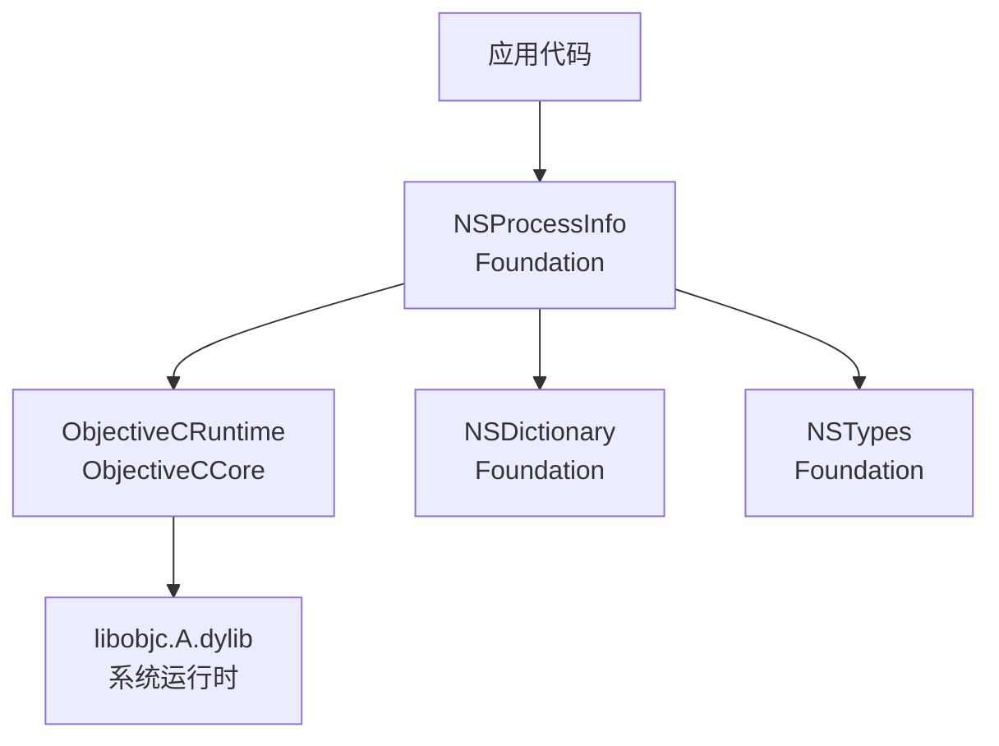
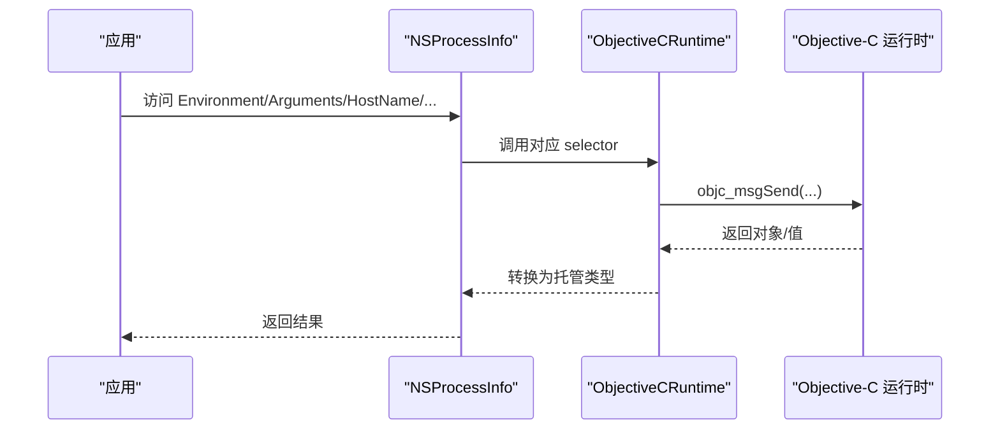
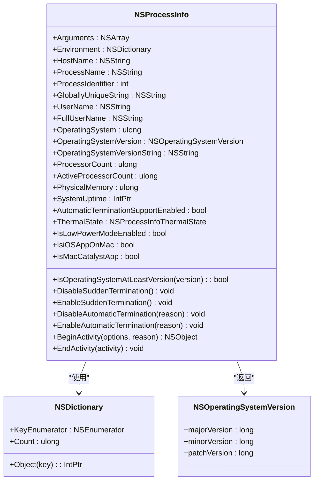
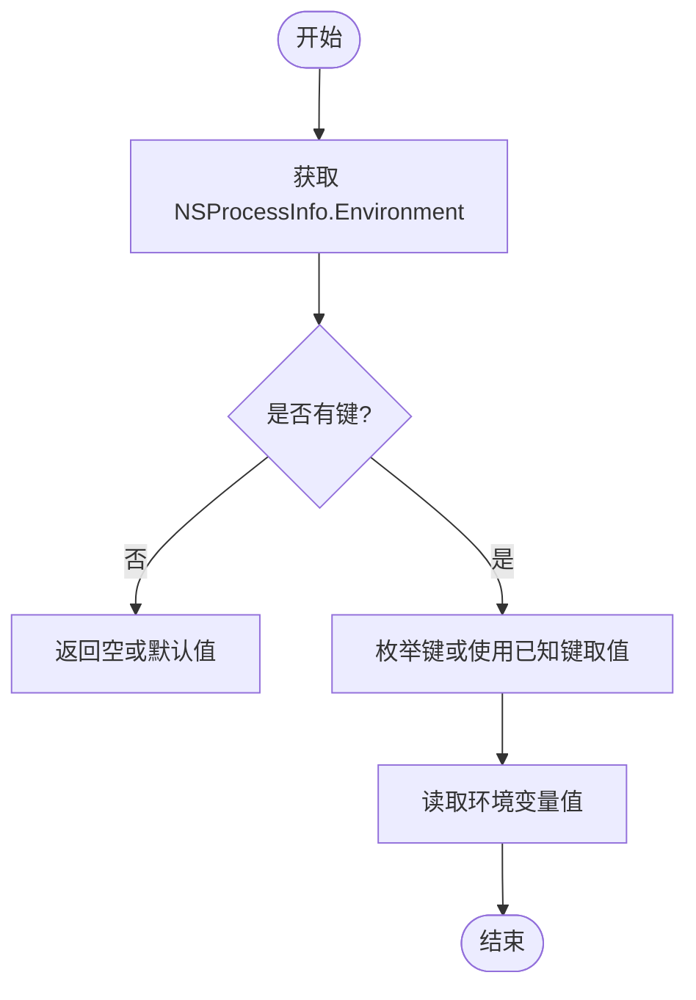
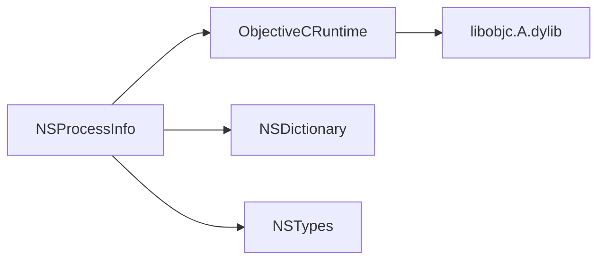

# 进程信息

<cite>
**本文引用的文件**
- [NSProcessInfo.cs](file://src/SharpMetal/Foundation/NSProcessInfo.cs)
- [ObjectiveCRuntime.cs](file://src/SharpMetal/ObjectiveCCore/ObjectiveCRuntime.cs)
- [NSDictionary.cs](file://src/SharpMetal/Foundation/NSDictionary.cs)
- [NSTypes.cs](file://src/SharpMetal/Foundation/NSTypes.cs)
</cite>

## 目录
1. [简介](#简介)
2. [项目结构](#项目结构)
3. [核心组件](#核心组件)
4. [架构总览](#架构总览)
5. [详细组件分析](#详细组件分析)
6. [依赖关系分析](#依赖关系分析)
7. [性能与监控](#性能与监控)
8. [故障排查指南](#故障排查指南)
9. [结论](#结论)
10. [附录：API 速查](#附录api-速查)

## 简介
本文件为 SharpMetal 中 NSProcessInfo 的 API 文档，聚焦于进程环境变量的获取与管理、系统信息与硬件特性查询（处理器架构、操作系统版本等）、进程标识符/主机名/进程名称等基本信息获取，以及环境变量读取与设置、性能监控相关属性与方法的使用示例。同时提供进程间通信与环境检测的最佳实践建议。

## 项目结构
- Foundation 层提供 NSProcessInfo、NSDictionary、NSTypes 等基础类型与运行时桥接能力。
- ObjectiveCCore 提供 Objective-C 运行时调用封装，用于访问底层系统接口。
- NSProcessInfo 通过 Selector 调用 Objective-C 方法，暴露进程信息与环境变量等能力。

图表来源
- [NSProcessInfo.cs:25-146](file://src/SharpMetal/Foundation/NSProcessInfo.cs#L25-L146)
- [ObjectiveCRuntime.cs:33-800](file://src/SharpMetal/ObjectiveCCore/ObjectiveCRuntime.cs#L33-L800)
- [NSDictionary.cs:5-53](file://src/SharpMetal/Foundation/NSDictionary.cs#L5-L53)
- [NSTypes.cs:5-11](file://src/SharpMetal/Foundation/NSTypes.cs#L5-L11)

章节来源
- [NSProcessInfo.cs:25-146](file://src/SharpMetal/Foundation/NSProcessInfo.cs#L25-L146)
- [ObjectiveCRuntime.cs:33-800](file://src/SharpMetal/ObjectiveCCore/ObjectiveCRuntime.cs#L33-L800)
- [NSDictionary.cs:5-53](file://src/SharpMetal/Foundation/NSDictionary.cs#L5-L53)
- [NSTypes.cs:5-11](file://src/SharpMetal/Foundation/NSTypes.cs#L5-L11)

## 核心组件
- NSProcessInfo：进程信息入口，提供进程参数、环境变量、主机名、进程名、进程 ID、用户信息、操作系统版本、处理器数量、物理内存、系统运行时长、热状态、低功耗模式、自动终止控制、活动生命周期管理等。
- NSDictionary：键值集合，用于遍历和访问环境变量。
- NSTypes：定义 NSOperatingSystemVersion 结构体，表示操作系统主/次/修订版本号。
- ObjectiveCRuntime：统一封装对 Objective-C 运行时方法的调用，屏蔽签名差异与返回值类型转换。

章节来源
- [NSProcessInfo.cs:25-146](file://src/SharpMetal/Foundation/NSProcessInfo.cs#L25-L146)
- [NSDictionary.cs:5-53](file://src/SharpMetal/Foundation/NSDictionary.cs#L5-L53)
- [NSTypes.cs:5-11](file://src/SharpMetal/Foundation/NSTypes.cs#L5-L11)
- [ObjectiveCRuntime.cs:33-800](file://src/SharpMetal/ObjectiveCCore/ObjectiveCRuntime.cs#L33-L800)

## 架构总览
NSProcessInfo 通过 Selector 向 Objective-C 运行时发送消息，获取系统级信息并返回托管类型。NSDictionary 作为环境变量的容器，支持枚举键与取值。所有跨语言边界调用均经由 ObjectiveCRuntime 完成。

图表来源
- [NSProcessInfo.cs:31-82](file://src/SharpMetal/Foundation/NSProcessInfo.cs#L31-L82)
- [ObjectiveCRuntime.cs:118-165](file://src/SharpMetal/ObjectiveCCore/ObjectiveCRuntime.cs#L118-L165)

## 详细组件分析

### NSProcessInfo 结构与能力
- 进程基本信息
  - Arguments：命令行参数数组（NSArray）
  - Environment：环境变量字典（NSDictionary）
  - HostName：主机名（NSString）
  - ProcessName：进程名称（可读写）
  - ProcessIdentifier：进程标识符（int）
  - GloballyUniqueString：全局唯一字符串
  - UserName/FullUserName：用户名/全名
- 系统与硬件信息
  - OperatingSystem：系统标识（ulong）
  - OperatingSystemVersion：系统版本结构（NSOperatingSystemVersion）
  - OperatingSystemVersionString：可读的系统版本字符串
  - ProcessorCount：逻辑处理器数（ulong）
  - ActiveProcessorCount：活跃处理器数（ulong）
  - PhysicalMemory：物理内存大小（ulong）
  - SystemUptime：系统运行时长（IntPtr，指向系统时间对象）
- 行为与策略
  - AutomaticTerminationSupportEnabled：是否启用自动终止支持（可读写）
  - ThermalState：设备热状态（Nominal/Fair/Serious/Critical）
  - IsLowPowerModeEnabled：是否处于低功耗模式
  - IsiOSAppOnMac / IsMacCatalystApp：运行平台判断
  - IsOperatingSystemAtLeastVersion：比较系统版本是否满足最低要求
- 终止控制与活动管理
  - DisableSuddenTermination / EnableSuddenTermination
  - DisableAutomaticTermination(reason) / EnableAutomaticTermination(reason)
  - BeginActivity(options, reason) / EndActivity(activity)

图表来源
- [NSProcessInfo.cs:25-146](file://src/SharpMetal/Foundation/NSProcessInfo.cs#L25-L146)
- [NSDictionary.cs:5-53](file://src/SharpMetal/Foundation/NSDictionary.cs#L5-L53)
- [NSTypes.cs:5-11](file://src/SharpMetal/Foundation/NSTypes.cs#L5-L11)

章节来源
- [NSProcessInfo.cs:25-146](file://src/SharpMetal/Foundation/NSProcessInfo.cs#L25-L146)
- [NSDictionary.cs:5-53](file://src/SharpMetal/Foundation/NSDictionary.cs#L5-L53)
- [NSTypes.cs:5-11](file://src/SharpMetal/Foundation/NSTypes.cs#L5-L11)

### 环境变量操作（读取与设置）
- 读取
  - 通过 NSProcessInfo.Environment 获取 NSDictionary 实例。
  - 使用 KeyEnumerator 遍历键，或根据已知键调用 Object(key) 获取值。
  - Count 可用于快速判断是否存在环境变量。
- 设置
  - 当前实现未暴露直接设置环境变量的方法；如需修改，请在进程启动前通过宿主进程或系统工具注入。
  - 若需动态影响子进程，可在创建子进程时传入所需的环境映射。

图表来源
- [NSProcessInfo.cs:33-33](file://src/SharpMetal/Foundation/NSProcessInfo.cs#L33-L33)
- [NSDictionary.cs:13-40](file://src/SharpMetal/Foundation/NSDictionary.cs#L13-L40)

章节来源
- [NSProcessInfo.cs:33-33](file://src/SharpMetal/Foundation/NSProcessInfo.cs#L33-L33)
- [NSDictionary.cs:13-40](file://src/SharpMetal/Foundation/NSDictionary.cs#L13-L40)

### 系统信息与硬件特性查询
- 处理器与内存
  - ProcessorCount：逻辑处理器数量
  - ActiveProcessorCount：当前活跃的处理器数量
  - PhysicalMemory：物理内存大小
- 操作系统信息
  - OperatingSystemVersion：包含 major/minor/patch 的版本结构
  - OperatingSystemVersionString：可读版本字符串
  - IsOperatingSystemAtLeastVersion：按版本结构进行兼容性检查
- 平台与模式
  - IsLowPowerModeEnabled：是否处于低功耗模式
  - IsiOSAppOnMac / IsMacCatalystApp：运行平台判断

章节来源
- [NSProcessInfo.cs:51-63](file://src/SharpMetal/Foundation/NSProcessInfo.cs#L51-L63)
- [NSTypes.cs:5-11](file://src/SharpMetal/Foundation/NSTypes.cs#L5-L11)

### 进程标识符、主机名、进程名称等基本信息
- ProcessIdentifier：进程 ID
- HostName：主机名
- ProcessName：进程名称（可读写）
- UserName / FullUserName：用户相关信息
- GloballyUniqueString：全局唯一字符串

章节来源
- [NSProcessInfo.cs:35-47](file://src/SharpMetal/Foundation/NSProcessInfo.cs#L35-L47)

### 性能监控相关属性与方法
- 热状态与功耗
  - ThermalState：设备热状态（Nominal/Fair/Serious/Critical）
  - IsLowPowerModeEnabled：低功耗模式开关
- 资源与负载
  - ProcessorCount / ActiveProcessorCount：处理器数量变化可反映负载情况
  - PhysicalMemory：内存容量
  - SystemUptime：系统运行时长，可用于计算指标基线
- 活动生命周期
  - BeginActivity/EndActivity：声明前台/后台任务或延迟敏感操作的意图，帮助系统调度与电源管理
  - AutomaticTerminationSupportEnabled：控制自动终止支持

章节来源
- [NSProcessInfo.cs:57-75](file://src/SharpMetal/Foundation/NSProcessInfo.cs#L57-L75)
- [NSProcessInfo.cs:65-112](file://src/SharpMetal/Foundation/NSProcessInfo.cs#L65-L112)

### 进程间通信与环境检测最佳实践
- 环境变量传递
  - 在父进程启动子进程时，显式传递所需环境变量，避免依赖运行期修改。
  - 使用 NSProcessInfo.Environment 读取关键配置项，结合默认值保证健壮性。
- 环境检测
  - 使用 IsOperatingSystemAtLeastVersion 进行功能分支判断，避免在不支持的平台上调用不兼容 API。
  - 使用 IsiOSAppOnMac / IsMacCatalystApp 区分运行平台，适配不同 UI/行为。
- 进程终止与活动
  - 在长耗时或延迟敏感任务中使用 BeginActivity/EndActivity 包裹，减少被系统终止的概率。
  - 谨慎使用 DisableSuddenTermination/DisableAutomaticTermination，仅在必要时临时禁用并在完成后恢复。

[本节为概念性指导，不直接分析具体文件]

## 依赖关系分析
- NSProcessInfo 依赖 ObjectiveCRuntime 进行跨语言调用。
- NSProcessInfo 依赖 NSDictionary 表示环境变量集合。
- NSProcessInfo 依赖 NSTypes 中的 NSOperatingSystemVersion 表示系统版本。
- ObjectiveCRuntime 依赖系统 Objective-C 运行时库（libobjc.A.dylib）。

图表来源
- [NSProcessInfo.cs:25-146](file://src/SharpMetal/Foundation/NSProcessInfo.cs#L25-L146)
- [ObjectiveCRuntime.cs:33-800](file://src/SharpMetal/ObjectiveCCore/ObjectiveCRuntime.cs#L33-L800)
- [NSDictionary.cs:5-53](file://src/SharpMetal/Foundation/NSDictionary.cs#L5-L53)
- [NSTypes.cs:5-11](file://src/SharpMetal/Foundation/NSTypes.cs#L5-L11)

章节来源
- [NSProcessInfo.cs:25-146](file://src/SharpMetal/Foundation/NSProcessInfo.cs#L25-L146)
- [ObjectiveCRuntime.cs:33-800](file://src/SharpMetal/ObjectiveCCore/ObjectiveCRuntime.cs#L33-L800)
- [NSDictionary.cs:5-53](file://src/SharpMetal/Foundation/NSDictionary.cs#L5-L53)
- [NSTypes.cs:5-11](file://src/SharpMetal/Foundation/NSTypes.cs#L5-L11)

## 性能与监控
- 使用 ThermalState 与 IsLowPowerModeEnabled 感知设备热状态与功耗模式，调整渲染或计算负载。
- 通过 ProcessorCount/ActiveProcessorCount 动态调整并行度，避免过度占用 CPU。
- 利用 SystemUptime 作为时间基准，统计长时间运行的任务耗时与吞吐。
- 合理使用 BeginActivity/EndActivity 声明任务优先级与延迟敏感性，提升系统调度友好性。

[本节为通用性能建议，不直接分析具体文件]

## 故障排查指南
- 环境变量为空或未找到
  - 检查环境变量是否在进程启动前注入。
  - 使用 NSDictionary.Count 与 KeyEnumerator 确认键是否存在。
- 系统版本判断失败
  - 确保构造正确的 NSOperatingSystemVersion 并与 IsOperatingSystemAtLeastVersion 比较。
- 自动终止导致任务中断
  - 在关键路径使用 DisableAutomaticTermination/EnableAutomaticTermination 包裹，并确保成对调用。
- 活动未正确释放
  - 确保 BeginActivity 返回的活动对象在使用后调用 EndActivity，避免资源泄漏。

章节来源
- [NSProcessInfo.cs:65-112](file://src/SharpMetal/Foundation/NSProcessInfo.cs#L65-L112)
- [NSDictionary.cs:13-40](file://src/SharpMetal/Foundation/NSDictionary.cs#L13-L40)

## 结论
NSProcessInfo 提供了完整的进程与环境信息访问能力，涵盖环境变量、系统版本、硬件特性、进程标识与生命周期管理。通过 ObjectiveCRuntime 的统一桥接，开发者可以以类型安全的方式获取系统信息并进行环境检测与性能优化。建议在关键路径上合理使用活动管理与终止控制，并结合环境变量与系统版本信息进行稳健的运行时适配。

[本节为总结，不直接分析具体文件]

## 附录：API 速查
- 环境变量
  - 读取：NSProcessInfo.Environment -> NSDictionary -> KeyEnumerator/Object/Count
  - 设置：当前未暴露直接设置方法；需在进程启动前注入或通过子进程参数传递
- 系统信息
  - 版本：OperatingSystemVersion / OperatingSystemVersionString / IsOperatingSystemAtLeastVersion
  - 处理器：ProcessorCount / ActiveProcessorCount
  - 内存：PhysicalMemory
  - 平台：IsiOSAppOnMac / IsMacCatalystApp / IsLowPowerModeEnabled
- 进程信息
  - 标识：ProcessIdentifier
  - 名称：ProcessName（可读写）
  - 主机名：HostName
  - 用户：UserName / FullUserName
- 行为控制
  - 终止：DisableSuddenTermination / EnableSuddenTermination / DisableAutomaticTermination / EnableAutomaticTermination
  - 活动：BeginActivity / EndActivity
  - 热状态：ThermalState

章节来源
- [NSProcessInfo.cs:31-112](file://src/SharpMetal/Foundation/NSProcessInfo.cs#L31-L112)
- [NSDictionary.cs:13-40](file://src/SharpMetal/Foundation/NSDictionary.cs#L13-L40)
- [NSTypes.cs:5-11](file://src/SharpMetal/Foundation/NSTypes.cs#L5-L11)