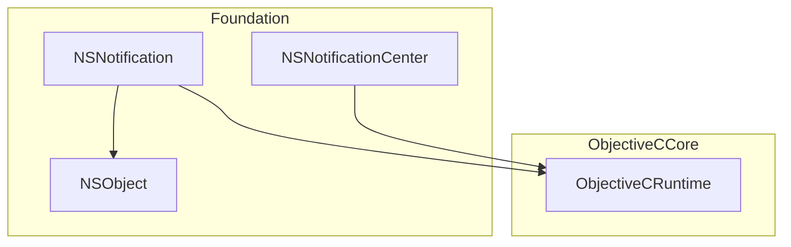
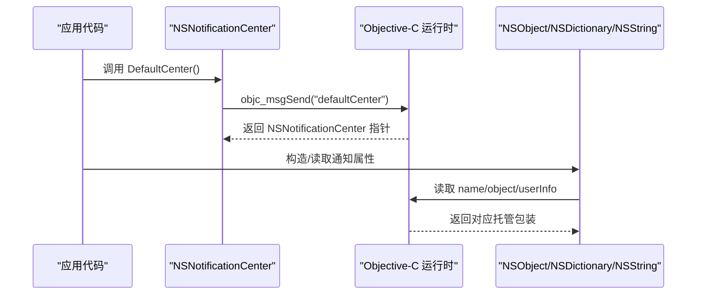
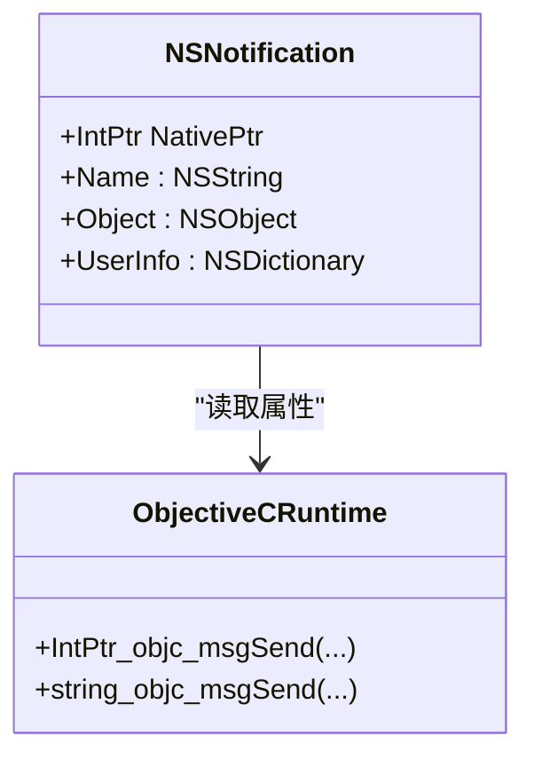
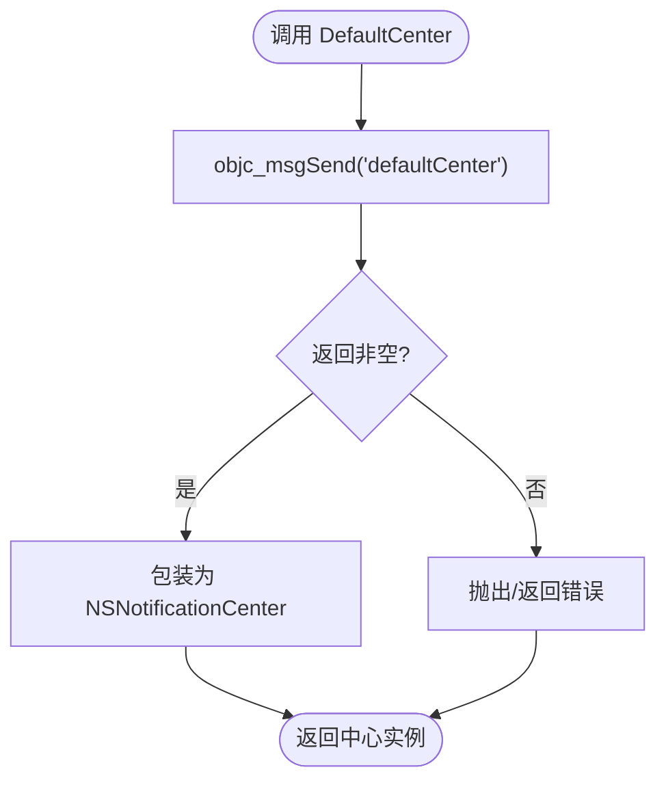
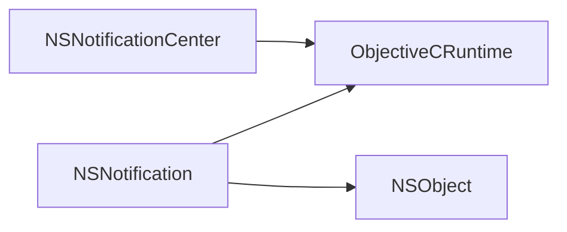

# 通知系统

<cite>
**本文引用的文件**
- [NSNotification.cs](file://src/SharpMetal/Foundation/NSNotification.cs)
- [ObjectiveCRuntime.cs](file://src/SharpMetal/ObjectiveCCore/ObjectiveCRuntime.cs)
- [NSObject.cs](file://src/SharpMetal/Foundation/NSObject.cs)
</cite>

## 目录
1. [简介](#简介)
2. [项目结构](#项目结构)
3. [核心组件](#核心组件)
4. [架构总览](#架构总览)
5. [详细组件分析](#详细组件分析)
6. [依赖分析](#依赖分析)
7. [性能考虑](#性能考虑)
8. [故障排查指南](#故障排查指南)
9. [结论](#结论)
10. [附录](#附录)

## 简介
本文件为 SharpMetal 中的 NSNotification 通知系统的 API 文档，聚焦事件发布/订阅模式在 Objective-C 运行时之上的托管封装。当前仓库提供了对 NSNotification 与 NSNotificationCenter 的最小化托管绑定，用于访问通知名称、对象与 userInfo 字典，以及获取默认通知中心实例。通过该封装，可在 .NET 应用中以类型安全的方式参与 Cocoa 的通知机制。

## 项目结构
- Foundation 层提供基础类型与通知相关类型：
  - NSNotification：表示一次通知消息（名称、来源对象、附加数据）。
  - NSNotificationCenter：表示通知中心，提供获取默认中心的入口。
- ObjectiveCCore 层提供与 Objective-C 运行时的互操作能力（消息发送、选择器、内存管理等），是通知类型实现的基础。
- NSObject 提供基础对象能力（如哈希、描述、相等性判断等），被通知相关类型间接使用。

图表来源
- [NSNotification.cs:5-35](file://src/SharpMetal/Foundation/NSNotification.cs#L5-L35)
- [ObjectiveCRuntime.cs:33-800](file://src/SharpMetal/ObjectiveCCore/ObjectiveCRuntime.cs#L33-L800)
- [NSObject.cs:48-90](file://src/SharpMetal/Foundation/NSObject.cs#L48-L90)

章节来源
- [NSNotification.cs:5-35](file://src/SharpMetal/Foundation/NSNotification.cs#L5-L35)
- [ObjectiveCRuntime.cs:33-800](file://src/SharpMetal/ObjectiveCCore/ObjectiveCRuntime.cs#L33-L800)
- [NSObject.cs:48-90](file://src/SharpMetal/Foundation/NSObject.cs#L48-L90)

## 核心组件
- NSNotification
  - 表示一条通知，包含：
    - Name：通知名称（NSString）
    - Object：通知来源对象（NSObject）
    - UserInfo：附加数据（NSDictionary）
  - 通过 Objective-C 运行时消息读取属性。
- NSNotificationCenter
  - 提供 DefaultCenter() 静态方法，返回全局默认通知中心实例。
  - 当前版本未暴露 add/remove/post 等方法，需结合运行时或后续扩展完成。

章节来源
- [NSNotification.cs:5-35](file://src/SharpMetal/Foundation/NSNotification.cs#L5-L35)

## 架构总览
下图展示了通知对象与通知中心如何通过 Objective-C 运行时进行交互，并如何与基础对象模型协作。

图表来源
- [NSNotification.cs:29-34](file://src/SharpMetal/Foundation/NSNotification.cs#L29-L34)
- [ObjectiveCRuntime.cs:118-134](file://src/SharpMetal/ObjectiveCCore/ObjectiveCRuntime.cs#L118-L134)
- [NSObject.cs:48-90](file://src/SharpMetal/Foundation/NSObject.cs#L48-L90)

## 详细组件分析

### NSNotification：通知消息的只读视图
- 设计要点
  - 作为值类型 struct 暴露 NativePtr，便于与原生对象桥接。
  - 通过 ObjectiveCRuntime 的消息发送读取 name、object、userInfo 三个属性。
  - 提供隐式转换到 IntPtr，方便传递给原生 API。
- 复杂度与性能
  - 属性访问均为 O(1) 的原生消息调用，开销取决于底层实现。
  - 避免不必要的装箱/拆箱，保持轻量。
- 错误处理
  - 若 NativePtr 为空或原生对象已释放，访问属性可能引发异常或空引用行为；应在上层确保生命周期有效。
- 使用建议
  - 仅用于读取通知内容，不持有额外状态。
  - 将 userInfo 视为不可变数据快照，避免修改。

图表来源
- [NSNotification.cs:5-19](file://src/SharpMetal/Foundation/NSNotification.cs#L5-L19)
- [ObjectiveCRuntime.cs:118-134](file://src/SharpMetal/ObjectiveCCore/ObjectiveCRuntime.cs#L118-L134)

章节来源
- [NSNotification.cs:5-19](file://src/SharpMetal/Foundation/NSNotification.cs#L5-L19)
- [ObjectiveCRuntime.cs:118-134](file://src/SharpMetal/ObjectiveCCore/ObjectiveCRuntime.cs#L118-L134)

### NSNotificationCenter：默认中心访问
- 设计要点
  - 提供 DefaultCenter() 静态方法，通过运行时消息获取全局单例。
  - 当前版本未暴露观察者注册/移除/发送通知的方法，属于最小可用集。
- 复杂度与性能
  - 获取默认中心为 O(1) 的原生调用。
- 错误处理
  - 若运行时环境不支持或类不存在，调用会失败；应捕获并降级处理。
- 使用建议
  - 在应用启动时缓存默认中心实例，减少重复调用。

图表来源
- [NSNotification.cs:29-34](file://src/SharpMetal/Foundation/NSNotification.cs#L29-L34)
- [ObjectiveCRuntime.cs:118-134](file://src/SharpMetal/ObjectiveCCore/ObjectiveCRuntime.cs#L118-L134)

章节来源
- [NSNotification.cs:29-34](file://src/SharpMetal/Foundation/NSNotification.cs#L29-L34)

### 通知数据传递机制（userInfo）
- 数据载体
  - userInfo 为 NSDictionary 类型，可承载任意键值对。
  - 通过 NSNotification.UserInfo 属性获取，类型为 NSDictionary。
- 最佳实践
  - 使用明确的字符串键名，避免冲突。
  - 仅传递必要数据，避免大对象拷贝。
  - 对复杂数据结构，优先使用可序列化的轻量格式。
- 注意事项
  - userInfo 是通知创建时的快照，不应假设其可变。
  - 跨线程使用时，注意线程安全性与生命周期。

章节来源
- [NSNotification.cs:11-15](file://src/SharpMetal/Foundation/NSNotification.cs#L11-L15)

### 异步事件处理与内存管理
- 异步处理
  - 通知回调通常由系统调度，建议在回调中切换到合适的队列执行 UI 更新。
  - 避免在通知回调中进行耗时阻塞操作。
- 内存管理
  - 使用 ObjectiveCRuntime 提供的 Retain/Release 管理原生对象生命周期。
  - 确保在不再需要时释放持有的原生句柄，防止泄漏。
  - 对于从通知中派生的临时对象，遵循“谁创建谁释放”的原则。

章节来源
- [ObjectiveCRuntime.cs:769-782](file://src/SharpMetal/ObjectiveCCore/ObjectiveCRuntime.cs#L769-L782)

## 依赖分析
- 耦合关系
  - NSNotification 强依赖 ObjectiveCRuntime 进行属性读取。
  - NSNotificationCenter.DefaultCenter 同样依赖 ObjectiveCRuntime。
  - NSNotification.Object 返回 NSObject，形成与基础对象模型的弱耦合。
- 外部依赖
  - 依赖 Objective-C 运行时库（libobjc.A.dylib）及系统框架（Foundation）。
- 潜在风险
  - 直接调用原生 API 需保证平台兼容性与 ABI 正确性。
  - 缺少 add/remove/post 等方法时，需在更高层自行封装或使用运行时动态调用。

图表来源
- [NSNotification.cs:5-35](file://src/SharpMetal/Foundation/NSNotification.cs#L5-L35)
- [ObjectiveCRuntime.cs:33-800](file://src/SharpMetal/ObjectiveCCore/ObjectiveCRuntime.cs#L33-L800)
- [NSObject.cs:48-90](file://src/SharpMetal/Foundation/NSObject.cs#L48-L90)

章节来源
- [NSNotification.cs:5-35](file://src/SharpMetal/Foundation/NSNotification.cs#L5-L35)
- [ObjectiveCRuntime.cs:33-800](file://src/SharpMetal/ObjectiveCCore/ObjectiveCRuntime.cs#L33-L800)
- [NSObject.cs:48-90](file://src/SharpMetal/Foundation/NSObject.cs#L48-L90)

## 性能考虑
- 通知频率高时，避免在回调中分配大量临时对象。
- 使用 userInfo 传递轻量数据，避免大对象频繁复制。
- 合理拆分通知粒度，降低无关模块的响应成本。
- 在 UI 线程更新界面时，确保批量更新以减少重绘。

## 故障排查指南
- 常见问题
  - 访问通知属性时报空引用：检查 NativePtr 是否有效，确认通知对象生命周期。
  - 无法注册/移除观察者：当前版本未暴露相应方法，需通过运行时扩展或后续版本支持。
  - 内存泄漏：确保对持有的原生对象调用 Release，避免长期持有。
- 调试建议
  - 打印通知名称与 userInfo 键值，定位问题来源。
  - 使用日志记录回调执行路径，识别阻塞点。
  - 在关键路径上验证平台与 ABI 兼容性。

章节来源
- [ObjectiveCRuntime.cs:769-782](file://src/SharpMetal/ObjectiveCCore/ObjectiveCRuntime.cs#L769-L782)

## 结论
当前仓库实现了 NSNotification 与 NSNotificationCenter 的最小托管绑定，提供通知内容的只读访问与默认中心获取。对于完整的发布/订阅流程（添加/移除观察者、发送通知），可在现有基础上基于 ObjectiveCRuntime 进一步扩展。建议在实际项目中遵循轻量数据传递、异步处理与严格内存管理的最佳实践，以确保性能与稳定性。

## 附录
- 常见场景示例（概念性说明）
  - 用户界面更新
    - 在某个业务事件触发后，通过通知中心广播状态变更。
    - 订阅该通知的 UI 组件在回调中切换至主线程并刷新界面。
  - 状态同步
    - 多个模块监听同一通知名称，根据 userInfo 中的键值同步本地状态。
    - 使用幂等处理避免重复更新。
- 参考路径
  - 通知对象属性访问：[NSNotification.cs:11-15](file://src/SharpMetal/Foundation/NSNotification.cs#L11-L15)
  - 默认通知中心获取：[NSNotification.cs:29-34](file://src/SharpMetal/Foundation/NSNotification.cs#L29-L34)
  - 运行时消息发送与内存管理：[ObjectiveCRuntime.cs:118-134](file://src/SharpMetal/ObjectiveCCore/ObjectiveCRuntime.cs#L118-L134), [ObjectiveCRuntime.cs:769-782](file://src/SharpMetal/ObjectiveCCore/ObjectiveCRuntime.cs#L769-L782)