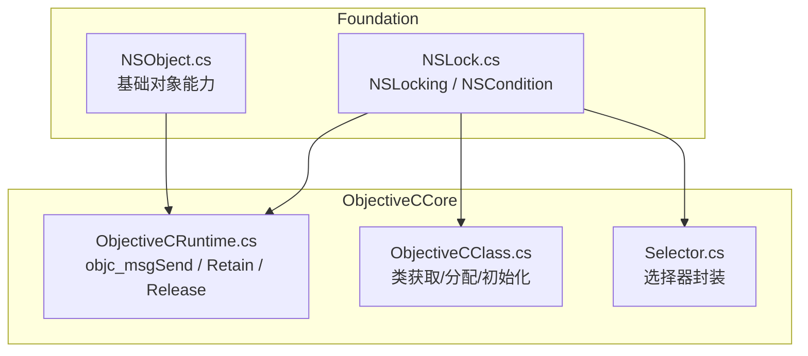
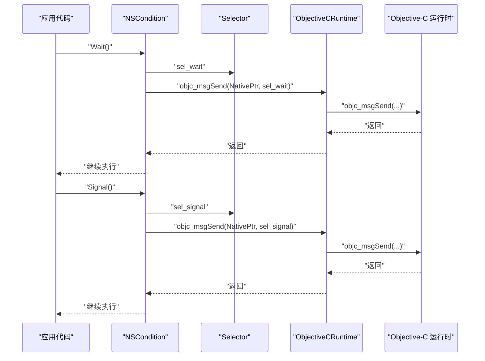
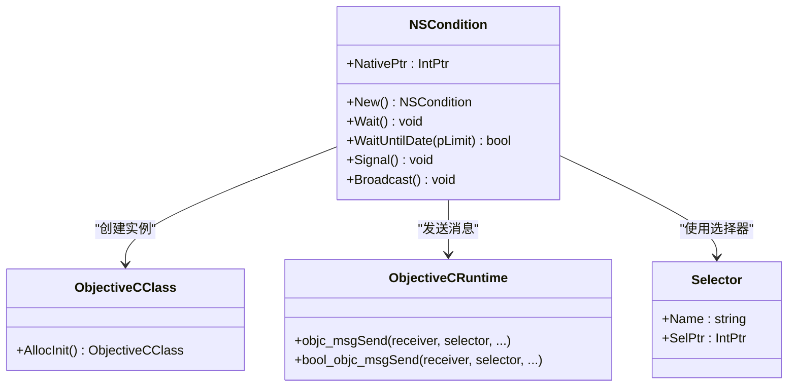
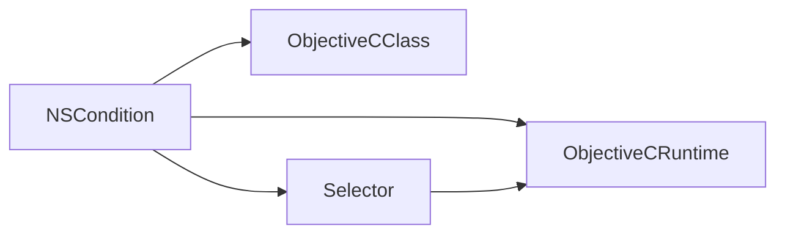
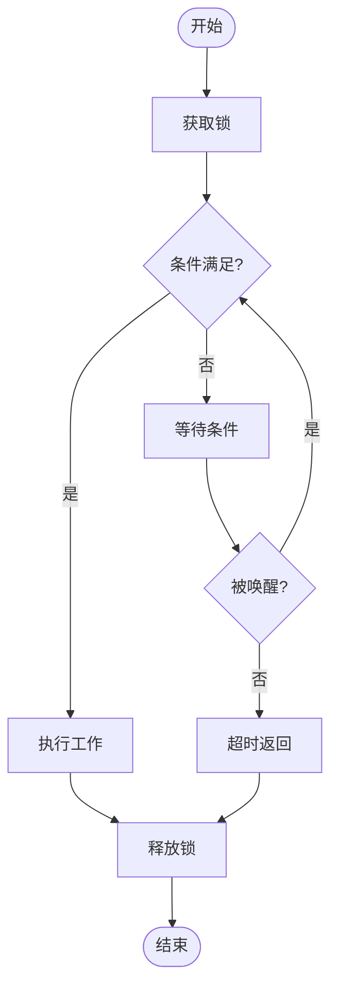

# 线程同步

<cite>
**本文引用的文件**
- [NSLock.cs](file://src/SharpMetal/Foundation/NSLock.cs)
- [ObjectiveCRuntime.cs](file://src/SharpMetal/ObjectiveCCore/ObjectiveCRuntime.cs)
- [ObjectiveCClass.cs](file://src/SharpMetal/ObjectiveCCore/ObjectiveCClass.cs)
- [Selector.cs](file://src/SharpMetal/ObjectiveCCore/Selector.cs)
- [NSObject.cs](file://src/SharpMetal/Foundation/NSObject.cs)
</cite>

## 目录
1. [简介](#简介)
2. [项目结构](#项目结构)
3. [核心组件](#核心组件)
4. [架构总览](#架构总览)
5. [详细组件分析](#详细组件分析)
6. [依赖关系分析](#依赖关系分析)
7. [性能考虑](#性能考虑)
8. [故障排查指南](#故障排查指南)
9. [结论](#结论)
10. [附录](#附录)

## 简介
本文件面向在 SharpMetal 的 Foundation 层进行多线程编程的开发者，聚焦于线程同步能力与最佳实践。当前仓库中已实现 NSCondition（条件变量）以及 Objective-C 运行时桥接基础设施；NSLock（互斥锁）作为协议类型存在，用于约束具备加锁能力的对象。本文基于现有代码，梳理同步原语的使用模式、死锁预防策略、性能注意事项，并给出在多线程环境下保护共享资源的推荐做法与常见陷阱规避方法。

## 项目结构
Foundation 层提供基础对象与同步原语，底层通过 ObjectiveCCore 调用 Objective-C 运行时完成实际同步语义。关键文件职责如下：
- Foundation/NSLock.cs：定义 NSLocking 协议结构与 NSCondition 条件变量封装。
- ObjectiveCCore/ObjectiveCRuntime.cs：提供与 Objective-C 运行时的消息发送、内存管理（Retain/Release）、选择器调用等底层能力。
- ObjectiveCCore/ObjectiveCClass.cs：提供 Objective-C 类的获取、分配与初始化封装。
- ObjectiveCCore/Selector.cs：封装选择器（selector）的创建与名称读取。
- Foundation/NSObject.cs：基础对象能力（哈希、描述、类型检查等），为其他 Foundation 对象提供通用基元。

图表来源
- [NSLock.cs:5-47](file://src/SharpMetal/Foundation/NSLock.cs#L5-L47)
- [ObjectiveCRuntime.cs:769-800](file://src/SharpMetal/ObjectiveCCore/ObjectiveCRuntime.cs#L769-L800)
- [ObjectiveCClass.cs:30-78](file://src/SharpMetal/ObjectiveCCore/ObjectiveCClass.cs#L30-L78)
- [Selector.cs:20-42](file://src/SharpMetal/ObjectiveCCore/Selector.cs#L20-L42)
- [NSObject.cs:48-90](file://src/SharpMetal/Foundation/NSObject.cs#L48-L90)

章节来源
- [NSLock.cs:5-47](file://src/SharpMetal/Foundation/NSLock.cs#L5-L47)
- [ObjectiveCRuntime.cs:769-800](file://src/SharpMetal/ObjectiveCCore/ObjectiveCRuntime.cs#L769-L800)
- [ObjectiveCClass.cs:30-78](file://src/SharpMetal/ObjectiveCCore/ObjectiveCClass.cs#L30-L78)
- [Selector.cs:20-42](file://src/SharpMetal/ObjectiveCCore/Selector.cs#L20-L42)
- [NSObject.cs:48-90](file://src/SharpMetal/Foundation/NSObject.cs#L48-L90)

## 核心组件
- NSLocking：表示“可加锁”的对象协议，持有原生指针，支持隐式转换为 IntPtr，便于与运行时交互。
- NSCondition：条件变量封装，提供 Wait、WaitUntilDate、Signal、Broadcast 等方法，内部通过 Objective-C 运行时发送对应选择器消息。
- ObjectiveCRuntime：提供 objc_msgSend 重载族、Retain/Release、选择器调用等底层能力。
- ObjectiveCClass：提供获取类、分配与初始化对象的能力，供 NSCondition.New 等构造路径使用。
- Selector：封装选择器的创建与名称读取，确保消息名正确解析。

章节来源
- [NSLock.cs:5-47](file://src/SharpMetal/Foundation/NSLock.cs#L5-L47)
- [ObjectiveCRuntime.cs:769-800](file://src/SharpMetal/ObjectiveCCore/ObjectiveCRuntime.cs#L769-L800)
- [ObjectiveCClass.cs:30-78](file://src/SharpMetal/ObjectiveCCore/ObjectiveCClass.cs#L30-L78)
- [Selector.cs:20-42](file://src/SharpMetal/ObjectiveCCore/Selector.cs#L20-L42)

## 架构总览
下图展示了从应用层到 Objective-C 运行时的调用链：NSCondition 的方法通过 Selector 定位消息，再经由 ObjectiveCRuntime 调用 objc_msgSend，最终由系统运行时执行实际的等待/唤醒逻辑。

图表来源
- [NSLock.cs:20-38](file://src/SharpMetal/Foundation/NSLock.cs#L20-L38)
- [ObjectiveCRuntime.cs:118-141](file://src/SharpMetal/ObjectiveCCore/ObjectiveCRuntime.cs#L118-L141)
- [Selector.cs:20-42](file://src/SharpMetal/ObjectiveCCore/Selector.cs#L20-L42)

## 详细组件分析

### NSCondition（条件变量）
- 功能要点
  - Wait：阻塞当前线程直到被 Signal/Broadcast 唤醒。
  - WaitUntilDate：带超时等待，返回布尔值指示是否到期。
  - Signal：唤醒一个等待线程。
  - Broadcast：唤醒所有等待线程。
- 实现要点
  - 通过 ObjectiveCClass.AllocInit 创建实例。
  - 使用 Selector 缓存选择器名，避免重复解析。
  - 通过 ObjectiveCRuntime.objc_msgSend 系列重载调用底层实现。

图表来源
- [NSLock.cs:12-47](file://src/SharpMetal/Foundation/NSLock.cs#L12-L47)
- [ObjectiveCClass.cs:60-78](file://src/SharpMetal/ObjectiveCCore/ObjectiveCClass.cs#L60-L78)
- [ObjectiveCRuntime.cs:118-141](file://src/SharpMetal/ObjectiveCCore/ObjectiveCRuntime.cs#L118-L141)
- [Selector.cs:20-42](file://src/SharpMetal/ObjectiveCCore/Selector.cs#L20-L42)

章节来源
- [NSLock.cs:12-47](file://src/SharpMetal/Foundation/NSLock.cs#L12-L47)
- [ObjectiveCClass.cs:60-78](file://src/SharpMetal/ObjectiveCCore/ObjectiveCClass.cs#L60-L78)
- [ObjectiveCRuntime.cs:118-141](file://src/SharpMetal/ObjectiveCCore/ObjectiveCRuntime.cs#L118-L141)
- [Selector.cs:20-42](file://src/SharpMetal/ObjectiveCCore/Selector.cs#L20-L42)

### NSLocking（锁协议）
- 作用：定义“可加锁”对象的统一接口约定，持有 NativePtr 并支持隐式转换，便于与运行时交互。
- 现状：当前仓库未提供 NSLock 的具体实现类，仅定义了协议结构。若需互斥锁，可在上层自行封装或扩展具体实现。

章节来源
- [NSLock.cs:5-10](file://src/SharpMetal/Foundation/NSLock.cs#L5-L10)

### ObjectiveCRuntime（运行时桥接）
- 提供大量 objc_msgSend 重载以匹配不同参数与返回值类型。
- 提供 Retain/Release 与 retainCount 查询，用于手动内存管理。
- 提供 struct 返回值包装方法，便于安全地接收结构体结果。

章节来源
- [ObjectiveCRuntime.cs:118-141](file://src/SharpMetal/ObjectiveCCore/ObjectiveCRuntime.cs#L118-L141)
- [ObjectiveCRuntime.cs:769-800](file://src/SharpMetal/ObjectiveCCore/ObjectiveCRuntime.cs#L769-L800)

### ObjectiveCClass（类与对象生命周期）
- 提供获取类、分配与初始化对象的方法，供 NSCondition.New 等构造路径使用。
- 提供 Alloc<T>/AllocInit<T> 泛型便捷方法，减少样板代码。

章节来源
- [ObjectiveCClass.cs:30-78](file://src/SharpMetal/ObjectiveCCore/ObjectiveCClass.cs#L30-L78)

### Selector（选择器）
- 封装选择器的创建与名称读取，确保消息名正确解析。
- 提供隐式转换，简化字符串到选择器的使用。

章节来源
- [Selector.cs:20-42](file://src/SharpMetal/ObjectiveCCore/Selector.cs#L20-L42)

### NSObject（基础对象）
- 提供哈希、描述、类型检查等基础能力，为其他 Foundation 对象提供通用基元。
- 与同步无直接关联，但常用于调试与诊断。

章节来源
- [NSObject.cs:48-90](file://src/SharpMetal/Foundation/NSObject.cs#L48-L90)

## 依赖关系分析
- NSCondition 依赖 ObjectiveCClass 进行实例创建，依赖 Selector 进行消息名解析，依赖 ObjectiveCRuntime 进行消息发送。
- ObjectiveCRuntime 是跨模块的基础设施，被多个 Foundation 组件复用。
- Selector 依赖 Objective-C 运行时获取选择器 UID 与名称。

图表来源
- [NSLock.cs:12-47](file://src/SharpMetal/Foundation/NSLock.cs#L12-L47)
- [ObjectiveCClass.cs:30-78](file://src/SharpMetal/ObjectiveCCore/ObjectiveCClass.cs#L30-L78)
- [Selector.cs:20-42](file://src/SharpMetal/ObjectiveCCore/Selector.cs#L20-L42)
- [ObjectiveCRuntime.cs:118-141](file://src/SharpMetal/ObjectiveCCore/ObjectiveCRuntime.cs#L118-L141)

章节来源
- [NSLock.cs:12-47](file://src/SharpMetal/Foundation/NSLock.cs#L12-L47)
- [ObjectiveCClass.cs:30-78](file://src/SharpMetal/ObjectiveCCore/ObjectiveCClass.cs#L30-L78)
- [Selector.cs:20-42](file://src/SharpMetal/ObjectiveCCore/Selector.cs#L20-L42)
- [ObjectiveCRuntime.cs:118-141](file://src/SharpMetal/ObjectiveCCore/ObjectiveCRuntime.cs#L118-L141)

## 性能考虑
- 最小化临界区：将耗时操作移出加锁区域，仅在访问共享状态时持有锁。
- 避免嵌套锁：尽量使用单一锁粒度，减少死锁风险与上下文切换开销。
- 合理使用条件变量：优先使用 WaitUntilDate 防止虚假唤醒与无限等待；合理设置超时以避免资源长期占用。
- 批量通知：需要唤醒多个消费者时使用 Broadcast，但注意“惊群效应”，必要时配合谓词过滤。
- 选择器与运行时调用成本：Selector 与 objc_msgSend 有固定开销，建议缓存选择器并减少频繁调用。
- 内存管理：遵循 Retain/Release 配对，避免泄漏或过早释放导致崩溃。

[本节为通用指导，不直接分析具体文件]

## 故障排查指南
- 常见问题
  - 未加锁访问共享资源：导致数据竞争与不一致。
  - 忘记释放锁：造成后续线程永久阻塞。
  - 条件等待未配合谓词：可能因虚假唤醒导致逻辑错误。
  - 选择器名称错误：运行时无法找到方法，抛出异常或行为异常。
  - 内存泄漏：未正确调用 Retain/Release。
- 排查步骤
  - 确认所有共享状态访问均在同一把锁的保护下。
  - 使用日志记录加锁/解锁与条件等待/唤醒的关键点。
  - 对条件等待使用 WaitUntilDate，并检查返回值处理超时分支。
  - 校验 Selector 名称与 Objective-C 侧一致。
  - 使用工具检测内存泄漏与线程死锁。

章节来源
- [ObjectiveCRuntime.cs:769-800](file://src/SharpMetal/ObjectiveCCore/ObjectiveCRuntime.cs#L769-L800)
- [NSLock.cs:20-38](file://src/SharpMetal/Foundation/NSLock.cs#L20-L38)

## 结论
当前仓库提供了 Foundation 层的条件变量（NSCondition）与完整的 Objective-C 运行时桥接能力，可用于构建高效的线程同步方案。NSLocking 协议为未来扩展互斥锁实现预留了接口。建议在项目中采用“细粒度锁 + 条件变量”的组合，严格遵循最小临界区、避免嵌套锁、合理超时与广播策略，以获得稳定且高性能的多线程行为。

[本节为总结性内容，不直接分析具体文件]

## 附录

### 互斥锁使用模式（基于 NSLocking 协议）
- 创建：通过具体实现类实例化锁对象（当前仓库未提供 NSLock 实现）。
- 获取：在进入临界区前调用加锁方法。
- 释放：在退出临界区后调用释放方法，确保异常路径也能释放。
- 最佳实践
  - 使用 try/finally 或等效机制保证释放。
  - 避免在持有锁时执行 I/O 或长时间计算。
  - 对复杂流程使用更高层的抽象（如读写锁、屏障）降低复杂度。

[本节为概念性说明，不直接分析具体文件]

### 条件变量使用示例（流程图）

[本节为概念性流程图，不直接映射到具体源码]

### 并发编程最佳实践清单
- 明确共享资源边界，集中管理其生命周期。
- 使用单一责任原则拆分锁粒度，降低竞争。
- 优先使用不可变数据结构减少同步需求。
- 对异步任务使用队列与信号量协调。
- 充分测试竞态条件与死锁场景。

[本节为通用指导，不直接分析具体文件]