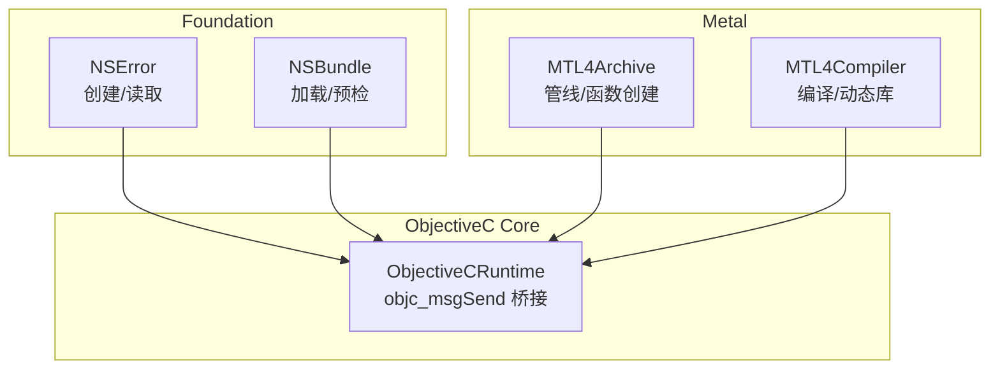
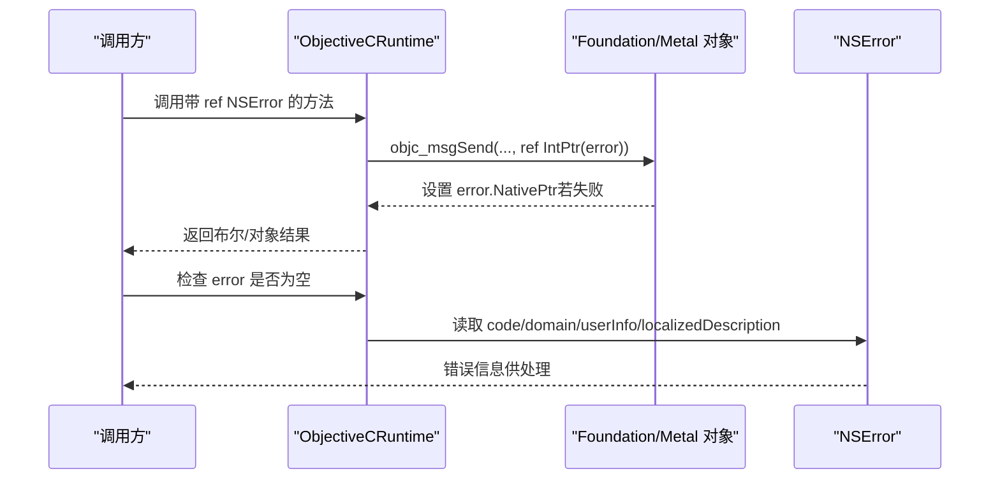
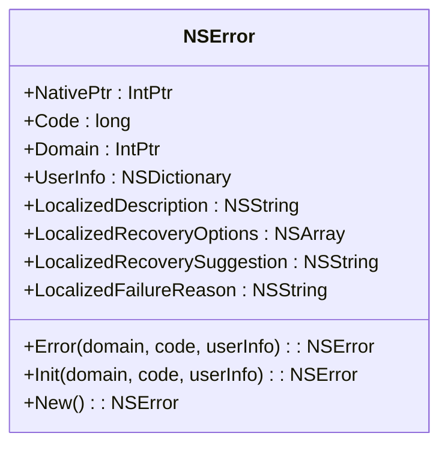
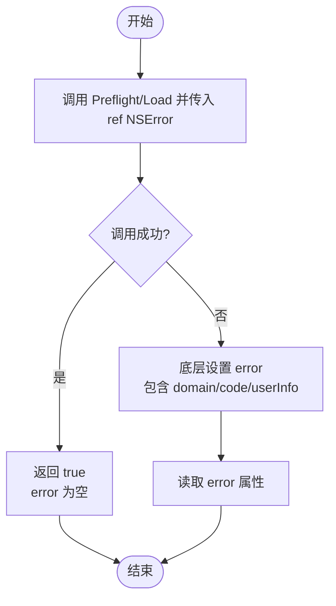
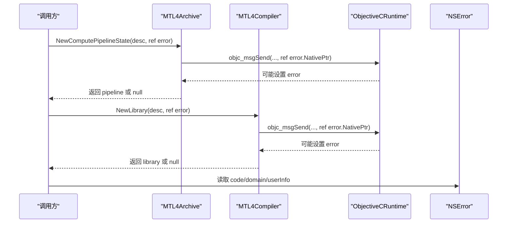
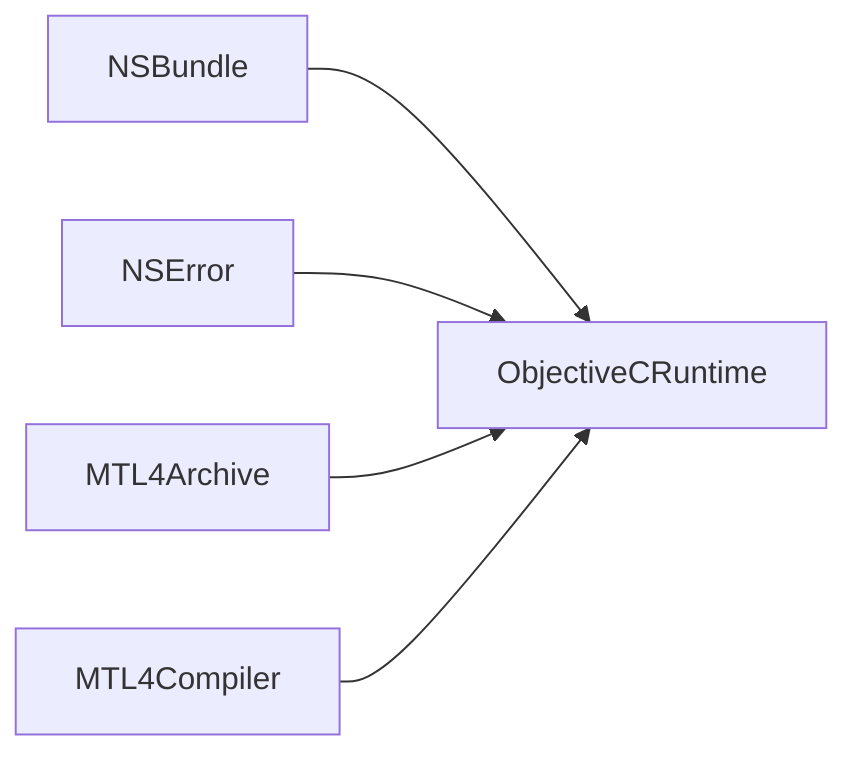

# 错误处理

<cite>
**本文引用的文件**
- [NSError.cs](file://src/SharpMetal/Foundation/NSError.cs)
- [NSBundle.cs](file://src/SharpMetal/Foundation/NSBundle.cs)
- [ObjectiveCRuntime.cs](file://src/SharpMetal/ObjectiveCCore/ObjectiveCRuntime.cs)
- [MTL4Archive.cs](file://src/SharpMetal/Metal/MTL4Archive.cs)
- [MTL4Compiler.cs](file://src/SharpMetal/Metal/MTL4Compiler.cs)
</cite>

## 目录
1. [简介](#简介)
2. [项目结构](#项目结构)
3. [核心组件](#核心组件)
4. [架构总览](#架构总览)
5. [详细组件分析](#详细组件分析)
6. [依赖关系分析](#依赖关系分析)
7. [性能考虑](#性能考虑)
8. [故障排查指南](#故障排查指南)
9. [结论](#结论)
10. [附录](#附录)

## 简介
本文件聚焦于 SharpMetal 项目中 Foundation 框架的错误处理机制，围绕 NSError 对象的创建、属性访问与用户信息组织，系统性地说明错误域、错误代码和用户信息的约定与用法；结合 Metal 相关 API 的 ref NSError 模式，阐述错误链与错误传播方式；并提供最佳实践（异常捕获、错误恢复、用户提示策略）、完整示例路径与调试技巧。

## 项目结构
本项目将 Objective-C 运行时能力通过 C# 封装暴露给上层使用。Foundation 层提供 NSError 等基础类型，Metal 层在创建管线、编译库等操作中广泛采用“返回结果 + ref NSError”的模式进行错误上报。底层通过 ObjectiveCRuntime 调用 objc_msgSend 完成消息转发。

图表来源
- [NSError.cs:5-49](file://src/SharpMetal/Foundation/NSError.cs#L5-L49)
- [NSBundle.cs:88-96](file://src/SharpMetal/Foundation/NSBundle.cs#L88-L96)
- [MTL4Archive.cs:26-49](file://src/SharpMetal/Metal/MTL4Archive.cs#L26-L49)
- [MTL4Compiler.cs:100-148](file://src/SharpMetal/Metal/MTL4Compiler.cs#L100-L148)
- [ObjectiveCRuntime.cs:118-228](file://src/SharpMetal/ObjectiveCCore/ObjectiveCRuntime.cs#L118-L228)

章节来源
- [NSError.cs:5-49](file://src/SharpMetal/Foundation/NSError.cs#L5-L49)
- [NSBundle.cs:88-96](file://src/SharpMetal/Foundation/NSBundle.cs#L88-L96)
- [MTL4Archive.cs:26-49](file://src/SharpMetal/Metal/MTL4Archive.cs#L26-L49)
- [MTL4Compiler.cs:100-148](file://src/SharpMetal/Metal/MTL4Compiler.cs#L100-L148)
- [ObjectiveCRuntime.cs:118-228](file://src/SharpMetal/ObjectiveCCore/ObjectiveCRuntime.cs#L118-L228)

## 核心组件
- NSError：Foundation 中的错误对象，支持通过静态工厂或初始化方法创建，并提供 domain、code、userInfo、本地化描述、恢复选项与建议等只读属性。
- NSBundle：提供带 error 参数的方法（如 PreflightAndReturnError、LoadAndReturnError），用于资源包预检与加载时的错误回传。
- MTL4Archive / MTL4Compiler：Metal 管线与编译器相关 API 普遍采用“返回值 + ref NSError”的方式传递错误。
- ObjectiveCRuntime：底层桥接层，负责调用 Objective-C 运行时方法，包括向 NSError 写入指针、读取属性等。

章节来源
- [NSError.cs:5-49](file://src/SharpMetal/Foundation/NSError.cs#L5-L49)
- [NSBundle.cs:88-96](file://src/SharpMetal/Foundation/NSBundle.cs#L88-L96)
- [MTL4Archive.cs:26-49](file://src/SharpMetal/Metal/MTL4Archive.cs#L26-L49)
- [MTL4Compiler.cs:100-148](file://src/SharpMetal/Metal/MTL4Compiler.cs#L100-L148)
- [ObjectiveCRuntime.cs:118-228](file://src/SharpMetal/ObjectiveCCore/ObjectiveCRuntime.cs#L118-L228)

## 架构总览
下图展示了从应用层到 Objective-C 运行时的错误处理数据流：调用方传入 NSError 实例（或 ref 参数），底层通过 ObjectiveCRuntime 调用对应 selector 将错误对象写回或读取其属性。

图表来源
- [ObjectiveCRuntime.cs:118-228](file://src/SharpMetal/ObjectiveCCore/ObjectiveCRuntime.cs#L118-L228)
- [NSError.cs:13-25](file://src/SharpMetal/Foundation/NSError.cs#L13-L25)
- [MTL4Archive.cs:26-49](file://src/SharpMetal/Metal/MTL4Archive.cs#L26-L49)
- [MTL4Compiler.cs:100-148](file://src/SharpMetal/Metal/MTL4Compiler.cs#L100-L148)

## 详细组件分析

### NSError 结构与 API
- 创建方式
  - 静态工厂：通过 Error(domain, code, userInfo) 创建 NSError 实例。
  - 初始化：Init(domain, code, userInfo) 对已有实例进行初始化。
  - 默认构造：New() 可创建空实例（通常由底层填充）。
- 关键属性
  - Code：错误码（long）。
  - Domain：错误域（IntPtr，指向 NSString）。
  - UserInfo：用户信息字典（NSDictionary）。
  - LocalizedDescription：本地化描述。
  - LocalizedRecoveryOptions：本地化恢复选项数组。
  - LocalizedRecoverySuggestion：本地化恢复建议。
  - LocalizedFailureReason：本地化失败原因。
- 互操作
  - 隐式转换为 IntPtr，便于与 Objective-C 运行时交互。
  - 内部通过 Selector 与 ObjectiveCRuntime 的消息发送完成属性读写。

图表来源
- [NSError.cs:5-49](file://src/SharpMetal/Foundation/NSError.cs#L5-L49)

章节来源
- [NSError.cs:5-49](file://src/SharpMetal/Foundation/NSError.cs#L5-L49)

### NSBundle 的错误回传
- 典型方法
  - PreflightAndReturnError(ref NSError)：预检资源包是否可用，失败时通过 ref NSError 返回错误。
  - LoadAndReturnError(ref NSError)：加载资源包，失败时通过 ref NSError 返回错误。
- 行为
  - 成功时返回 true，error 为空；失败时返回 false，error 被赋值。

图表来源
- [NSBundle.cs:88-96](file://src/SharpMetal/Foundation/NSBundle.cs#L88-L96)
- [ObjectiveCRuntime.cs:362-380](file://src/SharpMetal/ObjectiveCCore/ObjectiveCRuntime.cs#L362-L380)

章节来源
- [NSBundle.cs:88-96](file://src/SharpMetal/Foundation/NSBundle.cs#L88-L96)

### Metal 管线与编译器的错误传播
- MTL4Archive
  - NewComputePipelineState(...)、NewRenderPipelineState(...)、NewBinaryFunction(...) 等方法均接受 ref NSError，用于在创建失败时回传错误。
- MTL4Compiler
  - NewLibrary(...)、NewDynamicLibrary(...)、NewComputePipelineState(...)、NewRenderPipelineState(...)、NewBinaryFunction(...)、NewMachineLearningPipelineState(...) 等均采用相同模式。
- 统一约定
  - 返回值表示成功与否（对象或布尔），ref NSError 用于携带详细错误信息。
  - 调用方需检查返回值并结合 error 进行分支处理。

图表来源
- [MTL4Archive.cs:26-49](file://src/SharpMetal/Metal/MTL4Archive.cs#L26-L49)
- [MTL4Compiler.cs:100-148](file://src/SharpMetal/Metal/MTL4Compiler.cs#L100-L148)
- [ObjectiveCRuntime.cs:118-228](file://src/SharpMetal/ObjectiveCCore/ObjectiveCRuntime.cs#L118-L228)

章节来源
- [MTL4Archive.cs:26-49](file://src/SharpMetal/Metal/MTL4Archive.cs#L26-L49)
- [MTL4Compiler.cs:100-148](file://src/SharpMetal/Metal/MTL4Compiler.cs#L100-L148)

### 错误域、错误代码与用户信息的组织
- 错误域（Domain）
  - 以字符串形式标识错误来源（例如系统框架、模块名等），在 NSError.Domain 中以 IntPtr 形式暴露，可通过 NSString 包装后读取。
- 错误代码（Code）
  - 长整型数值，用于区分同一域下的具体错误类型。
- 用户信息（UserInfo）
  - 字典结构，可附加上下文信息（如 URL、文件名、状态码、堆栈等），便于诊断与日志记录。
- 本地化字段
  - LocalizedDescription、LocalizedFailureReason、LocalizedRecoveryOptions、LocalizedRecoverySuggestion 提供面向用户的可读文本与可选恢复动作。

章节来源
- [NSError.cs:13-25](file://src/SharpMetal/Foundation/NSError.cs#L13-L25)

### 错误链与错误传播机制
- 传播模式
  - 底层 API 通过 ref NSError 将错误对象写回调用方，形成“自底向上”的错误传播链。
  - 调用方可选择：
    - 直接消费当前错误并终止流程；
    - 包装为更高层错误（保留原始 error 作为 userInfo 的一部分），继续向上传播。
- 链式处理建议
  - 在高层捕获并记录原始错误；
  - 根据业务语义决定是重试、降级还是提示用户；
  - 避免吞掉错误，确保错误信息不丢失。

章节来源
- [MTL4Archive.cs:26-49](file://src/SharpMetal/Metal/MTL4Archive.cs#L26-L49)
- [MTL4Compiler.cs:100-148](file://src/SharpMetal/Metal/MTL4Compiler.cs#L100-L148)
- [NSBundle.cs:88-96](file://src/SharpMetal/Foundation/NSBundle.cs#L88-L96)

## 依赖关系分析
- 耦合与内聚
  - NSError 仅依赖 ObjectiveCRuntime 进行消息发送，内聚度高；
  - NSBundle、MTL4Archive、MTL4Compiler 通过统一的 ref NSError 模式与 Foundation/Metal 对象解耦，便于测试与替换。
- 外部依赖
  - ObjectiveCRuntime 依赖 Objective-C 运行时库（libobjc.A.dylib），所有跨语言调用均经由该层。
- 循环依赖
  - 未发现循环依赖；各层职责清晰，单向依赖。

图表来源
- [NSBundle.cs:88-96](file://src/SharpMetal/Foundation/NSBundle.cs#L88-L96)
- [NSError.cs:13-25](file://src/SharpMetal/Foundation/NSError.cs#L13-L25)
- [MTL4Archive.cs:26-49](file://src/SharpMetal/Metal/MTL4Archive.cs#L26-L49)
- [MTL4Compiler.cs:100-148](file://src/SharpMetal/Metal/MTL4Compiler.cs#L100-L148)
- [ObjectiveCRuntime.cs:118-228](file://src/SharpMetal/ObjectiveCCore/ObjectiveCRuntime.cs#L118-L228)

章节来源
- [NSBundle.cs:88-96](file://src/SharpMetal/Foundation/NSBundle.cs#L88-L96)
- [NSError.cs:13-25](file://src/SharpMetal/Foundation/NSError.cs#L13-L25)
- [MTL4Archive.cs:26-49](file://src/SharpMetal/Metal/MTL4Archive.cs#L26-L49)
- [MTL4Compiler.cs:100-148](file://src/SharpMetal/Metal/MTL4Compiler.cs#L100-L148)
- [ObjectiveCRuntime.cs:118-228](file://src/SharpMetal/ObjectiveCCore/ObjectiveCRuntime.cs#L118-L228)

## 性能考虑
- 错误对象创建与销毁
  - 频繁创建 NSError 会增加分配与释放开销；建议在批量操作中复用或仅在失败路径创建。
- 用户信息大小
  - 过大的 userInfo 会影响序列化与日志输出性能；应仅包含必要诊断信息。
- 本地化字符串
  - 本地化字段可能涉及资源查找；在热路径中应避免重复获取，必要时缓存。
- 桥接成本
  - 每次 ref NSError 传递都会触发一次或多次 objc_msgSend；尽量减少不必要的调用次数。

[本节为通用指导，不直接分析具体文件]

## 故障排查指南
- 常见症状
  - 管线创建失败：检查 MTL4Archive/MTL4Compiler 方法的返回值与 ref NSError。
  - 资源加载失败：检查 NSBundle 的 Preflight/Load 方法与 error。
- 定位步骤
  - 读取 error.Code 与 error.Domain 确定错误类别与来源；
  - 读取 error.LocalizedDescription 与 error.LocalizedFailureReason 获取用户可读信息；
  - 检查 error.UserInfo 中的上下文键值（如 URL、文件名、状态码）；
  - 结合日志与堆栈信息复现问题。
- 调试技巧
  - 在关键调用前后打印 error 的关键字段；
  - 使用最小化用例隔离问题；
  - 对比不同平台/驱动版本的行为差异。

章节来源
- [NSError.cs:13-25](file://src/SharpMetal/Foundation/NSError.cs#L13-L25)
- [NSBundle.cs:88-96](file://src/SharpMetal/Foundation/NSBundle.cs#L88-L96)
- [MTL4Archive.cs:26-49](file://src/SharpMetal/Metal/MTL4Archive.cs#L26-L49)
- [MTL4Compiler.cs:100-148](file://src/SharpMetal/Metal/MTL4Compiler.cs#L100-L148)

## 结论
SharpMetal 通过 NSError 与 ref NSError 模式实现了统一、可扩展的错误处理机制。Foundation 层提供错误对象的基本能力，Metal 层在关键路径上使用该模式进行错误传播。遵循本文的最佳实践与调试技巧，可有效提升错误处理的健壮性与可维护性。

[本节为总结性内容，不直接分析具体文件]

## 附录

### 最佳实践清单
- 始终检查返回值与 ref NSError，不要忽略错误。
- 在高层捕获并记录原始错误，必要时包装为领域错误。
- 使用 LocalizedDescription/LocalizedFailureReason 展示给用户，避免直接暴露技术细节。
- 利用 UserInfo 记录关键上下文，便于离线分析与复现。
- 避免在热路径中频繁创建 NSError 或读取大量本地化字符串。
- 对可恢复错误提供明确的恢复选项（LocalizedRecoveryOptions）与建议（LocalizedRecoverySuggestion）。

[本节为通用指导，不直接分析具体文件]

### 完整示例路径（按文件与行号引用）
- 创建 NSError 并读取属性
  - 参考：[NSError.cs:27-35](file://src/SharpMetal/Foundation/NSError.cs#L27-L35)、[NSError.cs:13-25](file://src/SharpMetal/Foundation/NSError.cs#L13-L25)
- 使用 NSBundle 进行资源预检与加载的错误处理
  - 参考：[NSBundle.cs:88-96](file://src/SharpMetal/Foundation/NSBundle.cs#L88-L96)
- 使用 Metal 管线创建的错误处理
  - 参考：[MTL4Archive.cs:26-49](file://src/SharpMetal/Metal/MTL4Archive.cs#L26-L49)
- 使用 Metal 编译器的错误处理
  - 参考：[MTL4Compiler.cs:100-148](file://src/SharpMetal/Metal/MTL4Compiler.cs#L100-L148)

章节来源
- [NSError.cs:13-35](file://src/SharpMetal/Foundation/NSError.cs#L13-L35)
- [NSBundle.cs:88-96](file://src/SharpMetal/Foundation/NSBundle.cs#L88-L96)
- [MTL4Archive.cs:26-49](file://src/SharpMetal/Metal/MTL4Archive.cs#L26-L49)
- [MTL4Compiler.cs:100-148](file://src/SharpMetal/Metal/MTL4Compiler.cs#L100-L148)