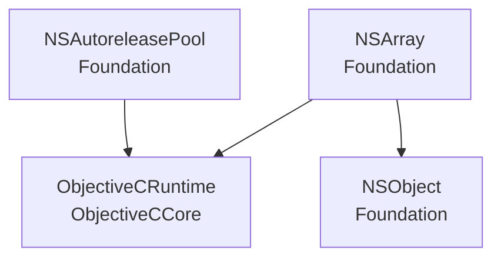
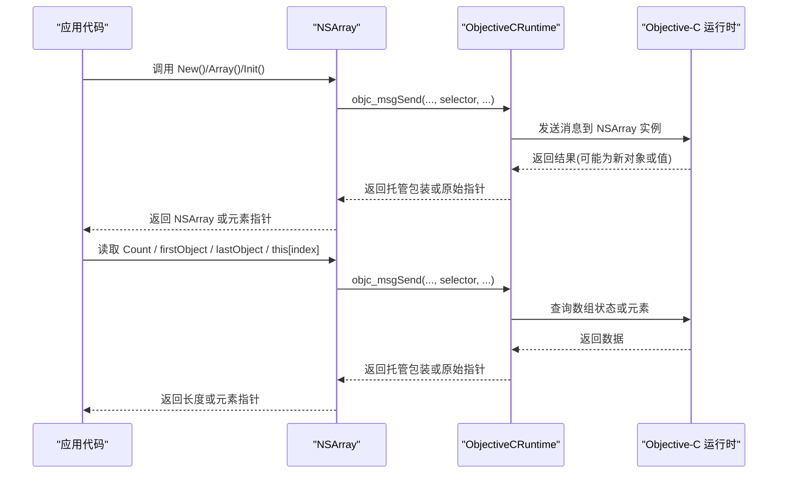
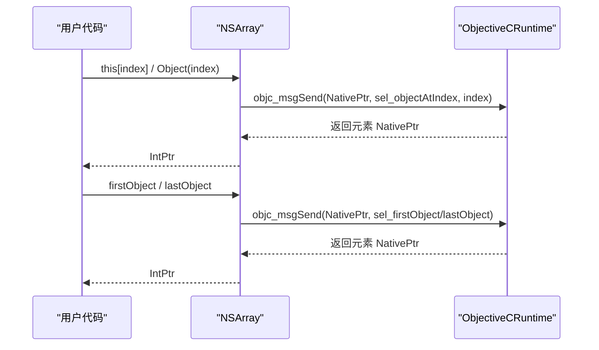
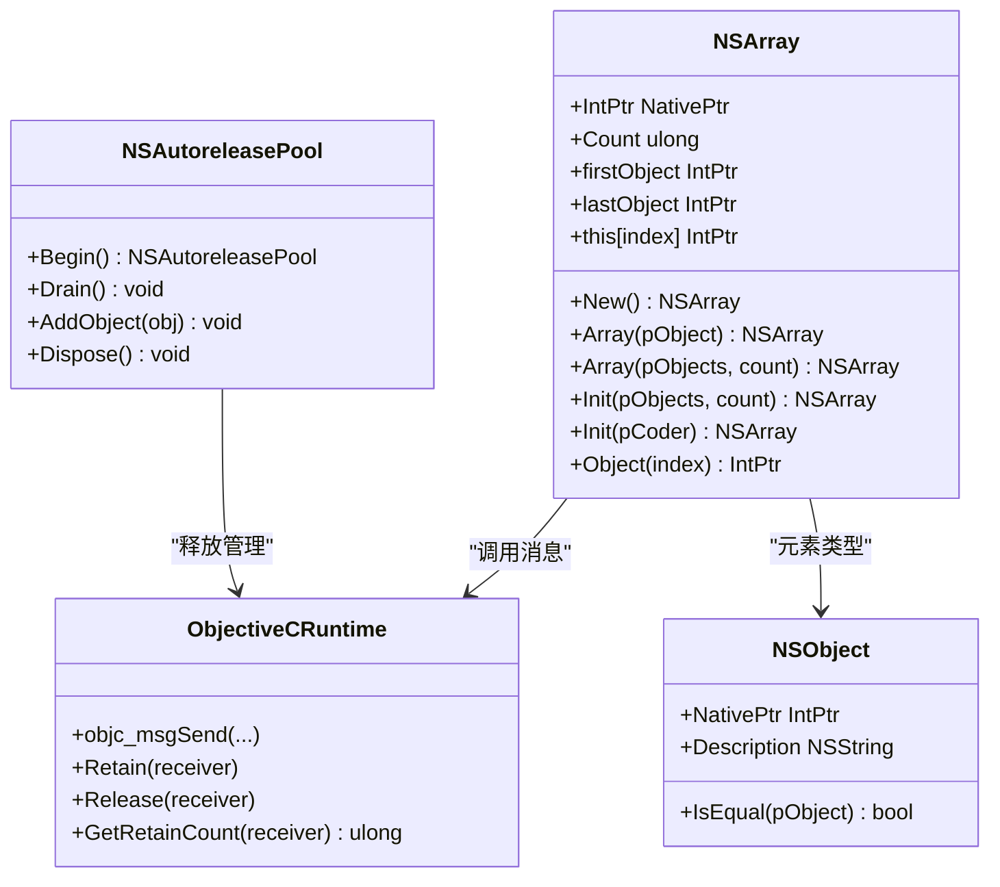

# NSArray 数组类型

<cite>
**本文引用的文件**
- [NSArray.cs](file://src/SharpMetal/Foundation/NSArray.cs)
- [NSObject.cs](file://src/SharpMetal/Foundation/NSObject.cs)
- [ObjectiveCRuntime.cs](file://src/SharpMetal/ObjectiveCCore/ObjectiveCRuntime.cs)
- [NSAutoreleasePool.cs](file://src/SharpMetal/Foundation/NSAutoreleasePool.cs)
- [README.md](file://README.md)
</cite>

## 目录
1. [简介](#简介)
2. [项目结构](#项目结构)
3. [核心组件](#核心组件)
4. [架构总览](#架构总览)
5. [详细组件分析](#详细组件分析)
6. [依赖关系分析](#依赖关系分析)
7. [性能考虑](#性能考虑)
8. [故障排查指南](#故障排查指南)
9. [结论](#结论)

## 简介
本文件为 SharpMetal 中 Foundation 层的 NSArray 数组类型的 API 文档。重点说明其结构体设计、NativePtr 原生指针管理、与 Objective-C 对象的生命周期交互，以及创建、访问、长度获取等常用 API。同时给出性能与线程安全建议，并明确在需要可变操作时应使用 NSMutableArray（本仓库未包含该实现）。

## 项目结构
- NSArray 位于 Foundation 命名空间，是轻量级 struct，内部仅持有 Objective-C 对象的 NativePtr。
- 所有与 Objective-C 运行时交互均通过 ObjectiveCRuntime 提供的消息发送方法完成。
- 内存管理遵循 Objective-C 的引用计数模型；如需自动释放，可使用 NSAutoreleasePool。



图表来源
- [NSArray.cs:5-64](file://src/SharpMetal/Foundation/NSArray.cs#L5-L64)
- [ObjectiveCRuntime.cs:33-800](file://src/SharpMetal/ObjectiveCCore/ObjectiveCRuntime.cs#L33-L800)
- [NSObject.cs:48-90](file://src/SharpMetal/Foundation/NSObject.cs#L48-L90)
- [NSAutoreleasePool.cs:5-39](file://src/SharpMetal/Foundation/NSAutoreleasePool.cs#L5-L39)

章节来源
- [README.md:1-23](file://README.md#L1-L23)

## 核心组件
- NSArray：不可变数组的结构体封装，持有 NativePtr，提供创建、访问、长度等 API。
- ObjectiveCRuntime：底层 Objective-C 运行时桥接，负责消息发送、保留/释放、选择器调用等。
- NSObject：基础对象封装，用于表示数组元素或作为工厂方法的参数。
- NSAutoreleasePool：可选的自动释放池，用于管理临时 Objective-C 对象的生命周期。

章节来源
- [NSArray.cs:5-64](file://src/SharpMetal/Foundation/NSArray.cs#L5-L64)
- [ObjectiveCRuntime.cs:33-800](file://src/SharpMetal/ObjectiveCCore/ObjectiveCRuntime.cs#L33-L800)
- [NSObject.cs:48-90](file://src/SharpMetal/Foundation/NSObject.cs#L48-L90)
- [NSAutoreleasePool.cs:5-39](file://src/SharpMetal/Foundation/NSAutoreleasePool.cs#L5-L39)

## 架构总览
NSArray 通过静态类字段持有 ObjectiveCClass 引用，并使用 Selector 常量标识 Objective-C 方法名。所有读写操作最终都转化为对 ObjectiveCRuntime 的消息发送。



图表来源
- [NSArray.cs:11-50](file://src/SharpMetal/Foundation/NSArray.cs#L11-L50)
- [ObjectiveCRuntime.cs:118-141](file://src/SharpMetal/ObjectiveCCore/ObjectiveCRuntime.cs#L118-L141)

## 详细组件分析

### 结构体设计与 NativePtr 管理
- NSArray 是 struct，包含一个公共字段 NativePtr，直接指向 Objective-C 的 NSArray 实例。
- 构造函数接受 IntPtr，便于从其他桥接层传入已有对象。
- 提供隐式转换 operator IntPtr，方便与底层 API 互操作。

章节来源
- [NSArray.cs:5-10](file://src/SharpMetal/Foundation/NSArray.cs#L5-L10)
- [NSArray.cs:52-54](file://src/SharpMetal/Foundation/NSArray.cs#L52-L54)

### 创建方法
- New()：静态方法，通过 ObjectiveCClass.AllocInit 创建新的空数组实例。
- Array(NSObject)：工厂方法，创建一个包含单个元素的数组。
- Array(NSObject[], ulong)：工厂方法，根据元素指针数组和数量创建数组。
- Init(NSObject[], ulong)：初始化器，基于已有 NativePtr 用元素数组和数量初始化。
- Init(IntPtrCoder)：反序列化初始化器，用于从编码流恢复数组。

```mermaid
flowchart TD
Start(["开始"]) --> Choice{"创建方式"}
Choice --> |New()| NewPath["分配并初始化空数组"]
Choice --> |Array(obj)| OnePath["创建含单元素的数组"]
Choice --> |Array(ptrs,count)| MultiPath["创建含多元素的数组"]
Choice --> |Init(ptrs,count)| InitPath["用元素数组初始化现有实例"]
Choice --> |Init(coder)| DecodePath["从编码器恢复数组"]
NewPath --> End(["返回 NSArray"])
OnePath --> End
MultiPath --> End
InitPath --> End
DecodePath --> End
```

图表来源
- [NSArray.cs:11-45](file://src/SharpMetal/Foundation/NSArray.cs#L11-L45)

章节来源
- [NSArray.cs:11-45](file://src/SharpMetal/Foundation/NSArray.cs#L11-L45)

### 元素访问方式
- 索引器 this[uint index]：通过 objectAtIndex: 获取指定位置的元素指针。
- Object(ulong index)：与方法等价的方法形式，返回元素指针。
- firstObject：返回第一个元素指针。
- lastObject：返回最后一个元素指针。

注意：这些访问方法返回的是 Objective-C 对象的 NativePtr（IntPtr），并非强类型托管对象。若需进一步操作，应结合具体类型进行桥接。



图表来源
- [NSArray.cs:13-25](file://src/SharpMetal/Foundation/NSArray.cs#L13-L25)
- [NSArray.cs:47-50](file://src/SharpMetal/Foundation/NSArray.cs#L47-L50)

章节来源
- [NSArray.cs:13-25](file://src/SharpMetal/Foundation/NSArray.cs#L13-L25)
- [NSArray.cs:47-50](file://src/SharpMetal/Foundation/NSArray.cs#L47-L50)

### 长度属性 Count
- Count：通过 count 选择器获取数组长度，返回 ulong。

章节来源
- [NSArray.cs:13-14](file://src/SharpMetal/Foundation/NSArray.cs#L13-L14)

### 生命周期与内存管理
- NSArray 本身是轻量级 struct，不拥有所有权语义；它只是对 NativePtr 的透明包装。
- 由工厂方法或初始化器创建的 NSArray 实例通常由 Objective-C 运行时管理其引用计数。
- 若需要在局部作用域内自动释放临时对象，可结合 NSAutoreleasePool.Begin() 与 Dispose() 使用。
- 对于从 Objective-C 返回的对象，请遵循“谁创建谁释放”的原则；若不确定所有权，避免手动 Release，交由自动释放池或上层框架管理。

章节来源
- [NSAutoreleasePool.cs:5-39](file://src/SharpMetal/Foundation/NSAutoreleasePool.cs#L5-L39)
- [ObjectiveCRuntime.cs:769-782](file://src/SharpMetal/ObjectiveCCore/ObjectiveCRuntime.cs#L769-L782)

## 依赖关系分析
- NSArray 依赖 ObjectiveCRuntime 进行消息发送。
- NSArray 的元素类型为 NSObject（或其子类）的 NativePtr，因此与 NSObject 存在概念上的关联。
- 可选依赖 NSAutoreleasePool 以管理临时对象的生命周期。



图表来源
- [NSArray.cs:5-64](file://src/SharpMetal/Foundation/NSArray.cs#L5-L64)
- [ObjectiveCRuntime.cs:33-800](file://src/SharpMetal/ObjectiveCCore/ObjectiveCRuntime.cs#L33-L800)
- [NSObject.cs:48-90](file://src/SharpMetal/Foundation/NSObject.cs#L48-L90)
- [NSAutoreleasePool.cs:5-39](file://src/SharpMetal/Foundation/NSAutoreleasePool.cs#L5-L39)

章节来源
- [NSArray.cs:5-64](file://src/SharpMetal/Foundation/NSArray.cs#L5-L64)
- [ObjectiveCRuntime.cs:33-800](file://src/SharpMetal/ObjectiveCCore/ObjectiveCRuntime.cs#L33-L800)
- [NSObject.cs:48-90](file://src/SharpMetal/Foundation/NSObject.cs#L48-L90)
- [NSAutoreleasePool.cs:5-39](file://src/SharpMetal/Foundation/NSAutoreleasePool.cs#L5-L39)

## 性能考虑
- 不可变性：NSArray 是不可变数组，适合只读场景。频繁修改请使用 NSMutableArray（本仓库未包含该实现）。
- 访问成本：索引访问与 first/last 均为 O(1) 级别的 Objective-C 消息调用；大量随机访问时注意跨边界调用的开销。
- 批量创建：优先使用 Array(pObjects, count) 一次性构造，减少多次消息发送。
- 内存分配：避免在热路径上频繁创建临时数组；必要时复用或缓存。
- 自动释放：在高频率循环中合理使用 NSAutoreleasePool 以减少峰值内存占用。

## 故障排查指南
- 空指针访问：确保 NativePtr 非零后再调用 Count/firstObject/lastObject/索引访问。
- 越界访问：索引超出范围可能导致未定义行为；请在调用前检查 Count。
- 生命周期问题：若元素在访问时已释放，将导致崩溃；确认元素的所有权归属与作用域。
- 自动释放池：在长时间运行的任务中，适时 Begin/Dispose 自动释放池以避免内存增长。
- 调试信息：可通过 NSObject.Description/DebugDescription 获取对象的描述信息辅助定位问题。

章节来源
- [NSObject.cs:54-58](file://src/SharpMetal/Foundation/NSObject.cs#L54-L58)
- [NSAutoreleasePool.cs:11-26](file://src/SharpMetal/Foundation/NSAutoreleasePool.cs#L11-L26)

## 结论
NSArray 提供了简洁高效的不可变数组能力，适用于只读数据集合。通过 NativePtr 与 ObjectiveCRuntime 的桥接，实现了与 Objective-C 运行时的无缝集成。建议在只读场景下使用 NSArray，并在需要可变操作时使用 NSMutableArray（本仓库未包含）。合理运用自动释放池与所有权规则，可确保内存安全与性能稳定。