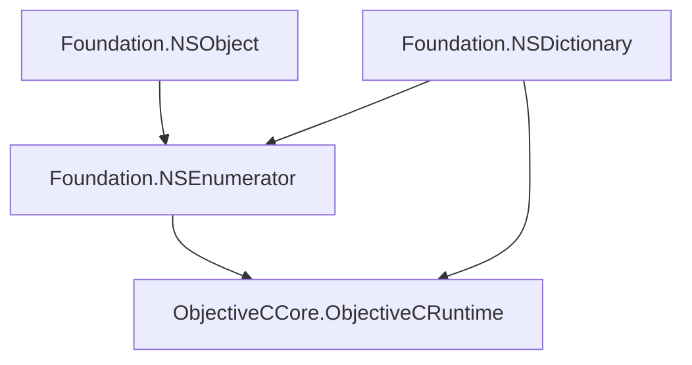
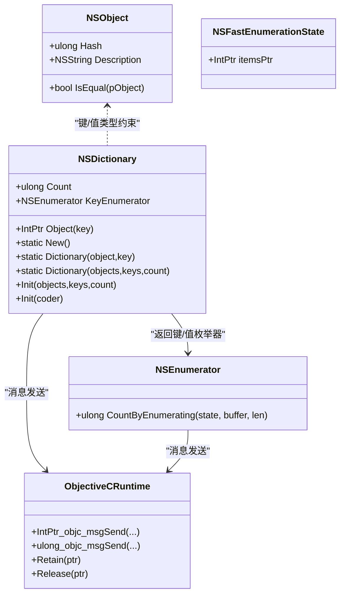
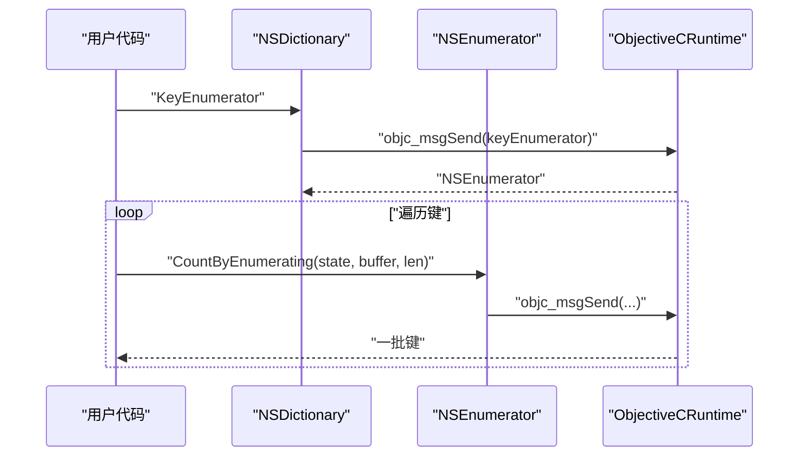
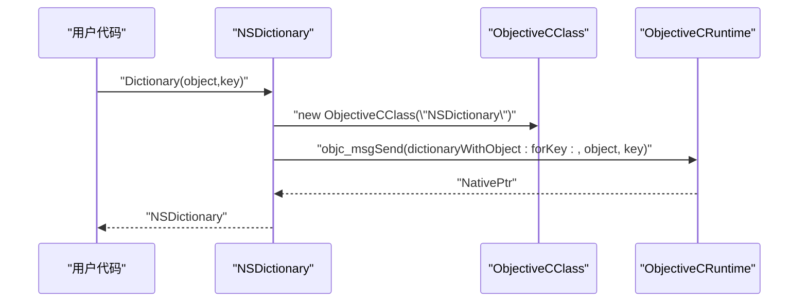
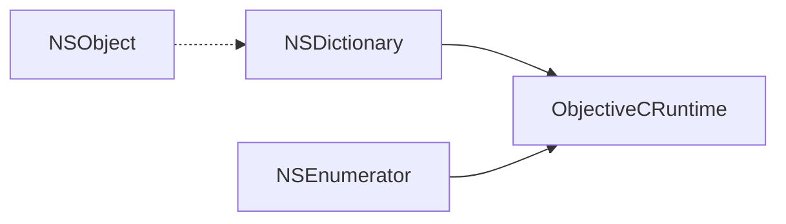

# NSDictionary 字典类型

<cite>
**本文引用的文件**
- [NSDictionary.cs](file://src/SharpMetal/Foundation/NSDictionary.cs)
- [NSEnumerator.cs](file://src/SharpMetal/Foundation/NSEnumerator.cs)
- [NSObject.cs](file://src/SharpMetal/Foundation/NSObject.cs)
- [ObjectiveCRuntime.cs](file://src/SharpMetal/ObjectiveCCore/ObjectiveCRuntime.cs)
</cite>

## 目录
1. [简介](#简介)
2. [项目结构](#项目结构)
3. [核心组件](#核心组件)
4. [架构总览](#架构总览)
5. [详细组件分析](#详细组件分析)
6. [依赖关系分析](#依赖关系分析)
7. [性能考虑](#性能考虑)
8. [故障排查指南](#故障排查指南)
9. [结论](#结论)
10. [附录：API 速查表](#附录api-速查表)

## 简介
本文件为 SharpMetal 中 Foundation 层的 NSDictionary 字典类型的完整 API 文档。NSDictionary 在 Objective-C 运行时中以不可变键值对集合的形式提供高效查找能力，适用于频繁按 Key 读取值的场景。本文档聚焦以下方面：
- 设计模式与不可变性
- 创建方式（构造函数、工厂方法、初始化器）
- 键值操作（获取值、检查键存在性）
- 枚举器支持（KeyEnumerator、ObjectEnumerator）
- 查找与基于谓词的搜索
- 性能特性（O(1) 查找）
- 线程安全与内存管理最佳实践

## 项目结构
NSDictionary 位于 Foundation 命名空间下，作为轻量级结构体封装了 Objective-C 对象的 NativePtr，并通过 ObjectiveCRuntime 进行消息转发调用。与之协作的关键类型包括：
- NSObject：基础对象类型，提供哈希、描述、相等性比较等通用能力
- NSEnumerator/NSFastEnumeration：用于遍历键或值的枚举器
- ObjectiveCRuntime：底层 Objective-C 运行时桥接，负责消息发送与内存管理

图表来源
- [NSDictionary.cs:5-52](file://src/SharpMetal/Foundation/NSDictionary.cs#L5-L52)
- [NSEnumerator.cs:6-44](file://src/SharpMetal/Foundation/NSEnumerator.cs#L6-L44)
- [NSObject.cs:48-90](file://src/SharpMetal/Foundation/NSObject.cs#L48-L90)
- [ObjectiveCRuntime.cs:33-800](file://src/SharpMetal/ObjectiveCCore/ObjectiveCRuntime.cs#L33-L800)

章节来源
- [NSDictionary.cs:5-52](file://src/SharpMetal/Foundation/NSDictionary.cs#L5-L52)
- [NSEnumerator.cs:6-44](file://src/SharpMetal/Foundation/NSEnumerator.cs#L6-L44)
- [NSObject.cs:48-90](file://src/SharpMetal/Foundation/NSObject.cs#L48-L90)
- [ObjectiveCRuntime.cs:33-800](file://src/SharpMetal/ObjectiveCCore/ObjectiveCRuntime.cs#L33-L800)

## 核心组件
- NSDictionary：不可变字典的托管包装，暴露创建、计数、取值、枚举器等能力
- NSEnumerator/NSFastEnumerationState：用于遍历键或值的迭代协议
- NSObject：所有 Foundation 对象的基元，提供哈希、描述、相等性等
- ObjectiveCRuntime：通过动态消息发送访问 Objective-C 对象方法与属性

章节来源
- [NSDictionary.cs:5-52](file://src/SharpMetal/Foundation/NSDictionary.cs#L5-L52)
- [NSEnumerator.cs:6-44](file://src/SharpMetal/Foundation/NSEnumerator.cs#L6-L44)
- [NSObject.cs:48-90](file://src/SharpMetal/Foundation/NSObject.cs#L48-L90)
- [ObjectiveCRuntime.cs:33-800](file://src/SharpMetal/ObjectiveCCore/ObjectiveCRuntime.cs#L33-L800)

## 架构总览
下图展示了 NSDictionary 与其依赖的关系以及典型调用路径：

图表来源
- [NSDictionary.cs:5-52](file://src/SharpMetal/Foundation/NSDictionary.cs#L5-L52)
- [NSEnumerator.cs:6-44](file://src/SharpMetal/Foundation/NSEnumerator.cs#L6-L44)
- [NSObject.cs:48-90](file://src/SharpMetal/Foundation/NSObject.cs#L48-L90)
- [ObjectiveCRuntime.cs:33-800](file://src/SharpMetal/ObjectiveCCore/ObjectiveCRuntime.cs#L33-L800)

## 详细组件分析

### NSDictionary 设计与不可变性
- 不可变语义：NSDictionary 以结构体形式封装原生指针，不暴露修改接口，符合不可变集合的设计模式，适合并发只读访问
- 构造与工厂：
  - 构造函数：通过传入 NativePtr 直接包装已有对象
  - 工厂方法：New()、Dictionary(object,key)、Dictionary(objects,keys,count)
  - 初始化器：Init(objects,keys,count)、Init(coder)
- 基本属性与方法：
  - Count：返回元素数量
  - KeyEnumerator：返回键枚举器
  - Object(key)：根据键获取值（对应 objectForKey:）
- 隐式转换：可隐式转换为 IntPtr，便于与底层 API 互操作

章节来源
- [NSDictionary.cs:5-52](file://src/SharpMetal/Foundation/NSDictionary.cs#L5-L52)

### 键值操作
- 获取值：Object(in NSObject pKey) 对应 objectForKey:，返回值为 IntPtr，需结合具体类型使用
- 检查键存在性：当前实现未提供 ContainsKey；可通过 Object(key) 返回值是否为空来判断是否存在（注意：若值本身可为空，建议结合 key 的存在性语义谨慎处理）
- 计数：Count 属性用于快速判断是否为空或遍历边界

章节来源
- [NSDictionary.cs:37-40](file://src/SharpMetal/Foundation/NSDictionary.cs#L37-L40)
- [NSDictionary.cs:15-15](file://src/SharpMetal/Foundation/NSDictionary.cs#L15-L15)

### 枚举器支持
- KeyEnumerator：返回 NSEnumerator，可用于遍历所有键
- 遍历值：可通过 KeyEnumerator 逐个取键，再调用 Object(key) 获取值；或使用 NSSet/ObjectEnumerator 模式（NSSet 提供 ObjectEnumerator，但 NSDictionary 未直接暴露）
- NSEnumerator/NSFastEnumeration：通过 CountByEnumerating 批量获取元素，提升遍历效率

图表来源
- [NSDictionary.cs:13-13](file://src/SharpMetal/Foundation/NSDictionary.cs#L13-L13)
- [NSEnumerator.cs:18-21](file://src/SharpMetal/Foundation/NSEnumerator.cs#L18-L21)
- [ObjectiveCRuntime.cs:118-141](file://src/SharpMetal/ObjectiveCCore/ObjectiveCRuntime.cs#L118-L141)

章节来源
- [NSDictionary.cs:13-13](file://src/SharpMetal/Foundation/NSDictionary.cs#L13-L13)
- [NSEnumerator.cs:6-44](file://src/SharpMetal/Foundation/NSEnumerator.cs#L6-L44)

### 查找与基于谓词的搜索
- 精确查找：Object(in NSObject pKey) 提供 O(1) 平均时间复杂度的键到值映射
- 基于谓词搜索：当前 NSDictionary 未提供基于谓词的过滤方法；如需条件筛选，可在应用层遍历键并组合谓词逻辑
- 键存在性：如前所述，可使用 Object(key) 返回值是否为空来近似判断，但更严谨的做法是结合业务语义

章节来源
- [NSDictionary.cs:37-40](file://src/SharpMetal/Foundation/NSDictionary.cs#L37-L40)

### 创建流程时序图

图表来源
- [NSDictionary.cs:17-20](file://src/SharpMetal/Foundation/NSDictionary.cs#L17-L20)
- [ObjectiveCRuntime.cs:118-141](file://src/SharpMetal/ObjectiveCCore/ObjectiveCRuntime.cs#L118-L141)

章节来源
- [NSDictionary.cs:11-25](file://src/SharpMetal/Foundation/NSDictionary.cs#L11-L25)

## 依赖关系分析
- NSDictionary 依赖 ObjectiveCRuntime 完成与 Objective-C 对象的消息交互
- NSEnumerator 同样依赖 ObjectiveCRuntime 进行枚举
- NSObject 提供键/值的基础能力（哈希、相等性），影响字典的键行为

图表来源
- [NSDictionary.cs:5-52](file://src/SharpMetal/Foundation/NSDictionary.cs#L5-L52)
- [NSEnumerator.cs:6-44](file://src/SharpMetal/Foundation/NSEnumerator.cs#L6-L44)
- [NSObject.cs:48-90](file://src/SharpMetal/Foundation/NSObject.cs#L48-L90)
- [ObjectiveCRuntime.cs:33-800](file://src/SharpMetal/ObjectiveCCore/ObjectiveCRuntime.cs#L33-L800)

章节来源
- [NSDictionary.cs:5-52](file://src/SharpMetal/Foundation/NSDictionary.cs#L5-L52)
- [NSEnumerator.cs:6-44](file://src/SharpMetal/Foundation/NSEnumerator.cs#L6-L44)
- [NSObject.cs:48-90](file://src/SharpMetal/Foundation/NSObject.cs#L48-L90)
- [ObjectiveCRuntime.cs:33-800](file://src/SharpMetal/ObjectiveCCore/ObjectiveCRuntime.cs#L33-L800)

## 性能考虑
- 查找复杂度：Object(key) 平均时间复杂度为 O(1)，适合高频查找场景
- 枚举开销：KeyEnumerator 配合 NSFastEnumeration 可批量获取元素，减少跨语言调用次数
- 内存与生命周期：NSDictionary 为不可变对象，通常由 Objective-C 运行时管理；避免重复创建相同内容的字典以提升性能
- 键选择：建议使用稳定且高效的键类型（如 NSString），并确保正确实现哈希与相等性

[本节为通用性能指导，不直接分析具体文件]

## 故障排查指南
- 空指针异常：确保传入的键非空；Object(key) 可能返回空指针表示不存在
- 枚举器状态：遍历时不要修改底层字典（尽管不可变，仍需避免外部并发修改引用）
- 内存泄漏：遵循 Objective-C 内存模型，必要时使用 Retain/Release 管理生命周期（见 ObjectiveCRuntime）
- 类型转换：从 IntPtr 到具体类型时，请确保类型匹配，避免不安全转换

章节来源
- [ObjectiveCRuntime.cs:769-782](file://src/SharpMetal/ObjectiveCCore/ObjectiveCRuntime.cs#L769-L782)
- [NSDictionary.cs:37-40](file://src/SharpMetal/Foundation/NSDictionary.cs#L37-L40)

## 结论
NSDictionary 在 SharpMetal 中提供了不可变的键值对集合，具备高效的 O(1) 查找能力与简洁的枚举器支持。其设计遵循不可变模式，适合多线程只读场景。对于键存在性检查与基于谓词的搜索，当前实现未直接暴露，可通过现有 API 组合实现。建议在关键路径上优先使用 Object(key) 进行查找，并结合枚举器进行批量遍历，以获得最佳性能与稳定性。

[本节为总结性内容，不直接分析具体文件]

## 附录：API 速查表
- 构造与工厂
  - 构造函数：NSDictionary(in IntPtr ptr)
  - 工厂方法：New()、Dictionary(in NSObject pObject, in NSObject pKey)、Dictionary(in NSObject pObjects, in NSObject pKeys, in ulong count)
  - 初始化器：Init(in NSObject pObjects, in NSObject pKeys, in ulong count)、Init(in IntPtr pCoder)
- 属性与方法
  - Count：ulong
  - KeyEnumerator：NSEnumerator
  - Object(in NSObject pKey)：IntPtr
- 枚举器
  - NSEnumerator.CountByEnumerating(NSFastEnumerationState, NSObject, ulong)：ulong
- 运行时
  - ObjectiveCRuntime.Retain/Release：用于手动内存管理
  - ObjectiveCRuntime.IntPtr_objc_msgSend/ulong_objc_msgSend：消息发送

章节来源
- [NSDictionary.cs:9-40](file://src/SharpMetal/Foundation/NSDictionary.cs#L9-L40)
- [NSEnumerator.cs:18-21](file://src/SharpMetal/Foundation/NSEnumerator.cs#L18-L21)
- [ObjectiveCRuntime.cs:769-782](file://src/SharpMetal/ObjectiveCCore/ObjectiveCRuntime.cs#L769-L782)