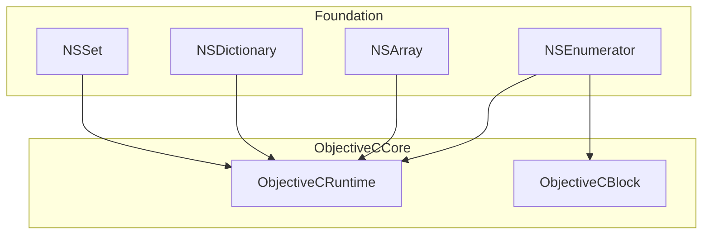
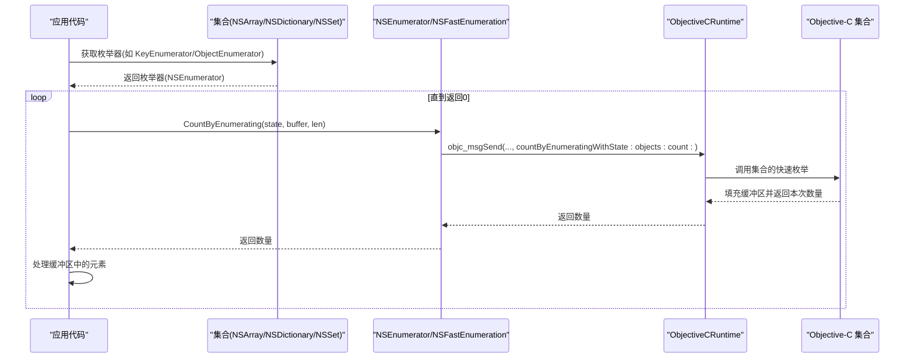
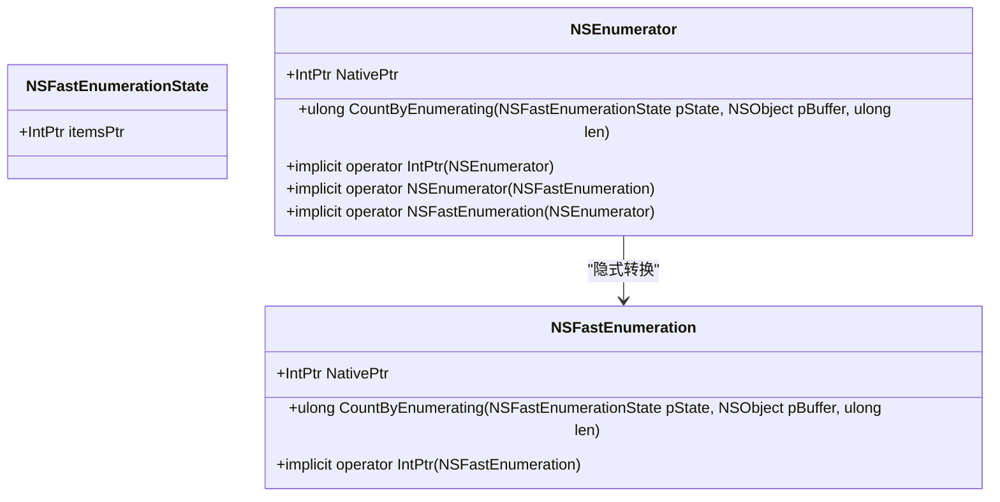
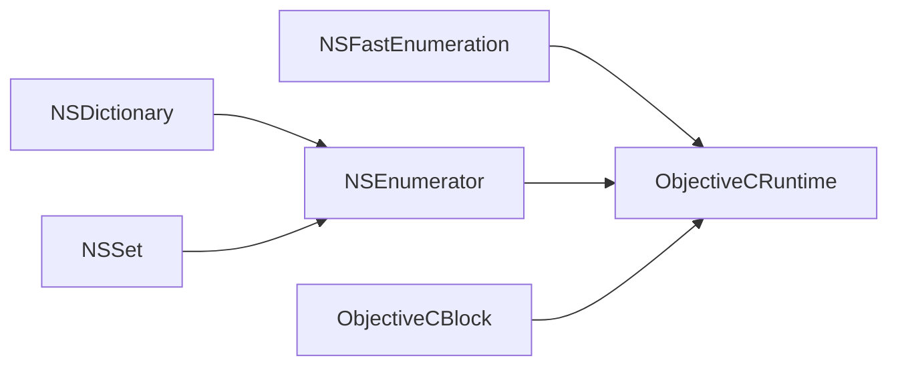

# NSEnumerator 枚举器

<cite>
**本文引用的文件**
- [NSEnumerator.cs](file://src/SharpMetal/Foundation/NSEnumerator.cs)
- [NSArray.cs](file://src/SharpMetal/Foundation/NSArray.cs)
- [NSDictionary.cs](file://src/SharpMetal/Foundation/NSDictionary.cs)
- [NSSet.cs](file://src/SharpMetal/Foundation/NSSet.cs)
- [ObjectiveCRuntime.cs](file://src/SharpMetal/ObjectiveCCore/ObjectiveCRuntime.cs)
- [ObjectiveCBlock.cs](file://src/SharpMetal/ObjectiveCCore/ObjectiveCBlock.cs)
</cite>

## 目录
1. [简介](#简介)
2. [项目结构](#项目结构)
3. [核心组件](#核心组件)
4. [架构总览](#架构总览)
5. [详细组件分析](#详细组件分析)
6. [依赖关系分析](#依赖关系分析)
7. [性能考虑](#性能考虑)
8. [故障排查指南](#故障排查指南)
9. [结论](#结论)
10. [附录：使用示例与最佳实践](#附录使用示例与最佳实践)

## 简介
本文件为 SharpMetal 中 NSEnumerator 枚举器的完整 API 文档。NSEnumerator 作为迭代协议的基础抽象，提供对 Objective-C 集合的统一遍历接口。当前实现基于 NSFastEnumeration（快速枚举）机制，通过底层 Objective-C 运行时调用获取元素批次，从而在 C# 侧以高效、低内存开销的方式遍历 NSArray、NSDictionary、NSSet 等集合。

说明范围：
- 枚举器核心能力：基于 NSFastEnumeration 的批量枚举
- 与集合类型的集成：NSArray、NSDictionary、NSSet 的枚举器来源
- 现代 C# 集成现状：当前仓库未包含 foreach/IEnumerable/LINQ 扩展，需自行封装
- 性能与错误处理：内存效率、遍历性能、并发修改行为建议

## 项目结构
NSEnumerator 位于 Foundation 命名空间，配合 ObjectiveCCore 中的运行时桥接能力，为上层集合类型提供统一的枚举入口。

图表来源
- [NSEnumerator.cs:6-44](file://src/SharpMetal/Foundation/NSEnumerator.cs#L6-L44)
- [NSArray.cs:1-66](file://src/SharpMetal/Foundation/NSArray.cs#L1-L66)
- [NSDictionary.cs:1-55](file://src/SharpMetal/Foundation/NSDictionary.cs#L1-L55)
- [NSSet.cs:1-36](file://src/SharpMetal/Foundation/NSSet.cs#L1-L36)
- [ObjectiveCRuntime.cs:33-839](file://src/SharpMetal/ObjectiveCCore/ObjectiveCRuntime.cs#L33-L839)
- [ObjectiveCBlock.cs:12-167](file://src/SharpMetal/ObjectiveCCore/ObjectiveCBlock.cs#L12-L167)

章节来源
- [NSEnumerator.cs:6-44](file://src/SharpMetal/Foundation/NSEnumerator.cs#L6-L44)
- [NSArray.cs:1-66](file://src/SharpMetal/Foundation/NSArray.cs#L1-L66)
- [NSDictionary.cs:1-55](file://src/SharpMetal/Foundation/NSDictionary.cs#L1-L55)
- [NSSet.cs:1-36](file://src/SharpMetal/Foundation/NSSet.cs#L1-L36)
- [ObjectiveCRuntime.cs:33-839](file://src/SharpMetal/ObjectiveCCore/ObjectiveCRuntime.cs#L33-L839)
- [ObjectiveCBlock.cs:12-167](file://src/SharpMetal/ObjectiveCCore/ObjectiveCBlock.cs#L12-L167)

## 核心组件
- NSFastEnumerationState：用于保存快速枚举状态的结构体，包含指向对象缓冲区的指针。
- NSFastEnumeration：暴露 countByEnumeratingWithState:objects:count: 方法，用于从底层集合批量拉取元素。
- NSEnumerator：封装了与 NSFastEnumeration 相同的快速枚举能力，并提供与 NSFastEnumeration 之间的隐式转换。

关键要点
- 所有枚举均通过 ObjectiveCRuntime 调用 objc_msgSend 完成，避免托管层额外分配。
- 返回值为 ulong，表示本次批次读取到的元素数量；当返回 0 时，表示枚举结束。
- 通过 NSFastEnumerationState 维护内部游标，确保多次调用时的连续性。

章节来源
- [NSEnumerator.cs:6-44](file://src/SharpMetal/Foundation/NSEnumerator.cs#L6-L44)
- [ObjectiveCRuntime.cs:421-429](file://src/SharpMetal/ObjectiveCCore/ObjectiveCRuntime.cs#L421-L429)

## 架构总览
NSEnumerator 作为统一抽象，向上屏蔽不同集合的具体实现细节。各集合类型通过各自的枚举器属性或方法返回一个可被快速枚举的对象，从而获得一致的遍历体验。

图表来源
- [NSEnumerator.cs:18-21](file://src/SharpMetal/Foundation/NSEnumerator.cs#L18-L21)
- [NSEnumerator.cs:34-37](file://src/SharpMetal/Foundation/NSEnumerator.cs#L34-L37)
- [ObjectiveCRuntime.cs:421-429](file://src/SharpMetal/ObjectiveCCore/ObjectiveCRuntime.cs#L421-L429)
- [NSDictionary.cs:13-14](file://src/SharpMetal/Foundation/NSDictionary.cs#L13-L14)
- [NSSet.cs:15-16](file://src/SharpMetal/Foundation/NSSet.cs#L15-L16)

## 详细组件分析

### NSEnumerator 与 NSFastEnumeration
- NSFastEnumerationState：持有 itemsPtr，用于指向由集合写入的元素缓冲区。
- NSFastEnumeration.CountByEnumerating(...)：通过 ObjectiveCRuntime 调用底层快速枚举选择器，返回本次批次的元素个数。
- NSEnumerator：与 NSFastEnumeration 等价的能力封装，并提供相互隐式转换，便于在不同上下文中复用。

复杂度与内存
- 时间复杂度：每次调用 O(k)，k 为本次批次大小；整体 O(n)。
- 空间复杂度：O(k)，仅缓存当前批次，不复制整个集合。

章节来源
- [NSEnumerator.cs:6-44](file://src/SharpMetal/Foundation/NSEnumerator.cs#L6-L44)
- [ObjectiveCRuntime.cs:421-429](file://src/SharpMetal/ObjectiveCCore/ObjectiveCRuntime.cs#L421-L429)

#### 类图（代码级）

图表来源
- [NSEnumerator.cs:6-44](file://src/SharpMetal/Foundation/NSEnumerator.cs#L6-L44)

### 与 NSArray 的集成
- NSArray 提供索引访问、计数、首尾元素等方法，但未直接暴露枚举器属性。可通过自定义包装将 NSArray 适配为 NSFastEnumeration 进行遍历。
- 典型用法：构造 NSArray，然后使用外部实现的快速枚举循环读取元素。

章节来源
- [NSArray.cs:1-66](file://src/SharpMetal/Foundation/NSArray.cs#L1-L66)

### 与 NSDictionary 的集成
- NSDictionary 暴露 KeyEnumerator 属性，返回一个可用于键枚举的 NSEnumerator。
- 结合 NSFastEnumeration 的批量读取，可高效遍历字典的所有键。

章节来源
- [NSDictionary.cs:13-14](file://src/SharpMetal/Foundation/NSDictionary.cs#L13-L14)

### 与 NSSet 的集成
- NSSet 暴露 ObjectEnumerator 属性，返回一个可用于元素枚举的 NSEnumerator。
- 适合无序集合的高效遍历。

章节来源
- [NSSet.cs:15-16](file://src/SharpMetal/Foundation/NSSet.cs#L15-L16)

### 现代 C# 集成现状与建议
- 当前仓库未提供 IEnumerable<T> 实现、foreach 支持或 LINQ 扩展方法。
- 建议方案：
  - 为 NSEnumerator 编写 IEnumerable<T> 适配器，利用 CountByEnumerating 的批次特性实现 GetEnumerator()。
  - 为 NSArray/NSDictionary/NSSet 提供 LINQ 扩展（Select/Where/ToArray 等），内部委托至上述适配器。
  - 若需要块回调风格（类似 enumerateObjectsUsingBlock:），可使用 ObjectiveCBlock 创建托管回调桥接到 Objective-C 块。

章节来源
- [ObjectiveCBlock.cs:23-45](file://src/SharpMetal/ObjectiveCCore/ObjectiveCBlock.cs#L23-L45)

## 依赖关系分析
- NSEnumerator/NSFastEnumeration 依赖 ObjectiveCRuntime 提供的 objc_msgSend 重载，用于调用 Objective-C 的选择器。
- NSDictionary/NSSet 通过各自枚举器属性返回 NSEnumerator，形成“集合 -> 枚举器”的单向依赖。
- ObjectiveCBlock 用于桥接托管 Action 到 Objective-C Block，适用于需要回调的场景。

图表来源
- [NSEnumerator.cs:18-21](file://src/SharpMetal/Foundation/NSEnumerator.cs#L18-L21)
- [NSDictionary.cs:13-14](file://src/SharpMetal/Foundation/NSDictionary.cs#L13-L14)
- [NSSet.cs:15-16](file://src/SharpMetal/Foundation/NSSet.cs#L15-L16)
- [ObjectiveCRuntime.cs:421-429](file://src/SharpMetal/ObjectiveCCore/ObjectiveCRuntime.cs#L421-L429)
- [ObjectiveCBlock.cs:23-45](file://src/SharpMetal/ObjectiveCCore/ObjectiveCBlock.cs#L23-L45)

章节来源
- [NSEnumerator.cs:6-44](file://src/SharpMetal/Foundation/NSEnumerator.cs#L6-L44)
- [NSDictionary.cs:13-14](file://src/SharpMetal/Foundation/NSDictionary.cs#L13-L14)
- [NSSet.cs:15-16](file://src/SharpMetal/Foundation/NSSet.cs#L15-L16)
- [ObjectiveCRuntime.cs:421-429](file://src/SharpMetal/ObjectiveCCore/ObjectiveCRuntime.cs#L421-L429)
- [ObjectiveCBlock.cs:23-45](file://src/SharpMetal/ObjectiveCCore/ObjectiveCBlock.cs#L23-L45)

## 性能考虑
- 批次读取：CountByEnumerating 一次返回多个元素，减少跨边界调用次数，降低开销。
- 内存占用：仅维护当前批次缓冲区，避免全量拷贝，适合大集合遍历。
- 推荐实践：
  - 尽量使用快速枚举而非逐元素访问（如 objectAtIndex:）。
  - 在 C# 侧合并批次处理逻辑，减少托管层循环次数。
  - 避免在枚举期间修改集合，必要时先复制快照或使用线程安全集合。

[本节为通用性能指导，不直接分析具体文件]

## 故障排查指南
- 枚举提前结束：检查 CountByEnumerating 返回值是否为 0；确认 NSFastEnumerationState 是否正确初始化与传递。
- 缓冲区越界：确保传入的缓冲区长度足够容纳批次大小；根据返回数量只处理有效元素。
- 并发修改异常：在多线程环境下，不要在枚举过程中修改源集合；如需修改，应在锁保护下操作或采用快照策略。
- 块回调崩溃：使用 ObjectiveCBlock 时，确保上下文句柄生命周期正确，避免释放后仍被调用。

章节来源
- [NSEnumerator.cs:18-21](file://src/SharpMetal/Foundation/NSEnumerator.cs#L18-L21)
- [NSEnumerator.cs:34-37](file://src/SharpMetal/Foundation/NSEnumerator.cs#L34-L37)
- [ObjectiveCBlock.cs:23-45](file://src/SharpMetal/ObjectiveCCore/ObjectiveCBlock.cs#L23-L45)

## 结论
NSEnumerator 在 SharpMetal 中提供了基于 NSFastEnumeration 的高效、低内存占用的统一枚举能力。通过与 NSDictionary、NSSet 的集成，开发者可以以一致的方式遍历多种集合。当前仓库未内置 foreach/IEnumerable/LINQ 支持，但可通过轻量适配器轻松补齐。遵循批次处理与并发安全原则，可在大规模数据场景中获得稳定且高性能的遍历体验。

[本节为总结性内容，不直接分析具体文件]

## 附录：使用示例与最佳实践
- 字典键枚举：
  - 从 NSDictionary.KeyEnumerator 获取 NSEnumerator，循环调用 CountByEnumerating 直至返回 0，处理每个批次中的元素。
- 集合元素枚举：
  - 从 NSSet.ObjectEnumerator 获取 NSEnumerator，按相同模式遍历。
- 数组适配：
  - 由于 NSArray 未直接暴露枚举器，可封装一个 NSFastEnumeration 适配器，将 NSArray 的索引访问转换为快速枚举批次。
- 块回调风格：
  - 使用 ObjectiveCBlock 将托管回调桥接到 Objective-C 块，实现类似 enumerateObjectsUsingBlock: 的行为。

章节来源
- [NSDictionary.cs:13-14](file://src/SharpMetal/Foundation/NSDictionary.cs#L13-L14)
- [NSSet.cs:15-16](file://src/SharpMetal/Foundation/NSSet.cs#L15-L16)
- [NSArray.cs:1-66](file://src/SharpMetal/Foundation/NSArray.cs#L1-L66)
- [ObjectiveCBlock.cs:23-45](file://src/SharpMetal/ObjectiveCCore/ObjectiveCBlock.cs#L23-L45)