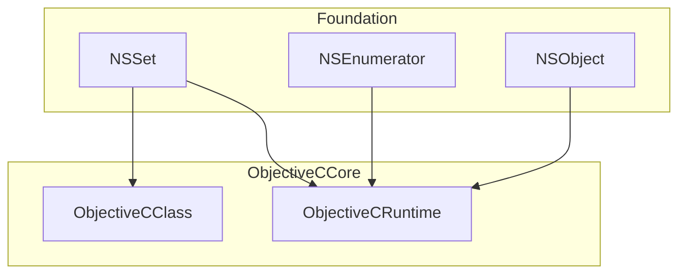
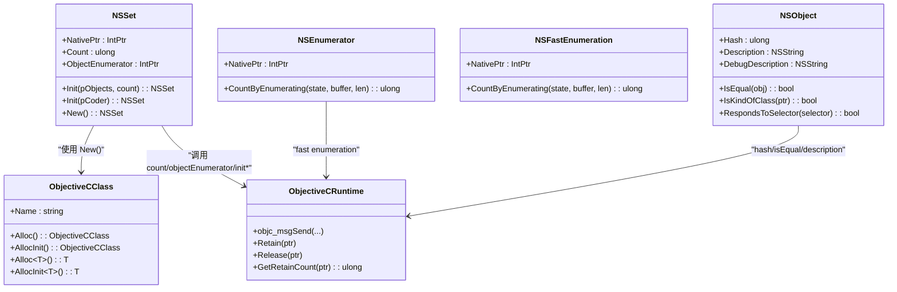
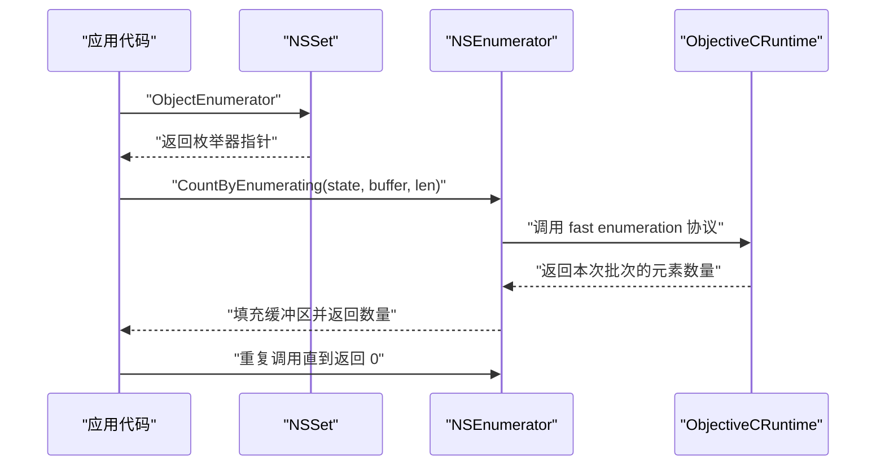
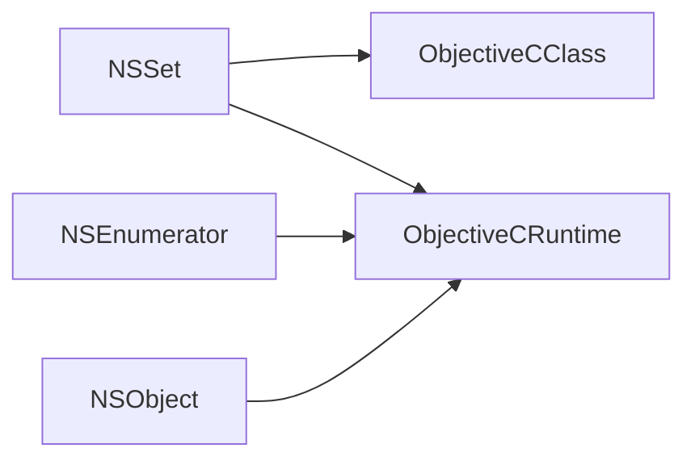

# NSSet 集合类型

<cite>
**本文引用的文件**
- [NSSet.cs](file://src/SharpMetal/Foundation/NSSet.cs)
- [NSEnumerator.cs](file://src/SharpMetal/Foundation/NSEnumerator.cs)
- [NSObject.cs](file://src/SharpMetal/Foundation/NSObject.cs)
- [ObjectiveCClass.cs](file://src/SharpMetal/ObjectiveCCore/ObjectiveCClass.cs)
- [ObjectiveCRuntime.cs](file://src/SharpMetal/ObjectiveCCore/ObjectiveCRuntime.cs)
</cite>

## 目录
1. [简介](#简介)
2. [项目结构](#项目结构)
3. [核心组件](#核心组件)
4. [架构总览](#架构总览)
5. [详细组件分析](#详细组件分析)
6. [依赖关系分析](#依赖关系分析)
7. [性能考虑](#性能考虑)
8. [故障排查指南](#故障排查指南)
9. [结论](#结论)
10. [附录](#附录)

## 简介
本文件为 SharpMetal 中 Foundation 层的 NSSet 集合类型的 API 文档。NSSet 表示无序、唯一元素的集合，元素必须实现合适的相等性语义（哈希与相等比较）。在 SharpMetal 中，NSSet 以值类型 struct 形式封装 Objective-C 运行时对象指针，并通过 ObjectiveCRuntime 进行消息调用，从而桥接到系统 Foundation 的 NSSet 能力。

- 特性：无序、元素唯一（基于对象的哈希与相等判断）
- 用途：快速查找、去重、集合运算等
- 底层：通过 ObjectiveCRuntime 调用 Objective-C 方法

## 项目结构
与 NSSet 相关的代码位于 Foundation 命名空间下，并与 ObjectiveCCore 中的运行时支持紧密耦合：
- Foundation/NSSet.cs：定义 NSSet 的结构体及基础访问方法
- Foundation/NSEnumerator.cs：定义枚举器接口，用于遍历集合元素
- Foundation/NSObject.cs：提供基础对象能力（如 Hash、IsEqual），是集合元素相等性判定的关键
- ObjectiveCCore/ObjectiveCClass.cs：提供 Alloc/AllocInit 等工厂式创建能力
- ObjectiveCCore/ObjectiveCRuntime.cs：提供 objc_msgSend 等底层消息发送与内存管理原语

图表来源
- [NSSet.cs:5-33](file://src/SharpMetal/Foundation/NSSet.cs#L5-L33)
- [NSEnumerator.cs:6-44](file://src/SharpMetal/Foundation/NSEnumerator.cs#L6-L44)
- [NSObject.cs:48-90](file://src/SharpMetal/Foundation/NSObject.cs#L48-L90)
- [ObjectiveCClass.cs:18-87](file://src/SharpMetal/ObjectiveCCore/ObjectiveCClass.cs#L18-L87)
- [ObjectiveCRuntime.cs:33-800](file://src/SharpMetal/ObjectiveCCore/ObjectiveCRuntime.cs#L33-L800)

章节来源
- [NSSet.cs:5-33](file://src/SharpMetal/Foundation/NSSet.cs#L5-L33)
- [NSEnumerator.cs:6-44](file://src/SharpMetal/Foundation/NSEnumerator.cs#L6-L44)
- [NSObject.cs:48-90](file://src/SharpMetal/Foundation/NSObject.cs#L48-L90)
- [ObjectiveCClass.cs:18-87](file://src/SharpMetal/ObjectiveCCore/ObjectiveCClass.cs#L18-L87)
- [ObjectiveCRuntime.cs:33-800](file://src/SharpMetal/ObjectiveCCore/ObjectiveCRuntime.cs#L33-L800)

## 核心组件
- NSSet：集合类型，提供计数、枚举器获取、初始化等方法
- NSEnumerator：枚举器，支持通过 fast enumeration 协议遍历集合元素
- NSObject：集合元素基类能力，提供 Hash、IsEqual 等用于相等性判定
- ObjectiveCClass：Objective-C 类的托管包装，提供 Alloc/AllocInit 等工厂方法
- ObjectiveCRuntime：Objective-C 运行时桥接，提供消息发送与内存管理

章节来源
- [NSSet.cs:5-33](file://src/SharpMetal/Foundation/NSSet.cs#L5-L33)
- [NSEnumerator.cs:6-44](file://src/SharpMetal/Foundation/NSEnumerator.cs#L6-L44)
- [NSObject.cs:48-90](file://src/SharpMetal/Foundation/NSObject.cs#L48-L90)
- [ObjectiveCClass.cs:18-87](file://src/SharpMetal/ObjectiveCCore/ObjectiveCClass.cs#L18-L87)
- [ObjectiveCRuntime.cs:33-800](file://src/SharpMetal/ObjectiveCCore/ObjectiveCRuntime.cs#L33-L800)

## 架构总览
下图展示了 NSSet 与其依赖的关系：

图表来源
- [NSSet.cs:5-33](file://src/SharpMetal/Foundation/NSSet.cs#L5-L33)
- [NSEnumerator.cs:6-44](file://src/SharpMetal/Foundation/NSEnumerator.cs#L6-L44)
- [NSObject.cs:48-90](file://src/SharpMetal/Foundation/NSObject.cs#L48-L90)
- [ObjectiveCClass.cs:18-87](file://src/SharpMetal/ObjectiveCCore/ObjectiveCClass.cs#L18-L87)
- [ObjectiveCRuntime.cs:33-800](file://src/SharpMetal/ObjectiveCCore/ObjectiveCRuntime.cs#L33-L800)

## 详细组件分析

### NSSet 结构与成员
- NativePtr：指向底层 Objective-C 对象的句柄
- Count：返回集合元素数量
- ObjectEnumerator：返回一个枚举器，用于遍历集合元素
- Init(in NSObject pObjects, in ulong count)：从对象数组和数量构造集合
- Init(in IntPtr pCoder)：从归档编码器构造集合
- New()：静态工厂方法，等价于 alloc+init
- 隐式转换到 IntPtr：便于与原生 API 互操作

章节来源
- [NSSet.cs:5-33](file://src/SharpMetal/Foundation/NSSet.cs#L5-L33)

### 枚举器 NSEnumerator
- CountByEnumerating(NSFastEnumerationState state, NSObject buffer, ulong len)：实现 fast enumeration 协议，批量取出元素
- 与 NSFastEnumeration 相互隐式转换，便于统一处理

章节来源
- [NSEnumerator.cs:6-44](file://src/SharpMetal/Foundation/NSEnumerator.cs#L6-L44)

### 元素相等性与哈希
- NSObject.Hash：用于计算元素的哈希值，影响集合存储位置
- NSObject.IsEqual：用于判断两个元素是否相等，决定集合的唯一性约束
- 注意：集合的唯一性由元素的哈希与相等比较共同决定

章节来源
- [NSObject.cs:48-90](file://src/SharpMetal/Foundation/NSObject.cs#L48-L90)

### 创建与初始化
- 构造函数：NSSet(in IntPtr ptr) 直接包装已有原生指针
- 工厂方法：New() 通过 ObjectiveCClass.AllocInit 创建并初始化
- 初始化器：
  - Init(in NSObject pObjects, in ulong count)：从对象列表与数量构造
  - Init(in IntPtr pCoder)：从归档数据恢复

章节来源
- [NSSet.cs:9-25](file://src/SharpMetal/Foundation/NSSet.cs#L9-L25)
- [ObjectiveCClass.cs:54-78](file://src/SharpMetal/ObjectiveCCore/ObjectiveCClass.cs#L54-L78)

### 元素存在性检查与引用获取
- Contains()：当前 NSSet 未暴露 Contains 方法。可通过枚举器遍历或使用其他途径实现
- Member()：当前 NSSet 未暴露 Member 方法。可通过枚举器遍历或使用其他途径实现
- 建议：如需频繁查找，可结合外部缓存或扩展 NSSet 封装

章节来源
- [NSEnumerator.cs:18-21](file://src/SharpMetal/Foundation/NSEnumerator.cs#L18-L21)
- [NSSet.cs:15-15](file://src/SharpMetal/Foundation/NSSet.cs#L15-L15)

### 集合运算
- IntersectSet()、UnionSet()、MinusSet()：当前 NSSet 未暴露这些方法。可通过枚举器遍历并结合外部逻辑实现交集、并集、差集
- 建议：封装常用集合运算工具方法，提高易用性

章节来源
- [NSEnumerator.cs:18-21](file://src/SharpMetal/Foundation/NSEnumerator.cs#L18-L21)

### 枚举遍历流程

图表来源
- [NSSet.cs:15-15](file://src/SharpMetal/Foundation/NSSet.cs#L15-L15)
- [NSEnumerator.cs:18-21](file://src/SharpMetal/Foundation/NSEnumerator.cs#L18-L21)
- [ObjectiveCRuntime.cs:420-428](file://src/SharpMetal/ObjectiveCCore/ObjectiveCRuntime.cs#L420-L428)

## 依赖关系分析
- NSSet 依赖 ObjectiveCClass 进行对象创建
- NSSet 依赖 ObjectiveCRuntime 进行消息发送（count、objectEnumerator、initWith*）
- NSEnumerator 依赖 ObjectiveCRuntime 实现 fast enumeration
- 集合元素依赖 NSObject 的 Hash 与 IsEqual 实现唯一性

图表来源
- [NSSet.cs:11-25](file://src/SharpMetal/Foundation/NSSet.cs#L11-L25)
- [NSEnumerator.cs:18-21](file://src/SharpMetal/Foundation/NSEnumerator.cs#L18-L21)
- [NSObject.cs:54-63](file://src/SharpMetal/Foundation/NSObject.cs#L54-L63)
- [ObjectiveCClass.cs:54-78](file://src/SharpMetal/ObjectiveCCore/ObjectiveCClass.cs#L54-L78)
- [ObjectiveCRuntime.cs:33-800](file://src/SharpMetal/ObjectiveCCore/ObjectiveCRuntime.cs#L33-L800)

章节来源
- [NSSet.cs:11-25](file://src/SharpMetal/Foundation/NSSet.cs#L11-L25)
- [NSEnumerator.cs:18-21](file://src/SharpMetal/Foundation/NSEnumerator.cs#L18-L21)
- [NSObject.cs:54-63](file://src/SharpMetal/Foundation/NSObject.cs#L54-L63)
- [ObjectiveCClass.cs:54-78](file://src/SharpMetal/ObjectiveCCore/ObjectiveCClass.cs#L54-L78)
- [ObjectiveCRuntime.cs:33-800](file://src/SharpMetal/ObjectiveCCore/ObjectiveCRuntime.cs#L33-L800)

## 性能考虑
- 查找与插入：NSSet 基于哈希表实现，平均时间复杂度为 O(1)。这得益于元素的哈希与相等比较机制
- 枚举：通过 fast enumeration 批量获取元素，减少跨边界调用开销
- 最佳实践：
  - 确保集合元素的 Hash 与 IsEqual 正确且高效
  - 避免在枚举过程中修改集合
  - 对频繁查找的场景，优先使用 NSSet；若需有序或索引访问，考虑 NSArray

[本节为通用性能指导，不直接分析具体文件]

## 故障排查指南
- 空指针问题：确保 NativePtr 非空后再调用方法
- 枚举异常：检查 CountByEnumerating 返回值是否为 0，避免越界访问缓冲区
- 内存泄漏：遵循 ARC 规则，必要时使用 ObjectiveCRuntime.Retain/Release 管理生命周期
- 相等性错误：确认元素的 Hash 与 IsEqual 实现一致，否则可能导致集合行为异常

章节来源
- [ObjectiveCRuntime.cs:769-782](file://src/SharpMetal/ObjectiveCCore/ObjectiveCRuntime.cs#L769-L782)
- [NSEnumerator.cs:18-21](file://src/SharpMetal/Foundation/NSEnumerator.cs#L18-L21)
- [NSObject.cs:54-63](file://src/SharpMetal/Foundation/NSObject.cs#L54-L63)

## 结论
SharpMetal 中的 NSSet 提供了基础的集合能力：创建、计数、枚举与初始化。由于当前实现未包含 Contains、Member、IntersectSet、UnionSet、MinusSet 等方法，建议在业务层通过枚举器与外部逻辑实现所需功能。同时，务必保证集合元素的哈希与相等性实现正确，以获得预期的唯一性与查找性能。

[本节为总结性内容，不直接分析具体文件]

## 附录

### API 速查
- 创建
  - New()：工厂方法，创建空集合
  - Init(in NSObject pObjects, in ulong count)：从对象数组与数量构造
  - Init(in IntPtr pCoder)：从归档数据构造
- 查询
  - Count：获取元素数量
  - ObjectEnumerator：获取枚举器
- 枚举
  - NSEnumerator.CountByEnumerating：批量获取元素

章节来源
- [NSSet.cs:11-25](file://src/SharpMetal/Foundation/NSSet.cs#L11-L25)
- [NSEnumerator.cs:18-21](file://src/SharpMetal/Foundation/NSEnumerator.cs#L18-L21)