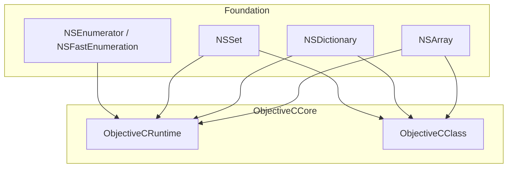
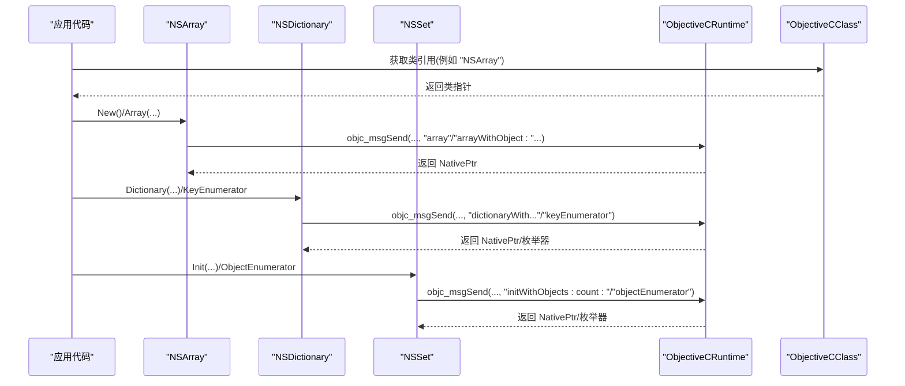
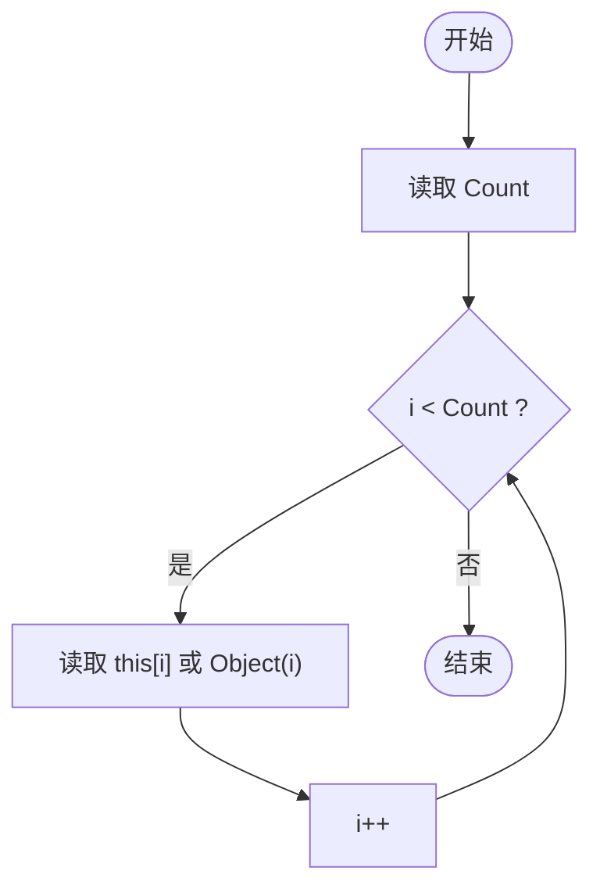
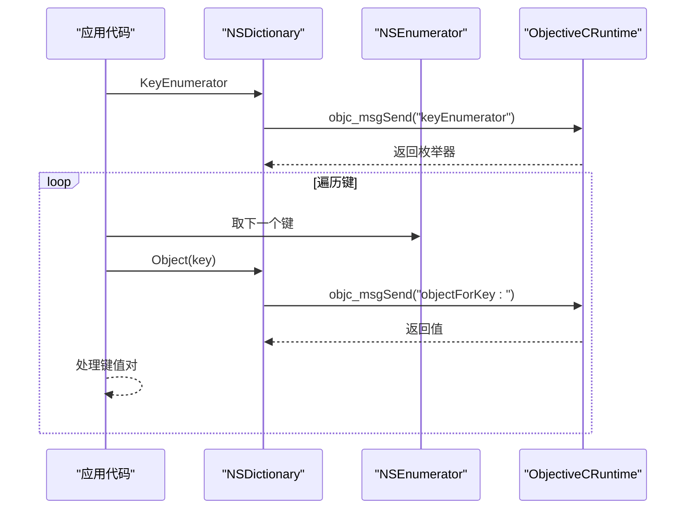
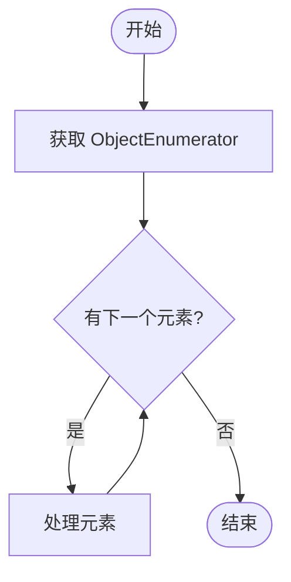
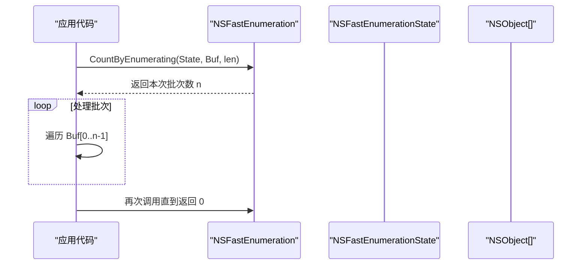
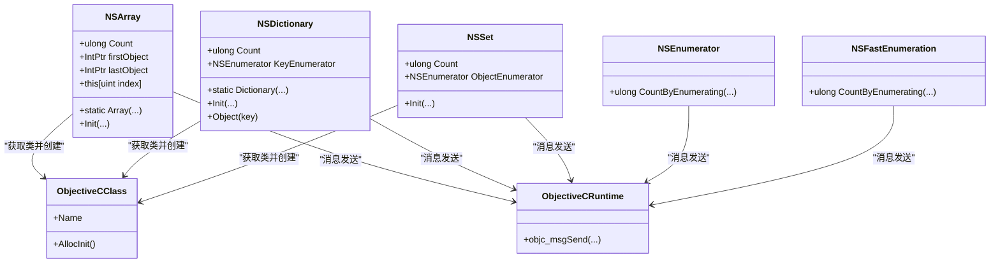

# 集合类型

<cite>
**本文引用的文件**
- [NSArray.cs](file://src/SharpMetal/Foundation/NSArray.cs)
- [NSDictionary.cs](file://src/SharpMetal/Foundation/NSDictionary.cs)
- [NSSet.cs](file://src/SharpMetal/Foundation/NSSet.cs)
- [NSEnumerator.cs](file://src/SharpMetal/Foundation/NSEnumerator.cs)
- [ObjectiveCRuntime.cs](file://src/SharpMetal/ObjectiveCCore/ObjectiveCRuntime.cs)
- [ObjectiveCClass.cs](file://src/SharpMetal/ObjectiveCCore/ObjectiveCClass.cs)
</cite>

## 目录
1. [简介](#简介)
2. [项目结构](#项目结构)
3. [核心组件](#核心组件)
4. [架构总览](#架构总览)
5. [详细组件分析](#详细组件分析)
6. [依赖关系分析](#依赖关系分析)
7. [性能考虑](#性能考虑)
8. [故障排查指南](#故障排查指南)
9. [结论](#结论)
10. [附录](#附录)

## 简介
本文件为 SharpMetal 的 Foundation 框架集合类型的完整 API 文档，覆盖以下主题：
- NSArray：数组的创建、访问、修改与遍历（索引访问、首尾元素、计数）
- NSDictionary：键值对的创建、获取、枚举器与查找
- NSSet：唯一性约束与基础操作（计数、枚举）
- NSEnumerator/NSFastEnumeration：传统迭代与快速枚举的使用模式
- 每个集合类型的性能考量、线程安全性与最佳实践建议

说明：当前仓库中的集合类型为 Objective-C 对象的轻量托管包装，通过 ObjectiveCRuntime 调用底层方法。可变集合（如 NSMutableArray、NSMutableDictionary、NSMutableSet）在本仓库中未提供实现，因此本文聚焦于不可变集合的能力边界与使用方式。

## 项目结构
Foundation 集合类型位于 src/SharpMetal/Foundation 下，依赖 ObjectiveCCore 提供的运行时桥接能力。

图表来源
- [NSArray.cs:1-66](file://src/SharpMetal/Foundation/NSArray.cs#L1-L66)
- [NSDictionary.cs:1-55](file://src/SharpMetal/Foundation/NSDictionary.cs#L1-L55)
- [NSSet.cs:1-36](file://src/SharpMetal/Foundation/NSSet.cs#L1-L36)
- [NSEnumerator.cs:1-46](file://src/SharpMetal/Foundation/NSEnumerator.cs#L1-L46)
- [ObjectiveCRuntime.cs:1-200](file://src/SharpMetal/ObjectiveCCore/ObjectiveCRuntime.cs#L1-L200)
- [ObjectiveCClass.cs:1-89](file://src/SharpMetal/ObjectiveCCore/ObjectiveCClass.cs#L1-L89)

章节来源
- [NSArray.cs:1-66](file://src/SharpMetal/Foundation/NSArray.cs#L1-L66)
- [NSDictionary.cs:1-55](file://src/SharpMetal/Foundation/NSDictionary.cs#L1-L55)
- [NSSet.cs:1-36](file://src/SharpMetal/Foundation/NSSet.cs#L1-L36)
- [NSEnumerator.cs:1-46](file://src/SharpMetal/Foundation/NSEnumerator.cs#L1-L46)
- [ObjectiveCRuntime.cs:1-200](file://src/SharpMetal/ObjectiveCCore/ObjectiveCRuntime.cs#L1-L200)
- [ObjectiveCClass.cs:1-89](file://src/SharpMetal/ObjectiveCCore/ObjectiveCClass.cs#L1-L89)

## 核心组件
- NSArray：提供计数、首尾元素、按索引访问、基于 NSObject 的构造与初始化等能力。
- NSDictionary：提供计数、键枚举器、按键取值、基于键值对或键值数组的构造与初始化。
- NSSet：提供计数、对象枚举器、基于对象数组的构造与初始化。
- NSEnumerator/NSFastEnumeration：提供基于状态块的高效批量枚举接口，支持快速枚举与传统迭代。

章节来源
- [NSArray.cs:1-66](file://src/SharpMetal/Foundation/NSArray.cs#L1-L66)
- [NSDictionary.cs:1-55](file://src/SharpMetal/Foundation/NSDictionary.cs#L1-L55)
- [NSSet.cs:1-36](file://src/SharpMetal/Foundation/NSSet.cs#L1-L36)
- [NSEnumerator.cs:1-46](file://src/SharpMetal/Foundation/NSEnumerator.cs#L1-L46)

## 架构总览
集合类型通过 ObjectiveCClass 定位类并调用 ObjectiveCRuntime 暴露的 objc_msgSend 重载，完成与原生对象的交互。所有集合均持有 NativePtr 以指向底层对象。

图表来源
- [ObjectiveCClass.cs:18-89](file://src/SharpMetal/ObjectiveCCore/ObjectiveCClass.cs#L18-L89)
- [ObjectiveCRuntime.cs:118-200](file://src/SharpMetal/ObjectiveCCore/ObjectiveCRuntime.cs#L118-L200)
- [NSArray.cs:11-39](file://src/SharpMetal/Foundation/NSArray.cs#L11-L39)
- [NSDictionary.cs:11-39](file://src/SharpMetal/Foundation/NSDictionary.cs#L11-L39)
- [NSSet.cs:11-25](file://src/SharpMetal/Foundation/NSSet.cs#L11-L25)

## 详细组件分析

### NSArray 数组
- 创建
  - 空数组：New()
  - 单元素数组：Array(NSObject)
  - 多元素数组：Array(NSObject*, count)
  - 初始化：Init(NSObject*, count)、Init(Coder)
- 访问
  - Count：元素数量
  - firstObject/lastObject：首/尾元素
  - 索引访问：this[uint]、Object(index)
- 遍历
  - 可通过 Count + 索引访问进行遍历
  - 也可结合 NSEnumerator/NSFastEnumeration 进行高效遍历（见下文）
- 注意
  - 当前实现为不可变数组；无添加/删除/替换方法
  - 索引越界行为由底层决定，建议在访问前检查 Count

图表来源
- [NSArray.cs:13-25](file://src/SharpMetal/Foundation/NSArray.cs#L13-L25)

章节来源
- [NSArray.cs:1-66](file://src/SharpMetal/Foundation/NSArray.cs#L1-L66)

### NSDictionary 字典
- 创建
  - 单键值对：Dictionary(object, key)
  - 多键值对：Dictionary(objects, keys, count)
  - 初始化：Init(objects, keys, count)、Init(Coder)
- 访问
  - Count：键值对数量
  - Object(key)：按键取值
  - KeyEnumerator：键枚举器，用于遍历键
- 遍历
  - 通过 KeyEnumerator 遍历键，再调用 Object(key) 获取值
  - 或使用 NSEnumerator/NSFastEnumeration 进行批量枚举
- 注意
  - 当前实现为不可变字典；无设置/删除键值的方法
  - 键不存在时返回值由底层决定，建议在使用前判断或捕获异常

图表来源
- [NSDictionary.cs:13-40](file://src/SharpMetal/Foundation/NSDictionary.cs#L13-L40)
- [NSEnumerator.cs:28-44](file://src/SharpMetal/Foundation/NSEnumerator.cs#L28-L44)

章节来源
- [NSDictionary.cs:1-55](file://src/SharpMetal/Foundation/NSDictionary.cs#L1-L55)
- [NSEnumerator.cs:1-46](file://src/SharpMetal/Foundation/NSEnumerator.cs#L1-L46)

### NSSet 集合
- 创建
  - 新实例：New()
  - 初始化：Init(objects, count)、Init(Coder)
- 访问
  - Count：元素数量
  - ObjectEnumerator：对象枚举器，用于遍历元素
- 特性
  - 唯一性：重复元素在底层集合中被去重（由 Objective-C 集合语义保证）
  - 无序：不保证遍历顺序
- 注意
  - 当前实现为不可变集合；无添加/删除元素的方法

图表来源
- [NSSet.cs:11-20](file://src/SharpMetal/Foundation/NSSet.cs#L11-L20)
- [NSEnumerator.cs:28-44](file://src/SharpMetal/Foundation/NSEnumerator.cs#L28-L44)

章节来源
- [NSSet.cs:1-36](file://src/SharpMetal/Foundation/NSSet.cs#L1-L36)
- [NSEnumerator.cs:1-46](file://src/SharpMetal/Foundation/NSEnumerator.cs#L1-L46)

### NSEnumerator 与 NSFastEnumeration
- NSEnumerator
  - 提供传统迭代接口，通常配合集合的枚举器属性使用
  - 支持隐式转换为 IntPtr，便于与底层交互
- NSFastEnumeration
  - 提供批量枚举接口 CountByEnumerating(state, buffer, len)，适合高性能遍历
  - NSArray/NSDictionary/NSSet 均可通过各自的枚举器接入此机制
- 使用模式
  - 快速枚举：分配缓冲区，循环调用 CountByEnumerating，直到返回 0
  - 传统迭代：通过枚举器的 nextObject 语义（由底层实现）逐个获取元素

图表来源
- [NSEnumerator.cs:6-26](file://src/SharpMetal/Foundation/NSEnumerator.cs#L6-L26)

章节来源
- [NSEnumerator.cs:1-46](file://src/SharpMetal/Foundation/NSEnumerator.cs#L1-L46)

## 依赖关系分析
- 所有集合类型依赖 ObjectiveCClass 获取类引用并进行 alloc/init
- 所有方法调用最终通过 ObjectiveCRuntime 的 objc_msgSend 系列重载完成
- 枚举器与快速枚举共享同一底层接口，便于统一优化

图表来源
- [NSArray.cs:1-66](file://src/SharpMetal/Foundation/NSArray.cs#L1-L66)
- [NSDictionary.cs:1-55](file://src/SharpMetal/Foundation/NSDictionary.cs#L1-L55)
- [NSSet.cs:1-36](file://src/SharpMetal/Foundation/NSSet.cs#L1-L36)
- [NSEnumerator.cs:1-46](file://src/SharpMetal/Foundation/NSEnumerator.cs#L1-L46)
- [ObjectiveCClass.cs:18-89](file://src/SharpMetal/ObjectiveCCore/ObjectiveCClass.cs#L18-L89)
- [ObjectiveCRuntime.cs:118-200](file://src/SharpMetal/ObjectiveCCore/ObjectiveCRuntime.cs#L118-L200)

章节来源
- [NSArray.cs:1-66](file://src/SharpMetal/Foundation/NSArray.cs#L1-L66)
- [NSDictionary.cs:1-55](file://src/SharpMetal/Foundation/NSDictionary.cs#L1-L55)
- [NSSet.cs:1-36](file://src/SharpMetal/Foundation/NSSet.cs#L1-L36)
- [NSEnumerator.cs:1-46](file://src/SharpMetal/Foundation/NSEnumerator.cs#L1-L46)
- [ObjectiveCClass.cs:1-89](file://src/SharpMetal/ObjectiveCCore/ObjectiveCClass.cs#L1-L89)
- [ObjectiveCRuntime.cs:1-200](file://src/SharpMetal/ObjectiveCCore/ObjectiveCRuntime.cs#L1-L200)

## 性能考虑
- 遍历
  - 优先使用 NSFastEnumeration 的批量枚举接口以减少跨语言调用开销
  - 对于大数组，避免频繁的单次 objc_msgSend 调用，尽量批量处理
- 内存
  - 合理设置缓冲区长度，避免过小导致多次往返，也避免过大造成浪费
  - 及时释放不再使用的 NativePtr 资源（由上层生命周期管理）
- 查找
  - NSDictionary 的按键查找通常为 O(1) 平均复杂度；避免在循环中进行低效搜索
  - NSArray 的线性查找为 O(n)；如需频繁查找，优先考虑转换为 NSDictionary 或 NSSet
- 并发
  - 当前集合为不可变视图，读操作可并发安全；但多线程同时访问需确保对象生命周期有效
  - 不要在多个线程上同时修改同一底层对象（当前封装层不提供可变方法）

## 故障排查指南
- 类获取失败
  - 现象：ObjectiveCClass 构造后 NativePtr 为空
  - 可能原因：平台不支持或未加载相应框架
  - 处理：检查运行环境与依赖，必要时回退到兼容路径
- 枚举器为空或无效
  - 现象：KeyEnumerator/ObjectEnumerator 返回空指针
  - 可能原因：底层对象为空或已释放
  - 处理：在调用前校验 Count 与对象有效性
- 索引越界
  - 现象：访问 this[index] 或 Object(index) 异常
  - 处理：先检查 Count，再进行索引访问
- 键不存在
  - 现象：Object(key) 返回空或默认值
  - 处理：根据业务需求进行空值分支处理

章节来源
- [ObjectiveCClass.cs:30-40](file://src/SharpMetal/ObjectiveCCore/ObjectiveCClass.cs#L30-L40)
- [NSArray.cs:13-25](file://src/SharpMetal/Foundation/NSArray.cs#L13-L25)
- [NSDictionary.cs:13-40](file://src/SharpMetal/Foundation/NSDictionary.cs#L13-L40)
- [NSSet.cs:11-20](file://src/SharpMetal/Foundation/NSSet.cs#L11-L20)

## 结论
- 本仓库提供了 Foundation 集合类型的不可变视图封装，涵盖创建、访问与遍历的核心能力
- 通过 NSFastEnumeration 可实现高效遍历；NSDictionary 提供高效的键查找
- 由于缺少可变集合实现，需在应用层进行必要的转换与缓存策略设计
- 建议在生产环境中结合性能分析与内存工具，评估批量枚举与查找的实际收益

## 附录
- 常用操作速查
  - 数组：New()/Array(...)/Count/firstObject/lastObject/this[index]
  - 字典：Dictionary(...)/Count/Object(key)/KeyEnumerator
  - 集合：New()/Init(...)/Count/ObjectEnumerator
  - 枚举：NSEnumerator/NSFastEnumeration.CountByEnumerating(...)
- 最佳实践
  - 优先使用批量枚举减少跨语言调用
  - 对大集合进行分块处理，平衡内存与吞吐
  - 对频繁查找场景，选择合适的数据结构（字典/集合）
  - 明确对象生命周期，避免悬垂指针