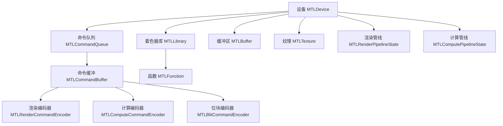
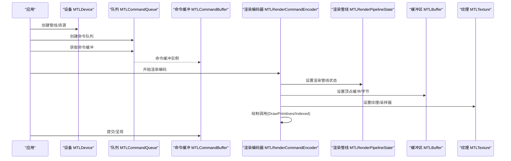
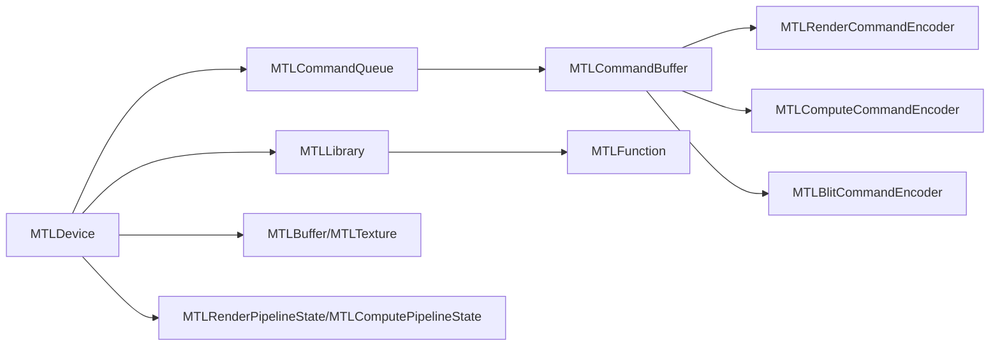

# Metal 图形 API

<cite>
**本文引用的文件**
- [MTLDevice.cs](file://src/SharpMetal/Metal/MTLDevice.cs)
- [MTLBuffer.cs](file://src/SharpMetal/Metal/MTLBuffer.cs)
- [MTLTexture.cs](file://src/SharpMetal/Metal/MTLTexture.cs)
- [MTLCommandQueue.cs](file://src/SharpMetal/Metal/MTLCommandQueue.cs)
- [MTLCommandBuffer.cs](file://src/SharpMetal/Metal/MTLCommandBuffer.cs)
- [MTLRenderPipeline.cs](file://src/SharpMetal/Metal/MTLRenderPipeline.cs)
- [MTLComputePipeline.cs](file://src/SharpMetal/Metal/MTLComputePipeline.cs)
- [MTLPixelFormat.cs](file://src/SharpMetal/Metal/MTLPixelFormat.cs)
- [MTLFunctionDescriptor.cs](file://src/SharpMetal/Metal/MTLFunctionDescriptor.cs)
- [MTLVertexDescriptor.cs](file://src/SharpMetal/Metal/MTLVertexDescriptor.cs)
- [MTLLibrary.cs](file://src/SharpMetal/Metal/MTLLibrary.cs)
- [MTLRenderCommandEncoder.cs](file://src/SharpMetal/Metal/MTLRenderCommandEncoder.cs)
- [MTLComputeCommandEncoder.cs](file://src/SharpMetal/Metal/MTLComputeCommandEncoder.cs)
- [MTLBlitCommandEncoder.cs](file://src/SharpMetal/Metal/MTLBlitCommandEncoder.cs)
</cite>

## 目录
1. [简介](#简介)
2. [项目结构](#项目结构)
3. [核心组件](#核心组件)
4. [架构总览](#架构总览)
5. [详细组件分析](#详细组件分析)
6. [依赖关系分析](#依赖关系分析)
7. [性能考量](#性能考量)
8. [故障排查指南](#故障排查指南)
9. [结论](#结论)
10. [附录](#附录)

## 简介
本参考文档基于仓库中的 C# 绑定实现，系统化梳理 Apple Metal 图形 API 的关键类型与用法，覆盖设备管理与查询、缓冲区与纹理操作、命令系统（队列/缓冲/编码器）、渲染与计算管线配置、着色器库加载与函数描述符、顶点描述符等高级特性。每个方法均提供参数说明、返回值类型、异常处理要点与使用示例路径指引，帮助开发者在 SharpMetal 环境中高效构建高性能图形与计算应用。

## 项目结构
- 所有 Metal 相关类型位于 src/SharpMetal/Metal 命名空间下，采用 struct + NativePtr 的 P/Invoke 风格封装 Objective-C 对象。
- 关键模块：
  - 设备与资源创建：MTLDevice
  - 资源：MTLBuffer、MTLTexture、MTLSamplerState（通过设备创建）
  - 命令系统：MTLCommandQueue、MTLCommandBuffer、各类 CommandEncoder
  - 管线：MTLRenderPipelineState、MTLComputePipelineState
  - 着色器与描述符：MTLLibrary、MTLFunctionDescriptor、MTLVertexDescriptor、MTLPixelFormat
  - 辅助：MTLBlitCommandEncoder（数据拷贝/优化）

图表来源
- [MTLDevice.cs:305-449](file://src/SharpMetal/Metal/MTLDevice.cs#L305-L449)
- [MTLCommandQueue.cs:44-108](file://src/SharpMetal/Metal/MTLCommandQueue.cs#L44-L108)
- [MTLCommandBuffer.cs:116-321](file://src/SharpMetal/Metal/MTLCommandBuffer.cs#L116-L321)
- [MTLRenderCommandEncoder.cs:126-800](file://src/SharpMetal/Metal/MTLRenderCommandEncoder.cs#L126-L800)
- [MTLComputeCommandEncoder.cs:20-298](file://src/SharpMetal/Metal/MTLComputeCommandEncoder.cs#L20-L298)
- [MTLBlitCommandEncoder.cs:14-217](file://src/SharpMetal/Metal/MTLBlitCommandEncoder.cs#L14-L217)
- [MTLLibrary.cs:347-399](file://src/SharpMetal/Metal/MTLLibrary.cs#L347-L399)
- [MTLBuffer.cs:6-115](file://src/SharpMetal/Metal/MTLBuffer.cs#L6-L115)
- [MTLTexture.cs:242-440](file://src/SharpMetal/Metal/MTLTexture.cs#L242-L440)
- [MTLRenderPipeline.cs:530-629](file://src/SharpMetal/Metal/MTLRenderPipeline.cs#L530-L629)
- [MTLComputePipeline.cs:151-237](file://src/SharpMetal/Metal/MTLComputePipeline.cs#L151-L237)

章节来源
- [MTLDevice.cs:187-800](file://src/SharpMetal/Metal/MTLDevice.cs#L187-L800)
- [MTLCommandQueue.cs:6-108](file://src/SharpMetal/Metal/MTLCommandQueue.cs#L6-L108)
- [MTLCommandBuffer.cs:9-321](file://src/SharpMetal/Metal/MTLCommandBuffer.cs#L9-L321)

## 核心组件
- 设备管理（MTLDevice）
  - 功能：获取系统默认设备、枚举设备、创建命令队列/堆/缓冲区/纹理/采样器/管线、查询能力与对齐信息、动态库与二进制归档、加速结构、计数器采样等。
  - 关键点：多数创建方法返回对应对象；部分方法带 NSError 引用用于错误传播；支持多种平台能力探测。
- 缓冲区（MTLBuffer）
  - 功能：CPU/GPU 内存访问、别名化、从 Buffer 创建 Texture/Tensor、调试标记、远程视图等。
- 纹理（MTLTexture）
  - 功能：多维纹理类型、像素格式、mipmap、采样、区域读写、共享句柄、视口视图、稀疏纹理等。
- 命令系统
  - 队列（MTLCommandQueue）：创建命令缓冲、驻留集管理。
  - 缓冲（MTLCommandBuffer）：提交/呈现、等待完成、编码各种命令编码器、事件同步、调试分组。
  - 编码器：渲染/计算/位块三类，分别负责绘制、并行计算、数据搬运与优化。
- 管线
  - 渲染管线（MTLRenderPipelineState）：由描述符配置顶点/片段/瓦片阶段、混合、深度模板、细分曲面等。
  - 计算管线（MTLComputePipelineState）：由函数或描述符配置线程组大小、输入描述符、缓冲区布局等。
- 着色器与描述符
  - 库（MTLLibrary）：从 bundle/url/data/source 加载，导出函数。
  - 函数描述符（MTLFunctionDescriptor）：指定函数名/特化名/常量值/选项/二进制归档。
  - 顶点描述符（MTLVertexDescriptor）：布局与属性定义，映射到顶点缓冲。
  - 像素格式（MTLPixelFormat）：丰富的 GPU 原生格式集合。

章节来源
- [MTLDevice.cs:305-700](file://src/SharpMetal/Metal/MTLDevice.cs#L305-L700)
- [MTLBuffer.cs:6-115](file://src/SharpMetal/Metal/MTLBuffer.cs#L6-L115)
- [MTLTexture.cs:75-440](file://src/SharpMetal/Metal/MTLTexture.cs#L75-L440)
- [MTLCommandQueue.cs:6-108](file://src/SharpMetal/Metal/MTLCommandQueue.cs#L6-L108)
- [MTLCommandBuffer.cs:59-321](file://src/SharpMetal/Metal/MTLCommandBuffer.cs#L59-L321)
- [MTLRenderPipeline.cs:208-629](file://src/SharpMetal/Metal/MTLRenderPipeline.cs#L208-L629)
- [MTLComputePipeline.cs:25-237](file://src/SharpMetal/Metal/MTLComputePipeline.cs#L25-L237)
- [MTLLibrary.cs:221-399](file://src/SharpMetal/Metal/MTLLibrary.cs#L221-L399)
- [MTLFunctionDescriptor.cs:14-125](file://src/SharpMetal/Metal/MTLFunctionDescriptor.cs#L14-L125)
- [MTLVertexDescriptor.cs:221-247](file://src/SharpMetal/Metal/MTLVertexDescriptor.cs#L221-L247)
- [MTLPixelFormat.cs:1-147](file://src/SharpMetal/Metal/MTLPixelFormat.cs#L1-L147)

## 架构总览
下图展示典型渲染帧流程：设备创建管线与资源 -> 队列生成命令缓冲 -> 渲染编码器设置状态与资源 -> 提交并呈现可显示对象。

图表来源
- [MTLDevice.cs:326-449](file://src/SharpMetal/Metal/MTLDevice.cs#L326-L449)
- [MTLCommandQueue.cs:58-68](file://src/SharpMetal/Metal/MTLCommandQueue.cs#L58-L68)
- [MTLCommandBuffer.cs:150-168](file://src/SharpMetal/Metal/MTLCommandBuffer.cs#L150-L168)
- [MTLRenderCommandEncoder.cs:168-586](file://src/SharpMetal/Metal/MTLRenderCommandEncoder.cs#L168-L586)
- [MTLRenderPipeline.cs:530-629](file://src/SharpMetal/Metal/MTLRenderPipeline.cs#L530-L629)
- [MTLBuffer.cs:18-49](file://src/SharpMetal/Metal/MTLBuffer.cs#L18-L49)
- [MTLTexture.cs:253-335](file://src/SharpMetal/Metal/MTLTexture.cs#L253-L335)

## 详细组件分析

### 设备管理与查询（MTLDevice）
- 设备获取与枚举
  - CreateSystemDefaultDevice：返回默认设备实例。
  - CopyAllDevices：返回所有可用设备数组。
- 能力与限制查询
  - SupportsFamily、SupportsTextureSampleCount、MinimumLinearTextureAlignmentForPixelFormat、MinimumTextureBufferAlignmentForPixelFormat 等。
  - 其他布尔能力：如 SupportsRaytracing、SupportsFunctionPointers、Supports32BitFloatFiltering 等。
- 资源与管线创建
  - NewCommandQueue / NewCommandQueue(descriptor/maxCount)
  - NewBuffer / NewTexture / NewSamplerState / NewDepthStencilState
  - NewRenderPipelineState / NewComputePipelineState（多重载）
  - NewLibrary（bundle/url/data/source/stitched）
  - NewDynamicLibrary / NewBinaryArchive
  - NewAccelerationStructure / AccelerationStructureSizes
  - NewCounterSampleBuffer / QueryTimestampFrequency
- 错误处理
  - 多数创建方法以 NSError 引用返回错误；调用前需准备 NSError 实例并在失败时检查。

使用示例路径
- 设备创建与队列：[MTLDevice.cs:305-339](file://src/SharpMetal/Metal/MTLDevice.cs#L305-L339)
- 管线创建：[MTLDevice.cs:431-454](file://src/SharpMetal/Metal/MTLDevice.cs#L431-L454)
- 库加载：[MTLDevice.cs:401-429](file://src/SharpMetal/Metal/MTLDevice.cs#L401-L429)

章节来源
- [MTLDevice.cs:187-800](file://src/SharpMetal/Metal/MTLDevice.cs#L187-L800)

### 缓冲区操作（MTLBuffer）
- 生命周期与访问
  - Label、Device、StorageMode、CpuCacheMode、ResourceOptions、Heap/HeapOffset、AllocatedSize、Length、Contents、GpuAddress。
  - SetPurgeableState：控制内存回收策略。
  - MakeAliasable：允许与其他资源别名共享内存。
- 数据更新
  - DidModifyRange：通知 CPU 侧修改范围，便于驱动同步。
- 衍生资源
  - NewTexture(descriptor, offset, bytesPerRow)：将 Buffer 作为纹理 backing。
  - NewTensor(descriptor, offset)：从 Buffer 创建 Tensor。
- 调试与远程
  - AddDebugMarker/RemoveAllDebugMarkers：调试标记。
  - NewRemoteBufferViewForDevice：跨设备共享视图。

使用示例路径
- 基本属性与内存：[MTLBuffer.cs:18-49](file://src/SharpMetal/Metal/MTLBuffer.cs#L18-L49)
- 数据更新与纹理包装：[MTLBuffer.cs:60-73](file://src/SharpMetal/Metal/MTLBuffer.cs#L60-L73)

章节来源
- [MTLBuffer.cs:6-115](file://src/SharpMetal/Metal/MTLBuffer.cs#L6-L115)

### 纹理处理与格式（MTLTexture）
- 描述与创建
  - MTLTextureDescriptor：TextureType、PixelFormat、Width/Height/Depth、MipmapLevelCount、SampleCount、ArrayLength、Usage、CompressionType、Swizzle、PlacementSparsePageSize。
  - 静态工厂：Texture2DDescriptor、TextureCubeDescriptor、TextureBufferDescriptor。
- 访问与更新
  - GetBytes/ReplaceRegion：CPU 读取/写入纹理数据，支持层级与切片。
  - SetPurgeableState：内存回收。
- 视图与共享
  - NewTextureView：按像素格式/类型/层级/切片范围创建视图，支持 Swizzle。
  - NewSharedTextureHandle：跨进程/设备共享句柄。
  - RemoteStorageTexture：远程存储视图。
- 元信息与特性
  - Buffer/BufferOffset/BufferBytesPerRow：与缓冲关联。
  - Iosurface/IosurfacePlane：与 Core Animation 集成。
  - IsSparse/SparseTextureTier：稀疏纹理支持。

使用示例路径
- 描述符与工厂：[MTLTexture.cs:75-240](file://src/SharpMetal/Metal/MTLTexture.cs#L75-L240)
- 数据读写与视图：[MTLTexture.cs:347-385](file://src/SharpMetal/Metal/MTLTexture.cs#L347-L385)

章节来源
- [MTLTexture.cs:75-440](file://src/SharpMetal/Metal/MTLTexture.cs#L75-L440)
- [MTLPixelFormat.cs:1-147](file://src/SharpMetal/Metal/MTLPixelFormat.cs#L1-L147)

### 命令系统（队列/缓冲/编码器）
- 命令队列（MTLCommandQueue）
  - CommandBuffer()/CommandBuffer(descriptor)/CommandBufferWithUnretainedReferences
  - 驻留集管理：Add/RemoveResidencySet(s)
- 命令缓冲（MTLCommandBuffer）
  - Enqueue/Commit/PresentDrawable（含时间/最小时长变体）
  - WaitUntilScheduled/WaitUntilCompleted
  - 编码器创建：Render/Compute/Blit/ResourceState/AccelerationStructure
  - 事件同步：EncodeWait/EncodeSignalEvent
  - 调试：Push/PopDebugGroup
- 渲染编码器（MTLRenderCommandEncoder）
  - 状态设置：SetRenderPipelineState、SetDepthStencilState、Viewport/Scissor/Cull/Winding/FillMode
  - 资源绑定：SetVertex/Fragment/Object/Mesh/Tile Bytes/Buffer/Texture/Sampler/Visible/Intersection Function Table/Acceleration Structure
  - 绘制：DrawPrimitives/DrawIndexedPrimitives/DrawPatches/DrawMesh*
  - 同步与屏障：MemoryBarrier、TextureBarrier、UpdateFence/WaitForFence
  - 执行间接命令：ExecuteCommandsInBuffer
- 计算编码器（MTLComputeCommandEncoder）
  - 状态设置：SetComputePipelineState、ThreadgroupMemoryLength、ImageblockWidth、StageInRegion
  - 资源绑定：SetBytes/SetBuffer/SetTexture/SetSamplerState/Visible/Intersection/Acceleration Structure
  - 调度：DispatchThreadgroups/DispatchThreads（支持间接缓冲）
  - 同步：MemoryBarrier、UpdateFence/WaitForFence
- 位块编码器（MTLBlitCommandEncoder）
  - 同步：SynchronizeResource/SynchronizeTexture
  - 复制：CopyFrom/To Texture/Buffer/Tensor
  - 生成 mipmap、填充缓冲、优化内容（GPU/CPU 访问）、重置/复制间接命令缓冲、计数器采样与解析。

使用示例路径
- 队列与缓冲：[MTLCommandQueue.cs:58-68](file://src/SharpMetal/Metal/MTLCommandQueue.cs#L58-L68)、[MTLCommandBuffer.cs:150-268](file://src/SharpMetal/Metal/MTLCommandBuffer.cs#L150-L268)
- 渲染编码：[MTLRenderCommandEncoder.cs:168-586](file://src/SharpMetal/Metal/MTLRenderCommandEncoder.cs#L168-L586)
- 计算编码：[MTLComputeCommandEncoder.cs:60-193](file://src/SharpMetal/Metal/MTLComputeCommandEncoder.cs#L60-L193)
- 位块编码：[MTLBlitCommandEncoder.cs:52-175](file://src/SharpMetal/Metal/MTLBlitCommandEncoder.cs#L52-L175)

章节来源
- [MTLCommandQueue.cs:6-108](file://src/SharpMetal/Metal/MTLCommandQueue.cs#L6-L108)
- [MTLCommandBuffer.cs:59-321](file://src/SharpMetal/Metal/MTLCommandBuffer.cs#L59-L321)
- [MTLRenderCommandEncoder.cs:126-800](file://src/SharpMetal/Metal/MTLRenderCommandEncoder.cs#L126-L800)
- [MTLComputeCommandEncoder.cs:20-298](file://src/SharpMetal/Metal/MTLComputeCommandEncoder.cs#L20-L298)
- [MTLBlitCommandEncoder.cs:14-217](file://src/SharpMetal/Metal/MTLBlitCommandEncoder.cs#L14-L217)

### 渲染管线配置（MTLRenderPipeline）
- 描述符（MTLRenderPipelineDescriptor）
  - 阶段函数：VertexFunction、FragmentFunction
  - 顶点描述：VertexDescriptor
  - 采样与光栅：SampleCount、RasterSampleCount、AlphaToCoverage/AlphaToOne、RasterizationEnabled
  - 拓扑与细分：InputPrimitiveTopology、Tessellation* 系列
  - 颜色附件：ColorAttachments（BlendFactor/Operation/WriteMask）
  - 深度/模板：DepthAttachmentPixelFormat、StencilAttachmentPixelFormat
  - 预加载库/链接函数/二进制归档/校验等
- 状态（MTLRenderPipelineState）
  - 反射：Reflection（Bindings/Arguments）
  - 函数句柄：FunctionHandleWithName/FunctionHandle(Function/BinaryFunction)
  - 可见/相交函数表：NewVisibleFunctionTable/NewIntersectionFunctionTable
  - 扩展：NewRenderPipelineStateWithAdditionalBinaryFunctions
- 瓦片管线（Tile Render Pipeline）
  - TileFunction、ColorAttachments、ThreadgroupSizeMatchesTileSize、MaxTotalThreadsPerThreadgroup

使用示例路径
- 描述符与状态：[MTLRenderPipeline.cs:208-629](file://src/SharpMetal/Metal/MTLRenderPipeline.cs#L208-L629)

章节来源
- [MTLRenderPipeline.cs:87-800](file://src/SharpMetal/Metal/MTLRenderPipeline.cs#L87-L800)

### 计算管线配置（MTLComputePipeline）
- 描述符（MTLComputePipelineDescriptor）
  - ComputeFunction、StageInputDescriptor、Buffers、InsertLibraries/PreloadedLibraries、LinkedFunctions、BinaryArchives、MaxCallStackDepth、ShaderValidation
- 状态（MTLComputePipelineState）
  - 反射：Reflection（Bindings/Arguments）
  - 函数句柄：FunctionHandleWithName/FunctionHandle(Function/BinaryFunction)
  - 扩展：NewComputePipelineStateWithAdditionalBinaryFunctions

使用示例路径
- 描述符与状态：[MTLComputePipeline.cs:25-237](file://src/SharpMetal/Metal/MTLComputePipeline.cs#L25-L237)

章节来源
- [MTLComputePipeline.cs:25-237](file://src/SharpMetal/Metal/MTLComputePipeline.cs#L25-L237)

### 着色器库加载与函数描述符
- 库加载（MTLLibrary）
  - 从 Bundle/URL/Data/Source/Stitched 创建库；导出函数名称列表；支持动态库与安装名。
- 函数（MTLFunction）
  - 类型：Vertex/Fragment/Kernel/Visible/Intersection/Mesh/Object
  - 属性：PatchType、PatchControlPointCount、VertexAttributes/StageInputAttributes、FunctionConstantsDictionary、Options
  - 参数编码器：NewArgumentEncoder（支持反射）
- 函数描述符（MTLFunctionDescriptor）
  - Name/SpecializedName、ConstantValues、Options（编译为二进制/脚本/二进制归档缺失行为）
  - BinaryArchives：用于离线编译与缓存
- 交叉函数描述符（MTLIntersectionFunctionDescriptor）
  - 与函数描述符类似，用于光线追踪相交阶段

使用示例路径
- 库与函数：[MTLLibrary.cs:347-399](file://src/SharpMetal/Metal/MTLLibrary.cs#L347-L399)
- 函数描述符：[MTLFunctionDescriptor.cs:14-125](file://src/SharpMetal/Metal/MTLFunctionDescriptor.cs#L14-L125)

章节来源
- [MTLLibrary.cs:6-399](file://src/SharpMetal/Metal/MTLLibrary.cs#L6-L399)
- [MTLFunctionDescriptor.cs:14-125](file://src/SharpMetal/Metal/MTLFunctionDescriptor.cs#L14-L125)

### 顶点描述符与像素格式
- 顶点描述符（MTLVertexDescriptor）
  - Layouts：每缓冲区的步长、步进函数（常数/逐顶点/逐实例/补丁/控制点）
  - Attributes：格式、偏移、缓冲区索引
- 像素格式（MTLPixelFormat）
  - 涵盖通用、压缩（BC/ASTC/PVRTC/ETC）、深度/模板、HDR/LDR 等多种格式

使用示例路径
- 顶点描述：[MTLVertexDescriptor.cs:221-247](file://src/SharpMetal/Metal/MTLVertexDescriptor.cs#L221-L247)
- 像素格式：[MTLPixelFormat.cs:1-147](file://src/SharpMetal/Metal/MTLPixelFormat.cs#L1-L147)

章节来源
- [MTLVertexDescriptor.cs:6-247](file://src/SharpMetal/Metal/MTLVertexDescriptor.cs#L6-L247)
- [MTLPixelFormat.cs:1-147](file://src/SharpMetal/Metal/MTLPixelFormat.cs#L1-L147)

## 依赖关系分析
- 耦合关系
  - 设备是资源与管线的唯一入口，强耦合于所有创建型 API。
  - 命令缓冲聚合多种编码器，形成“一次提交，多路编码”的结构。
  - 渲染/计算编码器依赖管线状态与资源绑定，形成“状态+资源+指令”的三段式。
- 外部依赖
  - 通过 ObjectiveCRuntime 进行消息转发；Foundation/QuartzCore 提供基础类型与可显示对象。
- 循环依赖
  - 未发现代码级循环引用；各模块职责清晰，依赖方向单一。

图表来源
- [MTLDevice.cs:305-700](file://src/SharpMetal/Metal/MTLDevice.cs#L305-L700)
- [MTLCommandBuffer.cs:195-268](file://src/SharpMetal/Metal/MTLCommandBuffer.cs#L195-L268)
- [MTLLibrary.cs:347-399](file://src/SharpMetal/Metal/MTLLibrary.cs#L347-L399)

章节来源
- [MTLDevice.cs:187-800](file://src/SharpMetal/Metal/MTLDevice.cs#L187-L800)
- [MTLCommandBuffer.cs:116-321](file://src/SharpMetal/Metal/MTLCommandBuffer.cs#L116-L321)

## 性能考量
- 资源复用与池化
  - 重用命令缓冲与编码器，避免频繁分配；合理使用间接命令缓冲批量绘制。
- 内存与对齐
  - 使用 MinimumLinearTextureAlignmentForPixelFormat/MinimumTextureBufferAlignmentForPixelFormat 确保正确对齐，减少重排开销。
- 纹理优化
  - OptimizeContentsForGPUAccess/CPUAccess 在切换访问域前后调用，降低带宽浪费。
- 管线与函数
  - 使用二进制归档与预加载库减少编译时延；合理设置 ShaderValidation 与 MaxCallStackDepth。
- 同步与屏障
  - 仅在必要时使用 MemoryBarrier/TextureBarrier；利用 Fence/Event 精确同步。

[本节为通用指导，不直接分析具体文件]

## 故障排查指南
- 常见错误来源
  - 管线/库创建失败：检查 NSError 返回值；确认函数名、常量值、二进制归档是否匹配。
  - 命令缓冲错误：查看 Status/Error；关注 EncoderExecutionStatus 选项以定位编码器错误。
  - 资源访问冲突：确保 UseResource/UseResources 正确声明使用方式与阶段。
- 调试技巧
  - 使用 PushDebugGroup/PopDebugGroup 与 InsertDebugSignpost 标注关键步骤。
  - 使用 AddDebugMarker/RemoveAllDebugMarkers 对缓冲区添加标记。
  - 使用 SampleCountersInBuffer/ResolveCounters 采集性能计数器。
- 常见问题定位
  - 纹理尺寸/格式不支持：用 SupportsTextureSampleCount/Minimum*Alignment 验证。
  - 跨设备/进程共享：使用 SharedTextureHandle/RemoteStorageTexture 并确保目标设备兼容。

章节来源
- [MTLCommandBuffer.cs:9-48](file://src/SharpMetal/Metal/MTLCommandBuffer.cs#L9-L48)
- [MTLRenderCommandEncoder.cs:153-166](file://src/SharpMetal/Metal/MTLRenderCommandEncoder.cs#L153-L166)
- [MTLBlitCommandEncoder.cs:172-180](file://src/SharpMetal/Metal/MTLBlitCommandEncoder.cs#L172-L180)

## 结论
本参考文档基于 SharpMetal 的 C# 绑定，系统梳理了 Metal 的核心 API 族：设备、资源、命令系统与管线配置。通过清晰的分类、流程图与源码路径，读者可以快速定位实现细节并正确组合 API 构建高性能图形与计算应用。建议在实际工程中结合二进制归档、预加载库与资源池化策略，以获得更优的启动与运行时性能。

## 附录
- 术语速查
  - 管线：将着色器与固定功能状态打包的可复用对象。
  - 命令缓冲：记录一系列 GPU 命令的容器，提交后由驱动执行。
  - 编码器：针对特定任务（渲染/计算/位块）的命令构造器。
  - 描述符：用于配置管线/函数/资源的结构化参数集合。

[本节为概念性补充，不直接分析具体文件]