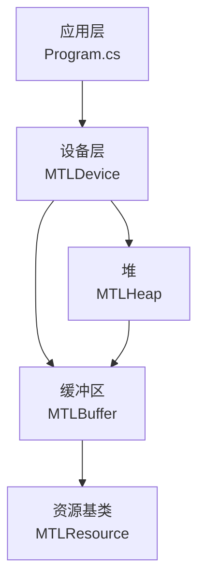
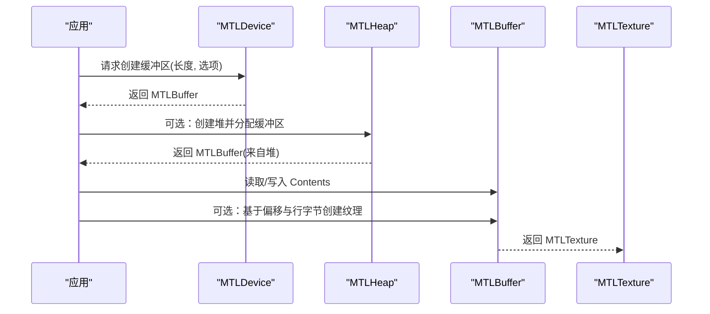
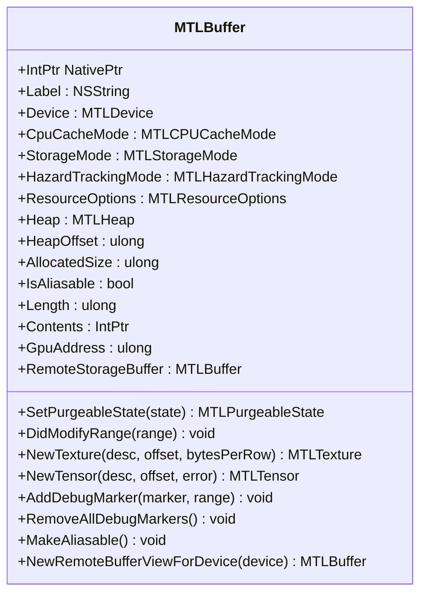
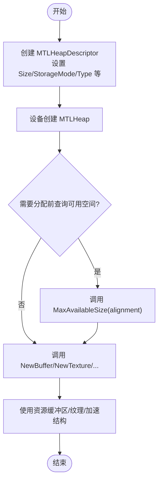
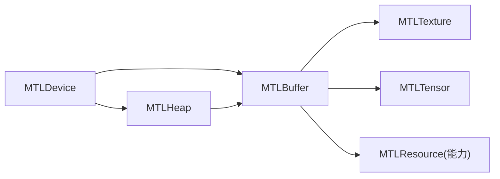
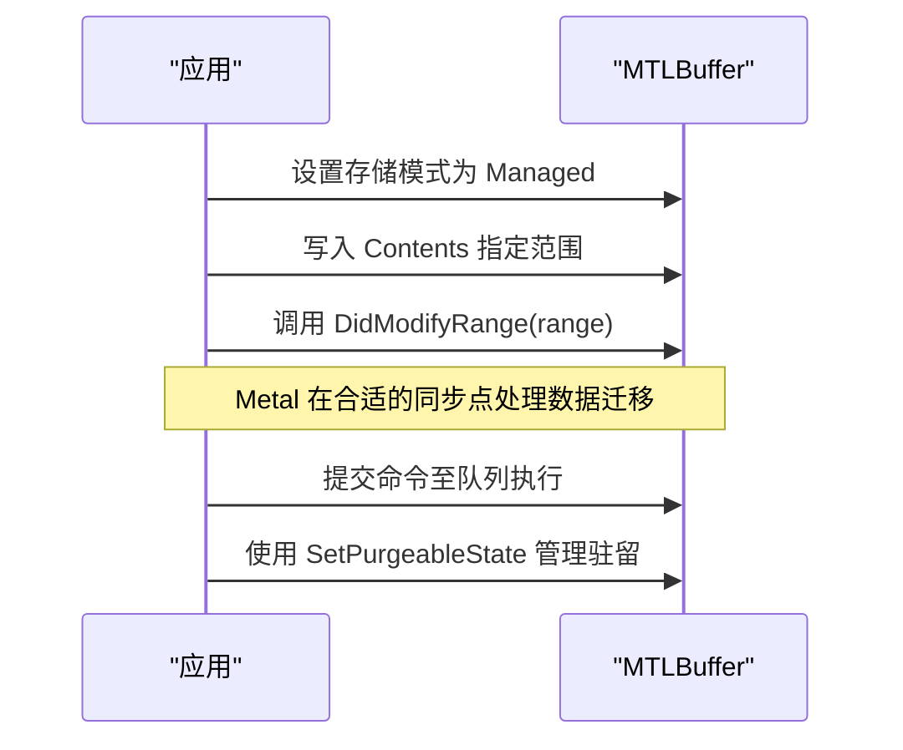

# 内存管理

<cite>
**本文引用的文件**
- [MTLBuffer.cs](file://src/SharpMetal/Metal/MTLBuffer.cs)
- [MTLHeap.cs](file://src/SharpMetal/Metal/MTLHeap.cs)
- [MTLResource.cs](file://src/SharpMetal/Metal/MTLResource.cs)
- [MTLDevice.cs](file://src/SharpMetal/Metal/MTLDevice.cs)
- [Program.cs](file://samples/SharpMetal.Sample/Program.cs)
</cite>

## 目录
1. [简介](#简介)
2. [项目结构](#项目结构)
3. [核心组件](#核心组件)
4. [架构总览](#架构总览)
5. [详细组件分析](#详细组件分析)
6. [依赖关系分析](#依赖关系分析)
7. [性能与对齐](#性能与对齐)
8. [生命周期、映射与同步](#生命周期映射与同步)
9. [使用场景与最佳实践](#使用场景与最佳实践)
10. [故障排查](#故障排查)
11. [结论](#结论)

## 简介
本文件面向在 SharpMetal 中高效进行 Metal 内存管理的开发者，重点覆盖：
- MTLBuffer 缓冲区的创建、配置与使用
- 存储类型选择（Managed、Shared、Private、Memoryless）的适用场景与权衡
- MTLHeap 堆内存管理机制，用于大对象的高效分配与复用
- 内存对齐要求、访问模式与性能优化技巧
- 缓冲区生命周期管理、内存映射与同步机制
- 常见内存使用场景的代码示例路径与最佳实践建议

## 项目结构
与内存管理直接相关的核心代码位于 src/SharpMetal/Metal 目录下，包括：
- MTLBuffer：封装 Metal 缓冲区对象及其属性与方法
- MTLHeap / MTLHeapDescriptor：封装堆内存池及资源分配接口
- MTLResource / MTLResourceOptions / MTLStorageMode / MTLCPUCacheMode / MTLHazardTrackingMode：资源通用能力与选项
- MTLDevice：设备级 API，提供缓冲区与堆的创建入口
- 示例 Program.cs：演示共享模式下缓冲区的创建与读写

图表来源
- [Program.cs:21-38](file://samples/SharpMetal.Sample/Program.cs#L21-L38)
- [MTLDevice.cs:356-369](file://src/SharpMetal/Metal/MTLDevice.cs#L356-L369)
- [MTLHeap.cs:124-147](file://src/SharpMetal/Metal/MTLHeap.cs#L124-L147)
- [MTLBuffer.cs:6-49](file://src/SharpMetal/Metal/MTLBuffer.cs#L6-L49)
- [MTLResource.cs:63-119](file://src/SharpMetal/Metal/MTLResource.cs#L63-L119)

章节来源
- [Program.cs:21-38](file://samples/SharpMetal.Sample/Program.cs#L21-L38)
- [MTLDevice.cs:356-369](file://src/SharpMetal/Metal/MTLDevice.cs#L356-L369)
- [MTLHeap.cs:124-147](file://src/SharpMetal/Metal/MTLHeap.cs#L124-L147)
- [MTLBuffer.cs:6-49](file://src/SharpMetal/Metal/MTLBuffer.cs#L6-L49)
- [MTLResource.cs:63-119](file://src/SharpMetal/Metal/MTLResource.cs#L63-L119)

## 核心组件
- MTLBuffer：表示 GPU/CPU 可访问的连续内存块。暴露长度、内容指针、GPU 地址、所属设备、存储模式、CPU 缓存模式、危险跟踪模式、是否可别名、是否来自堆等信息；支持从缓冲区创建纹理或张量视图、添加调试标记、设置可清理状态等。
- MTLHeap / MTLHeapDescriptor：描述并创建堆内存池，支持自动、放置式、稀疏三种类型；可从堆中按长度和选项分配缓冲区、纹理、加速结构等，并提供最大可用空间查询。
- MTLResource / 枚举：定义资源的通用能力（标签、设备、缓存模式、存储模式、危险跟踪模式、资源选项、堆归属、已分配大小、别名能力、可清理状态）。
- MTLDevice：设备入口，提供 NewBuffer、NewHeap、HeapBufferSizeAndAlign 等方法，用于创建缓冲区与计算堆内对齐与尺寸。

章节来源
- [MTLBuffer.cs:6-113](file://src/SharpMetal/Metal/MTLBuffer.cs#L6-L113)
- [MTLHeap.cs:6-192](file://src/SharpMetal/Metal/MTLHeap.cs#L6-L192)
- [MTLResource.cs:6-119](file://src/SharpMetal/Metal/MTLResource.cs#L6-L119)
- [MTLDevice.cs:341-369](file://src/SharpMetal/Metal/MTLDevice.cs#L341-L369)

## 架构总览
下图展示了从设备到缓冲区/堆的创建与使用关系，以及缓冲区与纹理/张量的衍生关系。

图表来源
- [MTLDevice.cs:356-369](file://src/SharpMetal/Metal/MTLDevice.cs#L356-L369)
- [MTLHeap.cs:124-147](file://src/SharpMetal/Metal/MTLHeap.cs#L124-L147)
- [MTLBuffer.cs:65-73](file://src/SharpMetal/Metal/MTLBuffer.cs#L65-L73)

## 详细组件分析

### MTLBuffer 缓冲区
- 关键属性
  - Device：所属设备
  - StorageMode：存储模式（Shared/Managed/Private/Memoryless）
  - CpuCacheMode：CPU 缓存模式（DefaultCache/WriteCombined）
  - HazardTrackingMode：危险跟踪模式（Default/Untracked/Tracked）
  - ResourceOptions：资源选项组合
  - Length：逻辑长度
  - Contents：CPU 可读写的内存指针
  - GpuAddress：GPU 可见地址
  - Heap/HeapOffset/AllocatedSize：若来自堆，则包含堆句柄、偏移与分配大小
  - IsAliasable：是否可别名（可用于零拷贝视图）
- 关键方法
  - SetPurgeableState：设置可清理状态（KeepCurrent/NonVolatile/Volatile/Empty）
  - DidModifyRange：通知 CPU 对某范围进行了修改（用于 Managed 模式同步）
  - NewTexture/NewTensor：从缓冲区派生纹理/张量视图
  - AddDebugMarker/RemoveAllDebugMarkers：调试标记
  - MakeAliasable：使缓冲区可别名化
  - RemoteStorageBuffer/NewRemoteBufferViewForDevice：远程存储相关视图

图表来源
- [MTLBuffer.cs:6-113](file://src/SharpMetal/Metal/MTLBuffer.cs#L6-L113)

章节来源
- [MTLBuffer.cs:6-113](file://src/SharpMetal/Metal/MTLBuffer.cs#L6-L113)

### MTLHeap 堆内存
- 用途：集中管理大块 GPU/CPU 内存，减少频繁分配开销，便于大对象复用与碎片控制。
- 类型
  - Automatic：自动管理
  - Placement：放置式，需自行计算对齐与偏移
  - Sparse：稀疏堆，按需驻留页
- 描述符 MTLHeapDescriptor
  - Size：堆大小
  - StorageMode/CpuCacheMode/HazardTrackingMode/ResourceOptions：与资源一致
  - Type：堆类型
  - SparsePageSize/MaxCompatiblePlacementSparsePageSize：稀疏页大小与兼容性
- 主要方法
  - MaxAvailableSize(alignment)：查询给定对齐下的最大可用空间
  - NewBuffer(length, options[, offset])：从堆分配缓冲区
  - NewTexture(NewTextureWithDescriptor/offset)：从堆分配纹理
  - NewAccelerationStructure(...)：从堆分配加速结构
  - SetPurgeableState：设置可清理状态

图表来源
- [MTLHeap.cs:13-84](file://src/SharpMetal/Metal/MTLHeap.cs#L13-L84)
- [MTLHeap.cs:119-167](file://src/SharpMetal/Metal/MTLHeap.cs#L119-L167)
- [MTLDevice.cs:351-354](file://src/SharpMetal/Metal/MTLDevice.cs#L351-L354)

章节来源
- [MTLHeap.cs:6-192](file://src/SharpMetal/Metal/MTLHeap.cs#L6-L192)
- [MTLDevice.cs:351-354](file://src/SharpMetal/Metal/MTLDevice.cs#L351-L354)

### 资源基类与选项
- MTLResource：所有资源的公共基元，提供标签、设备、缓存模式、存储模式、危险跟踪模式、资源选项、堆信息、已分配大小、别名能力、可清理状态等。
- 重要枚举
  - MTLStorageMode：Shared/Managed/Private/Memoryless
  - MTLCPUCacheMode：DefaultCache/WriteCombined
  - MTLHazardTrackingMode：Default/Untracked/Tracked
  - MTLResourceOptions：组合存储模式、CPU 缓存模式、危险跟踪模式的位标志
  - MTLPurgeableState：KeepCurrent/NonVolatile/Volatile/Empty

章节来源
- [MTLResource.cs:6-119](file://src/SharpMetal/Metal/MTLResource.cs#L6-L119)

## 依赖关系分析
- 应用通过 MTLDevice 创建 MTLBuffer 或 MTLHeap；MTLHeap 再创建 MTLBuffer/纹理/加速结构。
- MTLBuffer 可派生出 MTLTexture/MTLTensor，形成“视图”语义，避免数据复制。
- 所有资源均继承自 MTLResource 的能力集，统一管理与监控。

图表来源
- [MTLDevice.cs:356-369](file://src/SharpMetal/Metal/MTLDevice.cs#L356-L369)
- [MTLHeap.cs:124-167](file://src/SharpMetal/Metal/MTLHeap.cs#L124-L167)
- [MTLBuffer.cs:65-73](file://src/SharpMetal/Metal/MTLBuffer.cs#L65-L73)
- [MTLResource.cs:63-119](file://src/SharpMetal/Metal/MTLResource.cs#L63-L119)

章节来源
- [MTLDevice.cs:356-369](file://src/SharpMetal/Metal/MTLDevice.cs#L356-L369)
- [MTLHeap.cs:124-167](file://src/SharpMetal/Metal/MTLHeap.cs#L124-L167)
- [MTLBuffer.cs:65-73](file://src/SharpMetal/Metal/MTLBuffer.cs#L65-L73)
- [MTLResource.cs:63-119](file://src/SharpMetal/Metal/MTLResource.cs#L63-L119)

## 性能与对齐
- 存储模式选择
  - Shared：CPU/GPU 共享同一物理内存，适合频繁 CPU/GPU 交替访问的场景；注意显存带宽与一致性。
  - Managed：Metal 负责 CPU/GPU 间的数据同步；配合 DidModifyRange 通知修改区域，减少不必要的全量同步。
  - Private：仅 GPU 可访问，适合纯 GPU 工作负载，避免 CPU 干扰。
  - Memoryless：无持久显存，渲染期间必须保持资源活跃，适合帧内一次性使用的渲染目标。
- CPU 缓存模式
  - DefaultCache：默认缓存策略，适合随机读写。
  - WriteCombined：写合并，适合顺序写入且很少读的场景，可降低总线流量。
- 危险跟踪模式
  - Untracked：关闭危险检测，提升性能但需自行保证并发安全。
  - Tracked：开启危险检测，帮助发现读写冲突。
- 对齐与尺寸
  - 使用 MTLDevice.HeapBufferSizeAndAlign 获取堆内缓冲区的 size 与 align，确保在 Placement 模式下正确布局。
  - 使用 MTLHeap.MaxAvailableSize 检查剩余空间，避免越界分配。
  - 对于纹理/张量，可使用对应 SizeAndAlign 方法获取对齐要求。

章节来源
- [MTLResource.cs:14-48](file://src/SharpMetal/Metal/MTLResource.cs#L14-L48)
- [MTLDevice.cs:341-349](file://src/SharpMetal/Metal/MTLDevice.cs#L341-L349)
- [MTLHeap.cs:119-127](file://src/SharpMetal/Metal/MTLHeap.cs#L119-L127)

## 生命周期、映射与同步
- 生命周期
  - 创建：通过 MTLDevice.NewBuffer 或 MTLHeap.NewBuffer 创建。
  - 使用：将缓冲区绑定到命令编码器或作为参数传递。
  - 释放：由 Metal 内部引用计数管理；在托管语言侧可通过释放原生指针来释放底层资源（参考示例中的释放方式）。
- 内存映射
  - 通过 Buffer.Contents 获取 CPU 可访问的指针，进行读写。
  - 在 Managed 模式下，使用 DidModifyRange 告知 Metal 哪些范围被修改，以便其进行必要的同步。
- 同步机制
  - Managed 模式：依赖 DidModifyRange 与 Metal 的内部同步点。
  - Shared 模式：通常无需显式同步，但需注意 CPU/GPU 同时访问时的可见性与时序。
  - Private/Memoryless：CPU 不应直接访问，避免未定义行为。
- 可清理状态
  - 通过 SetPurgeableState 设置 KeepCurrent/NonVolatile/Volatile/Empty，以在内存紧张时让系统回收或延迟回收资源。

图表来源
- [MTLBuffer.cs:26-63](file://src/SharpMetal/Metal/MTLBuffer.cs#L26-L63)
- [MTLResource.cs:6-12](file://src/SharpMetal/Metal/MTLResource.cs#L6-L12)

章节来源
- [MTLBuffer.cs:26-63](file://src/SharpMetal/Metal/MTLBuffer.cs#L26-L63)
- [MTLResource.cs:6-12](file://src/SharpMetal/Metal/MTLResource.cs#L6-L12)

## 使用场景与最佳实践
- 小对象、频繁更新
  - 使用 Shared 或 Managed 模式；Managed 下结合 DidModifyRange 缩小同步范围。
  - 优先使用 WriteCombined 缓存模式以提升顺序写入吞吐。
- 大对象、批量分配
  - 使用 MTLHeap（Placement 或 Automatic），提前计算对齐与偏移，减少分配开销与碎片。
  - 使用 MaxAvailableSize 预检空间，避免运行时失败。
- 纯 GPU 工作负载
  - 使用 Private 或 Memoryless（如渲染目标），避免 CPU 访问带来的额外开销。
- 零拷贝视图
  - 使用 MakeAliasable 与 NewTexture/NewTensor 从缓冲区派生视图，避免数据复制。
- 示例参考
  - 共享模式下缓冲区的创建与读写：[Program.cs:21-38](file://samples/SharpMetal.Sample/Program.cs#L21-L38)

章节来源
- [Program.cs:21-38](file://samples/SharpMetal.Sample/Program.cs#L21-L38)
- [MTLBuffer.cs:55-73](file://src/SharpMetal/Metal/MTLBuffer.cs#L55-L73)
- [MTLHeap.cs:119-147](file://src/SharpMetal/Metal/MTLHeap.cs#L119-L147)

## 故障排查
- 缓冲区为空或 Contents 为空
  - 检查存储模式与设备能力；确认创建返回值非空。
  - 参考示例中对共享缓冲区的创建与校验流程：[Program.cs:21-38](file://samples/SharpMetal.Sample/Program.cs#L21-L38)
- 数据不一致
  - Managed 模式下忘记调用 DidModifyRange 可能导致数据未同步；确保在 CPU 写入后调用相应范围的通知。
- 内存不足或分配失败
  - 使用 MTLHeap.MaxAvailableSize 预检；必要时调整堆大小或分片分配。
- 性能问题
  - 评估存储模式与缓存模式是否匹配访问模式；考虑使用 Private/Memoryless 避免 CPU 干扰。
  - 使用危险跟踪模式定位潜在的并发访问问题。

章节来源
- [Program.cs:21-38](file://samples/SharpMetal.Sample/Program.cs#L21-L38)
- [MTLBuffer.cs:60-63](file://src/SharpMetal/Metal/MTLBuffer.cs#L60-L63)
- [MTLHeap.cs:119-127](file://src/SharpMetal/Metal/MTLHeap.cs#L119-L127)

## 结论
- 选择合适的存储模式与缓存模式是性能优化的关键。
- 对大对象与高频分配场景，优先采用 MTLHeap 统一管理，结合对齐与空间预检，降低碎片与分配成本。
- 在 Managed 模式下合理使用 DidModifyRange，精确同步修改范围，减少不必要的迁移。
- 利用缓冲区派生的纹理/张量视图实现零拷贝，提升整体吞吐。
- 通过可清理状态与危险跟踪模式，平衡内存占用与调试效率。