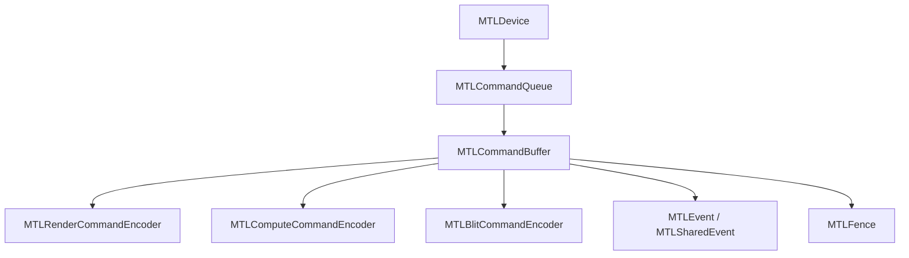
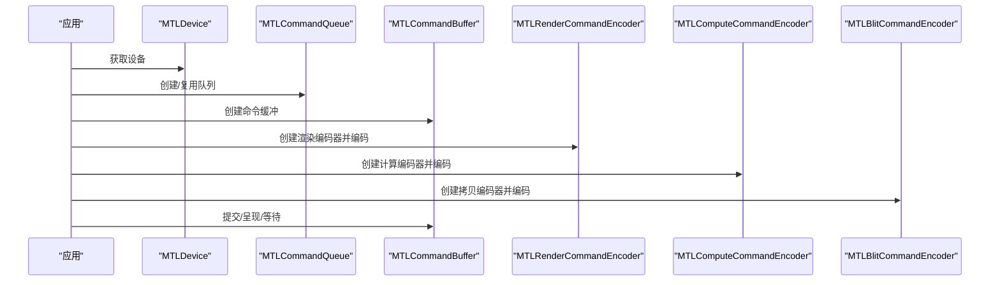
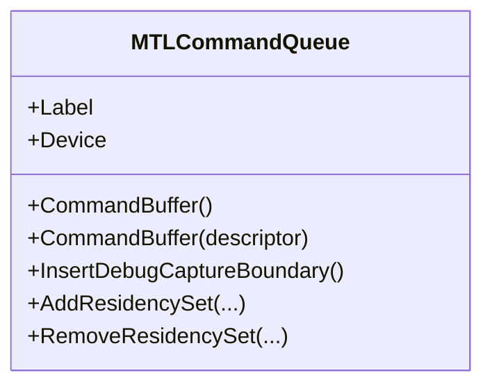
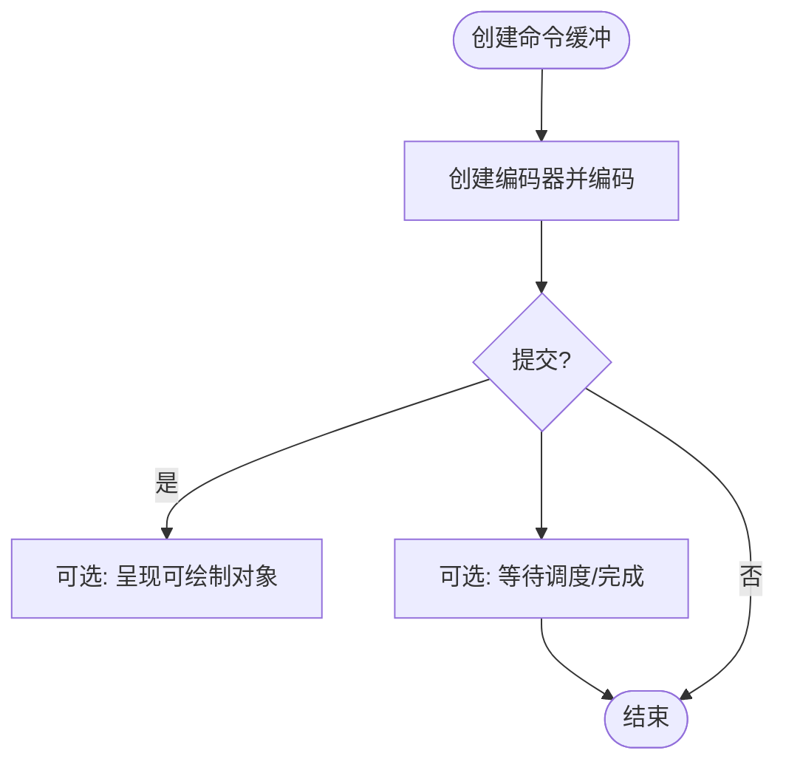
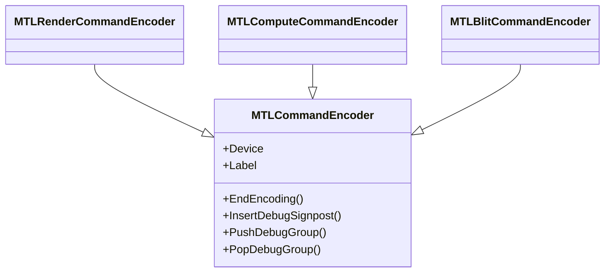
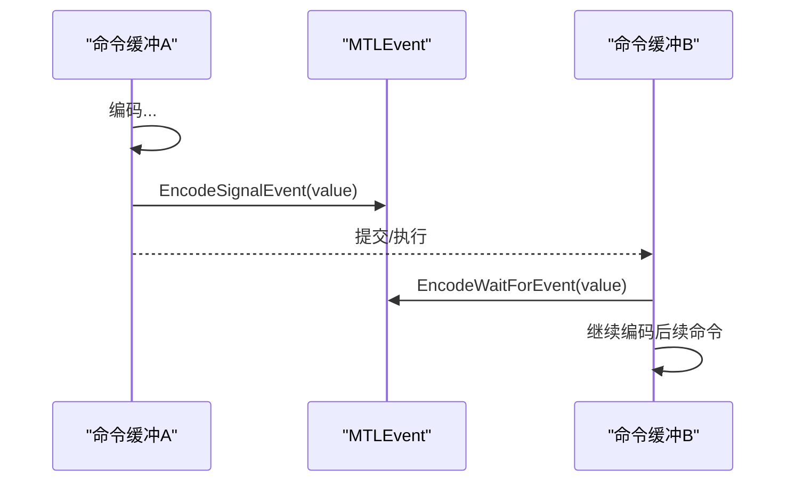
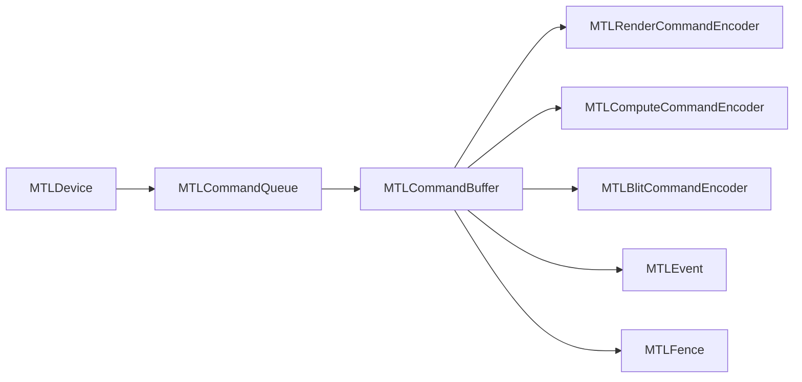
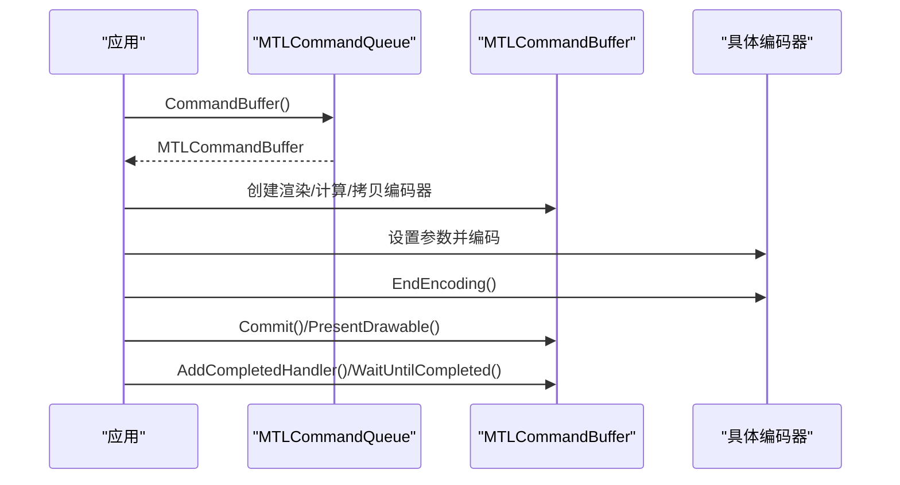

# 命令系统

<cite>
**本文引用的文件**
- [MTLCommandQueue.cs](file://src/SharpMetal/Metal/MTLCommandQueue.cs)
- [MTLCommandBuffer.cs](file://src/SharpMetal/Metal/MTLCommandBuffer.cs)
- [MTLCommandEncoder.cs](file://src/SharpMetal/Metal/MTLCommandEncoder.cs)
- [MTLComputeCommandEncoder.cs](file://src/SharpMetal/Metal/MTLComputeCommandEncoder.cs)
- [MTLRenderCommandEncoder.cs](file://src/SharpMetal/Metal/MTLRenderCommandEncoder.cs)
- [MTLBlitCommandEncoder.cs](file://src/SharpMetal/Metal/MTLBlitCommandEncoder.cs)
- [MTLEvent.cs](file://src/SharpMetal/Metal/MTLEvent.cs)
- [MTLFence.cs](file://src/SharpMetal/Metal/MTLFence.cs)
- [MTLDevice.cs](file://src/SharpMetal/Metal/MTLDevice.cs)
</cite>

## 目录
1. [简介](#简介)
2. [项目结构](#项目结构)
3. [核心组件](#核心组件)
4. [架构总览](#架构总览)
5. [详细组件分析](#详细组件分析)
6. [依赖关系分析](#依赖关系分析)
7. [性能考量](#性能考量)
8. [故障排查指南](#故障排查指南)
9. [结论](#结论)
10. [附录：典型使用流程与最佳实践](#附录：典型使用流程与最佳实践)

## 简介
本文件系统性梳理 SharpMetal 中 Metal 命令系统的实现与使用，覆盖命令队列（MTLCommandQueue）的创建与管理、命令缓冲（MTLCommandBuffer）的生命周期控制、命令编码器（MTLCommandEncoder）及其扩展类型（渲染、计算、拷贝等），以及事件（MTLEvent）和栅栏（MTLFence）在命令同步中的作用。文档同时给出命令编码、提交与执行的完整流程，并提供正确使用模式、性能优化技巧与常见同步问题的解决方案。

## 项目结构
SharpMetal 将 Metal API 以托管结构体形式暴露，通过 Objective-C 运行时调用底层 Metal 对象。命令系统相关的关键文件位于 src/SharpMetal/Metal 目录下：
- 命令队列与缓冲：MTLCommandQueue.cs、MTLCommandBuffer.cs
- 命令编码器基类与具体类型：MTLCommandEncoder.cs、MTLComputeCommandEncoder.cs、MTLRenderCommandEncoder.cs、MTLBlitCommandEncoder.cs
- 同步原语：MTLEvent.cs、MTLFence.cs
- 设备入口：MTLDevice.cs（用于获取默认设备、创建资源等）

图表来源
- [MTLDevice.cs:187-200](file://src/SharpMetal/Metal/MTLDevice.cs#L187-L200)
- [MTLCommandQueue.cs:44-107](file://src/SharpMetal/Metal/MTLCommandQueue.cs#L44-L107)
- [MTLCommandBuffer.cs:116-319](file://src/SharpMetal/Metal/MTLCommandBuffer.cs#L116-L319)
- [MTLRenderCommandEncoder.cs:126-166](file://src/SharpMetal/Metal/MTLRenderCommandEncoder.cs#L126-L166)
- [MTLComputeCommandEncoder.cs:20-58](file://src/SharpMetal/Metal/MTLComputeCommandEncoder.cs#L20-L58)
- [MTLBlitCommandEncoder.cs:14-50](file://src/SharpMetal/Metal/MTLBlitCommandEncoder.cs#L14-L50)
- [MTLEvent.cs:6-23](file://src/SharpMetal/Metal/MTLEvent.cs#L6-L23)
- [MTLFence.cs:6-23](file://src/SharpMetal/Metal/MTLFence.cs#L6-L23)

章节来源
- [MTLCommandQueue.cs:1-109](file://src/SharpMetal/Metal/MTLCommandQueue.cs#L1-L109)
- [MTLCommandBuffer.cs:1-321](file://src/SharpMetal/Metal/MTLCommandBuffer.cs#L1-L321)
- [MTLCommandEncoder.cs:1-63](file://src/SharpMetal/Metal/MTLCommandEncoder.cs#L1-L63)
- [MTLComputeCommandEncoder.cs:1-298](file://src/SharpMetal/Metal/MTLComputeCommandEncoder.cs#L1-L298)
- [MTLRenderCommandEncoder.cs:1-917](file://src/SharpMetal/Metal/MTLRenderCommandEncoder.cs#L1-L917)
- [MTLBlitCommandEncoder.cs:1-217](file://src/SharpMetal/Metal/MTLBlitCommandEncoder.cs#L1-L217)
- [MTLEvent.cs:1-108](file://src/SharpMetal/Metal/MTLEvent.cs#L1-L108)
- [MTLFence.cs:1-25](file://src/SharpMetal/Metal/MTLFence.cs#L1-L25)
- [MTLDevice.cs:1-200](file://src/SharpMetal/Metal/MTLDevice.cs#L1-L200)

## 核心组件
- 命令队列（MTLCommandQueue）：从设备创建或复用，负责接收并调度命令缓冲。支持设置标签、日志状态、最大缓冲数，以及驻留集管理。
- 命令缓冲（MTLCommandBuffer）：承载一次完整的 GPU 工作单元。可创建渲染、计算、拷贝等编码器；支持提交、呈现可绘制对象、等待调度/完成、添加回调、事件信号/等待、调试分组等。
- 命令编码器（MTLCommandEncoder）：抽象基类，提供设备、标签、结束编码、调试标记等通用能力；具体子类封装特定类型的命令。
- 事件（MTLEvent/MTLSharedEvent）：跨命令缓冲或进程间同步的计数型事件，支持等待指定值、通知监听器。
- 栅栏（MTLFence）：轻量级同步点，可在不同编码器之间建立执行顺序约束。

章节来源
- [MTLCommandQueue.cs:6-107](file://src/SharpMetal/Metal/MTLCommandQueue.cs#L6-L107)
- [MTLCommandBuffer.cs:9-319](file://src/SharpMetal/Metal/MTLCommandBuffer.cs#L9-L319)
- [MTLCommandEncoder.cs:6-61](file://src/SharpMetal/Metal/MTLCommandEncoder.cs#L6-L61)
- [MTLEvent.cs:6-108](file://src/SharpMetal/Metal/MTLEvent.cs#L6-L108)
- [MTLFence.cs:6-23](file://src/SharpMetal/Metal/MTLFence.cs#L6-L23)

## 架构总览
命令系统围绕“队列—缓冲—编码器”三层展开：
- 设备提供命令队列
- 命令队列生产命令缓冲
- 命令缓冲创建并持有各类编码器
- 编码器记录具体操作（渲染/计算/拷贝/资源状态转换等）
- 命令缓冲提交后由驱动调度执行，期间可通过事件/栅栏进行同步

图表来源
- [MTLDevice.cs:187-200](file://src/SharpMetal/Metal/MTLDevice.cs#L187-L200)
- [MTLCommandQueue.cs:44-107](file://src/SharpMetal/Metal/MTLCommandQueue.cs#L44-L107)
- [MTLCommandBuffer.cs:116-319](file://src/SharpMetal/Metal/MTLCommandBuffer.cs#L116-L319)
- [MTLRenderCommandEncoder.cs:126-166](file://src/SharpMetal/Metal/MTLRenderCommandEncoder.cs#L126-L166)
- [MTLComputeCommandEncoder.cs:20-58](file://src/SharpMetal/Metal/MTLComputeCommandEncoder.cs#L20-L58)
- [MTLBlitCommandEncoder.cs:14-50](file://src/SharpMetal/Metal/MTLBlitCommandEncoder.cs#L14-L50)

## 详细组件分析

### 命令队列（MTLCommandQueue）
- 职责：持有设备引用，生成命令缓冲，支持调试捕获边界、驻留集管理等。
- 关键能力：
  - 创建命令缓冲：无参与带描述符两种形式
  - 标签与日志：便于调试与诊断
  - 最大缓冲数：控制队列深度，影响吞吐与内存占用
  - 驻留集：批量注册/注销常驻资源集合，减少迁移开销

图表来源
- [MTLCommandQueue.cs:44-107](file://src/SharpMetal/Metal/MTLCommandQueue.cs#L44-L107)

章节来源
- [MTLCommandQueue.cs:6-107](file://src/SharpMetal/Metal/MTLCommandQueue.cs#L6-L107)

### 命令缓冲（MTLCommandBuffer）
- 职责：封装一次 GPU 任务，生命周期包括创建、编码、提交、执行、完成回调。
- 关键能力：
  - 状态查询：NotEnqueued/Enqueued/Committed/Scheduled/Completed/Error
  - 错误选项：可选择是否返回编码器执行状态
  - 呈现：PresentDrawable 系列方法
  - 等待：WaitUntilScheduled/WaitUntilCompleted
  - 回调：AddScheduledHandler/AddCompletedHandler
  - 编码器工厂：渲染、计算、拷贝、并行渲染、资源状态、加速结构等
  - 事件：EncodeWaitForEventvalue/EncodeSignalEventvalue
  - 调试：Push/Pop DebugGroup

图表来源
- [MTLCommandBuffer.cs:9-319](file://src/SharpMetal/Metal/MTLCommandBuffer.cs#L9-L319)

章节来源
- [MTLCommandBuffer.cs:59-319](file://src/SharpMetal/Metal/MTLCommandBuffer.cs#L59-L319)

### 命令编码器（MTLCommandEncoder）及扩展
- 基类（MTLCommandEncoder）：提供设备、标签、结束编码、调试分组/标记等通用接口。
- 渲染编码器（MTLRenderCommandEncoder）：
  - 设置管线、顶点/片段/对象/网格/瓦片阶段参数
  - 视口、裁剪、剔除、深度模板、混合、可见性结果
  - 绘制调用（直接/索引/间接）、补丁绘制、每瓦片线程
  - 内存屏障、栅栏更新/等待、资源/堆使用声明、计数器采样
- 计算编码器（MTLComputeCommandEncoder）：
  - 设置管线、常量/缓冲区/纹理/采样器、图像块尺寸、阶段输入区域
  - 线程组/线程分发（直接/间接）、内存屏障、栅栏更新/等待
  - 资源/堆使用声明、执行间接命令缓冲、计数器采样
- 拷贝编码器（MTLBlitCommandEncoder）：
  - 资源/纹理同步、纹理/缓冲互拷、Mipmap 生成、填充缓冲
  - 张量拷贝、栅栏更新/等待、访问计数器、内容优化、间接命令缓冲操作、计数器解析

图表来源
- [MTLCommandEncoder.cs:20-61](file://src/SharpMetal/Metal/MTLCommandEncoder.cs#L20-L61)
- [MTLRenderCommandEncoder.cs:126-166](file://src/SharpMetal/Metal/MTLRenderCommandEncoder.cs#L126-L166)
- [MTLComputeCommandEncoder.cs:20-58](file://src/SharpMetal/Metal/MTLComputeCommandEncoder.cs#L20-L58)
- [MTLBlitCommandEncoder.cs:14-50](file://src/SharpMetal/Metal/MTLBlitCommandEncoder.cs#L14-L50)

章节来源
- [MTLCommandEncoder.cs:1-63](file://src/SharpMetal/Metal/MTLCommandEncoder.cs#L1-L63)
- [MTLRenderCommandEncoder.cs:1-917](file://src/SharpMetal/Metal/MTLRenderCommandEncoder.cs#L1-L917)
- [MTLComputeCommandEncoder.cs:1-298](file://src/SharpMetal/Metal/MTLComputeCommandEncoder.cs#L1-L298)
- [MTLBlitCommandEncoder.cs:1-217](file://src/SharpMetal/Metal/MTLBlitCommandEncoder.cs#L1-L217)

### 事件（MTLEvent）与栅栏（MTLFence）
- MTLEvent/MTLSharedEvent：
  - 设备绑定、标签
  - 信号值读取/设置
  - 阻塞等待至指定值（超时）
  - 基于监听器的异步通知
  - 共享句柄用于跨进程/跨设备场景
- MTLFence：
  - 设备绑定、标签
  - 在渲染/计算/拷贝编码器中更新或等待，形成执行顺序约束

图表来源
- [MTLCommandBuffer.cs:235-243](file://src/SharpMetal/Metal/MTLCommandBuffer.cs#L235-L243)
- [MTLEvent.cs:6-108](file://src/SharpMetal/Metal/MTLEvent.cs#L6-L108)

章节来源
- [MTLEvent.cs:6-108](file://src/SharpMetal/Metal/MTLEvent.cs#L6-L108)
- [MTLFence.cs:6-23](file://src/SharpMetal/Metal/MTLFence.cs#L6-L23)
- [MTLCommandBuffer.cs:235-243](file://src/SharpMetal/Metal/MTLCommandBuffer.cs#L235-L243)

## 依赖关系分析
- MTLCommandQueue 依赖 MTLDevice 获取设备信息，并通过 Objective-C 选择器创建命令缓冲。
- MTLCommandBuffer 依赖 MTLCommandQueue、MTLDevice，并作为所有编码器的宿主。
- 各编码器均继承自 MTLCommandEncoder，具备统一的调试与生命周期管理能力。
- 同步原语（事件/栅栏）被命令缓冲与编码器共同使用，形成跨命令缓冲的执行顺序约束。

图表来源
- [MTLCommandQueue.cs:44-107](file://src/SharpMetal/Metal/MTLCommandQueue.cs#L44-L107)
- [MTLCommandBuffer.cs:116-319](file://src/SharpMetal/Metal/MTLCommandBuffer.cs#L116-L319)
- [MTLRenderCommandEncoder.cs:126-166](file://src/SharpMetal/Metal/MTLRenderCommandEncoder.cs#L126-L166)
- [MTLComputeCommandEncoder.cs:20-58](file://src/SharpMetal/Metal/MTLComputeCommandEncoder.cs#L20-L58)
- [MTLBlitCommandEncoder.cs:14-50](file://src/SharpMetal/Metal/MTLBlitCommandEncoder.cs#L14-L50)
- [MTLEvent.cs:6-108](file://src/SharpMetal/Metal/MTLEvent.cs#L6-L108)
- [MTLFence.cs:6-23](file://src/SharpMetal/Metal/MTLFence.cs#L6-L23)

章节来源
- [MTLCommandQueue.cs:44-107](file://src/SharpMetal/Metal/MTLCommandQueue.cs#L44-L107)
- [MTLCommandBuffer.cs:116-319](file://src/SharpMetal/Metal/MTLCommandBuffer.cs#L116-L319)

## 性能考量
- 命令队列深度与最大缓冲数：合理设置 MaxCommandBufferCount，避免过深导致内存压力或过浅限制吞吐。
- 命令缓冲复用：尽量复用命令缓冲以减少分配与初始化开销。
- 编码器粒度：将同类型操作合并到同一编码器，减少切换成本。
- 资源使用声明：显式声明 UseResource/UseResources/UseHeap，帮助驱动优化内存布局与访问路径。
- 内存屏障与栅栏：仅在必要时使用 MemoryBarrier/UpdateFence/WaitForFence，避免过度同步。
- 事件同步：跨命令缓冲使用事件时，注意信号值单调递增，避免死锁。
- 呈现时机：使用 PresentDrawableAtTime/PresentDrawableAfterMinimumDuration 平滑帧率与功耗。
- 调试与日志：合理使用 Label、LogState、Push/Pop DebugGroup、InsertDebugSignpost，定位瓶颈。

[本节为通用指导，不直接分析具体文件]

## 故障排查指南
- 命令缓冲状态异常：
  - 检查 Status 是否为 Completed/Error，Error 属性包含 NSError 详情。
  - 若启用 ErrorOptions.EncoderExecutionStatus，可进一步定位编码器错误状态。
- 同步问题：
  - 事件未触发：确认 EncodeSignalEvent 的值与 EncodeWaitForEvent 期望一致且单调递增。
  - 栅栏未生效：确保在正确的阶段（渲染阶段/计算阶段）更新与等待。
- 呈现问题：
  - 确保在正确时机调用 PresentDrawable，并在命令缓冲提交后处理下一帧。
- 资源访问冲突：
  - 使用 MemoryBarrier 或 UseResource 明确读写意图，避免隐式竞争。
- 调试手段：
  - 使用 InsertDebugCaptureBoundary 插入捕获边界，结合日志与调试工具分析。

章节来源
- [MTLCommandBuffer.cs:9-49](file://src/SharpMetal/Metal/MTLCommandBuffer.cs#L9-L49)
- [MTLCommandBuffer.cs:146-149](file://src/SharpMetal/Metal/MTLCommandBuffer.cs#L146-L149)
- [MTLCommandBuffer.cs:160-173](file://src/SharpMetal/Metal/MTLCommandBuffer.cs#L160-L173)
- [MTLCommandBuffer.cs:235-243](file://src/SharpMetal/Metal/MTLCommandBuffer.cs#L235-L243)
- [MTLRenderCommandEncoder.cs:588-601](file://src/SharpMetal/Metal/MTLRenderCommandEncoder.cs#L588-L601)
- [MTLComputeCommandEncoder.cs:195-203](file://src/SharpMetal/Metal/MTLComputeCommandEncoder.cs#L195-L203)
- [MTLBlitCommandEncoder.cs:117-125](file://src/SharpMetal/Metal/MTLBlitCommandEncoder.cs#L117-L125)

## 结论
SharpMetal 的命令系统以清晰的层次组织：设备→队列→缓冲→编码器，配合事件与栅栏提供灵活的同步机制。通过合理的队列深度、缓冲复用、资源声明与最小化同步，可获得稳定高效的 GPU 利用率。建议在生产环境中结合调试与日志，持续优化编码粒度与同步策略。

[本节为总结性内容，不直接分析具体文件]

## 附录：典型使用流程与最佳实践

### 命令编码与提交流程

图表来源
- [MTLCommandQueue.cs:60-68](file://src/SharpMetal/Metal/MTLCommandQueue.cs#L60-L68)
- [MTLCommandBuffer.cs:150-193](file://src/SharpMetal/Metal/MTLCommandBuffer.cs#L150-L193)
- [MTLRenderCommandEncoder.cs:148-166](file://src/SharpMetal/Metal/MTLRenderCommandEncoder.cs#L148-L166)
- [MTLComputeCommandEncoder.cs:38-58](file://src/SharpMetal/Metal/MTLComputeCommandEncoder.cs#L38-L58)
- [MTLBlitCommandEncoder.cs:32-50](file://src/SharpMetal/Metal/MTLBlitCommandEncoder.cs#L32-L50)

### 同步模式
- 事件同步：在命令缓冲 A 中 EncodeSignalEvent，在命令缓冲 B 中 EncodeWaitForEvent，保证数据就绪后再消费。
- 栅栏同步：在渲染/计算/拷贝编码器中使用 UpdateFence/WaitForFence，限定阶段内执行顺序。
- 内存屏障：在同一命令缓冲内对共享资源使用 MemoryBarrier，确保读写可见性。

章节来源
- [MTLCommandBuffer.cs:235-243](file://src/SharpMetal/Metal/MTLCommandBuffer.cs#L235-L243)
- [MTLRenderCommandEncoder.cs:593-601](file://src/SharpMetal/Metal/MTLRenderCommandEncoder.cs#L593-L601)
- [MTLComputeCommandEncoder.cs:195-203](file://src/SharpMetal/Metal/MTLComputeCommandEncoder.cs#L195-L203)
- [MTLBlitCommandEncoder.cs:117-125](file://src/SharpMetal/Metal/MTLBlitCommandEncoder.cs#L117-L125)