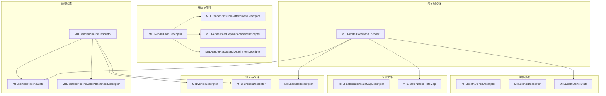
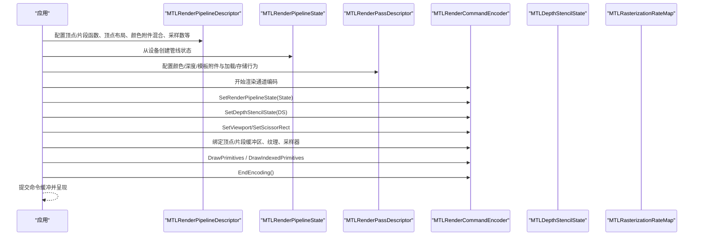
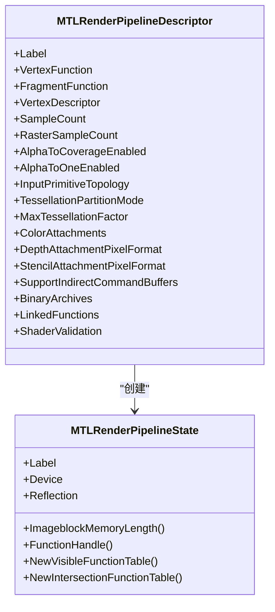
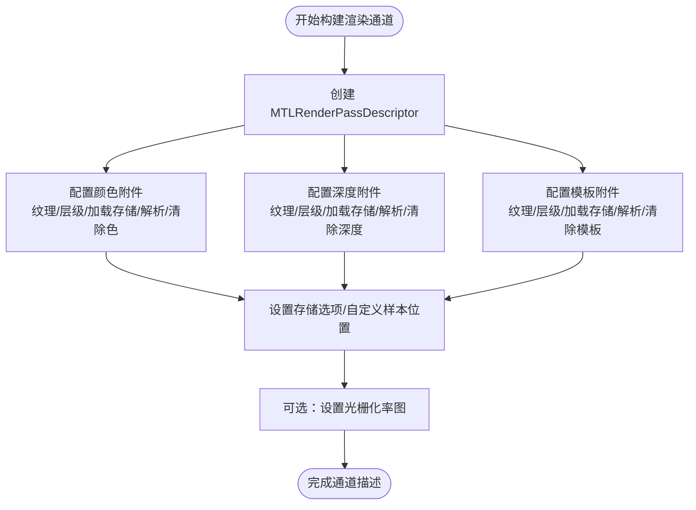
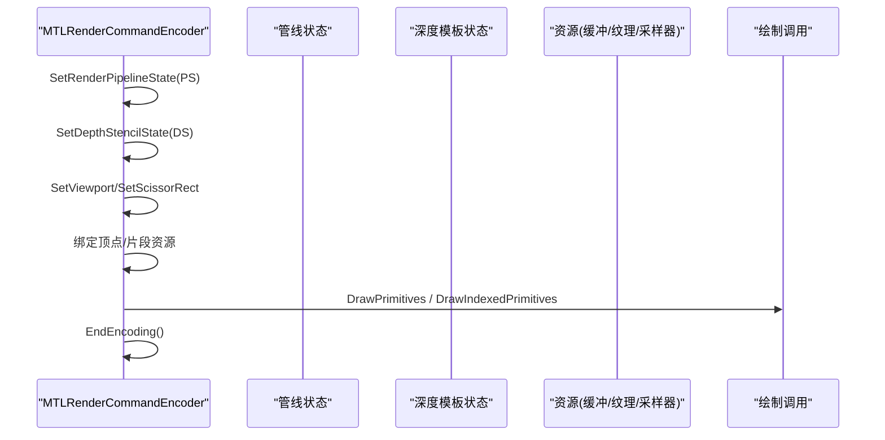
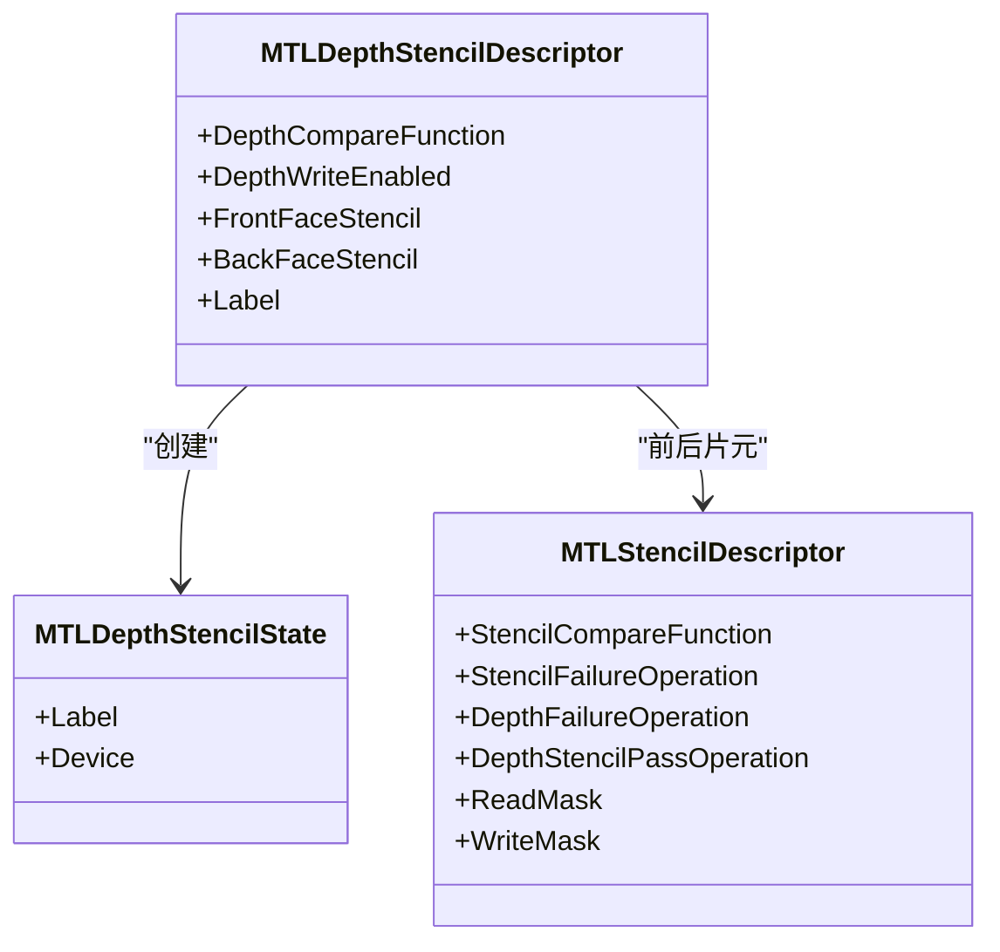
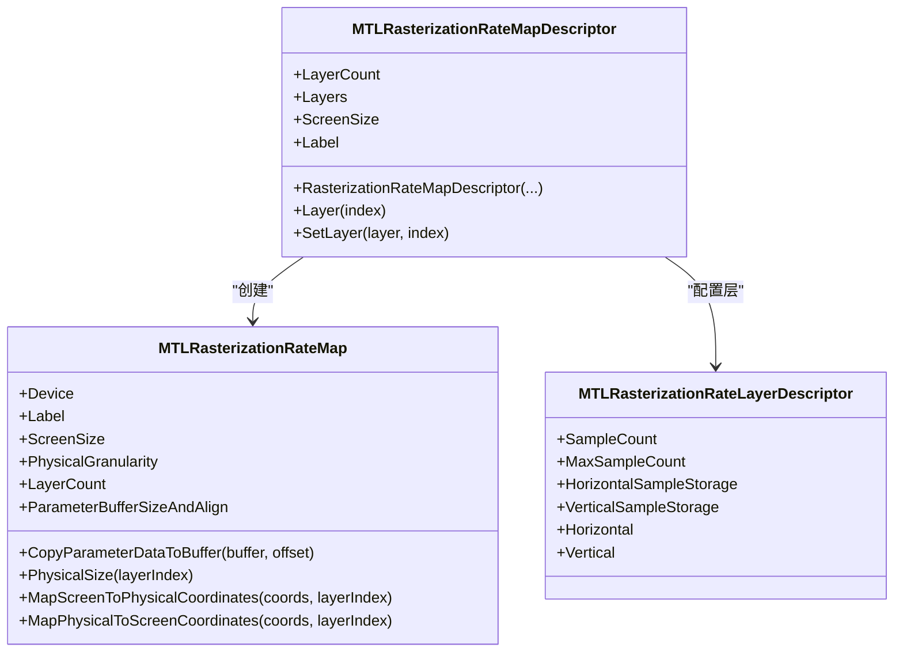
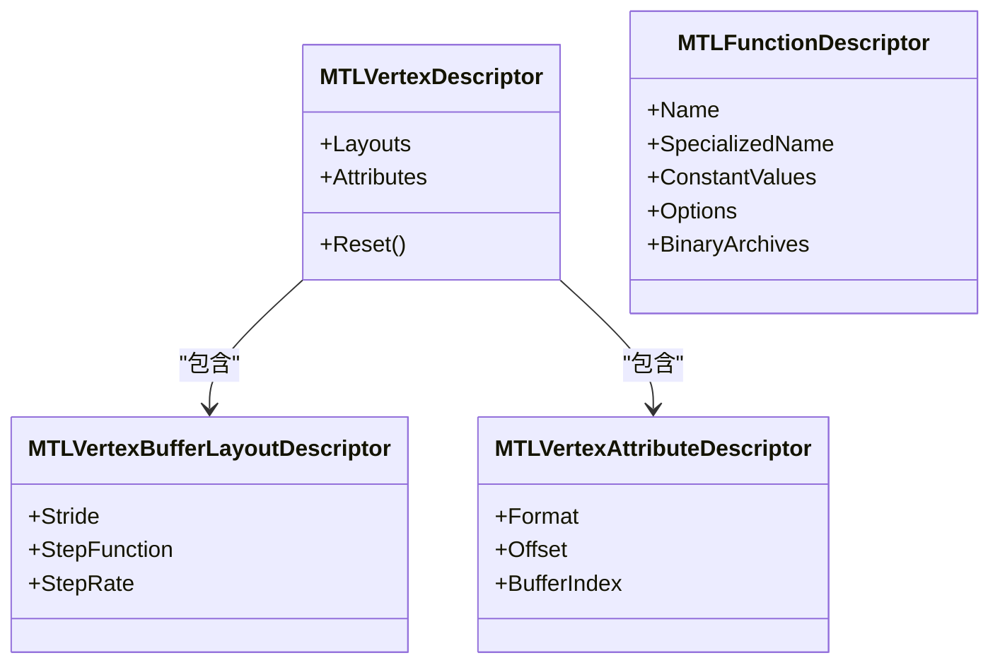
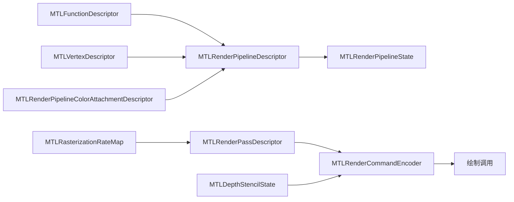

# 渲染管线

<cite>
**本文引用的文件**
- [MTLRenderPipeline.cs](file://src/SharpMetal/Metal/MTLRenderPipeline.cs)
- [MTLRenderPass.cs](file://src/SharpMetal/Metal/MTLRenderPass.cs)
- [MTLRenderCommandEncoder.cs](file://src/SharpMetal/Metal/MTLRenderCommandEncoder.cs)
- [MTLDepthStencil.cs](file://src/SharpMetal/Metal/MTLDepthStencil.cs)
- [MTLRasterizationRate.cs](file://src/SharpMetal/Metal/MTLRasterizationRate.cs)
- [MTLVertexDescriptor.cs](file://src/SharpMetal/Metal/MTLVertexDescriptor.cs)
- [MTLFunctionDescriptor.cs](file://src/SharpMetal/Metal/MTLFunctionDescriptor.cs)
- [MTLSampler.cs](file://src/SharpMetal/Metal/MTLSampler.cs)
</cite>

## 目录
1. [简介](#简介)
2. [项目结构](#项目结构)
3. [核心组件](#核心组件)
4. [架构总览](#架构总览)
5. [详细组件分析](#详细组件分析)
6. [依赖关系分析](#依赖关系分析)
7. [性能考虑](#性能考虑)
8. [故障排查指南](#故障排查指南)
9. [结论](#结论)
10. [附录：完整渲染流程示例](#附录完整渲染流程示例)

## 简介
本文件面向使用 SharpMetal 进行 Metal 渲染的开发者，系统性说明渲染管线的状态配置、通道定义与命令编码流程。重点覆盖：
- 渲染管线状态（MTLRenderPipelineState）的配置：顶点着色器、片段着色器、混合状态、采样数、光栅化等
- 渲染通道（MTLRenderPassDescriptor）的定义：颜色、深度、模板附件的加载/存储行为与多重采样解析
- 渲染命令编码器（MTLRenderCommandEncoder）的使用：设置管线、视图/裁剪、缓冲区/纹理绑定、绘制调用、深度模板状态、可见性统计等
- 深度模板测试（MTLDepthStencilState）与光栅化率（MTLRasterizationRateMap）的配置与使用
- 渲染各阶段、状态切换与性能优化策略
- 常见问题排查与最佳实践

## 项目结构
SharpMetal 在 src/SharpMetal/Metal 下提供对 Metal API 的 C# 封装。与渲染管线直接相关的核心类型包括：
- 管线状态与描述符：MTLRenderPipelineDescriptor、MTLRenderPipelineState、MTLRenderPipelineColorAttachmentDescriptor
- 通道与附件：MTLRenderPassDescriptor、MTLRenderPassColorAttachmentDescriptor、MTLRenderPassDepthAttachmentDescriptor、MTLRenderPassStencilAttachmentDescriptor
- 命令编码器：MTLRenderCommandEncoder（绘制、状态设置、资源绑定）
- 深度模板：MTLDepthStencilDescriptor、MTLStencilDescriptor、MTLDepthStencilState
- 光栅化率：MTLRasterizationRateMapDescriptor、MTLRasterizationRateMap
- 顶点描述：MTLVertexDescriptor、MTLVertexBufferLayoutDescriptor、MTLVertexAttributeDescriptor
- 函数与采样器：MTLFunctionDescriptor、MTLSamplerDescriptor、MTLSamplerState

图表来源
- [MTLRenderPipeline.cs:208-492](file://src/SharpMetal/Metal/MTLRenderPipeline.cs#L208-L492)
- [MTLRenderPass.cs:636-762](file://src/SharpMetal/Metal/MTLRenderPass.cs#L636-L762)
- [MTLRenderCommandEncoder.cs:126-800](file://src/SharpMetal/Metal/MTLRenderCommandEncoder.cs#L126-L800)
- [MTLDepthStencil.cs:91-162](file://src/SharpMetal/Metal/MTLDepthStencil.cs#L91-L162)
- [MTLRasterizationRate.cs:105-221](file://src/SharpMetal/Metal/MTLRasterizationRate.cs#L105-L221)
- [MTLVertexDescriptor.cs:221-246](file://src/SharpMetal/Metal/MTLVertexDescriptor.cs#L221-L246)
- [MTLFunctionDescriptor.cs:14-66](file://src/SharpMetal/Metal/MTLFunctionDescriptor.cs#L14-L66)
- [MTLSampler.cs:37-186](file://src/SharpMetal/Metal/MTLSampler.cs#L37-L186)

章节来源
- [MTLRenderPipeline.cs:208-492](file://src/SharpMetal/Metal/MTLRenderPipeline.cs#L208-L492)
- [MTLRenderPass.cs:636-762](file://src/SharpMetal/Metal/MTLRenderPass.cs#L636-L762)
- [MTLRenderCommandEncoder.cs:126-800](file://src/SharpMetal/Metal/MTLRenderCommandEncoder.cs#L126-L800)
- [MTLDepthStencil.cs:91-162](file://src/SharpMetal/Metal/MTLDepthStencil.cs#L91-L162)
- [MTLRasterizationRate.cs:105-221](file://src/SharpMetal/Metal/MTLRasterizationRate.cs#L105-L221)
- [MTLVertexDescriptor.cs:221-246](file://src/SharpMetal/Metal/MTLVertexDescriptor.cs#L221-L246)
- [MTLFunctionDescriptor.cs:14-66](file://src/SharpMetal/Metal/MTLFunctionDescriptor.cs#L14-L66)
- [MTLSampler.cs:37-186](file://src/SharpMetal/Metal/MTLSampler.cs#L37-L186)

## 核心组件
- MTLRenderPipelineDescriptor：配置顶点/片段着色器、顶点布局、颜色附件混合、采样数、光栅化、细分曲面参数、链接函数、二进制归档等
- MTLRenderPipelineState：由描述符创建的可复用管线状态对象，包含反射、线程组信息、函数句柄等
- MTLRenderPassDescriptor：定义当前帧的颜色/深度/模板附件及其加载/存储行为、多重采样解析、光栅化率图、样本位置等
- MTLRenderCommandEncoder：在命令缓冲中记录绘制相关命令，设置管线、视口/裁剪、缓冲区/纹理/采样器、深度模板状态、绘制调用、内存屏障等
- MTLDepthStencilDescriptor/MTLStencilDescriptor/MTLDepthStencilState：配置深度比较、写入、前后片元模板操作与掩码
- MTLRasterizationRateMapDescriptor/MTLRasterizationRateMap：配置逐层/屏幕到物理坐标映射、每层采样网格、物理粒度等
- MTLVertexDescriptor：定义顶点属性格式、偏移、所属缓冲索引及步长/步进函数
- MTLFunctionDescriptor：指定着色器函数名、常量值、选项与二进制归档
- MTLSamplerDescriptor/MTLSamplerState：纹理采样模式、地址模式、LOD、比较函数等

章节来源
- [MTLRenderPipeline.cs:208-492](file://src/SharpMetal/Metal/MTLRenderPipeline.cs#L208-L492)
- [MTLRenderPipeline.cs:530-629](file://src/SharpMetal/Metal/MTLRenderPipeline.cs#L530-L629)
- [MTLRenderPass.cs:636-762](file://src/SharpMetal/Metal/MTLRenderPass.cs#L636-L762)
- [MTLRenderCommandEncoder.cs:126-800](file://src/SharpMetal/Metal/MTLRenderCommandEncoder.cs#L126-L800)
- [MTLDepthStencil.cs:91-162](file://src/SharpMetal/Metal/MTLDepthStencil.cs#L91-L162)
- [MTLRasterizationRate.cs:105-221](file://src/SharpMetal/Metal/MTLRasterizationRate.cs#L105-L221)
- [MTLVertexDescriptor.cs:221-246](file://src/SharpMetal/Metal/MTLVertexDescriptor.cs#L221-L246)
- [MTLFunctionDescriptor.cs:14-66](file://src/SharpMetal/Metal/MTLFunctionDescriptor.cs#L14-L66)
- [MTLSampler.cs:37-186](file://src/SharpMetal/Metal/MTLSampler.cs#L37-L186)

## 架构总览
下图展示从应用侧到 GPU 的典型渲染流程：准备管线状态与通道描述，获取命令编码器，设置状态与资源，执行绘制，结束编码并提交命令缓冲。

图表来源
- [MTLRenderPipeline.cs:208-492](file://src/SharpMetal/Metal/MTLRenderPipeline.cs#L208-L492)
- [MTLRenderPass.cs:636-762](file://src/SharpMetal/Metal/MTLRenderPass.cs#L636-L762)
- [MTLRenderCommandEncoder.cs:168-586](file://src/SharpMetal/Metal/MTLRenderCommandEncoder.cs#L168-L586)
- [MTLDepthStencil.cs:91-162](file://src/SharpMetal/Metal/MTLDepthStencil.cs#L91-L162)
- [MTLRasterizationRate.cs:105-221](file://src/SharpMetal/Metal/MTLRasterizationRate.cs#L105-L221)

## 详细组件分析

### 渲染管线状态（MTLRenderPipelineState）
- 描述符（MTLRenderPipelineDescriptor）关键配置项：
  - 顶点/片段函数：通过函数描述符或库中的函数名设置
  - 顶点布局：MTLVertexDescriptor 定义属性格式、偏移、缓冲索引与步长
  - 颜色附件混合：为每个颜色附件设置像素格式、混合开关、源/目标因子、RGB/Alpha 运算、写掩码
  - 采样与光栅化：SampleCount、RasterSampleCount、AlphaToCoverageEnabled、AlphaToOneEnabled、RasterizationEnabled
  - 细分曲面：分区模式、最大细分因子、输出绕序、控制点索引类型等
  - 其他：支持间接命令缓冲、二进制归档、预加载库、链接函数、调用栈深度、着色器验证等
- 管线状态（MTLRenderPipelineState）：
  - 提供反射信息、线程组大小、图像块内存长度、函数句柄、可见/相交函数表创建等能力

图表来源
- [MTLRenderPipeline.cs:208-492](file://src/SharpMetal/Metal/MTLRenderPipeline.cs#L208-L492)
- [MTLRenderPipeline.cs:530-629](file://src/SharpMetal/Metal/MTLRenderPipeline.cs#L530-L629)

章节来源
- [MTLRenderPipeline.cs:208-492](file://src/SharpMetal/Metal/MTLRenderPipeline.cs#L208-L492)
- [MTLRenderPipeline.cs:530-629](file://src/SharpMetal/Metal/MTLRenderPipeline.cs#L530-L629)

### 渲染通道（MTLRenderPassDescriptor）与附件
- 颜色附件（MTLRenderPassColorAttachmentDescriptor）：
  - 纹理、层级、切片、深度平面
  - 解析纹理与层级
  - 加载/存储动作（LoadAction/StoreAction）、存储选项（StoreActionOptions）
  - 清除颜色（ClearColor）
- 深度附件（MTLRenderPassDepthAttachmentDescriptor）：
  - 纹理、层级、切片、深度平面
  - 解析纹理与层级
  - 加载/存储动作、存储选项
  - 清除深度（ClearDepth）、多重采样深度解析过滤（DepthResolveFilter）
- 模板附件（MTLRenderPassStencilAttachmentDescriptor）：
  - 纹理、层级、切片、深度平面
  - 加载/存储动作、存储选项
  - 清除模板值（ClearStencil）、多重采样模板解析过滤（StencilResolveFilter）
- 通道描述符（MTLRenderPassDescriptor）：
  - 颜色附件数组、深度/模板附件
  - 可见性结果缓冲、渲染目标数组长度
  - 图像块采样长度、线程组内存长度
  - Tile 尺寸、默认光栅化采样数、渲染目标宽高
  - 光栅化率图（RasterizationRateMap）
  - 自定义样本位置设置/获取

图表来源
- [MTLRenderPass.cs:60-158](file://src/SharpMetal/Metal/MTLRenderPass.cs#L60-L158)
- [MTLRenderPass.cs:160-270](file://src/SharpMetal/Metal/MTLRenderPass.cs#L160-L270)
- [MTLRenderPass.cs:272-390](file://src/SharpMetal/Metal/MTLRenderPass.cs#L272-L390)
- [MTLRenderPass.cs:392-510](file://src/SharpMetal/Metal/MTLRenderPass.cs#L392-L510)
- [MTLRenderPass.cs:636-762](file://src/SharpMetal/Metal/MTLRenderPass.cs#L636-L762)

章节来源
- [MTLRenderPass.cs:60-158](file://src/SharpMetal/Metal/MTLRenderPass.cs#L60-L158)
- [MTLRenderPass.cs:160-270](file://src/SharpMetal/Metal/MTLRenderPass.cs#L160-L270)
- [MTLRenderPass.cs:272-390](file://src/SharpMetal/Metal/MTLRenderPass.cs#L272-L390)
- [MTLRenderPass.cs:392-510](file://src/SharpMetal/Metal/MTLRenderPass.cs#L392-L510)
- [MTLRenderPass.cs:636-762](file://src/SharpMetal/Metal/MTLRenderPass.cs#L636-L762)

### 渲染命令编码器（MTLRenderCommandEncoder）
- 管线与状态设置：
  - SetRenderPipelineState：绑定已创建的管线状态
  - SetDepthStencilState：绑定深度模板状态
  - SetBlendColor：设置混合颜色
- 视图与光栅化：
  - SetViewport/SetViewports：设置视口
  - SetScissorRect/SetScissorRects：设置裁剪矩形
  - SetFrontFacingWinding/SetCullMode/SetDepthClipMode/SetTriangleFillMode：正面绕序、剔除、深度裁剪、填充模式
  - SetDepthBias：深度偏置
- 资源绑定：
  - 顶点：SetVertexBytes/SetVertexBuffer/SetVertexTextures/SetVertexSamplerState 等
  - 片段：SetFragmentBytes/SetFragmentBuffer/SetFragmentTextures/SetFragmentSamplerState 等
  - 对象/网格：Object/Mesh 阶段的缓冲、纹理、采样器设置
  - 可见性/相交函数表、加速结构
- 绘制调用：
  - DrawPrimitives / DrawIndexedPrimitives（含间接缓冲版本）
  - DrawPatches / DrawIndexedPatches（细分曲面）
  - DrawMeshThreadgroups / DrawMeshThreads（Mesh Shader）
- 同步与调试：
  - TextureBarrier、UpdateFence/WaitForFence
  - PushDebugGroup/PopDebugGroup/InsertDebugSignpost
  - MemoryBarrier（按作用域/资源集合）
  - ExecuteCommandsInBuffer（间接命令缓冲）
  - SampleCountersInBuffer（计数器采样）

图表来源
- [MTLRenderCommandEncoder.cs:168-586](file://src/SharpMetal/Metal/MTLRenderCommandEncoder.cs#L168-L586)
- [MTLRenderCommandEncoder.cs:588-781](file://src/SharpMetal/Metal/MTLRenderCommandEncoder.cs#L588-L781)

章节来源
- [MTLRenderCommandEncoder.cs:168-586](file://src/SharpMetal/Metal/MTLRenderCommandEncoder.cs#L168-L586)
- [MTLRenderCommandEncoder.cs:588-781](file://src/SharpMetal/Metal/MTLRenderCommandEncoder.cs#L588-L781)

### 深度模板测试（MTLDepthStencil）
- 比较函数（MTLCompareFunction）：Never/Less/Equal/LessEqual/Greater/NotEqual/GreaterEqual/Always
- 模板操作（MTLStencilOperation）：Keep/Zero/Replace/IncrementClamp/DecrementClamp/Invert/IncrementWrap/DecrementWrap
- 模板描述（MTLStencilDescriptor）：
  - 模板比较函数、失败/深度失败/通过时的操作、读写掩码
- 深度模板描述（MTLDepthStencilDescriptor）：
  - 深度比较函数、是否写入深度、前后片元的模板描述
- 深度模板状态（MTLDepthStencilState）：
  - 由描述符创建的状态对象，可在命令编码器中设置

图表来源
- [MTLDepthStencil.cs:30-89](file://src/SharpMetal/Metal/MTLDepthStencil.cs#L30-L89)
- [MTLDepthStencil.cs:91-162](file://src/SharpMetal/Metal/MTLDepthStencil.cs#L91-L162)

章节来源
- [MTLDepthStencil.cs:30-89](file://src/SharpMetal/Metal/MTLDepthStencil.cs#L30-L89)
- [MTLDepthStencil.cs:91-162](file://src/SharpMetal/Metal/MTLDepthStencil.cs#L91-L162)

### 光栅化率（MTLRasterizationRate）
- 层描述（MTLRasterizationRateLayerDescriptor）：
  - 采样网格尺寸、最大采样数、水平/垂直采样存储、水平/垂直采样数组
- 地图描述（MTLRasterizationRateMapDescriptor）：
  - 屏幕尺寸、层数量、层访问/设置、静态工厂方法
- 地图实例（MTLRasterizationRateMap）：
  - 设备、标签、屏幕尺寸、物理粒度、层数量、参数缓冲大小与对齐
  - 将参数数据复制到缓冲、物理尺寸查询、屏幕与物理坐标互映射

图表来源
- [MTLRasterizationRate.cs:31-77](file://src/SharpMetal/Metal/MTLRasterizationRate.cs#L31-L77)
- [MTLRasterizationRate.cs:105-168](file://src/SharpMetal/Metal/MTLRasterizationRate.cs#L105-L168)
- [MTLRasterizationRate.cs:170-221](file://src/SharpMetal/Metal/MTLRasterizationRate.cs#L170-L221)

章节来源
- [MTLRasterizationRate.cs:31-77](file://src/SharpMetal/Metal/MTLRasterizationRate.cs#L31-L77)
- [MTLRasterizationRate.cs:105-168](file://src/SharpMetal/Metal/MTLRasterizationRate.cs#L105-L168)
- [MTLRasterizationRate.cs:170-221](file://src/SharpMetal/Metal/MTLRasterizationRate.cs#L170-L221)

### 顶点描述与着色器函数
- 顶点描述（MTLVertexDescriptor）：
  - 缓冲布局（MTLVertexBufferLayoutDescriptor）：步幅、步进函数、步进速率
  - 属性（MTLVertexAttributeDescriptor）：格式、偏移、缓冲索引
- 函数描述（MTLFunctionDescriptor）：
  - 函数名/特化名、常量值、选项（编译为二进制、脚本存储、二进制归档缺失时失败）、二进制归档

图表来源
- [MTLVertexDescriptor.cs:73-108](file://src/SharpMetal/Metal/MTLVertexDescriptor.cs#L73-L108)
- [MTLVertexDescriptor.cs:147-182](file://src/SharpMetal/Metal/MTLVertexDescriptor.cs#L147-L182)
- [MTLVertexDescriptor.cs:221-246](file://src/SharpMetal/Metal/MTLVertexDescriptor.cs#L221-L246)
- [MTLFunctionDescriptor.cs:14-66](file://src/SharpMetal/Metal/MTLFunctionDescriptor.cs#L14-L66)

章节来源
- [MTLVertexDescriptor.cs:73-108](file://src/SharpMetal/Metal/MTLVertexDescriptor.cs#L73-L108)
- [MTLVertexDescriptor.cs:147-182](file://src/SharpMetal/Metal/MTLVertexDescriptor.cs#L147-L182)
- [MTLVertexDescriptor.cs:221-246](file://src/SharpMetal/Metal/MTLVertexDescriptor.cs#L221-L246)
- [MTLFunctionDescriptor.cs:14-66](file://src/SharpMetal/Metal/MTLFunctionDescriptor.cs#L14-L66)

### 采样器（MTLSampler）
- 采样器描述（MTLSamplerDescriptor）：
  - 最小/放大滤波、Mipmap 滤波、最大各向异性、S/T/R 地址模式、边框颜色
  - 归一化坐标、LOD 范围、LOD 平均、比较函数、是否支持参数缓冲、标签
- 采样器状态（MTLSamplerState）：
  - 设备、GPU 资源 ID、标签

章节来源
- [MTLSampler.cs:37-186](file://src/SharpMetal/Metal/MTLSampler.cs#L37-L186)

## 依赖关系分析
- 管线状态依赖：
  - 顶点/片段函数（MTLFunctionDescriptor）
  - 顶点布局（MTLVertexDescriptor）
  - 颜色附件混合（MTLRenderPipelineColorAttachmentDescriptor）
  - 采样与光栅化参数
- 通道描述依赖：
  - 颜色/深度/模板附件（纹理、层级、加载/存储、解析、清除值）
  - 光栅化率图（MTLRasterizationRateMap）
- 命令编码器依赖：
  - 管线状态、深度模板状态、视口/裁剪、资源绑定、绘制调用、同步与调试接口
- 外部依赖：
  - 设备（MTLDevice）用于创建管线状态、采样器状态、深度模板状态等
  - 命令缓冲（MTLCommandBuffer）用于提交与呈现

图表来源
- [MTLRenderPipeline.cs:208-492](file://src/SharpMetal/Metal/MTLRenderPipeline.cs#L208-L492)
- [MTLRenderPass.cs:636-762](file://src/SharpMetal/Metal/MTLRenderPass.cs#L636-L762)
- [MTLRenderCommandEncoder.cs:168-586](file://src/SharpMetal/Metal/MTLRenderCommandEncoder.cs#L168-L586)

章节来源
- [MTLRenderPipeline.cs:208-492](file://src/SharpMetal/Metal/MTLRenderPipeline.cs#L208-L492)
- [MTLRenderPass.cs:636-762](file://src/SharpMetal/Metal/MTLRenderPass.cs#L636-L762)
- [MTLRenderCommandEncoder.cs:168-586](file://src/SharpMetal/Metal/MTLRenderCommandEncoder.cs#L168-L586)

## 性能考虑
- 管线状态复用：尽量缓存 MTLRenderPipelineState，避免频繁重建
- 混合与采样：合理设置 AlphaToCoverage、AlphaToOne、SampleCount/RasterSampleCount；仅在需要时启用多重采样
- 光栅化率：使用 MTLRasterizationRateMap 降低非关键区域的采样密度，提升吞吐
- 资源绑定批量：使用批量设置接口（如 SetVertexBuffers/SetFragmentTextures）减少调用开销
- 间接命令缓冲：利用 ExecuteCommandsInBuffer 减少 CPU 端命令生成成本
- 内存屏障：在跨阶段共享资源时使用 MemoryBarrier/TextureBarrier，避免不必要的同步
- 可见性统计：启用可见性结果缓冲以进行遮挡剔除，减少绘制量
- 调试与测量：合理使用 PushDebugGroup/InsertDebugSignpost/SampleCountersInBuffer 定位瓶颈

[本节为通用性能建议，不直接分析具体文件]

## 故障排查指南
- 颜色附件未正确设置：
  - 检查颜色附件的纹理、层级、加载/存储动作与清除颜色是否正确
  - 参考：颜色附件描述与通道描述
- 深度/模板未生效：
  - 确认深度/模板附件的纹理与加载/存储动作
  - 检查深度模板状态的深度比较函数与写入开关
  - 参考：深度模板描述与命令编码器设置
- 混合结果异常：
  - 核对颜色附件的混合因子、运算与写掩码
  - 确保 SetBlendColor 与混合设置一致
- 多重采样解析问题：
  - 检查 ResolveTexture/ResolveLevel 与 StoreActionOptions
  - 确认 DepthResolveFilter/StencilResolveFilter
- 光栅化率图无效：
  - 确认 ScreenSize、LayerCount、物理粒度与参数缓冲拷贝
  - 检查 MapScreenToPhysicalCoordinates 的坐标转换
- 绘制无输出：
  - 检查视口与裁剪矩形是否覆盖目标区域
  - 确认顶点布局与属性偏移匹配缓冲数据
  - 检查着色器函数名与常量值
- 同步与可见性：
  - 使用 UpdateFence/WaitForFence 确保阶段间顺序
  - 启用可见性结果缓冲并进行遮挡剔除

章节来源
- [MTLRenderPass.cs:60-158](file://src/SharpMetal/Metal/MTLRenderPass.cs#L60-L158)
- [MTLRenderPass.cs:160-270](file://src/SharpMetal/Metal/MTLRenderPass.cs#L160-L270)
- [MTLRenderPass.cs:272-390](file://src/SharpMetal/Metal/MTLRenderPass.cs#L272-L390)
- [MTLRenderPass.cs:392-510](file://src/SharpMetal/Metal/MTLRenderPass.cs#L392-L510)
- [MTLDepthStencil.cs:91-162](file://src/SharpMetal/Metal/MTLDepthStencil.cs#L91-L162)
- [MTLRenderCommandEncoder.cs:168-586](file://src/SharpMetal/Metal/MTLRenderCommandEncoder.cs#L168-L586)
- [MTLRasterizationRate.cs:105-221](file://src/SharpMetal/Metal/MTLRasterizationRate.cs#L105-L221)

## 结论
SharpMetal 提供了完整的 Metal 渲染管线封装，涵盖管线状态、通道描述、命令编码、深度模板与光栅化率等关键能力。通过合理配置与复用状态、批量绑定资源、使用间接命令与可见性统计，可以在保证正确性的同时获得良好的性能表现。建议在复杂场景中结合调试与计数器工具持续优化。

[本节为总结性内容，不直接分析具体文件]

## 附录：完整渲染流程示例
以下为一个典型渲染流程的步骤指引（基于现有 API 的能力），不包含具体代码内容：

1. 准备着色器函数与常量
   - 使用 MTLFunctionDescriptor 指定函数名、常量值与选项
2. 配置顶点布局
   - 使用 MTLVertexDescriptor 定义属性格式、偏移、缓冲索引与步长
3. 创建管线状态
   - 使用 MTLRenderPipelineDescriptor 设置顶点/片段函数、顶点布局、颜色附件混合、采样数、光栅化等
   - 从设备创建 MTLRenderPipelineState
4. 配置深度模板
   - 使用 MTLDepthStencilDescriptor 与 MTLStencilDescriptor 设置深度比较、写入与模板操作
   - 创建 MTLDepthStencilState
5. 配置光栅化率图（可选）
   - 使用 MTLRasterizationRateMapDescriptor 设置屏幕尺寸与层配置
   - 创建 MTLRasterizationRateMap 并复制参数数据到缓冲
6. 构建渲染通道
   - 使用 MTLRenderPassDescriptor 配置颜色/深度/模板附件的纹理、层级、加载/存储动作与解析
   - 设置清除颜色/深度/模板值
7. 开始渲染通道编码
   - 获取 MTLRenderCommandEncoder
   - 设置管线状态、深度模板状态、视口与裁剪矩形
   - 绑定顶点/片段缓冲、纹理、采样器
   - 执行绘制调用（DrawPrimitives/DrawIndexedPrimitives 等）
8. 结束编码并提交
   - 调用 EndEncoding 并提交命令缓冲进行呈现

章节来源
- [MTLFunctionDescriptor.cs:14-66](file://src/SharpMetal/Metal/MTLFunctionDescriptor.cs#L14-L66)
- [MTLVertexDescriptor.cs:221-246](file://src/SharpMetal/Metal/MTLVertexDescriptor.cs#L221-L246)
- [MTLRenderPipeline.cs:208-492](file://src/SharpMetal/Metal/MTLRenderPipeline.cs#L208-L492)
- [MTLDepthStencil.cs:91-162](file://src/SharpMetal/Metal/MTLDepthStencil.cs#L91-L162)
- [MTLRasterizationRate.cs:105-221](file://src/SharpMetal/Metal/MTLRasterizationRate.cs#L105-L221)
- [MTLRenderPass.cs:636-762](file://src/SharpMetal/Metal/MTLRenderPass.cs#L636-L762)
- [MTLRenderCommandEncoder.cs:168-586](file://src/SharpMetal/Metal/MTLRenderCommandEncoder.cs#L168-L586)