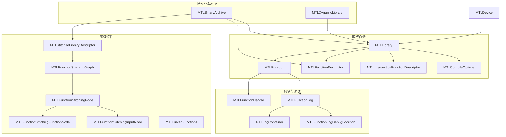
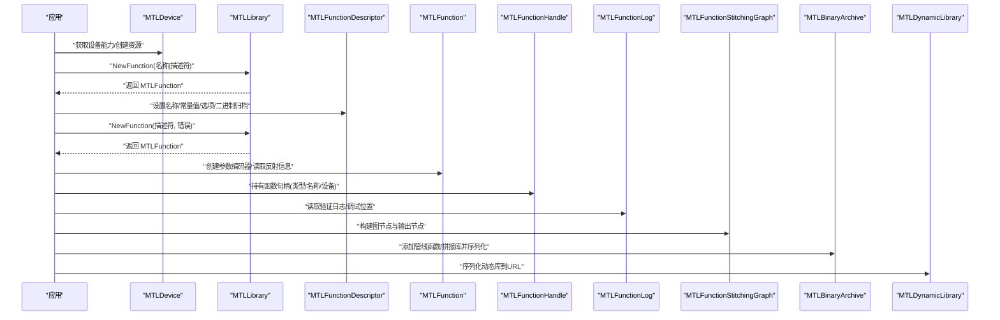
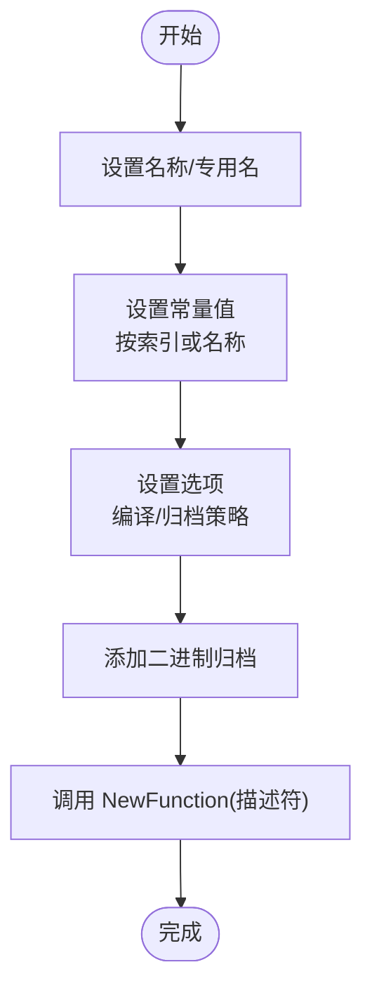
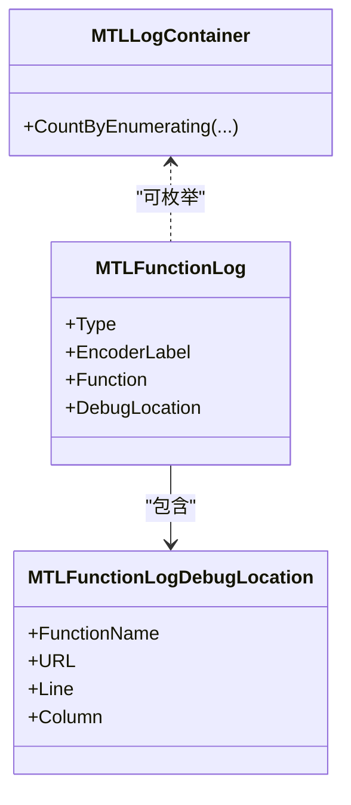
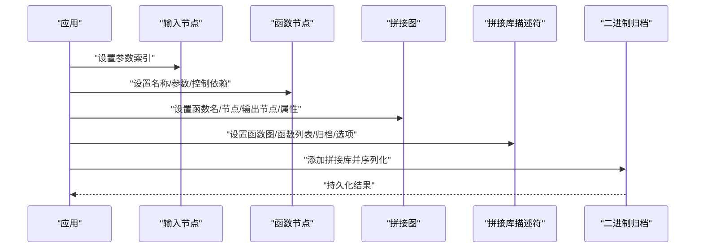
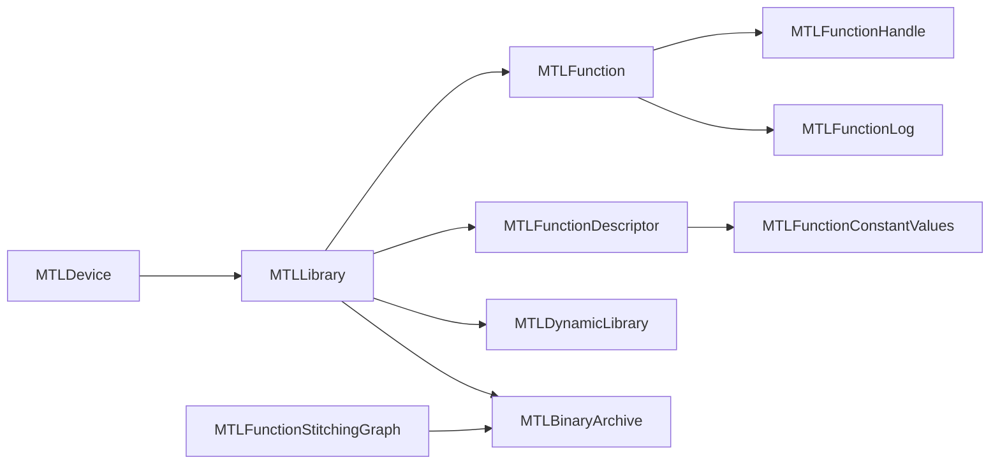
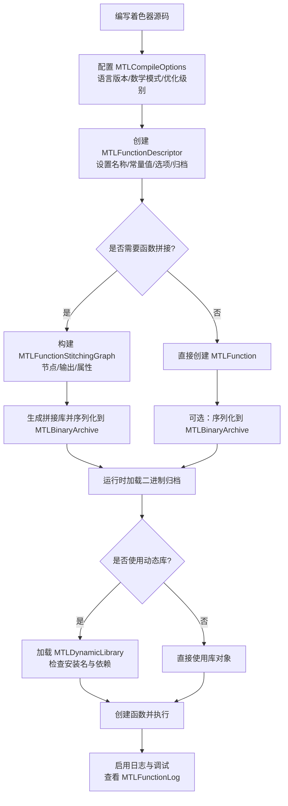

# 着色器库

<cite>
**本文引用的文件**
- [MTLLibrary.cs](file://src/SharpMetal/Metal/MTLLibrary.cs)
- [MTLFunctionDescriptor.cs](file://src/SharpMetal/Metal/MTLFunctionDescriptor.cs)
- [MTLFunctionHandle.cs](file://src/SharpMetal/Metal/MTLFunctionHandle.cs)
- [MTLFunctionLog.cs](file://src/SharpMetal/Metal/MTLFunctionLog.cs)
- [MTLFunctionStitching.cs](file://src/SharpMetal/Metal/MTLFunctionStitching.cs)
- [MTLDynamicLibrary.cs](file://src/SharpMetal/Metal/MTLDynamicLibrary.cs)
- [MTLBinaryArchive.cs](file://src/SharpMetal/Metal/MTLBinaryArchive.cs)
- [MTLLinkedFunctions.cs](file://src/SharpMetal/Metal/MTLLinkedFunctions.cs)
- [MTLDevice.cs](file://src/SharpMetal/Metal/MTLDevice.cs)
</cite>

## 目录
1. [简介](#简介)
2. [项目结构](#项目结构)
3. [核心组件](#核心组件)
4. [架构总览](#架构总览)
5. [详细组件分析](#详细组件分析)
6. [依赖关系分析](#依赖关系分析)
7. [性能考虑](#性能考虑)
8. [故障排查指南](#故障排查指南)
9. [结论](#结论)
10. [附录：完整工作流程](#附录完整工作流程)

## 简介
本文件围绕 SharpMetal 中的 Metal 着色器库（MTLLibrary）进行系统化文档化，覆盖从源码到二进制、动态库的加载与管理；函数描述符（MTLFunctionDescriptor）的配置项（常量值、链接函数、编译选项）；函数句柄（MTLFunctionHandle）的使用；函数日志（MTLFunctionLog）的调试能力；以及函数拼接（MTLFunctionStitching）的高级特性与性能考量。同时提供着色器开发、编译与调试的端到端工作流建议。

## 项目结构
与着色器库相关的核心类型集中在 src/SharpMetal/Metal 目录下，围绕 MTLLibrary 及其周边对象形成清晰的职责边界：
- 库与函数：MTLLibrary、MTLFunction、MTLCompileOptions、MTLFunctionDescriptor、MTLIntersectionFunctionDescriptor
- 运行时句柄与调试：MTLFunctionHandle、MTLFunctionLog、MTLLogContainer、MTLFunctionLogDebugLocation
- 高级特性：MTLFunctionStitching（图节点、属性、描述符）、MTLLinkedFunctions（链接函数集合）
- 持久化与复用：MTLBinaryArchive（二进制归档）、MTLDynamicLibrary（动态库）
- 设备上下文：MTLDevice（用于获取设备能力、创建/管理资源）

图表来源
- [MTLLibrary.cs:347-397](file://src/SharpMetal/Metal/MTLLibrary.cs#L347-L397)
- [MTLFunctionDescriptor.cs:14-123](file://src/SharpMetal/Metal/MTLFunctionDescriptor.cs#L14-L123)
- [MTLFunctionHandle.cs:6-21](file://src/SharpMetal/Metal/MTLFunctionHandle.cs#L6-L21)
- [MTLFunctionLog.cs:11-67](file://src/SharpMetal/Metal/MTLFunctionLog.cs#L11-L67)
- [MTLFunctionStitching.cs:13-211](file://src/SharpMetal/Metal/MTLFunctionStitching.cs#L13-L211)
- [MTLBinaryArchive.cs:15-95](file://src/SharpMetal/Metal/MTLBinaryArchive.cs#L15-L95)
- [MTLDynamicLibrary.cs:16-42](file://src/SharpMetal/Metal/MTLDynamicLibrary.cs#L16-L42)
- [MTLDevice.cs:187-200](file://src/SharpMetal/Metal/MTLDevice.cs#L187-L200)

章节来源
- [MTLLibrary.cs:347-397](file://src/SharpMetal/Metal/MTLLibrary.cs#L347-L397)
- [MTLFunctionDescriptor.cs:14-123](file://src/SharpMetal/Metal/MTLFunctionDescriptor.cs#L14-L123)
- [MTLFunctionHandle.cs:6-21](file://src/SharpMetal/Metal/MTLFunctionHandle.cs#L6-L21)
- [MTLFunctionLog.cs:11-67](file://src/SharpMetal/Metal/MTLFunctionLog.cs#L11-L67)
- [MTLFunctionStitching.cs:13-211](file://src/SharpMetal/Metal/MTLFunctionStitching.cs#L13-L211)
- [MTLBinaryArchive.cs:15-95](file://src/SharpMetal/Metal/MTLBinaryArchive.cs#L15-L95)
- [MTLDynamicLibrary.cs:16-42](file://src/SharpMetal/Metal/MTLDynamicLibrary.cs#L16-L42)
- [MTLDevice.cs:187-200](file://src/SharpMetal/Metal/MTLDevice.cs#L187-L200)

## 核心组件
- MTLLibrary：封装着色器库对象，提供按名称或描述符创建函数、枚举函数名、查询库类型与安装名等能力。
- MTLFunction：表示已编译的单个着色器函数，包含函数类型、补丁信息、顶点/阶段输入属性、常量字典、选项等，并可创建参数编码器。
- MTLCompileOptions：控制编译期行为，如预处理宏、数学模式、语言版本、库类型、优化级别、符号可见性、线程组上限、是否启用日志等。
- MTLFunctionDescriptor / MTLIntersectionFunctionDescriptor：配置函数实例化的描述符，包括名称、专用名、常量值、选项、二进制归档等。
- MTLFunctionHandle：轻量级函数句柄，携带函数类型、名称和设备引用，便于跨调用传递。
- MTLFunctionLog / MTLLogContainer / MTLFunctionLogDebugLocation：提供验证类日志、编码器标签、关联函数及调试位置（文件名、行、列）。
- MTLFunctionStitching：通过图节点（输入节点、函数节点）和属性构建“函数拼接”图，配合描述符生成可复用的拼接库。
- MTLBinaryArchive：将计算/渲染/瓦片/网格管线函数或拼接库序列化到磁盘，供后续快速加载。
- MTLDynamicLibrary：动态库对象，支持序列化到 URL，并具备安装名与错误码。
- MTLLinkedFunctions：聚合一组函数、二进制函数、分组与私有函数，用于链接期组合。

章节来源
- [MTLLibrary.cs:6-397](file://src/SharpMetal/Metal/MTLLibrary.cs#L6-L397)
- [MTLFunctionDescriptor.cs:6-123](file://src/SharpMetal/Metal/MTLFunctionDescriptor.cs#L6-L123)
- [MTLFunctionHandle.cs:6-21](file://src/SharpMetal/Metal/MTLFunctionHandle.cs#L6-L21)
- [MTLFunctionLog.cs:6-67](file://src/SharpMetal/Metal/MTLFunctionLog.cs#L6-L67)
- [MTLFunctionStitching.cs:6-211](file://src/SharpMetal/Metal/MTLFunctionStitching.cs#L6-L211)
- [MTLBinaryArchive.cs:6-95](file://src/SharpMetal/Metal/MTLBinaryArchive.cs#L6-L95)
- [MTLDynamicLibrary.cs:6-42](file://src/SharpMetal/Metal/MTLDynamicLibrary.cs#L6-L42)
- [MTLLinkedFunctions.cs:6-50](file://src/SharpMetal/Metal/MTLLinkedFunctions.cs#L6-L50)

## 架构总览
下图展示了从设备到库、函数、拼接与持久化的整体流程与交互关系。

图表来源
- [MTLLibrary.cs:367-385](file://src/SharpMetal/Metal/MTLLibrary.cs#L367-L385)
- [MTLFunctionDescriptor.cs:22-50](file://src/SharpMetal/Metal/MTLFunctionDescriptor.cs#L22-L50)
- [MTLFunctionHandle.cs:12-16](file://src/SharpMetal/Metal/MTLFunctionHandle.cs#L12-L16)
- [MTLFunctionLog.cs:49-67](file://src/SharpMetal/Metal/MTLFunctionLog.cs#L49-L67)
- [MTLFunctionStitching.cs:117-166](file://src/SharpMetal/Metal/MTLFunctionStitching.cs#L117-L166)
- [MTLBinaryArchive.cs:50-83](file://src/SharpMetal/Metal/MTLBinaryArchive.cs#L50-L83)
- [MTLDynamicLibrary.cs:32-35](file://src/SharpMetal/Metal/MTLDynamicLibrary.cs#L32-L35)

## 详细组件分析

### MTLLibrary：着色器库加载与函数创建
- 功能要点
  - 通过名称或描述符创建函数：NewFunction(name)、NewFunction(descriptor, error)。
  - 枚举函数名：FunctionNames。
  - 查询库类型与安装名：Type、InstallName。
  - 创建交叉函数：NewIntersectionFunction(descriptor, error)。
- 关键类型
  - 枚举：MTLLibraryType（Executable/Dynamic）、MTLFunctionType（Vertex/Fragment/Kernel/Visible/Intersection/Mesh/Object）、MTLPatchType、MTLLanguageVersion、MTLLibraryOptimizationLevel、MTLMathMode、MTLMathFloatingPointFunctions、MTLCompileSymbolVisibility、MTLLibraryError。
  - 结构体：MTLFunctionConstant、MTLFunction、MTLCompileOptions。
- 使用建议
  - 优先使用描述符方式创建函数，以统一注入常量值、选项与二进制归档。
  - 对需要重用的函数，结合 MTLBinaryArchive 进行序列化与缓存。
  - 对动态库场景，使用 MTLDynamicLibrary 并关注安装名与依赖加载。

章节来源
- [MTLLibrary.cs:6-397](file://src/SharpMetal/Metal/MTLLibrary.cs#L6-L397)

### MTLFunctionDescriptor：函数描述符配置
- 配置项
  - Name/SpecializedName：基础名称与专用名（用于特化）。
  - ConstantValues：为函数常量赋值（索引/名称两种方式）。
  - Options：编译选项（如 CompileToBinary、StoreFunctionInMetalScript、FailOnBinaryArchiveMiss）。
  - BinaryArchives：附加的二进制归档，用于加速函数查找与链接。
- 交叉函数描述符
  - MTLIntersectionFunctionDescriptor 与 MTLFunctionDescriptor 可相互隐式转换，便于在交叉函数场景中复用描述符逻辑。

图表来源
- [MTLFunctionDescriptor.cs:22-50](file://src/SharpMetal/Metal/MTLFunctionDescriptor.cs#L22-L50)
- [MTLFunctionDescriptor.cs:77-105](file://src/SharpMetal/Metal/MTLFunctionDescriptor.cs#L77-L105)

章节来源
- [MTLFunctionDescriptor.cs:6-123](file://src/SharpMetal/Metal/MTLFunctionDescriptor.cs#L6-L123)

### MTLFunctionHandle：函数句柄
- 作用
  - 轻量级持有函数类型、名称与设备引用，便于在不同上下文中传递函数标识。
- 典型用法
  - 在命令编码或管线状态中作为函数标识，避免重复解析。

章节来源
- [MTLFunctionHandle.cs:6-21](file://src/SharpMetal/Metal/MTLFunctionHandle.cs#L6-L21)

### MTLFunctionLog：函数日志与调试
- 能力
  - 日志类型：Validation。
  - 编码器标签：EncoderLabel，便于定位调用方。
  - 关联函数：Function，直接指向对应的 MTLFunction。
  - 调试位置：DebugLocation（函数名、URL、行、列），辅助定位源码位置。
  - 容器：MTLLogContainer 支持枚举日志条目。
- 调试建议
  - 在编译选项中开启 Logging，捕获验证问题与源码映射。
  - 结合编码器标签与调试位置，快速定位问题代码。

图表来源
- [MTLFunctionLog.cs:11-67](file://src/SharpMetal/Metal/MTLFunctionLog.cs#L11-L67)

章节来源
- [MTLFunctionLog.cs:6-67](file://src/SharpMetal/Metal/MTLFunctionLog.cs#L6-L67)

### MTLFunctionStitching：函数拼接高级特性
- 核心概念
  - 图节点：输入节点（MTLFunctionStitchingInputNode）与函数节点（MTLFunctionStitchingFunctionNode）。
  - 图：MTLFunctionStitchingGraph，定义函数名、节点列表、输出节点与属性。
  - 属性：MTLFunctionStitchingAttributeAlwaysInline 等，控制内联等行为。
  - 描述符：MTLStitchedLibraryDescriptor，聚合函数图、函数列表、二进制归档与选项。
- 工作流
  - 构建输入节点与函数节点，建立控制依赖。
  - 指定输出节点与属性，组装图。
  - 通过描述符生成拼接库，可加入二进制归档以提升性能。
- 性能考量
  - 合理使用内联属性减少调用开销。
  - 将常用拼接结果序列化至二进制归档，避免重复构建。
  - 谨慎控制图规模，避免过度复杂导致编译与链接成本上升。

图表来源
- [MTLFunctionStitching.cs:43-166](file://src/SharpMetal/Metal/MTLFunctionStitching.cs#L43-L166)
- [MTLFunctionStitching.cs:168-211](file://src/SharpMetal/Metal/MTLFunctionStitching.cs#L168-L211)
- [MTLBinaryArchive.cs:70-78](file://src/SharpMetal/Metal/MTLBinaryArchive.cs#L70-L78)

章节来源
- [MTLFunctionStitching.cs:6-211](file://src/SharpMetal/Metal/MTLFunctionStitching.cs#L6-L211)

### 动态库与二进制归档
- 动态库（MTLDynamicLibrary）
  - 支持序列化到 URL，便于按需加载与更新。
  - 具备安装名与错误码，便于诊断依赖与加载失败原因。
- 二进制归档（MTLBinaryArchive）
  - 支持添加各类管线函数（计算/渲染/瓦片/网格）与拼接库。
  - 支持序列化到 URL，实现跨进程/会话复用。
  - 可与函数描述符的 BinaryArchives 配合，提升函数查找速度。

章节来源
- [MTLDynamicLibrary.cs:6-42](file://src/SharpMetal/Metal/MTLDynamicLibrary.cs#L6-L42)
- [MTLBinaryArchive.cs:6-95](file://src/SharpMetal/Metal/MTLBinaryArchive.cs#L6-L95)

### 链接函数（MTLLinkedFunctions）
- 作用
  - 聚合一组函数、二进制函数、分组与私有函数，便于在链接期组合与复用。
- 使用建议
  - 将常用函数集打包为 LinkedFunctions，配合描述符与归档，降低启动时链接成本。

章节来源
- [MTLLinkedFunctions.cs:6-50](file://src/SharpMetal/Metal/MTLLinkedFunctions.cs#L6-L50)

## 依赖关系分析
- 耦合与内聚
  - MTLLibrary 与 MTLFunction 强相关，负责函数生命周期管理。
  - MTLFunctionDescriptor 与 MTLFunctionConstantValues 解耦良好，便于配置与复用。
  - MTLFunctionStitching 内部节点间存在组合关系，复杂度较高但职责清晰。
- 外部依赖
  - 所有类型均基于 ObjectiveC 运行时桥接，依赖 Foundation 与 ObjectiveCCore 基础设施。
  - 设备（MTLDevice）作为上下文入口，贯穿库与函数的创建与使用。

图表来源
- [MTLLibrary.cs:347-397](file://src/SharpMetal/Metal/MTLLibrary.cs#L347-L397)
- [MTLFunctionDescriptor.cs:14-123](file://src/SharpMetal/Metal/MTLFunctionDescriptor.cs#L14-L123)
- [MTLFunctionHandle.cs:6-21](file://src/SharpMetal/Metal/MTLFunctionHandle.cs#L6-L21)
- [MTLFunctionLog.cs:11-67](file://src/SharpMetal/Metal/MTLFunctionLog.cs#L11-L67)
- [MTLFunctionStitching.cs:117-166](file://src/SharpMetal/Metal/MTLFunctionStitching.cs#L117-L166)
- [MTLBinaryArchive.cs:50-83](file://src/SharpMetal/Metal/MTLBinaryArchive.cs#L50-L83)
- [MTLDynamicLibrary.cs:16-42](file://src/SharpMetal/Metal/MTLDynamicLibrary.cs#L16-L42)
- [MTLDevice.cs:187-200](file://src/SharpMetal/Metal/MTLDevice.cs#L187-L200)

章节来源
- [MTLLibrary.cs:347-397](file://src/SharpMetal/Metal/MTLLibrary.cs#L347-L397)
- [MTLFunctionDescriptor.cs:14-123](file://src/SharpMetal/Metal/MTLFunctionDescriptor.cs#L14-L123)
- [MTLFunctionHandle.cs:6-21](file://src/SharpMetal/Metal/MTLFunctionHandle.cs#L6-L21)
- [MTLFunctionLog.cs:11-67](file://src/SharpMetal/Metal/MTLFunctionLog.cs#L11-L67)
- [MTLFunctionStitching.cs:117-166](file://src/SharpMetal/Metal/MTLFunctionStitching.cs#L117-L166)
- [MTLBinaryArchive.cs:50-83](file://src/SharpMetal/Metal/MTLBinaryArchive.cs#L50-L83)
- [MTLDynamicLibrary.cs:16-42](file://src/SharpMetal/Metal/MTLDynamicLibrary.cs#L16-L42)
- [MTLDevice.cs:187-200](file://src/SharpMetal/Metal/MTLDevice.cs#L187-L200)

## 性能考虑
- 编译与链接
  - 合理设置 MTLCompileOptions 的 MathMode、LanguageVersion、OptimizationLevel，平衡精度与性能。
  - 使用 StoreFunctionInMetalScript 与 CompileToBinary 选项，结合二进制归档减少运行时开销。
- 函数拼接
  - 使用 AlwaysInline 属性减少调用开销，但需评估代码膨胀风险。
  - 将高频拼接结果序列化至 MTLBinaryArchive，避免重复构建。
- 动态库
  - 利用安装名与依赖管理，按需加载模块，降低初始加载时间。
- 日志与调试
  - 仅在调试阶段启用 Logging，生产环境关闭以减少开销。

[本节为通用性能指导，不直接分析具体文件]

## 故障排查指南
- 常见错误码
  - MTLLibraryError：Unsupported、Internal、CompileFailure、CompileWarning、FunctionNotFound、FileNotFound。
  - MTLDynamicLibraryError：InvalidFile、CompilationFailure、UnresolvedInstallName、DependencyLoadFailure、Unsupported。
  - MTLBinaryArchiveError：InvalidFile、UnexpectedElement、CompilationFailure、InternalError。
- 调试步骤
  - 检查函数名称与描述符配置是否正确。
  - 查看 MTLFunctionLog 的 Type、EncoderLabel 与 DebugLocation，定位问题源码位置。
  - 确认二进制归档路径与内容有效，必要时重新序列化。
  - 对动态库，核对安装名与依赖加载顺序。

章节来源
- [MTLLibrary.cs:69-77](file://src/SharpMetal/Metal/MTLLibrary.cs#L69-L77)
- [MTLDynamicLibrary.cs:6-14](file://src/SharpMetal/Metal/MTLDynamicLibrary.cs#L6-L14)
- [MTLBinaryArchive.cs:6-13](file://src/SharpMetal/Metal/MTLBinaryArchive.cs#L6-L13)
- [MTLFunctionLog.cs:49-67](file://src/SharpMetal/Metal/MTLFunctionLog.cs#L49-L67)

## 结论
SharpMetal 的着色器库体系围绕 MTLLibrary 构建了完整的函数加载、配置、调试与复用机制。通过描述符统一管理常量与选项，借助二进制归档与动态库实现高效加载，利用函数拼接扩展复杂着色器逻辑，并以完善的日志与错误码支撑开发与排障。遵循本文的工作流程与最佳实践，可在保证性能的同时提升开发效率。

[本节为总结性内容，不直接分析具体文件]

## 附录：完整工作流程
以下流程图概括了从源码到运行时的完整链路，涵盖编译、归档、动态加载与调试。

[此图为概念性流程，不绑定具体文件，故无图表来源]