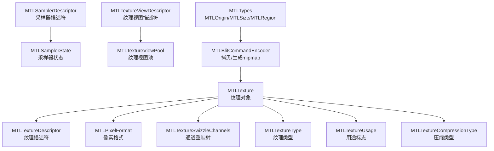
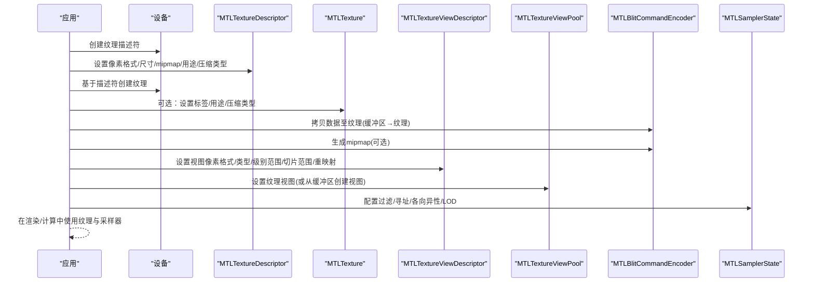
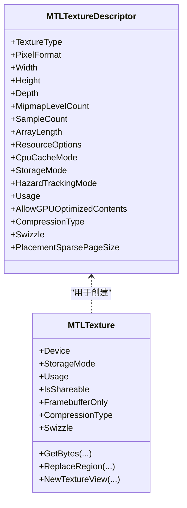
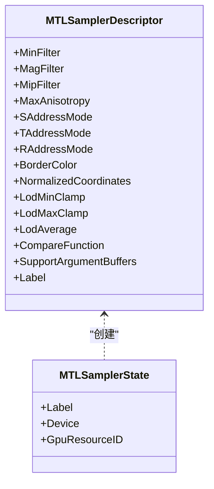
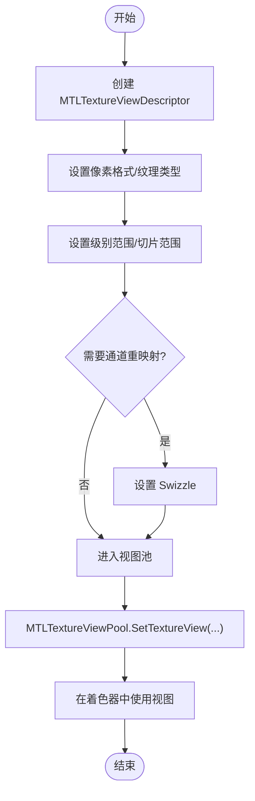
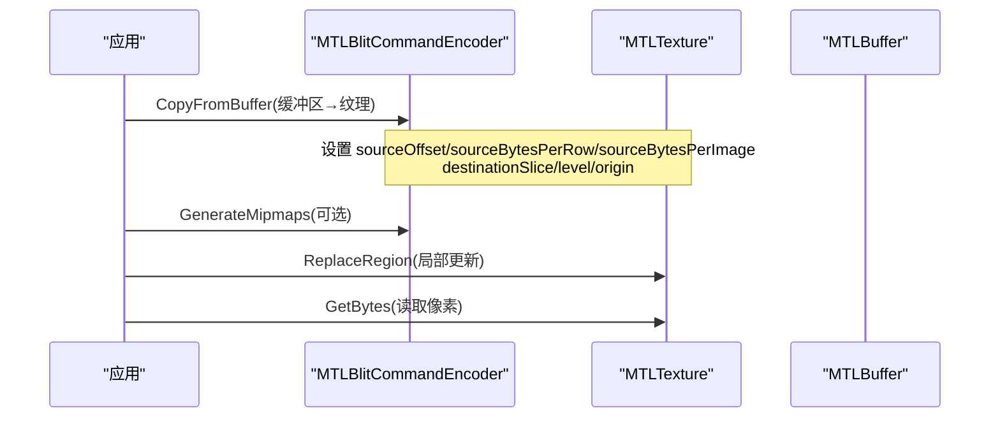
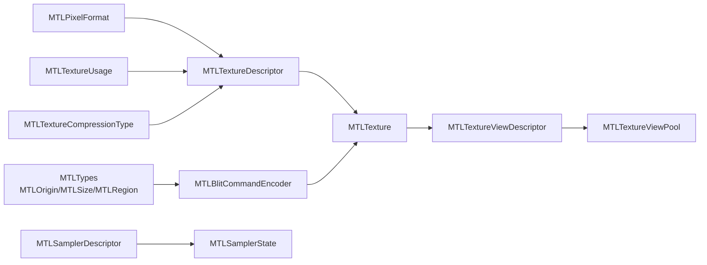

# 纹理处理

<cite>
**本文引用的文件**
- [MTLTexture.cs](file://src/SharpMetal/Metal/MTLTexture.cs)
- [MTLPixelFormat.cs](file://src/SharpMetal/Metal/MTLPixelFormat.cs)
- [MTLSampler.cs](file://src/SharpMetal/Metal/MTLSampler.cs)
- [MTLTextureViewDescriptor.cs](file://src/SharpMetal/Metal/MTLTextureViewDescriptor.cs)
- [MTLTextureViewPool.cs](file://src/SharpMetal/Metal/MTLTextureViewPool.cs)
- [MTLBlitCommandEncoder.cs](file://src/SharpMetal/Metal/MTLBlitCommandEncoder.cs)
- [MTLTypes.cs](file://src/SharpMetal/Metal/MTLTypes.cs)
</cite>

## 目录
1. [简介](#简介)
2. [项目结构](#项目结构)
3. [核心组件](#核心组件)
4. [架构总览](#架构总览)
5. [详细组件分析](#详细组件分析)
6. [依赖关系分析](#依赖关系分析)
7. [性能考虑](#性能考虑)
8. [故障排查指南](#故障排查指南)
9. [结论](#结论)
10. [附录](#附录)

## 简介
本文件面向使用 SharpMetal 进行 Metal 纹理处理的开发者，系统性地说明 MTLTexture 纹理对象的创建、配置与操作，覆盖像素格式（MTLPixelFormat）支持、采样器（MTLSampler）配置、纹理视图（MTLTextureView）与纹理视图池（MTLTextureViewPool）的管理机制，以及纹理数据上传、下载、更新与压缩格式的处理方法。同时提供性能优化建议与常见问题解决方案，帮助你在实际项目中高效、稳定地使用纹理资源。

## 项目结构
与纹理处理相关的核心类型分布在以下文件中：
- 纹理定义与描述符：MTLTexture.cs
- 像素格式枚举：MTLPixelFormat.cs
- 采样器描述符与状态：MTLSampler.cs
- 纹理视图描述符：MTLTextureViewDescriptor.cs
- 纹理视图池：MTLTextureViewPool.cs
- 纹理数据拷贝与生成 mipmap：MTLBlitCommandEncoder.cs
- 基础几何与区域类型：MTLTypes.cs

图表来源
- [MTLTexture.cs:75-240](file://src/SharpMetal/Metal/MTLTexture.cs#L75-L240)
- [MTLPixelFormat.cs:3-144](file://src/SharpMetal/Metal/MTLPixelFormat.cs#L3-L144)
- [MTLSampler.cs:37-185](file://src/SharpMetal/Metal/MTLSampler.cs#L37-L185)
- [MTLTextureViewDescriptor.cs:6-57](file://src/SharpMetal/Metal/MTLTextureViewDescriptor.cs#L6-L57)
- [MTLTextureViewPool.cs:6-50](file://src/SharpMetal/Metal/MTLTextureViewPool.cs#L6-L50)
- [MTLBlitCommandEncoder.cs:14-215](file://src/SharpMetal/Metal/MTLBlitCommandEncoder.cs#L14-L215)
- [MTLTypes.cs:47-107](file://src/SharpMetal/Metal/MTLTypes.cs#L47-L107)

章节来源
- [MTLTexture.cs:75-240](file://src/SharpMetal/Metal/MTLTexture.cs#L75-L240)
- [MTLPixelFormat.cs:3-144](file://src/SharpMetal/Metal/MTLPixelFormat.cs#L3-L144)
- [MTLSampler.cs:37-185](file://src/SharpMetal/Metal/MTLSampler.cs#L37-L185)
- [MTLTextureViewDescriptor.cs:6-57](file://src/SharpMetal/Metal/MTLTextureViewDescriptor.cs#L6-L57)
- [MTLTextureViewPool.cs:6-50](file://src/SharpMetal/Metal/MTLTextureViewPool.cs#L6-L50)
- [MTLBlitCommandEncoder.cs:14-215](file://src/SharpMetal/Metal/MTLBlitCommandEncoder.cs#L14-L215)
- [MTLTypes.cs:47-107](file://src/SharpMetal/Metal/MTLTypes.cs#L47-L107)

## 核心组件
- 纹理与描述符
  - MTLTextureDescriptor：用于配置纹理类型、像素格式、宽高深、mipmap 级数、采样数、数组长度、存储模式、CPU 缓存模式、用途、压缩类型、通道重映射等。
  - MTLTexture：纹理实例，暴露设备、存储模式、尺寸、用途、是否可共享、是否仅帧缓冲、压缩类型、共享句柄、远程视图、通道重映射等属性，并提供 GetBytes/ReplaceRegion 进行 CPU 访问与数据更新，以及 NewTextureView 创建视图。
- 像素格式
  - MTLPixelFormat：涵盖通用浮点/整型/规范整数、sRGB、深度/模板、多种压缩格式（BCn、PVRTC、ETC2、ASTC 等）。
- 采样器
  - MTLSamplerDescriptor：配置最小/放大过滤、mipmap 过滤、最大各向异性、S/T/R 寻址模式、边框颜色、归一化坐标、LOD 范围、比较函数等。
  - MTLSamplerState：由描述符创建的采样器状态对象，供着色器采样使用。
- 纹理视图与视图池
  - MTLTextureViewDescriptor：指定视图的像素格式、纹理类型、mipmap 级别范围、切片范围、通道重映射。
  - MTLTextureViewPool：批量管理纹理视图，支持设置视图、从缓冲区创建视图、复制视图池片段等。
- 数据拷贝与辅助
  - MTLBlitCommandEncoder：提供纹理到纹理、缓冲区到纹理、纹理到缓冲区的拷贝，生成 mipmap，同步与优化内容等。
  - MTLOrigin/MTLSize/MTLRegion：用于指定源/目的区域与尺寸。

章节来源
- [MTLTexture.cs:75-240](file://src/SharpMetal/Metal/MTLTexture.cs#L75-L240)
- [MTLTexture.cs:242-438](file://src/SharpMetal/Metal/MTLTexture.cs#L242-L438)
- [MTLPixelFormat.cs:3-144](file://src/SharpMetal/Metal/MTLPixelFormat.cs#L3-L144)
- [MTLSampler.cs:6-185](file://src/SharpMetal/Metal/MTLSampler.cs#L6-L185)
- [MTLTextureViewDescriptor.cs:6-57](file://src/SharpMetal/Metal/MTLTextureViewDescriptor.cs#L6-L57)
- [MTLTextureViewPool.cs:6-50](file://src/SharpMetal/Metal/MTLTextureViewPool.cs#L6-L50)
- [MTLBlitCommandEncoder.cs:14-215](file://src/SharpMetal/Metal/MTLBlitCommandEncoder.cs#L14-L215)
- [MTLTypes.cs:47-107](file://src/SharpMetal/Metal/MTLTypes.cs#L47-L107)

## 架构总览
下图展示了纹理从创建、配置、数据更新到被着色器采样的整体流程，以及与视图池和 Blit 命令编码器的交互。

图表来源
- [MTLTexture.cs:75-240](file://src/SharpMetal/Metal/MTLTexture.cs#L75-L240)
- [MTLTexture.cs:242-438](file://src/SharpMetal/Metal/MTLTexture.cs#L242-L438)
- [MTLTextureViewDescriptor.cs:6-57](file://src/SharpMetal/Metal/MTLTextureViewDescriptor.cs#L6-L57)
- [MTLTextureViewPool.cs:6-50](file://src/SharpMetal/Metal/MTLTextureViewPool.cs#L6-L50)
- [MTLBlitCommandEncoder.cs:62-105](file://src/SharpMetal/Metal/MTLBlitCommandEncoder.cs#L62-L105)
- [MTLSampler.cs:37-185](file://src/SharpMetal/Metal/MTLSampler.cs#L37-L185)

## 详细组件分析

### 纹理对象与描述符（MTLTexture / MTLTextureDescriptor）
- 关键能力
  - 描述符：支持 1D/2D/3D、数组、立方体、多重采样、纹理缓冲等多种类型；可配置像素格式、尺寸、mipmap 级数、采样数、数组长度、存储模式、CPU 缓存模式、用途、压缩类型、通道重映射、稀疏页大小等。
  - 实例：暴露设备、存储模式、用途、是否可共享、是否仅帧缓冲、压缩类型、共享句柄、远程视图、通道重映射等；提供 GetBytes/ReplaceRegion 进行 CPU 读写与局部更新；NewTextureView 创建视图。
- 典型用法要点
  - 根据用途选择 Usage 标志（如 ShaderRead/ShaderWrite/RenderTarget/PixelFormatView/ShaderAtomic）。
  - 对需要频繁 CPU 读写的纹理，合理设置 StorageMode/CpuCacheMode。
  - 对压缩纹理，设置 CompressionType 并配合合适的像素格式。
  - 通过 Swizzle 实现通道重映射，避免额外转换开销。

图表来源
- [MTLTexture.cs:75-240](file://src/SharpMetal/Metal/MTLTexture.cs#L75-L240)
- [MTLTexture.cs:242-438](file://src/SharpMetal/Metal/MTLTexture.cs#L242-L438)

章节来源
- [MTLTexture.cs:75-240](file://src/SharpMetal/Metal/MTLTexture.cs#L75-L240)
- [MTLTexture.cs:242-438](file://src/SharpMetal/Metal/MTLTexture.cs#L242-L438)

### 像素格式（MTLPixelFormat）
- 支持范围
  - 通用格式：R8/R16/R32、RG8/RG16/RG32、RGBA8/RGBA16/RGBA32 及对应的 Unorm/Snorm/Uint/Sint/sRGB 变体。
  - 高精度/浮点：RGB10A2、RG11B10Float、RGB9E5Float、R32Float、RG32Float、RGBA32Float。
  - 压缩格式：BC1-BC7、PVRTC、ETC2、ASTC（含 HDR/LDR/sRGB）。
  - 深度/模板：Depth16Unorm、Depth32Float、Stencil8、Depth24UnormStencil8、Depth32FloatStencil8、X24/X32 等。
- 使用建议
  - 渲染目标通常使用 RGBA8/BGRA8 或 sRGB 变体；深度/模板使用专用格式。
  - 大纹理或带宽敏感场景优先选择压缩格式（ASTC/BCn/ETC2/PVRTC），注意平台支持与解码质量。
  - 高动态范围或科学可视化可使用浮点格式（需确保设备支持）。

章节来源
- [MTLPixelFormat.cs:3-144](file://src/SharpMetal/Metal/MTLPixelFormat.cs#L3-L144)

### 采样器（MTLSampler）
- 配置项
  - 过滤：MinFilter/MagFilter（Nearest/Linear）、MipFilter（NotMipmapped/Nearest/Linear）。
  - 寻址：SAddressMode/TAddressMode/RAddressMode（ClampToEdge/MirrorClampToEdge/Repeat/MirrorRepeat/ClampToZero/ClampToBorderColor）。
  - 边框颜色：BorderColor（TransparentBlack/OpaqueBlack/OpaqueWhite）。
  - 其他：MaxAnisotropy、NormalizedCoordinates、LodMinClamp/LodMaxClamp、LodAverage、CompareFunction、SupportArgumentBuffers。
- 使用建议
  - 纹理贴图常用 Linear + Repeat/MirrorRepeat；UI 或像素艺术可用 Nearest。
  - 远距离采样开启各向异性以提升视觉质量，但需权衡性能。
  - LOD 限制可减少不必要的细节层级，降低采样成本。

图表来源
- [MTLSampler.cs:37-185](file://src/SharpMetal/Metal/MTLSampler.cs#L37-L185)

章节来源
- [MTLSampler.cs:6-185](file://src/SharpMetal/Metal/MTLSampler.cs#L6-L185)

### 纹理视图与视图池（MTLTextureViewDescriptor / MTLTextureViewPool）
- 纹理视图描述符
  - 可指定视图的像素格式、纹理类型、mipmap 级别范围、切片范围、通道重映射，从而在不复制数据的情况下以不同视角访问同一底层纹理。
- 纹理视图池
  - 提供批量设置纹理视图的能力，支持从纹理或缓冲区创建视图，以及从一个池复制视图片段到另一个池，便于在渲染循环中复用视图引用，减少状态切换与分配开销。

图表来源
- [MTLTextureViewDescriptor.cs:6-57](file://src/SharpMetal/Metal/MTLTextureViewDescriptor.cs#L6-L57)
- [MTLTextureViewPool.cs:6-50](file://src/SharpMetal/Metal/MTLTextureViewPool.cs#L6-L50)

章节来源
- [MTLTextureViewDescriptor.cs:6-57](file://src/SharpMetal/Metal/MTLTextureViewDescriptor.cs#L6-L57)
- [MTLTextureViewPool.cs:6-50](file://src/SharpMetal/Metal/MTLTextureViewPool.cs#L6-L50)

### 纹理数据上传、下载、更新与压缩格式处理
- 数据上传（CPU→GPU）
  - 通过 Blit 命令编码器将缓冲区数据拷贝到纹理：CopyFromBuffer(..., destinationTexture, ...)。
  - 对于压缩纹理，通常先准备压缩后的块数据，再按块对齐与行步长进行拷贝。
- 数据下载（GPU→CPU）
  - 使用纹理的 GetBytes(...) 系列接口读取像素数据，注意 bytesPerRow/bytesPerImage 与 Region 的设置。
- 局部更新
  - 使用 ReplaceRegion(...) 对纹理的指定区域进行增量更新，避免全量写入带来的带宽浪费。
- Mipmap 生成
  - 使用 Blit 命令编码器的 GenerateMipmaps(...) 为纹理生成多级渐远纹理，适用于带缩放的采样场景。
- 压缩格式
  - 选择合适的 MTLPixelFormat（如 ASTC/BCn/ETC2/PVRTC），并在描述符中设置 CompressionType。
  - 注意不同平台的压缩格式支持差异，必要时做运行时检测与回退策略。

图表来源
- [MTLBlitCommandEncoder.cs:62-105](file://src/SharpMetal/Metal/MTLBlitCommandEncoder.cs#L62-L105)
- [MTLBlitCommandEncoder.cs:87-90](file://src/SharpMetal/Metal/MTLBlitCommandEncoder.cs#L87-L90)
- [MTLTexture.cs:347-365](file://src/SharpMetal/Metal/MTLTexture.cs#L347-L365)

章节来源
- [MTLBlitCommandEncoder.cs:62-105](file://src/SharpMetal/Metal/MTLBlitCommandEncoder.cs#L62-L105)
- [MTLBlitCommandEncoder.cs:87-90](file://src/SharpMetal/Metal/MTLBlitCommandEncoder.cs#L87-L90)
- [MTLTexture.cs:347-365](file://src/SharpMetal/Metal/MTLTexture.cs#L347-L365)

## 依赖关系分析
- 纹理与类型
  - MTLTexture 依赖 MTLOrigin/MTLSize/MTLRegion 来描述区域与尺寸。
  - MTLTextureDescriptor 依赖 MTLPixelFormat、MTLTextureType、MTLTextureUsage、MTLTextureCompressionType 等枚举。
- 采样器与状态
  - MTLSamplerDescriptor 配置后生成 MTLSamplerState，供着色器采样阶段使用。
- 视图与池
  - MTLTextureViewDescriptor 描述视图语义；MTLTextureViewPool 负责批量管理与复用视图引用。
- 数据搬运
  - MTLBlitCommandEncoder 作为统一的拷贝与生成工具，连接缓冲区与纹理，并支持 mipmap 生成与内容优化。

图表来源
- [MTLTypes.cs:47-107](file://src/SharpMetal/Metal/MTLTypes.cs#L47-L107)
- [MTLPixelFormat.cs:3-144](file://src/SharpMetal/Metal/MTLPixelFormat.cs#L3-L144)
- [MTLTexture.cs:75-240](file://src/SharpMetal/Metal/MTLTexture.cs#L75-L240)
- [MTLTextureViewDescriptor.cs:6-57](file://src/SharpMetal/Metal/MTLTextureViewDescriptor.cs#L6-L57)
- [MTLTextureViewPool.cs:6-50](file://src/SharpMetal/Metal/MTLTextureViewPool.cs#L6-L50)
- [MTLSampler.cs:37-185](file://src/SharpMetal/Metal/MTLSampler.cs#L37-L185)
- [MTLBlitCommandEncoder.cs:14-215](file://src/SharpMetal/Metal/MTLBlitCommandEncoder.cs#L14-L215)

章节来源
- [MTLTypes.cs:47-107](file://src/SharpMetal/Metal/MTLTypes.cs#L47-L107)
- [MTLPixelFormat.cs:3-144](file://src/SharpMetal/Metal/MTLPixelFormat.cs#L3-L144)
- [MTLTexture.cs:75-240](file://src/SharpMetal/Metal/MTLTexture.cs#L75-L240)
- [MTLTextureViewDescriptor.cs:6-57](file://src/SharpMetal/Metal/MTLTextureViewDescriptor.cs#L6-L57)
- [MTLTextureViewPool.cs:6-50](file://src/SharpMetal/Metal/MTLTextureViewPool.cs#L6-L50)
- [MTLSampler.cs:37-185](file://src/SharpMetal/Metal/MTLSampler.cs#L37-L185)
- [MTLBlitCommandEncoder.cs:14-215](file://src/SharpMetal/Metal/MTLBlitCommandEncoder.cs#L14-L215)

## 性能考虑
- 内存与带宽
  - 尽量使用压缩格式（ASTC/BCn/ETC2/PVRTC）以降低显存占用与带宽压力，注意平台支持与质量权衡。
  - 合理设置 StorageMode 与 CpuCacheMode，减少 CPU/GPU 间不必要的数据往返。
- 采样与过滤
  - 根据场景选择合适过滤模式；远距离采样启用各向异性，近处 UI 使用最近邻以减少采样开销。
  - 使用 LOD 限制避免过度采样。
- 数据更新
  - 使用 ReplaceRegion 进行局部更新，避免全量写入。
  - 批量拷贝与生成 mipmap，减少命令提交次数。
- 视图复用
  - 使用 MTLTextureViewPool 管理视图引用，减少重复创建与状态切换。
- 内容优化
  - 在 CPU/GPU 访问前调用相应的优化接口，使内部布局更利于当前访问路径。

[本节为通用性能建议，不直接分析具体文件]

## 故障排查指南
- 纹理数据不正确
  - 检查 bytesPerRow/bytesPerImage 是否与像素格式和图像布局一致。
  - 确认 Region、level、slice 参数正确，避免越界。
- 采样结果异常
  - 核对采样器寻址模式与边框颜色是否符合预期。
  - 检查 mipmap 是否已生成且级别范围有效。
- 性能瓶颈
  - 评估是否使用了合适的压缩格式与存储模式。
  - 检查是否存在频繁的 CPU/GPU 同步与全量更新。
- 视图问题
  - 确认视图描述符中的像素格式、纹理类型、级别范围与切片范围与底层纹理兼容。
  - 使用视图池时，确保索引与范围不冲突。

章节来源
- [MTLTexture.cs:347-365](file://src/SharpMetal/Metal/MTLTexture.cs#L347-L365)
- [MTLBlitCommandEncoder.cs:62-105](file://src/SharpMetal/Metal/MTLBlitCommandEncoder.cs#L62-L105)
- [MTLSampler.cs:37-185](file://src/SharpMetal/Metal/MTLSampler.cs#L37-L185)
- [MTLTextureViewDescriptor.cs:6-57](file://src/SharpMetal/Metal/MTLTextureViewDescriptor.cs#L6-L57)
- [MTLTextureViewPool.cs:6-50](file://src/SharpMetal/Metal/MTLTextureViewPool.cs#L6-L50)

## 结论
SharpMetal 提供了完整的 Metal 纹理处理能力，涵盖纹理创建与配置、像素格式与压缩、采样器配置、纹理视图与池化管理，以及数据上传/下载/更新与 mipmap 生成。通过合理使用描述符、视图池与 Blit 命令编码器，并结合适当的性能优化策略，可以在保证画质的前提下获得良好的运行效率。建议在项目中建立统一的纹理资源管理流程，结合平台特性选择合适的像素格式与采样策略，以获得最佳的整体表现。

[本节为总结性内容，不直接分析具体文件]

## 附录
- 常用 API 路径参考
  - 纹理描述符与实例：[MTLTexture.cs:75-240](file://src/SharpMetal/Metal/MTLTexture.cs#L75-L240)、[MTLTexture.cs:242-438](file://src/SharpMetal/Metal/MTLTexture.cs#L242-L438)
  - 像素格式枚举：[MTLPixelFormat.cs:3-144](file://src/SharpMetal/Metal/MTLPixelFormat.cs#L3-L144)
  - 采样器描述符与状态：[MTLSampler.cs:37-185](file://src/SharpMetal/Metal/MTLSampler.cs#L37-L185)
  - 纹理视图描述符与池：[MTLTextureViewDescriptor.cs:6-57](file://src/SharpMetal/Metal/MTLTextureViewDescriptor.cs#L6-L57)、[MTLTextureViewPool.cs:6-50](file://src/SharpMetal/Metal/MTLTextureViewPool.cs#L6-L50)
  - 数据拷贝与 mipmap 生成：[MTLBlitCommandEncoder.cs:62-105](file://src/SharpMetal/Metal/MTLBlitCommandEncoder.cs#L62-L105)、[MTLBlitCommandEncoder.cs:87-90](file://src/SharpMetal/Metal/MTLBlitCommandEncoder.cs#L87-L90)
  - 区域与尺寸类型：[MTLTypes.cs:47-107](file://src/SharpMetal/Metal/MTLTypes.cs#L47-L107)

[本节为附录，不直接分析具体文件]