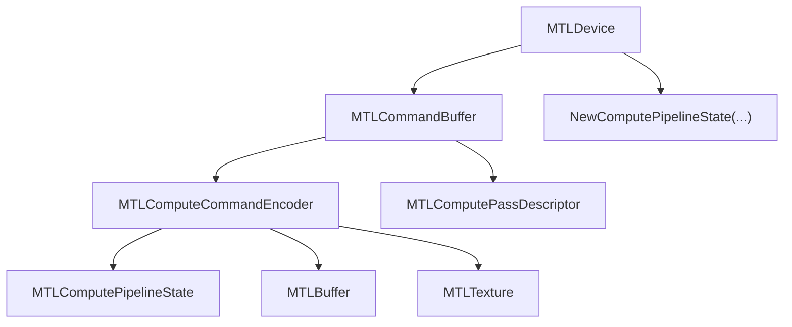
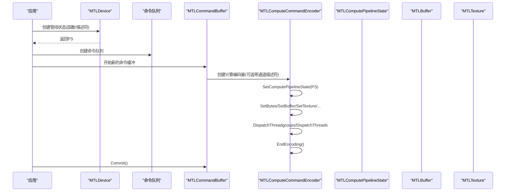
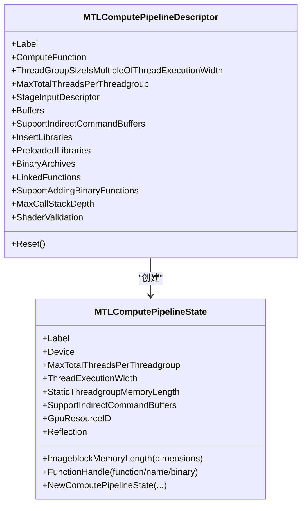
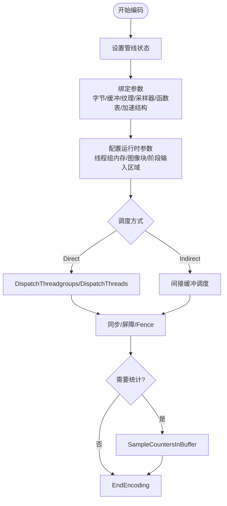
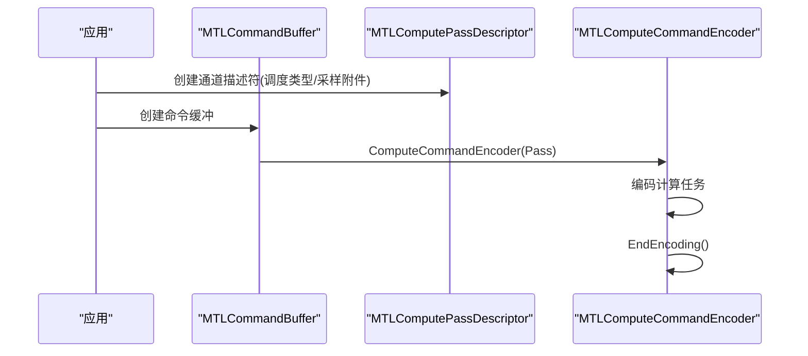
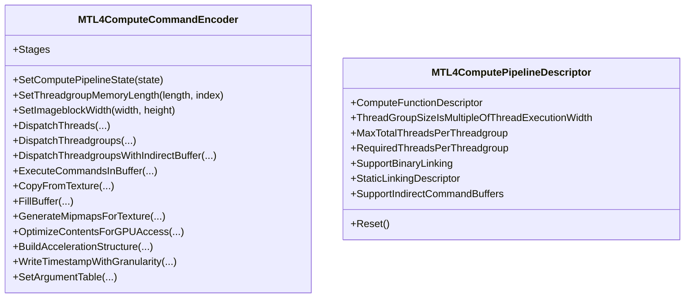
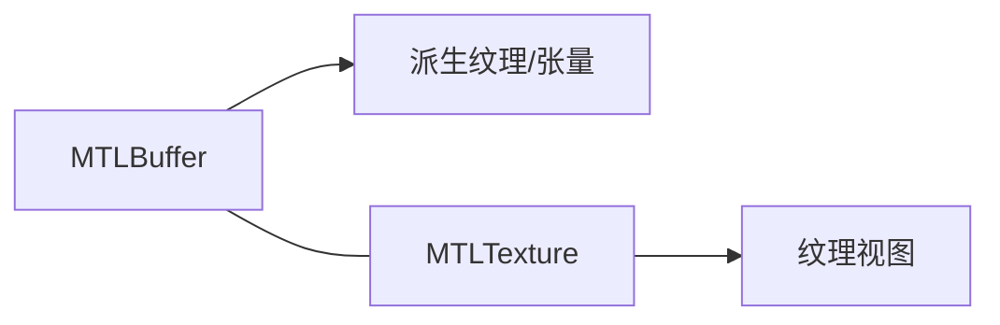
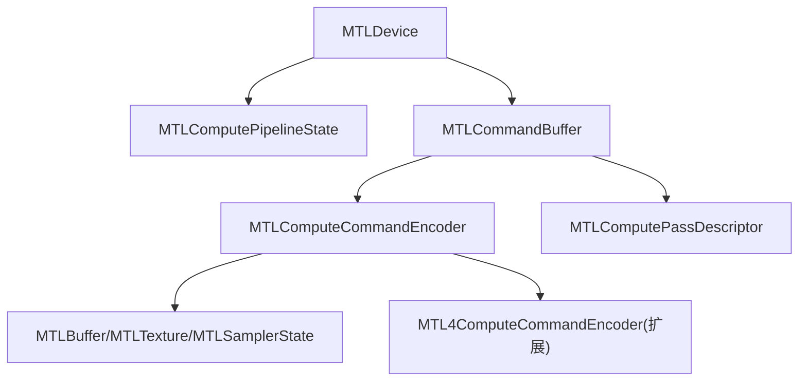

# 计算管线

<cite>
**本文引用的文件**
- [MTLComputePipeline.cs](file://src/SharpMetal/Metal/MTLComputePipeline.cs)
- [MTLComputeCommandEncoder.cs](file://src/SharpMetal/Metal/MTLComputeCommandEncoder.cs)
- [MTLComputePass.cs](file://src/SharpMetal/Metal/MTLComputePass.cs)
- [MTL4ComputeCommandEncoder.cs](file://src/SharpMetal/Metal/MTL4ComputeCommandEncoder.cs)
- [MTL4ComputePipeline.cs](file://src/SharpMetal/Metal/MTL4ComputePipeline.cs)
- [MTLBuffer.cs](file://src/SharpMetal/Metal/MTLBuffer.cs)
- [MTLTexture.cs](file://src/SharpMetal/Metal/MTLTexture.cs)
- [MTLCommandBuffer.cs](file://src/SharpMetal/Metal/MTLCommandBuffer.cs)
- [MTLDevice.cs](file://src/SharpMetal/Metal/MTLDevice.cs)
- [Program.cs](file://samples/SharpMetal.Sample/Program.cs)
</cite>

## 目录
1. [简介](#简介)
2. [项目结构](#项目结构)
3. [核心组件](#核心组件)
4. [架构总览](#架构总览)
5. [详细组件分析](#详细组件分析)
6. [依赖关系分析](#依赖关系分析)
7. [性能考量](#性能考量)
8. [故障排查指南](#故障排查指南)
9. [结论](#结论)
10. [附录](#附录)

## 简介
本文件面向使用 SharpMetal 进行 Metal 计算编程的开发者，系统化说明如何创建与配置计算管线状态（MTLComputePipelineState）、如何使用计算命令编码器（MTLComputeCommandEncoder）绑定参数、设置缓冲区并执行计算任务，以及计算通道（MTLComputePass）的概念与适用场景。同时补充 GPU 并行计算的基本概念、内存访问模式、性能优化技巧，并提供 GPGPU 编程的实际示例与调试方法。内容严格基于仓库中的源代码实现进行归纳与可视化。

## 项目结构
SharpMetal 在 Metal 层提供了对 Apple Metal API 的托管封装，围绕“设备—命令缓冲—命令编码—资源”的主线组织代码：
- 设备（MTLDevice）负责创建管线、命令队列、资源等。
- 命令缓冲（MTLCommandBuffer）承载一次提交的工作单元，可创建多种编码器。
- 计算相关：
  - 计算管线状态（MTLComputePipelineState）描述已编译的计算程序与运行时约束。
  - 计算命令编码器（MTLComputeCommandEncoder）用于绑定参数、调度线程组/线程。
  - 计算通道（MTLComputePassDescriptor）用于开启带采样/统计能力的计算通道。
- 资源：
  - 缓冲区（MTLBuffer）用于通用数据与间接参数。
  - 纹理（MTLTexture）用于图像/张量数据。
- 新特性（MTL4）：
  - MTL4ComputeCommandEncoder 提供复制、填充、加速结构构建、时间戳写入等扩展能力。
  - MTL4ComputePipelineDescriptor 支持二进制链接、静态链接、必需线程组大小等新选项。

图表来源
- [MTLDevice.cs:441-454](file://src/SharpMetal/Metal/MTLDevice.cs#L441-L454)
- [MTLCommandBuffer.cs:200-223](file://src/SharpMetal/Metal/MTLCommandBuffer.cs#L200-L223)
- [MTLComputeCommandEncoder.cs:60-183](file://src/SharpMetal/Metal/MTLComputeCommandEncoder.cs#L60-L183)
- [MTLComputePipeline.cs:151-235](file://src/SharpMetal/Metal/MTLComputePipeline.cs#L151-L235)
- [MTLComputePass.cs:71-94](file://src/SharpMetal/Metal/MTLComputePass.cs#L71-L94)

章节来源
- [MTLDevice.cs:187-800](file://src/SharpMetal/Metal/MTLDevice.cs#L187-L800)
- [MTLCommandBuffer.cs:116-321](file://src/SharpMetal/Metal/MTLCommandBuffer.cs#L116-L321)
- [MTLComputeCommandEncoder.cs:20-298](file://src/SharpMetal/Metal/MTLComputeCommandEncoder.cs#L20-L298)
- [MTLComputePipeline.cs:6-235](file://src/SharpMetal/Metal/MTLComputePipeline.cs#L6-L235)
- [MTLComputePass.cs:7-96](file://src/SharpMetal/Metal/MTLComputePass.cs#L7-L96)

## 核心组件
- 计算管线状态（MTLComputePipelineState）
  - 由设备或描述符创建，包含最大线程组大小、线程执行宽度、静态线程组内存长度、反射信息等。
  - 支持函数句柄获取、附加二进制函数创建新管线状态等。
- 计算命令编码器（MTLComputeCommandEncoder）
  - 设置管线状态、绑定字节/缓冲区/纹理/采样器/可见函数表/交集函数表/加速结构等。
  - 设置动态线程组内存、图像块尺寸、阶段输入区域。
  - 调度：DispatchThreadgroups / DispatchThreads，支持间接缓冲调度。
  - 同步与屏障：Fence、MemoryBarrier、UseResource/Heaps。
  - 统计：SampleCountersInBuffer。
- 计算通道（MTLComputePassDescriptor）
  - 指定调度类型（串行/并发），并可附加计数器采样缓冲区以采集性能指标。
- 资源
  - MTLBuffer：长度、存储模式、CPU/GPU地址、修改范围通知、派生纹理/张量等。
  - MTLTexture：维度、像素格式、使用方式、视图、替换/读取区域等。
- 新特性（MTL4）
  - MTL4ComputeCommandEncoder：复制、填充、mipmap 生成、加速结构构建/贴合/拷贝、时间戳写入、参数表等。
  - MTL4ComputePipelineDescriptor：二进制链接、静态链接、必需线程组大小、间接命令缓冲支持等。

章节来源
- [MTLComputePipeline.cs:151-235](file://src/SharpMetal/Metal/MTLComputePipeline.cs#L151-L235)
- [MTLComputeCommandEncoder.cs:60-248](file://src/SharpMetal/Metal/MTLComputeCommandEncoder.cs#L60-L248)
- [MTLComputePass.cs:71-94](file://src/SharpMetal/Metal/MTLComputePass.cs#L71-L94)
- [MTLBuffer.cs:18-113](file://src/SharpMetal/Metal/MTLBuffer.cs#L18-L113)
- [MTLTexture.cs:75-438](file://src/SharpMetal/Metal/MTLTexture.cs#L75-L438)
- [MTL4ComputeCommandEncoder.cs:19-235](file://src/SharpMetal/Metal/MTL4ComputeCommandEncoder.cs#L19-L235)
- [MTL4ComputePipeline.cs:6-81](file://src/SharpMetal/Metal/MTL4ComputePipeline.cs#L6-L81)

## 架构总览
下图展示从设备到命令缓冲、再到计算编码器与资源的典型调用链，体现“创建管线—编码命令—提交执行”的流程。

图表来源
- [MTLDevice.cs:441-454](file://src/SharpMetal/Metal/MTLDevice.cs#L441-L454)
- [MTLCommandBuffer.cs:200-223](file://src/SharpMetal/Metal/MTLCommandBuffer.cs#L200-L223)
- [MTLComputeCommandEncoder.cs:60-183](file://src/SharpMetal/Metal/MTLComputeCommandEncoder.cs#L60-L183)
- [MTLComputePipeline.cs:151-235](file://src/SharpMetal/Metal/MTLComputePipeline.cs#L151-L235)

## 详细组件分析

### 计算管线状态（MTLComputePipelineState）
- 关键属性与方法
  - 最大线程组大小、线程执行宽度、静态线程组内存长度。
  - 反射信息（Bindings/Arguments）。
  - 通过函数名或函数对象获取函数句柄。
  - 通过附加二进制函数创建新的管线状态。
- 创建路径
  - 设备接口提供多重重载：直接传入函数、传入描述符、传入选项与反射信息。
- 线程组与工作区调度
  - 线程组大小需满足设备最大线程组限制；可通过描述符强制线程组大小为执行宽度的倍数。
  - 最大线程数限制与静态线程组内存长度影响调度策略。

图表来源
- [MTLComputePipeline.cs:25-149](file://src/SharpMetal/Metal/MTLComputePipeline.cs#L25-L149)
- [MTLComputePipeline.cs:151-235](file://src/SharpMetal/Metal/MTLComputePipeline.cs#L151-L235)
- [MTLDevice.cs:441-454](file://src/SharpMetal/Metal/MTLDevice.cs#L441-L454)

章节来源
- [MTLComputePipeline.cs:25-235](file://src/SharpMetal/Metal/MTLComputePipeline.cs#L25-L235)
- [MTLDevice.cs:441-454](file://src/SharpMetal/Metal/MTLDevice.cs#L441-L454)

### 计算命令编码器（MTLComputeCommandEncoder）
- 参数绑定
  - 字节：SetBytes（支持步长）。
  - 缓冲区：SetBuffer/SetBuffers（支持偏移与步长）、SetBufferOffset。
  - 纹理：SetTexture/Textures。
  - 采样器：SetSamplerState/SamplerStates（支持LOD裁剪）。
  - 可见/交集函数表、加速结构：SetVisibleFunctionTable(s)、SetIntersectionFunctionTable(s)、SetAccelerationStructure。
- 运行时配置
  - 动态线程组内存长度、图像块宽高、阶段输入区域（含间接缓冲版本）。
- 任务调度
  - DispatchThreadgroups（支持间接缓冲）、DispatchThreads。
- 同步与资源声明
  - Fence：UpdateFence/WaitForFence。
  - 内存屏障：MemoryBarrier（按作用域或资源列表）。
  - 资源/堆使用声明：UseResource/UseResources、UseHeap/UseHeaps。
- 统计与执行
  - SampleCountersInBuffer。
  - ExecuteCommandsInBuffer（间接命令缓冲）。

图表来源
- [MTLComputeCommandEncoder.cs:60-248](file://src/SharpMetal/Metal/MTLComputeCommandEncoder.cs#L60-L248)

章节来源
- [MTLComputeCommandEncoder.cs:20-298](file://src/SharpMetal/Metal/MTLComputeCommandEncoder.cs#L20-L298)

### 计算通道（MTLComputePass）
- 概念
  - 计算通道允许在单次提交中为计算编码器附加性能采样点，便于采集启动/结束阶段的计数器。
- 使用要点
  - 通过 MTLComputePassDescriptor 指定调度类型（串行/并发）。
  - 通过 SampleBufferAttachments 配置计数器采样缓冲区及起止索引。
  - 在命令缓冲中创建带有通道描述符的计算编码器。

图表来源
- [MTLComputePass.cs:71-94](file://src/SharpMetal/Metal/MTLComputePass.cs#L71-L94)
- [MTLCommandBuffer.cs:200-223](file://src/SharpMetal/Metal/MTLCommandBuffer.cs#L200-L223)

章节来源
- [MTLComputePass.cs:7-96](file://src/SharpMetal/Metal/MTLComputePass.cs#L7-L96)
- [MTLCommandBuffer.cs:200-223](file://src/SharpMetal/Metal/MTLCommandBuffer.cs#L200-L223)

### 新特性：MTL4 计算命令编码器与管线描述符
- MTL4ComputeCommandEncoder
  - 提供复制（纹理到纹理/缓冲）、填充缓冲、生成 mipmap、优化内容（GPU/CPU 访问）、重置/复制/优化间接命令缓冲、构建/贴合/拷贝加速结构、写入时间戳、设置参数表等。
- MTL4ComputePipelineDescriptor
  - 支持二进制链接、静态链接、必需线程组大小、间接命令缓冲支持等。

图表来源
- [MTL4ComputeCommandEncoder.cs:19-235](file://src/SharpMetal/Metal/MTL4ComputeCommandEncoder.cs#L19-L235)
- [MTL4ComputePipeline.cs:6-81](file://src/SharpMetal/Metal/MTL4ComputePipeline.cs#L6-L81)

章节来源
- [MTL4ComputeCommandEncoder.cs:1-238](file://src/SharpMetal/Metal/MTL4ComputeCommandEncoder.cs#L1-L238)
- [MTL4ComputePipeline.cs:1-83](file://src/SharpMetal/Metal/MTL4ComputePipeline.cs#L1-L83)

### 资源模型：缓冲区与纹理
- 缓冲区（MTLBuffer）
  - 长度、存储模式、CPU缓存模式、危险跟踪模式、资源选项、堆分配、别名化、修改范围通知、派生纹理/张量、远程视图等。
- 纹理（MTLTexture）
  - 类型、像素格式、尺寸、mipmap、采样、数组长度、使用方式、压缩、稀疏页、共享句柄、视图、区域读写等。

图表来源
- [MTLBuffer.cs:18-113](file://src/SharpMetal/Metal/MTLBuffer.cs#L18-L113)
- [MTLTexture.cs:75-438](file://src/SharpMetal/Metal/MTLTexture.cs#L75-L438)

章节来源
- [MTLBuffer.cs:1-115](file://src/SharpMetal/Metal/MTLBuffer.cs#L1-L115)
- [MTLTexture.cs:1-440](file://src/SharpMetal/Metal/MTLTexture.cs#L1-L440)

## 依赖关系分析
- 设备（MTLDevice）作为工厂，提供管线状态、命令队列、资源创建能力。
- 命令缓冲（MTLCommandBuffer）聚合编码器创建与生命周期管理。
- 计算编码器依赖管线状态与资源（缓冲/纹理/采样器/函数表/加速结构）。
- 计算通道（MTLComputePassDescriptor）增强编码器能力（如采样）。
- MTL4 扩展在不破坏原有 API 的前提下，新增高级功能（复制、加速结构、时间戳等）。

图表来源
- [MTLDevice.cs:441-454](file://src/SharpMetal/Metal/MTLDevice.cs#L441-L454)
- [MTLCommandBuffer.cs:200-223](file://src/SharpMetal/Metal/MTLCommandBuffer.cs#L200-L223)
- [MTLComputeCommandEncoder.cs:60-248](file://src/SharpMetal/Metal/MTLComputeCommandEncoder.cs#L60-L248)
- [MTLComputePass.cs:71-94](file://src/SharpMetal/Metal/MTLComputePass.cs#L71-L94)
- [MTL4ComputeCommandEncoder.cs:19-235](file://src/SharpMetal/Metal/MTL4ComputeCommandEncoder.cs#L19-L235)

章节来源
- [MTLDevice.cs:187-800](file://src/SharpMetal/Metal/MTLDevice.cs#L187-L800)
- [MTLCommandBuffer.cs:116-321](file://src/SharpMetal/Metal/MTLCommandBuffer.cs#L116-L321)
- [MTLComputeCommandEncoder.cs:20-298](file://src/SharpMetal/Metal/MTLComputeCommandEncoder.cs#L20-L298)
- [MTLComputePass.cs:7-96](file://src/SharpMetal/Metal/MTLComputePass.cs#L7-L96)
- [MTL4ComputeCommandEncoder.cs:1-238](file://src/SharpMetal/Metal/MTL4ComputeCommandEncoder.cs#L1-L238)

## 性能考量
- 线程组与工作区调度
  - 合理设置线程组大小，使其为设备线程执行宽度的倍数，有助于提高吞吐。
  - 控制每个线程组的最大线程数，避免超过设备上限。
- 内存访问模式
  - 优先顺序访问与合并访问，减少跨行/跨面访问带来的带宽浪费。
  - 使用合适的存储模式（共享/私有/设备）与 CPU 缓存模式，降低同步开销。
  - 纹理使用正确的像素格式与使用标志，必要时启用 GPU 优化内容。
- 资源与同步
  - 使用 UseResource/UseHeaps 显式声明资源使用，帮助驱动优化。
  - 合理使用 MemoryBarrier 与 Fence，避免不必要的等待。
- 统计与诊断
  - 使用 SampleCountersInBuffer 或计算通道采样附件采集性能指标。
  - 利用标签、调试分组、日志状态辅助定位瓶颈。
- 新特性优化
  - 使用 MTL4 的复制/填充/优化内容与加速结构构建，减少 CPU-GPU 数据搬运与额外步骤。
  - 通过参数表（Argument Table）批量绑定参数，减少编码器调用次数。

[本节为通用性能指导，不直接分析具体文件]

## 故障排查指南
- 常见错误与状态
  - 命令缓冲状态与错误枚举可用于判断执行阶段与失败原因（超时、缺页、设备移除等）。
  - 编码器错误状态（未知/完成/受影响/挂起/故障）辅助定位问题。
- 调试手段
  - 使用 PushDebugGroup/PopDebugGroup 与 InsertDebugSignpost 标记关键阶段。
  - 为缓冲区添加调试标记，配合日志状态输出。
  - 使用 WaitUntilScheduled/WaitUntilCompleted 同步检查执行进度。
- 资源问题
  - 检查缓冲区长度、偏移、步长是否匹配着色器期望。
  - 纹理格式、尺寸、mipmap 层级是否与使用一致。
  - 确认资源使用模式（只读/写入/原子）与用途标志正确。

章节来源
- [MTLCommandBuffer.cs:9-48](file://src/SharpMetal/Metal/MTLCommandBuffer.cs#L9-L48)
- [MTLCommandBuffer.cs:146-183](file://src/SharpMetal/Metal/MTLCommandBuffer.cs#L146-L183)
- [MTLCommandBuffer.cs:270-278](file://src/SharpMetal/Metal/MTLCommandBuffer.cs#L270-L278)
- [MTLBuffer.cs:75-83](file://src/SharpMetal/Metal/MTLBuffer.cs#L75-L83)
- [MTLComputeCommandEncoder.cs:43-56](file://src/SharpMetal/Metal/MTLComputeCommandEncoder.cs#L43-L56)

## 结论
SharpMetal 对 Metal 计算管线的封装覆盖了从管线状态创建、参数绑定、任务调度到同步与统计的完整流程，并通过 MTL4 扩展提供更强大的数据处理与加速结构能力。结合合理的线程组设计、内存访问优化与资源管理策略，可在苹果平台上高效实现 GPGPU 计算。建议在实际项目中结合计算通道与统计采样进行持续的性能分析与调优。

[本节为总结性内容，不直接分析具体文件]

## 附录

### 实际示例：设备与共享缓冲读写
以下示例展示了如何在非渲染场景下验证设备与共享缓冲的读写能力，可作为计算任务的起点：
- 获取系统默认设备。
- 创建共享模式的缓冲区。
- 通过 Contents 指针进行读写校验。
- 释放原生资源。

章节来源
- [Program.cs:10-46](file://samples/SharpMetal.Sample/Program.cs#L10-L46)

### 参考路径（代码片段位置）
- 创建计算管线状态
  - [MTLDevice.cs:441-454](file://src/SharpMetal/Metal/MTLDevice.cs#L441-L454)
- 设置管线状态与调度
  - [MTLComputeCommandEncoder.cs:60-183](file://src/SharpMetal/Metal/MTLComputeCommandEncoder.cs#L60-L183)
- 参数绑定（缓冲/纹理/采样器/函数表/加速结构）
  - [MTLComputeCommandEncoder.cs:65-178](file://src/SharpMetal/Metal/MTLComputeCommandEncoder.cs#L65-L178)
- 同步与统计
  - [MTLComputeCommandEncoder.cs:195-248](file://src/SharpMetal/Metal/MTLComputeCommandEncoder.cs#L195-L248)
- 计算通道与采样附件
  - [MTLComputePass.cs:71-94](file://src/SharpMetal/Metal/MTLComputePass.cs#L71-L94)
- MTL4 扩展能力
  - [MTL4ComputeCommandEncoder.cs:19-235](file://src/SharpMetal/Metal/MTL4ComputeCommandEncoder.cs#L19-L235)
  - [MTL4ComputePipeline.cs:6-81](file://src/SharpMetal/Metal/MTL4ComputePipeline.cs#L6-L81)