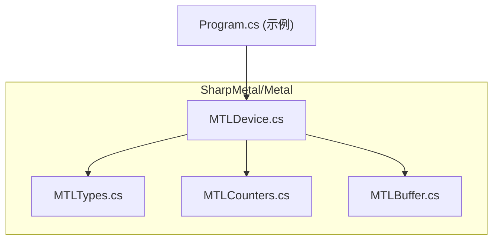
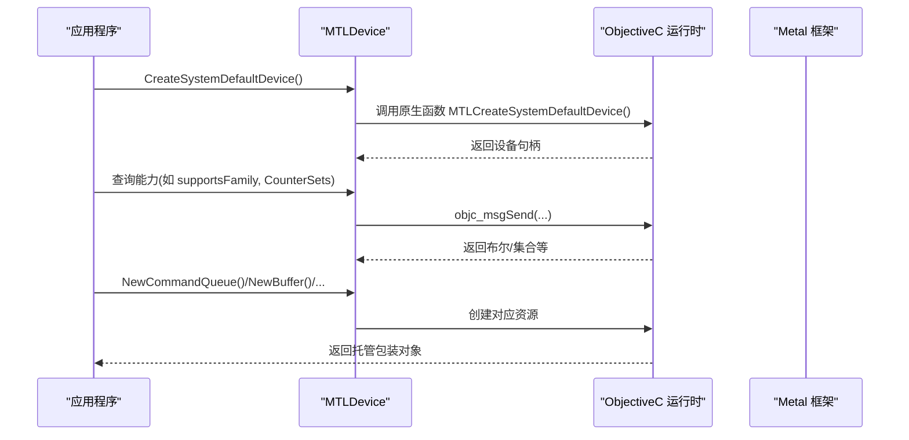
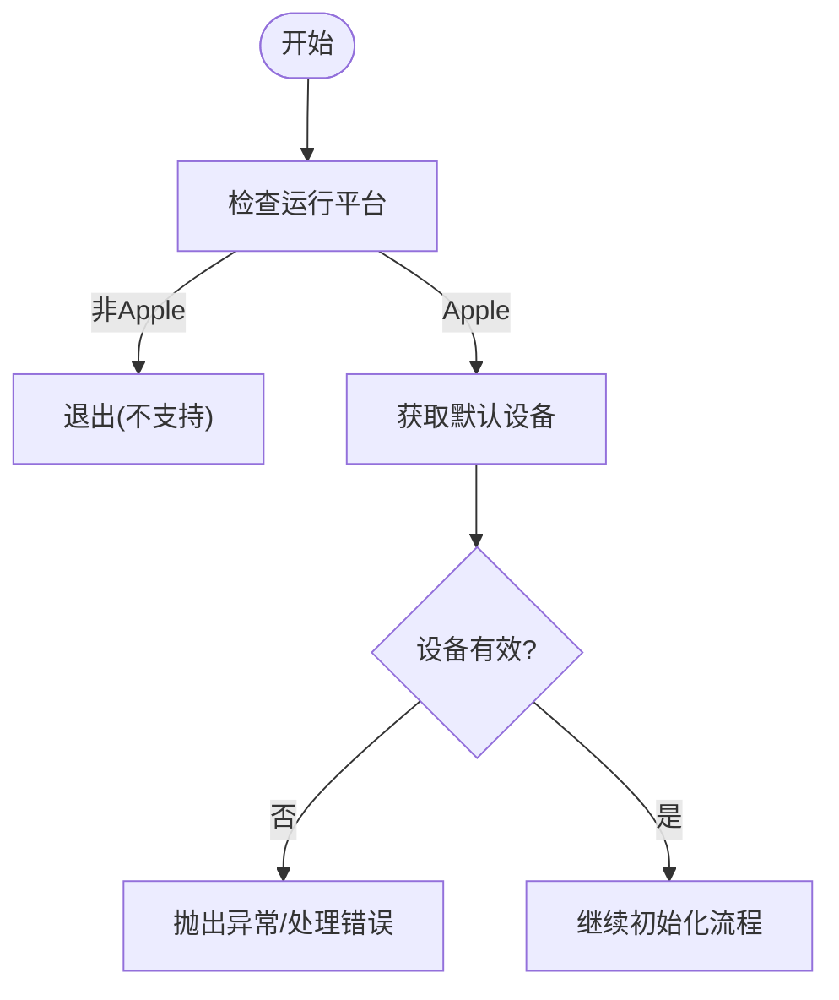
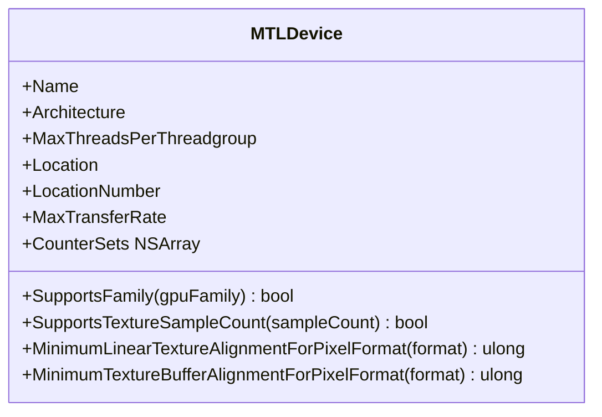
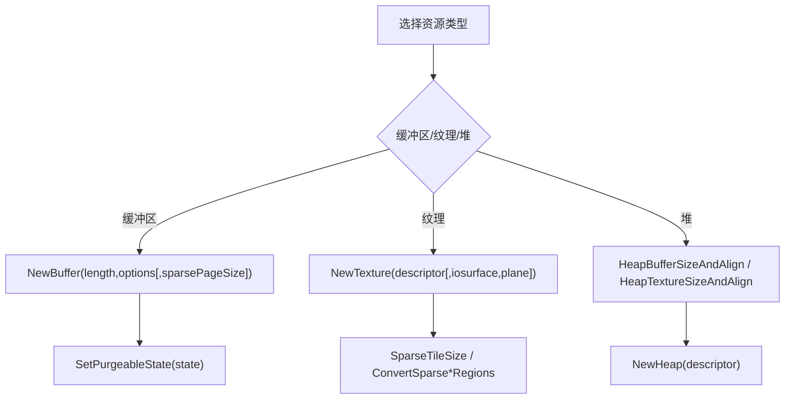
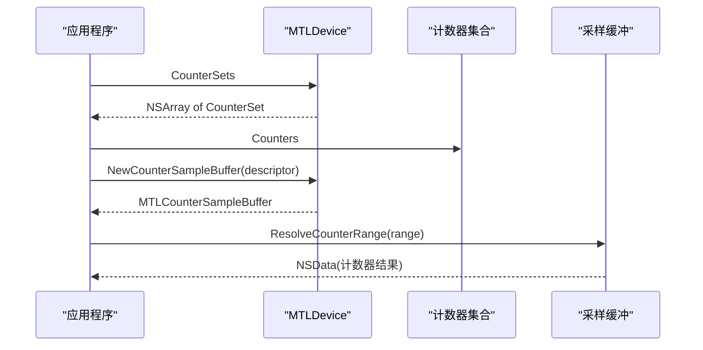
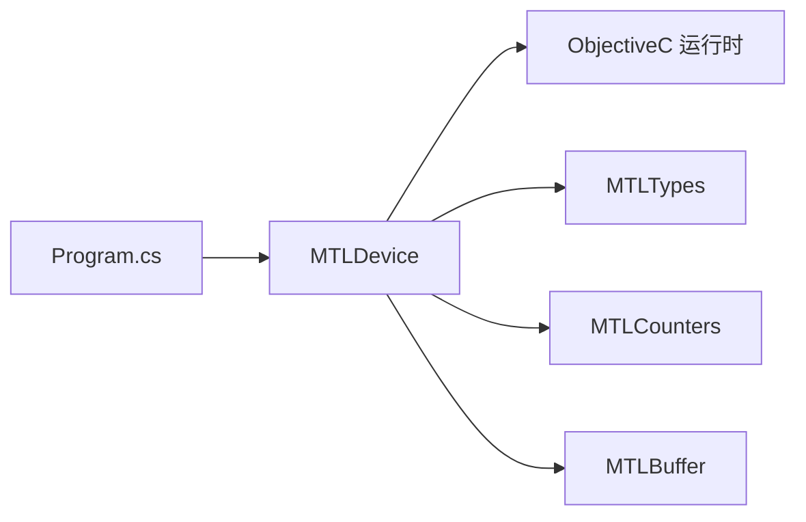

# 设备管理

<cite>
**本文引用的文件**
- [MTLDevice.cs](file://src/SharpMetal/Metal/MTLDevice.cs)
- [MTLTypes.cs](file://src/SharpMetal/Metal/MTLTypes.cs)
- [MTLCounters.cs](file://src/SharpMetal/Metal/MTLCounters.cs)
- [MTLBuffer.cs](file://src/SharpMetal/Metal/MTLBuffer.cs)
- [Program.cs](file://samples/SharpMetal.Sample/Program.cs)
</cite>

## 目录
1. [简介](#简介)
2. [项目结构](#项目结构)
3. [核心组件](#核心组件)
4. [架构总览](#架构总览)
5. [详细组件分析](#详细组件分析)
6. [依赖关系分析](#依赖关系分析)
7. [性能考量](#性能考量)
8. [故障排查指南](#故障排查指南)
9. [结论](#结论)
10. [附录：最佳实践与示例路径](#附录最佳实践与示例路径)

## 简介
本文件面向使用 SharpMetal 进行 Metal 设备管理的开发者，系统阐述 MTLDevice 的核心能力：设备发现、特性查询、GPU 架构信息获取；枚举类型（如 MTLGPUFamily、MTLDeviceLocation、MTLIOCompressionMethod）的使用场景；如何创建设备实例、查询设备支持的功能与限制；以及性能计数器、内存管理策略和设备状态检查的方法。文档同时提供代码级流程图和序列图，帮助读者快速理解并正确应用。

## 项目结构
SharpMetal 将 Metal 相关类型按功能模块组织在 src/SharpMetal/Metal 下，其中设备管理与基础类型定义集中在以下文件：
- MTLDevice.cs：设备对象、设备能力与资源创建入口
- MTLTypes.cs：通用几何与区域结构体（如 MTLSize、MTLRegion）
- MTLCounters.cs：性能计数器集合与采样缓冲
- MTLBuffer.cs：缓冲区对象，体现内存模式与生命周期管理
- Program.cs：最小可用示例，演示设备初始化与共享缓冲区读写

图表来源
- [MTLDevice.cs:187-851](file://src/SharpMetal/Metal/MTLDevice.cs#L187-L851)
- [MTLTypes.cs:47-108](file://src/SharpMetal/Metal/MTLTypes.cs#L47-L108)
- [MTLCounters.cs:44-137](file://src/SharpMetal/Metal/MTLCounters.cs#L44-L137)
- [MTLBuffer.cs:6-115](file://src/SharpMetal/Metal/MTLBuffer.cs#L6-L115)
- [Program.cs:21-45](file://samples/SharpMetal.Sample/Program.cs#L21-L45)

章节来源
- [MTLDevice.cs:187-851](file://src/SharpMetal/Metal/MTLDevice.cs#L187-L851)
- [MTLTypes.cs:47-108](file://src/SharpMetal/Metal/MTLTypes.cs#L47-L108)
- [MTLCounters.cs:44-137](file://src/SharpMetal/Metal/MTLCounters.cs#L44-L137)
- [MTLBuffer.cs:6-115](file://src/SharpMetal/Metal/MTLBuffer.cs#L6-L115)
- [Program.cs:21-45](file://samples/SharpMetal.Sample/Program.cs#L21-L45)

## 核心组件
- MTLDevice：设备抽象，提供设备发现、能力查询、资源创建、命令队列、管线状态、堆与纹理/缓冲区分配、IO 压缩、加速结构、动态库、二进制归档、计数器等能力。
- 枚举与结构：
  - MTLGPUFamily：GPU 家族标识，用于查询设备是否支持特定 GPU 特性集。
  - MTLDeviceLocation：设备物理位置（内置、插槽、外部等）。
  - MTLOCompressionMethod：IO 压缩方法（Zlib、LZFSE、LZ4、LZMA、LZBitmap）。
  - MTLCounterSamplingPoint：性能计数器采样点（阶段边界、绘制/调度/Blit 边界等）。
  - MTLSize/MTLRegion：三维尺寸与区域描述，用于纹理与稀疏纹理操作。
- MTLCounters：计数器集合、计数器采样缓冲及其结果解析。
- MTLBuffer：缓冲区对象，暴露存储模式、缓存模式、可回收状态、长度、内容指针等。

章节来源
- [MTLDevice.cs:7-92](file://src/SharpMetal/Metal/MTLDevice.cs#L7-L92)
- [MTLDevice.cs:171-185](file://src/SharpMetal/Metal/MTLDevice.cs#L171-L185)
- [MTLDevice.cs:187-851](file://src/SharpMetal/Metal/MTLDevice.cs#L187-L851)
- [MTLTypes.cs:47-108](file://src/SharpMetal/Metal/MTLTypes.cs#L47-L108)
- [MTLCounters.cs:44-137](file://src/SharpMetal/Metal/MTLCounters.cs#L44-L137)
- [MTLBuffer.cs:6-115](file://src/SharpMetal/Metal/MTLBuffer.cs#L6-L115)

## 架构总览
下图展示了设备初始化、能力查询与资源创建的典型调用链，以及与底层 Objective-C 运行时交互的桥接方式。

图表来源
- [MTLDevice.cs:305-319](file://src/SharpMetal/Metal/MTLDevice.cs#L305-L319)
- [MTLDevice.cs:456-464](file://src/SharpMetal/Metal/MTLDevice.cs#L456-L464)
- [MTLDevice.cs:326-339](file://src/SharpMetal/Metal/MTLDevice.cs#L326-L339)
- [MTLDevice.cs:356-369](file://src/SharpMetal/Metal/MTLDevice.cs#L356-L369)

## 详细组件分析

### 设备发现与实例化
- 默认设备：通过静态方法获取系统默认设备，若返回空指针则表明无可用设备。
- 设备枚举：复制所有设备列表，便于遍历选择。
- 平台检测：示例中先判断运行平台，确保仅在 Apple 主机上执行 Metal 工作负载。

图表来源
- [Program.cs:16-26](file://samples/SharpMetal.Sample/Program.cs#L16-L26)
- [MTLDevice.cs:305-319](file://src/SharpMetal/Metal/MTLDevice.cs#L305-L319)

章节来源
- [Program.cs:16-26](file://samples/SharpMetal.Sample/Program.cs#L16-L26)
- [MTLDevice.cs:305-319](file://src/SharpMetal/Metal/MTLDevice.cs#L305-L319)

### 特性查询与 GPU 架构信息
- GPU 家族支持：supportsFamily(gpuFamily) 用于判断设备是否支持某 GPU 家族特性集。
- 设备属性：Name、RegistryID、Architecture、MaxThreadsPerThreadgroup、Location、LocationNumber、MaxTransferRate 等。
- 功能开关：统一内存、深度模板格式支持、读写纹理等级、参数缓冲等级、MSAA、BC 纹理压缩、拉模型插值、Barycentric 坐标、动态库、光线追踪、函数指针、顶点放大等。
- 对齐与限制：MinimumLinearTextureAlignmentForPixelFormat、MinimumTextureBufferAlignmentForPixelFormat、最大线程组内存长度、最大参数缓冲采样器数量等。

图表来源
- [MTLDevice.cs:200-259](file://src/SharpMetal/Metal/MTLDevice.cs#L200-L259)
- [MTLDevice.cs:456-474](file://src/SharpMetal/Metal/MTLDevice.cs#L456-L474)

章节来源
- [MTLDevice.cs:200-259](file://src/SharpMetal/Metal/MTLDevice.cs#L200-L259)
- [MTLDevice.cs:456-474](file://src/SharpMetal/Metal/MTLDevice.cs#L456-L474)

### 设备枚举类型使用场景
- MTLGPUFamily：用于特性分支与兼容性判断，例如根据支持的 GPU 家族启用不同渲染路径或优化。
- MTLDeviceLocation：区分内置、插槽、外部设备，辅助多设备场景下的资源分配与迁移策略。
- MTLOCompressionMethod：为 IO 文件句柄指定压缩算法，影响 I/O 吞吐与 CPU 占用。
- MTLCounterSamplingPoint：选择性能计数器采样时机，配合计数器采样缓冲进行性能剖析。

章节来源
- [MTLDevice.cs:7-42](file://src/SharpMetal/Metal/MTLDevice.cs#L7-L42)
- [MTLDevice.cs:85-92](file://src/SharpMetal/Metal/MTLDevice.cs#L85-L92)
- [MTLDevice.cs:521-539](file://src/SharpMetal/Metal/MTLDevice.cs#L521-L539)
- [MTLDevice.cs:586-589](file://src/SharpMetal/Metal/MTLDevice.cs#L586-L589)

### 资源创建与内存管理策略
- 命令队列：支持默认与带描述符/最大命令缓冲数量的队列创建。
- 缓冲区：支持从长度、选项、指针拷贝等多种方式创建；支持稀疏页大小参数；可通过 SetPurgeableState 控制可回收性。
- 纹理：支持普通纹理、共享纹理、基于 IOSurface 的纹理；支持稀疏纹理尺寸与像素/瓦片区域转换。
- 堆：计算纹理/缓冲/加速结构的尺寸与对齐，便于集中式内存管理。
- 动态库与二进制归档：按需加载与复用着色器/管线数据。
- 同步原语：事件、栅栏、共享事件用于跨进程/设备同步。

图表来源
- [MTLDevice.cs:326-369](file://src/SharpMetal/Metal/MTLDevice.cs#L326-L369)
- [MTLDevice.cs:341-354](file://src/SharpMetal/Metal/MTLDevice.cs#L341-L354)
- [MTLDevice.cs:541-569](file://src/SharpMetal/Metal/MTLDevice.cs#L541-L569)
- [MTLBuffer.cs:50-53](file://src/SharpMetal/Metal/MTLBuffer.cs#L50-L53)

章节来源
- [MTLDevice.cs:326-369](file://src/SharpMetal/Metal/MTLDevice.cs#L326-L369)
- [MTLDevice.cs:341-354](file://src/SharpMetal/Metal/MTLDevice.cs#L341-L354)
- [MTLDevice.cs:541-569](file://src/SharpMetal/Metal/MTLDevice.cs#L541-L569)
- [MTLBuffer.cs:50-53](file://src/SharpMetal/Metal/MTLBuffer.cs#L50-L53)

### 性能计数器与时间戳
- 计数器集合：CounterSets 返回设备支持的计数器集合；每个集合包含多个计数器。
- 采样缓冲：通过 NewCounterSampleBuffer 创建采样缓冲，设置计数器集合、标签、存储模式与采样次数。
- 采样点：SupportsCounterSampling(samplingPoint) 检查是否支持特定时机采样。
- 时间戳：QueryTimestampFrequency 获取频率；SampleTimestamps 记录 CPU/GPU 时间戳。

图表来源
- [MTLDevice.cs:279-279](file://src/SharpMetal/Metal/MTLDevice.cs#L279-L279)
- [MTLDevice.cs:571-574](file://src/SharpMetal/Metal/MTLDevice.cs#L571-L574)
- [MTLDevice.cs:586-589](file://src/SharpMetal/Metal/MTLDevice.cs#L586-L589)
- [MTLDevice.cs:696-699](file://src/SharpMetal/Metal/MTLDevice.cs#L696-L699)
- [MTLCounters.cs:55-67](file://src/SharpMetal/Metal/MTLCounters.cs#L55-L67)
- [MTLCounters.cs:69-137](file://src/SharpMetal/Metal/MTLCounters.cs#L69-L137)

章节来源
- [MTLDevice.cs:279-279](file://src/SharpMetal/Metal/MTLDevice.cs#L279-L279)
- [MTLDevice.cs:571-574](file://src/SharpMetal/Metal/MTLDevice.cs#L571-L574)
- [MTLDevice.cs:586-589](file://src/SharpMetal/Metal/MTLDevice.cs#L586-L589)
- [MTLDevice.cs:696-699](file://src/SharpMetal/Metal/MTLDevice.cs#L696-L699)
- [MTLCounters.cs:55-67](file://src/SharpMetal/Metal/MTLCounters.cs#L55-L67)
- [MTLCounters.cs:69-137](file://src/SharpMetal/Metal/MTLCounters.cs#L69-L137)

### 设备状态检查与限制
- 当前已分配内存：CurrentAllocatedSize 可用于监控内存压力。
- 推荐工作集大小：RecommendedMaxWorkingSetSize 指导资源上限规划。
- 传输速率：MaxTransferRate 评估带宽能力。
- 并发编译：ShouldMaximizeConcurrentCompilation 与 MaximumConcurrentCompilationTaskCount 控制着色器编译并行度。

章节来源
- [MTLDevice.cs:231-237](file://src/SharpMetal/Metal/MTLDevice.cs#L231-L237)
- [MTLDevice.cs:297-303](file://src/SharpMetal/Metal/MTLDevice.cs#L297-L303)

## 依赖关系分析
- MTLDevice 依赖 ObjectiveC 运行时进行消息转发，以访问 Metal 框架的原生 API。
- MTLDevice 与 MTLTypes、MTLCounters、MTLBuffer 等类型紧密协作，形成“设备为中心”的资源创建与能力查询体系。
- 示例程序依赖平台检测与异常处理，确保在受支持平台上安全运行。

图表来源
- [MTLDevice.cs:721-800](file://src/SharpMetal/Metal/MTLDevice.cs#L721-L800)
- [Program.cs:21-45](file://samples/SharpMetal.Sample/Program.cs#L21-L45)

章节来源
- [MTLDevice.cs:721-800](file://src/SharpMetal/Metal/MTLDevice.cs#L721-L800)
- [Program.cs:21-45](file://samples/SharpMetal.Sample/Program.cs#L21-L45)

## 性能考量
- 合理选择计数器采样点：根据瓶颈定位选择合适的采样时机（阶段边界、绘制/调度/Blit 边界），避免过度采样带来的开销。
- 利用设备能力分支：通过 supportsFamily 与各项 supportsXxx 接口进行特性探测，启用最优路径。
- 内存策略：结合 RecommendedMaxWorkingSetSize 与 CurrentAllocatedSize 调整资源规模；对大对象使用堆与可回收状态管理。
- 并发编译：在高延迟编译场景下，开启 ShouldMaximizeConcurrentCompilation 并结合 MaximumConcurrentCompilationTaskCount 提升吞吐。
- 纹理对齐：使用 MinimumLinearTextureAlignmentForPixelFormat 与 MinimumTextureBufferAlignmentForPixelFormat 保证内存布局高效。

[本节为通用性能建议，不直接分析具体文件]

## 故障排查指南
- 设备为空：当 CreateSystemDefaultDevice 返回空指针时，应检查平台支持与驱动可用性。
- 平台不支持：示例中在非 Apple 平台直接退出，避免非法调用。
- 缓冲区分配失败：检查资源选项、长度与内存模式；必要时降低规模或改用堆分配。
- 计数器不可用：确认 SupportsCounterSampling 与设备是否支持相应计数器集合。
- 原生释放：示例中对 NativePtr 进行 Release，避免内存泄漏。

章节来源
- [Program.cs:16-26](file://samples/SharpMetal.Sample/Program.cs#L16-L26)
- [Program.cs:41-45](file://samples/SharpMetal.Sample/Program.cs#L41-L45)
- [MTLDevice.cs:305-319](file://src/SharpMetal/Metal/MTLDevice.cs#L305-L319)
- [MTLDevice.cs:586-589](file://src/SharpMetal/Metal/MTLDevice.cs#L586-L589)

## 结论
SharpMetal 的 MTLDevice 提供了完整的设备发现、能力查询与资源管理能力，并通过丰富的枚举与结构体适配不同硬件与系统版本。借助性能计数器、内存策略与并发编译配置，开发者可在不同设备上实现稳定且高效的图形与计算管线。建议在应用中优先进行平台检测与能力探测，再按需创建资源与启用特性。

[本节为总结性内容，不直接分析具体文件]

## 附录：最佳实践与示例路径
- 设备初始化与共享缓冲区读写示例：
  - 参考路径：[Program.cs:21-45](file://samples/SharpMetal.Sample/Program.cs#L21-L45)
- 设备能力探测与特性分支：
  - 参考路径：[MTLDevice.cs:456-474](file://src/SharpMetal/Metal/MTLDevice.cs#L456-L474)
- 性能计数器采样与结果解析：
  - 参考路径：[MTLDevice.cs:571-574](file://src/SharpMetal/Metal/MTLDevice.cs#L571-L574)、[MTLCounters.cs:69-137](file://src/SharpMetal/Metal/MTLCounters.cs#L69-L137)
- 内存管理与可回收策略：
  - 参考路径：[MTLBuffer.cs:50-53](file://src/SharpMetal/Metal/MTLBuffer.cs#L50-L53)
- 设备属性与限制查询：
  - 参考路径：[MTLDevice.cs:231-237](file://src/SharpMetal/Metal/MTLDevice.cs#L231-L237)、[MTLDevice.cs:297-303](file://src/SharpMetal/Metal/MTLDevice.cs#L297-L303)