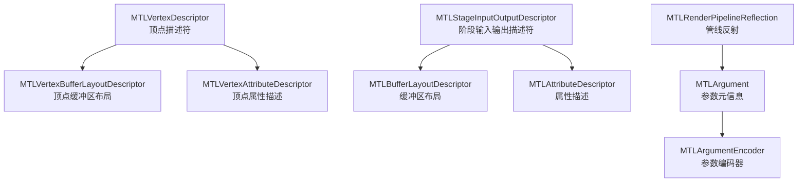
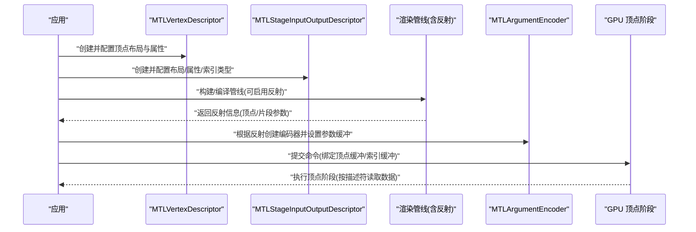
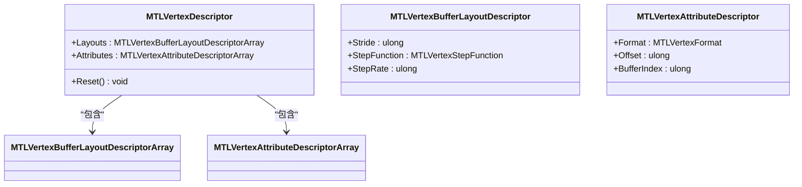
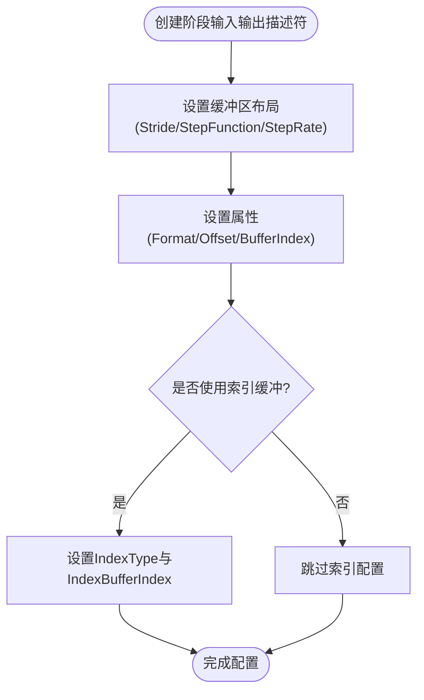
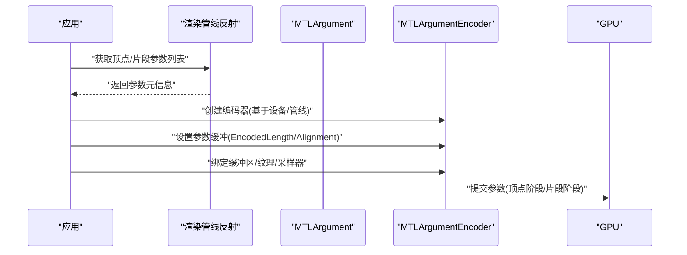
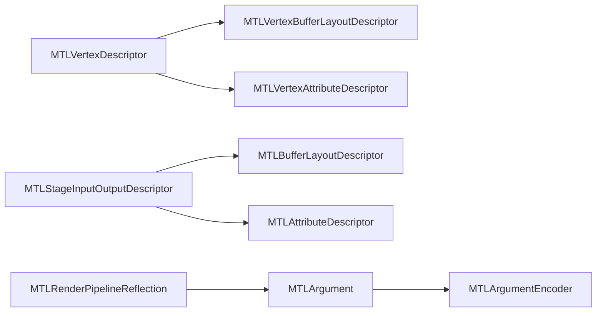

# 顶点配置

<cite>
**本文引用的文件**
- [MTLVertexDescriptor.cs](file://src/SharpMetal/Metal/MTLVertexDescriptor.cs)
- [MTLStageInputOutputDescriptor.cs](file://src/SharpMetal/Metal/MTLStageInputOutputDescriptor.cs)
- [MTLArgument.cs](file://src/SharpMetal/Metal/MTLArgument.cs)
- [MTLArgumentEncoder.cs](file://src/SharpMetal/Metal/MTLArgumentEncoder.cs)
- [MTLRenderPipeline.cs](file://src/SharpMetal/Metal/MTLRenderPipeline.cs)
</cite>

## 目录
1. [简介](#简介)
2. [项目结构](#项目结构)
3. [核心组件](#核心组件)
4. [架构总览](#架构总览)
5. [详细组件分析](#详细组件分析)
6. [依赖关系分析](#依赖关系分析)
7. [性能考虑](#性能考虑)
8. [故障排查指南](#故障排查指南)
9. [结论](#结论)
10. [附录](#附录)

## 简介
本文件面向使用 SharpMetal 进行 Metal 渲染的开发者，聚焦“顶点配置”主题：如何创建与配置顶点描述符（MTLVertexDescriptor），如何定义顶点属性、数据类型与布局；阶段输入输出描述符（MTLStageInputOutputDescriptor）的作用与配置；参数（MTLArgument）与参数编码器（MTLArgumentEncoder）在着色器参数传递中的使用；以及顶点数据的内存布局、对齐要求与性能优化技巧。文档同时提供最佳实践与常见问题解决方案，帮助你在 C# 绑定层正确构建并验证顶点数据流。

## 项目结构
与顶点配置直接相关的代码位于 src/SharpMetal/Metal 目录下，主要包含以下类型：
- 顶点描述符相关：MTLVertexDescriptor、MTLVertexBufferLayoutDescriptor、MTLVertexAttributeDescriptor
- 通用阶段输入输出描述符：MTLStageInputOutputDescriptor、MTLBufferLayoutDescriptor、MTLAttributeDescriptor
- 参数与编码：MTLArgument、MTLArgumentEncoder
- 管线反射：MTLRenderPipelineReflection（用于获取顶点/片段等阶段的绑定信息）

图表来源
- [MTLVertexDescriptor.cs:73-247](file://src/SharpMetal/Metal/MTLVertexDescriptor.cs#L73-L247)
- [MTLStageInputOutputDescriptor.cs:83-273](file://src/SharpMetal/Metal/MTLStageInputOutputDescriptor.cs#L83-L273)
- [MTLArgument.cs:325-383](file://src/SharpMetal/Metal/MTLArgument.cs#L325-L383)
- [MTLArgumentEncoder.cs:6-157](file://src/SharpMetal/Metal/MTLArgumentEncoder.cs#L6-L157)
- [MTLRenderPipeline.cs:172-200](file://src/SharpMetal/Metal/MTLRenderPipeline.cs#L172-L200)

章节来源
- [MTLVertexDescriptor.cs:1-247](file://src/SharpMetal/Metal/MTLVertexDescriptor.cs#L1-L247)
- [MTLStageInputOutputDescriptor.cs:1-273](file://src/SharpMetal/Metal/MTLStageInputOutputDescriptor.cs#L1-L273)
- [MTLArgument.cs:1-605](file://src/SharpMetal/Metal/MTLArgument.cs#L1-L605)
- [MTLArgumentEncoder.cs:1-157](file://src/SharpMetal/Metal/MTLArgumentEncoder.cs#L1-L157)
- [MTLRenderPipeline.cs:172-200](file://src/SharpMetal/Metal/MTLRenderPipeline.cs#L172-L200)

## 核心组件
- MTLVertexDescriptor：用于为渲染管线顶点阶段声明顶点缓冲区的布局与顶点属性的映射。通过 Layouts 和 Attributes 两个集合分别描述每个缓冲区的步长、步进函数与步进率，以及每个属性的格式、偏移与所属缓冲区索引。
- MTLStageInputOutputDescriptor：更通用的阶段输入输出描述符，既可用于顶点阶段也可用于其他阶段。它同样提供 Layouts 与 Attributes 集合，并额外支持 IndexType 与 IndexBufferIndex，以指定索引缓冲的类型与索引缓冲绑定位置。
- MTLArgument：描述着色器中参数的元信息，包括名称、类型、访问权限、索引、激活状态、缓冲区/纹理/采样器等资源的对齐与大小、数组长度等。
- MTLArgumentEncoder：将实际资源绑定到着色器参数槽位，支持设置缓冲区、纹理、采样器、常量数据、管线状态、可见函数表、加速结构等，并提供 encodedLength 与 alignment 用于分配参数缓冲。

章节来源
- [MTLVertexDescriptor.cs:73-247](file://src/SharpMetal/Metal/MTLVertexDescriptor.cs#L73-L247)
- [MTLStageInputOutputDescriptor.cs:83-273](file://src/SharpMetal/Metal/MTLStageInputOutputDescriptor.cs#L83-L273)
- [MTLArgument.cs:325-383](file://src/SharpMetal/Metal/MTLArgument.cs#L325-L383)
- [MTLArgumentEncoder.cs:6-157](file://src/SharpMetal/Metal/MTLArgumentEncoder.cs#L6-L157)

## 架构总览
下图展示了从应用侧准备顶点数据到 GPU 读取的端到端流程，涵盖顶点描述符、阶段输入输出描述符、参数编码器与渲染管线的协作关系。

图表来源
- [MTLVertexDescriptor.cs:221-247](file://src/SharpMetal/Metal/MTLVertexDescriptor.cs#L221-L247)
- [MTLStageInputOutputDescriptor.cs:231-273](file://src/SharpMetal/Metal/MTLStageInputOutputDescriptor.cs#L231-L273)
- [MTLArgumentEncoder.cs:20-157](file://src/SharpMetal/Metal/MTLArgumentEncoder.cs#L20-L157)
- [MTLRenderPipeline.cs:172-200](file://src/SharpMetal/Metal/MTLRenderPipeline.cs#L172-L200)

## 详细组件分析

### 顶点描述符（MTLVertexDescriptor）
- 作用：为顶点阶段定义顶点缓冲区的布局与顶点属性映射，使 GPU 能正确解析顶点数据。
- 关键成员：
  - Layouts：顶点缓冲区布局数组，每个元素包含 Stride（步长）、StepFunction（步进函数）、StepRate（步进率）。
  - Attributes：顶点属性数组，每个元素包含 Format（格式）、Offset（偏移）、BufferIndex（缓冲区索引）。
- 数据类型：
  - MTLVertexFormat：顶点属性格式枚举，覆盖整数、浮点、半精度、归一化整数、压缩格式等。
  - MTLVertexStepFunction：步进函数，支持 Constant、PerVertex、PerInstance、PerPatch、PerPatchControlPoint。
- 典型用法：
  - 为每个顶点缓冲区设置 Stride，决定每顶点的字节跨度。
  - 为每个属性设置 Format、Offset、BufferIndex，确保与 CPU 侧顶点数据结构一致。
  - 对实例化或 patch 数据，设置合适的 StepFunction 与 StepRate。

图表来源
- [MTLVertexDescriptor.cs:73-247](file://src/SharpMetal/Metal/MTLVertexDescriptor.cs#L73-L247)

章节来源
- [MTLVertexDescriptor.cs:6-247](file://src/SharpMetal/Metal/MTLVertexDescriptor.cs#L6-L247)

### 阶段输入输出描述符（MTLStageInputOutputDescriptor）
- 作用：描述任意阶段的输入输出布局，常用于顶点阶段，也适用于其他阶段。相比顶点专用描述符，它还提供索引缓冲相关信息。
- 关键成员：
  - Layouts：缓冲区布局数组，包含 Stride、StepFunction、StepRate。
  - Attributes：属性数组，包含 Format、Offset、BufferIndex。
  - IndexType：索引类型（UInt16/UInt32）。
  - IndexBufferIndex：索引缓冲的绑定索引。
- 与顶点描述符的关系：两者都提供布局与属性集合，但阶段描述符更通用且支持索引缓冲配置。

图表来源
- [MTLStageInputOutputDescriptor.cs:83-273](file://src/SharpMetal/Metal/MTLStageInputOutputDescriptor.cs#L83-L273)

章节来源
- [MTLStageInputOutputDescriptor.cs:64-273](file://src/SharpMetal/Metal/MTLStageInputOutputDescriptor.cs#L64-L273)

### 参数（MTLArgument）与参数编码器（MTLArgumentEncoder）
- MTLArgument：描述着色器参数的元信息，包括名称、类型、访问权限、索引、激活状态、缓冲区/纹理/采样器的对齐与大小、数组长度等。可通过渲染管线反射获取。
- MTLArgumentEncoder：负责将实际资源绑定到着色器参数槽位，支持：
  - 设置参数缓冲（SetArgumentBuffer/SetArgumentBuffer:startOffset:arrayElement:）
  - 设置缓冲区、纹理、采样器（SetBuffer/SetTexture/SetSamplerState 及批量版本）
  - 获取常量数据指针（ConstantDataAtIndex）
  - 设置管线状态、间接命令缓冲、加速结构、可见/相交函数表等
  - 查询 encodedLength 与 alignment，用于分配参数缓冲

图表来源
- [MTLArgument.cs:325-383](file://src/SharpMetal/Metal/MTLArgument.cs#L325-L383)
- [MTLArgumentEncoder.cs:20-157](file://src/SharpMetal/Metal/MTLArgumentEncoder.cs#L20-L157)
- [MTLRenderPipeline.cs:172-200](file://src/SharpMetal/Metal/MTLRenderPipeline.cs#L172-L200)

章节来源
- [MTLArgument.cs:6-605](file://src/SharpMetal/Metal/MTLArgument.cs#L6-L605)
- [MTLArgumentEncoder.cs:1-157](file://src/SharpMetal/Metal/MTLArgumentEncoder.cs#L1-L157)
- [MTLRenderPipeline.cs:172-200](file://src/SharpMetal/Metal/MTLRenderPipeline.cs#L172-L200)

### 顶点数据的内存布局与对齐
- 顶点缓冲区布局（Stride）：每个顶点缓冲区的 Stride 必须等于一个顶点的字节大小，确保 GPU 能按步长读取下一个顶点。
- 属性偏移（Offset）：每个属性的 Offset 必须与 CPU 侧顶点结构体字段偏移一致，避免错位读取。
- 步进函数与步进率（StepFunction/StepRate）：
  - PerVertex：每个顶点更新一次。
  - PerInstance：每个实例更新一次，适合实例化渲染。
  - PerPatch/PerPatchControlPoint：细分曲面相关。
  - Constant：常量值，不随顶点/实例变化。
- 索引缓冲（IndexType/IndexBufferIndex）：
  - 当使用索引缓冲时，需设置 IndexType（UInt16/UInt32）与 IndexBufferIndex，确保索引格式与缓冲绑定位置正确。
- 参数缓冲对齐（Alignment/EncodedLength）：
  - 通过 MTLArgumentEncoder 的 Alignment 与 EncodedLength 计算参数缓冲大小与对齐，保证 GPU 正确读取参数。

章节来源
- [MTLVertexDescriptor.cs:73-247](file://src/SharpMetal/Metal/MTLVertexDescriptor.cs#L73-L247)
- [MTLStageInputOutputDescriptor.cs:83-273](file://src/SharpMetal/Metal/MTLStageInputOutputDescriptor.cs#L83-L273)
- [MTLArgumentEncoder.cs:20-157](file://src/SharpMetal/Metal/MTLArgumentEncoder.cs#L20-L157)

## 依赖关系分析
- MTLVertexDescriptor 依赖 MTLVertexBufferLayoutDescriptor 与 MTLVertexAttributeDescriptor，用于描述顶点缓冲与属性。
- MTLStageInputOutputDescriptor 依赖 MTLBufferLayoutDescriptor 与 MTLAttributeDescriptor，提供更通用的阶段输入输出配置。
- MTLArgument 与 MTLArgumentEncoder 配合，实现着色器参数的元信息描述与运行时绑定。
- MTLRenderPipelineReflection 提供顶点/片段等阶段的绑定与参数信息，辅助调试与验证。

图表来源
- [MTLVertexDescriptor.cs:73-247](file://src/SharpMetal/Metal/MTLVertexDescriptor.cs#L73-L247)
- [MTLStageInputOutputDescriptor.cs:83-273](file://src/SharpMetal/Metal/MTLStageInputOutputDescriptor.cs#L83-L273)
- [MTLArgument.cs:325-383](file://src/SharpMetal/Metal/MTLArgument.cs#L325-L383)
- [MTLArgumentEncoder.cs:6-157](file://src/SharpMetal/Metal/MTLArgumentEncoder.cs#L6-L157)
- [MTLRenderPipeline.cs:172-200](file://src/SharpMetal/Metal/MTLRenderPipeline.cs#L172-L200)

章节来源
- [MTLVertexDescriptor.cs:73-247](file://src/SharpMetal/Metal/MTLVertexDescriptor.cs#L73-L247)
- [MTLStageInputOutputDescriptor.cs:83-273](file://src/SharpMetal/Metal/MTLStageInputOutputDescriptor.cs#L83-L273)
- [MTLArgument.cs:325-383](file://src/SharpMetal/Metal/MTLArgument.cs#L325-L383)
- [MTLArgumentEncoder.cs:6-157](file://src/SharpMetal/Metal/MTLArgumentEncoder.cs#L6-L157)
- [MTLRenderPipeline.cs:172-200](file://src/SharpMetal/Metal/MTLRenderPipeline.cs#L172-L200)

## 性能考虑
- 合理选择顶点格式：优先使用紧凑格式（如 Half、归一化整数）以减少带宽占用。
- 最小化顶点属性数量：仅保留着色器需要的属性，减少内存带宽压力。
- 正确使用步进函数：对共享数据使用 PerInstance 或 Constant，避免重复传输。
- 对齐与填充：确保顶点结构与 CPU 侧一致，避免不必要的填充导致带宽浪费。
- 参数缓冲复用：利用 MTLArgumentEncoder 的 EncodedLength 与 Alignment 预分配参数缓冲，减少频繁分配开销。
- 索引缓冲优化：根据模型规模选择合适的 IndexType（UInt16/UInt32），平衡内存与索引范围。

[本节为通用指导，无需特定文件引用]

## 故障排查指南
- 顶点数据错位：检查 Attributes 的 Offset 是否与 CPU 侧结构体字段偏移一致；确认 BufferIndex 指向正确的缓冲区。
- 格式不匹配：确保 MTLVertexFormat/MTLAttributeFormat 与着色器输入类型一致。
- 步进函数错误：确认 StepFunction 与 StepRate 与实际数据更新频率匹配，避免实例化数据错乱。
- 索引缓冲问题：检查 IndexType 与 IndexBufferIndex 是否正确设置，确保索引缓冲绑定位置与着色器期望一致。
- 参数缓冲溢出：根据 MTLArgumentEncoder 的 EncodedLength 与 Alignment 正确分配参数缓冲，避免越界访问。
- 使用反射验证：通过 MTLRenderPipelineReflection 获取顶点/片段参数与绑定信息，辅助定位问题。

章节来源
- [MTLVertexDescriptor.cs:147-247](file://src/SharpMetal/Metal/MTLVertexDescriptor.cs#L147-L247)
- [MTLStageInputOutputDescriptor.cs:157-273](file://src/SharpMetal/Metal/MTLStageInputOutputDescriptor.cs#L157-L273)
- [MTLArgumentEncoder.cs:20-157](file://src/SharpMetal/Metal/MTLArgumentEncoder.cs#L20-L157)
- [MTLRenderPipeline.cs:172-200](file://src/SharpMetal/Metal/MTLRenderPipeline.cs#L172-L200)

## 结论
通过 SharpMetal 提供的 MTLVertexDescriptor、MTLStageInputOutputDescriptor、MTLArgument 与 MTLArgumentEncoder，你可以在 C# 环境中精确控制顶点数据的内存布局、对齐与参数传递。结合渲染管线反射，能够高效验证与调试顶点配置。遵循最佳实践与性能优化建议，可获得稳定高效的渲染性能。

[本节为总结性内容，无需特定文件引用]

## 附录
- 常用顶点格式参考：MTLVertexFormat/MTLAttributeFormat 覆盖整数、浮点、半精度、归一化整数与压缩格式。
- 步进函数选项：Constant、PerVertex、PerInstance、PerPatch、PerPatchControlPoint。
- 索引类型：UInt16、UInt32。
- 参数缓冲对齐：通过 MTLArgumentEncoder 的 Alignment 与 EncodedLength 计算。

[本节为补充信息，无需特定文件引用]