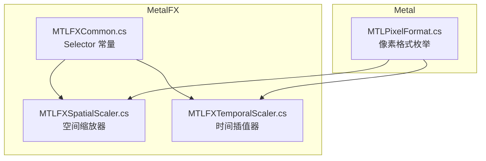
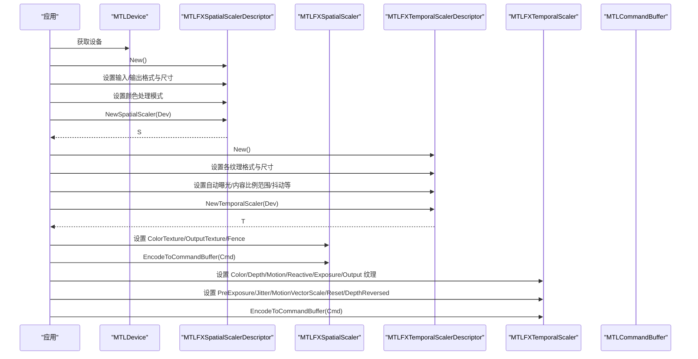
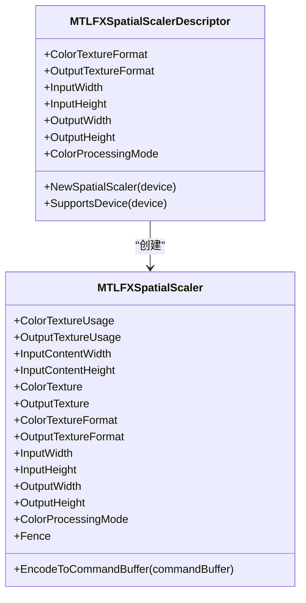
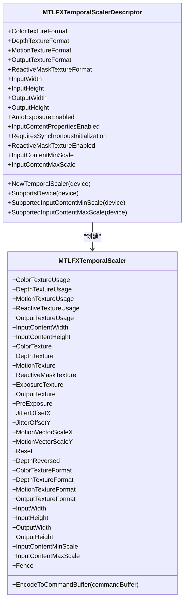
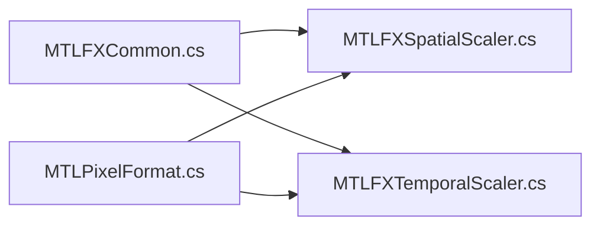
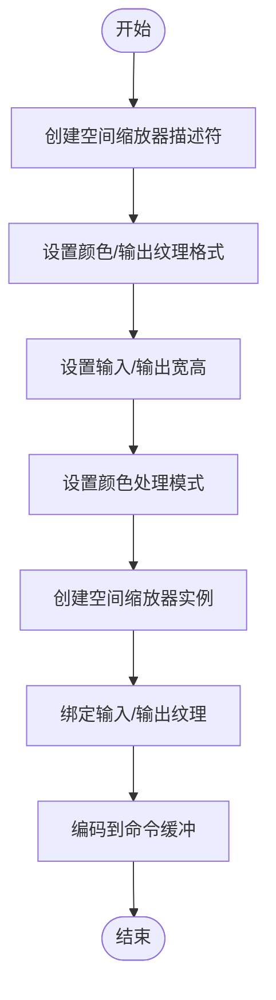
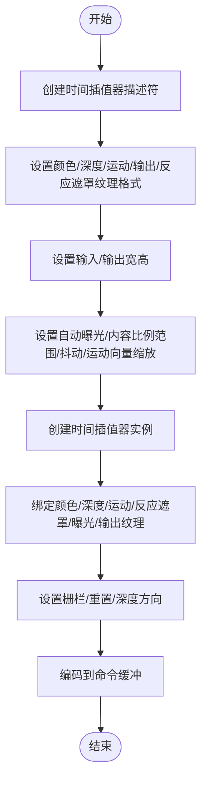

# MetalFX 图像处理 API

<cite>
**本文引用的文件**
- [MTLFXCommon.cs](file://src/SharpMetal/MetalFX/MTLFXCommon.cs)
- [MTLFXSpatialScaler.cs](file://src/SharpMetal/MetalFX/MTLFXSpatialScaler.cs)
- [MTLFXTemporalScaler.cs](file://src/SharpMetal/MetalFX/MTLFXTemporalScaler.cs)
- [MTLPixelFormat.cs](file://src/SharpMetal/Metal/MTLPixelFormat.cs)
</cite>

## 目录
1. [简介](#简介)
2. [项目结构](#项目结构)
3. [核心组件](#核心组件)
4. [架构总览](#架构总览)
5. [详细组件分析](#详细组件分析)
6. [依赖关系分析](#依赖关系分析)
7. [性能与质量配置](#性能与质量配置)
8. [与 Metal 管道集成指南](#与-metal-管道集成指南)
9. [故障排查](#故障排查)
10. [结论](#结论)
11. [附录：常见任务流程示例](#附录：常见任务流程示例)

## 简介
本参考文档面向使用 SharpMetal 的开发者，聚焦于 MetalFX 图像处理 API 在 C# 绑定中的类型、参数与使用方式。内容涵盖：
- MTLFXCommon 中暴露的选择器常量（用于桥接 Objective-C 方法）
- MTLFXSpatialScaler 空间图像缩放器的描述符与实例用法
- MTLFXTemporalScaler 时间图像插值器的描述符与实例用法
- 图像缩放算法的配置选项、性能优化参数与质量设置
- 与 Metal 命令缓冲、纹理和设备的集成要点与最佳实践

## 项目结构
MetalFX 相关代码位于 src/SharpMetal/MetalFX 目录下，包含三类关键文件：
- MTLFXCommon.cs：集中定义与 MetalFX 交互所需的 Objective-C Selector 常量
- MTLFXSpatialScaler.cs：空间缩放器的描述符与实例封装
- MTLFXTemporalScaler.cs：时间插值器的描述符与实例封装

此外，像素格式枚举 MTLPixelFormat 位于 src/SharpMetal/Metal/MTLPixelFormat.cs，供上述组件配置纹理格式时使用。

图表来源
- [MTLFXCommon.cs:6-83](file://src/SharpMetal/MetalFX/MTLFXCommon.cs#L6-L83)
- [MTLFXSpatialScaler.cs:6-76](file://src/SharpMetal/MetalFX/MTLFXSpatialScaler.cs#L6-L76)
- [MTLFXTemporalScaler.cs:6-127](file://src/SharpMetal/MetalFX/MTLFXTemporalScaler.cs#L6-L127)
- [MTLPixelFormat.cs:3-144](file://src/SharpMetal/Metal/MTLPixelFormat.cs#L3-L144)

章节来源
- [MTLFXCommon.cs:6-83](file://src/SharpMetal/MetalFX/MTLFXCommon.cs#L6-L83)
- [MTLFXSpatialScaler.cs:6-76](file://src/SharpMetal/MetalFX/MTLFXSpatialScaler.cs#L6-L76)
- [MTLFXTemporalScaler.cs:6-127](file://src/SharpMetal/MetalFX/MTLFXTemporalScaler.cs#L6-L127)
- [MTLPixelFormat.cs:3-144](file://src/SharpMetal/Metal/MTLPixelFormat.cs#L3-L144)

## 核心组件
- MTLFXCommon：提供与 MetalFX 交互的 Selector 常量集合，包括颜色/深度/运动/曝光/抖动等属性访问与设置的 selector，以及设备支持检测、创建缩放器等方法的 selector。
- MTLFXSpatialScalerDescriptor / MTLFXSpatialScaler：空间缩放器的配置与执行对象，负责将输入纹理缩放到输出尺寸，支持颜色处理模式、输入/输出纹理格式与尺寸、内容区域、同步栅栏等。
- MTLFXTemporalScalerDescriptor / MTLFXTemporalScaler：时间插值器的配置与执行对象，负责基于运动矢量、深度、曝光等信息进行帧间插值，支持自动曝光、输入内容比例范围、抖动偏移、运动向量缩放、重置标志、深度方向等。

章节来源
- [MTLFXCommon.cs:6-83](file://src/SharpMetal/MetalFX/MTLFXCommon.cs#L6-L83)
- [MTLFXSpatialScaler.cs:6-167](file://src/SharpMetal/MetalFX/MTLFXSpatialScaler.cs#L6-L167)
- [MTLFXTemporalScaler.cs:6-314](file://src/SharpMetal/MetalFX/MTLFXTemporalScaler.cs#L6-L314)

## 架构总览
MetalFX 通过描述符（Descriptor）配置算法参数，再创建对应的 Scaler 实例，设置输入/输出纹理及其他运行时参数后，编码到 Metal 命令缓冲区执行。

图表来源
- [MTLFXSpatialScaler.cs:13-76](file://src/SharpMetal/MetalFX/MTLFXSpatialScaler.cs#L13-L76)
- [MTLFXSpatialScaler.cs:78-167](file://src/SharpMetal/MetalFX/MTLFXSpatialScaler.cs#L78-L167)
- [MTLFXTemporalScaler.cs:6-127](file://src/SharpMetal/MetalFX/MTLFXTemporalScaler.cs#L6-L127)
- [MTLFXTemporalScaler.cs:129-314](file://src/SharpMetal/MetalFX/MTLFXTemporalScaler.cs#L129-L314)

## 详细组件分析

### MTLFXCommon：选择器常量
- 作用：集中声明与 MetalFX 交互所需的 Objective-C 方法名（Selector），供后续 C# 包装类通过消息发送调用底层实现。
- 覆盖范围：颜色/深度/运动/曝光/抖动等纹理属性；输入/输出尺寸与内容区域；设备支持与能力查询；初始化同步控制；编码到命令缓冲等。

章节来源
- [MTLFXCommon.cs:6-83](file://src/SharpMetal/MetalFX/MTLFXCommon.cs#L6-L83)

### MTLFXSpatialScaler：空间图像缩放器
- 描述符 MTLFXSpatialScalerDescriptor
  - 可配置项：颜色纹理格式、输出纹理格式、输入宽高、输出宽高、颜色处理模式。
  - 创建缩放器：NewSpatialScaler(device)。
  - 设备支持：SupportsDevice(device)。
- 实例 MTLFXSpatialScaler
  - 只读能力：ColorTextureUsage、OutputTextureUsage、ColorTextureFormat、OutputTextureFormat、InputWidth、InputHeight、OutputWidth、OutputHeight、ColorProcessingMode。
  - 运行时属性：InputContentWidth、InputContentHeight、ColorTexture、OutputTexture、Fence。
  - 执行：EncodeToCommandBuffer(commandBuffer)。

图表来源
- [MTLFXSpatialScaler.cs:13-76](file://src/SharpMetal/MetalFX/MTLFXSpatialScaler.cs#L13-L76)
- [MTLFXSpatialScaler.cs:78-167](file://src/SharpMetal/MetalFX/MTLFXSpatialScaler.cs#L78-L167)

章节来源
- [MTLFXSpatialScaler.cs:6-167](file://src/SharpMetal/MetalFX/MTLFXSpatialScaler.cs#L6-L167)

### MTLFXTemporalScaler：时间图像插值器
- 描述符 MTLFXTemporalScalerDescriptor
  - 可配置项：颜色/深度/运动/输出/反应遮罩纹理格式；输入宽高；输出宽高；自动曝光开关；输入内容属性开关；是否需要同步初始化；反应遮罩纹理开关；输入内容最小/最大缩放比例。
  - 创建插值器：NewTemporalScaler(device)。
  - 设备支持：SupportsDevice(device)、SupportedInputContentMinScale(device)、SupportedInputContentMaxScale(device)。
- 实例 MTLFXTemporalScaler
  - 只读能力：Color/Depth/Motion/Reactive/Output 纹理使用模式与各纹理格式；输入宽高；输出宽高；输入内容最小/最大缩放比例。
  - 运行时属性：Color/Depth/Motion/ReactiveMask/Exposure/Output 纹理；PreExposure；JitterOffsetX/Y；MotionVectorScaleX/Y；Reset；DepthReversed；Fence。
  - 执行：EncodeToCommandBuffer(commandBuffer)。

图表来源
- [MTLFXTemporalScaler.cs:6-127](file://src/SharpMetal/MetalFX/MTLFXTemporalScaler.cs#L6-L127)
- [MTLFXTemporalScaler.cs:129-314](file://src/SharpMetal/MetalFX/MTLFXTemporalScaler.cs#L129-L314)

章节来源
- [MTLFXTemporalScaler.cs:6-314](file://src/SharpMetal/MetalFX/MTLFXTemporalScaler.cs#L6-L314)

## 依赖关系分析
- 所有 MetalFX 组件均依赖 MTLFXCommon 提供的 Selector 常量以调用底层 Objective-C 方法。
- 纹理格式统一使用 MTLPixelFormat 枚举进行配置。
- 执行阶段依赖 Metal 命令缓冲（MTLCommandBuffer）、纹理（MTLTexture）、栅栏（MTLFence）等同步与资源对象。

图表来源
- [MTLFXCommon.cs:6-83](file://src/SharpMetal/MetalFX/MTLFXCommon.cs#L6-L83)
- [MTLFXSpatialScaler.cs:6-167](file://src/SharpMetal/MetalFX/MTLFXSpatialScaler.cs#L6-L167)
- [MTLFXTemporalScaler.cs:6-314](file://src/SharpMetal/MetalFX/MTLFXTemporalScaler.cs#L6-L314)
- [MTLPixelFormat.cs:3-144](file://src/SharpMetal/Metal/MTLPixelFormat.cs#L3-L144)

章节来源
- [MTLFXCommon.cs:6-83](file://src/SharpMetal/MetalFX/MTLFXCommon.cs#L6-L83)
- [MTLFXSpatialScaler.cs:6-167](file://src/SharpMetal/MetalFX/MTLFXSpatialScaler.cs#L6-L167)
- [MTLFXTemporalScaler.cs:6-314](file://src/SharpMetal/MetalFX/MTLFXTemporalScaler.cs#L6-L314)
- [MTLPixelFormat.cs:3-144](file://src/SharpMetal/Metal/MTLPixelFormat.cs#L3-L144)

## 性能与质量配置
- 颜色处理模式（空间缩放器）
  - 感知模式、线性模式、HDR 模式：根据内容色彩空间与显示管线选择合适的模式以获得更准确的色调映射与更高的视觉质量。
- 纹理格式
  - 颜色/深度/运动/输出/反应遮罩纹理格式需与渲染管线一致，避免不必要的转换开销。
- 输入内容与缩放范围（时间插值器）
  - 输入内容最小/最大缩放比例：限制内容缩放范围，有助于稳定插值并减少极端情况下的伪影。
  - 设备能力查询：可通过设备能力接口获取支持的缩放范围，确保配置合法。
- 抖动与运动向量缩放（时间插值器）
  - 抖动偏移 X/Y：引入微小抖动可降低重采样带来的带状噪声。
  - 运动向量缩放 X/Y：匹配运动矢量尺度，提高运动估计精度。
- 自动曝光与预曝光（时间插值器）
  - 自动曝光开关：启用后可自适应亮度变化，提升动态场景稳定性。
  - 预曝光：用于补偿曝光过渡，减少闪烁。
- 同步与栅栏
  - Fence：可用于跨命令缓冲或线程间的同步点，确保数据就绪后再进行下一阶段的处理。
- 输入内容属性开关
  - 输入内容属性开关：启用后可利用内容区域的元信息优化处理路径。

章节来源
- [MTLFXSpatialScaler.cs:6-76](file://src/SharpMetal/MetalFX/MTLFXSpatialScaler.cs#L6-L76)
- [MTLFXTemporalScaler.cs:6-127](file://src/SharpMetal/MetalFX/MTLFXTemporalScaler.cs#L6-L127)
- [MTLFXTemporalScaler.cs:129-314](file://src/SharpMetal/MetalFX/MTLFXTemporalScaler.cs#L129-L314)

## 与 Metal 管道集成指南
- 设备与资源
  - 使用 MTLDevice 创建与管理纹理、命令缓冲与栅栏。
  - 纹理格式应与渲染目标及后续处理阶段保持一致，优先选择硬件高效格式。
- 描述符与实例生命周期
  - 先构造描述符并设置静态配置（格式、尺寸、模式）。
  - 通过描述符创建 Scaler 实例，并在每帧或需要时更新运行时属性（纹理指针、抖动、曝光等）。
- 编码到命令缓冲
  - 为每个 Scaler 实例设置输入/输出纹理后，调用 EncodeToCommandBuffer 将其编码到当前命令缓冲。
  - 可使用 Fence 标记依赖关系，确保下游阶段正确等待上游完成。
- 典型工作流
  - 空间缩放：输入纹理 -> 空间缩放器 -> 输出纹理（可直接作为渲染目标或后续处理的输入）。
  - 时间插值：上一帧输出/当前帧颜色/深度/运动/曝光/反应遮罩 -> 时间插值器 -> 输出纹理（可作为下一帧的历史帧缓存）。

章节来源
- [MTLFXSpatialScaler.cs:78-167](file://src/SharpMetal/MetalFX/MTLFXSpatialScaler.cs#L78-L167)
- [MTLFXTemporalScaler.cs:129-314](file://src/SharpMetal/MetalFX/MTLFXTemporalScaler.cs#L129-L314)

## 故障排查
- 平台与设备
  - 确认运行环境为 Apple 平台且存在可用 Metal 设备。
  - 使用 SupportsDevice 检查设备能力，避免在不支持的设备上启用特定功能。
- 纹理格式不匹配
  - 若出现编码失败或结果异常，检查颜色/深度/运动/输出/反应遮罩纹理格式是否与描述符设置一致。
- 尺寸与内容区域
  - 输入/输出宽高必须与纹理实际尺寸一致；如需仅对部分内容进行处理，请设置输入内容宽高。
- 同步问题
  - 若多命令缓冲或多线程并发，使用 Fence 明确依赖顺序，避免读取未就绪数据。
- 时间插值稳定性
  - 若出现闪烁或拖尾，调整自动曝光、预曝光、抖动偏移与运动向量缩放；必要时关闭自动曝光并使用固定曝光策略。

章节来源
- [MTLFXSpatialScaler.cs:63-76](file://src/SharpMetal/MetalFX/MTLFXSpatialScaler.cs#L63-L76)
- [MTLFXTemporalScaler.cs:104-127](file://src/SharpMetal/MetalFX/MTLFXTemporalScaler.cs#L104-L127)
- [MTLFXTemporalScaler.cs:129-314](file://src/SharpMetal/MetalFX/MTLFXTemporalScaler.cs#L129-L314)

## 结论
SharpMetal 的 MetalFX 绑定提供了完整的空间缩放与时间插值能力。通过描述符进行静态配置、实例进行运行时参数管理，并以命令缓冲编码执行，能够高效地嵌入现有 Metal 渲染管线。合理选择颜色处理模式、纹理格式与时间插值参数，结合同步机制，可在保证画质的同时获得良好的性能表现。

## 附录：常见任务流程示例
以下示例以流程图形式展示常见任务的步骤与关键参数设置，具体代码实现请参考对应文件的属性与方法路径。

- 空间图像缩放流程

图表来源
- [MTLFXSpatialScaler.cs:13-76](file://src/SharpMetal/MetalFX/MTLFXSpatialScaler.cs#L13-L76)
- [MTLFXSpatialScaler.cs:78-167](file://src/SharpMetal/MetalFX/MTLFXSpatialScaler.cs#L78-L167)

- 时间图像插值流程

图表来源
- [MTLFXTemporalScaler.cs:6-127](file://src/SharpMetal/MetalFX/MTLFXTemporalScaler.cs#L6-L127)
- [MTLFXTemporalScaler.cs:129-314](file://src/SharpMetal/MetalFX/MTLFXTemporalScaler.cs#L129-L314)