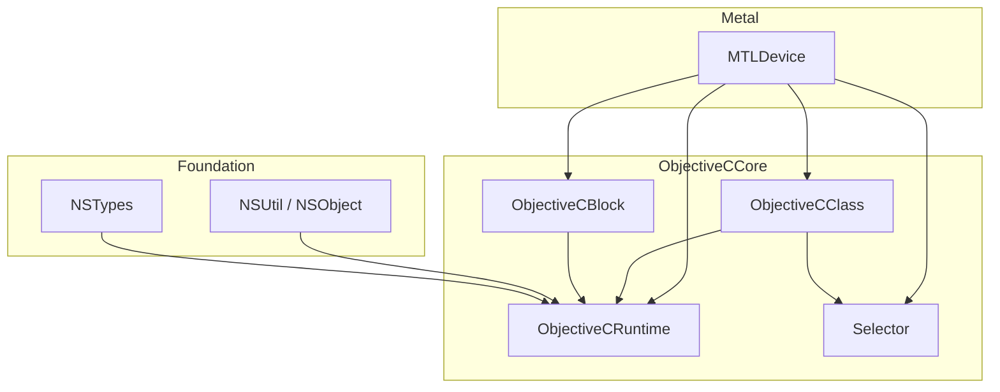
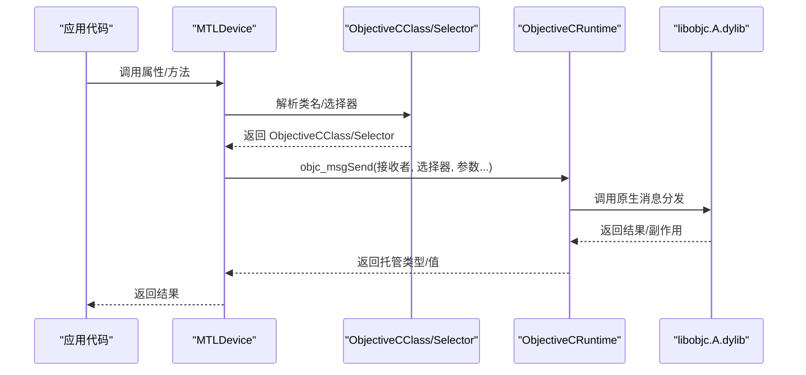
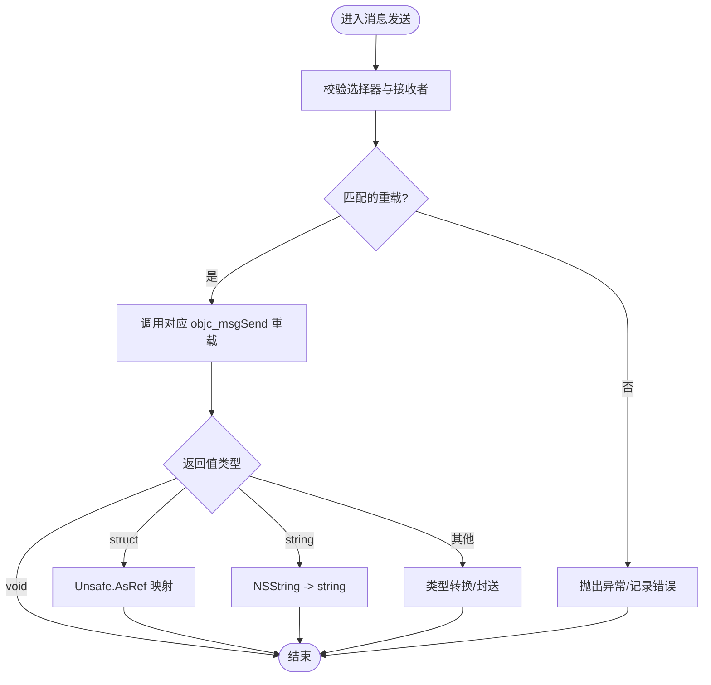
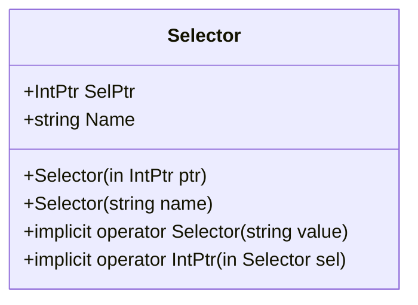
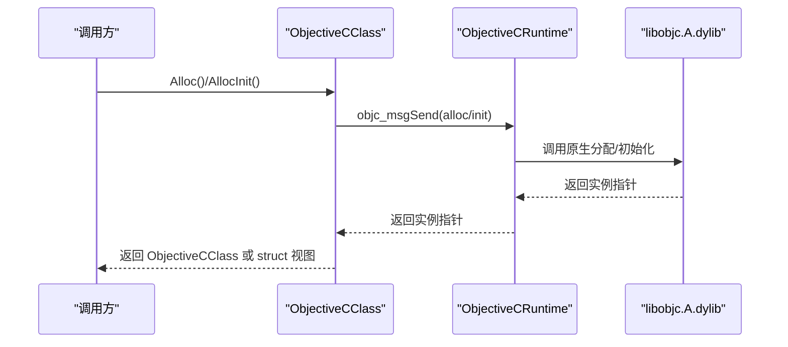
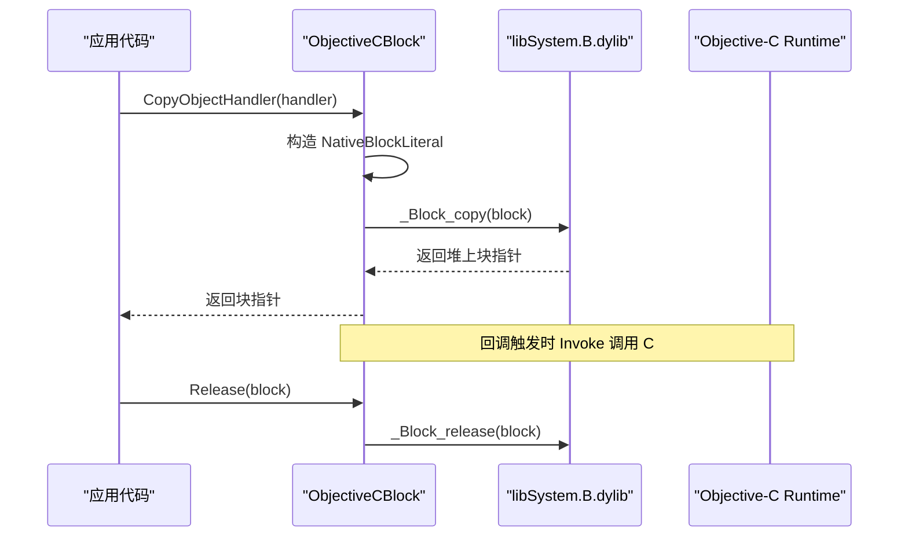
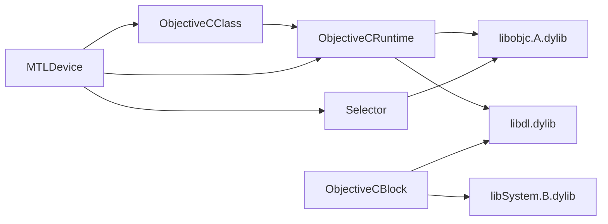

# Objective-C 运行时核心 API

<cite>
**本文引用的文件**
- [ObjectiveCRuntime.cs](file://src/SharpMetal/ObjectiveCCore/ObjectiveCRuntime.cs)
- [Selector.cs](file://src/SharpMetal/ObjectiveCCore/Selector.cs)
- [ObjectiveCClass.cs](file://src/SharpMetal/ObjectiveCCore/ObjectiveCClass.cs)
- [ObjectiveCBlock.cs](file://src/SharpMetal/ObjectiveCCore/ObjectiveCBlock.cs)
- [NSObject.cs](file://src/SharpMetal/Foundation/NSObject.cs)
- [NSTypes.cs](file://src/SharpMetal/Foundation/NSTypes.cs)
- [MTLDevice.cs](file://src/SharpMetal/Metal/MTLDevice.cs)
</cite>

## 目录
1. [简介](#简介)
2. [项目结构](#项目结构)
3. [核心组件](#核心组件)
4. [架构总览](#架构总览)
5. [详细组件分析](#详细组件分析)
6. [依赖关系分析](#依赖关系分析)
7. [性能考量](#性能考量)
8. [故障排查指南](#故障排查指南)
9. [结论](#结论)
10. [附录：使用示例与最佳实践](#附录使用示例与最佳实践)

## 简介
本参考文档聚焦于 SharpMetal 中的 Objective-C 运行时核心 API，覆盖消息传递机制、内存管理、类型转换、选择器（Selector）的创建与缓存、动态类操作（ObjectiveCClass）、块对象支持（ObjectiveCBlock），以及底层 P/Invoke 的安全封装与性能优化策略。文档同时提供完整的代码级流程图和调用序列图，帮助读者理解如何在 C# 中安全高效地与原生 Objective-C 进行交互。

## 项目结构
ObjectiveCCore 位于 src/SharpMetal/ObjectiveCCore 下，包含以下关键文件：
- ObjectiveCRuntime.cs：定义与 libobjc.A.dylib 的 P/Invoke 绑定、消息发送重载、内存管理辅助方法、框架链接工具等。
- Selector.cs：选择器的轻量包装，负责从字符串创建并获取名称。
- ObjectiveCClass.cs：动态类发现、实例分配与初始化、方法列表枚举等。
- ObjectiveCBlock.cs：最小化的 Objective-C Block 桥接，用于异步回调（如 Metal 反馈处理器）。

Foundation 层提供通用类型与工具：
- NSObject.cs：NSUtil 字符串转换、NSObject 基础能力（哈希、描述、响应检查等）。
- NSTypes.cs：系统版本等基础结构体。

Metal 层通过上述核心 API 访问具体 Metal 对象与方法，例如 MTLDevice.cs 展示了如何基于 ObjectiveCClass 与 Selector 调用 Metal 接口。

图表来源
- [ObjectiveCRuntime.cs:33-839](file://src/SharpMetal/ObjectiveCCore/ObjectiveCRuntime.cs#L33-L839)
- [Selector.cs:5-43](file://src/SharpMetal/ObjectiveCCore/Selector.cs#L5-L43)
- [ObjectiveCClass.cs:7-87](file://src/SharpMetal/ObjectiveCCore/ObjectiveCClass.cs#L7-L87)
- [ObjectiveCBlock.cs:12-165](file://src/SharpMetal/ObjectiveCCore/ObjectiveCBlock.cs#L12-L165)
- [NSObject.cs:34-92](file://src/SharpMetal/Foundation/NSObject.cs#L34-L92)
- [NSTypes.cs:5-12](file://src/SharpMetal/Foundation/NSTypes.cs#L5-L12)
- [MTLDevice.cs:187-200](file://src/SharpMetal/Metal/MTLDevice.cs#L187-L200)

章节来源
- [ObjectiveCRuntime.cs:33-839](file://src/SharpMetal/ObjectiveCCore/ObjectiveCRuntime.cs#L33-L839)
- [Selector.cs:5-43](file://src/SharpMetal/ObjectiveCCore/Selector.cs#L5-L43)
- [ObjectiveCClass.cs:7-87](file://src/SharpMetal/ObjectiveCCore/ObjectiveCClass.cs#L7-L87)
- [ObjectiveCBlock.cs:12-165](file://src/SharpMetal/ObjectiveCCore/ObjectiveCBlock.cs#L12-L165)
- [NSObject.cs:34-92](file://src/SharpMetal/Foundation/NSObject.cs#L34-L92)
- [NSTypes.cs:5-12](file://src/SharpMetal/Foundation/NSTypes.cs#L5-L12)
- [MTLDevice.cs:187-200](file://src/SharpMetal/Metal/MTLDevice.cs#L187-L200)

## 核心组件
- 消息传递机制：ObjectiveCRuntime 提供大量 objc_msgSend 重载，覆盖不同参数与返回值类型；并提供泛型与 struct 返回封装，减少装箱与拷贝开销。
- 内存管理：提供 Retain/Release/GetRetainCount 等便捷方法，统一调用 retain/release/retainCount 选择器。
- 类型转换：string_objc_msgSend 将 NSString 转为 C# string；NSUtil.GetUtf8String 将 UTF-8 指针转换为字符串；struct 返回路径通过 Unsafe.AsRef 避免额外分配。
- 选择器管理：Selector 以字符串构造并缓存为 IntPtr；可隐式转换为 IntPtr 或 Selector，便于在多处复用。
- 动态类操作：ObjectiveCClass 支持按名称查找类、分配与初始化实例、枚举方法列表、读取属性名等。
- 块对象支持：ObjectiveCBlock 构建最小化 Block 字面量，复制/释放生命周期由 _Block_copy/_Block_release 管理，回调通过 UnmanagedCallersOnly 安全转发到 C# Action。

章节来源
- [ObjectiveCRuntime.cs:118-839](file://src/SharpMetal/ObjectiveCCore/ObjectiveCRuntime.cs#L118-L839)
- [Selector.cs:5-43](file://src/SharpMetal/ObjectiveCCore/Selector.cs#L5-L43)
- [ObjectiveCClass.cs:18-87](file://src/SharpMetal/ObjectiveCCore/ObjectiveCClass.cs#L18-L87)
- [ObjectiveCBlock.cs:12-165](file://src/SharpMetal/ObjectiveCCore/ObjectiveCBlock.cs#L12-L165)
- [NSObject.cs:34-92](file://src/SharpMetal/Foundation/NSObject.cs#L34-L92)

## 架构总览
下图展示从 C# 到 Objective-C 的核心调用链：上层 Metal 类型通过 ObjectiveCClass 与 Selector 定位目标类与方法，再经由 ObjectiveCRuntime 的消息发送函数完成跨语言调用；对于异步回调，使用 ObjectiveCBlock 将 C# 委托包装为原生 Block。

图表来源
- [MTLDevice.cs:187-200](file://src/SharpMetal/Metal/MTLDevice.cs#L187-L200)
- [ObjectiveCClass.cs:18-87](file://src/SharpMetal/ObjectiveCCore/ObjectiveCClass.cs#L18-L87)
- [ObjectiveCRuntime.cs:118-839](file://src/SharpMetal/ObjectiveCCore/ObjectiveCRuntime.cs#L118-L839)

## 详细组件分析

### 消息传递与内存管理（ObjectiveCRuntime）
- 消息发送：提供多组 objc_msgSend 重载，覆盖 void/bool/int/long/float/double/ulong/ushort/byte/IntPtr 等返回值，以及多种参数组合；对 struct 返回提供泛型封装与 stret 路径。
- 内存管理：Retain/Release/GetRetainCount 分别调用 retain/release/retainCount 选择器，简化引用计数操作。
- 框架链接：LinkMetal/LinkCoreGraphics/LinkAppKit/LinkMetalKit 通过 dlopen 预加载相关框架，确保后续符号可用。
- 类型转换：string_objc_msgSend 将 NSString 转为 string；struct 返回路径通过 Unsafe.AsRef 直接映射内存布局，降低分配与拷贝成本。

图表来源
- [ObjectiveCRuntime.cs:769-839](file://src/SharpMetal/ObjectiveCCore/ObjectiveCRuntime.cs#L769-L839)

章节来源
- [ObjectiveCRuntime.cs:118-839](file://src/SharpMetal/ObjectiveCCore/ObjectiveCRuntime.cs#L118-L839)

### 选择器（Selector）
- 创建与缓存：Selector(string) 内部调用 sel_getUid 获取唯一选择器指针，并缓存为 SelPtr；多次构造相同名称会复用同一指针。
- 名称获取：Name 属性通过 sel_getName 获取原始指针并转换为字符串。
- 隐式转换：支持从 string 到 Selector 的隐式转换，以及与 IntPtr 的双向转换，便于在消息发送中直接使用。

图表来源
- [Selector.cs:5-43](file://src/SharpMetal/ObjectiveCCore/Selector.cs#L5-L43)

章节来源
- [Selector.cs:5-43](file://src/SharpMetal/ObjectiveCCore/Selector.cs#L5-L43)

### 动态类操作（ObjectiveCClass）
- 类发现：ObjectiveCClass(string) 通过 objc_getClass 查找类，失败时输出诊断信息。
- 实例创建：Alloc() 仅分配内存；AllocInit() 先 alloc 再 init；泛型 Alloc<T>() 与 AllocInit<T>() 直接返回 struct 视图，避免额外分配。
- 方法枚举：class_copyMethodList 返回方法列表指针与数量，供反射式调用或调试。
- 属性查询：GetProperty 将属性名编码为 UTF-8 并调用 class_getProperty。

图表来源
- [ObjectiveCClass.cs:18-87](file://src/SharpMetal/ObjectiveCCore/ObjectiveCClass.cs#L18-L87)
- [ObjectiveCRuntime.cs:118-139](file://src/SharpMetal/ObjectiveCCore/ObjectiveCRuntime.cs#L118-L139)

章节来源
- [ObjectiveCClass.cs:18-87](file://src/SharpMetal/ObjectiveCCore/ObjectiveCClass.cs#L18-L87)

### 块对象支持（ObjectiveCBlock）
- 目的：将 C# Action<IntPtr, IntPtr> 包装为 Objective-C Block，用于 Metal 异步回调（如 addFeedbackHandler/addPresentedHandler），避免 PAC 崩溃。
- 实现要点：
  - 构造 NativeBlockLiteral，设置 isa、flags、invoke、descriptor、context（GCHandle 持有委托）。
  - 通过 _Block_copy 复制到堆上，CopyHelper 复制 GCHandle，DisposeHelper 释放 GCHandle。
  - Release 调用 _Block_release 释放块。
- 签名与描述符：为 arm64 构造 v16@?0@8 签名，声明块类型为 void (^)(id)。

图表来源
- [ObjectiveCBlock.cs:23-53](file://src/SharpMetal/ObjectiveCCore/ObjectiveCBlock.cs#L23-L53)
- [ObjectiveCBlock.cs:55-97](file://src/SharpMetal/ObjectiveCCore/ObjectiveCBlock.cs#L55-L97)
- [ObjectiveCBlock.cs:99-143](file://src/SharpMetal/ObjectiveCCore/ObjectiveCBlock.cs#L99-L143)

章节来源
- [ObjectiveCBlock.cs:12-165](file://src/SharpMetal/ObjectiveCCore/ObjectiveCBlock.cs#L12-L165)

### Foundation 与类型转换
- NSUtil.GetUtf8String：将 UTF-8 字节指针转换为 C# string，用于类名等场景。
- NSObject 基础能力：hash、description、debugDescription、isEqual、isKindOfClass、respondsToSelector 等，均通过 ObjectiveCRuntime 的消息发送实现。
- NSTypes：如 NSOperatingSystemVersion，用于系统版本检测等。

章节来源
- [NSObject.cs:34-92](file://src/SharpMetal/Foundation/NSObject.cs#L34-L92)
- [NSTypes.cs:5-12](file://src/SharpMetal/Foundation/NSTypes.cs#L5-L12)

### Metal 层集成示例（MTLDevice）
- 通过 ObjectiveCClass(nameof(MTLArgumentDescriptor)) 获取类，并使用 AllocInit<...>() 创建配置对象。
- 使用 RespondsToSelector 检查平台能力（如 IsHeadless），再调用相应方法，避免在不支持的平台上崩溃。
- 属性访问与设置通过 ObjectiveCRuntime 的消息发送完成，保持类型安全与性能。

章节来源
- [MTLDevice.cs:109-185](file://src/SharpMetal/Metal/MTLDevice.cs#L109-L185)
- [MTLDevice.cs:187-200](file://src/SharpMetal/Metal/MTLDevice.cs#L187-L200)

## 依赖关系分析
- ObjectiveCRuntime 依赖 libobjc.A.dylib 与 libdl.dylib（dlopen/dlsym），并通过 dlopen 预加载 Metal/CoreGraphics/AppKit/MetalKit 框架。
- Selector 依赖 libobjc.A.dylib 的选择器 API（sel_getUid/sel_getName）。
- ObjectiveCClass 依赖 ObjectiveCRuntime 提供的类与方法枚举 API。
- ObjectiveCBlock 依赖 libSystem.B.dylib（_Block_copy/_Block_release）与 libdl.dylib（dlopen/dlsym）。
- Foundation 层为通用工具，被 ObjectiveCCore 与 Metal 层共同使用。

图表来源
- [ObjectiveCRuntime.cs:33-839](file://src/SharpMetal/ObjectiveCCore/ObjectiveCRuntime.cs#L33-L839)
- [Selector.cs:5-43](file://src/SharpMetal/ObjectiveCCore/Selector.cs#L5-L43)
- [ObjectiveCClass.cs:18-87](file://src/SharpMetal/ObjectiveCCore/ObjectiveCClass.cs#L18-L87)
- [ObjectiveCBlock.cs:116-143](file://src/SharpMetal/ObjectiveCCore/ObjectiveCBlock.cs#L116-L143)
- [MTLDevice.cs:109-200](file://src/SharpMetal/Metal/MTLDevice.cs#L109-L200)

章节来源
- [ObjectiveCRuntime.cs:33-839](file://src/SharpMetal/ObjectiveCCore/ObjectiveCRuntime.cs#L33-L839)
- [Selector.cs:5-43](file://src/SharpMetal/ObjectiveCCore/Selector.cs#L5-L43)
- [ObjectiveCClass.cs:18-87](file://src/SharpMetal/ObjectiveCCore/ObjectiveCClass.cs#L18-L87)
- [ObjectiveCBlock.cs:116-143](file://src/SharpMetal/ObjectiveCCore/ObjectiveCBlock.cs#L116-L143)
- [MTLDevice.cs:109-200](file://src/SharpMetal/Metal/MTLDevice.cs#L109-L200)

## 性能考量
- 选择器缓存：Selector 以字符串构造后缓存为 IntPtr，避免重复创建开销。
- 消息发送重载：针对常见参数与返回值类型提供专用重载，减少封送与分支判断。
- struct 返回路径：使用 Unsafe.AsRef 直接映射内存布局，避免临时对象分配。
- stret 路径：对需要结构体返回的场景提供 objc_msgSend_stret 封装，保证 ABI 正确性。
- 块对象生命周期：通过 _Block_copy/_Block_release 精确控制块的生命周期，Copy/Dispose 助手确保 GCHandle 的正确复制与释放，避免内存泄漏与悬垂指针。
- 框架预加载：在启动阶段调用 Link* 方法预加载框架，减少首次调用时的延迟。

[本节为通用性能建议，不直接分析具体文件]

## 故障排查指南
- 选择器为空：Selector(string) 内部若 sel_getUid 返回空指针，会输出诊断信息；请确认选择器名称拼写与平台可用性。
- 类查找失败：ObjectiveCClass(string) 若 objc_getClass 返回空指针，会输出诊断信息；请确认类名与框架已加载。
- 平台能力检查：在调用可能不存在的方法前，使用 RespondsToSelector 检查，避免 unrecognized selector 崩溃。
- 块回调崩溃：确保使用 ObjectiveCBlock.CopyObjectHandler 创建块，并在不再需要时调用 Release；避免直接传递 C# 委托指针给原生 API。
- 框架未加载：若出现符号解析失败，请在应用启动时调用对应的 Link* 方法预加载框架。

章节来源
- [Selector.cs:20-30](file://src/SharpMetal/ObjectiveCCore/Selector.cs#L20-L30)
- [ObjectiveCClass.cs:30-40](file://src/SharpMetal/ObjectiveCCore/ObjectiveCClass.cs#L30-L40)
- [NSObject.cs:70-79](file://src/SharpMetal/Foundation/NSObject.cs#L70-L79)
- [ObjectiveCBlock.cs:23-53](file://src/SharpMetal/ObjectiveCCore/ObjectiveCBlock.cs#L23-L53)
- [ObjectiveCRuntime.cs:814-832](file://src/SharpMetal/ObjectiveCCore/ObjectiveCRuntime.cs#L814-L832)

## 结论
SharpMetal 的 ObjectiveCCore 提供了稳定、高性能的 Objective-C 运行时桥接能力。通过精心设计的消息发送重载、选择器缓存、struct 返回优化与块对象生命周期管理，开发者可以在 C# 中以接近原生的效率调用 Objective-C 与 Metal API。结合 Foundation 的工具方法与 Metal 层的类型封装，形成了完整且可扩展的原生交互体系。

[本节为总结性内容，不直接分析具体文件]

## 附录：使用示例与最佳实践
- 创建并使用选择器：
  - 使用字符串构造 Selector，并缓存以供多次消息发送。
  - 通过隐式转换将 Selector 传递给消息发送函数。
  - 参考路径：[Selector.cs:20-43](file://src/SharpMetal/ObjectiveCCore/Selector.cs#L20-L43)

- 动态类与实例：
  - 使用 ObjectiveCClass(name) 查找类，调用 Alloc()/AllocInit() 创建实例。
  - 使用泛型 Alloc<T>()/AllocInit<T>() 直接获得 struct 视图，减少分配。
  - 参考路径：[ObjectiveCClass.cs:30-78](file://src/SharpMetal/ObjectiveCCore/ObjectiveCClass.cs#L30-L78)

- 消息发送与类型转换：
  - 使用合适的 objc_msgSend 重载，确保参数与返回值类型匹配。
  - 使用 string_objc_msgSend 将 NSString 转为 string。
  - 参考路径：[ObjectiveCRuntime.cs:118-139](file://src/SharpMetal/ObjectiveCCore/ObjectiveCRuntime.cs#L118-L139), [ObjectiveCRuntime.cs:809-812](file://src/SharpMetal/ObjectiveCCore/ObjectiveCRuntime.cs#L809-L812)

- 块对象回调：
  - 使用 ObjectiveCBlock.CopyObjectHandler(Action<IntPtr, IntPtr>) 创建块，并将返回的块指针传给原生 API。
  - 在回调结束后调用 Release 释放块。
  - 参考路径：[ObjectiveCBlock.cs:23-53](file://src/SharpMetal/ObjectiveCCore/ObjectiveCBlock.cs#L23-L53), [ObjectiveCBlock.cs:47-53](file://src/SharpMetal/ObjectiveCCore/ObjectiveCBlock.cs#L47-L53)

- 平台能力检查：
  - 在调用可能不存在的方法前，使用 RespondsToSelector 检查。
  - 参考路径：[NSObject.cs:70-79](file://src/SharpMetal/Foundation/NSObject.cs#L70-L79)

- 框架预加载：
  - 在应用启动时调用 LinkMetal/LinkCoreGraphics/LinkAppKit/LinkMetalKit 预加载框架。
  - 参考路径：[ObjectiveCRuntime.cs:814-832](file://src/SharpMetal/ObjectiveCCore/ObjectiveCRuntime.cs#L814-L832)

[本节为使用指导，不直接分析具体文件]