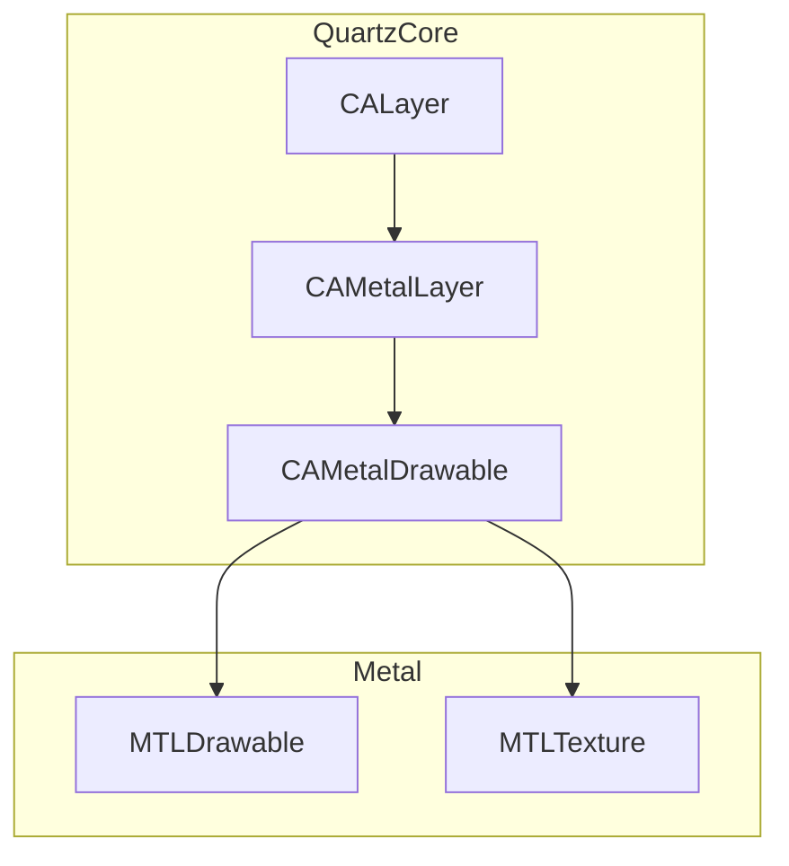
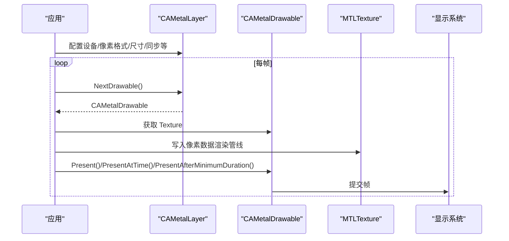
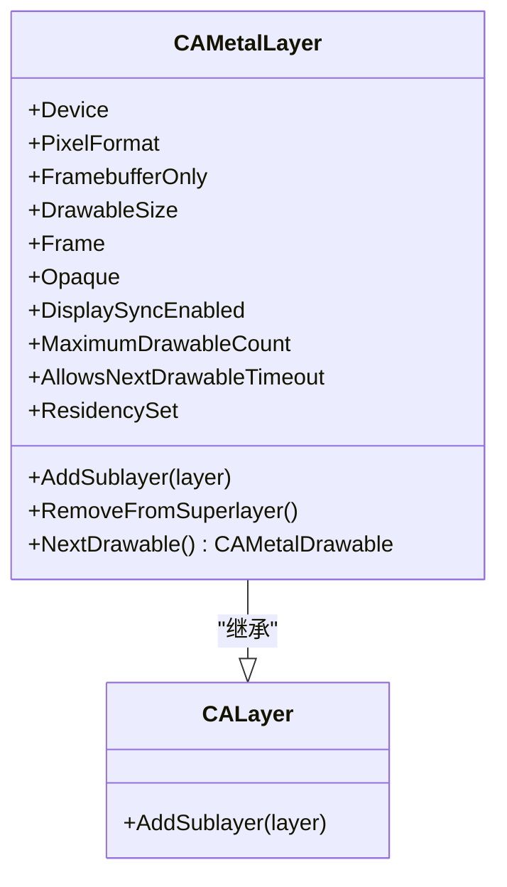
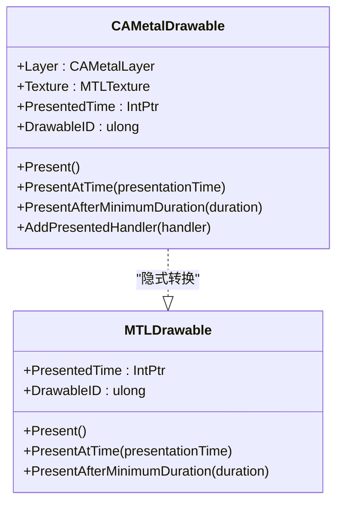
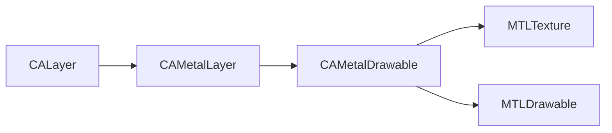

# QuartzCore 显示框架 API

<cite>
**本文引用的文件**
- [CAMetalLayer.cs](file://src/SharpMetal/QuartzCore/CAMetalLayer.cs)
- [CAMetalDrawable.cs](file://src/SharpMetal/QuartzCore/CAMetalDrawable.cs)
- [CALayer.cs](file://src/SharpMetal/QuartzCore/CALayer.cs)
- [MTLDrawable.cs](file://src/SharpMetal/Metal/MTLDrawable.cs)
- [MTLTexture.cs](file://src/SharpMetal/Metal/MTLTexture.cs)
- [Program.cs](file://samples/SharpMetal.Sample/Program.cs)
</cite>

## 目录
1. [简介](#简介)
2. [项目结构](#项目结构)
3. [核心组件](#核心组件)
4. [架构总览](#架构总览)
5. [详细组件分析](#详细组件分析)
6. [依赖关系分析](#依赖关系分析)
7. [性能考虑](#性能考虑)
8. [故障排查指南](#故障排查指南)
9. [结论](#结论)
10. [附录：完整使用流程与示例路径](#附录完整使用流程与示例路径)

## 简介
本参考文档聚焦于 QuartzCore 显示框架在 SharpMetal 中的绑定实现，围绕以下目标展开：
- CAMetalLayer 金属图层的配置属性、尺寸设置与显示模式
- CAMetalDrawable 可绘制对象的获取与管理方法，包括帧缓冲区访问与提交流程
- CALayer 基础图层类的继承关系与基本功能
- 与 UIKit/AppKit 集成的工作流程（视图层次结构中的使用方式）
- 提供完整的代码示例路径，展示如何设置 Metal 图层、获取可绘制对象并执行渲染操作

该文档以源码为依据，确保所有描述均可追溯到具体实现。

## 项目结构
QuartzCore 相关类型位于 src/SharpMetal/QuartzCore 目录下，包含：
- CAMetalLayer：Metal 专用图层，负责设备、像素格式、帧缓冲行为、可绘制对象生命周期等
- CAMetalDrawable：单帧可绘制对象，封装纹理、呈现时间与呈现控制
- CALayer：基础图层类型，提供图层树的基本能力（如添加子图层）

此外，Metal 层通过 MTLDrawable、MTLTexture 等类型与底层 GPU 资源交互；示例工程位于 samples/SharpMetal.Sample。

图表来源
- [CALayer.cs:5-19](file://src/SharpMetal/QuartzCore/CALayer.cs#L5-L19)
- [CAMetalLayer.cs:7-134](file://src/SharpMetal/QuartzCore/CAMetalLayer.cs#L7-L134)
- [CAMetalDrawable.cs:11-69](file://src/SharpMetal/QuartzCore/CAMetalDrawable.cs#L11-L69)
- [MTLDrawable.cs:6-38](file://src/SharpMetal/Metal/MTLDrawable.cs#L6-L38)
- [MTLTexture.cs:75-200](file://src/SharpMetal/Metal/MTLTexture.cs#L75-L200)

章节来源
- [README.md:1-23](file://README.md#L1-L23)

## 核心组件
本节对三个核心类型进行概览式说明，后续章节将深入细节。

- CALayer：基础图层类型，提供图层树管理能力（例如添加子图层）。它是 CAMetalLayer 的基类概念映射。
- CAMetalLayer：Metal 专用图层，暴露设备、像素格式、是否仅帧缓冲、可绘制尺寸、不透明度、显示同步、最大可绘制数量、超时策略等关键属性，并提供 NextDrawable 获取下一帧可绘制对象的能力。
- CAMetalDrawable：代表一帧的可绘制对象，提供纹理访问、呈现时间、ID、呈现方法与回调注册等能力，并可隐式转换为 MTLDrawable。

章节来源
- [CALayer.cs:5-19](file://src/SharpMetal/QuartzCore/CALayer.cs#L5-L19)
- [CAMetalLayer.cs:17-86](file://src/SharpMetal/QuartzCore/CAMetalLayer.cs#L17-L86)
- [CAMetalDrawable.cs:11-69](file://src/SharpMetal/QuartzCore/CAMetalDrawable.cs#L11-L69)

## 架构总览
下图展示了从应用侧到系统显示的典型数据流：应用创建或持有 CAMetalLayer，逐帧调用 NextDrawable 获取 CAMetalDrawable，写入其 Texture 作为渲染目标，完成后调用 Present 系列方法提交至显示系统。

图表来源
- [CAMetalLayer.cs:76-79](file://src/SharpMetal/QuartzCore/CAMetalLayer.cs#L76-L79)
- [CAMetalDrawable.cs:19-40](file://src/SharpMetal/QuartzCore/CAMetalDrawable.cs#L19-L40)
- [MTLDrawable.cs:12-29](file://src/SharpMetal/Metal/MTLDrawable.cs#L12-L29)

## 详细组件分析

### CAMetalLayer：金属图层配置与显示模式
- 设备与像素格式
  - Device：关联的 Metal 设备
  - PixelFormat：像素格式，影响颜色通道与采样
- 帧缓冲行为
  - FramebufferOnly：是否仅用于帧缓冲（通常设为 true 以获得最佳性能）
  - MaximumDrawableCount：最大可绘制数量，影响流水线并行度与内存占用
  - AllowsNextDrawableTimeout：允许等待下一帧超时，避免阻塞
- 尺寸与布局
  - DrawableSize：可绘制区域大小（单位通常为点），应与期望分辨率匹配
  - Frame：图层矩形（位置与大小）
  - Opaque：是否不透明，影响合成优化
- 显示同步
  - DisplaySyncEnabled：是否启用显示同步（VSync），有助于减少撕裂
- 生命周期与层级
  - AddSublayer/RemoveFromSuperlayer：参与图层树管理
  - ResidencySet：Metal 26+  residency set，跟踪可绘制纹理驻留状态（需在命令队列中使用）
- 获取可绘制对象
  - NextDrawable：获取下一帧 CAMetalDrawable

图表来源
- [CAMetalLayer.cs:17-86](file://src/SharpMetal/QuartzCore/CAMetalLayer.cs#L17-L86)
- [CALayer.cs:5-19](file://src/SharpMetal/QuartzCore/CALayer.cs#L5-L19)

章节来源
- [CAMetalLayer.cs:17-86](file://src/SharpMetal/QuartzCore/CAMetalLayer.cs#L17-L86)

### CAMetalDrawable：可绘制对象与帧缓冲访问
- 基本信息
  - Layer：所属 CAMetalLayer
  - Texture：当前帧的纹理，作为渲染目标
  - PresentedTime：呈现时间戳
  - DrawableID：可绘制对象唯一标识
- 呈现控制
  - Present()：立即呈现
  - PresentAtTime(presentationTime)：在指定时间呈现
  - PresentAfterMinimumDuration(duration)：满足最小持续时间后呈现
- 回调
  - AddPresentedHandler(handler)：注册呈现完成回调（块包装与释放由绑定处理）
- 互操作
  - 隐式转换为 MTLDrawable，便于与 Metal 命令序列集成

图表来源
- [CAMetalDrawable.cs:11-69](file://src/SharpMetal/QuartzCore/CAMetalDrawable.cs#L11-L69)
- [MTLDrawable.cs:6-38](file://src/SharpMetal/Metal/MTLDrawable.cs#L6-L38)

章节来源
- [CAMetalDrawable.cs:11-69](file://src/SharpMetal/QuartzCore/CAMetalDrawable.cs#L11-L69)

### CALayer：基础图层类
- 提供图层树的基本能力，如添加子图层
- 作为 CAMetalLayer 的基础类型，承载通用图层语义

章节来源
- [CALayer.cs:5-19](file://src/SharpMetal/QuartzCore/CALayer.cs#L5-L19)

### 与 UIKit/AppKit 集成的工作流程
- 在 iOS/macOS 应用中，通常将 CAMetalLayer 添加到 UIView/NSView 的 layer 中，使 Metal 渲染结果直接输出到视图内容
- 常见步骤：
  - 创建或获取 CAMetalLayer，并设置 Device、PixelFormat、DrawableSize、DisplaySyncEnabled、MaximumDrawableCount 等
  - 将 CAMetalLayer 设置为视图的 layer（或通过子类化视图覆盖 layerClass）
  - 在视图生命周期内（如 layoutSubviews 或屏幕刷新回调）循环获取 CAMetalDrawable，渲染到其 Texture，然后呈现
- 注意：
  - 若设置 FramebufferOnly=true，则图层仅用于帧缓冲，不可读取像素
  - 合理设置 MaximumDrawableCount 以平衡延迟与内存
  - 使用 DisplaySyncEnabled 与呈现时间控制，避免过度刷新或撕裂

（本节为概念性说明，不直接引用具体文件）

## 依赖关系分析
- CAMetalLayer 依赖 Objective-C 运行时选择器与 Metal 设备/像素格式类型
- CAMetalDrawable 依赖 MTLTexture 作为渲染目标，并可转换为 MTLDrawable 以融入 Metal 命令序列
- 示例工程展示了 Metal 设备与共享缓冲的基本用法，可作为理解资源生命周期的参考

图表来源
- [CALayer.cs:5-19](file://src/SharpMetal/QuartzCore/CALayer.cs#L5-L19)
- [CAMetalLayer.cs:17-86](file://src/SharpMetal/QuartzCore/CAMetalLayer.cs#L17-L86)
- [CAMetalDrawable.cs:11-69](file://src/SharpMetal/QuartzCore/CAMetalDrawable.cs#L11-L69)
- [MTLDrawable.cs:6-38](file://src/SharpMetal/Metal/MTLDrawable.cs#L6-L38)
- [MTLTexture.cs:75-200](file://src/SharpMetal/Metal/MTLTexture.cs#L75-L200)

章节来源
- [Program.cs:21-45](file://samples/SharpMetal.Sample/Program.cs#L21-L45)

## 性能考虑
- FramebufferOnly 建议为 true：减少不必要的读写路径，提升带宽利用率
- MaximumDrawableCount：根据目标帧率与 GPU 负载调整，过大增加内存与延迟，过小限制并行度
- DisplaySyncEnabled：开启以减少撕裂；关闭时需谨慎控制呈现频率
- AllowsNextDrawableTimeout：在高负载场景下避免无限等待导致卡顿
- 纹理与资源复用：尽量复用 MTLTexture/Buffer，减少分配开销
- 呈现时机：使用 PresentAtTime/PresentAfterMinimumDuration 精确控制呈现节奏，降低功耗与抖动

（本节提供通用指导，不直接引用具体文件）

## 故障排查指南
- 无 Metal 设备或初始化失败
  - 现象：无法创建设备或资源
  - 排查：确认运行平台支持 Metal，检查设备创建返回值
  - 参考路径：[Program.cs:21-27](file://samples/SharpMetal.Sample/Program.cs#L21-L27)
- 共享缓冲读写不一致
  - 现象：读回数据异常
  - 排查：确认存储模式与一致性要求，必要时进行内存屏障或同步
  - 参考路径：[Program.cs:27-37](file://samples/SharpMetal.Sample/Program.cs#L27-L37)
- 可绘制对象为空或呈现失败
  - 现象：NextDrawable 返回空或呈现无效
  - 排查：检查 DrawableSize 是否与视图尺寸一致，Pixel Format 是否受支持，Display Sync 与最大可绘制数设置是否合理
  - 参考路径：[CAMetalLayer.cs:35-63](file://src/SharpMetal/QuartzCore/CAMetalLayer.cs#L35-L63), [CAMetalDrawable.cs:19-40](file://src/SharpMetal/QuartzCore/CAMetalDrawable.cs#L19-L40)
- 回调未触发或内存泄漏
  - 现象：AddPresentedHandler 回调未执行或内存增长
  - 排查：确认块复制与释放逻辑正确，避免重复注册或强引用循环
  - 参考路径：[CAMetalDrawable.cs:42-55](file://src/SharpMetal/QuartzCore/CAMetalDrawable.cs#L42-L55)

章节来源
- [Program.cs:21-45](file://samples/SharpMetal.Sample/Program.cs#L21-L45)
- [CAMetalLayer.cs:35-63](file://src/SharpMetal/QuartzCore/CAMetalLayer.cs#L35-L63)
- [CAMetalDrawable.cs:42-55](file://src/SharpMetal/QuartzCore/CAMetalDrawable.cs#L42-L55)

## 结论
SharpMetal 对 QuartzCore 的绑定提供了清晰的 Metal 图层与可绘制对象抽象。通过 CAMetalLayer 配置设备与显示参数，使用 CAMetalDrawable 获取帧纹理并完成渲染与呈现，结合 MTLDrawable/MTLTexture 融入 Metal 命令序列，即可在 UIKit/AppKit 视图中高效输出图形内容。遵循性能与同步的最佳实践，可获得稳定流畅的渲染体验。

## 附录：完整使用流程与示例路径
以下为“设置 Metal 图层、获取可绘制对象并执行渲染”的端到端流程与对应源码路径指引（不包含具体代码内容）：

- 步骤 1：创建或获取 CAMetalLayer，并配置关键属性
  - 设备与像素格式：Device、PixelFormat
  - 帧缓冲行为：FramebufferOnly、MaximumDrawableCount、AllowsNextDrawableTimeout
  - 尺寸与同步：DrawableSize、DisplaySyncEnabled、Opaque
  - 参考路径：[CAMetalLayer.cs:17-63](file://src/SharpMetal/QuartzCore/CAMetalLayer.cs#L17-L63)

- 步骤 2：将 CAMetalLayer 添加到视图层次结构
  - 在 iOS/macOS 应用中，将 CAMetalLayer 设置为 UIView/NSView 的 layer
  - 参考路径：[CALayer.cs:13-16](file://src/SharpMetal/QuartzCore/CALayer.cs#L13-L16)

- 步骤 3：每帧获取 CAMetalDrawable 并渲染
  - 调用 NextDrawable 获取可绘制对象
  - 通过 Texture 属性获取 MTLTexture 作为渲染目标
  - 参考路径：[CAMetalLayer.cs:76-79](file://src/SharpMetal/QuartzCore/CAMetalLayer.cs#L76-L79), [CAMetalDrawable.cs:19-21](file://src/SharpMetal/QuartzCore/CAMetalDrawable.cs#L19-L21)

- 步骤 4：提交帧到显示系统
  - 使用 Present()/PresentAtTime()/PresentAfterMinimumDuration() 呈现
  - 可选：注册 AddPresentedHandler 回调以监听呈现完成
  - 参考路径：[CAMetalDrawable.cs:27-55](file://src/SharpMetal/QuartzCore/CAMetalDrawable.cs#L27-L55), [MTLDrawable.cs:16-29](file://src/SharpMetal/Metal/MTLDrawable.cs#L16-L29)

- 步骤 5：资源管理与错误处理
  - 合理设置 MaximumDrawableCount 与 DisplaySyncEnabled
  - 检查设备与资源创建是否成功
  - 参考路径：[Program.cs:21-45](file://samples/SharpMetal.Sample/Program.cs#L21-L45)

（本节为流程指引，不直接引用具体代码片段）