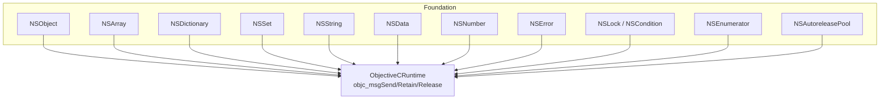
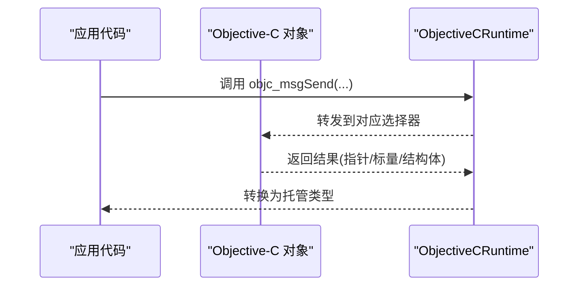
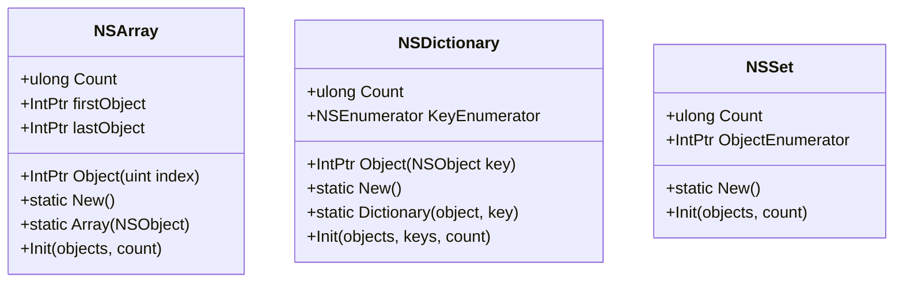
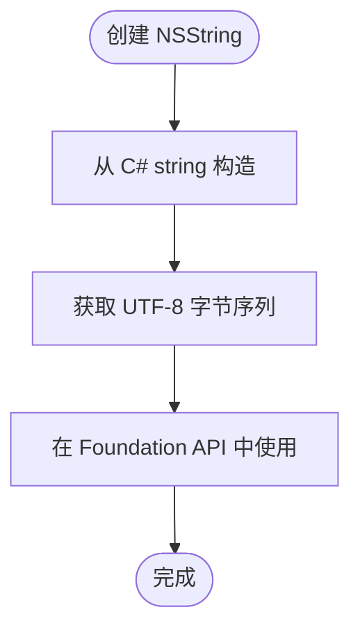
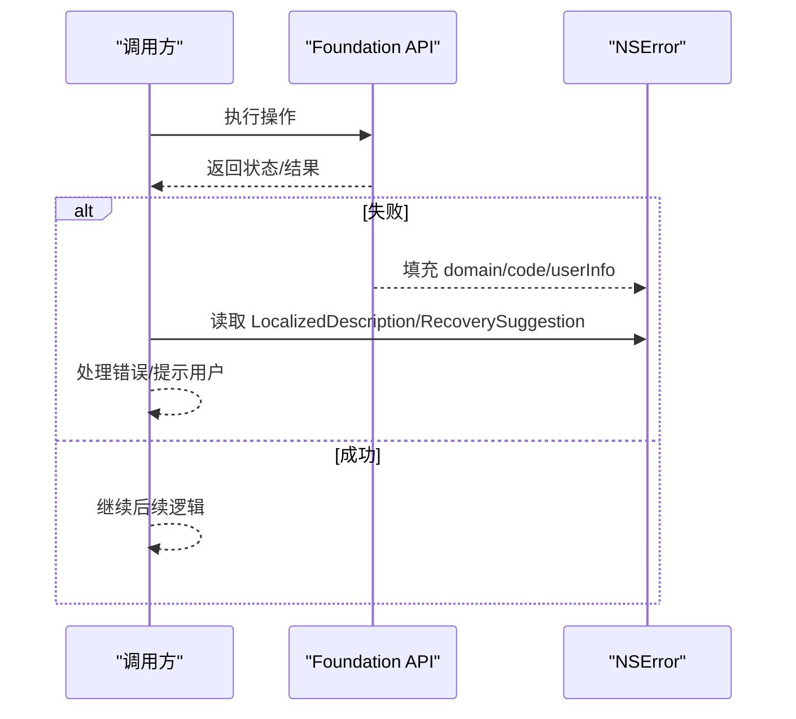
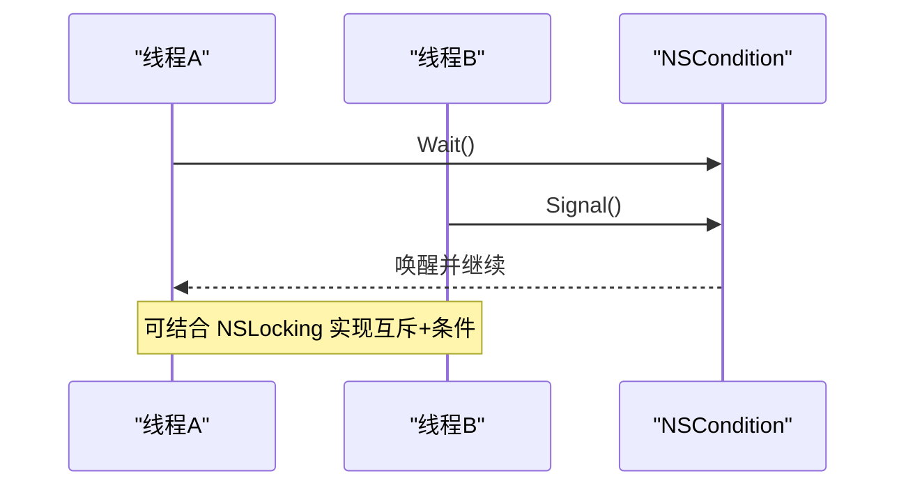
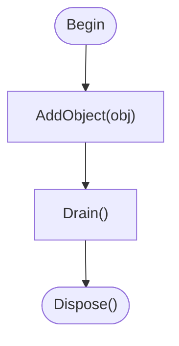
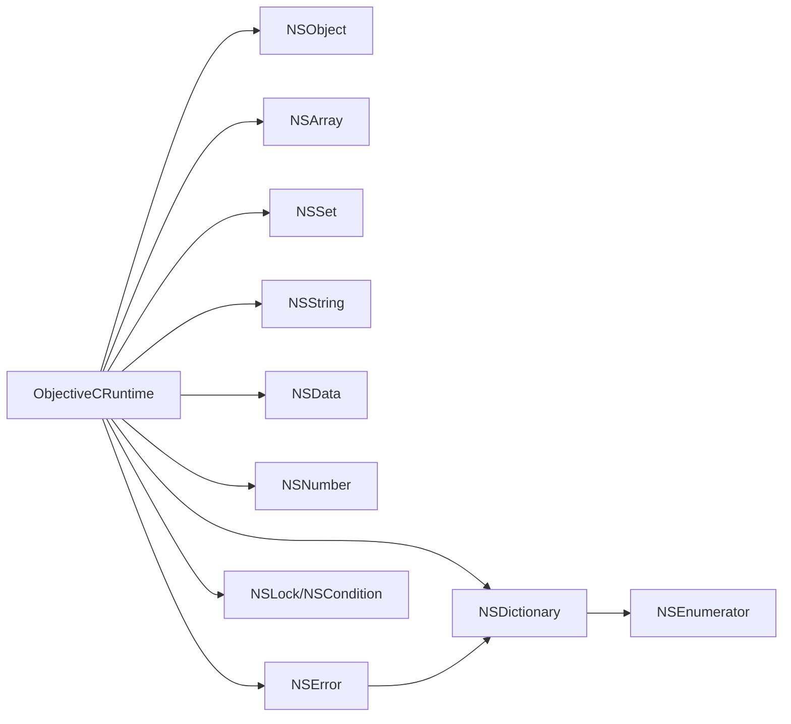

# Foundation 框架绑定

<cite>
**本文引用的文件**
- [NSObject.cs](file://src/SharpMetal/Foundation/NSObject.cs)
- [NSArray.cs](file://src/SharpMetal/Foundation/NSArray.cs)
- [NSDictionary.cs](file://src/SharpMetal/Foundation/NSDictionary.cs)
- [NSSet.cs](file://src/SharpMetal/Foundation/NSSet.cs)
- [NSString.cs](file://src/SharpMetal/Foundation/NSString.cs)
- [NSData.cs](file://src/SharpMetal/Foundation/NSData.cs)
- [NSNumber.cs](file://src/SharpMetal/Foundation/NSNumber.cs)
- [NSError.cs](file://src/SharpMetal/Foundation/NSError.cs)
- [NSLock.cs](file://src/SharpMetal/Foundation/NSLock.cs)
- [NSEnumerator.cs](file://src/SharpMetal/Foundation/NSEnumerator.cs)
- [NSAutoreleasePool.cs](file://src/SharpMetal/Foundation/NSAutoreleasePool.cs)
- [ObjectiveCRuntime.cs](file://src/SharpMetal/ObjectiveCCore/ObjectiveCRuntime.cs)
</cite>

## 目录
1. [简介](#简介)
2. [项目结构](#项目结构)
3. [核心组件](#核心组件)
4. [架构总览](#架构总览)
5. [详细组件分析](#详细组件分析)
6. [依赖关系分析](#依赖关系分析)
7. [性能考虑](#性能考虑)
8. [故障排查指南](#故障排查指南)
9. [结论](#结论)
10. [附录：使用示例与最佳实践](#附录使用示例与最佳实践)

## 简介
本文件为 SharpMetal 项目中 Foundation 框架绑定的综合文档，聚焦以下目标：
- NSObject 基类的设计与功能，对象生命周期、引用计数与内存管理
- 集合类型 NSArray、NSDictionary、NSSet 的使用方法与性能考量
- 数据类型绑定 NSString、NSData、NSNumber 的操作方法
- 错误处理 NSError 的使用模式
- 线程同步原语 NSLock（含 NSCondition）的用法
- 提供丰富的代码示例路径与最佳实践建议

## 项目结构
Foundation 绑定位于 src/SharpMetal/Foundation 目录下，围绕 Objective-C Runtime 的 C 接口进行托管封装。核心依赖是 ObjectiveCCore.ObjectiveCRuntime，用于通过动态调用 objc_msgSend 等运行时函数访问 Objective-C 对象与方法。

图表来源
- [NSObject.cs:48-90](file://src/SharpMetal/Foundation/NSObject.cs#L48-L90)
- [NSArray.cs:5-64](file://src/SharpMetal/Foundation/NSArray.cs#L5-L64)
- [NSDictionary.cs:5-53](file://src/SharpMetal/Foundation/NSDictionary.cs#L5-L53)
- [NSSet.cs:5-34](file://src/SharpMetal/Foundation/NSSet.cs#L5-L34)
- [NSString.cs:65-186](file://src/SharpMetal/Foundation/NSString.cs#L65-L186)
- [NSData.cs:5-20](file://src/SharpMetal/Foundation/NSData.cs#L5-L20)
- [NSNumber.cs:61-271](file://src/SharpMetal/Foundation/NSNumber.cs#L61-L271)
- [NSError.cs:5-49](file://src/SharpMetal/Foundation/NSError.cs#L5-L49)
- [NSLock.cs:5-47](file://src/SharpMetal/Foundation/NSLock.cs#L5-L47)
- [NSEnumerator.cs:6-44](file://src/SharpMetal/Foundation/NSEnumerator.cs#L6-L44)
- [NSAutoreleasePool.cs:5-39](file://src/SharpMetal/Foundation/NSAutoreleasePool.cs#L5-L39)
- [ObjectiveCRuntime.cs:33-800](file://src/SharpMetal/ObjectiveCCore/ObjectiveCRuntime.cs#L33-L800)

章节来源
- [NSObject.cs:48-90](file://src/SharpMetal/Foundation/NSObject.cs#L48-L90)
- [ObjectiveCRuntime.cs:33-800](file://src/SharpMetal/ObjectiveCCore/ObjectiveCRuntime.cs#L33-L800)

## 核心组件
- NSObject：所有 Foundation 对象的根，暴露哈希、描述、相等性判断、类型检查等基础能力；通过 ObjectiveCRuntime 调用底层方法。
- 集合：NSArray（有序）、NSDictionary（键值对）、NSSet（无序唯一），均提供创建、枚举、计数与元素访问。
- 数据类型：NSString（字符串）、NSData（二进制数据）、NSNumber（数值包装）。
- 错误处理：NSError（域、码、用户信息、本地化消息）。
- 并发：NSLocking 接口与 NSCondition（等待/信号/广播）。
- 自动释放池：NSAutoreleasePool（Begin/Drain/AddObject/Dispose）。
- 枚举器：NSEnumerator/NSFastEnumeration（快速枚举支持）。

章节来源
- [NSObject.cs:48-90](file://src/SharpMetal/Foundation/NSObject.cs#L48-L90)
- [NSArray.cs:5-64](file://src/SharpMetal/Foundation/NSArray.cs#L5-L64)
- [NSDictionary.cs:5-53](file://src/SharpMetal/Foundation/NSDictionary.cs#L5-L53)
- [NSSet.cs:5-34](file://src/SharpMetal/Foundation/NSSet.cs#L5-L34)
- [NSString.cs:65-186](file://src/SharpMetal/Foundation/NSString.cs#L65-L186)
- [NSData.cs:5-20](file://src/SharpMetal/Foundation/NSData.cs#L5-L20)
- [NSNumber.cs:61-271](file://src/SharpMetal/Foundation/NSNumber.cs#L61-L271)
- [NSError.cs:5-49](file://src/SharpMetal/Foundation/NSError.cs#L5-L49)
- [NSLock.cs:5-47](file://src/SharpMetal/Foundation/NSLock.cs#L5-L47)
- [NSEnumerator.cs:6-44](file://src/SharpMetal/Foundation/NSEnumerator.cs#L6-L44)
- [NSAutoreleasePool.cs:5-39](file://src/SharpMetal/Foundation/NSAutoreleasePool.cs#L5-L39)

## 架构总览
Foundation 绑定以“薄封装”的方式将 Objective-C 对象映射为 C# struct，并通过 ObjectiveCRuntime 直接调用运行时。这种设计避免了额外的抽象层开销，同时保持与原生行为一致。

图表来源
- [ObjectiveCRuntime.cs:118-800](file://src/SharpMetal/ObjectiveCCore/ObjectiveCRuntime.cs#L118-L800)

## 详细组件分析

### NSObject 基类
- 职责：提供哈希、描述、调试描述、相等性比较、类型检查、响应式检测等基础能力。
- 内存管理：不直接持有所有权，通常由上层或自动释放池管理；可通过 ObjectiveCRuntime.Retain/Release 显式控制引用计数。
- 关键方法路径参考：
  - 哈希/描述/调试描述：[NSObject.cs:54-58](file://src/SharpMetal/Foundation/NSObject.cs#L54-L58)
  - 相等性与类型检查：[NSObject.cs:60-79](file://src/SharpMetal/Foundation/NSObject.cs#L60-L79)

章节来源
- [NSObject.cs:48-90](file://src/SharpMetal/Foundation/NSObject.cs#L48-L90)

### 集合类型：NSArray、NSDictionary、NSSet
- NSArray
  - 创建：New、Array(pObject)、Array(pObjects, count)
  - 访问：Count、firstObject、lastObject、索引器 this[index]、Object(index)
  - 初始化：initWithObjects:count:、initWithCoder:
  - 参考路径：[NSArray.cs:11-50](file://src/SharpMetal/Foundation/NSArray.cs#L11-L50)
- NSDictionary
  - 创建：New、Dictionary(object,key)、Dictionary(objects,keys,count)
  - 访问：Count、KeyEnumerator、Object(key)
  - 初始化：initWithObjects:forKeys:count:、initWithCoder:
  - 参考路径：[NSDictionary.cs:11-40](file://src/SharpMetal/Foundation/NSDictionary.cs#L11-L40)
- NSSet
  - 创建：New
  - 访问：Count、ObjectEnumerator
  - 初始化：initWithObjects:count:、initWithCoder:
  - 参考路径：[NSSet.cs:11-25](file://src/SharpMetal/Foundation/NSSet.cs#L11-L25)

图表来源
- [NSArray.cs:5-64](file://src/SharpMetal/Foundation/NSArray.cs#L5-L64)
- [NSDictionary.cs:5-53](file://src/SharpMetal/Foundation/NSDictionary.cs#L5-L53)
- [NSSet.cs:5-34](file://src/SharpMetal/Foundation/NSSet.cs#L5-L34)

章节来源
- [NSArray.cs:5-64](file://src/SharpMetal/Foundation/NSArray.cs#L5-L64)
- [NSDictionary.cs:5-53](file://src/SharpMetal/Foundation/NSDictionary.cs#L5-L53)
- [NSSet.cs:5-34](file://src/SharpMetal/Foundation/NSSet.cs#L5-L34)

### 数据类型绑定：NSString、NSData、NSNumber
- NSString
  - 构造：从 C# string、UTF-16 字符缓冲、C 字符串（带编码）、字节缓冲（无拷贝）
  - 访问：Length、Character(index)、CString(encoding)、MaximumLengthOfBytes、LengthOfBytes
  - 操作：IsEqualToString、RangeOfString(options)、StringByAppendingString、CaseInsensitiveCompare
  - 参考路径：[NSString.cs:71-186](file://src/SharpMetal/Foundation/NSString.cs#L71-L186)
- NSData
  - 访问：Bytes、MutableBytes、Length
  - 参考路径：[NSData.cs:11-19](file://src/SharpMetal/Foundation/NSData.cs#L11-L19)
- NSNumber
  - 构造：Number(value) 多类型重载；Init(value) 多类型重载
  - 访问：CharValue/ShortValue/IntValue/LongValue/FloatValue/DoubleValue/BoolValue 等
  - 比较与描述：Compare、IsEqualToNumber、DescriptionWithLocale
  - 参考路径：[NSNumber.cs:67-271](file://src/SharpMetal/Foundation/NSNumber.cs#L67-L271)

图表来源
- [NSString.cs:71-98](file://src/SharpMetal/Foundation/NSString.cs#L71-L98)

章节来源
- [NSString.cs:65-186](file://src/SharpMetal/Foundation/NSString.cs#L65-L186)
- [NSData.cs:5-20](file://src/SharpMetal/Foundation/NSData.cs#L5-L20)
- [NSNumber.cs:61-271](file://src/SharpMetal/Foundation/NSNumber.cs#L61-L271)

### 错误处理：NSError
- 属性：Code、Domain、UserInfo、LocalizedDescription、LocalizedRecoveryOptions、LocalizedRecoverySuggestion、LocalizedFailureReason
- 工厂与初始化：Error(domain, code, userInfo)、Init(domain, code, userInfo)
- 典型流程：调用可能失败的 API -> 若失败则构建 NSError -> 读取本地化信息与恢复建议
- 参考路径：[NSError.cs:11-35](file://src/SharpMetal/Foundation/NSError.cs#L11-L35)

图表来源
- [NSError.cs:11-35](file://src/SharpMetal/Foundation/NSError.cs#L11-L35)

章节来源
- [NSError.cs:5-49](file://src/SharpMetal/Foundation/NSError.cs#L5-L49)

### 线程同步：NSLock 与 NSCondition
- NSLocking：作为锁接口的句柄类型
- NSCondition：条件变量，支持 Wait、WaitUntilDate(limit)、Signal、Broadcast
- 典型用法：在临界区前加锁，条件满足时 Signal/Broadcast，否则 Wait
- 参考路径：[NSLock.cs:5-47](file://src/SharpMetal/Foundation/NSLock.cs#L5-L47)

图表来源
- [NSLock.cs:12-47](file://src/SharpMetal/Foundation/NSLock.cs#L12-L47)

章节来源
- [NSLock.cs:5-47](file://src/SharpMetal/Foundation/NSLock.cs#L5-L47)

### 自动释放池：NSAutoreleasePool
- Begin：创建新的自动释放池
- AddObject：将对象加入当前池
- Drain：释放池中对象
- Dispose：释放池本身
- 参考路径：[NSAutoreleasePool.cs:11-26](file://src/SharpMetal/Foundation/NSAutoreleasePool.cs#L11-L26)

图表来源
- [NSAutoreleasePool.cs:11-26](file://src/SharpMetal/Foundation/NSAutoreleasePool.cs#L11-L26)

章节来源
- [NSAutoreleasePool.cs:5-39](file://src/SharpMetal/Foundation/NSAutoreleasePool.cs#L5-L39)

### 枚举器：NSEnumerator 与 NSFastEnumeration
- NSEnumerator：传统迭代器，提供 CountByEnumerating
- NSFastEnumeration：快速枚举协议，优化遍历性能
- 参考路径：[NSEnumerator.cs:6-44](file://src/SharpMetal/Foundation/NSEnumerator.cs#L6-L44)

章节来源
- [NSEnumerator.cs:6-44](file://src/SharpMetal/Foundation/NSEnumerator.cs#L6-L44)

## 依赖关系分析
- 所有 Foundation 类型都依赖 ObjectiveCRuntime 提供的 objc_msgSend 系列重载以及 Retain/Release/GetRetainCount。
- 集合类型依赖 NSEnumerator 进行遍历。
- NSString 依赖 NSUtil.GetUtf8String 将 UTF-8 字节串转换为 C# string。
- NSError 依赖 NSDictionary 承载用户信息。

图表来源
- [ObjectiveCRuntime.cs:118-800](file://src/SharpMetal/ObjectiveCCore/ObjectiveCRuntime.cs#L118-L800)
- [NSArray.cs:5-64](file://src/SharpMetal/Foundation/NSArray.cs#L5-L64)
- [NSDictionary.cs:5-53](file://src/SharpMetal/Foundation/NSDictionary.cs#L5-L53)
- [NSSet.cs:5-34](file://src/SharpMetal/Foundation/NSSet.cs#L5-L34)
- [NSString.cs:65-186](file://src/SharpMetal/Foundation/NSString.cs#L65-L186)
- [NSData.cs:5-20](file://src/SharpMetal/Foundation/NSData.cs#L5-L20)
- [NSNumber.cs:61-271](file://src/SharpMetal/Foundation/NSNumber.cs#L61-L271)
- [NSError.cs:5-49](file://src/SharpMetal/Foundation/NSError.cs#L5-L49)
- [NSLock.cs:5-47](file://src/SharpMetal/Foundation/NSLock.cs#L5-L47)
- [NSEnumerator.cs:6-44](file://src/SharpMetal/Foundation/NSEnumerator.cs#L6-L44)

章节来源
- [ObjectiveCRuntime.cs:118-800](file://src/SharpMetal/ObjectiveCCore/ObjectiveCRuntime.cs#L118-L800)

## 性能考虑
- 集合访问
  - NSArray 按索引访问为 O(1)，适合随机访问场景。
  - NSDictionary 查找平均 O(1)，适合键值映射。
  - NSSet 成员检测平均 O(1)，适合去重与存在性判断。
- 字符串处理
  - 避免频繁创建临时 NSString；尽量复用或批量转换。
  - 使用 RangeOfString 与选项进行高效子串定位。
- 枚举
  - 优先使用快速枚举（NSEnumerator/NSFastEnumeration）以减少桥接开销。
- 内存管理
  - 合理使用 NSAutoreleasePool 包裹短期大量临时对象，减少峰值内存。
  - 谨慎使用 Retain/Release；仅在明确所有权语义时使用。
- 错误处理
  - 及时检查 NSError，避免静默失败导致后续逻辑异常。

## 故障排查指南
- 空指针与零地址
  - 调用 RespondsToSelector 前确保 NativePtr 与 Selector 非空，避免崩溃。
  - 参考路径：[NSObject.cs:70-79](file://src/SharpMetal/Foundation/NSObject.cs#L70-L79)
- 越界访问
  - 访问 NSArray 元素前先检查 Count 与索引范围。
  - 参考路径：[NSArray.cs:19-25](file://src/SharpMetal/Foundation/NSArray.cs#L19-L25)
- 编码问题
  - NSString 构造与转换需匹配正确编码；长度计算使用 MaximumLengthOfBytes 预留空间。
  - 参考路径：[NSString.cs:120-143](file://src/SharpMetal/Foundation/NSString.cs#L120-L143)
- 错误信息缺失
  - 当 API 返回失败时，务必读取 NSError.LocalizedDescription 与 UserInfo 以便诊断。
  - 参考路径：[NSError.cs:13-25](file://src/SharpMetal/Foundation/NSError.cs#L13-L25)
- 线程安全
  - 共享资源访问需配合 NSLocking 与 NSCondition，避免竞态条件。
  - 参考路径：[NSLock.cs:12-47](file://src/SharpMetal/Foundation/NSLock.cs#L12-L47)

章节来源
- [NSObject.cs:70-79](file://src/SharpMetal/Foundation/NSObject.cs#L70-L79)
- [NSArray.cs:19-25](file://src/SharpMetal/Foundation/NSArray.cs#L19-L25)
- [NSString.cs:120-143](file://src/SharpMetal/Foundation/NSString.cs#L120-L143)
- [NSError.cs:13-25](file://src/SharpMetal/Foundation/NSError.cs#L13-L25)
- [NSLock.cs:12-47](file://src/SharpMetal/Foundation/NSLock.cs#L12-L47)

## 结论
SharpMetal 的 Foundation 绑定以轻量、贴近原生的方式暴露了 iOS/macOS 的核心能力。通过 ObjectiveCRuntime 的直接调用，既保持了高性能，又提供了清晰的托管 API。遵循本文档中的最佳实践，可以在保证稳定性的前提下充分发挥 Foundation 的能力。

## 附录：使用示例与最佳实践
以下为常见用法的“代码片段路径”，便于快速定位实现位置与签名：

- 创建与管理自动释放池
  - 开始/结束：[NSAutoreleasePool.cs:11-26](file://src/SharpMetal/Foundation/NSAutoreleasePool.cs#L11-L26)
- 数组操作
  - 创建与访问：[NSArray.cs:11-50](file://src/SharpMetal/Foundation/NSArray.cs#L11-L50)
- 字典操作
  - 创建与查询：[NSDictionary.cs:11-40](file://src/SharpMetal/Foundation/NSDictionary.cs#L11-L40)
- 集合操作
  - 创建与枚举：[NSSet.cs:11-25](file://src/SharpMetal/Foundation/NSSet.cs#L11-L25)
- 字符串处理
  - 构造与转换：[NSString.cs:71-186](file://src/SharpMetal/Foundation/NSString.cs#L71-L186)
- 数值包装
  - 构造与取值：[NSNumber.cs:67-271](file://src/SharpMetal/Foundation/NSNumber.cs#L67-L271)
- 二进制数据
  - 访问与长度：[NSData.cs:11-19](file://src/SharpMetal/Foundation/NSData.cs#L11-L19)
- 错误处理
  - 构建与读取：[NSError.cs:11-35](file://src/SharpMetal/Foundation/NSError.cs#L11-L35)
- 线程同步
  - 条件变量：[NSLock.cs:12-47](file://src/SharpMetal/Foundation/NSLock.cs#L12-L47)

最佳实践要点
- 始终在可能的失败点检查 NSError，并记录 LocalizedDescription。
- 使用 NSAutoreleasePool 包裹短时大量临时对象，降低内存峰值。
- 对共享数据结构加锁并使用 NSCondition 协调生产者/消费者。
- 优先使用快速枚举与集合的高效 API（如字典查找、集合成员检测）。
- 谨慎管理引用计数，避免重复 Release 或未释放导致的泄漏。