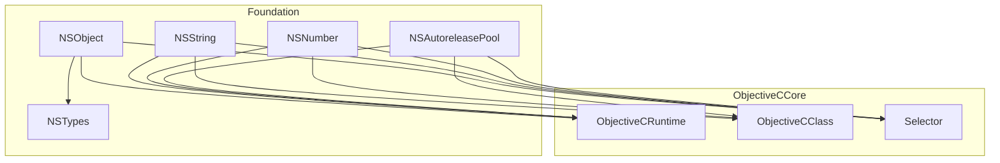
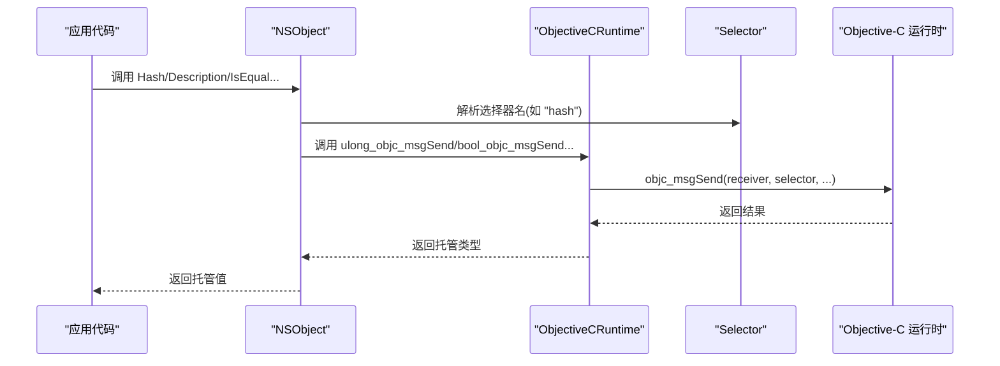
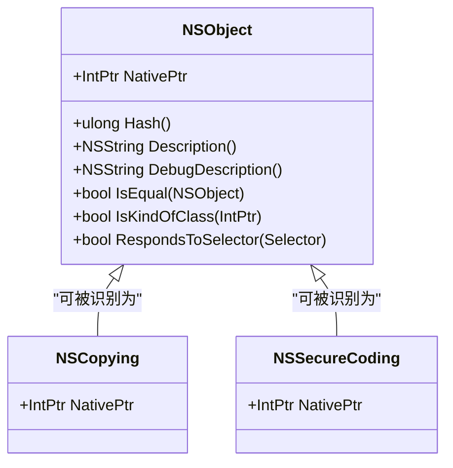
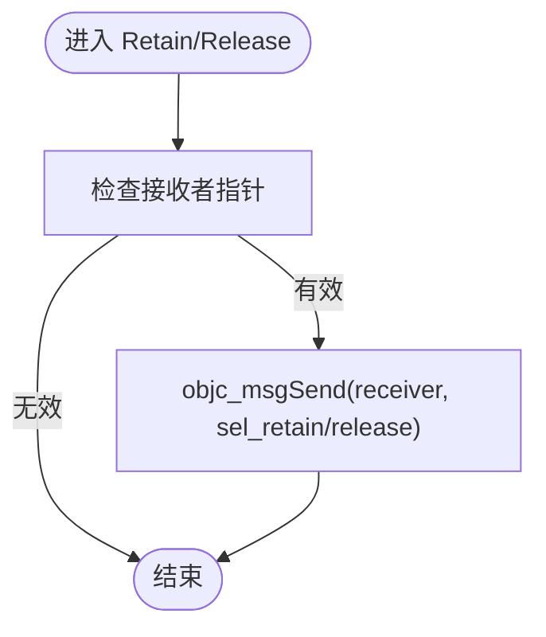
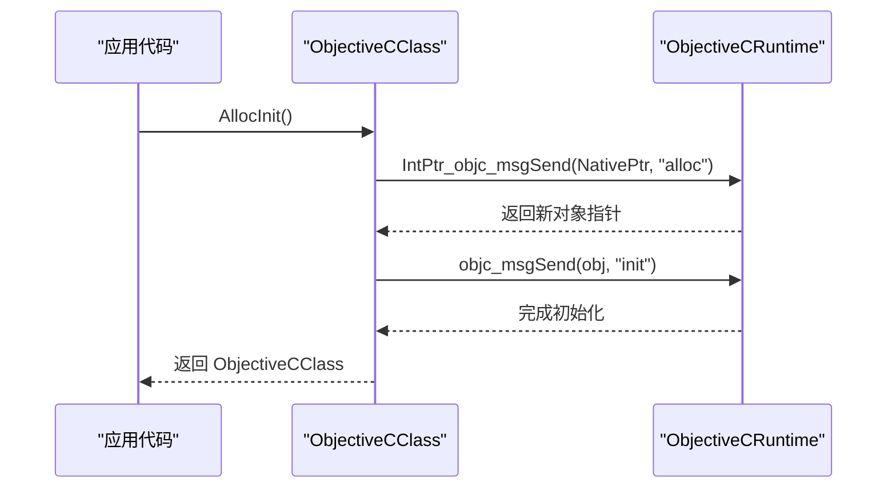
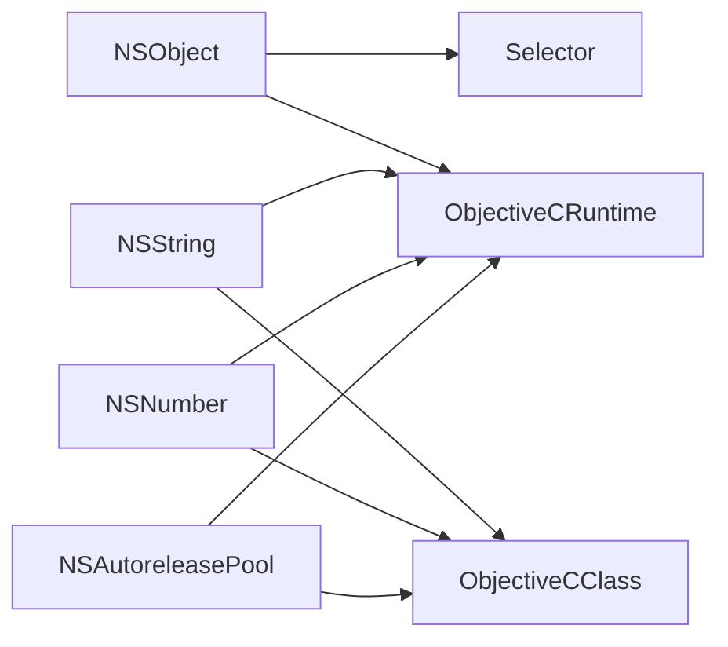

# NSObject 基类系统

<cite>
**本文引用的文件**
- [NSObject.cs](file://src/SharpMetal/Foundation/NSObject.cs)
- [ObjectiveCClass.cs](file://src/SharpMetal/ObjectiveCCore/ObjectiveCClass.cs)
- [ObjectiveCRuntime.cs](file://src/SharpMetal/ObjectiveCCore/ObjectiveCRuntime.cs)
- [Selector.cs](file://src/SharpMetal/ObjectiveCCore/Selector.cs)
- [NSTypes.cs](file://src/SharpMetal/Foundation/NSTypes.cs)
- [NSString.cs](file://src/SharpMetal/Foundation/NSString.cs)
- [NSNumber.cs](file://src/SharpMetal/Foundation/NSNumber.cs)
- [NSAutoreleasePool.cs](file://src/SharpMetal/Foundation/NSAutoreleasePool.cs)
- [Program.cs](file://samples/SharpMetal.Sample/Program.cs)
</cite>

## 目录
1. [简介](#简介)
2. [项目结构](#项目结构)
3. [核心组件](#核心组件)
4. [架构总览](#架构总览)
5. [详细组件分析](#详细组件分析)
6. [依赖关系分析](#依赖关系分析)
7. [性能考量](#性能考量)
8. [故障排查指南](#故障排查指南)
9. [结论](#结论)
10. [附录：使用示例与最佳实践](#附录使用示例与最佳实践)

## 简介
本文件系统性梳理 SharpMetal 中 NSObject 基类体系的设计与实现，重点解释以下方面：
- NSObject 作为所有 Foundation 对象基类的角色：统一持有 NativePtr、提供哈希、描述、比较、类型检查等基础能力。
- Objective-C 消息传递机制的封装：通过 Selector 与 ObjectiveCRuntime 将 C# 调用桥接到 Objective-C 运行时。
- 协议接口绑定：以 NSCopying、NSSecureCoding 等结构体形式暴露给上层，便于在托管层识别与交互。
- 对象生命周期管理：结合 NSAutoreleasePool 与 retain/release 语义，给出安全使用模式。
- 与其他 Foundation 对象的交互：以 NSString、NSNumber 为例展示典型用法。

## 项目结构
Foundation 层围绕 NSObject 构建，ObjectiveCCore 提供底层运行时桥接，Sample 演示基本使用方式。

图表来源
- [NSObject.cs:48-90](file://src/SharpMetal/Foundation/NSObject.cs#L48-L90)
- [ObjectiveCRuntime.cs:33-800](file://src/SharpMetal/ObjectiveCCore/ObjectiveCRuntime.cs#L33-L800)
- [ObjectiveCClass.cs:18-87](file://src/SharpMetal/ObjectiveCCore/ObjectiveCClass.cs#L18-L87)
- [Selector.cs:5-43](file://src/SharpMetal/ObjectiveCCore/Selector.cs#L5-L43)
- [NSTypes.cs:5-12](file://src/SharpMetal/Foundation/NSTypes.cs#L5-L12)
- [NSString.cs:65-186](file://src/SharpMetal/Foundation/NSString.cs#L65-L186)
- [NSNumber.cs:61-271](file://src/SharpMetal/Foundation/NSNumber.cs#L61-L271)
- [NSAutoreleasePool.cs:5-39](file://src/SharpMetal/Foundation/NSAutoreleasePool.cs#L5-L39)

章节来源
- [NSObject.cs:48-90](file://src/SharpMetal/Foundation/NSObject.cs#L48-L90)
- [ObjectiveCRuntime.cs:33-800](file://src/SharpMetal/ObjectiveCCore/ObjectiveCRuntime.cs#L33-L800)
- [ObjectiveCClass.cs:18-87](file://src/SharpMetal/ObjectiveCCore/ObjectiveCClass.cs#L18-L87)
- [Selector.cs:5-43](file://src/SharpMetal/ObjectiveCCore/Selector.cs#L5-L43)
- [NSTypes.cs:5-12](file://src/SharpMetal/Foundation/NSTypes.cs#L5-L12)
- [NSString.cs:65-186](file://src/SharpMetal/Foundation/NSString.cs#L65-L186)
- [NSNumber.cs:61-271](file://src/SharpMetal/Foundation/NSNumber.cs#L61-L271)
- [NSAutoreleasePool.cs:5-39](file://src/SharpMetal/Foundation/NSAutoreleasePool.cs#L5-L39)

## 核心组件
- NSObject：所有 Foundation 对象的基元结构，持有 NativePtr，并提供哈希、描述、相等性、类型检查、选择器响应检测等能力。
- ObjectiveCRuntime：对 Objective-C 运行时的直接导入与封装，包含 objc_msgSend 的各种重载、retain/release、类/方法/属性访问等。
- ObjectiveCClass：对 Objective-C 类的封装，支持按名称获取类、分配与初始化、枚举方法列表等。
- Selector：对 Objective-C 选择器的封装，支持从字符串创建与获取名称。
- Foundation 类型：NSString、NSNumber、NSAutoreleasePool 等基于 NSObject 的消息桥接实现。
- NSTypes：跨平台数据结构（如 NSOperatingSystemVersion）定义。

章节来源
- [NSObject.cs:48-90](file://src/SharpMetal/Foundation/NSObject.cs#L48-L90)
- [ObjectiveCRuntime.cs:33-800](file://src/SharpMetal/ObjectiveCCore/ObjectiveCRuntime.cs#L33-L800)
- [ObjectiveCClass.cs:18-87](file://src/SharpMetal/ObjectiveCCore/ObjectiveCClass.cs#L18-L87)
- [Selector.cs:5-43](file://src/SharpMetal/ObjectiveCCore/Selector.cs#L5-L43)
- [NSString.cs:65-186](file://src/SharpMetal/Foundation/NSString.cs#L65-L186)
- [NSNumber.cs:61-271](file://src/SharpMetal/Foundation/NSNumber.cs#L61-L271)
- [NSAutoreleasePool.cs:5-39](file://src/SharpMetal/Foundation/NSAutoreleasePool.cs#L5-L39)
- [NSTypes.cs:5-12](file://src/SharpMetal/Foundation/NSTypes.cs#L5-L12)

## 架构总览
下图展示了从 C# 到 Objective-C 运行时的调用路径，以及 NSObject 如何作为基类承载通用能力。

图表来源
- [NSObject.cs:54-79](file://src/SharpMetal/Foundation/NSObject.cs#L54-L79)
- [ObjectiveCRuntime.cs:118-141](file://src/SharpMetal/ObjectiveCCore/ObjectiveCRuntime.cs#L118-L141)
- [Selector.cs:20-30](file://src/SharpMetal/ObjectiveCCore/Selector.cs#L20-L30)

## 详细组件分析

### NSObject：基类能力与协议绑定
- 指针管理：内部持有 NativePtr，并支持隐式转换为 IntPtr，便于与运行时交互。
- 哈希计算：通过 ObjectiveCRuntime.ulong_objc_msgSend 调用 "hash" 选择器。
- 描述信息：通过 "description" 与 "debugDescription" 选择器返回 NSString。
- 相等性与类型检查：
  - IsEqual：调用 "isEqual:" 进行对象级相等性判断。
  - IsKindOfClass：调用 "isKindOfClass:" 进行类型检查。
  - RespondsToSelector：先做空指针校验，再调用 "respondsToSelector:"。
- 协议接口绑定：
  - NSCopying、NSSecureCoding 以结构体形式暴露 NativePtr 与隐式转换，用于在托管层识别实现了相应协议的 Foundation 对象。

图表来源
- [NSObject.cs:20-32](file://src/SharpMetal/Foundation/NSObject.cs#L20-L32)
- [NSObject.cs:48-90](file://src/SharpMetal/Foundation/NSObject.cs#L48-L90)

章节来源
- [NSObject.cs:20-32](file://src/SharpMetal/Foundation/NSObject.cs#L20-L32)
- [NSObject.cs:48-90](file://src/SharpMetal/Foundation/NSObject.cs#L48-L90)

### ObjectiveCRuntime：消息传递与内存管理
- 消息发送：提供大量 objc_msgSend 重载，覆盖不同返回值与参数类型；同时提供泛型版本用于结构体返回值的转换。
- 内存管理：
  - Retain/Release：通过 objc_msgSend 调用 retain/release。
  - GetRetainCount：查询引用计数。
- 类与方法反射：
  - objc_getClass/class_getName/class_copyMethodList/method_getName 等，用于动态查找类与方法。
- 选择器注册与获取：sel_registerName/sel_getName。

图表来源
- [ObjectiveCRuntime.cs:769-782](file://src/SharpMetal/ObjectiveCCore/ObjectiveCRuntime.cs#L769-L782)

章节来源
- [ObjectiveCRuntime.cs:33-800](file://src/SharpMetal/ObjectiveCCore/ObjectiveCRuntime.cs#L33-L800)

### ObjectiveCClass：类操作与实例化
- 类获取：通过名称获取 Objective-C 类指针。
- 分配与初始化：
  - Alloc：仅分配。
  - AllocInit：分配并调用 init。
  - Alloc<T>/AllocInit<T>：针对结构体的便捷分配与初始化。
- 属性与方法：
  - GetProperty：获取属性元数据。
  - class_copyMethodList：枚举方法列表。

图表来源
- [ObjectiveCClass.cs:54-77](file://src/SharpMetal/ObjectiveCCore/ObjectiveCClass.cs#L54-L77)
- [ObjectiveCRuntime.cs:118-141](file://src/SharpMetal/ObjectiveCCore/ObjectiveCRuntime.cs#L118-L141)

章节来源
- [ObjectiveCClass.cs:18-87](file://src/SharpMetal/ObjectiveCCore/ObjectiveCClass.cs#L18-L87)

### Selector：选择器封装
- 构造：从字符串创建选择器，内部调用 sel_getUid。
- 名称读取：通过 sel_getName 获取选择器名称。
- 隐式转换：支持与 IntPtr 互转，便于与运行时交互。

章节来源
- [Selector.cs:5-43](file://src/SharpMetal/ObjectiveCCore/Selector.cs#L5-L43)

### Foundation 对象：NSString、NSNumber、NSAutoreleasePool
- NSString：
  - 构造与销毁：通过 Alloc/initWithCharacters:length 或静态工厂创建。
  - 文本处理：UTF8String、Length、RangeOfString、CaseInsensitiveCompare 等。
  - 调试视图：提供 DebuggerTypeProxy 以便调试时查看字符串内容。
- NSNumber：
  - 数值包装：多种类型的 Number(...) 工厂方法与 Init(...) 构造。
  - 取值与比较：intValue/doubleValue/compare/isEqualToNumber 等。
- NSAutoreleasePool：
  - 作用域管理：Begin/Drain/Dispose 管理自动释放池的生命周期。
  - 添加对象：AddObject 将对象加入当前自动释放池。

章节来源
- [NSString.cs:65-186](file://src/SharpMetal/Foundation/NSString.cs#L65-L186)
- [NSNumber.cs:61-271](file://src/SharpMetal/Foundation/NSNumber.cs#L61-L271)
- [NSAutoreleasePool.cs:5-39](file://src/SharpMetal/Foundation/NSAutoreleasePool.cs#L5-L39)

## 依赖关系分析
- NSObject 依赖 ObjectiveCRuntime 与 Selector 完成消息发送与选择器解析。
- NSString/NSNumber 依赖 ObjectiveCClass 进行类获取与实例化，依赖 ObjectiveCRuntime 进行消息发送。
- NSAutoreleasePool 依赖 ObjectiveCRuntime 进行 retain/release 与 drain 操作。
- 所有 Foundation 对象均通过 NativePtr 与 Objective-C 运行时交互，形成统一的桥接层。

图表来源
- [NSObject.cs:48-90](file://src/SharpMetal/Foundation/NSObject.cs#L48-L90)
- [ObjectiveCRuntime.cs:33-800](file://src/SharpMetal/ObjectiveCCore/ObjectiveCRuntime.cs#L33-L800)
- [ObjectiveCClass.cs:18-87](file://src/SharpMetal/ObjectiveCCore/ObjectiveCClass.cs#L18-L87)
- [Selector.cs:5-43](file://src/SharpMetal/ObjectiveCCore/Selector.cs#L5-L43)
- [NSString.cs:65-186](file://src/SharpMetal/Foundation/NSString.cs#L65-L186)
- [NSNumber.cs:61-271](file://src/SharpMetal/Foundation/NSNumber.cs#L61-L271)
- [NSAutoreleasePool.cs:5-39](file://src/SharpMetal/Foundation/NSAutoreleasePool.cs#L5-L39)

章节来源
- [NSObject.cs:48-90](file://src/SharpMetal/Foundation/NSObject.cs#L48-L90)
- [ObjectiveCRuntime.cs:33-800](file://src/SharpMetal/ObjectiveCCore/ObjectiveCRuntime.cs#L33-L800)
- [ObjectiveCClass.cs:18-87](file://src/SharpMetal/ObjectiveCCore/ObjectiveCClass.cs#L18-L87)
- [Selector.cs:5-43](file://src/SharpMetal/ObjectiveCCore/Selector.cs#L5-L43)
- [NSString.cs:65-186](file://src/SharpMetal/Foundation/NSString.cs#L65-L186)
- [NSNumber.cs:61-271](file://src/SharpMetal/Foundation/NSNumber.cs#L61-L271)
- [NSAutoreleasePool.cs:5-39](file://src/SharpMetal/Foundation/NSAutoreleasePool.cs#L5-L39)

## 性能考量
- 消息发送开销：每次 NSObject 方法调用都会触发 objc_msgSend，频繁调用时应尽量批量处理或缓存选择器。
- 字符串转换：NSString.ToString 会生成 UTF8 字节序列并拷贝，注意避免在热路径中重复转换。
- 自动释放池：合理使用 NSAutoreleasePool.Begin/Drain 控制短期对象的生命周期，减少 GC 压力。
- 类型检查：IsKindOfClass/RespondsToSelector 涉及运行时查找，应谨慎使用，优先使用已知类型以减少开销。

[本节为通用指导，不直接分析具体文件]

## 故障排查指南
- 选择器为空或对象指针为空：
  - 现象：RespondsToSelector 返回 false。
  - 原因：NativePtr 或 Selector.SelPtr 为空。
  - 处理：确保对象已正确初始化且选择器名称正确。
- 类获取失败：
  - 现象：ObjectiveCClass 构造后 NativePtr 为零。
  - 原因：目标类未加载或名称错误。
  - 处理：检查类名大小写与模块加载状态。
- 内存泄漏：
  - 现象：程序运行一段时间后内存持续增长。
  - 原因：未正确调用 Release 或未使用自动释放池。
  - 处理：在 finally 块中释放资源或使用 NSAutoreleasePool 管理短期对象。

章节来源
- [NSObject.cs:70-79](file://src/SharpMetal/Foundation/NSObject.cs#L70-L79)
- [ObjectiveCClass.cs:30-40](file://src/SharpMetal/ObjectiveCCore/ObjectiveCClass.cs#L30-L40)
- [ObjectiveCRuntime.cs:769-782](file://src/SharpMetal/ObjectiveCCore/ObjectiveCRuntime.cs#L769-L782)
- [NSAutoreleasePool.cs:11-26](file://src/SharpMetal/Foundation/NSAutoreleasePool.cs#L11-L26)

## 结论
SharpMetal 的 NSObject 基类系统通过轻量级的结构体与运行时桥接，提供了与 Objective-C 对象一致的基础能力。借助 ObjectiveCRuntime 与 Selector，Foundation 对象能够以高效、可控的方式与原生框架交互。遵循正确的生命周期管理与性能优化策略，可以在托管层安全地构建高性能的 Apple 平台应用。

[本节为总结性内容，不直接分析具体文件]

## 附录：使用示例与最佳实践

- 使用 NSObject 的哈希与描述
  - 示例路径：[NSObject.cs:54-58](file://src/SharpMetal/Foundation/NSObject.cs#L54-L58)
  - 说明：通过 Hash 与 Description/DebugDescription 获取对象标识与可读描述。

- 类型检查与响应检测
  - 示例路径：[NSObject.cs:65-79](file://src/SharpMetal/Foundation/NSObject.cs#L65-L79)
  - 说明：使用 IsKindOfClass 与 RespondsToSelector 进行运行时类型与能力检查。

- 字符串与数字对象
  - 示例路径：[NSString.cs:71-98](file://src/SharpMetal/Foundation/NSString.cs#L71-L98)、[NSNumber.cs:105-153](file://src/SharpMetal/Foundation/NSNumber.cs#L105-L153)
  - 说明：通过工厂方法与初始化器创建 NSString/NSNumber，并进行取值与比较。

- 自动释放池管理
  - 示例路径：[NSAutoreleasePool.cs:11-26](file://src/SharpMetal/Foundation/NSAutoreleasePool.cs#L11-L26)
  - 说明：使用 Begin/Drain/Dispose 管理短期对象的生命周期，避免手动释放遗漏。

- 资源释放最佳实践
  - 示例路径：[Program.cs:41-45](file://samples/SharpMetal.Sample/Program.cs#L41-L45)
  - 说明：在 finally 块中调用 ObjectiveCRuntime.Release 确保原生资源释放。

章节来源
- [NSObject.cs:54-79](file://src/SharpMetal/Foundation/NSObject.cs#L54-L79)
- [NSString.cs:71-98](file://src/SharpMetal/Foundation/NSString.cs#L71-L98)
- [NSNumber.cs:105-153](file://src/SharpMetal/Foundation/NSNumber.cs#L105-L153)
- [NSAutoreleasePool.cs:11-26](file://src/SharpMetal/Foundation/NSAutoreleasePool.cs#L11-L26)
- [Program.cs:41-45](file://samples/SharpMetal.Sample/Program.cs#L41-L45)