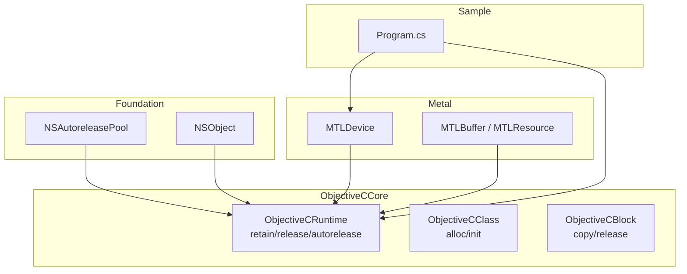
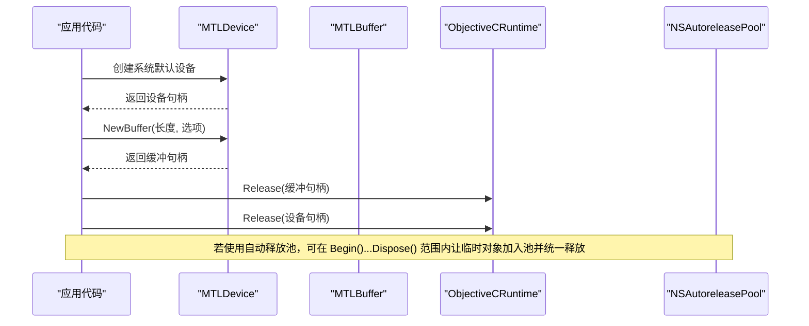
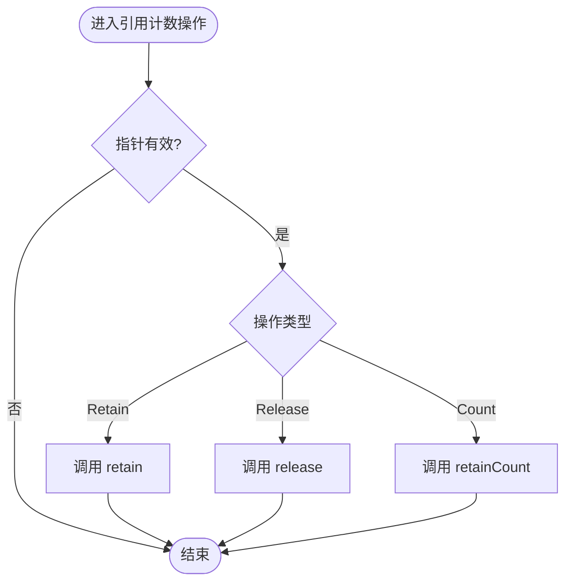
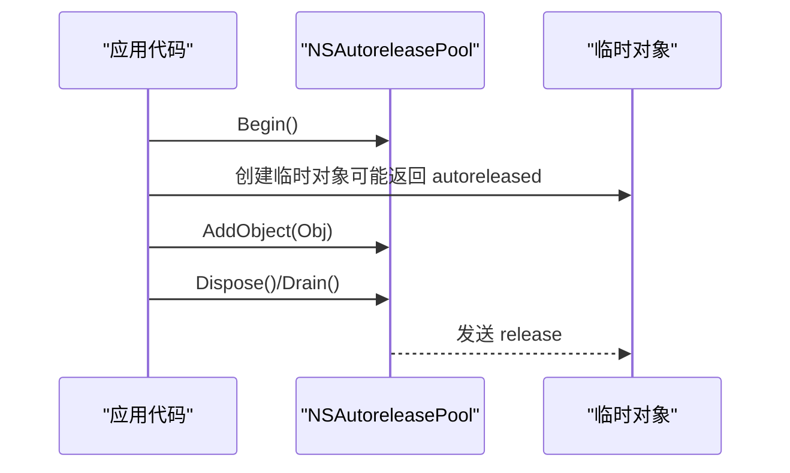
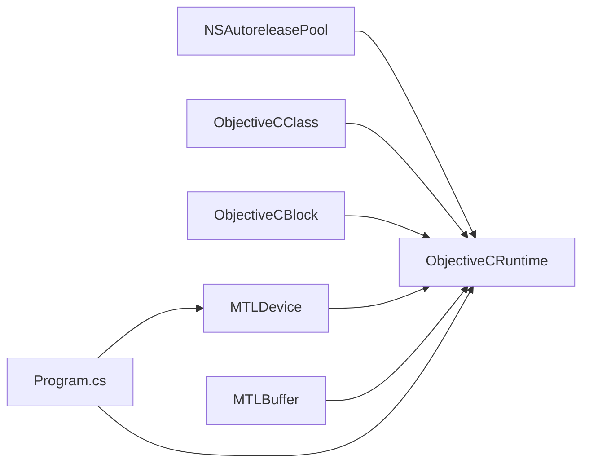

# 内存管理

<cite>
**本文引用的文件**
- [NSAutoreleasePool.cs](file://src/SharpMetal/Foundation/NSAutoreleasePool.cs)
- [NSObject.cs](file://src/SharpMetal/Foundation/NSObject.cs)
- [ObjectiveCRuntime.cs](file://src/SharpMetal/ObjectiveCCore/ObjectiveCRuntime.cs)
- [ObjectiveCClass.cs](file://src/SharpMetal/ObjectiveCCore/ObjectiveCClass.cs)
- [ObjectiveCBlock.cs](file://src/SharpMetal/ObjectiveCCore/ObjectiveCBlock.cs)
- [MTLResource.cs](file://src/SharpMetal/Metal/MTLResource.cs)
- [MTLBuffer.cs](file://src/SharpMetal/Metal/MTLBuffer.cs)
- [MTLDevice.cs](file://src/SharpMetal/Metal/MTLDevice.cs)
- [Program.cs](file://samples/SharpMetal.Sample/Program.cs)
</cite>

## 目录
1. [简介](#简介)
2. [项目结构](#项目结构)
3. [核心组件](#核心组件)
4. [架构总览](#架构总览)
5. [详细组件分析](#详细组件分析)
6. [依赖关系分析](#依赖关系分析)
7. [性能考量](#性能考量)
8. [故障排查指南](#故障排查指南)
9. [结论](#结论)
10. [附录](#附录)

## 简介
本文件聚焦 SharpMetal 中的内存管理，重点解释 Objective-C 引用计数机制在本项目中的实现方式、自动释放池的工作原理与使用模式、NSAutoreleasePool 的生命周期与释放时机、托管对象与原生对象之间的所有权转移规则、循环引用的检测与避免策略，以及内存泄漏检测工具与调试技巧。同时提供不同场景下的最佳实践与性能优化建议，帮助开发者在 Swift/C#/Objective-C 混合环境中安全高效地管理内存。

## 项目结构
SharpMetal 将内存管理的核心能力集中在 ObjectiveCCore 层（引用计数、消息转发、块生命周期），Foundation 层提供 NSAutoreleasePool 等基础类型，Metal 层暴露资源对象（如 MTLBuffer、MTLTexture）的托管包装，并通过统一的 ObjectiveCRuntime 进行底层调用。示例程序展示了显式释放原生资源的正确用法。

图表来源
- [NSAutoreleasePool.cs:5-39](file://src/SharpMetal/Foundation/NSAutoreleasePool.cs#L5-L39)
- [NSObject.cs:48-90](file://src/SharpMetal/Foundation/NSObject.cs#L48-L90)
- [ObjectiveCRuntime.cs:769-782](file://src/SharpMetal/ObjectiveCCore/ObjectiveCRuntime.cs#L769-L782)
- [ObjectiveCClass.cs:54-78](file://src/SharpMetal/ObjectiveCCore/ObjectiveCClass.cs#L54-L78)
- [ObjectiveCBlock.cs:23-53](file://src/SharpMetal/ObjectiveCCore/ObjectiveCBlock.cs#L23-L53)
- [MTLDevice.cs:305-319](file://src/SharpMetal/Metal/MTLDevice.cs#L305-L319)
- [MTLBuffer.cs:6-15](file://src/SharpMetal/Metal/MTLBuffer.cs#L6-L15)
- [Program.cs:21-45](file://samples/SharpMetal.Sample/Program.cs#L21-L45)

章节来源
- [NSAutoreleasePool.cs:5-39](file://src/SharpMetal/Foundation/NSAutoreleasePool.cs#L5-L39)
- [ObjectiveCRuntime.cs:769-782](file://src/SharpMetal/ObjectiveCCore/ObjectiveCRuntime.cs#L769-L782)
- [ObjectiveCClass.cs:54-78](file://src/SharpMetal/ObjectiveCCore/ObjectiveCClass.cs#L54-L78)
- [ObjectiveCBlock.cs:23-53](file://src/SharpMetal/ObjectiveCCore/ObjectiveCBlock.cs#L23-L53)
- [MTLDevice.cs:305-319](file://src/SharpMetal/Metal/MTLDevice.cs#L305-L319)
- [MTLBuffer.cs:6-15](file://src/SharpMetal/Metal/MTLBuffer.cs#L6-L15)
- [Program.cs:21-45](file://samples/SharpMetal.Sample/Program.cs#L21-L45)

## 核心组件
- ObjectiveCRuntime：封装 retain、release、retainCount 等引用计数操作，并提供 objc_msgSend 重载以调用 Objective-C 方法。
- NSAutoreleasePool：封装 autorelease pool 的创建、添加对象与释放（drain/dispose）。
- ObjectiveCClass：封装 alloc/init 流程，用于创建 Objective-C 对象。
- ObjectiveCBlock：封装 Objective-C Block 的复制与释放，确保回调闭包生命周期正确。
- Metal 资源包装（MTLBuffer、MTLResource 等）：提供对原生 Metal 对象的托管视图，支持属性访问与状态查询。
- 示例 Program.cs：演示如何获取设备、创建缓冲并在 finally 中显式释放原生指针。

章节来源
- [ObjectiveCRuntime.cs:769-782](file://src/SharpMetal/ObjectiveCCore/ObjectiveCRuntime.cs#L769-L782)
- [NSAutoreleasePool.cs:5-39](file://src/SharpMetal/Foundation/NSAutoreleasePool.cs#L5-L39)
- [ObjectiveCClass.cs:54-78](file://src/SharpMetal/ObjectiveCCore/ObjectiveCClass.cs#L54-L78)
- [ObjectiveCBlock.cs:23-53](file://src/SharpMetal/ObjectiveCCore/ObjectiveCBlock.cs#L23-L53)
- [MTLBuffer.cs:6-15](file://src/SharpMetal/Metal/MTLBuffer.cs#L6-L15)
- [Program.cs:21-45](file://samples/SharpMetal.Sample/Program.cs#L21-L45)

## 架构总览
SharpMetal 通过 ObjectiveCCore 统一对接 Objective-C Runtime，Foundation 层提供自动释放池与基础对象抽象，Metal 层暴露资源对象。所有跨语言的对象创建与释放都经由 ObjectiveCRuntime 完成，保证引用计数语义一致。

图表来源
- [MTLDevice.cs:305-319](file://src/SharpMetal/Metal/MTLDevice.cs#L305-L319)
- [MTLDevice.cs:356-369](file://src/SharpMetal/Metal/MTLDevice.cs#L356-L369)
- [ObjectiveCRuntime.cs:769-782](file://src/SharpMetal/ObjectiveCCore/ObjectiveCRuntime.cs#L769-L782)
- [NSAutoreleasePool.cs:11-26](file://src/SharpMetal/Foundation/NSAutoreleasePool.cs#L11-L26)
- [Program.cs:21-45](file://samples/SharpMetal.Sample/Program.cs#L21-L45)

## 详细组件分析

### Objective-C 引用计数机制（ObjectiveCRuntime）
- 提供 Retain/Release 直接调用 Objective-C 的 retain/release。
- 提供 GetRetainCount 用于调试与验证引用计数变化。
- 所有 Metal/Foundation 对象均通过 objc_msgSend 调用其方法，从而遵循 Objective-C 的内存模型。

图表来源
- [ObjectiveCRuntime.cs:769-782](file://src/SharpMetal/ObjectiveCCore/ObjectiveCRuntime.cs#L769-L782)

章节来源
- [ObjectiveCRuntime.cs:769-782](file://src/SharpMetal/ObjectiveCCore/ObjectiveCRuntime.cs#L769-L782)

### 自动释放池（NSAutoreleasePool）
- Begin：创建新的自动释放池（等价于 push）。
- AddObject：将对象加入当前池（等价于 addObject:）。
- Drain/Dispose：释放池（等价于 drain 或 release），触发池中对象的 release。
- 典型用法：在短生命周期内包裹大量临时对象，减少频繁释放开销。

图表来源
- [NSAutoreleasePool.cs:11-26](file://src/SharpMetal/Foundation/NSAutoreleasePool.cs#L11-L26)

章节来源
- [NSAutoreleasePool.cs:11-26](file://src/SharpMetal/Foundation/NSAutoreleasePool.cs#L11-L26)

### 对象创建与初始化（ObjectiveCClass）
- Alloc/AllocInit：封装 alloc/init 流程，返回托管包装。
- 适用于需要手动控制生命周期的场景；配合 Release 使用。

章节来源
- [ObjectiveCClass.cs:54-78](file://src/SharpMetal/ObjectiveCCore/ObjectiveCClass.cs#L54-L78)

### 块（Block）生命周期（ObjectiveCBlock）
- CopyObjectHandler：将 C# Action 包装为 Objective-C Block，并复制到堆上，确保回调期间上下文存活。
- Release：释放 Block，防止内存泄漏。
- 适用场景：Metal 回调（如反馈、呈现回调）等异步任务。

章节来源
- [ObjectiveCBlock.cs:23-53](file://src/SharpMetal/ObjectiveCCore/ObjectiveCBlock.cs#L23-L53)

### Metal 资源对象（MTLBuffer/MTLResource）
- 提供 Label、Device、StorageMode、Length、Contents 等属性访问。
- SetPurgeableState：允许在内存紧张时释放 GPU 内存（需重新分配）。
- MakeAliasable：允许别名化以减少内存占用。
- 注意：这些对象由 Objective-C 管理，需在不再使用时调用 Release。

章节来源
- [MTLBuffer.cs:18-58](file://src/SharpMetal/Metal/MTLBuffer.cs#L18-L58)
- [MTLResource.cs:72-118](file://src/SharpMetal/Metal/MTLResource.cs#L72-L118)

### 示例：设备与缓冲的创建与释放（Program.cs）
- 创建默认设备与共享缓冲。
- 在 finally 中显式释放设备与缓冲的原生指针，避免泄漏。

章节来源
- [Program.cs:21-45](file://samples/SharpMetal.Sample/Program.cs#L21-L45)

## 依赖关系分析
- Foundation 与 ObjectiveCCore 强耦合：NSAutoreleasePool 依赖 ObjectiveCRuntime 进行消息发送与释放。
- Metal 层依赖 ObjectiveCCore：所有资源对象通过 ObjectiveCRuntime 调用底层方法。
- 示例程序依赖 Metal 与 ObjectiveCCore：展示正确的释放顺序与模式。

图表来源
- [NSAutoreleasePool.cs:11-26](file://src/SharpMetal/Foundation/NSAutoreleasePool.cs#L11-L26)
- [ObjectiveCClass.cs:54-78](file://src/SharpMetal/ObjectiveCCore/ObjectiveCClass.cs#L54-L78)
- [ObjectiveCBlock.cs:23-53](file://src/SharpMetal/ObjectiveCCore/ObjectiveCBlock.cs#L23-L53)
- [MTLDevice.cs:305-319](file://src/SharpMetal/Metal/MTLDevice.cs#L305-L319)
- [MTLBuffer.cs:18-58](file://src/SharpMetal/Metal/MTLBuffer.cs#L18-L58)
- [Program.cs:21-45](file://samples/SharpMetal.Sample/Program.cs#L21-L45)

章节来源
- [NSAutoreleasePool.cs:11-26](file://src/SharpMetal/Foundation/NSAutoreleasePool.cs#L11-L26)
- [ObjectiveCClass.cs:54-78](file://src/SharpMetal/ObjectiveCCore/ObjectiveCClass.cs#L54-L78)
- [ObjectiveCBlock.cs:23-53](file://src/SharpMetal/ObjectiveCCore/ObjectiveCBlock.cs#L23-L53)
- [MTLDevice.cs:305-319](file://src/SharpMetal/Metal/MTLDevice.cs#L305-L319)
- [MTLBuffer.cs:18-58](file://src/SharpMetal/Metal/MTLBuffer.cs#L18-L58)
- [Program.cs:21-45](file://samples/SharpMetal.Sample/Program.cs#L21-L45)

## 性能考量
- 合理使用自动释放池：在高频率创建临时对象的场景中，使用 Begin/Dispose 包裹可显著降低频繁释放的开销。
- 批量释放：尽量在同一作用域内集中释放，减少跨边界调用成本。
- 选择存储模式：根据数据访问模式选择合适的 StorageMode（Shared/Managed/Private/Memoryless），避免不必要的 CPU-GPU 同步。
- 复用资源：对 Buffer/Texture 等资源进行复用，减少分配与释放次数。
- 最小化回调块生命周期：及时释放 Objective-C Block，避免长期持有导致内存增长。

[本节为通用指导，不直接分析具体文件]

## 故障排查指南
- 常见症状
  - 崩溃：访问已释放对象（野指针）、重复释放（double free）。
  - 内存持续增长：未释放 Block、未释放 Metal 资源、自动释放池未正确关闭。
- 定位步骤
  - 使用 GetRetainCount 观察关键对象引用计数变化，确认是否在预期点释放。
  - 检查是否在所有路径（包括异常路径）释放了资源（参考示例程序的 finally 模式）。
  - 审查回调块的生命周期，确保在不再需要时调用 Release。
  - 使用 Instruments（Allocation、Leaks、Zombie Objects）辅助定位。
- 修复建议
  - 明确所有权：谁创建谁释放，或通过明确的 TransferOwnership 约定。
  - 使用 using/try-finally 确保释放。
  - 避免循环引用：在托管层记录弱引用或使用中间代理打破环。

章节来源
- [ObjectiveCRuntime.cs:769-782](file://src/SharpMetal/ObjectiveCCore/ObjectiveCRuntime.cs#L769-L782)
- [Program.cs:21-45](file://samples/SharpMetal.Sample/Program.cs#L21-L45)
- [ObjectiveCBlock.cs:23-53](file://src/SharpMetal/ObjectiveCCore/ObjectiveCBlock.cs#L23-L53)

## 结论
SharpMetal 通过 ObjectiveCCore 统一实现了 Objective-C 引用计数与消息转发，Foundation 层提供自动释放池与基础对象抽象，Metal 层暴露资源对象。遵循“创建即拥有、释放即归还”的原则，结合自动释放池与显式释放，可有效避免内存泄漏与崩溃。在实际工程中，应严格管理对象生命周期、合理使用自动释放池、及时释放 Block 与 Metal 资源，并使用调试工具持续监控内存行为。

[本节为总结性内容，不直接分析具体文件]

## 附录

### 自动释放池使用模式（推荐）
- 短生命周期批量临时对象：Begin/Dispose 包裹。
- 长生命周期对象：显式持有与释放，避免依赖池。
- 回调块：创建后及时释放，避免长期持有。

章节来源
- [NSAutoreleasePool.cs:11-26](file://src/SharpMetal/Foundation/NSAutoreleasePool.cs#L11-L26)
- [ObjectiveCBlock.cs:23-53](file://src/SharpMetal/ObjectiveCCore/ObjectiveCBlock.cs#L23-L53)

### 循环引用的检测与避免策略
- 检测：使用 Instruments 的 Leaks 与 Zombies 工具，结合 GetRetainCount 观察异常增长。
- 避免：在托管层维护弱引用关系，或在回调中避免强引用宿主对象；必要时引入中间代理或事件总线解耦。

[本节为通用指导，不直接分析具体文件]

### 不同场景的最佳实践
- 渲染帧循环：每帧创建少量临时对象，使用自动释放池；复用 Buffer/Texture。
- 后台计算：批量处理时使用池；完成后立即释放资源。
- 回调与异步任务：确保 Block 生命周期与任务一致，完成后释放。

[本节为通用指导，不直接分析具体文件]