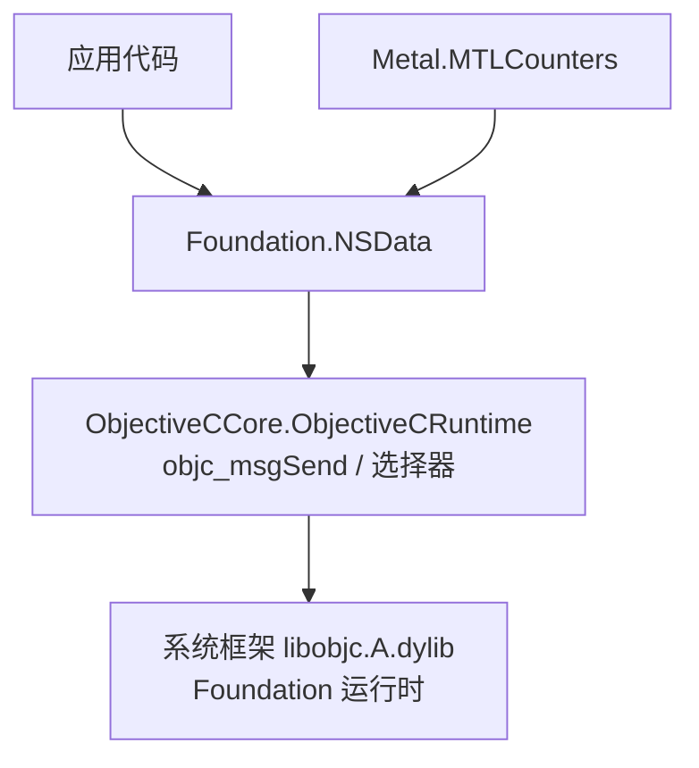
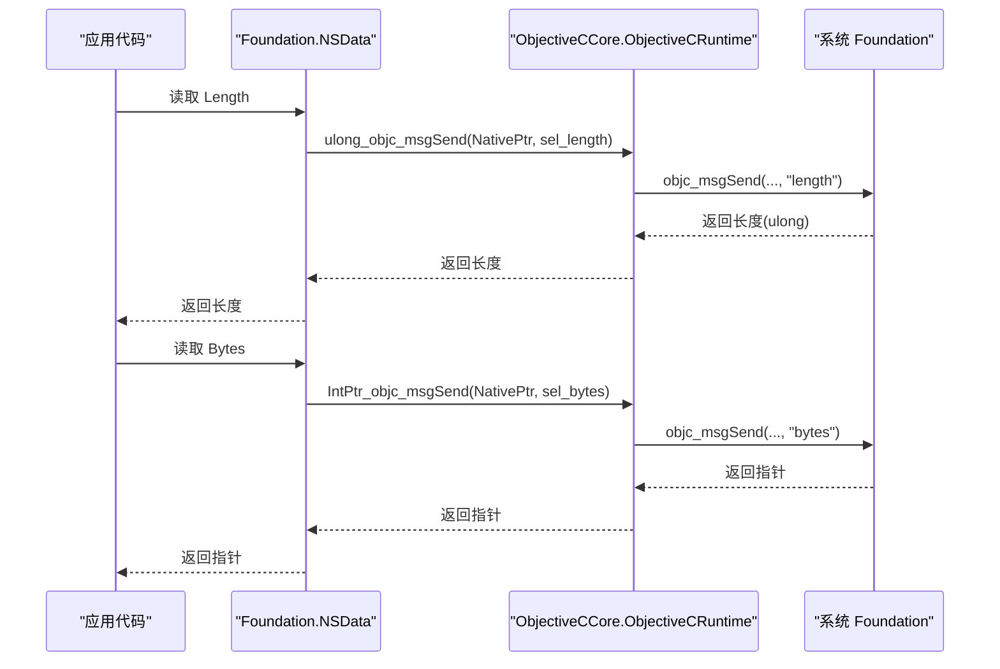
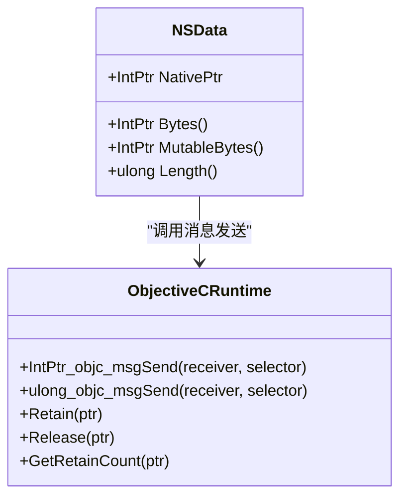
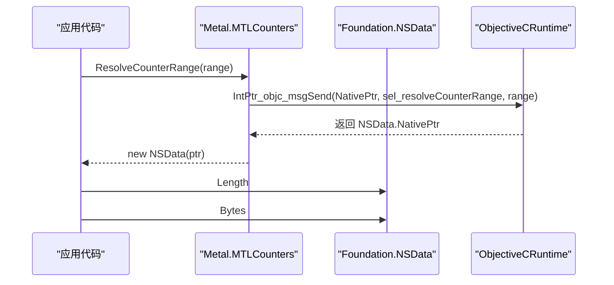

# NSData 数据绑定

<cite>
**本文引用的文件**
- [NSData.cs](file://src/SharpMetal/Foundation/NSData.cs)
- [ObjectiveCRuntime.cs](file://src/SharpMetal/ObjectiveCCore/ObjectiveCRuntime.cs)
- [NSObject.cs](file://src/SharpMetal/Foundation/NSObject.cs)
- [NSTypes.cs](file://src/SharpMetal/Foundation/NSTypes.cs)
- [MTLCounters.cs](file://src/SharpMetal/Metal/MTLCounters.cs)
- [README.md](file://README.md)
</cite>

## 目录
1. [简介](#简介)
2. [项目结构](#项目结构)
3. [核心组件](#核心组件)
4. [架构总览](#架构总览)
5. [详细组件分析](#详细组件分析)
6. [依赖关系分析](#依赖关系分析)
7. [性能与内存管理](#性能与内存管理)
8. [故障排查指南](#故障排查指南)
9. [结论](#结论)
10. [附录：使用示例与最佳实践](#附录使用示例与最佳实践)

## 简介
本文件围绕 SharpMetal 中的 NSData 二进制数据绑定，系统阐述其内存管理机制、数据操作方法、与不同数据格式的兼容性处理、大文件与流式操作的优化策略，以及安全性与性能注意事项。该绑定通过 Objective-C 运行时桥接，将 Foundation 的 NSData 暴露为 .NET 中的轻量值类型封装，便于在 Metal 等底层场景中高效传递原始字节数据。

## 项目结构
- Foundation 层提供基础对象与类型定义（如 NSObject、NSData、NSString、NSRange 等）。
- ObjectiveCCore 层提供 Objective-C 运行时调用能力（消息发送、选择器、引用计数等）。
- Metal 层在部分 API 中返回或接收 NSData，用于计数器结果等二进制数据交换。

图表来源
- [NSData.cs:5-19](file://src/SharpMetal/Foundation/NSData.cs#L5-L19)
- [ObjectiveCRuntime.cs:33-141](file://src/SharpMetal/ObjectiveCCore/ObjectiveCRuntime.cs#L33-L141)
- [MTLCounters.cs:126-129](file://src/SharpMetal/Metal/MTLCounters.cs#L126-L129)

章节来源
- [README.md:1-23](file://README.md#L1-L23)

## 核心组件
- NSData 绑定：以 struct 形式持有 NativePtr，并通过 Objective-C 选择器访问底层 bytes、mutableBytes 与 length。
- ObjectiveCRuntime：提供 objc_msgSend 的各种重载，支持无参、整型、指针、布尔等返回值类型；并提供 Retain/Release/GetRetainCount 等生命周期工具。
- NSObject：提供通用对象方法（hash、description、isEqual 等）及 NSUtil 字符串工具。
- NSTypes：定义跨平台结构体（如 NSOperatingSystemVersion），用于系统信息交互。
- MTLCounters：在 Metal 计数器解析时返回 NSData，体现二进制数据在 GPU/CPU 间传输的典型用法。

章节来源
- [NSData.cs:5-19](file://src/SharpMetal/Foundation/NSData.cs#L5-L19)
- [ObjectiveCRuntime.cs:33-141](file://src/SharpMetal/ObjectiveCCore/ObjectiveCRuntime.cs#L33-L141)
- [NSObject.cs:34-90](file://src/SharpMetal/Foundation/NSObject.cs#L34-L90)
- [NSTypes.cs:5-11](file://src/SharpMetal/Foundation/NSTypes.cs#L5-L11)
- [MTLCounters.cs:126-129](file://src/SharpMetal/Metal/MTLCounters.cs#L126-L129)

## 架构总览
下图展示了从 .NET 侧调用到系统层的完整路径：.NET 代码通过 NSData 属性访问底层字节与长度，内部委托给 ObjectiveCRuntime 的消息发送机制，最终由系统 Foundation 实现具体行为。

图表来源
- [NSData.cs:11-15](file://src/SharpMetal/Foundation/NSData.cs#L11-L15)
- [ObjectiveCRuntime.cs:124-141](file://src/SharpMetal/ObjectiveCCore/ObjectiveCRuntime.cs#L124-L141)

## 详细组件分析

### NSData 绑定分析
- 设计要点
  - 值类型 struct，包含 NativePtr，隐式转换为 IntPtr，便于与原生互操作。
  - 通过选择器访问底层属性：bytes、mutableBytes、length。
  - 不直接持有托管缓冲，避免额外拷贝；需配合长度进行安全访问。
- 关键成员
  - NativePtr：指向底层 Foundation 对象的指针。
  - Bytes：获取只读数据起始指针。
  - MutableBytes：获取可写数据起始指针（要求底层对象可变）。
  - Length：数据长度（字节数）。
- 复杂度
  - 属性访问为 O(1)，但实际数据访问取决于上层对指针的使用方式。
- 错误与边界
  - 空指针或越界访问会导致未定义行为；应在上层确保长度与范围正确。
  - 可变性：MutableBytes 仅在底层对象可变时有效，否则可能失败。

图表来源
- [NSData.cs:5-19](file://src/SharpMetal/Foundation/NSData.cs#L5-L19)
- [ObjectiveCRuntime.cs:769-800](file://src/SharpMetal/ObjectiveCCore/ObjectiveCRuntime.cs#L769-L800)

章节来源
- [NSData.cs:5-19](file://src/SharpMetal/Foundation/NSData.cs#L5-L19)

### ObjectiveCRuntime 运行时桥接
- 功能
  - 提供大量 objc_msgSend 重载，覆盖常见参数与返回类型。
  - 提供 Retain/Release/GetRetainCount 等引用计数工具。
  - 常量 ObjcLibraryPath 指定动态库路径。
- 性能
  - 直接调用系统函数，开销极低；频繁调用时应注意批量化与减少跨边界次数。
- 安全性
  - 所有调用均基于传入的 NativePtr 与 Selector；需保证有效性。

章节来源
- [ObjectiveCRuntime.cs:33-141](file://src/SharpMetal/ObjectiveCCore/ObjectiveCRuntime.cs#L33-L141)
- [ObjectiveCRuntime.cs:769-800](file://src/SharpMetal/ObjectiveCCore/ObjectiveCRuntime.cs#L769-L800)

### MTLCounters 与 NSData 的集成
- 场景
  - 解析计数器范围时返回 NSData，承载二进制采样结果。
- 流程
  - 调用 ResolveCounterRange(range) 得到 NSData，再读取 Length 与 Bytes 进行后续处理。

图表来源
- [MTLCounters.cs:126-129](file://src/SharpMetal/Metal/MTLCounters.cs#L126-L129)
- [NSData.cs:11-15](file://src/SharpMetal/Foundation/NSData.cs#L11-L15)

章节来源
- [MTLCounters.cs:126-129](file://src/SharpMetal/Metal/MTLCounters.cs#L126-L129)

## 依赖关系分析
- 耦合度
  - NSData 强依赖 ObjectiveCRuntime 的消息发送能力。
  - MTLCounters 依赖 NSData 作为二进制数据载体。
- 外部依赖
  - 系统框架 libobjc.A.dylib，提供 Objective-C 运行时。
- 循环依赖
  - 当前未见循环依赖；Foundation 与 Metal 通过 NSData 解耦。

图表来源
- [NSData.cs:5-19](file://src/SharpMetal/Foundation/NSData.cs#L5-L19)
- [ObjectiveCRuntime.cs:33-141](file://src/SharpMetal/ObjectiveCCore/ObjectiveCRuntime.cs#L33-L141)
- [MTLCounters.cs:126-129](file://src/SharpMetal/Metal/MTLCounters.cs#L126-L129)

章节来源
- [NSData.cs:5-19](file://src/SharpMetal/Foundation/NSData.cs#L5-L19)
- [ObjectiveCRuntime.cs:33-141](file://src/SharpMetal/ObjectiveCCore/ObjectiveCRuntime.cs#L33-L141)
- [MTLCounters.cs:126-129](file://src/SharpMetal/Metal/MTLCounters.cs#L126-L129)

## 性能与内存管理
- 内存模型
  - NSData 仅持有原生指针与长度，不复制数据；适合零拷贝场景。
  - 可变数据通过 MutableBytes 暴露，写入前需确认底层对象可变。
- 引用计数
  - 通过 ObjectiveCRuntime.Retain/Release 管理原生对象生命周期；避免悬垂指针。
- 大文件与流式处理
  - 建议分块读取：按固定块大小迭代读取并处理，降低峰值内存占用。
  - 结合 Range/Offset 进行切片处理，避免全量加载。
- 网络数据传输
  - 直接使用 Bytes 与 Length 进行发送，减少中间缓冲。
  - 对于超大响应，采用分段下载与增量处理。
- 内存映射
  - 若底层支持，优先使用内存映射以减少 I/O 开销；在 .NET 侧通过指针访问映射区域。
- 并发与线程安全
  - 多线程访问同一 NSData 时需加锁或确保不可变共享。
- 编码与格式兼容
  - 文本数据建议使用 NSString 进行编解码；二进制数据保持原样传递。
  - 序列化/反序列化应明确字节序与对齐规则。

[本节为通用指导，不直接分析具体文件]

## 故障排查指南
- 常见问题
  - 空指针异常：检查 NativePtr 是否有效，确保底层对象未被释放。
  - 越界访问：严格依据 Length 限制访问范围，避免读写越界。
  - 可变性错误：对不可变对象调用 MutableBytes 可能导致失败。
- 诊断步骤
  - 使用 GetRetainCount 检查引用计数变化，定位过早释放。
  - 打印 Description/DebugDescription 辅助定位对象状态。
- 日志与断言
  - 在关键路径添加断言，验证长度、指针有效性。
  - 记录调用栈与参数，便于复现问题。

章节来源
- [NSObject.cs:54-58](file://src/SharpMetal/Foundation/NSObject.cs#L54-L58)
- [ObjectiveCRuntime.cs:769-782](file://src/SharpMetal/ObjectiveCCore/ObjectiveCRuntime.cs#L769-L782)

## 结论
SharpMetal 的 NSData 绑定以最小开销暴露 Foundation 的二进制数据能力，适用于高性能场景。通过合理的数据分块、流式处理与引用计数管理，可在大文件、网络传输与 GPU 数据交换中取得良好性能。使用时需严格遵循长度与可变性约束，确保内存安全。

[本节为总结，不直接分析具体文件]

## 附录：使用示例与最佳实践
- 文件读写
  - 读取：打开文件后，将数据加载为 NSData，读取 Length 与 Bytes，按块处理。
  - 写入：创建可变 NSData，通过 MutableBytes 写入数据，注意长度更新与同步。
- 网络数据传输
  - 发送：构造 NSData 后，直接发送 Bytes 与 Length。
  - 接收：根据协议头确定长度，逐步填充缓冲区，避免一次性分配过大内存。
- 内存映射
  - 使用系统提供的内存映射接口映射文件，再以 NSData 包装映射区域进行访问。
- 安全性
  - 校验数据来源与完整性（如哈希校验）。
  - 敏感数据使用后及时清零或释放，避免残留。
- 性能优化
  - 批量处理：合并多次小写入为大块写入。
  - 减少跨边界调用：在 .NET 侧缓存必要元数据，减少重复查询。
  - 利用并行：对独立数据块进行并行处理，注意线程安全。

[本节为概念性指导，不直接分析具体文件]