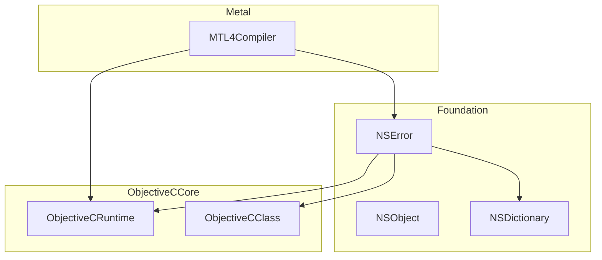
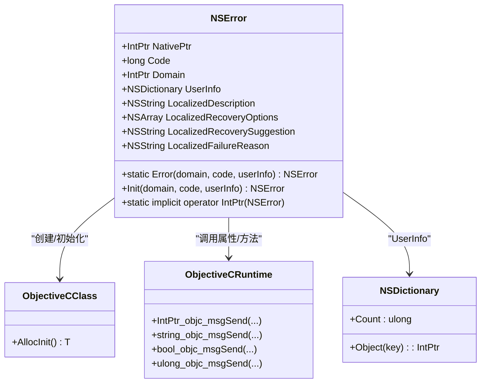
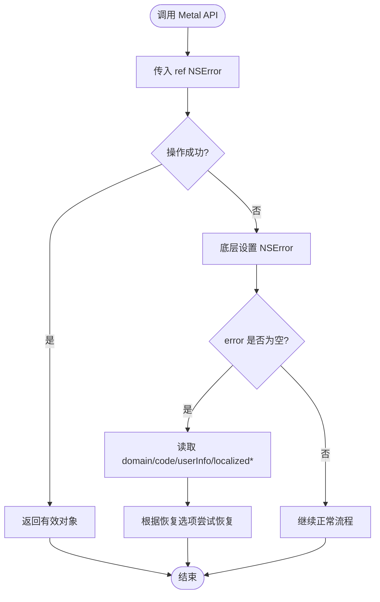
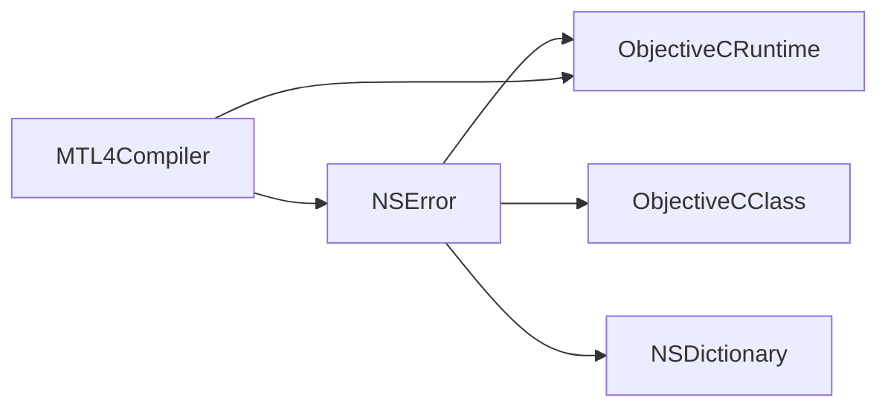

# NSError 错误处理绑定

<cite>
**本文引用的文件**
- [NSError.cs](file://src/SharpMetal/Foundation/NSError.cs)
- [NSObject.cs](file://src/SharpMetal/Foundation/NSObject.cs)
- [ObjectiveCRuntime.cs](file://src/SharpMetal/ObjectiveCCore/ObjectiveCRuntime.cs)
- [ObjectiveCClass.cs](file://src/SharpMetal/ObjectiveCCore/ObjectiveCClass.cs)
- [NSDictionary.cs](file://src/SharpMetal/Foundation/NSDictionary.cs)
- [MTL4Compiler.cs](file://src/SharpMetal/Metal/MTL4Compiler.cs)
- [NSBundle.cs](file://src/SharpMetal/Foundation/NSBundle.cs)
- [Program.cs](file://samples/SharpMetal.Sample/Program.cs)
</cite>

## 目录
1. [简介](#简介)
2. [项目结构](#项目结构)
3. [核心组件](#核心组件)
4. [架构总览](#架构总览)
5. [详细组件分析](#详细组件分析)
6. [依赖关系分析](#依赖关系分析)
7. [性能考虑](#性能考虑)
8. [故障排查指南](#故障排查指南)
9. [结论](#结论)
10. [附录](#附录)

## 简介
本文件围绕 SharpMetal 中的 NSError 错误处理绑定，系统性阐述其生命周期管理、错误信息获取机制、创建与传播模式、错误域/错误码/用户信息的组织方式，以及与 Objective-C 错误系统的集成。文档同时提供常见错误处理模式的实践建议（异常捕获、错误检查与恢复策略），并给出性能考量与最佳实践。

## 项目结构
NSError 位于 Foundation 命名空间，作为对 Objective-C NSError 的轻量托管包装。它通过 ObjectiveCCore 提供的运行时能力调用底层 Objective-C 方法，访问错误对象的核心属性（域、码、用户信息等）以及本地化描述等。在 Metal API 中，许多编译与资源创建方法采用“返回结果 + ref NSError”的模式进行错误传播。



图表来源
- [NSError.cs:5-49](file://src/SharpMetal/Foundation/NSError.cs#L5-L49)
- [ObjectiveCRuntime.cs:33-800](file://src/SharpMetal/ObjectiveCCore/ObjectiveCRuntime.cs#L33-L800)
- [ObjectiveCClass.cs:18-89](file://src/SharpMetal/ObjectiveCCore/ObjectiveCClass.cs#L18-L89)
- [NSDictionary.cs:5-55](file://src/SharpMetal/Foundation/NSDictionary.cs#L5-L55)
- [MTL4Compiler.cs:100-165](file://src/SharpMetal/Metal/MTL4Compiler.cs#L100-L165)

章节来源
- [NSError.cs:5-49](file://src/SharpMetal/Foundation/NSError.cs#L5-L49)
- [ObjectiveCRuntime.cs:33-800](file://src/SharpMetal/ObjectiveCCore/ObjectiveCRuntime.cs#L33-L800)
- [ObjectiveCClass.cs:18-89](file://src/SharpMetal/ObjectiveCCore/ObjectiveCClass.cs#L18-L89)
- [NSDictionary.cs:5-55](file://src/SharpMetal/Foundation/NSDictionary.cs#L5-L55)
- [MTL4Compiler.cs:100-165](file://src/SharpMetal/Metal/MTL4Compiler.cs#L100-L165)

## 核心组件
- NSError：对 Objective-C NSError 的结构体包装，暴露域、码、用户信息、本地化描述、恢复选项、失败原因等只读属性；提供静态工厂方法与初始化方法以创建错误对象；支持隐式转换为 IntPtr 以便与原生交互。
- ObjectiveCRuntime：封装 Objective-C 运行时调用（objc_msgSend 等），用于读取 NSError 的属性或调用其类方法。
- ObjectiveCClass：用于获取 Objective-C 类句柄并进行分配/初始化操作。
- NSDictionary：承载 NSError.UserInfo，用于存储键值形式的附加错误信息。
- MTL4Compiler：展示 ref NSError 的错误传播模式，API 方法将错误对象引用传入，由底层设置错误内容。

章节来源
- [NSError.cs:5-49](file://src/SharpMetal/Foundation/NSError.cs#L5-L49)
- [ObjectiveCRuntime.cs:33-800](file://src/SharpMetal/ObjectiveCCore/ObjectiveCRuntime.cs#L33-L800)
- [ObjectiveCClass.cs:18-89](file://src/SharpMetal/ObjectiveCCore/ObjectiveCClass.cs#L18-L89)
- [NSDictionary.cs:5-55](file://src/SharpMetal/Foundation/NSDictionary.cs#L5-L55)
- [MTL4Compiler.cs:100-165](file://src/SharpMetal/Metal/MTL4Compiler.cs#L100-L165)

## 架构总览
NSError 绑定通过 ObjectiveCClass 定位 NSError 类，使用 ObjectiveCRuntime 的 objc_msgSend 变体访问属性与方法。Metal API 通过 ref NSError 将错误回传至调用方，形成“返回值 + 错误参数”的双通道错误传播模型。

```mermaid
sequenceDiagram
participant App as "应用代码"
participant Compiler as "MTL4Compiler"
participant Runtime as "ObjectiveCRuntime"
participant ObjC as "Objective-C NSError"
App->>Compiler : 调用创建管线/库的方法(ref NSError)
Compiler->>Runtime : 调用 objc_msgSend(..., ref error.NativePtr)
Runtime->>ObjC : 执行对应 selector，可能设置错误对象
ObjC-->>Runtime : 返回结果指针/布尔状态
Runtime-->>Compiler : 返回托管结果
Compiler-->>App : 返回结果; 若出错则 error 非空
```

图表来源
- [MTL4Compiler.cs:100-165](file://src/SharpMetal/Metal/MTL4Compiler.cs#L100-L165)
- [ObjectiveCRuntime.cs:118-800](file://src/SharpMetal/ObjectiveCCore/ObjectiveCRuntime.cs#L118-L800)
- [NSError.cs:27-35](file://src/SharpMetal/Foundation/NSError.cs#L27-L35)

## 详细组件分析

### NSError 结构与生命周期
- 结构体包装：NSError 是 struct，内部持有 NativePtr，表示指向 Objective-C NSError 对象的指针。
- 构造与工厂：
  - New()：通过 s_class.AllocInit<NSError>() 创建未初始化的 NSError 实例（通常不直接使用）。
  - Error(domain, code, userInfo)：静态工厂方法，调用 NSError 类方法创建已配置的错误对象。
  - Init(domain, code, userInfo)：实例初始化方法，用于已有实例的配置。
- 属性访问：
  - Code：错误码。
  - Domain：错误域（NSString）。
  - UserInfo：用户信息字典（NSDictionary）。
  - LocalizedDescription / LocalizedRecoveryOptions / LocalizedRecoverySuggestion / LocalizedFailureReason：本地化文本与恢复提示。
- 生命周期管理：
  - 该绑定未实现 Dispose 或自动释放逻辑，遵循“谁拥有，谁释放”的原则。对于从系统 API 返回的错误对象，通常由系统负责释放；对于手动创建的 NSError，应避免重复释放。
  - 由于 NSError 是 struct，传递时复制的是指针值，不会改变原对象的生命周期计数。



图表来源
- [NSError.cs:5-49](file://src/SharpMetal/Foundation/NSError.cs#L5-L49)
- [ObjectiveCClass.cs:54-78](file://src/SharpMetal/ObjectiveCCore/ObjectiveCClass.cs#L54-L78)
- [ObjectiveCRuntime.cs:118-800](file://src/SharpMetal/ObjectiveCCore/ObjectiveCRuntime.cs#L118-L800)
- [NSDictionary.cs:5-55](file://src/SharpMetal/Foundation/NSDictionary.cs#L5-L55)

章节来源
- [NSError.cs:5-49](file://src/SharpMetal/Foundation/NSError.cs#L5-L49)
- [ObjectiveCClass.cs:54-78](file://src/SharpMetal/ObjectiveCCore/ObjectiveCClass.cs#L54-L78)
- [ObjectiveCRuntime.cs:118-800](file://src/SharpMetal/ObjectiveCCore/ObjectiveCRuntime.cs#L118-L800)
- [NSDictionary.cs:5-55](file://src/SharpMetal/Foundation/NSDictionary.cs#L5-L55)

### 错误信息获取机制
- 域（Domain）：通过 NSString 包装返回，可进一步转为字符串进行比较或显示。
- 码（Code）：长整型标识具体错误类型。
- 用户信息（UserInfo）：NSDictionary，可通过键枚举或 keyEnumerator 遍历，或使用 Object(key) 获取特定项。
- 本地化信息：LocalizedDescription、LocalizedFailureReason、LocalizedRecoveryOptions、LocalizedRecoverySuggestion 提供面向用户的可读信息与恢复建议。

章节来源
- [NSError.cs:13-25](file://src/SharpMetal/Foundation/NSError.cs#L13-L25)
- [NSDictionary.cs:13-40](file://src/SharpMetal/Foundation/NSDictionary.cs#L13-L40)

### 错误对象的创建、配置与传播模式
- 创建与配置：
  - 静态工厂 Error(domain, code, userInfo)：一次性创建并配置错误对象。
  - 实例 Init(domain, code, userInfo)：对已有实例进行配置。
- 传播模式：
  - “返回值 + ref NSError”：Metal 编译器相关 API（如 NewLibrary、NewComputePipelineState 等）将 NSError 以 ref 形式传入，底层在失败时填充错误对象。
  - 示例：MTL4Compiler.NewLibrary(descriptor, ref NSError error)。



图表来源
- [MTL4Compiler.cs:100-165](file://src/SharpMetal/Metal/MTL4Compiler.cs#L100-L165)
- [NSError.cs:27-35](file://src/SharpMetal/Foundation/NSError.cs#L27-L35)

章节来源
- [MTL4Compiler.cs:100-165](file://src/SharpMetal/Metal/MTL4Compiler.cs#L100-L165)
- [NSError.cs:27-35](file://src/SharpMetal/Foundation/NSError.cs#L27-L35)

### 与 Objective-C 错误系统的集成
- 通过 ObjectiveCClass("NSError") 获取 NSError 类句柄，再调用 ObjectiveCRuntime 的 objc_msgSend 变体执行类方法或实例方法。
- 所有属性访问（code、domain、userInfo 等）均通过 ObjectiveCRuntime 的相应重载完成。
- 隐式转换：NSError 到 IntPtr 的转换便于直接传递给需要原生指针的 API。

章节来源
- [NSError.cs:27-49](file://src/SharpMetal/Foundation/NSError.cs#L27-L49)
- [ObjectiveCClass.cs:30-40](file://src/SharpMetal/ObjectiveCCore/ObjectiveCClass.cs#L30-L40)
- [ObjectiveCRuntime.cs:118-800](file://src/SharpMetal/ObjectiveCCore/ObjectiveCRuntime.cs#L118-L800)

### 错误域、错误码与用户信息的组织方式
- 错误域（Domain）：用于区分错误来源（例如不同子系统或模块），通常为字符串常量。
- 错误码（Code）：在域内唯一标识错误类型。
- 用户信息（UserInfo）：NSDictionary，包含上下文数据（如文件名、行号、附加说明等），便于诊断与恢复。
- 本地化字段：LocalizedDescription、LocalizedFailureReason、LocalizedRecoveryOptions、LocalizedRecoverySuggestion 提供面向用户的消息与恢复建议。

章节来源
- [NSError.cs:13-25](file://src/SharpMetal/Foundation/NSError.cs#L13-L25)
- [NSDictionary.cs:13-40](file://src/SharpMetal/Foundation/NSDictionary.cs#L13-L40)

### 错误处理模式与示例路径
- 异常捕获：
  - 示例参考：[Program.cs:23-45](file://samples/SharpMetal.Sample/Program.cs#L23-L45) 展示了 try/finally 的资源清理与异常抛出模式。
- 错误检查与恢复：
  - 针对 Metal API 的 ref NSError 模式，调用后检查 error 是否非空，读取 domain/code/userInfo 与本地化信息，依据恢复选项尝试重试或降级。
  - 示例路径：[MTL4Compiler.cs:100-165](file://src/SharpMetal/Metal/MTL4Compiler.cs#L100-L165) 展示了多处使用 ref NSError 的 API。
- 恢复策略：
  - 基于 LocalizedRecoveryOptions 提供的选项列表，结合用户选择或默认策略进行恢复。
  - 利用 LocalizedRecoverySuggestion 指导下一步操作。

章节来源
- [Program.cs:23-45](file://samples/SharpMetal.Sample/Program.cs#L23-L45)
- [MTL4Compiler.cs:100-165](file://src/SharpMetal/Metal/MTL4Compiler.cs#L100-L165)
- [NSError.cs:13-25](file://src/SharpMetal/Foundation/NSError.cs#L13-L25)

## 依赖关系分析
NSError 绑定依赖以下组件：
- ObjectiveCRuntime：提供与 Objective-C 运行时的桥接。
- ObjectiveCClass：用于获取 NSError 类句柄并分配/初始化。
- NSDictionary：承载用户信息。
- Metal API：通过 ref NSError 传播错误。



图表来源
- [NSError.cs:5-49](file://src/SharpMetal/Foundation/NSError.cs#L5-L49)
- [ObjectiveCRuntime.cs:118-800](file://src/SharpMetal/ObjectiveCCore/ObjectiveCRuntime.cs#L118-L800)
- [ObjectiveCClass.cs:18-89](file://src/SharpMetal/ObjectiveCCore/ObjectiveCClass.cs#L18-L89)
- [NSDictionary.cs:5-55](file://src/SharpMetal/Foundation/NSDictionary.cs#L5-L55)
- [MTL4Compiler.cs:100-165](file://src/SharpMetal/Metal/MTL4Compiler.cs#L100-L165)

章节来源
- [NSError.cs:5-49](file://src/SharpMetal/Foundation/NSError.cs#L5-L49)
- [ObjectiveCRuntime.cs:118-800](file://src/SharpMetal/ObjectiveCCore/ObjectiveCRuntime.cs#L118-L800)
- [ObjectiveCClass.cs:18-89](file://src/SharpMetal/ObjectiveCCore/ObjectiveCClass.cs#L18-L89)
- [NSDictionary.cs:5-55](file://src/SharpMetal/Foundation/NSDictionary.cs#L5-L55)
- [MTL4Compiler.cs:100-165](file://src/SharpMetal/Metal/MTL4Compiler.cs#L100-L165)

## 性能考虑
- 避免频繁创建 NSError：错误对象创建涉及原生调用与内存分配，应在真正发生错误时创建。
- 最小化 UserInfo 大小：仅包含必要上下文信息，避免大对象或复杂结构导致序列化/传输开销。
- 减少本地化字符串解析：LocalizedDescription 等字符串按需获取，避免在热路径中多次调用。
- 合理使用 ref NSError：在批量操作中，复用同一错误对象以减少分配与拷贝成本。
- 注意跨语言边界调用成本：每次属性访问都通过 ObjectiveCRuntime 调用，应尽量减少不必要的读取。

## 故障排查指南
- 常见问题：
  - 错误对象为空但操作失败：确认 API 是否支持 ref NSError 模式，或改用异常捕获路径。
  - 无法读取用户信息：检查 NSDictionary 的键是否正确，必要时枚举 KeyEnumerator 查看可用键。
  - 本地化信息缺失：确认设备语言环境与资源包配置正确。
- 调试步骤：
  - 打印 Domain 与 Code，定位错误来源与类型。
  - 读取 LocalizedFailureReason 与 LocalizedRecoverySuggestion，理解失败原因与恢复建议。
  - 检查 UserInfo 中的关键上下文（如文件路径、参数值），辅助复现问题。
- 参考路径：
  - Bundle 预检与加载错误：[NSBundle.cs:88-93](file://src/SharpMetal/Foundation/NSBundle.cs#L88-L93)
  - 示例异常处理：[Program.cs:23-45](file://samples/SharpMetal.Sample/Program.cs#L23-L45)

章节来源
- [NSBundle.cs:88-93](file://src/SharpMetal/Foundation/NSBundle.cs#L88-L93)
- [Program.cs:23-45](file://samples/SharpMetal.Sample/Program.cs#L23-L45)

## 结论
SharpMetal 的 NSError 绑定提供了对 Objective-C 错误系统的简洁而高效的访问能力。通过“返回值 + ref NSError”的传播模式，开发者可以在 Metal API 调用中明确区分成功与失败路径，并利用域、码、用户信息与本地化字段进行精准诊断与恢复。遵循最小化创建、最小化 UserInfo、按需获取本地化字符串等最佳实践，可在保证可维护性的同时提升性能。

## 附录
- 常用 API 路径参考：
  - NSError 创建与属性：[NSError.cs:11-35](file://src/SharpMetal/Foundation/NSError.cs#L11-L35)
  - NSError 本地化字段：[NSError.cs:19-25](file://src/SharpMetal/Foundation/NSError.cs#L19-L25)
  - Metal 编译器错误传播：[MTL4Compiler.cs:100-165](file://src/SharpMetal/Metal/MTL4Compiler.cs#L100-L165)
  - 示例异常处理：[Program.cs:23-45](file://samples/SharpMetal.Sample/Program.cs#L23-L45)