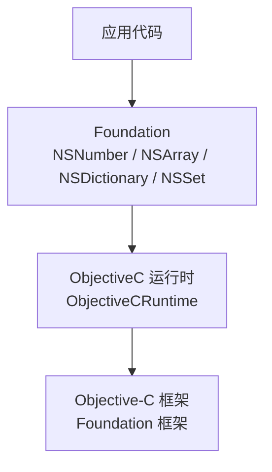
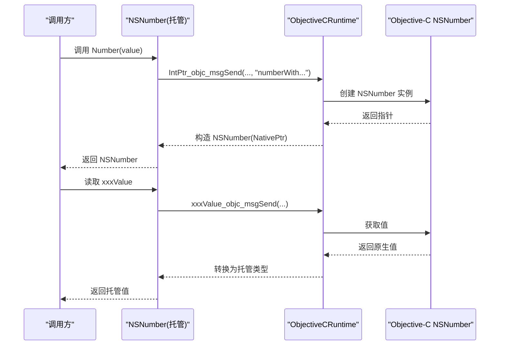
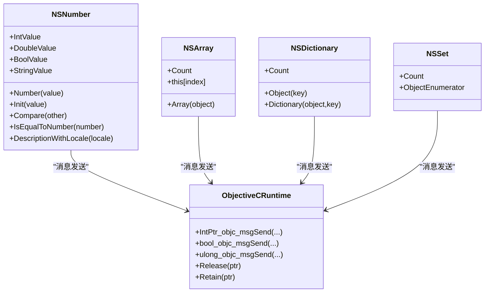

# NSNumber 数值包装绑定

<cite>
**本文引用的文件**
- [NSNumber.cs](file://src/SharpMetal/Foundation/NSNumber.cs)
- [NSObject.cs](file://src/SharpMetal/Foundation/NSObject.cs)
- [NSArray.cs](file://src/SharpMetal/Foundation/NSArray.cs)
- [NSDictionary.cs](file://src/SharpMetal/Foundation/NSDictionary.cs)
- [NSSet.cs](file://src/SharpMetal/Foundation/NSSet.cs)
- [ObjectiveCRuntime.cs](file://src/SharpMetal/ObjectiveCCore/ObjectiveCRuntime.cs)
</cite>

## 目录
1. [简介](#简介)
2. [项目结构](#项目结构)
3. [核心组件](#核心组件)
4. [架构总览](#架构总览)
5. [详细组件分析](#详细组件分析)
6. [依赖关系分析](#依赖关系分析)
7. [性能与内存优化](#性能与内存优化)
8. [故障排查指南](#故障排查指南)
9. [结论](#结论)
10. [附录：使用示例与最佳实践](#附录使用示例与最佳实践)

## 简介
本文件围绕 SharpMetal 中的 NSNumber 数值包装器绑定，系统阐述其对多种数值类型的支持、自动装箱机制、类型转换与精度处理、与 Foundation 集合（NSArray、NSDictionary、NSSet）的集成方式、比较与序列化能力，以及跨平台数据交换场景下的注意事项。同时给出性能与内存使用的优化建议，并提供可操作的示例路径指引，帮助读者在 .NET 环境中安全高效地使用 NSNumber。

## 项目结构
- Foundation 层提供 Objective-C 基础对象的托管封装，包括 NSNumber、NSArray、NSDictionary、NSSet、NSObject 等。
- ObjectiveCCore 层提供与 libobjc 的直接互操作（消息发送、选择器、内存管理），是 Foundation 层的运行时支撑。
- 本仓库为低层绑定库，运行时需要 Apple 宿主环境；示例工程展示了如何与 Metal 交互，但 NSNumber 的使用模式同样适用于其他 Foundation API。

图表来源
- [NSNumber.cs:61-271](file://src/SharpMetal/Foundation/NSNumber.cs#L61-L271)
- [ObjectiveCRuntime.cs:33-839](file://src/SharpMetal/ObjectiveCCore/ObjectiveCRuntime.cs#L33-L839)

章节来源
- [NSNumber.cs:1-273](file://src/SharpMetal/Foundation/NSNumber.cs#L1-L273)
- [ObjectiveCRuntime.cs:1-839](file://src/SharpMetal/ObjectiveCCore/ObjectiveCRuntime.cs#L1-L839)

## 核心组件
- NSNumber：对 C/ObjC 基本数值类型的对象化包装，提供创建、读取、比较、描述等方法。
- NSObject：基础对象模型，包含比较结果枚举 NSComparisonResult 及通用方法。
- NSArray/NSDictionary/NSSet：Foundation 集合类型，可存储 NSNumber 实例以实现多态容器。
- ObjectiveCRuntime：底层消息分发、类型转换和内存管理原语。

章节来源
- [NSNumber.cs:61-271](file://src/SharpMetal/Foundation/NSNumber.cs#L61-L271)
- [NSObject.cs:6-11](file://src/SharpMetal/Foundation/NSObject.cs#L6-L11)
- [NSArray.cs:5-64](file://src/SharpMetal/Foundation/NSArray.cs#L5-L64)
- [NSDictionary.cs:5-53](file://src/SharpMetal/Foundation/NSDictionary.cs#L5-L53)
- [NSSet.cs:5-34](file://src/SharpMetal/Foundation/NSSet.cs#L5-L34)
- [ObjectiveCRuntime.cs:383-434](file://src/SharpMetal/ObjectiveCCore/ObjectiveCRuntime.cs#L383-L434)

## 架构总览
NSNumber 通过静态工厂方法与初始化方法调用 Objective-C 的 NSNumber 类，完成“装箱”；读取时通过属性访问器调用对应取值方法，完成“拆箱”。所有调用均经由 ObjectiveCRuntime 的消息发送接口完成。

图表来源
- [NSNumber.cs:105-153](file://src/SharpMetal/Foundation/NSNumber.cs#L105-L153)
- [NSNumber.cs:73-103](file://src/SharpMetal/Foundation/NSNumber.cs#L73-L103)
- [ObjectiveCRuntime.cs:124-156](file://src/SharpMetal/ObjectiveCCore/ObjectiveCRuntime.cs#L124-L156)

## 详细组件分析

### NSNumber 类型支持与自动装箱
- 支持的数值类型覆盖常见整型、浮点与布尔：
  - 整型：char、unsigned char、short、unsigned short、int、unsigned int、long、unsigned long、long long、unsigned long long
  - 浮点：float、double
  - 布尔：bool
- 自动装箱：
  - 通过静态工厂方法 Number(value) 将各类型值装箱为 NSNumber。
  - 通过 Init(value) 重载也可完成装箱。
- 自动拆箱：
  - 通过 XxxValue 属性（如 IntValue、DoubleValue、BoolValue 等）从 NSNumber 中取出对应托管类型。
  - 还提供 integerValue、unsignedIntegerValue、stringValue 等便捷访问。

复杂度与行为说明
- 装箱/拆箱均为 O(1) 操作，主要开销来自一次 Objective-C 消息发送。
- 不同平台的整数宽度可能不同（例如 long 在 64 位平台上更宽），需根据目标平台选择合适的类型以避免截断或溢出。

章节来源
- [NSNumber.cs:73-103](file://src/SharpMetal/Foundation/NSNumber.cs#L73-L103)
- [NSNumber.cs:105-153](file://src/SharpMetal/Foundation/NSNumber.cs#L105-L153)
- [NSNumber.cs:155-208](file://src/SharpMetal/Foundation/NSNumber.cs#L155-L208)

### 数值类型转换与精度处理
- 从 NSNumber 读取到托管类型时，由 Objective-C 侧执行类型转换。若源类型与目标类型不匹配，可能出现精度损失或截断（例如 double 转 float、大整数转较小整型）。
- 建议在关键路径上显式选择合适精度的存取器（如优先使用 DoubleValue/LongLongValue 以保留更高精度）。
- 字符串化：
  - StringValue 提供十进制字符串表示，适合日志与调试。
  - DescriptionWithLocale(NSObject locale) 可按区域设置生成格式化字符串。

章节来源
- [NSNumber.cs:93-103](file://src/SharpMetal/Foundation/NSNumber.cs#L93-L103)
- [NSNumber.cs:220-223](file://src/SharpMetal/Foundation/NSNumber.cs#L220-L223)

### 与 Foundation 集合的集成
- NSArray：可存储任意 NSObject 子类，包括 NSNumber。可通过索引访问元素并得到 NativePtr，再包装为 NSNumber 进行读取。
- NSDictionary：键值对集合，键与值均可使用 NSNumber（注意键通常建议使用 NSString，但技术上 NSNumber 可作为键参与哈希与相等性判断）。
- NSSet：无序唯一集合，基于哈希与相等性，NSNumber 的相等性与哈希行为遵循其数值语义。

典型用法要点
- 创建数组/字典/集合时传入 NSNumber 实例。
- 读取时从集合取回 NativePtr，再构造 NSNumber 进行类型安全的取值。
- 注意集合元素的不可变性约定与生命周期管理。

章节来源
- [NSArray.cs:11-35](file://src/SharpMetal/Foundation/NSArray.cs#L11-L35)
- [NSDictionary.cs:17-30](file://src/SharpMetal/Foundation/NSDictionary.cs#L17-L30)
- [NSSet.cs:17-20](file://src/SharpMetal/Foundation/NSSet.cs#L17-L20)

### 数值比较与相等性
- Compare(NSNumber other)：返回 NSComparisonResult（升序、相同、降序），用于排序与条件分支。
- IsEqualToNumber(NSNumber number)：精确相等性判断。
- 与 NSObject.IsEqual 的关系：NSNumber 作为 NSObject 派生，具备对象级相等语义；数值比较推荐使用 Compare/IsEqualToNumber。

章节来源
- [NSNumber.cs:210-218](file://src/SharpMetal/Foundation/NSNumber.cs#L210-L218)
- [NSObject.cs:6-11](file://src/SharpMetal/Foundation/NSObject.cs#L6-L11)

### 序列化与反序列化
- 反序列化入口：Init(IntPtr coder) 支持从 NSCoder 解码 NSNumber。
- 序列化：Foundation 的编码协议（NSCoding）通常由系统框架内部实现；在托管层，可通过 stringValue 或自定义编码策略配合 NSData 进行持久化。
- 跨平台数据交换：
  - 文本格式：使用 stringValue 输出为字符串，便于 JSON/XML 等文本协议传输。
  - 二进制格式：可将数值序列化为字节流（例如按固定宽度写入），接收端再解析为 NSNumber 或直接解析为托管类型。

章节来源
- [NSNumber.cs:155-158](file://src/SharpMetal/Foundation/NSNumber.cs#L155-L158)
- [NSNumber.cs:103](file://src/SharpMetal/Foundation/NSNumber.cs#L103)

### 与其他基础类型的关系
- NSValue：用于包装任意 C 结构体或指针，与 NSNumber 同属 Foundation 数值相关类型，但用途不同。
- NSRange/CGSize/CGRect 等结构体通过 ObjectiveCRuntime 的专用消息发送函数进行编组与解组，体现统一的消息驱动设计。

章节来源
- [NSNumber.cs:5-59](file://src/SharpMetal/Foundation/NSNumber.cs#L5-L59)
- [ObjectiveCRuntime.cs:314-348](file://src/SharpMetal/ObjectiveCCore/ObjectiveCRuntime.cs#L314-L348)

## 依赖关系分析
- NSNumber 强依赖 ObjectiveCRuntime 进行消息发送与类型转换。
- NSArray/NSDictionary/NSSet 依赖 NSObject 体系，可与 NSNumber 组合形成富数据结构。
- 整体耦合度较低：Foundation 各类型通过统一的 NativePtr 与消息机制协作，便于扩展与维护。

图表来源
- [NSNumber.cs:61-271](file://src/SharpMetal/Foundation/NSNumber.cs#L61-L271)
- [NSArray.cs:5-64](file://src/SharpMetal/Foundation/NSArray.cs#L5-L64)
- [NSDictionary.cs:5-53](file://src/SharpMetal/Foundation/NSDictionary.cs#L5-L53)
- [NSSet.cs:5-34](file://src/SharpMetal/Foundation/NSSet.cs#L5-L34)
- [ObjectiveCRuntime.cs:124-156](file://src/SharpMetal/ObjectiveCCore/ObjectiveCRuntime.cs#L124-L156)

章节来源
- [NSNumber.cs:61-271](file://src/SharpMetal/Foundation/NSNumber.cs#L61-L271)
- [ObjectiveCRuntime.cs:124-156](file://src/SharpMetal/ObjectiveCCore/ObjectiveCRuntime.cs#L124-L156)

## 性能与内存优化
- 避免频繁装箱/拆箱：
  - 在热路径中尽量复用 NSNumber 实例或使用原生类型计算，减少 Objective-C 消息开销。
- 合理选择精度：
  - 使用 DoubleValue/LongLongValue 等高精度存取器，避免不必要的精度损失与二次转换。
- 集合使用：
  - 大量 NSNumber 放入集合会增加引用计数与分配压力，必要时考虑批量化创建与释放。
- 内存管理：
  - 持有 NativePtr 时需关注生命周期；可使用 ObjectiveCRuntime.Retain/Release 控制引用计数（谨慎使用）。
- 字符串化成本：
  - stringValue/descriptionWithLocale 会分配托管字符串，仅在需要时调用。

[本节为通用性能指导，不直接分析具体文件]

## 故障排查指南
- 平台限制：
  - 运行时需要 Apple 宿主环境；在非 Apple 平台会受限。
- 类型不匹配：
  - 从 NSNumber 读取到不兼容类型可能导致截断或异常；请确保存取器与原始装箱类型一致。
- 空指针与生命周期：
  - 访问已释放的 NativePtr 会导致崩溃；确保集合与对象的生命周期有效。
- 比较与哈希：
  - 使用 Compare/IsEqualToNumber 进行数值比较；集合中依赖相等性与哈希的行为符合数值语义。

章节来源
- [ObjectiveCRuntime.cs:769-782](file://src/SharpMetal/ObjectiveCCore/ObjectiveCRuntime.cs#L769-L782)
- [NSNumber.cs:210-223](file://src/SharpMetal/Foundation/NSNumber.cs#L210-L223)

## 结论
SharpMetal 的 NSNumber 绑定提供了对多种数值类型的完整对象化封装，借助 ObjectiveCRuntime 实现高效的装箱/拆箱与类型转换。通过与 NSArray/NSDictionary/NSSet 的无缝集成，可在 Foundation 生态中灵活组织数据。结合合理的精度选择、内存管理与性能优化策略，可以在跨平台数据交换与高性能场景中稳定使用 NSNumber。

[本节为总结性内容，不直接分析具体文件]

## 附录：使用示例与最佳实践
- 基本类型包装
  - 使用 Number(value) 将整型、浮点、布尔装箱为 NSNumber。
  - 使用 XxxValue 属性读取为托管类型。
  - 参考路径：[NSNumber.cs:105-153](file://src/SharpMetal/Foundation/NSNumber.cs#L105-L153)、[NSNumber.cs:73-103](file://src/SharpMetal/Foundation/NSNumber.cs#L73-L103)

- 集合存储
  - 将 NSNumber 放入 NSArray/NSDictionary/NSSet，并通过索引或键访问后构造 NSNumber 读取。
  - 参考路径：[NSArray.cs:11-35](file://src/SharpMetal/Foundation/NSArray.cs#L11-L35)、[NSDictionary.cs:17-30](file://src/SharpMetal/Foundation/NSDictionary.cs#L17-L30)、[NSSet.cs:17-20](file://src/SharpMetal/Foundation/NSSet.cs#L17-L20)

- 跨平台数据交换
  - 文本：使用 StringValue 或 DescriptionWithLocale 生成字符串，便于 JSON/XML。
  - 二进制：将数值按固定宽度写入字节流，接收端解析为 NSNumber 或原生类型。
  - 参考路径：[NSNumber.cs:103](file://src/SharpMetal/Foundation/NSNumber.cs#L103)、[NSNumber.cs:220-223](file://src/SharpMetal/Foundation/NSNumber.cs#L220-L223)

- 比较与排序
  - 使用 Compare(other) 进行有序比较，返回 NSComparisonResult。
  - 参考路径：[NSNumber.cs:210-213](file://src/SharpMetal/Foundation/NSNumber.cs#L210-L213)、[NSObject.cs:6-11](file://src/SharpMetal/Foundation/NSObject.cs#L6-L11)

- 性能与内存
  - 减少频繁装箱/拆箱；在高并发或大数据量场景下批量处理。
  - 合理使用字符串化与集合容量，避免不必要的分配。
  - 参考路径：[ObjectiveCRuntime.cs:769-782](file://src/SharpMetal/ObjectiveCCore/ObjectiveCRuntime.cs#L769-L782)