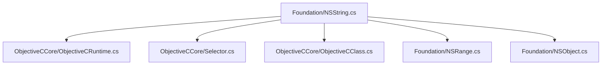
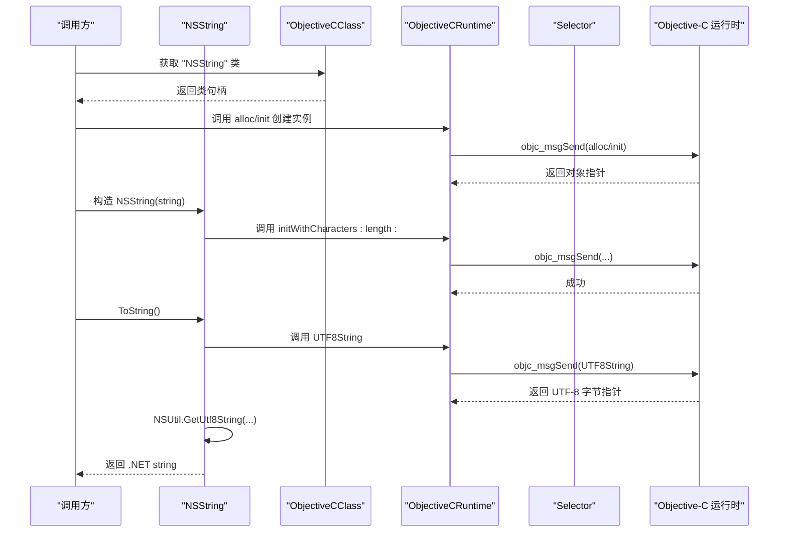
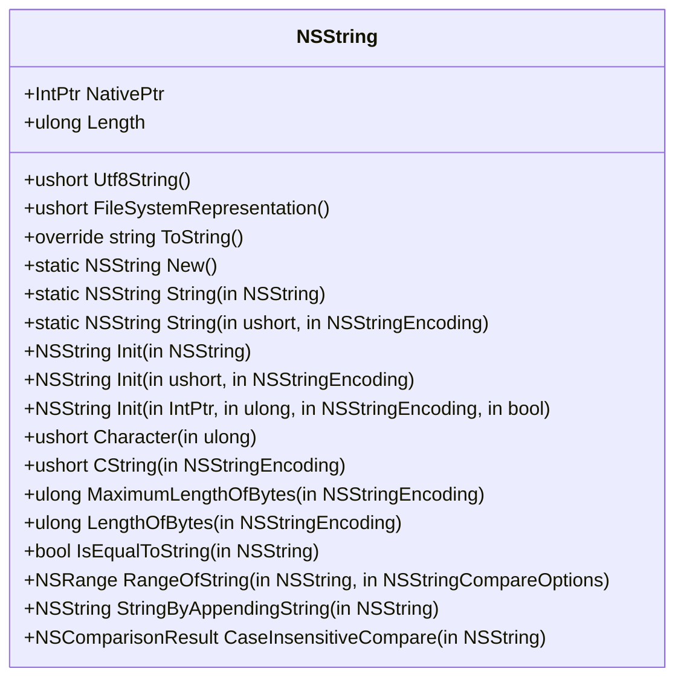
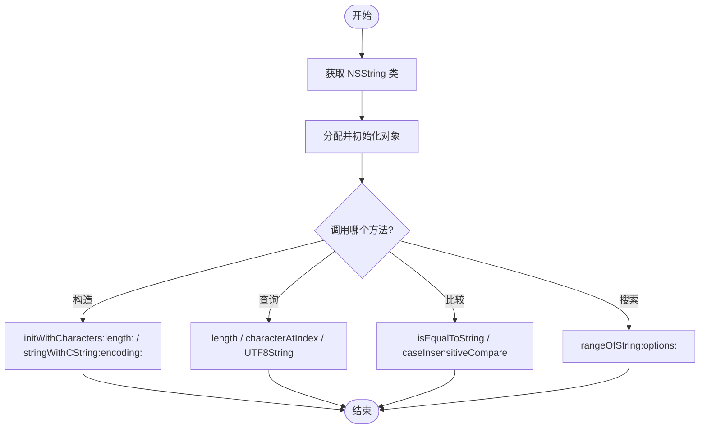
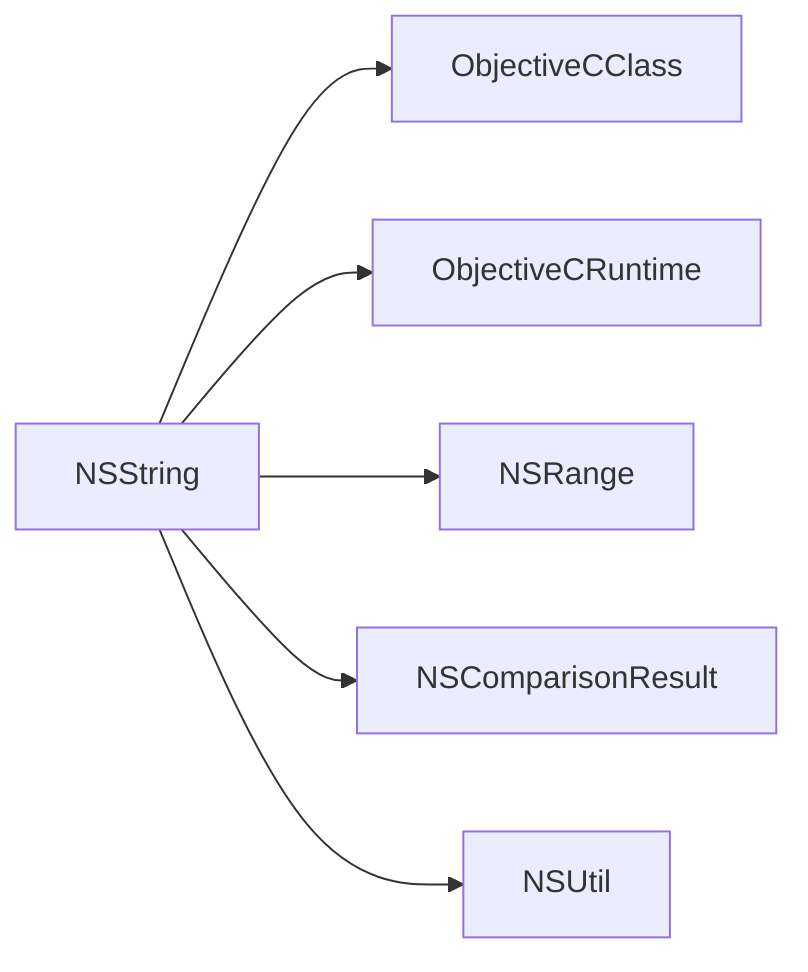

# NSString 字符串绑定

<cite>
**本文引用的文件**
- [NSString.cs](file://src/SharpMetal/Foundation/NSString.cs)
- [NSObject.cs](file://src/SharpMetal/Foundation/NSObject.cs)
- [NSRange.cs](file://src/SharpMetal/Foundation/NSRange.cs)
- [ObjectiveCRuntime.cs](file://src/SharpMetal/ObjectiveCCore/ObjectiveCRuntime.cs)
- [Selector.cs](file://src/SharpMetal/ObjectiveCCore/Selector.cs)
- [ObjectiveCClass.cs](file://src/SharpMetal/ObjectiveCCore/ObjectiveCClass.cs)
</cite>

## 目录
1. [简介](#简介)
2. [项目结构](#项目结构)
3. [核心组件](#核心组件)
4. [架构总览](#架构总览)
5. [详细组件分析](#详细组件分析)
6. [依赖关系分析](#依赖关系分析)
7. [性能考量](#性能考量)
8. [故障排查指南](#故障排查指南)
9. [结论](#结论)
10. [附录：使用示例与最佳实践](#附录使用示例与最佳实践)

## 简介
本文件围绕 SharpMetal 中的 NSString 字符串绑定进行深入说明，涵盖以下方面：
- NSString 结构体的实现要点：创建、编码转换、字符访问、长度计算、比较与搜索等。
- NSStringEncoding 枚举支持的编码格式（ASCII、UTF8、UTF16、UTF32 等）及其适用场景。
- NSStringCompareOptions 比较选项的组合用法。
- 字符串搜索、替换、格式化等核心功能的现状与建议。
- 性能优化建议与内存管理最佳实践。
- 提供完整的代码示例路径，便于在工程中快速定位与复用。

## 项目结构
本项目将 Foundation 层的核心类型以 C# struct/enum 形式暴露给上层调用，底层通过 Objective-C Runtime 进行消息发送与对象交互。NSString 位于 Foundation 命名空间，依赖 ObjectiveCCore 提供的运行时能力。

图表来源
- [NSString.cs:6-186](file://src/SharpMetal/Foundation/NSString.cs#L6-L186)
- [ObjectiveCRuntime.cs:33-839](file://src/SharpMetal/ObjectiveCCore/ObjectiveCRuntime.cs#L33-L839)
- [Selector.cs:5-43](file://src/SharpMetal/ObjectiveCCore/Selector.cs#L5-L43)
- [ObjectiveCClass.cs:18-89](file://src/SharpMetal/ObjectiveCCore/ObjectiveCClass.cs#L18-L89)
- [NSRange.cs:5-10](file://src/SharpMetal/Foundation/NSRange.cs#L5-L10)
- [NSObject.cs:34-46](file://src/SharpMetal/Foundation/NSObject.cs#L34-L46)

章节来源
- [NSString.cs:6-186](file://src/SharpMetal/Foundation/NSString.cs#L6-L186)
- [ObjectiveCRuntime.cs:33-839](file://src/SharpMetal/ObjectiveCCore/ObjectiveCRuntime.cs#L33-L839)

## 核心组件
- NSString 结构体：封装了 Objective-C 的 NSString 对象指针，并提供创建、编码转换、字符访问、长度、比较、搜索、拼接等方法。
- NSStringEncoding 枚举：定义多种编码常量，用于字符串与字节序列之间的转换。
- NSStringCompareOptions 枚举：定义字符串比较与搜索时的行为选项。
- NSRange：表示范围（location, length），常用于搜索结果。
- NSComparisonResult：表示比较结果（升序、相同、降序）。
- ObjectiveCRuntime：提供与 Objective-C 运行时交互的消息发送、类获取、选择器注册等能力。
- Selector：封装 Objective-C 方法选择器。
- ObjectiveCClass：封装 Objective-C 类的分配与初始化等操作。

章节来源
- [NSString.cs:6-186](file://src/SharpMetal/Foundation/NSString.cs#L6-L186)
- [NSRange.cs:5-10](file://src/SharpMetal/Foundation/NSRange.cs#L5-L10)
- [NSObject.cs:6-11](file://src/SharpMetal/Foundation/NSObject.cs#L6-L11)
- [ObjectiveCRuntime.cs:33-839](file://src/SharpMetal/ObjectiveCCore/ObjectiveCRuntime.cs#L33-L839)
- [Selector.cs:5-43](file://src/SharpMetal/ObjectiveCCore/Selector.cs#L5-L43)
- [ObjectiveCClass.cs:18-89](file://src/SharpMetal/ObjectiveCCore/ObjectiveCClass.cs#L18-L89)

## 架构总览
NSString 通过 ObjectiveCClass 获取并操作 Objective-C 的 NSString 类实例，所有方法调用均经由 ObjectiveCRuntime 的消息发送机制完成。字符串到 UTF-8 的转换由 NSUtil.GetUtf8String 完成，避免重复编解码开销。

图表来源
- [NSString.cs:71-98](file://src/SharpMetal/Foundation/NSString.cs#L71-L98)
- [ObjectiveCClass.cs:54-78](file://src/SharpMetal/ObjectiveCCore/ObjectiveCClass.cs#L54-L78)
- [ObjectiveCRuntime.cs:118-141](file://src/SharpMetal/ObjectiveCCore/ObjectiveCRuntime.cs#L118-L141)
- [NSObject.cs:34-46](file://src/SharpMetal/Foundation/NSObject.cs#L34-L46)

## 详细组件分析

### NSString 结构体与 API
- 构造与创建
  - 从 .NET string 构造：内部固定 char* 并调用 initWithCharacters:length:。
  - 静态 New()：通过 ObjectiveCClass 的 AllocInit 创建空字符串。
  - 从 C 字符串与编码构造：stringWithCString:encoding: / initWithCString:encoding:。
  - 从原始字节缓冲构造：initWithBytesNoCopy:length:encoding:freeWhenDone:。
- 长度与字符访问
  - Length：返回字符数。
  - Character(index)：按索引取字符（UTF-16 单元）。
- 编码转换
  - UTF8String：返回 UTF-8 字节指针，配合 NSUtil.GetUtf8String 转换为 .NET string。
  - CString(encoding)：按指定编码返回 C 字符串指针。
  - MaximumLengthOfBytes(encoding)/LengthOfBytes(encoding)：预估或计算编码后的字节长度。
- 比较与搜索
  - IsEqualToString(pString)：精确相等比较。
  - RangeOfString(pString, options)：根据选项查找子串位置，返回 NSRange。
  - CaseInsensitiveCompare(pString)：忽略大小写比较，返回 NSComparisonResult。
- 拼接
  - StringByAppendingString(pString)：返回新字符串。

图表来源
- [NSString.cs:65-186](file://src/SharpMetal/Foundation/NSString.cs#L65-L186)

章节来源
- [NSString.cs:6-186](file://src/SharpMetal/Foundation/NSString.cs#L6-L186)

### NSStringEncoding 枚举与使用场景
- ASCII：纯 ASCII 文本，兼容性好但无法表示非 ASCII 字符。
- UTF8：通用推荐编码，跨平台兼容性强，适合网络传输与存储。
- UTF16：与 .NET 内部 char 一致，适合与系统 API 或需要高效逐字符处理的场景。
- UTF32：固定宽度码点，适合需要直接按 Unicode 码点操作的算法。
- 其他：NEXTSTEP、JapaneseEUC、ISOLatin1/2、ShiftJIS、MacOSRoman、WindowsCP125x、ISO2022JP 等，主要用于历史或特定平台/区域兼容性。

使用建议
- 默认优先使用 UTF8；与 .NET 字符串互转时注意 UTF16 语义。
- 对多语言混合内容，避免使用 ASCII；必要时用 UTF32 简化码点处理。
- 与系统 API 交互时，遵循目标平台的约定（如文件系统常用 UTF8）。

章节来源
- [NSString.cs:6-31](file://src/SharpMetal/Foundation/NSString.cs#L6-L31)

### NSStringCompareOptions 比较选项组合
- CaseInsensitiveSearch：忽略大小写。
- LiteralSearch：严格字面量匹配（通常与忽略大小写互斥）。
- BackwardsSearch：反向搜索。
- AnchoredSearch：锚定搜索（仅在开头或结尾匹配）。
- NumericSearch：数值排序/比较（数字部分按数值比较）。
- DiacriticInsensitiveSearch：忽略重音符号。
- WidthInsensitiveSearch：全角/半角不敏感。
- ForcedOrderingSearch：强制顺序比较。
- RegularExpressionSearch：正则表达式匹配。

组合用法
- 通过位或组合多个选项，例如“忽略大小写 + 数值比较”用于自然排序。
- 结合 AnchoredSearch 可快速判断前缀/后缀匹配。
- 使用 RegularExpressionSearch 可实现复杂模式匹配（需确保目标字符串支持）。

章节来源
- [NSString.cs:33-44](file://src/SharpMetal/Foundation/NSString.cs#L33-L44)

### 字符串搜索、替换、格式化
- 搜索
  - RangeOfString(options)：返回 NSRange，指示子串位置与长度。
  - 结合 BackwardsSearch 与 AnchoredSearch 实现更灵活的模式定位。
- 替换
  - 当前未提供直接的 Replace 方法。可通过 RangeOfString 定位后，使用字符串拼接或重新构造新字符串的方式实现。
- 格式化
  - 当前未提供类似 stringWithFormat: 的方法。可使用 .NET 的字符串插值或 String.Format，再传入 NSString 构造。

章节来源
- [NSString.cs:150-158](file://src/SharpMetal/Foundation/NSString.cs#L150-L158)

### 与 Objective-C 运行时的交互
- ObjectiveCClass：负责获取类句柄、分配与初始化对象。
- ObjectiveCRuntime：提供大量重载的 objc_msgSend 变体，用于传递不同参数类型与返回值类型。
- Selector：封装方法名，供消息发送时使用。

图表来源
- [ObjectiveCClass.cs:54-78](file://src/SharpMetal/ObjectiveCCore/ObjectiveCClass.cs#L54-L78)
- [ObjectiveCRuntime.cs:118-141](file://src/SharpMetal/ObjectiveCCore/ObjectiveCRuntime.cs#L118-L141)
- [NSString.cs:71-186](file://src/SharpMetal/Foundation/NSString.cs#L71-L186)

章节来源
- [ObjectiveCClass.cs:18-89](file://src/SharpMetal/ObjectiveCCore/ObjectiveCClass.cs#L18-L89)
- [ObjectiveCRuntime.cs:33-839](file://src/SharpMetal/ObjectiveCCore/ObjectiveCRuntime.cs#L33-L839)
- [Selector.cs:5-43](file://src/SharpMetal/ObjectiveCCore/Selector.cs#L5-L43)

## 依赖关系分析
- NSString 依赖 ObjectiveCClass 进行类获取与对象生命周期管理。
- 所有方法调用通过 ObjectiveCRuntime 的消息发送机制完成，保证与 Objective-C 运行时的一致性。
- NSRange 作为搜索结果的载体，承载 location 与 length。
- NSComparisonResult 用于比较结果表达。
- NSUtil 提供 UTF-8 到 .NET string 的高效转换。

图表来源
- [NSString.cs:65-186](file://src/SharpMetal/Foundation/NSString.cs#L65-L186)
- [ObjectiveCClass.cs:18-89](file://src/SharpMetal/ObjectiveCCore/ObjectiveCClass.cs#L18-L89)
- [ObjectiveCRuntime.cs:33-839](file://src/SharpMetal/ObjectiveCCore/ObjectiveCRuntime.cs#L33-L839)
- [NSRange.cs:5-10](file://src/SharpMetal/Foundation/NSRange.cs#L5-L10)
- [NSObject.cs:6-11](file://src/SharpMetal/Foundation/NSObject.cs#L6-L11)
- [NSObject.cs:34-46](file://src/SharpMetal/Foundation/NSObject.cs#L34-L46)

章节来源
- [NSString.cs:65-186](file://src/SharpMetal/Foundation/NSString.cs#L65-L186)
- [ObjectiveCClass.cs:18-89](file://src/SharpMetal/ObjectiveCCore/ObjectiveCClass.cs#L18-L89)
- [ObjectiveCRuntime.cs:33-839](file://src/SharpMetal/ObjectiveCCore/ObjectiveCRuntime.cs#L33-L839)
- [NSRange.cs:5-10](file://src/SharpMetal/Foundation/NSRange.cs#L5-L10)
- [NSObject.cs:6-11](file://src/SharpMetal/Foundation/NSObject.cs#L6-L11)
- [NSObject.cs:34-46](file://src/SharpMetal/Foundation/NSObject.cs#L34-L46)

## 性能考量
- 避免频繁创建临时字符串：尽量复用 NSString 实例，减少 alloc/init 次数。
- 批量操作：对于多次拼接，考虑先构建缓冲区或使用更高效的方式，再一次性构造 NSString。
- 编码转换：UTF8String 返回的是原生 UTF-8 指针，应尽快转换为 .NET string 并释放引用，避免长时间持有原生指针。
- 搜索优化：合理使用选项（如 AnchoredSearch、BackwardsSearch）减少扫描范围。
- 字符访问：Character(index) 是 O(1) 的 UTF-16 单元访问，若需 Unicode 码点，应在应用层做额外处理。

[本节为通用性能指导，不直接分析具体文件]

## 故障排查指南
- 选择器失败：Selector 构造时若 sel_getUid 返回空，会输出错误信息。检查方法名是否正确。
- 类获取失败：ObjectiveCClass 构造时若 objc_getClass 返回空，会输出错误信息。确认类名与运行时可用。
- 内存问题：使用 initWithBytesNoCopy... 时需明确 freeWhenDone 标志，避免双重释放或未释放。
- 编码不匹配：CString(encoding) 与 UTF8String 的使用需与目标系统 API 的编码要求一致，否则可能出现乱码。

章节来源
- [Selector.cs:20-30](file://src/SharpMetal/ObjectiveCCore/Selector.cs#L20-L30)
- [ObjectiveCClass.cs:30-40](file://src/SharpMetal/ObjectiveCCore/ObjectiveCClass.cs#L30-L40)
- [NSString.cs:120-123](file://src/SharpMetal/Foundation/NSString.cs#L120-L123)

## 结论
SharpMetal 的 NSString 绑定通过轻量级 struct 封装 Objective-C 字符串对象，借助 ObjectiveCRuntime 进行消息发送，提供了创建、编码转换、字符访问、比较与搜索等核心能力。尽管当前未包含替换与格式化方法，但可通过现有 API 组合实现。建议在高频场景中关注对象生命周期与编码转换的性能影响，并结合 NSStringCompareOptions 的灵活组合提升搜索效率。

[本节为总结性内容，不直接分析具体文件]

## 附录：使用示例与最佳实践
以下为常见用例的代码片段路径，便于在工程中快速定位与参考：
- 从 .NET string 构造 NSString
  - 路径：[NSString.cs:71-81](file://src/SharpMetal/Foundation/NSString.cs#L71-L81)
- 获取 UTF-8 字符串并转为 .NET string
  - 路径：[NSString.cs:91-98](file://src/SharpMetal/Foundation/NSString.cs#L91-L98)
  - 辅助函数：[NSObject.cs:34-46](file://src/SharpMetal/Foundation/NSObject.cs#L34-L46)
- 按编码获取 C 字符串
  - 路径：[NSString.cs:130-133](file://src/SharpMetal/Foundation/NSString.cs#L130-L133)
- 计算编码后的字节长度
  - 路径：[NSString.cs:135-143](file://src/SharpMetal/Foundation/NSString.cs#L135-L143)
- 字符串比较与搜索
  - 路径：[NSString.cs:145-153](file://src/SharpMetal/Foundation/NSString.cs#L145-L153)
- 字符串拼接
  - 路径：[NSString.cs:155-158](file://src/SharpMetal/Foundation/NSString.cs#L155-L158)
- 使用 ObjectiveCClass 创建对象
  - 路径：[ObjectiveCClass.cs:54-78](file://src/SharpMetal/ObjectiveCCore/ObjectiveCClass.cs#L54-L78)
- 消息发送与类型转换
  - 路径：[ObjectiveCRuntime.cs:118-141](file://src/SharpMetal/ObjectiveCCore/ObjectiveCRuntime.cs#L118-L141)

最佳实践
- 统一使用 UTF8 进行跨平台数据交换。
- 合理组合 NSStringCompareOptions，避免不必要的扫描。
- 谨慎使用 initWithBytesNoCopy...，明确内存所有权。
- 在循环中避免重复创建 NSString，尽量复用或批量处理。

[本节为实践指导，不直接分析具体文件]