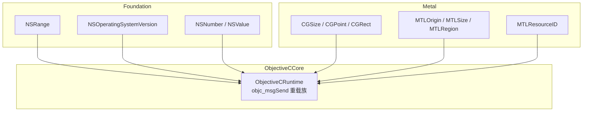
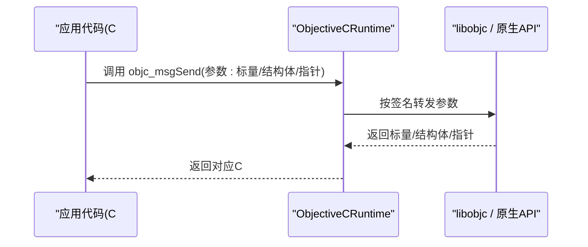
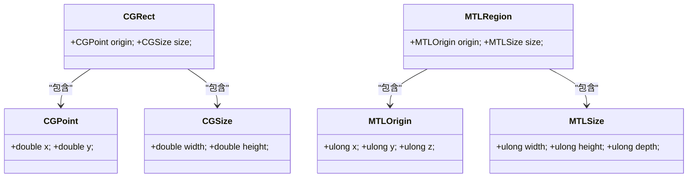
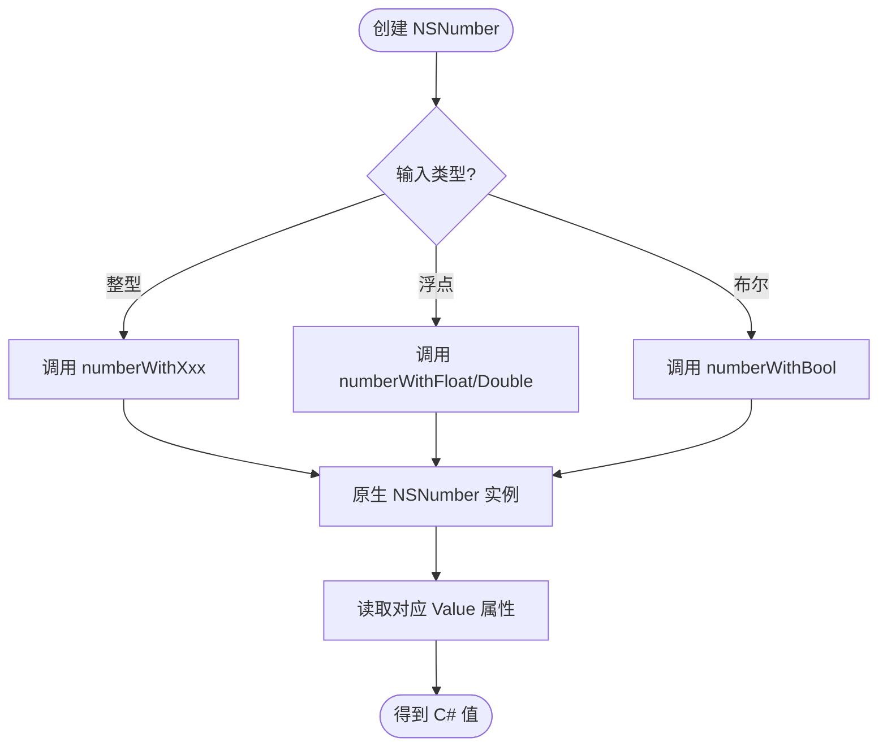
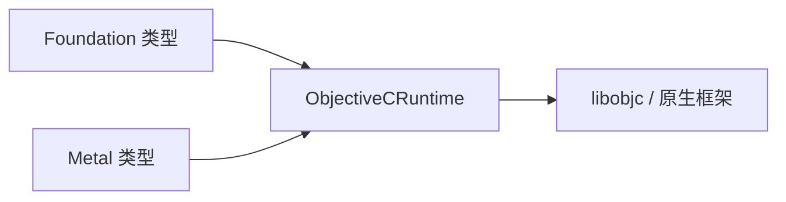

# 基础类型映射

<cite>
**本文引用的文件**
- [NSTypes.cs](file://src/SharpMetal/Foundation/NSTypes.cs)
- [NSRange.cs](file://src/SharpMetal/Foundation/NSRange.cs)
- [NSNumber.cs](file://src/SharpMetal/Foundation/NSNumber.cs)
- [NSObject.cs](file://src/SharpMetal/Foundation/NSObject.cs)
- [MTLTypes.cs](file://src/SharpMetal/Metal/MTLTypes.cs)
- [MTLAccelerationStructureTypes.cs](file://src/SharpMetal/Metal/MTLAccelerationStructureTypes.cs)
- [ObjectiveCRuntime.cs](file://src/SharpMetal/ObjectiveCCore/ObjectiveCRuntime.cs)
</cite>

## 目录
1. [简介](#简介)
2. [项目结构](#项目结构)
3. [核心组件](#核心组件)
4. [架构总览](#架构总览)
5. [详细组件分析](#详细组件分析)
6. [依赖关系分析](#依赖关系分析)
7. [性能与安全性考虑](#性能与安全性考虑)
8. [故障排查指南](#故障排查指南)
9. [结论](#结论)
10. [附录：类型映射速查表](#附录类型映射速查表)

## 简介
本文件聚焦于 SharpMetal 中 C# 与 Objective-C 之间的基础类型映射，涵盖整数、浮点数、布尔值、指针、几何与区域结构等。文档解释这些类型在托管环境中的内存布局、转换路径、安全边界与性能特征，并提供实际使用场景与版本兼容性策略。目标是帮助开发者在不深入底层细节的前提下，正确、高效地在 C# 与原生 Objective-C/Metal API 之间传递数据。

## 项目结构
- Foundation 层提供系统级基础类型（如 NSRange、NSOperatingSystemVersion）以及 NSNumber/NSValue 等包装类型，用于桥接数值与对象。
- Metal 层定义图形与计算所需的几何与资源标识结构（如 CGSize、CGRect、MTLOrigin、MTLSize、MTLRegion、MTLResourceID）。
- ObjectiveCCore 层通过 LibraryImport 直接调用 libobjc，提供 objc_msgSend 的强类型重载，实现跨语言消息传递与返回值/参数类型的精确映射。

图表来源
- [NSRange.cs:5-10](file://src/SharpMetal/Foundation/NSRange.cs#L5-L10)
- [NSTypes.cs:5-11](file://src/SharpMetal/Foundation/NSTypes.cs#L5-L11)
- [NSNumber.cs:61-271](file://src/SharpMetal/Foundation/NSNumber.cs#L61-L271)
- [MTLTypes.cs:5-107](file://src/SharpMetal/Metal/MTLTypes.cs#L5-L107)
- [ObjectiveCRuntime.cs:118-800](file://src/SharpMetal/ObjectiveCCore/ObjectiveCRuntime.cs#L118-L800)

章节来源
- [README.md:1-23](file://README.md#L1-L23)

## 核心组件
- 基础结构体：NSRange、NSOperatingSystemVersion、CGSize、CGPoint、CGRect、MTLOrigin、MTLSize、MTLRegion、MTLSamplePosition、MTLResourceID 等，均以顺序布局暴露给原生代码。
- 数值包装：NSNumber 提供从多种 C# 基本类型到 NSNumber 的创建与读取；NSValue 支持任意字节块与指针封装。
- 运行时桥接：ObjectiveCRuntime 提供大量 objc_msgSend 重载，将 C# 标量、结构体、指针与原生方法签名一一对应，避免装箱与反射开销。

章节来源
- [NSRange.cs:5-10](file://src/SharpMetal/Foundation/NSRange.cs#L5-L10)
- [NSTypes.cs:5-11](file://src/SharpMetal/Foundation/NSTypes.cs#L5-L11)
- [MTLTypes.cs:5-107](file://src/SharpMetal/Metal/MTLTypes.cs#L5-L107)
- [NSNumber.cs:61-271](file://src/SharpMetal/Foundation/NSNumber.cs#L61-L271)
- [ObjectiveCRuntime.cs:118-800](file://src/SharpMetal/ObjectiveCCore/ObjectiveCRuntime.cs#L118-L800)

## 架构总览
下图展示了一次典型的“C# → 原生”调用链：C# 结构体或标量通过 ObjectiveCRuntime 的特定重载直接传入原生方法，返回结果再按约定解包为 C# 类型。

图表来源
- [ObjectiveCRuntime.cs:118-800](file://src/SharpMetal/ObjectiveCCore/ObjectiveCRuntime.cs#L118-L800)

## 详细组件分析

### 整数与无符号整数
- C# long/ulong 与原生 long/unsigned long 的互操作：Foundation 中的 NSOperatingSystemVersion 字段采用 long；Metal 中的 MTLOrigin/MTLSize 使用 ulong；ObjectiveCRuntime 提供 long_objc_msgSend/ulong_objc_msgSend 等重载以匹配不同原生签名。
- NSRange.location/length 使用 ulong，表示位置与长度，适合索引与范围描述。

示例与要点
- 构造 NSRange：使用两个 ulong 分别表示起始位置与长度。
- 读取系统版本：通过 NSOperatingSystemVersion 的 major/minor/patch 字段获取版本信息。
- 尺寸与坐标：MTLOrigin/MTLSize 使用 ulong 表达三维坐标与维度，保证大纹理/缓冲区地址空间下的正确性。

章节来源
- [NSTypes.cs:5-11](file://src/SharpMetal/Foundation/NSTypes.cs#L5-L11)
- [NSRange.cs:5-10](file://src/SharpMetal/Foundation/NSRange.cs#L5-L10)
- [MTLTypes.cs:47-79](file://src/SharpMetal/Metal/MTLTypes.cs#L47-L79)
- [ObjectiveCRuntime.cs:395-425](file://src/SharpMetal/ObjectiveCCore/ObjectiveCRuntime.cs#L395-L425)

### 浮点数与双精度
- CGSize.width/height、CGPoint.x/y 使用 double，满足高精度坐标与尺寸需求。
- MTLSamplePosition.x/y 使用 float，用于采样位置等 GPU 相关参数。
- ObjectiveCRuntime 提供 float_objc_msgSend/double_objc_msgSend 等重载，确保与原生签名的精确匹配。

章节来源
- [MTLTypes.cs:5-31](file://src/SharpMetal/Metal/MTLTypes.cs#L5-L31)
- [MTLTypes.cs:96-101](file://src/SharpMetal/Metal/MTLTypes.cs#L96-L101)
- [ObjectiveCRuntime.cs:385-393](file://src/SharpMetal/ObjectiveCCore/ObjectiveCRuntime.cs#L385-L393)

### 布尔值
- ObjectiveCRuntime 提供 bool_objc_msgSend 重载，将 C# bool 与原生布尔语义对齐。
- 常见用法：查询状态、判断是否相等、响应选择器等。

章节来源
- [ObjectiveCRuntime.cs:137-139](file://src/SharpMetal/ObjectiveCCore/ObjectiveCRuntime.cs#L137-L139)
- [NSObject.cs:60-79](file://src/SharpMetal/Foundation/NSObject.cs#L60-L79)

### 指针与对象句柄
- NSObject、NSNumber、NSValue 等包含 NativePtr（IntPtr），并实现隐式转换为 IntPtr，便于与原生 API 交互。
- ObjectiveCRuntime 的多数重载接受 IntPtr 作为对象引用，并通过选择器（Selector）进行消息发送。
- 注意：NativePtr 的生命周期由原生侧管理，应避免重复释放或悬空引用。

章节来源
- [NSObject.cs:48-90](file://src/SharpMetal/Foundation/NSObject.cs#L48-L90)
- [NSNumber.cs:61-103](file://src/SharpMetal/Foundation/NSNumber.cs#L61-L103)
- [ObjectiveCRuntime.cs:124-134](file://src/SharpMetal/ObjectiveCCore/ObjectiveCRuntime.cs#L124-L134)

### 几何与区域结构
- CGSize/CGPoint/CGRect：用于二维几何，double 精度，常用于 UI 与渲染目标尺寸。
- MTLOrigin/MTLSize/MTLRegion：用于三维区域与纹理拷贝等操作，使用 ulong 保证大范围寻址。
- ObjectiveCRuntime 提供 CGSize_objc_msgSend/CGRect_objc_msgSend/MTLSize_objc_msgSend/MTLRegion_objc_msgSend 等重载，直接传递结构体。

图表来源
- [MTLTypes.cs:5-94](file://src/SharpMetal/Metal/MTLTypes.cs#L5-L94)

章节来源
- [MTLTypes.cs:5-94](file://src/SharpMetal/Metal/MTLTypes.cs#L5-L94)
- [ObjectiveCRuntime.cs:309-324](file://src/SharpMetal/ObjectiveCCore/ObjectiveCRuntime.cs#L309-L324)

### 数值包装：NSNumber 与 NSValue
- NSNumber：提供从 C# 基本类型（byte/short/int/long/uint/ulong/float/double/bool）创建实例，以及对应的取值属性。内部通过 objc_msgSend 调用原生方法完成转换。
- NSValue：可封装任意字节块或指针，适用于非标准或自定义结构体的传递。

图表来源
- [NSNumber.cs:105-153](file://src/SharpMetal/Foundation/NSNumber.cs#L105-L153)
- [NSNumber.cs:73-103](file://src/SharpMetal/Foundation/NSNumber.cs#L73-L103)

章节来源
- [NSNumber.cs:61-271](file://src/SharpMetal/Foundation/NSNumber.cs#L61-L271)

### 加速结构相关类型
- MTLPackedFloat3/MTLPackedFloat4x3/MTLAxisAlignedBoundingBox/MTLPackedFloatQuaternion/MTLComponentTransform 等用于加速结构与变换描述，均为顺序布局的结构体，便于与原生 API 直接传递。

章节来源
- [MTLAccelerationStructureTypes.cs:6-44](file://src/SharpMetal/Metal/MTLAccelerationStructureTypes.cs#L6-L44)

## 依赖关系分析
- Foundation 与 Metal 的类型均依赖 ObjectiveCRuntime 提供的 objc_msgSend 重载族进行跨语言调用。
- 结构体通过 StructLayout(LayoutKind.Sequential) 保证与原生 ABI 一致，避免额外填充导致的错位。
- 数值包装类（NSNumber/NSValue）依赖 Selector 与 ObjectiveCClass 进行动态消息发送。

图表来源
- [ObjectiveCRuntime.cs:118-800](file://src/SharpMetal/ObjectiveCCore/ObjectiveCRuntime.cs#L118-L800)
- [MTLTypes.cs:5-107](file://src/SharpMetal/Metal/MTLTypes.cs#L5-L107)
- [NSRange.cs:5-10](file://src/SharpMetal/Foundation/NSRange.cs#L5-L10)

章节来源
- [ObjectiveCRuntime.cs:118-800](file://src/SharpMetal/ObjectiveCCore/ObjectiveCRuntime.cs#L118-L800)

## 性能与安全性考虑
- 零分配与零装箱：通过强类型 objc_msgSend 重载直接传递标量与结构体，避免装箱与反射，减少 GC 压力。
- 内存布局一致性：所有需要与原生交互的结构体均使用 Sequential 布局，确保字段顺序与对齐符合原生 ABI。
- 指针生命周期：NSObject/NSNumber/NSValue 的 NativePtr 由原生侧管理，应避免手动释放或重复释放；仅在必要时显式持有或释放。
- 溢出与截断风险：在不同位宽类型间转换时（如 int→long、float→double），需确认值域与精度要求，避免截断或精度损失。
- 版本差异：NSOperatingSystemVersion 等结构可能随系统版本变化而扩展，建议在使用前检查字段存在性与兼容逻辑。

[本节为通用指导，不直接分析具体文件]

## 故障排查指南
- 崩溃或访问违规：检查传入结构体字段是否与原生期望一致（顺序、大小、对齐），尤其是跨平台或不同系统版本。
- 返回值异常：确认使用的 objc_msgSend 重载与原生方法签名匹配（例如返回类型为 struct 时使用 stret 或特定重载）。
- 字符串与编码：如需传递字符串，请使用带 StringMarshalling.Utf8 的重载，并确保字符串为空终止。
- 数值包装错误：NSNumber 取值属性应与创建时类型一致；若不确定，可使用更通用的 integerValue/doubleValue 并做范围校验。

章节来源
- [ObjectiveCRuntime.cs:760-800](file://src/SharpMetal/ObjectiveCCore/ObjectiveCRuntime.cs#L760-L800)
- [NSNumber.cs:73-103](file://src/SharpMetal/Foundation/NSNumber.cs#L73-L103)

## 结论
SharpMetal 通过精确的 StructLayout 与强类型 objc_msgSend 重载，实现了 C# 与 Objective-C/Metal 之间的高效、安全的类型映射。Foundation 与 Metal 的基础类型覆盖了常见的标量、几何与区域数据结构；NSNumber/NSValue 提供了灵活的数值包装能力。遵循本文的映射规则与最佳实践，可以在保持高性能的同时，获得良好的类型安全与可维护性。

[本节为总结，不直接分析具体文件]

## 附录：类型映射速查表
- 整数与无符号整数
  - C# long ↔ 原生 long（如 NSOperatingSystemVersion 字段）
  - C# ulong ↔ 原生 unsigned long（如 NSRange.location/length、MTLOrigin/MTLSize）
- 浮点数与双精度
  - C# double ↔ 原生 double（如 CGSize/CGPoint）
  - C# float ↔ 原生 float（如 MTLSamplePosition）
- 布尔值
  - C# bool ↔ 原生布尔（通过 bool_objc_msgSend）
- 指针与对象句柄
  - C# IntPtr ↔ 原生对象引用（NSObject/NSNumber/NSValue.NativePtr）
- 几何与区域
  - CGSize/CGPoint/CGRect ↔ 原生 CG 几何结构
  - MTLOrigin/MTLSize/MTLRegion ↔ 原生 Metal 区域与尺寸
- 数值包装
  - C# 基本类型 ↔ NSNumber（通过 numberWithXxx 与 XxxValue）
  - 任意字节块/指针 ↔ NSValue（valueWithBytes/pointerValue）

章节来源
- [NSTypes.cs:5-11](file://src/SharpMetal/Foundation/NSTypes.cs#L5-L11)
- [NSRange.cs:5-10](file://src/SharpMetal/Foundation/NSRange.cs#L5-L10)
- [MTLTypes.cs:5-107](file://src/SharpMetal/Metal/MTLTypes.cs#L5-L107)
- [NSNumber.cs:61-271](file://src/SharpMetal/Foundation/NSNumber.cs#L61-L271)
- [ObjectiveCRuntime.cs:118-800](file://src/SharpMetal/ObjectiveCCore/ObjectiveCRuntime.cs#L118-L800)