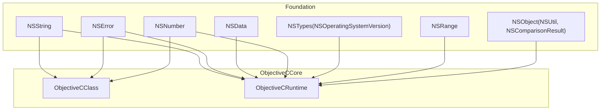
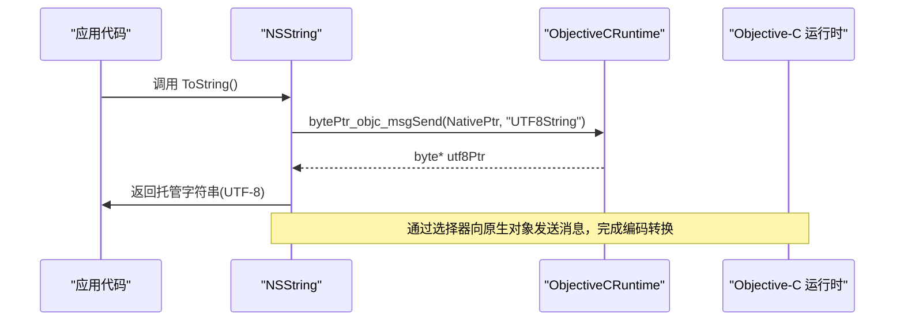
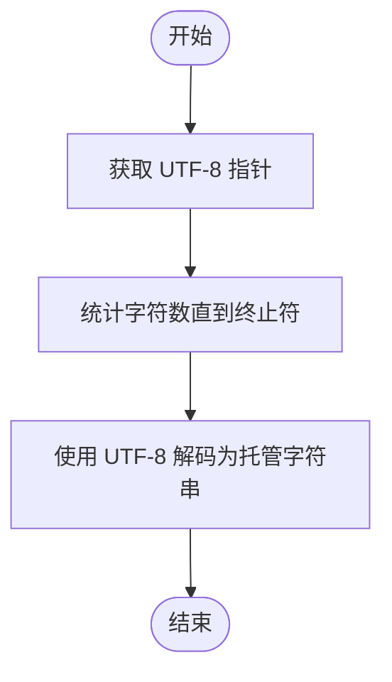
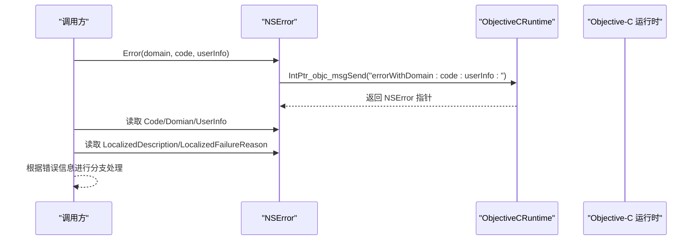
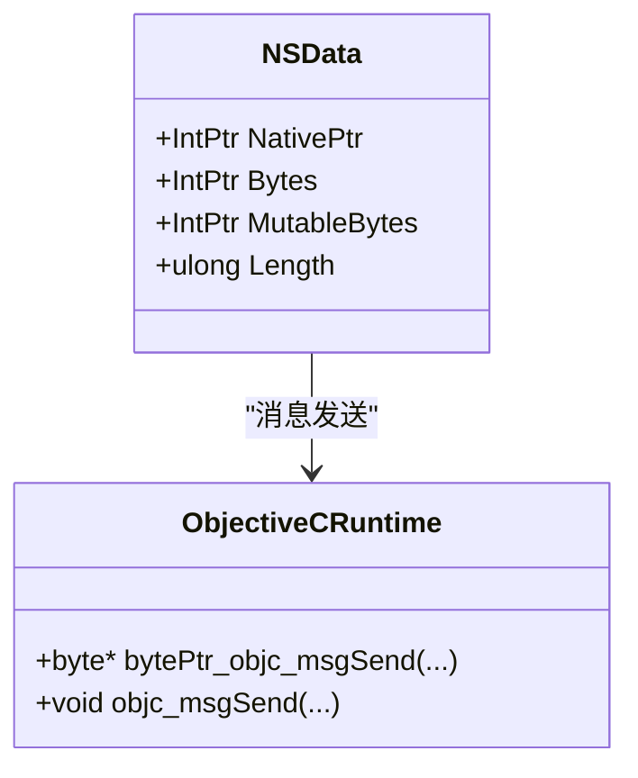
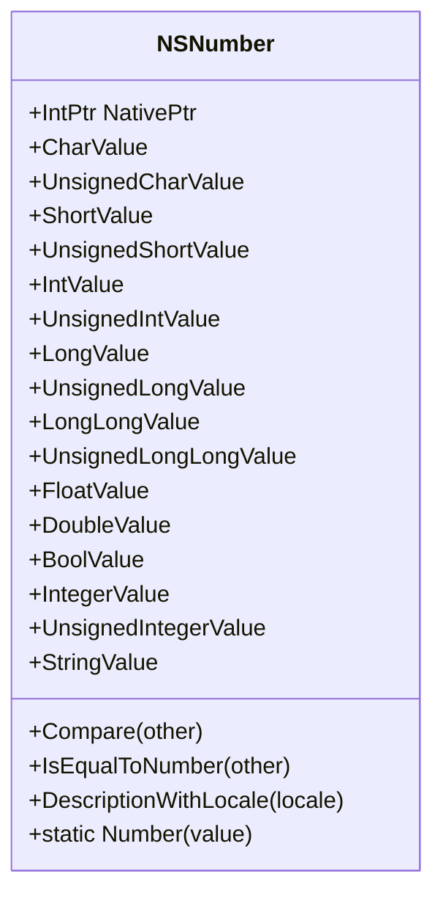
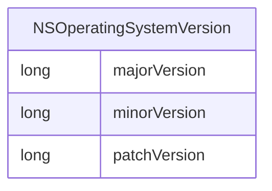
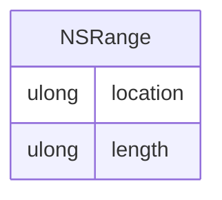
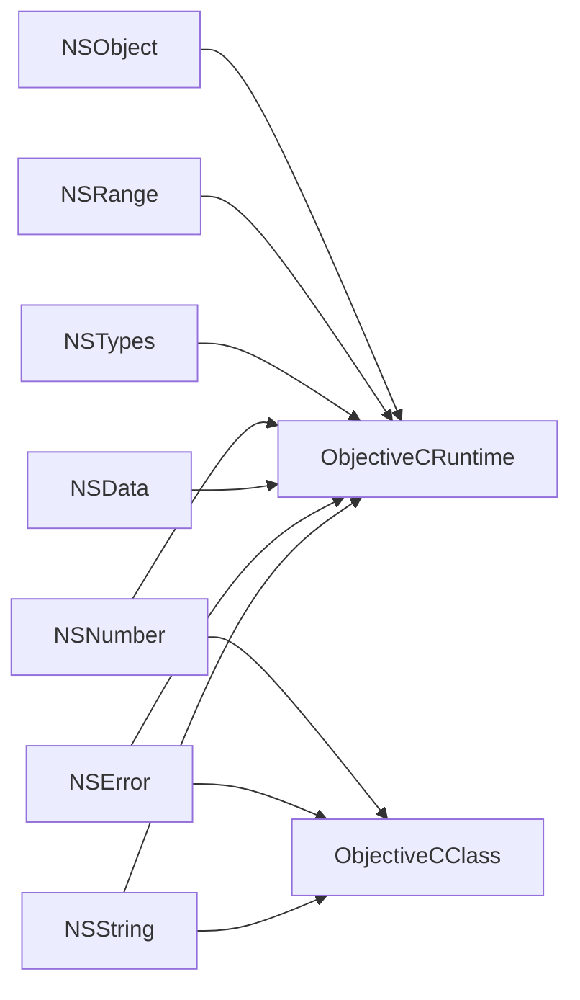

# 数据类型绑定

<cite>
**本文引用的文件**
- [NSString.cs](file://src/SharpMetal/Foundation/NSString.cs)
- [NSError.cs](file://src/SharpMetal/Foundation/NSError.cs)
- [NSData.cs](file://src/SharpMetal/Foundation/NSData.cs)
- [NSNumber.cs](file://src/SharpMetal/Foundation/NSNumber.cs)
- [NSTypes.cs](file://src/SharpMetal/Foundation/NSTypes.cs)
- [NSObject.cs](file://src/SharpMetal/Foundation/NSObject.cs)
- [NSRange.cs](file://src/SharpMetal/Foundation/NSRange.cs)
- [ObjectiveCClass.cs](file://src/SharpMetal/ObjectiveCCore/ObjectiveCClass.cs)
- [ObjectiveCRuntime.cs](file://src/SharpMetal/ObjectiveCCore/ObjectiveCRuntime.cs)
</cite>

## 目录
1. [简介](#简介)
2. [项目结构](#项目结构)
3. [核心组件](#核心组件)
4. [架构总览](#架构总览)
5. [详细组件分析](#详细组件分析)
6. [依赖关系分析](#依赖关系分析)
7. [性能考虑](#性能考虑)
8. [故障排查指南](#故障排查指南)
9. [结论](#结论)
10. [附录：转换示例与最佳实践](#附录：转换示例与最佳实践)

## 简介
本文件聚焦于 SharpMetal 的 Foundation 层数据类型绑定，系统阐述以下主题：
- NSString 字符串处理：编码转换、搜索与比较、格式化（通过描述）等。
- NSError 错误处理机制：创建、读取信息、传播模式。
- NSData 二进制数据：字节访问、长度、可变/不可变视图。
- NSNumber 数值包装器：类型支持与自动装箱/拆箱。
- NSTypes 基础类型映射：如 NSOperatingSystemVersion。
并提供跨类型的转换示例与性能注意事项。

## 项目结构
Foundation 层以轻量结构体封装 Objective-C 对象指针，并通过 ObjectiveCCore 提供的运行时能力进行消息发送与内存管理。关键文件职责如下：
- NSString.cs：字符串类型绑定，提供编码转换、查找、拼接、比较等。
- NSError.cs：错误对象绑定，提供错误域、代码、用户信息与本地化描述。
- NSData.cs：二进制数据绑定，提供原始字节、可变字节与长度。
- NSNumber.cs：数值包装器绑定，支持多种基本类型的装箱与取值。
- NSTypes.cs：基础结构体定义（如系统版本）。
- NSObject.cs：通用基类能力（哈希、描述、相等性判断）与工具方法（UTF-8 字符串读取）。
- NSRange.cs：范围结构体，用于字符串定位。
- ObjectiveCClass.cs：Objective-C 类的分配与初始化封装。
- ObjectiveCRuntime.cs：底层消息发送、类型桥接与内存管理原语。

图表来源
- [NSString.cs:64-186](file://src/SharpMetal/Foundation/NSString.cs#L64-L186)
- [NSError.cs:5-49](file://src/SharpMetal/Foundation/NSError.cs#L5-L49)
- [NSData.cs:5-20](file://src/SharpMetal/Foundation/NSData.cs#L5-L20)
- [NSNumber.cs:61-271](file://src/SharpMetal/Foundation/NSNumber.cs#L61-L271)
- [NSTypes.cs:5-11](file://src/SharpMetal/Foundation/NSTypes.cs#L5-L11)
- [NSRange.cs:5-10](file://src/SharpMetal/Foundation/NSRange.cs#L5-L10)
- [NSObject.cs:34-46](file://src/SharpMetal/Foundation/NSObject.cs#L34-L46)
- [ObjectiveCClass.cs:18-87](file://src/SharpMetal/ObjectiveCCore/ObjectiveCClass.cs#L18-L87)
- [ObjectiveCRuntime.cs:33-800](file://src/SharpMetal/ObjectiveCCore/ObjectiveCRuntime.cs#L33-L800)

章节来源
- [NSString.cs:64-186](file://src/SharpMetal/Foundation/NSString.cs#L64-L186)
- [NSError.cs:5-49](file://src/SharpMetal/Foundation/NSError.cs#L5-L49)
- [NSData.cs:5-20](file://src/SharpMetal/Foundation/NSData.cs#L5-L20)
- [NSNumber.cs:61-271](file://src/SharpMetal/Foundation/NSNumber.cs#L61-L271)
- [NSTypes.cs:5-11](file://src/SharpMetal/Foundation/NSTypes.cs#L5-L11)
- [NSRange.cs:5-10](file://src/SharpMetal/Foundation/NSRange.cs#L5-L10)
- [NSObject.cs:34-46](file://src/SharpMetal/Foundation/NSObject.cs#L34-L46)
- [ObjectiveCClass.cs:18-87](file://src/SharpMetal/ObjectiveCCore/ObjectiveCClass.cs#L18-L87)
- [ObjectiveCRuntime.cs:33-800](file://src/SharpMetal/ObjectiveCCore/ObjectiveCRuntime.cs#L33-L800)

## 核心组件
- NSString：封装 Objective-C 字符串，提供 UTF-8 获取、字符访问、编码转换、范围查找、拼接与比较。
- NSError：封装错误对象，提供错误域、代码、用户信息字典以及本地化描述、恢复建议等。
- NSData：封装二进制数据，暴露原始字节、可变字节与长度。
- NSNumber：数值包装器，支持从多种基本类型装箱与取值，并支持比较与本地化描述。
- NSTypes：定义基础结构体（如系统版本）。
- NSObject：提供通用能力与 UTF-8 字符串读取工具。
- NSRange：表示位置与长度的范围结构。
- ObjectiveCClass/ObjectiveCRuntime：提供 Objective-C 运行时交互能力（类分配、消息发送、内存管理）。

章节来源
- [NSString.cs:64-186](file://src/SharpMetal/Foundation/NSString.cs#L64-L186)
- [NSError.cs:5-49](file://src/SharpMetal/Foundation/NSError.cs#L5-L49)
- [NSData.cs:5-20](file://src/SharpMetal/Foundation/NSData.cs#L5-L20)
- [NSNumber.cs:61-271](file://src/SharpMetal/Foundation/NSNumber.cs#L61-L271)
- [NSTypes.cs:5-11](file://src/SharpMetal/Foundation/NSTypes.cs#L5-L11)
- [NSObject.cs:34-46](file://src/SharpMetal/Foundation/NSObject.cs#L34-L46)
- [NSRange.cs:5-10](file://src/SharpMetal/Foundation/NSRange.cs#L5-L10)
- [ObjectiveCClass.cs:18-87](file://src/SharpMetal/ObjectiveCCore/ObjectiveCClass.cs#L18-L87)
- [ObjectiveCRuntime.cs:33-800](file://src/SharpMetal/ObjectiveCCore/ObjectiveCRuntime.cs#L33-L800)

## 架构总览
Foundation 类型通过 ObjectiveCCore 与 Objective-C 运行时交互，采用“值类型结构体 + 内部 NativePtr”的模式，避免在托管堆上复制对象，同时保持与原生对象的零拷贝或最小拷贝交互。

图表来源
- [NSString.cs:91-98](file://src/SharpMetal/Foundation/NSString.cs#L91-L98)
- [NSObject.cs:34-46](file://src/SharpMetal/Foundation/NSObject.cs#L34-L46)
- [ObjectiveCRuntime.cs:437-437](file://src/SharpMetal/ObjectiveCCore/ObjectiveCRuntime.cs#L437-L437)

## 详细组件分析

### NSString 字符串处理
- 编码转换
  - 从 UTF-8 指针构建托管字符串：使用工具方法读取 UTF-8 字节序列并转换为托管字符串。
  - 按指定编码获取 C 字符串：支持多种编码常量。
  - 计算最大字节长度与实际字节长度：为缓冲区分配与序列化做准备。
- 搜索与比较
  - 范围查找：支持大小写、反向、锚定、数字、正则等选项。
  - 相等性与比较：区分大小写或不区分大小写的比较。
- 格式化
  - 通过描述属性获取可读字符串（继承自 NSObject）。
- 构造与生命周期
  - 从字符串、C 字符串、字节缓冲（可选择不复制）构造。
  - 隐式转换为 IntPtr，便于与其他原生 API 互操作。

图表来源
- [NSString.cs:91-98](file://src/SharpMetal/Foundation/NSString.cs#L91-L98)
- [NSObject.cs:34-46](file://src/SharpMetal/Foundation/NSObject.cs#L34-L46)

章节来源
- [NSString.cs:6-44](file://src/SharpMetal/Foundation/NSString.cs#L6-L44)
- [NSString.cs:64-186](file://src/SharpMetal/Foundation/NSString.cs#L64-L186)
- [NSObject.cs:34-46](file://src/SharpMetal/Foundation/NSObject.cs#L34-L46)

### NSError 错误处理机制
- 创建
  - 静态工厂方法与实例初始化：传入错误域、代码和用户信息字典。
- 读取
  - 错误码、域、用户信息字典。
  - 本地化描述、恢复选项、恢复建议、失败原因。
- 传播
  - 作为返回值或输出参数传递；调用方根据 Code 与 Domain 判断错误类型并采取相应措施。

图表来源
- [NSError.cs:27-35](file://src/SharpMetal/Foundation/NSError.cs#L27-L35)
- [NSError.cs:13-25](file://src/SharpMetal/Foundation/NSError.cs#L13-L25)
- [ObjectiveCRuntime.cs:125-125](file://src/SharpMetal/ObjectiveCCore/ObjectiveCRuntime.cs#L125-L125)

章节来源
- [NSError.cs:5-49](file://src/SharpMetal/Foundation/NSError.cs#L5-L49)

### NSData 二进制数据处理
- 数据访问
  - 只读字节指针与可变字节指针。
  - 长度属性。
- 内存管理
  - 通过 Objective-C 运行时进行引用计数（Retain/Release），由上层或框架负责生命周期。
- 格式转换
  - 结合 NSString 或其他类型进行编解码（例如将字节数组解析为字符串或数值）。

图表来源
- [NSData.cs:5-20](file://src/SharpMetal/Foundation/NSData.cs#L5-L20)
- [ObjectiveCRuntime.cs:437-437](file://src/SharpMetal/ObjectiveCCore/ObjectiveCRuntime.cs#L437-L437)

章节来源
- [NSData.cs:5-20](file://src/SharpMetal/Foundation/NSData.cs#L5-L20)

### NSNumber 数值包装器
- 类型支持
  - 装箱：char、byte、short、int、uint、long、ulong、float、double、bool。
  - 取值：对应各类型的 Value 属性。
  - 比较与相等性：Compare、IsEqualToNumber。
  - 描述：DescriptionWithLocale。
- 自动装箱/拆箱
  - 通过静态工厂方法与构造函数实现装箱。
  - 通过 Value 属性实现拆箱。

图表来源
- [NSNumber.cs:61-271](file://src/SharpMetal/Foundation/NSNumber.cs#L61-L271)

章节来源
- [NSNumber.cs:61-271](file://src/SharpMetal/Foundation/NSNumber.cs#L61-L271)

### NSTypes 基础类型映射
- NSOperatingSystemVersion：包含主版本、次版本、补丁版本字段，用于表示操作系统版本。

图表来源
- [NSTypes.cs:5-11](file://src/SharpMetal/Foundation/NSTypes.cs#L5-L11)

章节来源
- [NSTypes.cs:5-11](file://src/SharpMetal/Foundation/NSTypes.cs#L5-L11)

### NSRange 范围结构
- 用于表示字符串或集合中的位置与长度，常用于 RangeOfString 等方法的结果。

图表来源
- [NSRange.cs:5-10](file://src/SharpMetal/Foundation/NSRange.cs#L5-L10)

章节来源
- [NSRange.cs:5-10](file://src/SharpMetal/Foundation/NSRange.cs#L5-L10)

## 依赖关系分析
- NSString 依赖 ObjectiveCRuntime 的消息发送与 UTF-8 工具方法。
- NSError/NSData/NSNumber 均依赖 ObjectiveCRuntime 进行原生交互。
- ObjectiveCClass 提供 Alloc/AllocInit 等统一入口，供各 Foundation 类型复用。
- NSObject 提供公共能力（哈希、描述、相等性）与工具方法（UTF-8 字符串读取）。

图表来源
- [NSString.cs:64-186](file://src/SharpMetal/Foundation/NSString.cs#L64-L186)
- [NSError.cs:5-49](file://src/SharpMetal/Foundation/NSError.cs#L5-L49)
- [NSData.cs:5-20](file://src/SharpMetal/Foundation/NSData.cs#L5-L20)
- [NSNumber.cs:61-271](file://src/SharpMetal/Foundation/NSNumber.cs#L61-L271)
- [NSTypes.cs:5-11](file://src/SharpMetal/Foundation/NSTypes.cs#L5-L11)
- [NSRange.cs:5-10](file://src/SharpMetal/Foundation/NSRange.cs#L5-L10)
- [NSObject.cs:34-46](file://src/SharpMetal/Foundation/NSObject.cs#L34-L46)
- [ObjectiveCClass.cs:18-87](file://src/SharpMetal/ObjectiveCCore/ObjectiveCClass.cs#L18-L87)
- [ObjectiveCRuntime.cs:33-800](file://src/SharpMetal/ObjectiveCCore/ObjectiveCRuntime.cs#L33-L800)

章节来源
- [ObjectiveCClass.cs:18-87](file://src/SharpMetal/ObjectiveCCore/ObjectiveCClass.cs#L18-L87)
- [ObjectiveCRuntime.cs:33-800](file://src/SharpMetal/ObjectiveCCore/ObjectiveCRuntime.cs#L33-L800)

## 性能考虑
- 字符串转换
  - 优先使用 UTF-8 路径（ToString）以减少中间编码转换开销。
  - 批量处理时尽量复用缓冲区，避免频繁分配。
- 搜索与比较
  - 合理使用比较选项（如大小写不敏感）以避免重复扫描。
  - 大范围搜索时注意时间复杂度，必要时分块处理。
- 二进制数据
  - 直接访问 Bytes/MutableBytes 进行零拷贝处理，减少额外分配。
  - 对大对象谨慎使用可变副本，避免不必要的内存增长。
- 数值包装
  - 选择合适的装箱方法，避免多次装箱/拆箱带来的开销。
  - 比较时使用 Compare/IsEqualToNumber，避免手动类型转换。
- 运行时开销
  - 消息发送是主要开销来源，尽量减少高频小粒度调用，合并为批量操作。
  - 合理使用 ObjectiveCClass.AllocInit 减少重复分配。

[本节为通用性能指导，不直接分析具体文件]

## 故障排查指南
- 字符串为空或乱码
  - 检查使用的编码是否与源数据一致。
  - 确认 UTF-8 指针是否有效且以空终止。
- 错误信息缺失
  - 确保创建 NSError 时传入有效的 domain、code 与 userInfo。
  - 读取 LocalizedDescription/LocalizedFailureReason 前确认对象非空。
- 内存泄漏或崩溃
  - 遵循引用计数规则，确保在合适时机释放对象。
  - 避免悬垂指针，特别是在异步场景中。
- 数值类型溢出
  - 选择与数据范围匹配的装箱/取值方法，避免截断或溢出。

章节来源
- [NSString.cs:91-98](file://src/SharpMetal/Foundation/NSString.cs#L91-L98)
- [NSError.cs:13-35](file://src/SharpMetal/Foundation/NSError.cs#L13-L35)
- [ObjectiveCRuntime.cs:769-782](file://src/SharpMetal/ObjectiveCCore/ObjectiveCRuntime.cs#L769-L782)

## 结论
SharpMetal 的 Foundation 层通过轻量结构体与 Objective-C 运行时的高效交互，提供了对 NSString、NSError、NSData、NSNumber 等核心类型的完整绑定。借助统一的运行时抽象与工具方法，开发者可以安全、高效地进行字符串处理、错误处理、二进制数据操作与数值包装。在实际使用中，应关注编码一致性、内存管理与性能优化，以获得稳定高效的运行表现。

[本节为总结性内容，不直接分析具体文件]

## 附录：转换示例与最佳实践
- 字符串到托管字符串
  - 使用 ToString() 获取 UTF-8 字符串。
  - 参考路径：[NSString.ToString:91-98](file://src/SharpMetal/Foundation/NSString.cs#L91-L98)、[NSUtil.GetUtf8String:34-46](file://src/SharpMetal/Foundation/NSObject.cs#L34-L46)。
- 字符串编码转换
  - 使用 CString(encoding) 获取指定编码的 C 字符串。
  - 参考路径：[NSString.CString:130-133](file://src/SharpMetal/Foundation/NSString.cs#L130-L133)。
- 字符串搜索与替换
  - 使用 RangeOfString(options) 获取匹配范围，再结合其他 API 进行替换（需配合可变字符串或重新构建）。
  - 参考路径：[NSString.RangeOfString:150-153](file://src/SharpMetal/Foundation/NSString.cs#L150-L153)。
- 错误对象创建与传播
  - 使用 Error(domain, code, userInfo) 创建错误，并在调用链中向上抛出或返回。
  - 参考路径：[NSError.Error:27-30](file://src/SharpMetal/Foundation/NSError.cs#L27-L30)。
- 二进制数据读写
  - 通过 Bytes/MutableBytes 直接访问底层内存，Length 确定大小。
  - 参考路径：[NSData.Bytes/MutableBytes/Length:11-15](file://src/SharpMetal/Foundation/NSData.cs#L11-L15)。
- 数值装箱与取值
  - 使用 Number(value) 进行装箱，再通过对应 Value 属性取值。
  - 参考路径：[NSNumber.Number:105-153](file://src/SharpMetal/Foundation/NSNumber.cs#L105-L153)、[NSNumber.Value 属性:73-103](file://src/SharpMetal/Foundation/NSNumber.cs#L73-L103)。
- 系统版本获取
  - 使用 NSOperatingSystemVersion 结构体表示版本信息。
  - 参考路径：[NSTypes.NSOperatingSystemVersion:5-11](file://src/SharpMetal/Foundation/NSTypes.cs#L5-L11)。

[本节提供示例路径，不直接展示代码内容]