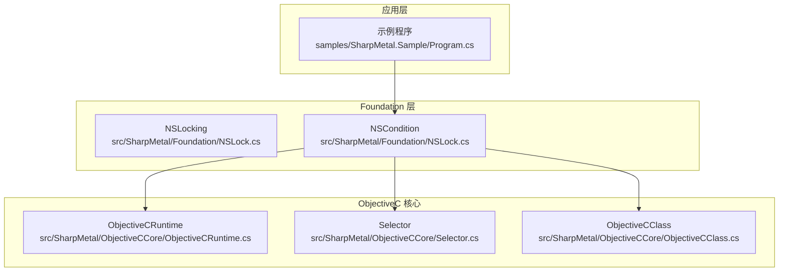
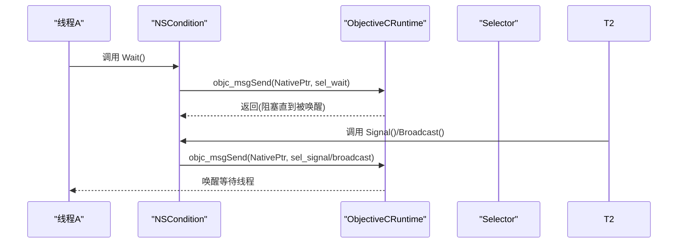
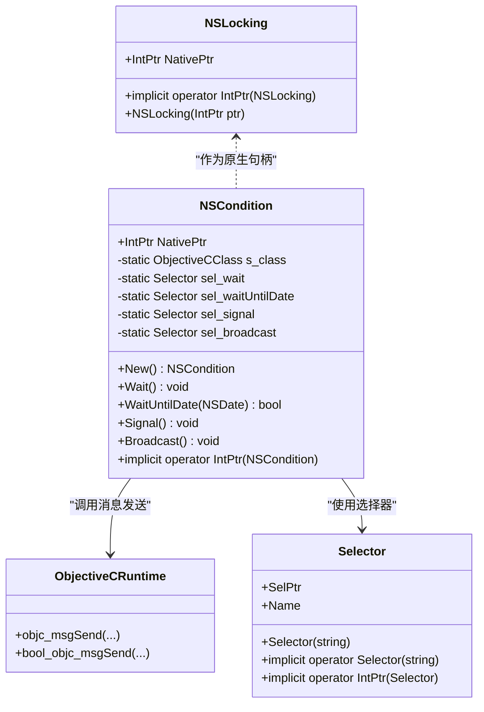
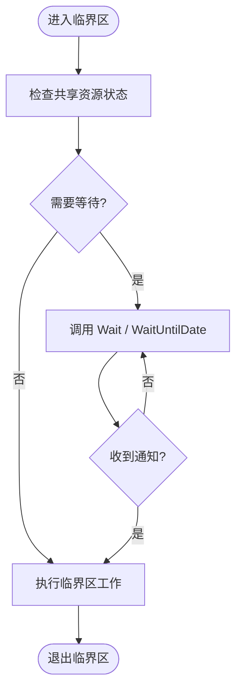
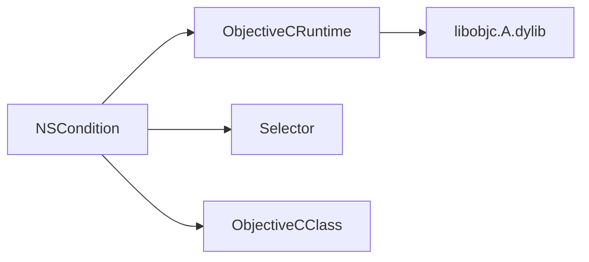

# 线程同步

<cite>
**本文引用的文件**
- [NSLock.cs](file://src/SharpMetal/Foundation/NSLock.cs)
- [ObjectiveCRuntime.cs](file://src/SharpMetal/ObjectiveCCore/ObjectiveCRuntime.cs)
- [Selector.cs](file://src/SharpMetal/ObjectiveCCore/Selector.cs)
- [ObjectiveCClass.cs](file://src/SharpMetal/ObjectiveCCore/ObjectiveCClass.cs)
- [Program.cs](file://samples/SharpMetal.Sample/Program.cs)
</cite>

## 目录
1. [简介](#简介)
2. [项目结构](#项目结构)
3. [核心组件](#核心组件)
4. [架构总览](#架构总览)
5. [详细组件分析](#详细组件分析)
6. [依赖关系分析](#依赖关系分析)
7. [性能考量](#性能考量)
8. [故障排查指南](#故障排查指南)
9. [结论](#结论)
10. [附录](#附录)

## 简介
本文件围绕 SharpMetal 中的线程同步主题，重点说明 NSLock 锁机制在本仓库中的实现方式与使用要点，包括互斥锁的获取与释放、死锁避免策略、在多线程环境下保护共享资源的正确做法，以及与 .NET 原生同步原语的集成方式和性能对比。同时提供并发编程最佳实践、常见陷阱规避方法，以及实际并发场景示例和性能测试建议。

## 项目结构
本仓库将 Objective-C 运行时能力以托管类型暴露给 .NET，Foundation 层提供基础对象与同步原语（如 NSCondition），并通过 ObjectiveCCore 调用 libobjc.A.dylib 完成消息派发。示例工程展示了如何在 Apple 平台上创建 Metal 设备并读写共享缓冲区。

图表来源
- [NSLock.cs:5-47](file://src/SharpMetal/Foundation/NSLock.cs#L5-L47)
- [ObjectiveCRuntime.cs:33-800](file://src/SharpMetal/ObjectiveCCore/ObjectiveCRuntime.cs#L33-L800)
- [Selector.cs:5-43](file://src/SharpMetal/ObjectiveCCore/Selector.cs#L5-L43)
- [ObjectiveCClass.cs:18-87](file://src/SharpMetal/ObjectiveCCore/ObjectiveCClass.cs#L18-L87)
- [Program.cs:10-46](file://samples/SharpMetal.Sample/Program.cs#L10-L46)

章节来源
- [README.md:1-23](file://README.md#L1-L23)

## 核心组件
- NSLocking：表示可加锁对象的句柄封装，持有底层 NativePtr，并提供到 IntPtr 的隐式转换，便于直接传递给 Objective-C 运行时。
- NSCondition：基于 Objective-C 的 NSCondition 包装，提供 Wait、WaitUntilDate、Signal、Broadcast 等线程间协作原语；内部通过 ObjectiveCRuntime 进行消息发送。
- ObjectiveCRuntime：对 libobjc.A.dylib 中 objc_msgSend 等函数的 P/Invoke 声明集合，用于向 Objective-C 对象发送消息。
- Selector：封装 Objective-C 选择器（方法名）的指针，支持从字符串构造与名称读取。
- ObjectiveCClass：封装 Objective-C 类元数据与分配/初始化流程，供 Foundation 层创建对象。

章节来源
- [NSLock.cs:5-47](file://src/SharpMetal/Foundation/NSLock.cs#L5-L47)
- [ObjectiveCRuntime.cs:33-800](file://src/SharpMetal/ObjectiveCCore/ObjectiveCRuntime.cs#L33-L800)
- [Selector.cs:5-43](file://src/SharpMetal/ObjectiveCCore/Selector.cs#L5-L43)
- [ObjectiveCClass.cs:18-87](file://src/SharpMetal/ObjectiveCCore/ObjectiveCClass.cs#L18-L87)

## 架构总览
下图展示了 NSCondition 在多线程环境下的典型交互流程：线程 A 等待条件，线程 B 发出信号或广播唤醒等待者。

图表来源
- [NSLock.cs:20-38](file://src/SharpMetal/Foundation/NSLock.cs#L20-L38)
- [ObjectiveCRuntime.cs:118-139](file://src/SharpMetal/ObjectiveCCore/ObjectiveCRuntime.cs#L118-L139)
- [Selector.cs:20-42](file://src/SharpMetal/ObjectiveCCore/Selector.cs#L20-L42)

## 详细组件分析

### NSLocking 与 NSCondition 的结构与职责
- NSLocking：轻量级句柄结构体，仅保存 NativePtr，便于跨边界传递至 Objective-C 运行时。其设计遵循“值语义 + 原生指针”的模式，降低托管对象开销。
- NSCondition：封装 NSCondition 的 wait/signal/broadcast 能力，所有操作均通过 ObjectiveCRuntime 的消息发送完成。该类未包含状态字段，因此自身不持有额外资源，生命周期由 NativePtr 管理。

图表来源
- [NSLock.cs:5-47](file://src/SharpMetal/Foundation/NSLock.cs#L5-L47)
- [ObjectiveCRuntime.cs:118-139](file://src/SharpMetal/ObjectiveCCore/ObjectiveCRuntime.cs#L118-L139)
- [Selector.cs:5-43](file://src/SharpMetal/ObjectiveCCore/Selector.cs#L5-L43)

章节来源
- [NSLock.cs:5-47](file://src/SharpMetal/Foundation/NSLock.cs#L5-L47)

### 互斥锁的获取与释放（概念性说明）
- 在 Objective-C 生态中，NSLock 通常提供 lock/unlock 成对调用以实现互斥访问。尽管当前仓库未直接暴露 NSLock 的 lock/unlock 方法，但可通过相同模式扩展：使用 ObjectiveCClass 创建 NSLock 实例，再通过 ObjectiveCRuntime 调用对应的 selector。
- 关键原则：
  - 每次成功获取锁后，必须在 finally 块中确保释放，防止异常路径导致锁泄漏。
  - 避免在持有锁时执行耗时操作或可能阻塞的 I/O，以减少临界区长度。
  - 统一加锁粒度，尽量缩小临界区范围，提高并发度。

[本节为概念性说明，不直接分析具体代码]

### 条件变量与协作（NSCondition）
- Wait：使当前线程进入等待状态，直到收到 Signal/Broadcast。
- WaitUntilDate：带超时的等待，返回布尔值指示是否超时。
- Signal：唤醒一个等待线程。
- Broadcast：唤醒所有等待线程。

图表来源
- [NSLock.cs:20-38](file://src/SharpMetal/Foundation/NSLock.cs#L20-L38)

章节来源
- [NSLock.cs:20-38](file://src/SharpMetal/Foundation/NSLock.cs#L20-L38)

### 与 .NET 原生同步原语的集成与对比
- 集成方式：
  - 通过 ObjectiveCRuntime 的 objc_msgSend 系列重载，向 Objective-C 对象发送消息，从而调用 NSLock/NSCondition 等方法。
  - Selector 负责将方法名转换为选择器指针，供运行时查找并调用。
- 性能对比（一般性指导）：
  - 对于纯托管代码，优先使用 Monitor/Mutex/SemaphoreSlim 等 .NET 内置同步原语，因为它们由 CLR 优化且无跨语言边界开销。
  - 当需要与系统框架（Foundation）交互时，使用 NSLock/NSCondition 更自然，因为它们在系统层面具备一致性与兼容性。
  - 频繁跨边界的消息发送会带来额外开销，应尽量减少临界区内调用次数，合并操作以降低上下文切换成本。

[本节为通用性能讨论，不直接分析具体代码]

### 死锁避免策略
- 固定加锁顺序：当需要同时获取多个锁时，始终按相同顺序加锁，避免循环等待。
- 缩短临界区：仅在必要时持有锁，避免长时间阻塞。
- 避免嵌套锁：尽量将复杂逻辑拆分为无锁算法或使用细粒度锁。
- 使用超时：在等待条件变量时使用 WaitUntilDate，设置合理超时，配合重试或降级策略。
- 防御性编程：在 finally 中释放锁；在异常路径也能保证资源释放。

[本节为通用指导，不直接分析具体代码]

### 多线程下保护共享资源的正确用法
- 明确共享资源边界：将共享状态集中在最小范围内，减少竞争面。
- 原子更新：对简单计数或标志位可使用 Interlocked 系列方法，避免引入锁。
- 条件变量配合：生产者-消费者模型中，用 NSCondition 协调生产与消费节奏。
- 不可变数据结构：尽可能使用不可变对象，消除竞态条件。

[本节为通用指导，不直接分析具体代码]

## 依赖关系分析
- NSCondition 依赖 ObjectiveCRuntime 进行消息发送，依赖 Selector 解析方法名。
- ObjectiveCRuntime 依赖 libobjc.A.dylib，提供底层运行时能力。
- ObjectiveCClass 用于创建和管理 Objective-C 对象，间接支撑 NSCondition 的实例化。

图表来源
- [NSLock.cs:20-47](file://src/SharpMetal/Foundation/NSLock.cs#L20-L47)
- [ObjectiveCRuntime.cs:33-800](file://src/SharpMetal/ObjectiveCCore/ObjectiveCRuntime.cs#L33-L800)
- [Selector.cs:5-43](file://src/SharpMetal/ObjectiveCCore/Selector.cs#L5-L43)
- [ObjectiveCClass.cs:18-87](file://src/SharpMetal/ObjectiveCCore/ObjectiveCClass.cs#L18-L87)

章节来源
- [NSLock.cs:20-47](file://src/SharpMetal/Foundation/NSLock.cs#L20-L47)
- [ObjectiveCRuntime.cs:33-800](file://src/SharpMetal/ObjectiveCCore/ObjectiveCRuntime.cs#L33-L800)
- [Selector.cs:5-43](file://src/SharpMetal/ObjectiveCCore/Selector.cs#L5-L43)
- [ObjectiveCClass.cs:18-87](file://src/SharpMetal/ObjectiveCCore/ObjectiveCClass.cs#L18-L87)

## 性能考量
- 临界区最小化：将非共享逻辑移出临界区，减少锁持有时间。
- 批量操作：在临界区内合并多次写入，降低锁竞争频率。
- 避免阻塞 I/O：不要在持有锁时进行网络或磁盘 I/O。
- 选择合适的原语：读多写少场景考虑 ReaderWriterLockSlim；高并发短临界区考虑无锁结构或原子操作。
- 测量与基准：使用 System.Diagnostics.Stopwatch 或 BenchmarkDotNet 评估不同方案的性能差异。

[本节为通用指导，不直接分析具体代码]

## 故障排查指南
- 平台限制：示例程序在非 Apple 平台会阻止原生 Metal 工作负载运行，需确保在 macOS/iOS/macCatalyst 上执行。
- 资源释放：示例中对原生资源使用 Release 进行释放，确保在 finally 中清理，避免内存泄漏。
- 条件变量误用：若出现“丢失通知”，检查是否在等待前已发出信号；使用 while 循环检查条件以避免虚假唤醒。
- 选择器错误：Selector 构造失败时会输出提示，检查方法名是否正确。

章节来源
- [Program.cs:16-46](file://samples/SharpMetal.Sample/Program.cs#L16-L46)
- [ObjectiveCRuntime.cs:769-782](file://src/SharpMetal/ObjectiveCCore/ObjectiveCRuntime.cs#L769-L782)
- [Selector.cs:20-30](file://src/SharpMetal/ObjectiveCCore/Selector.cs#L20-L30)

## 结论
本仓库通过 Foundation 层的 NSCondition 与 ObjectiveCCore 的运行时桥接，提供了在 .NET 中调用系统级同步原语的能力。对于纯托管场景，优先使用 .NET 内置同步原语以获得更佳性能；当需要与系统框架交互时，采用 NSLock/NSCondition 能更好地保持与平台行为的一致性。实践中应严格遵循最小临界区、固定加锁顺序、超时等待与异常安全等并发最佳实践，结合性能基准验证方案的有效性。

## 附录

### 并发场景示例（概念性）
- 生产者-消费者：使用 NSCondition 协调生产与消费，生产者在生产完成后 Signal，消费者在空队列时 Wait。
- 读写锁替代：读多写少场景可用 ReaderWriterLockSlim；若必须与系统框架交互，可将读/写段拆分，减少锁竞争。
- 任务并行：使用 Task.Run 与 SemaphoreSlim 控制并发度，避免过度并行导致资源争用。

[本节为概念性示例，不直接分析具体代码]

### 性能测试建议
- 基准目标：比较 Monitor、Mutex、SemaphoreSlim 与 NSCondition 在不同负载下的吞吐与延迟。
- 测试维度：临界区大小、锁粒度、I/O 比例、CPU 核数。
- 工具推荐：BenchmarkDotNet、dotnet-counters、Instruments（macOS）。

[本节为通用指导，不直接分析具体代码]