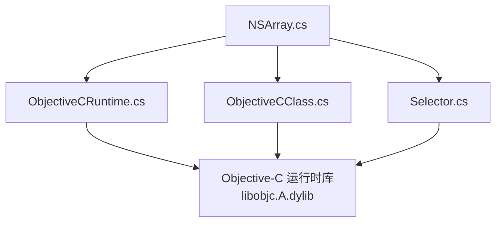
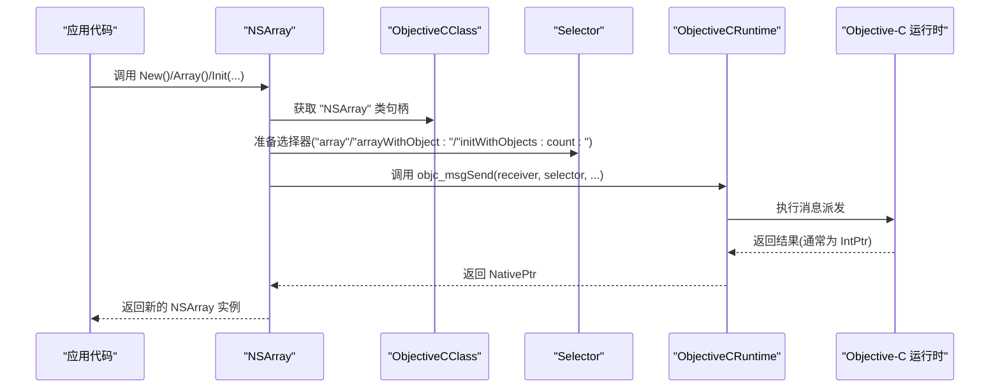
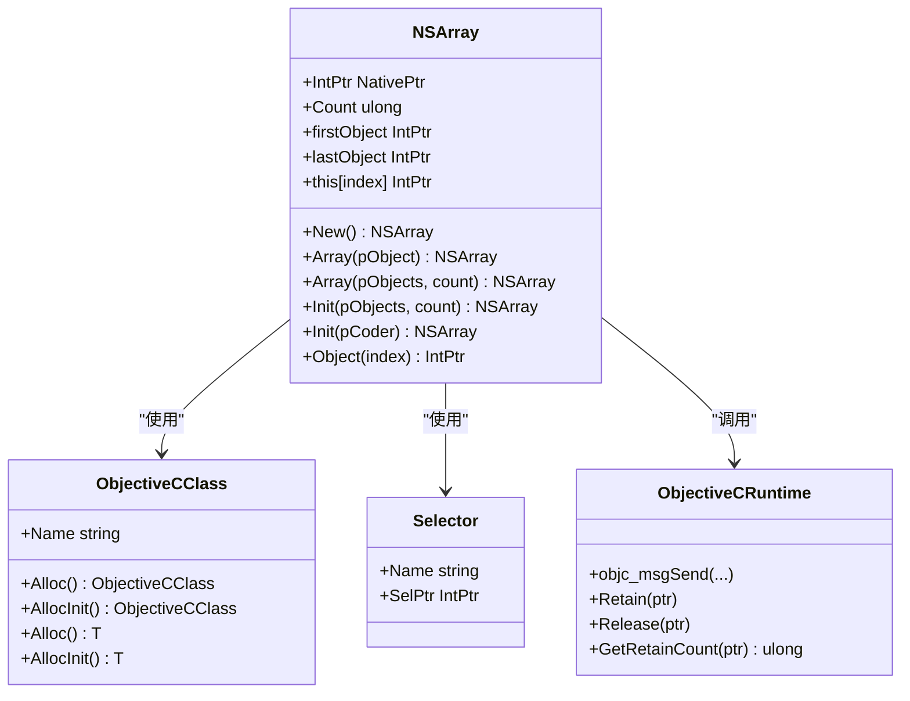
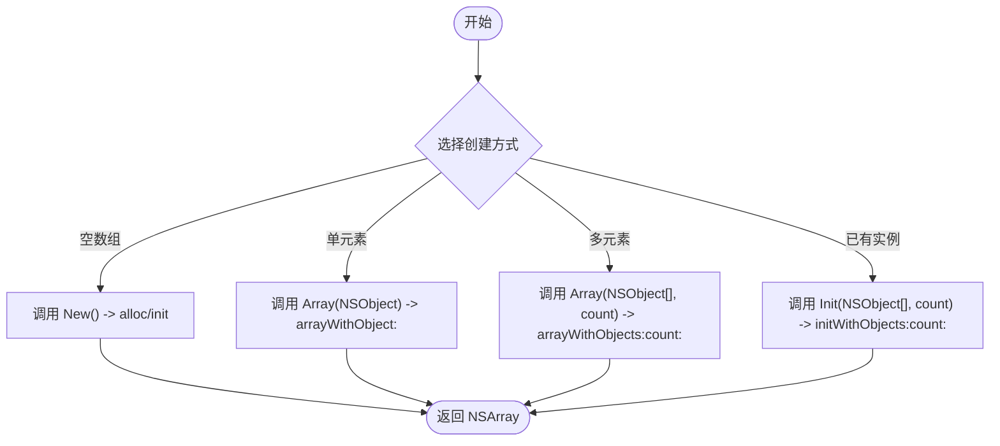
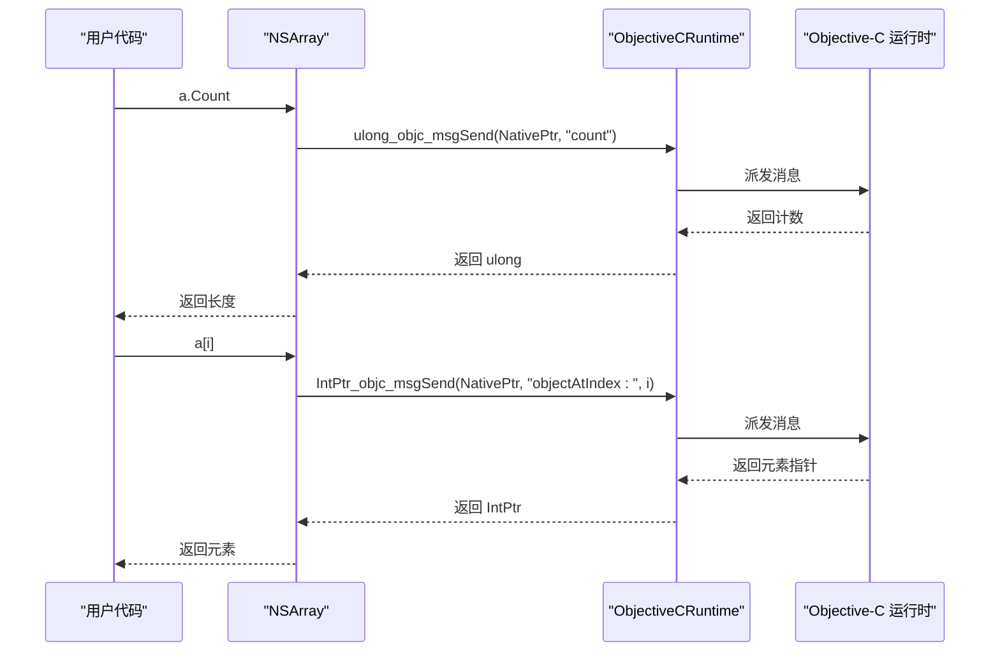
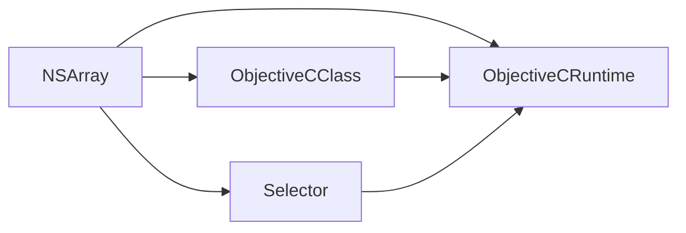

# NSArray 数组类型

<cite>
**本文引用的文件**
- [NSArray.cs](file://src/SharpMetal/Foundation/NSArray.cs)
- [NSObject.cs](file://src/SharpMetal/Foundation/NSObject.cs)
- [ObjectiveCRuntime.cs](file://src/SharpMetal/ObjectiveCCore/ObjectiveCRuntime.cs)
- [ObjectiveCClass.cs](file://src/SharpMetal/ObjectiveCCore/ObjectiveCClass.cs)
- [Selector.cs](file://src/SharpMetal/ObjectiveCCore/Selector.cs)
</cite>

## 目录
1. [简介](#简介)
2. [项目结构](#项目结构)
3. [核心组件](#核心组件)
4. [架构总览](#架构总览)
5. [详细组件分析](#详细组件分析)
6. [依赖关系分析](#依赖关系分析)
7. [性能与内存管理](#性能与内存管理)
8. [故障排查指南](#故障排查指南)
9. [结论](#结论)
10. [附录：常见用法示例路径](#附录：常见用法示例路径)

## 简介
本文件围绕 SharpMetal 中的 NSArray 类型进行系统化文档化，重点说明其结构体设计、原生指针（NativePtr）管理、与 Objective-C 运行时的交互机制，以及创建方式、元素访问模式、Count 属性与首尾对象访问。同时给出内存管理策略、性能优化建议、索引越界处理注意事项，并提供常见使用场景的代码片段路径，便于快速定位实现细节。最后说明与 C# 集合类型的互操作性思路。

## 项目结构
NSArray 位于 Foundation 命名空间下，属于对 Objective-C 运行时中 NSArray 的轻量托管封装。它通过 ObjectiveCClass、Selector 和 ObjectiveCRuntime 提供的底层能力，以值类型（struct）形式暴露 NativePtr 与常用方法，避免不必要的托管包装开销。

图表来源
- [NSArray.cs:5-64](file://src/SharpMetal/Foundation/NSArray.cs#L5-L64)
- [ObjectiveCClass.cs:18-87](file://src/SharpMetal/ObjectiveCCore/ObjectiveCClass.cs#L18-L87)
- [Selector.cs:5-43](file://src/SharpMetal/ObjectiveCCore/Selector.cs#L5-L43)
- [ObjectiveCRuntime.cs:33-800](file://src/SharpMetal/ObjectiveCCore/ObjectiveCRuntime.cs#L33-L800)

章节来源
- [NSArray.cs:5-64](file://src/SharpMetal/Foundation/NSArray.cs#L5-L64)
- [ObjectiveCClass.cs:18-87](file://src/SharpMetal/ObjectiveCCore/ObjectiveCClass.cs#L18-L87)
- [Selector.cs:5-43](file://src/SharpMetal/ObjectiveCCore/Selector.cs#L5-L43)
- [ObjectiveCRuntime.cs:33-800](file://src/SharpMetal/ObjectiveCCore/ObjectiveCRuntime.cs#L33-L800)

## 核心组件
- NSArray：值类型结构体，持有 NativePtr，提供 New、Array、Init、Count、firstObject、lastObject、索引器 this[index]、Object(index) 等 API。
- ObjectiveCClass：用于获取或构造 Objective-C 类句柄，并支持 Alloc/AllocInit 等工厂式调用。
- Selector：封装 Objective-C 选择器（方法名），用于消息发送。
- ObjectiveCRuntime：封装 objc_msgSend 系列 P/Invoke 声明，提供不同签名重载，供上层类型调用。

章节来源
- [NSArray.cs:5-64](file://src/SharpMetal/Foundation/NSArray.cs#L5-L64)
- [ObjectiveCClass.cs:18-87](file://src/SharpMetal/ObjectiveCCore/ObjectiveCClass.cs#L18-L87)
- [Selector.cs:5-43](file://src/SharpMetal/ObjectiveCCore/Selector.cs#L5-L43)
- [ObjectiveCRuntime.cs:33-800](file://src/SharpMetal/ObjectiveCCore/ObjectiveCRuntime.cs#L33-L800)

## 架构总览
NSArray 作为薄封装层，将 C# 值类型与 Objective-C 运行时桥接起来。所有读写操作最终都通过 ObjectiveCRuntime 的 objc_msgSend 变体完成，选择器由 Selector 提供，类句柄由 ObjectiveCClass 提供。

图表来源
- [NSArray.cs:11-40](file://src/SharpMetal/Foundation/NSArray.cs#L11-L40)
- [ObjectiveCClass.cs:30-77](file://src/SharpMetal/ObjectiveCCore/ObjectiveCClass.cs#L30-L77)
- [Selector.cs:20-30](file://src/SharpMetal/ObjectiveCCore/Selector.cs#L20-L30)
- [ObjectiveCRuntime.cs:118-264](file://src/SharpMetal/ObjectiveCCore/ObjectiveCRuntime.cs#L118-L264)

## 详细组件分析

### NSArray 结构体设计与成员
- 结构体布局：仅包含一个 NativePtr 字段，表示底层 Objective-C 对象的指针。
- 构造函数：接受 IntPtr 初始化 NativePtr。
- 静态工厂：
  - New()：通过 s_class.AllocInit<NSArray>() 创建空数组。
  - Array(NSObject)：调用 arrayWithObject:。
  - Array(NSObject[], ulong)：调用 arrayWithObjects:count:。
- 实例方法：
  - Init(NSObject[], ulong)：initWithObjects:count:。
  - Init(IntPtr coder)：initWithCoder:。
- 访问器：
  - Count：调用 count。
  - firstObject：调用 firstObject。
  - lastObject：调用 lastObject。
  - this[uint index]：调用 objectAtIndex:。
  - Object(uint index)：调用 objectAtIndex:。
- 隐式转换：到 IntPtr，便于直接传递给底层 API。

图表来源
- [NSArray.cs:5-64](file://src/SharpMetal/Foundation/NSArray.cs#L5-L64)
- [ObjectiveCClass.cs:18-87](file://src/SharpMetal/ObjectiveCCore/ObjectiveCClass.cs#L18-L87)
- [Selector.cs:5-43](file://src/SharpMetal/ObjectiveCCore/Selector.cs#L5-L43)
- [ObjectiveCRuntime.cs:769-800](file://src/SharpMetal/ObjectiveCCore/ObjectiveCRuntime.cs#L769-L800)

章节来源
- [NSArray.cs:5-64](file://src/SharpMetal/Foundation/NSArray.cs#L5-L64)

### 创建方式对比
- New()：适合创建空数组，内部走 alloc+init 流程。
- Array(NSObject)：便捷创建单元素数组。
- Array(NSObject[], ulong)：批量创建，传入元素数组与数量。
- Init(NSObject[], ulong)：在已有实例上初始化（注意返回值）。
- Init(IntPtr coder)：反序列化场景。

图表来源
- [NSArray.cs:11-40](file://src/SharpMetal/Foundation/NSArray.cs#L11-L40)
- [ObjectiveCClass.cs:60-77](file://src/SharpMetal/ObjectiveCCore/ObjectiveCClass.cs#L60-L77)

章节来源
- [NSArray.cs:11-40](file://src/SharpMetal/Foundation/NSArray.cs#L11-L40)
- [ObjectiveCClass.cs:60-77](file://src/SharpMetal/ObjectiveCCore/ObjectiveCClass.cs#L60-L77)

### 元素访问模式
- 索引器 this[uint index]：直接调用 objectAtIndex:，返回元素的原生指针。
- Object(uint index)：等价于索引器，语义更明确。
- Count：调用 count，返回元素个数。
- firstObject/lastObject：分别调用 firstObject/lastObject，返回首尾元素的原生指针。

图表来源
- [NSArray.cs:13-25](file://src/SharpMetal/Foundation/NSArray.cs#L13-L25)
- [ObjectiveCRuntime.cs:125-141](file://src/SharpMetal/ObjectiveCCore/ObjectiveCRuntime.cs#L125-L141)

章节来源
- [NSArray.cs:13-25](file://src/SharpMetal/Foundation/NSArray.cs#L13-L25)

### 与 NSObject 的关系
- NSArray 的元素类型为 IntPtr，通常指向 NSObject 或其他 Objective-C 对象。
- 若需要强类型访问，可将返回的 IntPtr 转换为对应的 NSObject 派生类型（如 NSString、NSNumber 等），再调用其方法。
- NSObject 提供了 Hash、Description、DebugDescription、IsEqual、IsKindOfClass、RespondsToSelector 等方法，可用于调试与类型检查。

章节来源
- [NSObject.cs:48-90](file://src/SharpMetal/Foundation/NSObject.cs#L48-L90)

## 依赖关系分析
- NSArray 依赖 ObjectiveCClass 获取 "NSArray" 类句柄，并通过 Selector 指定方法名。
- 所有消息派发均经由 ObjectiveCRuntime 的 objc_msgSend 重载族。
- ObjectiveCClass 自身也依赖 ObjectiveCRuntime 进行类查找与方法列表枚举。
- Selector 通过系统库函数注册/查询选择器名称。

图表来源
- [NSArray.cs:54-64](file://src/SharpMetal/Foundation/NSArray.cs#L54-L64)
- [ObjectiveCClass.cs:18-87](file://src/SharpMetal/ObjectiveCCore/ObjectiveCClass.cs#L18-L87)
- [Selector.cs:5-43](file://src/SharpMetal/ObjectiveCCore/Selector.cs#L5-L43)
- [ObjectiveCRuntime.cs:33-800](file://src/SharpMetal/ObjectiveCCore/ObjectiveCRuntime.cs#L33-L800)

章节来源
- [NSArray.cs:54-64](file://src/SharpMetal/Foundation/NSArray.cs#L54-L64)
- [ObjectiveCClass.cs:18-87](file://src/SharpMetal/ObjectiveCCore/ObjectiveCClass.cs#L18-L87)
- [Selector.cs:5-43](file://src/SharpMetal/ObjectiveCCore/Selector.cs#L5-L43)
- [ObjectiveCRuntime.cs:33-800](file://src/SharpMetal/ObjectiveCCore/ObjectiveCRuntime.cs#L33-L800)

## 性能与内存管理
- 值类型优势：NSArray 为 struct，传递时按值拷贝，仅复制 NativePtr，减少堆分配与 GC 压力。
- 批量创建：优先使用 Array(NSObject[], count) 一次性传入多个元素，减少多次消息派发。
- 遍历优化：
  - 使用 for 循环配合 Count 与索引器 this[index] 进行顺序访问，避免额外迭代器开销。
  - 对于只读遍历，可考虑使用 NSEnumerator（如需，可在后续扩展）。
- 索引越界：
  - 当前实现未做边界检查；调用 objectAtIndex: 时若索引越界，将由 Objective-C 运行时抛出异常或崩溃。
  - 建议在 C# 侧自行校验 index < Count，或在关键路径添加断言。
- 内存管理：
  - NSArray 本身不持有引用计数信息，生命周期由 Objective-C 运行时管理。
  - 若需延长生命周期，可使用 ObjectiveCRuntime.Retain/Release 对 NativePtr 进行显式控制（谨慎使用）。
  - 释放策略：遵循“谁创建谁释放”的原则，或通过 ARC/自动释放池管理。
- 首尾访问：firstObject/lastObject 是 O(1) 操作，适合快速获取两端元素。

章节来源
- [NSArray.cs:13-50](file://src/SharpMetal/Foundation/NSArray.cs#L13-L50)
- [ObjectiveCRuntime.cs:769-800](file://src/SharpMetal/ObjectiveCCore/ObjectiveCRuntime.cs#L769-L800)

## 故障排查指南
- 无法获取类句柄：
  - 现象：ObjectiveCClass 构造时打印失败信息。
  - 原因：运行时未加载或名称错误。
  - 处理：确认 "NSArray" 可用，或在目标平台正确加载 Foundation。
- 选择器无效：
  - 现象：Selector 构造失败或 Name 为空。
  - 原因：方法名拼写错误或平台不支持。
  - 处理：核对 NSArray 暴露的选择器常量。
- 访问越界：
  - 现象：调用 objectAtIndex: 时崩溃。
  - 处理：在 C# 侧先判断 index < Count。
- 内存泄漏：
  - 现象：对象长期驻留。
  - 处理：确保不再使用的 NativePtr 被释放，或使用自动释放池。

章节来源
- [ObjectiveCClass.cs:30-40](file://src/SharpMetal/ObjectiveCCore/ObjectiveCClass.cs#L30-L40)
- [Selector.cs:20-30](file://src/SharpMetal/ObjectiveCCore/Selector.cs#L20-L30)
- [NSArray.cs:19-25](file://src/SharpMetal/Foundation/NSArray.cs#L19-L25)
- [ObjectiveCRuntime.cs:769-800](file://src/SharpMetal/ObjectiveCCore/ObjectiveCRuntime.cs#L769-L800)

## 结论
NSArray 在 SharpMetal 中以轻量值类型封装了 Objective-C 的 NSArray，通过 NativePtr 与 ObjectiveCClass/Selector/ObjectiveCRuntime 协作，实现了高效的跨语言互操作。其 API 简洁直观，适合高性能场景。使用时应关注索引越界与内存生命周期管理，结合批量创建与顺序遍历以获得最佳性能。

## 附录：常见用法示例路径
- 创建空数组
  - 参考路径：[New 方法:11-11](file://src/SharpMetal/Foundation/NSArray.cs#L11-L11)
- 创建单元素数组
  - 参考路径：[Array(NSObject):27-30](file://src/SharpMetal/Foundation/NSArray.cs#L27-L30)
- 创建多元素数组
  - 参考路径：[Array(NSObject[], ulong)](file://src/SharpMetal/Foundation/NSArray.cs#L32-L35)
- 在已有实例上初始化
  - 参考路径：[Init(NSObject[], ulong)](file://src/SharpMetal/Foundation/NSArray.cs#L37-L40)
- 获取数组长度
  - 参考路径：[Count 属性:13-13](file://src/SharpMetal/Foundation/NSArray.cs#L13-L13)
- 访问首/尾元素
  - 参考路径：[firstObject:17-17](file://src/SharpMetal/Foundation/NSArray.cs#L17-L17), [lastObject:15-15](file://src/SharpMetal/Foundation/NSArray.cs#L15-L15)
- 按索引访问元素
  - 参考路径：[索引器 this[uint]](file://src/SharpMetal/Foundation/NSArray.cs#L19-L25), [Object(uint):47-50](file://src/SharpMetal/Foundation/NSArray.cs#L47-L50)
- 与 NSObject 互操作
  - 参考路径：[NSObject 基础方法:48-90](file://src/SharpMetal/Foundation/NSObject.cs#L48-L90)
- 底层消息派发
  - 参考路径：[ObjectiveCRuntime 消息发送:118-264](file://src/SharpMetal/ObjectiveCCore/ObjectiveCRuntime.cs#L118-L264)
- 类句柄与工厂方法
  - 参考路径：[ObjectiveCClass 工厂:54-77](file://src/SharpMetal/ObjectiveCCore/ObjectiveCClass.cs#L54-L77)
- 选择器封装
  - 参考路径：[Selector:5-43](file://src/SharpMetal/ObjectiveCCore/Selector.cs#L5-L43)