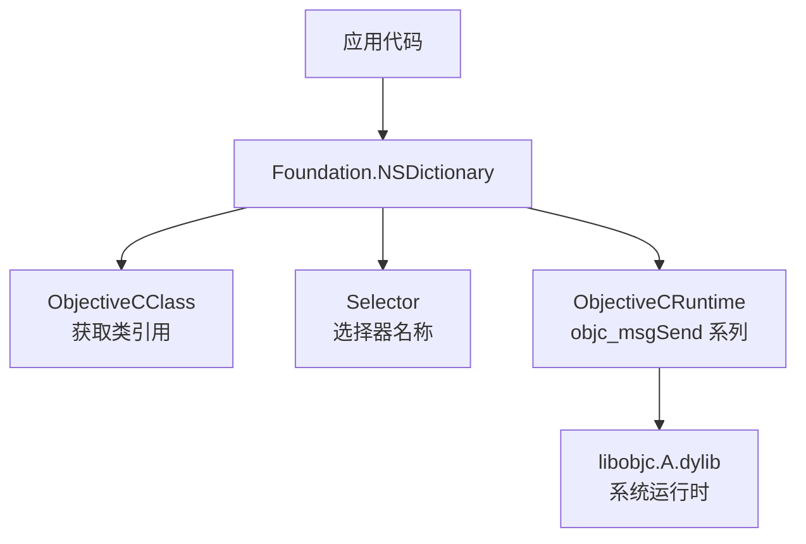
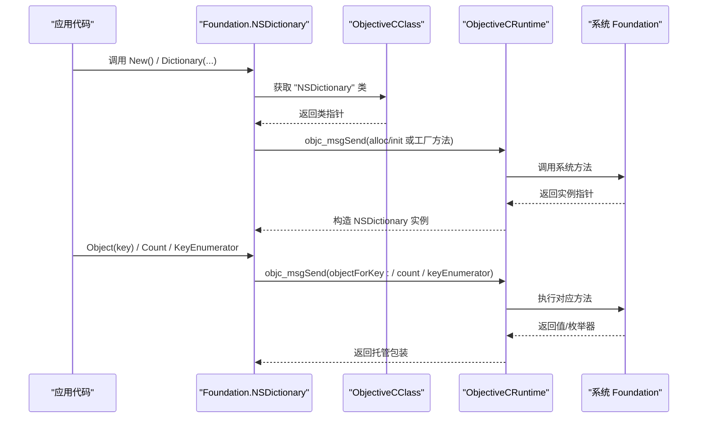
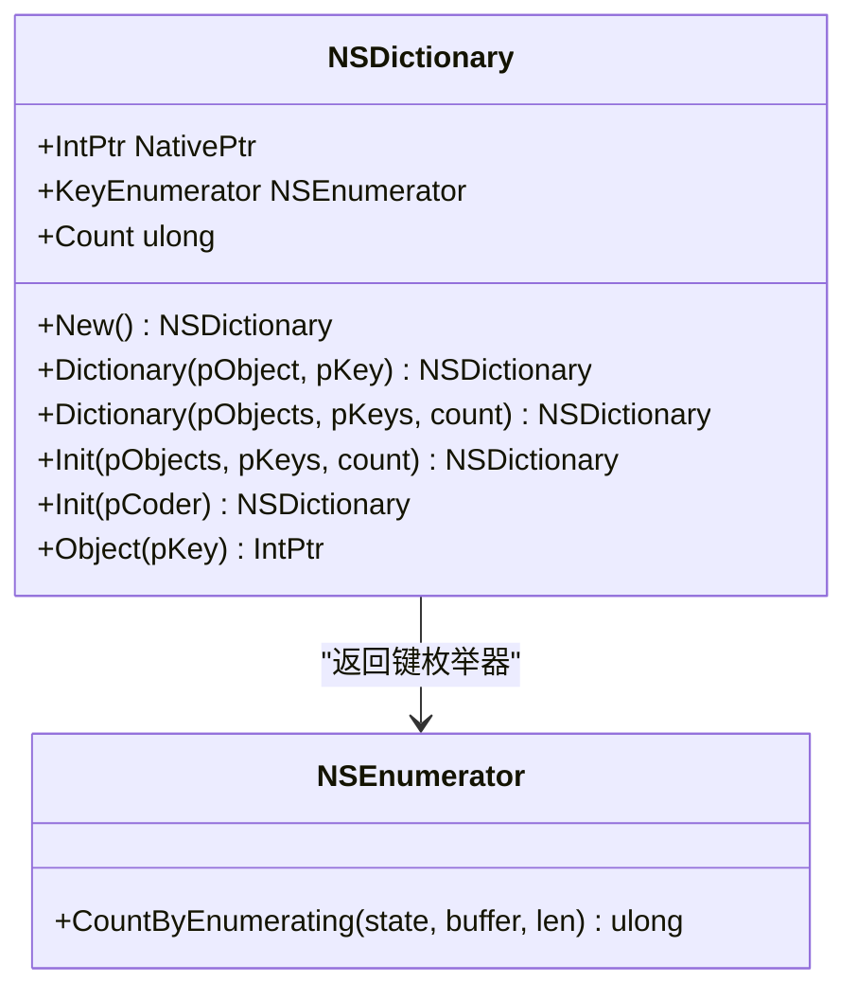
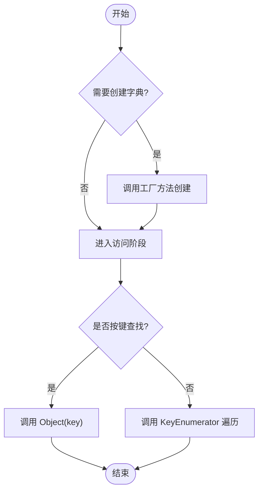
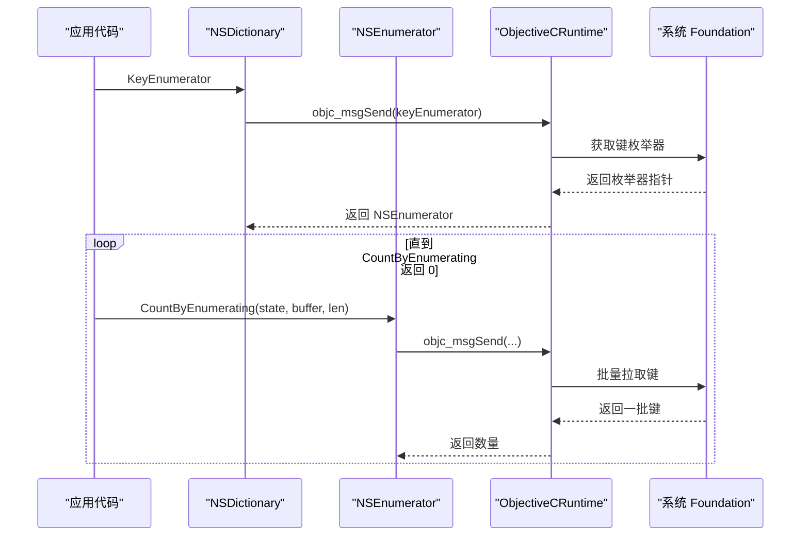
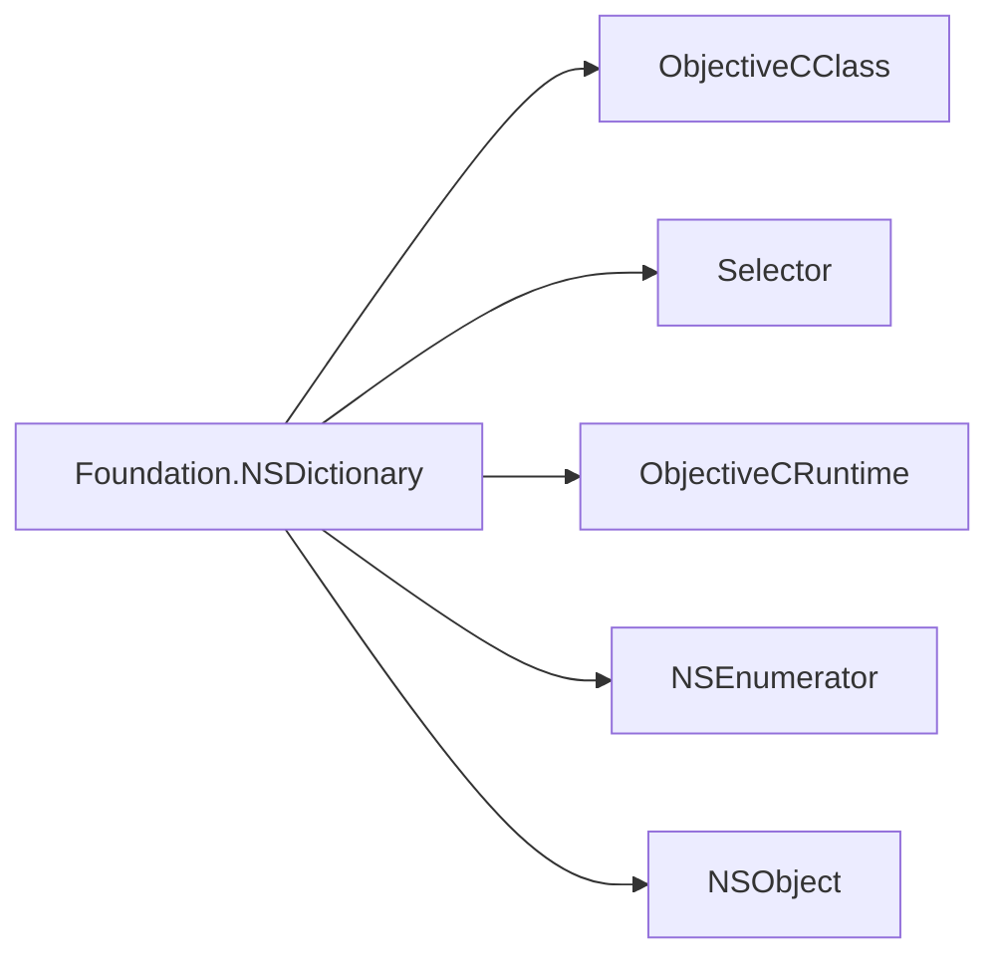

# NSDictionary 字典类型

<cite>
**本文引用的文件**
- [NSDictionary.cs](file://src/SharpMetal/Foundation/NSDictionary.cs)
- [NSObject.cs](file://src/SharpMetal/Foundation/NSObject.cs)
- [NSEnumerator.cs](file://src/SharpMetal/Foundation/NSEnumerator.cs)
- [ObjectiveCRuntime.cs](file://src/SharpMetal/ObjectiveCCore/ObjectiveCRuntime.cs)
- [ObjectiveCClass.cs](file://src/SharpMetal/ObjectiveCCore/ObjectiveCClass.cs)
- [Selector.cs](file://src/SharpMetal/ObjectiveCCore/Selector.cs)
- [README.md](file://README.md)
</cite>

## 目录
1. [简介](#简介)
2. [项目结构](#项目结构)
3. [核心组件](#核心组件)
4. [架构总览](#架构总览)
5. [详细组件分析](#详细组件分析)
6. [依赖关系分析](#依赖关系分析)
7. [性能考量](#性能考量)
8. [故障排查指南](#故障排查指南)
9. [结论](#结论)
10. [附录](#附录)

## 简介
本文件围绕 SharpMetal 中的 NSDictionary 类型，系统性说明其键值对存储机制、创建与访问方式、枚举遍历、内存管理要点以及与 Objective-C Foundation 的互操作路径。同时给出在 .NET 环境下使用 NSDictionary 的最佳实践建议，并对比 C# Dictionary 的使用差异与转换思路。

## 项目结构
本项目将 Foundation 框架的桥接封装放在 src/SharpMetal/Foundation 下，底层 Objective-C 运行时互操作位于 src/SharpMetal/ObjectiveCCore。NSDictionary 作为轻量包装结构体，通过 ObjectiveCClass 和 Selector 调用系统框架方法，完成对象生命周期与消息分发。

图表来源
- [NSDictionary.cs:11-52](file://src/SharpMetal/Foundation/NSDictionary.cs#L11-L52)
- [ObjectiveCClass.cs:30-78](file://src/SharpMetal/ObjectiveCCore/ObjectiveCClass.cs#L30-L78)
- [Selector.cs:20-42](file://src/SharpMetal/ObjectiveCCore/Selector.cs#L20-L42)
- [ObjectiveCRuntime.cs:118-141](file://src/SharpMetal/ObjectiveCCore/ObjectiveCRuntime.cs#L118-L141)

章节来源
- [README.md:1-23](file://README.md#L1-L23)

## 核心组件
- NSDictionary：以 struct 形式持有 NativePtr，提供创建、计数、查找、枚举等能力，内部通过静态 Selector 缓存方法名，减少重复解析开销。
- NSObject：基础对象类型，暴露 Hash、IsEqual、Description 等方法，供键类型实现哈希与相等性比较。
- NSEnumerator：用于遍历字典键集合，基于 NSFastEnumeration 协议。
- ObjectiveCRuntime：封装 libobjc 的 objc_msgSend 调用族，负责参数封送与返回值解包。
- ObjectiveCClass：封装类获取、分配与初始化流程。
- Selector：封装选择器注册与名称读取。

章节来源
- [NSDictionary.cs:5-52](file://src/SharpMetal/Foundation/NSDictionary.cs#L5-L52)
- [NSObject.cs:48-90](file://src/SharpMetal/Foundation/NSObject.cs#L48-L90)
- [NSEnumerator.cs:6-44](file://src/SharpMetal/Foundation/NSEnumerator.cs#L6-L44)
- [ObjectiveCRuntime.cs:118-141](file://src/SharpMetal/ObjectiveCCore/ObjectiveCRuntime.cs#L118-L141)
- [ObjectiveCClass.cs:30-78](file://src/SharpMetal/ObjectiveCCore/ObjectiveCClass.cs#L30-L78)
- [Selector.cs:20-42](file://src/SharpMetal/ObjectiveCCore/Selector.cs#L20-L42)

## 架构总览
NSDictionary 是薄封装层，所有数据操作最终都委托给系统 Foundation 的 NSDictionary 实现。关键路径如下：
- 创建：通过 ObjectiveCClass("NSDictionary") 获取类指针，再调用 alloc/init 或工厂方法（如 dictionaryWithObject:forKey:）。
- 查询：调用 objectForKey: 返回值的原生指针；Count 调用 count；KeyEnumerator 返回键枚举器。
- 枚举：通过 keyEnumerator 获得 NSEnumerator，利用 CountByEnumeratingWithState:objects:count: 批量拉取元素。
- 内存：由 Objective-C 运行时管理引用计数；.NET 侧不直接释放，需遵循“谁创建谁拥有”的原则，避免悬垂指针。

图表来源
- [NSDictionary.cs:11-40](file://src/SharpMetal/Foundation/NSDictionary.cs#L11-L40)
- [ObjectiveCClass.cs:30-78](file://src/SharpMetal/ObjectiveCCore/ObjectiveCClass.cs#L30-L78)
- [ObjectiveCRuntime.cs:118-141](file://src/SharpMetal/ObjectiveCCore/ObjectiveCRuntime.cs#L118-L141)

## 详细组件分析

### NSDictionary 结构与能力
- 字段：NativePtr 指向底层 Foundation 对象。
- 创建：
  - New()：等价于调用系统类的 alloc/init。
  - Dictionary(pObject, pKey)：单键值对工厂方法。
  - Dictionary(pObjects, pKeys, count)：批量键值对工厂方法。
  - Init(...)：从已有实例初始化。
- 访问：
  - Count：返回条目数。
  - Object(pKey)：按键取值。
  - KeyEnumerator：返回键枚举器。
- 隐式转换：可转换为 IntPtr，便于与原生 API 交互。

图表来源
- [NSDictionary.cs:5-52](file://src/SharpMetal/Foundation/NSDictionary.cs#L5-L52)
- [NSEnumerator.cs:28-44](file://src/SharpMetal/Foundation/NSEnumerator.cs#L28-L44)

章节来源
- [NSDictionary.cs:5-52](file://src/SharpMetal/Foundation/NSDictionary.cs#L5-L52)

### 键的唯一性与哈希查找
- 键唯一性：由系统 Foundation 保证同一键只能存在一次。若插入重复键，后写入的值会覆盖前者。
- 哈希查找：键必须正确实现哈希与相等性比较。在 .NET 侧，键类型通常继承自 NSObject 或通过桥接类型参与，其哈希与相等性由 NSObject.Hash 与 IsEqual 决定。NSDictionary 在查找时先计算键的哈希定位桶，再通过相等性比较确认命中。
- 注意事项：自定义键类型应确保：
  - 相等对象具有相同哈希值。
  - 不可变键更利于安全与性能。
  - 避免在键被放入字典后改变影响哈希的值。

章节来源
- [NSObject.cs:54-63](file://src/SharpMetal/Foundation/NSObject.cs#L54-L63)

### 创建、添加、修改、查找与删除
- 创建：
  - 单键值对：使用 Dictionary(pObject, pKey)。
  - 多键值对：使用 Dictionary(pObjects, pKeys, count)。
  - 空字典：使用 New()。
- 添加/修改：
  - 当前封装未暴露直接 set 方法。可通过重新构建新字典的方式实现“更新”语义（例如先取出旧字典，再合并新键值对后生成新字典）。
- 查找：
  - 使用 Object(pKey) 获取值指针；若不存在，返回空指针。
- 删除：
  - 当前封装未暴露移除方法。可通过构建新字典排除指定键来实现。

图表来源
- [NSDictionary.cs:11-40](file://src/SharpMetal/Foundation/NSDictionary.cs#L11-L40)

章节来源
- [NSDictionary.cs:11-40](file://src/SharpMetal/Foundation/NSDictionary.cs#L11-L40)

### 枚举遍历
- 通过 KeyEnumerator 获取键枚举器，结合 NSEnumerator.CountByEnumeratingWithState:objects:count: 进行高效批量枚举。
- 典型用法：循环调用枚举器的批量拉取接口，直到返回 0，表示遍历结束。

图表来源
- [NSDictionary.cs:13-15](file://src/SharpMetal/Foundation/NSDictionary.cs#L13-L15)
- [NSEnumerator.cs:18-26](file://src/SharpMetal/Foundation/NSEnumerator.cs#L18-L26)
- [ObjectiveCRuntime.cs:118-141](file://src/SharpMetal/ObjectiveCCore/ObjectiveCRuntime.cs#L118-L141)

章节来源
- [NSEnumerator.cs:6-44](file://src/SharpMetal/Foundation/NSEnumerator.cs#L6-L44)

### 内存管理与生命周期
- 所有权模型：
  - 通过 New()/工厂方法创建的字典由系统 ARC 管理；.NET 侧仅持有 NativePtr，不应手动释放。
  - 若通过其他途径获得 NativePtr，请遵循“谁创建谁释放”的规则，必要时显式 Release。
- 键与值的生命周期：
  - 字典持有键与值的强引用；当字典释放时，键与值也会被释放。
  - 避免在字典外部释放已被字典持有的对象。
- 调试与诊断：
  - 可使用 ObjectiveCRuntime.GetRetainCount 辅助判断对象生命周期（谨慎使用，仅在调试场景）。

章节来源
- [ObjectiveCRuntime.cs:769-782](file://src/SharpMetal/ObjectiveCCore/ObjectiveCRuntime.cs#L769-L782)

### 与 C# Dictionary 的转换与互操作
- 单向转换（.NET -> Foundation）：
  - 将 .NET 字典的键值对逐一映射为 NSObject 子类实例（如 NSString、NSNumber），然后调用 NSDictionary.Dictionary(pObjects, pKeys, count) 批量创建。
- 反向转换（Foundation -> .NET）：
  - 通过 KeyEnumerator 枚举键，再用 Object(key) 获取值，填充到 .NET Dictionary 中。
- 性能建议：
  - 批量创建时使用 Dictionary(pObjects, pKeys, count)，减少多次消息调用。
  - 避免频繁装箱/拆箱，尽量复用键对象。

章节来源
- [NSDictionary.cs:17-29](file://src/SharpMetal/Foundation/NSDictionary.cs#L17-L29)
- [NSEnumerator.cs:18-26](file://src/SharpMetal/Foundation/NSEnumerator.cs#L18-L26)

## 依赖关系分析
- NSDictionary 依赖：
  - ObjectiveCClass：用于获取系统类指针并进行分配/初始化。
  - Selector：缓存方法名，降低重复解析成本。
  - ObjectiveCRuntime：统一的消息发送入口，处理不同签名与返回值。
  - NSEnumerator：用于键枚举。
  - NSObject：作为键类型的基类，提供哈希与相等性支持。

图表来源
- [NSDictionary.cs:44-52](file://src/SharpMetal/Foundation/NSDictionary.cs#L44-L52)
- [ObjectiveCClass.cs:30-78](file://src/SharpMetal/ObjectiveCCore/ObjectiveCClass.cs#L30-L78)
- [Selector.cs:20-42](file://src/SharpMetal/ObjectiveCCore/Selector.cs#L20-L42)
- [ObjectiveCRuntime.cs:118-141](file://src/SharpMetal/ObjectiveCCore/ObjectiveCRuntime.cs#L118-L141)
- [NSEnumerator.cs:28-44](file://src/SharpMetal/Foundation/NSEnumerator.cs#L28-L44)
- [NSObject.cs:48-90](file://src/SharpMetal/Foundation/NSObject.cs#L48-L90)

章节来源
- [NSDictionary.cs:44-52](file://src/SharpMetal/Foundation/NSDictionary.cs#L44-L52)

## 性能考量
- 选择合适的键类型：
  - 优先使用不可变且哈希稳定的类型（如字符串、数值）。
  - 自定义键需保证相等性与哈希一致性，避免在字典中使用可变键。
- 批量操作：
  - 使用 Dictionary(pObjects, pKeys, count) 一次性传入多个键值对，减少跨边界调用次数。
  - 枚举时使用 NSEnumerator 的批量拉取接口，避免逐条获取。
- 避免不必要的复制：
  - 尽量复用键对象，减少临时对象分配。
- 线程安全：
  - 并发读写请使用外部同步机制；Foundation 容器并非天然线程安全。
- 测量与优化：
  - 使用性能剖析工具定位热点；关注消息调用次数与对象分配。

[本节为通用指导，不直接分析具体文件]

## 故障排查指南
- 常见错误：
  - 空指针访问：Object(key) 返回空指针时，需检查键是否存在。
  - 选择器失败：Selector 获取失败会导致后续消息发送异常，检查命名是否正确。
  - 类获取失败：ObjectiveCClass 构造时若类不存在，会输出日志；检查运行环境是否加载了 Foundation。
- 调试技巧：
  - 使用 Description/DebugDescription 查看对象描述。
  - 使用 GetRetainCount 辅助定位内存泄漏或过早释放问题。
  - 打印 Selector.Name 验证选择器是否正确。

章节来源
- [ObjectiveCClass.cs:30-40](file://src/SharpMetal/ObjectiveCCore/ObjectiveCClass.cs#L30-L40)
- [Selector.cs:20-42](file://src/SharpMetal/ObjectiveCCore/Selector.cs#L20-L42)
- [NSObject.cs:54-63](file://src/SharpMetal/Foundation/NSObject.cs#L54-L63)
- [ObjectiveCRuntime.cs:769-782](file://src/SharpMetal/ObjectiveCCore/ObjectiveCRuntime.cs#L769-L782)

## 结论
SharpMetal 中的 NSDictionary 是对系统 Foundation 的高效薄封装，聚焦于创建、查找与枚举三大常用场景。通过 Selector 与 ObjectiveCClass 的组合，实现了低开销的消息调用；借助 NSObject 的哈希与相等性机制，保证了键的唯一性与查找效率。对于高级操作（如删除、替换），可通过“重建字典”的模式实现。在生产环境中，应重视键类型设计、批量操作与内存管理，以获得稳定与高性能表现。

[本节为总结，不直接分析具体文件]

## 附录
- 常见操作模式参考（以路径代替代码片段）：
  - 创建空字典：[NSDictionary.New:11-11](file://src/SharpMetal/Foundation/NSDictionary.cs#L11-L11)
  - 创建单键值对字典：[NSDictionary.Dictionary(pObject, pKey):17-20](file://src/SharpMetal/Foundation/NSDictionary.cs#L17-L20)
  - 批量创建字典：[NSDictionary.Dictionary(pObjects, pKeys, count):22-25](file://src/SharpMetal/Foundation/NSDictionary.cs#L22-L25)
  - 按键取值：[NSDictionary.Object(pKey):37-40](file://src/SharpMetal/Foundation/NSDictionary.cs#L37-L40)
  - 获取键枚举器：[NSDictionary.KeyEnumerator:13-13](file://src/SharpMetal/Foundation/NSDictionary.cs#L13-L13)
  - 枚举键并取值：[NSEnumerator.CountByEnumerating(...):18-21](file://src/SharpMetal/Foundation/NSEnumerator.cs#L18-L21)
  - 获取对象哈希：[NSObject.Hash:54-54](file://src/SharpMetal/Foundation/NSObject.cs#L54-L54)
  - 判断相等：[NSObject.IsEqual(...):60-63](file://src/SharpMetal/Foundation/NSObject.cs#L60-L63)

[本节为索引，不直接分析具体文件]