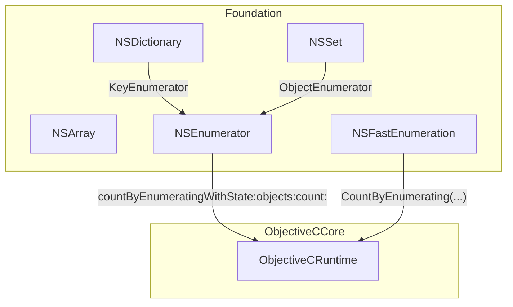
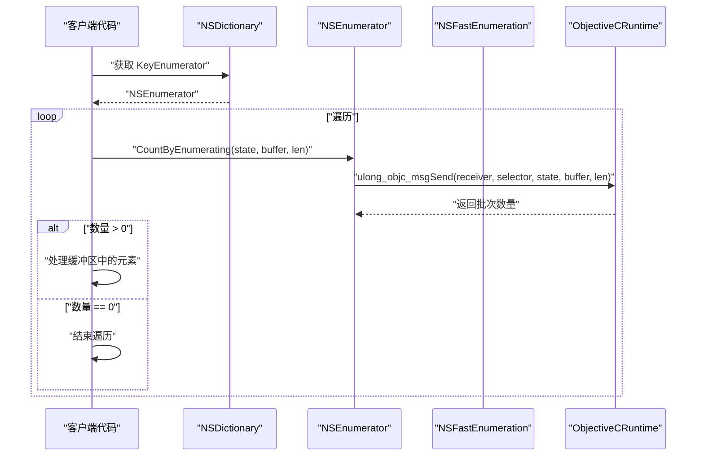
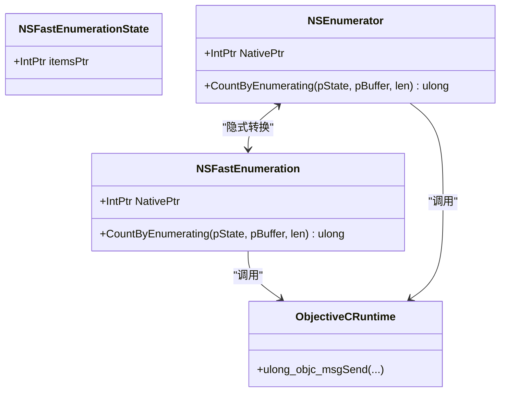
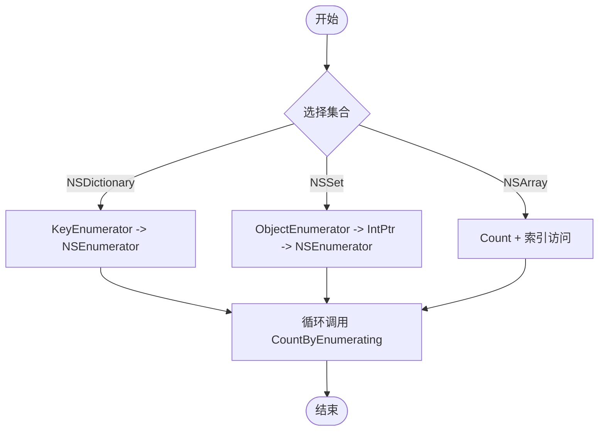
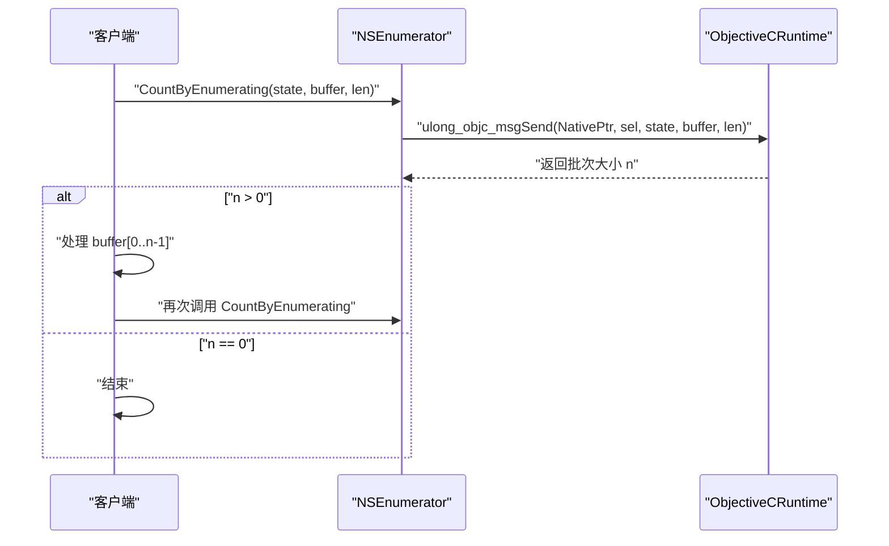
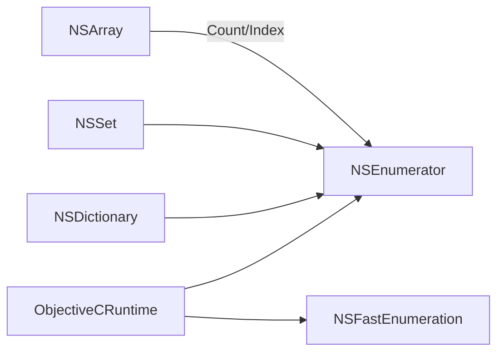

# NSEnumerator 枚举器

<cite>
**本文引用的文件**
- [NSEnumerator.cs](file://src/SharpMetal/Foundation/NSEnumerator.cs)
- [NSArray.cs](file://src/SharpMetal/Foundation/NSArray.cs)
- [NSDictionary.cs](file://src/SharpMetal/Foundation/NSDictionary.cs)
- [NSSet.cs](file://src/SharpMetal/Foundation/NSSet.cs)
- [ObjectiveCRuntime.cs](file://src/SharpMetal/ObjectiveCCore/ObjectiveCRuntime.cs)
</cite>

## 目录
1. [简介](#简介)
2. [项目结构](#项目结构)
3. [核心组件](#核心组件)
4. [架构总览](#架构总览)
5. [详细组件分析](#详细组件分析)
6. [依赖关系分析](#依赖关系分析)
7. [性能考量](#性能考量)
8. [故障排查指南](#故障排查指南)
9. [结论](#结论)
10. [附录：使用模式与最佳实践](#附录使用模式与最佳实践)

## 简介
本文件系统性梳理 SharpMetal 中 NSEnumerator 的设计与使用方式，重点说明：
- 迭代协议与 nextObject 调用机制（通过 Objective-C 运行时消息）
- 从 NSArray、NSDictionary、NSSet 等集合获取枚举器的方法
- 枚举器的生命周期管理与资源清理
- 最佳实践、异常处理、性能优化与常见陷阱
- 与 C# IEnumerator 的对应关系及互操作建议
- 结合仓库现有代码的完整使用模式指引（以路径引用代替直接代码片段）

## 项目结构
本项目在 Foundation 命名空间下提供对 Apple 框架的基础类型绑定。NSEnumerator 作为枚举器抽象，配合 NSDictionary、NSSet 暴露的枚举器属性，形成统一的遍历入口；底层通过 ObjectiveCRuntime 进行 Objective-C 消息派发。

图表来源
- [NSDictionary.cs:13-13](file://src/SharpMetal/Foundation/NSDictionary.cs#L13-L13)
- [NSSet.cs:15-15](file://src/SharpMetal/Foundation/NSSet.cs#L15-L15)
- [NSEnumerator.cs:18-21](file://src/SharpMetal/Foundation/NSEnumerator.cs#L18-L21)
- [NSEnumerator.cs:34-37](file://src/SharpMetal/Foundation/NSEnumerator.cs#L34-L37)
- [ObjectiveCRuntime.cs:428-428](file://src/SharpMetal/ObjectiveCCore/ObjectiveCRuntime.cs#L428-L428)

章节来源
- [README.md:1-23](file://README.md#L1-L23)

## 核心组件
- NSFastEnumerationState：用于快速枚举的状态结构，包含 itemsPtr 指针字段。
- NSFastEnumeration：定义 CountByEnumerating 方法，通过 ObjectiveCRuntime 调用 countByEnumeratingWithState:objects:count:。
- NSEnumerator：封装原生枚举器句柄，支持与 NSFastEnumeration 相互转换，并提供相同的 CountByEnumerating 能力。
- 集合类：
  - NSDictionary.KeyEnumerator：返回 NSEnumerator，用于遍历键。
  - NSSet.ObjectEnumerator：返回 IntPtr（可隐式转换为 NSEnumerator），用于遍历元素。
  - NSArray：提供计数与按索引访问，未直接暴露枚举器属性，但可通过快速枚举协议或手动构造枚举器进行遍历。

章节来源
- [NSEnumerator.cs:7-10](file://src/SharpMetal/Foundation/NSEnumerator.cs#L7-L10)
- [NSEnumerator.cs:12-26](file://src/SharpMetal/Foundation/NSEnumerator.cs#L12-L26)
- [NSEnumerator.cs:28-44](file://src/SharpMetal/Foundation/NSEnumerator.cs#L28-L44)
- [NSDictionary.cs:13-13](file://src/SharpMetal/Foundation/NSDictionary.cs#L13-L13)
- [NSSet.cs:15-15](file://src/SharpMetal/Foundation/NSSet.cs#L15-L15)
- [NSArray.cs:13-25](file://src/SharpMetal/Foundation/NSArray.cs#L13-L25)

## 架构总览
NSEnumerator 基于 Objective-C 的枚举协议实现。集合对象暴露枚举器接口，客户端通过 CountByEnumerating 反复拉取一批元素，直到返回 0 表示结束。底层通过 ObjectiveCRuntime 将托管调用转发到 libobjc 的动态消息分发。

图表来源
- [NSDictionary.cs:13-13](file://src/SharpMetal/Foundation/NSDictionary.cs#L13-L13)
- [NSEnumerator.cs:34-37](file://src/SharpMetal/Foundation/NSEnumerator.cs#L34-L37)
- [ObjectiveCRuntime.cs:428-428](file://src/SharpMetal/ObjectiveCCore/ObjectiveCRuntime.cs#L428-L428)

## 详细组件分析

### NSEnumerator 与 NSFastEnumeration
- 设计要点
  - 两者均持有 NativePtr，指向原生枚举器实例。
  - 提供 CountByEnumerating(state, buffer, len)，内部通过 ObjectiveCRuntime 调用 countByEnumeratingWithState:objects:count:。
  - 支持 NSEnumerator 与 NSFastEnumeration 之间的隐式转换，便于在不同 API 间复用。
- 复杂度
  - 每次调用为 O(1) 消息派发 + 批量拷贝；整体遍历复杂度取决于集合实现，通常为 O(n)。
- 错误处理
  - 若原生对象无效或状态不正确，可能抛出平台异常或返回非法值；应在调用前确保枚举器有效且未被释放。
- 生命周期
  - 枚举器由集合创建并拥有所有权；客户端不应显式释放，除非明确持有额外引用。

图表来源
- [NSEnumerator.cs:7-10](file://src/SharpMetal/Foundation/NSEnumerator.cs#L7-L10)
- [NSEnumerator.cs:12-26](file://src/SharpMetal/Foundation/NSEnumerator.cs#L12-L26)
- [NSEnumerator.cs:28-44](file://src/SharpMetal/Foundation/NSEnumerator.cs#L28-L44)
- [ObjectiveCRuntime.cs:428-428](file://src/SharpMetal/ObjectiveCCore/ObjectiveCRuntime.cs#L428-L428)

章节来源
- [NSEnumerator.cs:12-44](file://src/SharpMetal/Foundation/NSEnumerator.cs#L12-L44)

### 从集合获取枚举器
- NSDictionary
  - 通过 KeyEnumerator 获取键枚举器，类型为 NSEnumerator。
  - 适合遍历字典的键，再根据键取值。
- NSSet
  - 通过 ObjectEnumerator 获取元素枚举器，返回 IntPtr，可隐式转为 NSEnumerator。
- NSArray
  - 当前实现未直接暴露枚举器属性，但可使用 Count 与索引访问进行顺序遍历；如需统一枚举体验，可在上层封装一个适配器，将数组包装为枚举器语义。

图表来源
- [NSDictionary.cs:13-13](file://src/SharpMetal/Foundation/NSDictionary.cs#L13-L13)
- [NSSet.cs:15-15](file://src/SharpMetal/Foundation/NSSet.cs#L15-L15)
- [NSArray.cs:13-25](file://src/SharpMetal/Foundation/NSArray.cs#L13-L25)

章节来源
- [NSDictionary.cs:13-13](file://src/SharpMetal/Foundation/NSDictionary.cs#L13-L13)
- [NSSet.cs:15-15](file://src/SharpMetal/Foundation/NSSet.cs#L15-L15)
- [NSArray.cs:13-25](file://src/SharpMetal/Foundation/NSArray.cs#L13-L25)

### 遍历流程与 nextObject 机制
- 快速枚举协议
  - 客户端维护 NSFastEnumerationState，分配 NSObject 缓冲数组，调用 CountByEnumerating 获取一批元素。
  - 当返回值为 0 时，表示枚举完成。
- nextObject 语义
  - 在 Objective-C 传统枚举器中，nextObject 逐个返回元素；在本实现中，通过 CountByEnumerating 批量返回元素，等价于多次 nextObject 的高效聚合。
- 序列图

图表来源
- [NSEnumerator.cs:34-37](file://src/SharpMetal/Foundation/NSEnumerator.cs#L34-L37)
- [ObjectiveCRuntime.cs:428-428](file://src/SharpMetal/ObjectiveCCore/ObjectiveCRuntime.cs#L428-L428)

章节来源
- [NSEnumerator.cs:34-37](file://src/SharpMetal/Foundation/NSEnumerator.cs#L34-L37)
- [ObjectiveCRuntime.cs:428-428](file://src/SharpMetal/ObjectiveCCore/ObjectiveCRuntime.cs#L428-L428)

## 依赖关系分析
- NSEnumerator 与 NSFastEnumeration 依赖 ObjectiveCRuntime 进行消息派发。
- NSDictionary 与 NSSet 分别暴露枚举器入口，返回 NSEnumerator 或可转换的 IntPtr。
- NSArray 通过 Count 与索引访问提供顺序遍历能力，可作为枚举器的替代方案。

图表来源
- [NSEnumerator.cs:34-37](file://src/SharpMetal/Foundation/NSEnumerator.cs#L34-L37)
- [NSDictionary.cs:13-13](file://src/SharpMetal/Foundation/NSDictionary.cs#L13-L13)
- [NSSet.cs:15-15](file://src/SharpMetal/Foundation/NSSet.cs#L15-L15)
- [NSArray.cs:13-25](file://src/SharpMetal/Foundation/NSArray.cs#L13-L25)
- [ObjectiveCRuntime.cs:428-428](file://src/SharpMetal/ObjectiveCCore/ObjectiveCRuntime.cs#L428-L428)

章节来源
- [NSEnumerator.cs:34-37](file://src/SharpMetal/Foundation/NSEnumerator.cs#L34-L37)
- [NSDictionary.cs:13-13](file://src/SharpMetal/Foundation/NSDictionary.cs#L13-L13)
- [NSSet.cs:15-15](file://src/SharpMetal/Foundation/NSSet.cs#L15-L15)
- [NSArray.cs:13-25](file://src/SharpMetal/Foundation/NSArray.cs#L13-L25)
- [ObjectiveCRuntime.cs:428-428](file://src/SharpMetal/ObjectiveCCore/ObjectiveCRuntime.cs#L428-L428)

## 性能考量
- 批量拉取优于逐元素
  - CountByEnumerating 一次返回多个元素，减少跨边界调用次数，降低开销。
- 避免重复创建枚举器
  - 同一集合多次遍历时，按需创建新枚举器；不要缓存已耗尽的枚举器。
- 合理设置缓冲区长度
  - 根据集合实现和内存带宽选择合适的 len，过大可能导致不必要拷贝，过小会增加调用次数。
- 注意线程安全
  - 并发修改集合可能导致枚举器行为不确定；建议在遍历期间避免修改集合。

## 故障排查指南
- 常见问题
  - 枚举器为空或已释放：检查集合是否被提前释放或枚举器是否来自无效对象。
  - 返回 0 但集合非空：确认 state 与 buffer 是否正确初始化，len 是否足够。
  - 越界访问：确保只读取 CountByEnumerating 返回的数量范围内的元素。
- 定位步骤
  - 打印 NativePtr 与返回值，验证消息是否成功派发。
  - 使用 ObjectiveCRuntime 提供的 retain/release 工具函数管理生命周期（如需要）。
- 参考位置
  - 枚举器调用点：[NSEnumerator.cs:34-37](file://src/SharpMetal/Foundation/NSEnumerator.cs#L34-L37)
  - 运行时消息派发：[ObjectiveCRuntime.cs:428-428](file://src/SharpMetal/ObjectiveCCore/ObjectiveCRuntime.cs#L428-L428)

章节来源
- [NSEnumerator.cs:34-37](file://src/SharpMetal/Foundation/NSEnumerator.cs#L34-L37)
- [ObjectiveCRuntime.cs:428-428](file://src/SharpMetal/ObjectiveCCore/ObjectiveCRuntime.cs#L428-L428)

## 结论
SharpMetal 中的 NSEnumerator 通过快速枚举协议提供了高效、低开销的遍历能力。结合 NSDictionary 与 NSSet 的枚举器入口，以及 ObjectiveCRuntime 的消息派发，形成了清晰的分层与职责划分。遵循批量拉取、正确生命周期管理与线程安全等最佳实践，可获得稳定且高性能的枚举体验。

## 附录：使用模式与最佳实践

### 遍历字典键
- 获取枚举器：调用 NSDictionary.KeyEnumerator。
- 循环调用 CountByEnumerating，处理缓冲区中的键。
- 参考路径
  - [NSDictionary.cs:13-13](file://src/SharpMetal/Foundation/NSDictionary.cs#L13-L13)
  - [NSEnumerator.cs:34-37](file://src/SharpMetal/Foundation/NSEnumerator.cs#L34-L37)

### 遍历集合元素
- 获取枚举器：调用 NSSet.ObjectEnumerator，并将返回的 IntPtr 隐式转换为 NSEnumerator。
- 循环调用 CountByEnumerating，处理缓冲区中的元素。
- 参考路径
  - [NSSet.cs:15-15](file://src/SharpMetal/Foundation/NSSet.cs#L15-L15)
  - [NSEnumerator.cs:34-37](file://src/SharpMetal/Foundation/NSEnumerator.cs#L34-L37)

### 遍历数组
- 使用 Count 与索引访问进行顺序遍历。
- 若需统一枚举体验，可在上层封装一个适配器，将数组包装为枚举器语义。
- 参考路径
  - [NSArray.cs:13-25](file://src/SharpMetal/Foundation/NSArray.cs#L13-L25)

### 与 C# IEnumerator 的对应关系
- 概念映射
  - MoveNext 对应 CountByEnumerating 的“是否有下一批”判断。
  - Current 对应缓冲区中的当前元素。
  - Dispose 对应释放枚举器（通常由集合管理，无需显式释放）。
- 互操作性建议
  - 在上层封装一个实现了 System.Collections.IEnumerator 的适配器，内部委托给 NSEnumerator.CountByEnumerating。
  - 注意线程安全与生命周期管理，避免在遍历过程中修改集合。

### 异常处理与资源清理
- 异常处理
  - 捕获平台异常，记录 NativePtr 与调用参数，便于定位问题。
  - 对无效输入（空指针、零长度缓冲）进行前置校验。
- 资源清理
  - 枚举器由集合创建并拥有所有权；除非显式持有额外引用，否则无需手动释放。
  - 必要时使用 ObjectiveCRuntime.Retain/Release 管理生命周期。

### 性能优化与常见陷阱
- 优化
  - 使用较大的缓冲区以减少跨边界调用次数。
  - 避免在遍历中进行昂贵操作，尽量批量处理。
- 陷阱
  - 不要在遍历中修改集合。
  - 不要重用已耗尽的枚举器。
  - 确保缓冲区和 state 正确初始化，避免越界访问。