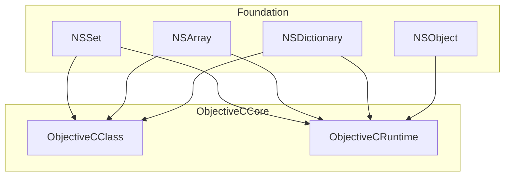
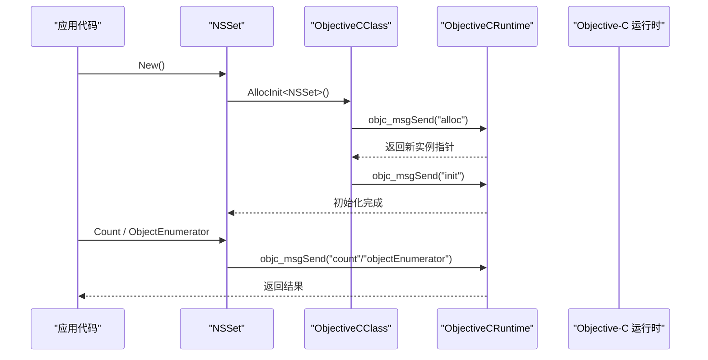
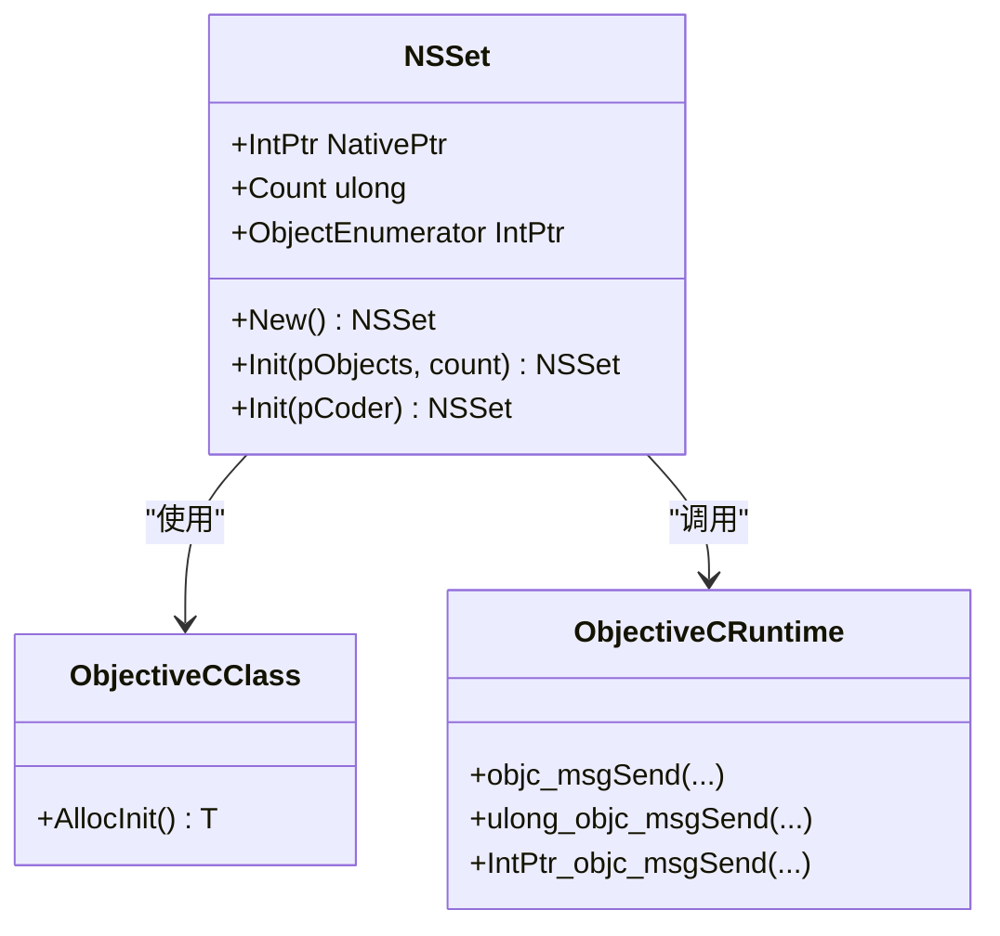
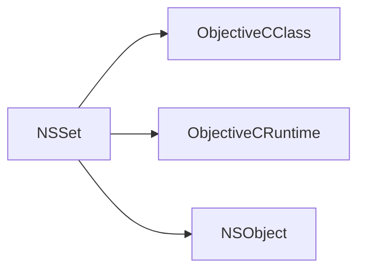

# NSSet 集合类型

<cite>
**本文引用的文件**
- [NSSet.cs](file://src/SharpMetal/Foundation/NSSet.cs)
- [NSObject.cs](file://src/SharpMetal/Foundation/NSObject.cs)
- [ObjectiveCClass.cs](file://src/SharpMetal/ObjectiveCCore/ObjectiveCClass.cs)
- [ObjectiveCRuntime.cs](file://src/SharpMetal/ObjectiveCCore/ObjectiveCRuntime.cs)
- [NSArray.cs](file://src/SharpMetal/Foundation/NSArray.cs)
- [NSDictionary.cs](file://src/SharpMetal/Foundation/NSDictionary.cs)
</cite>

## 目录
1. [简介](#简介)
2. [项目结构](#项目结构)
3. [核心组件](#核心组件)
4. [架构总览](#架构总览)
5. [详细组件分析](#详细组件分析)
6. [依赖关系分析](#依赖关系分析)
7. [性能与内存管理](#性能与内存管理)
8. [故障排查指南](#故障排查指南)
9. [结论](#结论)
10. [附录：与 C# HashSet 的对应与转换](#附录与-c-hashset-的对应与转换)

## 简介
本文件围绕 SharpMetal 中的 NSSet 集合类型，系统阐述其唯一性保证机制、高效查找原理、创建与增删操作、成员资格检查、数学运算支持（并集、交集、差集等）、内存管理与性能考量，并提供常见用法示例路径。同时说明与 C# HashSet 的对应关系及转换方法。

## 项目结构
本项目将 Foundation 层的核心 Objective-C 类型以托管包装暴露给 .NET。NSSet 位于 Foundation 命名空间，通过 ObjectiveCCore 提供的运行时能力调用底层 Objective-C 运行时 API，实现集合语义。

图表来源
- [NSSet.cs:5-34](file://src/SharpMetal/Foundation/NSSet.cs#L5-L34)
- [ObjectiveCClass.cs:18-87](file://src/SharpMetal/ObjectiveCCore/ObjectiveCClass.cs#L18-L87)
- [ObjectiveCRuntime.cs:33-800](file://src/SharpMetal/ObjectiveCCore/ObjectiveCRuntime.cs#L33-L800)

章节来源
- [NSSet.cs:1-36](file://src/SharpMetal/Foundation/NSSet.cs#L1-L36)
- [ObjectiveCClass.cs:1-89](file://src/SharpMetal/ObjectiveCCore/ObjectiveCClass.cs#L1-L89)
- [ObjectiveCRuntime.cs:1-839](file://src/SharpMetal/ObjectiveCCore/ObjectiveCRuntime.cs#L1-L839)

## 核心组件
- NSSet：不可变集合的轻量包装，持有原生指针，提供计数、枚举器、初始化等能力。
- NSObject：所有 Foundation 对象的基类，提供哈希、相等性比较、描述等基础能力，是集合元素必须实现的契约。
- ObjectiveCClass/ObjectiveCRuntime：封装 Objective-C 运行时调用，负责对象分配、消息发送、选择器解析等。

章节来源
- [NSSet.cs:5-34](file://src/SharpMetal/Foundation/NSSet.cs#L5-L34)
- [NSObject.cs:48-90](file://src/SharpMetal/Foundation/NSObject.cs#L48-L90)
- [ObjectiveCClass.cs:18-87](file://src/SharpMetal/ObjectiveCCore/ObjectiveCClass.cs#L18-L87)
- [ObjectiveCRuntime.cs:33-800](file://src/SharpMetal/ObjectiveCCore/ObjectiveCRuntime.cs#L33-L800)

## 架构总览
NSSet 作为薄包装，直接委托到底层 Objective-C 运行时进行集合操作。其唯一性与高效查找由底层实现保障；上层仅暴露必要接口，避免重复造轮子。

图表来源
- [NSSet.cs:11-15](file://src/SharpMetal/Foundation/NSSet.cs#L11-L15)
- [ObjectiveCClass.cs:60-77](file://src/SharpMetal/ObjectiveCCore/ObjectiveCClass.cs#L60-L77)
- [ObjectiveCRuntime.cs:118-141](file://src/SharpMetal/ObjectiveCCore/ObjectiveCRuntime.cs#L118-L141)

## 详细组件分析

### NSSet 结构与能力
- 原生指针持有：NativePtr 指向底层集合对象。
- 工厂方法：New() 通过 ObjectiveCClass.AllocInit<T>() 创建并初始化。
- 基本属性与方法：
  - Count：获取元素数量。
  - ObjectEnumerator：获取枚举器用于遍历。
  - Init(in NSObject pObjects, in ulong count)：从对象数组构造集合。
  - Init(in IntPtr pCoder)：反序列化构造。
- 隐式转换：可转换为 IntPtr，便于与底层 API 互操作。

章节来源
- [NSSet.cs:5-34](file://src/SharpMetal/Foundation/NSSet.cs#L5-L34)

#### 类图（代码级）

图表来源
- [NSSet.cs:5-34](file://src/SharpMetal/Foundation/NSSet.cs#L5-L34)
- [ObjectiveCClass.cs:60-77](file://src/SharpMetal/ObjectiveCCore/ObjectiveCClass.cs#L60-L77)
- [ObjectiveCRuntime.cs:118-141](file://src/SharpMetal/ObjectiveCCore/ObjectiveCRuntime.cs#L118-L141)

### 唯一性保证与高效查找
- 唯一性：由底层 Objective-C 运行时保证。集合在插入时依据元素的哈希值与相等性判断去重。
- 高效查找：基于哈希表实现，平均 O(1) 查找、插入、删除。
- 元素契约：元素需正确实现哈希与相等性比较，通常通过 NSObject 的 Hash 与 IsEqual 行为来体现。

章节来源
- [NSObject.cs:54-63](file://src/SharpMetal/Foundation/NSObject.cs#L54-L63)

### 创建方式
- 空集合：调用 New() 创建空集合。
- 批量构造：使用 Init(in NSObject pObjects, in ulong count) 传入对象指针数组与数量。
- 反序列化：使用 Init(in IntPtr pCoder) 从编码流恢复。

章节来源
- [NSSet.cs:11-25](file://src/SharpMetal/Foundation/NSSet.cs#L11-L25)

### 添加与移除
- 当前公开 API 未直接暴露 Add/Remove 方法。若需可变集合语义，可在应用层维护一个可变容器（如 NSArray 或自定义缓冲），并在需要时通过 Init(in NSObject pObjects, in ulong count) 重建 NSSet。
- 注意：NSSet 本身为不可变集合包装，变更应通过重新构造实现。

章节来源
- [NSSet.cs:17-25](file://src/SharpMetal/Foundation/NSSet.cs#L17-L25)

### 成员资格检查
- 可通过枚举器遍历或使用底层 API 进行存在性判断。当前公开接口未直接提供 Contains 方法，建议通过枚举器遍历或在必要时扩展包装以调用底层 containsObject: 等方法。

章节来源
- [NSSet.cs:15-15](file://src/SharpMetal/Foundation/NSSet.cs#L15-L15)

### 数学运算（并集、交集、差集）
- 当前公开 API 未直接暴露集合运算方法。可在应用层通过枚举器遍历两个集合，组合出新的对象数组，再构造新的 NSSet 实现并集、交集、差集等。
- 典型流程：
  - 并集：合并两集合的元素并去重（由 NSSet 构造自动去重）。
  - 交集：遍历一集合，检查另一集合是否包含该元素。
  - 差集：遍历一集合，排除另一集合中存在的元素。

章节来源
- [NSSet.cs:11-25](file://src/SharpMetal/Foundation/NSSet.cs#L11-L25)

### 与 NSArray/NSDictionary 的关系
- NSArray 提供有序序列访问，常用于传递对象数组给 NSSet 构造。
- NSDictionary 提供键值映射，可作为数据源参与集合运算。

章节来源
- [NSArray.cs:5-64](file://src/SharpMetal/Foundation/NSArray.cs#L5-L64)
- [NSDictionary.cs:5-53](file://src/SharpMetal/Foundation/NSDictionary.cs#L5-L53)

## 依赖关系分析
- NSSet 依赖 ObjectiveCClass 进行对象生命周期管理（分配与初始化）。
- NSSet 依赖 ObjectiveCRuntime 执行消息发送，访问 count、objectEnumerator 等。
- 元素类型依赖 NSObject 的哈希与相等性语义以保证集合行为的正确性。

图表来源
- [NSSet.cs:5-34](file://src/SharpMetal/Foundation/NSSet.cs#L5-L34)
- [ObjectiveCClass.cs:18-87](file://src/SharpMetal/ObjectiveCCore/ObjectiveCClass.cs#L18-L87)
- [ObjectiveCRuntime.cs:33-800](file://src/SharpMetal/ObjectiveCCore/ObjectiveCRuntime.cs#L33-L800)
- [NSObject.cs:48-90](file://src/SharpMetal/Foundation/NSObject.cs#L48-L90)

章节来源
- [NSSet.cs:1-36](file://src/SharpMetal/Foundation/NSSet.cs#L1-L36)
- [ObjectiveCClass.cs:1-89](file://src/SharpMetal/ObjectiveCCore/ObjectiveCClass.cs#L1-L89)
- [ObjectiveCRuntime.cs:1-839](file://src/SharpMetal/ObjectiveCCore/ObjectiveCRuntime.cs#L1-L839)
- [NSObject.cs:1-92](file://src/SharpMetal/Foundation/NSObject.cs#L1-L92)

## 性能与内存管理
- 时间复杂度：
  - 查找/插入/删除：平均 O(1)，取决于底层哈希表实现。
  - 枚举：O(n)。
- 空间复杂度：O(n)，存储 n 个不重复元素。
- 内存管理：
  - 通过 ObjectiveCRuntime.Retain/Release 管理引用计数。
  - 使用 NSSet 时应确保元素的生命周期与集合一致，避免悬垂指针。
- 最佳实践：
  - 尽量批量构造集合以减少多次分配。
  - 对频繁查询的场景，优先使用 NSSet 而非线性结构。
  - 合理实现元素的 Hash 与 IsEqual，避免冲突过多导致退化。

章节来源
- [ObjectiveCRuntime.cs:769-782](file://src/SharpMetal/ObjectiveCCore/ObjectiveCRuntime.cs#L769-L782)
- [NSObject.cs:54-63](file://src/SharpMetal/Foundation/NSObject.cs#L54-L63)

## 故障排查指南
- 空指针异常：
  - 检查 NSSet.NativePtr 是否为空，确认 New() 或 Init() 成功返回。
- 枚举器为空：
  - 确认集合已正确初始化且包含元素。
- 元素相等性不正确：
  - 检查元素的 Hash 与 IsEqual 实现是否符合约定。
- 内存泄漏：
  - 确保对不再使用的对象调用 Release，或交由 ARC/框架管理。

章节来源
- [ObjectiveCRuntime.cs:769-782](file://src/SharpMetal/ObjectiveCCore/ObjectiveCRuntime.cs#L769-L782)
- [NSObject.cs:54-63](file://src/SharpMetal/Foundation/NSObject.cs#L54-L63)

## 结论
SharpMetal 中的 NSSet 是对 Objective-C 集合的轻量包装，专注于提供不可变集合的基本能力。其唯一性与高效查找由底层运行时保障，上层通过最小化接口降低复杂度。对于可变集合与高级运算，建议在应用层结合 NSArray/NSDictionary 与 NSSet 构造方法灵活实现。

## 附录：与 C# HashSet 的对应与转换
- 概念对应：
  - NSSet ↔ System.Collections.Generic.HashSet<T>
  - 唯一性、O(1) 查找、集合运算语义相似。
- 转换方法（思路）：
  - NSSet → HashSet：通过枚举器遍历 NSSet，收集元素到 HashSet。
  - HashSet → NSSet：将 HashSet 元素转为 NSObject 数组，调用 NSSet.Init(in NSObject pObjects, in ulong count) 构造集合。
- 注意事项：
  - 元素类型需实现正确的哈希与相等性比较。
  - 转换过程中注意内存管理与生命周期。

章节来源
- [NSSet.cs:11-25](file://src/SharpMetal/Foundation/NSSet.cs#L11-L25)
- [NSObject.cs:54-63](file://src/SharpMetal/Foundation/NSObject.cs#L54-L63)