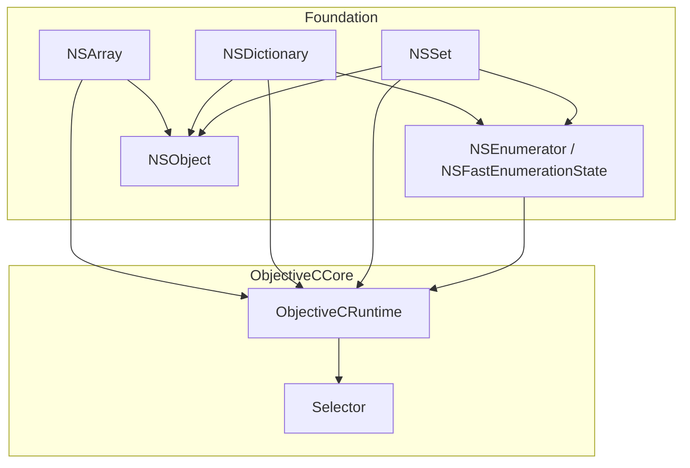
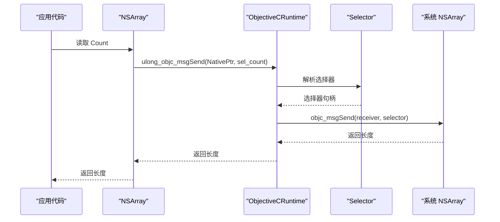
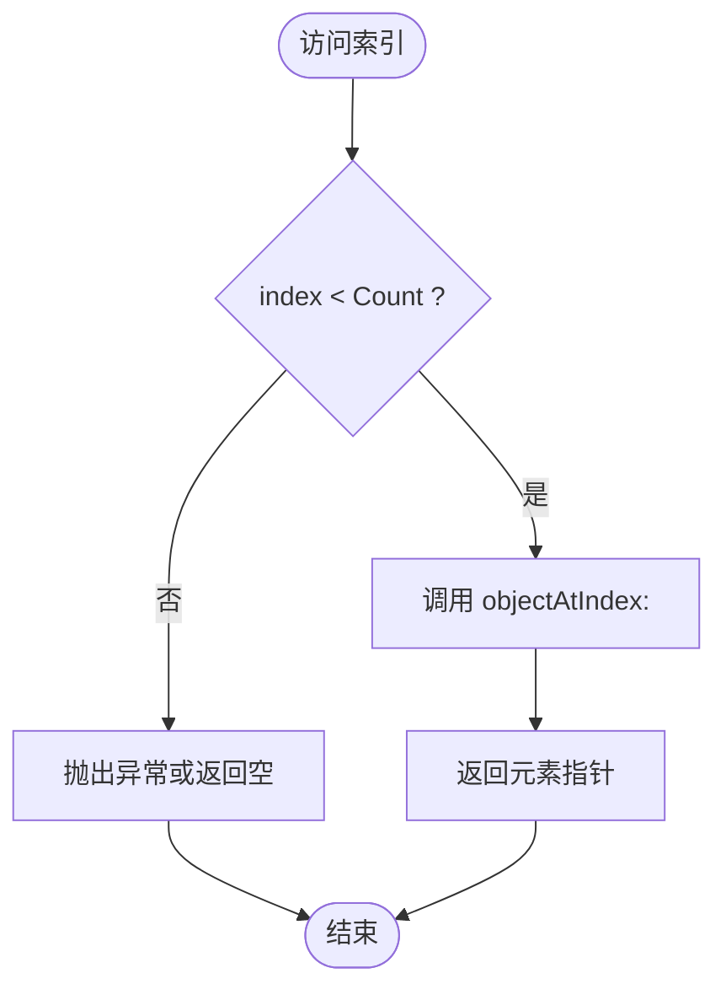
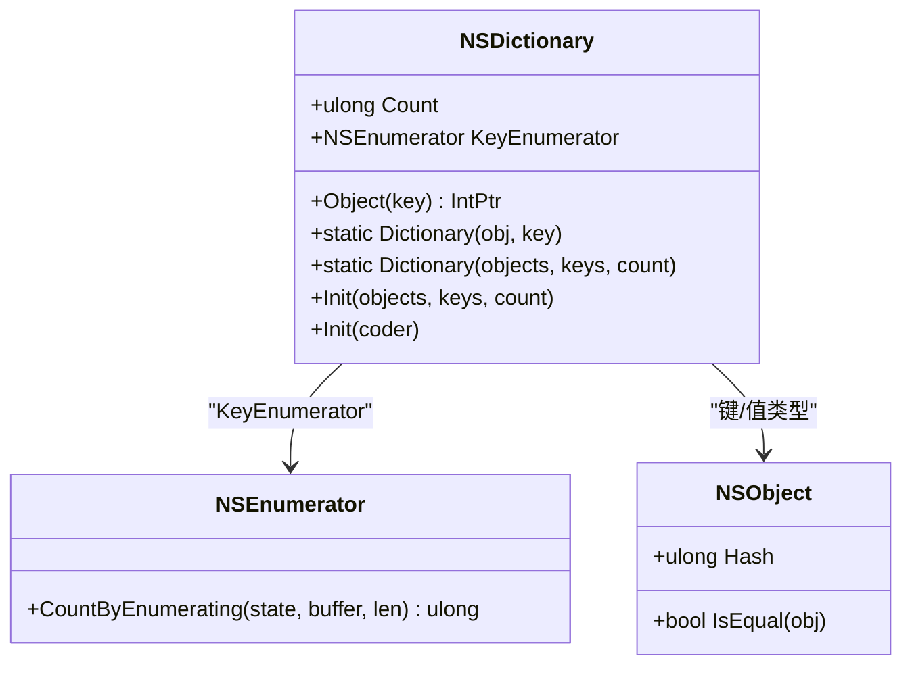
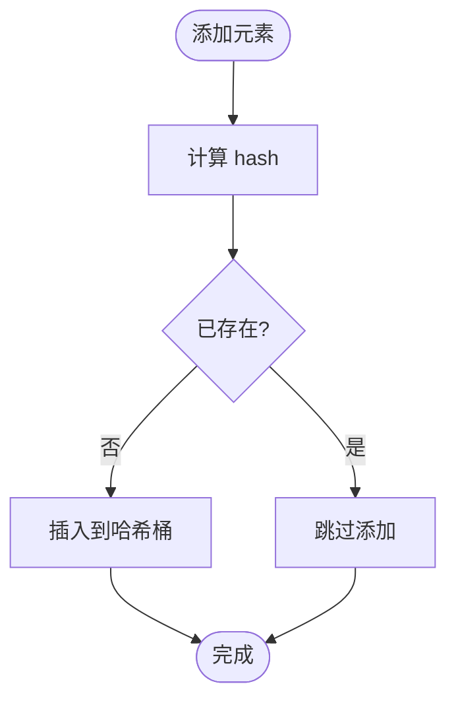
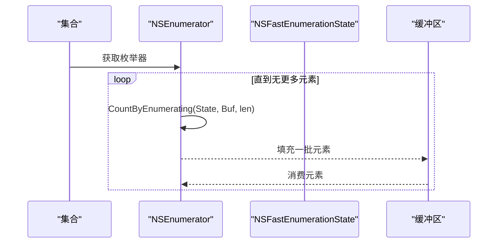
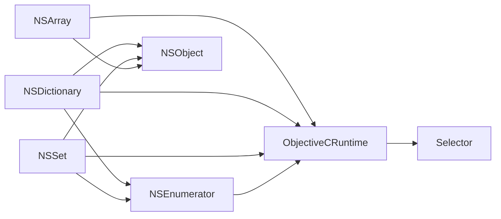

# 集合类型

<cite>
**本文引用的文件**
- [NSArray.cs](file://src/SharpMetal/Foundation/NSArray.cs)
- [NSDictionary.cs](file://src/SharpMetal/Foundation/NSDictionary.cs)
- [NSSet.cs](file://src/SharpMetal/Foundation/NSSet.cs)
- [NSEnumerator.cs](file://src/SharpMetal/Foundation/NSEnumerator.cs)
- [NSObject.cs](file://src/SharpMetal/Foundation/NSObject.cs)
- [ObjectiveCRuntime.cs](file://src/SharpMetal/ObjectiveCCore/ObjectiveCRuntime.cs)
- [Selector.cs](file://src/SharpMetal/ObjectiveCCore/Selector.cs)
</cite>

## 目录
1. [简介](#简介)
2. [项目结构](#项目结构)
3. [核心组件](#核心组件)
4. [架构总览](#架构总览)
5. [详细组件分析](#详细组件分析)
6. [依赖关系分析](#依赖关系分析)
7. [性能考量](#性能考量)
8. [故障排查指南](#故障排查指南)
9. [结论](#结论)
10. [附录：常见操作模式与示例路径](#附录：常见操作模式与示例路径)

## 简介
本文件围绕 SharpMetal 中的 Foundation 集合类型，系统性说明 NSArray、NSDictionary、NSSet 的创建、访问、修改方式，以及 NSEnumerator 的迭代模式。结合 Objective-C 运行时桥接机制，解释键值查找算法、唯一性保证、内存管理要点，并给出性能优化建议与使用场景指导。文档以代码级事实为依据，避免臆测，所有实现细节均对应到具体源文件行号。

## 项目结构
Foundation 层提供对 Objective-C 原生集合类型的托管封装，通过 ObjectiveC 运行时进行消息调用（objc_msgSend）完成与系统框架的交互。关键文件组织如下：
- 集合类型：NSArray、NSDictionary、NSSet
- 枚举器：NSEnumerator、NSFastEnumerationState
- 基础对象：NSObject（哈希、相等性、描述等）
- 运行时：ObjectiveCRuntime（消息发送、生命周期管理）、Selector（选择器封装）

图表来源
- [NSArray.cs:5-64](file://src/SharpMetal/Foundation/NSArray.cs#L5-L64)
- [NSDictionary.cs:5-53](file://src/SharpMetal/Foundation/NSDictionary.cs#L5-L53)
- [NSSet.cs:5-34](file://src/SharpMetal/Foundation/NSSet.cs#L5-L34)
- [NSEnumerator.cs:6-44](file://src/SharpMetal/Foundation/NSEnumerator.cs#L6-L44)
- [NSObject.cs:48-90](file://src/SharpMetal/Foundation/NSObject.cs#L48-L90)
- [ObjectiveCRuntime.cs:33-800](file://src/SharpMetal/ObjectiveCCore/ObjectiveCRuntime.cs#L33-L800)
- [Selector.cs:5-43](file://src/SharpMetal/ObjectiveCCore/Selector.cs#L5-L43)

章节来源
- [NSArray.cs:5-64](file://src/SharpMetal/Foundation/NSArray.cs#L5-L64)
- [NSDictionary.cs:5-53](file://src/SharpMetal/Foundation/NSDictionary.cs#L5-L53)
- [NSSet.cs:5-34](file://src/SharpMetal/Foundation/NSSet.cs#L5-L34)
- [NSEnumerator.cs:6-44](file://src/SharpMetal/Foundation/NSEnumerator.cs#L6-L44)
- [NSObject.cs:48-90](file://src/SharpMetal/Foundation/NSObject.cs#L48-L90)
- [ObjectiveCRuntime.cs:33-800](file://src/SharpMetal/ObjectiveCCore/ObjectiveCRuntime.cs#L33-L800)
- [Selector.cs:5-43](file://src/SharpMetal/ObjectiveCCore/Selector.cs#L5-L43)

## 核心组件
- NSArray：顺序容器，支持按索引访问、计数、首尾元素获取；提供静态工厂方法与初始化方法。
- NSDictionary：键值映射，支持按 Key 取值、Key 枚举、计数；提供单键值与批量构造方法。
- NSSet：无序不重复集合，支持计数、对象枚举；提供批量构造方法。
- NSEnumerator/NSFastEnumerationState：统一迭代协议，用于遍历集合元素。
- NSObject：提供哈希、相等性判断、描述能力，是集合元素的基础。
- ObjectiveCRuntime/Selector：底层消息发送与选择器封装，支撑所有集合方法的调用。

章节来源
- [NSArray.cs:5-64](file://src/SharpMetal/Foundation/NSArray.cs#L5-L64)
- [NSDictionary.cs:5-53](file://src/SharpMetal/Foundation/NSDictionary.cs#L5-L53)
- [NSSet.cs:5-34](file://src/SharpMetal/Foundation/NSSet.cs#L5-L34)
- [NSEnumerator.cs:6-44](file://src/SharpMetal/Foundation/NSEnumerator.cs#L6-L44)
- [NSObject.cs:48-90](file://src/SharpMetal/Foundation/NSObject.cs#L48-L90)
- [ObjectiveCRuntime.cs:33-800](file://src/SharpMetal/ObjectiveCCore/ObjectiveCRuntime.cs#L33-L800)
- [Selector.cs:5-43](file://src/SharpMetal/ObjectiveCCore/Selector.cs#L5-L43)

## 架构总览
集合类型通过托管 struct 包装原生指针，所有读写操作最终转化为 Objective-C 消息调用。下图展示典型的数据流：应用层调用 -> 托管 API -> 运行时消息发送 -> 系统集合实现。

图表来源
- [NSArray.cs:13-17](file://src/SharpMetal/Foundation/NSArray.cs#L13-L17)
- [ObjectiveCRuntime.cs:141-141](file://src/SharpMetal/ObjectiveCCore/ObjectiveCRuntime.cs#L141-L141)
- [Selector.cs:20-30](file://src/SharpMetal/ObjectiveCCore/Selector.cs#L20-L30)

章节来源
- [NSArray.cs:13-17](file://src/SharpMetal/Foundation/NSArray.cs#L13-L17)
- [ObjectiveCRuntime.cs:141-141](file://src/SharpMetal/ObjectiveCCore/ObjectiveCRuntime.cs#L141-L141)
- [Selector.cs:20-30](file://src/SharpMetal/ObjectiveCCore/Selector.cs#L20-L30)

## 详细组件分析

### NSArray 数组
- 创建
  - 空数组：New()
  - 单元素数组：Array(NSObject)
  - 多元素数组：Array(NSObject*, count)
  - 初始化：Init(objects, count)、Init(coder)
- 访问
  - 计数：Count
  - 首/末元素：firstObject、lastObject
  - 索引访问：this[index]、Object(index)
- 修改
  - 当前封装未暴露可变接口（如 addObject/removeObject），需通过更底层的 Objective-C 消息扩展或不可变数组配合新数组构建。
- 索引越界处理
  - 当前实现直接调用 objectAtIndex:，未做边界检查；越界行为由系统决定（可能崩溃）。建议在调用前自行校验 index < Count。
- 性能要点
  - 索引访问为 O(1)，适合随机访问。
  - 频繁扩容/插入建议使用可替代方案或在批处理时预分配容量（若上层有可变封装）。
  - 避免在热路径中反复创建临时数组。

图表来源
- [NSArray.cs:13-25](file://src/SharpMetal/Foundation/NSArray.cs#L13-L25)

章节来源
- [NSArray.cs:11-50](file://src/SharpMetal/Foundation/NSArray.cs#L11-L50)

### NSDictionary 字典
- 创建
  - 单键值：Dictionary(object, key)
  - 批量：Dictionary(objects, keys, count)
  - 初始化：Init(objects, keys, count)、Init(coder)
- 访问
  - 计数：Count
  - 取值：Object(key)
  - 枚举：KeyEnumerator
- 查找算法
  - 底层基于哈希表；时间复杂度近似 O(1)。
  - 键的相等性与哈希由 NSObject.IsEqual/hash 决定。
- 内存管理
  - 键与值会被 retain（由系统集合负责），释放由集合生命周期管理。
- 注意事项
  - 键应为不可变且正确实现 hash/isEqual。
  - 大量写入建议一次性批量构造，减少多次插入开销。

图表来源
- [NSDictionary.cs:13-40](file://src/SharpMetal/Foundation/NSDictionary.cs#L13-L40)
- [NSEnumerator.cs:28-44](file://src/SharpMetal/Foundation/NSEnumerator.cs#L28-L44)
- [NSObject.cs:54-63](file://src/SharpMetal/Foundation/NSObject.cs#L54-L63)

章节来源
- [NSDictionary.cs:17-40](file://src/SharpMetal/Foundation/NSDictionary.cs#L17-L40)
- [NSObject.cs:54-63](file://src/SharpMetal/Foundation/NSObject.cs#L54-L63)

### NSSet 集合
- 创建
  - 空集合：New()
  - 批量：Init(objects, count)
- 访问
  - 计数：Count
  - 枚举：ObjectEnumerator
- 唯一性保证
  - 基于元素的 hash/isEqual 去重；重复元素将被忽略。
- 查找特性
  - 基于哈希表，查找近似 O(1)。
- 适用场景
  - 需要快速成员检测、去重、集合运算（交集/并集/差集，需扩展）。

图表来源
- [NSSet.cs:13-20](file://src/SharpMetal/Foundation/NSSet.cs#L13-L20)
- [NSObject.cs:54-63](file://src/SharpMetal/Foundation/NSObject.cs#L54-L63)

章节来源
- [NSSet.cs:11-20](file://src/SharpMetal/Foundation/NSSet.cs#L11-L20)
- [NSObject.cs:54-63](file://src/SharpMetal/Foundation/NSObject.cs#L54-L63)

### NSEnumerator 与 NSFastEnumerationState
- 角色
  - NSEnumerator：传统枚举器，提供 nextObject 语义（此处通过 fast enumeration 协议实现）。
  - NSFastEnumerationState：快枚举状态结构，包含 itemsPtr。
- 使用模式
  - 通过集合提供的 Enumerator 属性获取枚举器。
  - 使用 CountByEnumerating(state, buffer, len) 批量拉取元素，减少跨语言调用次数。
- 最佳实践
  - 优先使用快枚举（批量拉取）而非逐个 nextObject。
  - 注意缓冲区的生命周期与大小，避免溢出。

图表来源
- [NSEnumerator.cs:6-26](file://src/SharpMetal/Foundation/NSEnumerator.cs#L6-L26)
- [NSEnumerator.cs:28-44](file://src/SharpMetal/Foundation/NSEnumerator.cs#L28-L44)

章节来源
- [NSEnumerator.cs:6-44](file://src/SharpMetal/Foundation/NSEnumerator.cs#L6-L44)

## 依赖关系分析
- 所有集合类型依赖 ObjectiveCRuntime 进行消息发送，依赖 Selector 解析方法名。
- 字典与集合的元素依赖 NSObject 的 hash/isEqual 契约。
- 枚举器与集合解耦，通过协议式接口统一遍历。

图表来源
- [NSArray.cs:53-64](file://src/SharpMetal/Foundation/NSArray.cs#L53-L64)
- [NSDictionary.cs:44-53](file://src/SharpMetal/Foundation/NSDictionary.cs#L44-L53)
- [NSSet.cs:29-34](file://src/SharpMetal/Foundation/NSSet.cs#L29-L34)
- [NSEnumerator.cs:25-44](file://src/SharpMetal/Foundation/NSEnumerator.cs#L25-L44)
- [ObjectiveCRuntime.cs:33-800](file://src/SharpMetal/ObjectiveCCore/ObjectiveCRuntime.cs#L33-L800)
- [Selector.cs:5-43](file://src/SharpMetal/ObjectiveCCore/Selector.cs#L5-L43)

章节来源
- [NSArray.cs:53-64](file://src/SharpMetal/Foundation/NSArray.cs#L53-L64)
- [NSDictionary.cs:44-53](file://src/SharpMetal/Foundation/NSDictionary.cs#L44-L53)
- [NSSet.cs:29-34](file://src/SharpMetal/Foundation/NSSet.cs#L29-L34)
- [NSEnumerator.cs:25-44](file://src/SharpMetal/Foundation/NSEnumerator.cs#L25-L44)
- [ObjectiveCRuntime.cs:33-800](file://src/SharpMetal/ObjectiveCCore/ObjectiveCRuntime.cs#L33-L800)
- [Selector.cs:5-43](file://src/SharpMetal/ObjectiveCCore/Selector.cs#L5-L43)

## 性能考量
- 访问复杂度
  - NSArray 索引访问 O(1)；遍历 O(n)。
  - NSDictionary 查找/插入近似 O(1)；遍历 O(n)。
  - NSSet 查找/插入近似 O(1)；遍历 O(n)。
- 内存与生命周期
  - 集合持有其元素的强引用；释放由集合生命周期管理。
  - 自定义元素需正确实现 hash/isEqual，否则字典/集合行为异常。
- 枚举优化
  - 使用 NSEnumerator 的 CountByEnumerating 批量拉取，减少跨语言调用开销。
- 构造优化
  - 批量构造字典/集合优于多次单元素插入。
- 线程安全
  - 这些集合非线程安全；并发访问需外部同步。

[本节为通用性能讨论，不直接分析具体文件]

## 故障排查指南
- 索引越界
  - 现象：访问 NSArray 索引超出范围可能导致崩溃。
  - 排查：确保 index < Count；必要时先检查再访问。
  - 参考位置：[NSArray.cs:19-25](file://src/SharpMetal/Foundation/NSArray.cs#L19-L25)
- 键无效或缺失
  - 现象：NSDictionary 取值返回空或未定义行为。
  - 排查：确认键存在且实现了正确的 hash/isEqual。
  - 参考位置：[NSDictionary.cs:37-40](file://src/SharpMetal/Foundation/NSDictionary.cs#L37-L40)
- 枚举为空或提前结束
  - 现象：NSEnumerator 遍历时未获得预期元素。
  - 排查：检查集合是否为空；确认缓冲区大小足够；关注 CountByEnumerating 返回值。
  - 参考位置：[NSEnumerator.cs:18-26](file://src/SharpMetal/Foundation/NSEnumerator.cs#L18-L26)
- 选择器失败
  - 现象：Selector 构造失败导致后续消息发送异常。
  - 排查：检查选择器名称是否正确；查看日志输出。
  - 参考位置：[Selector.cs:20-30](file://src/SharpMetal/ObjectiveCCore/Selector.cs#L20-L30)
- 内存泄漏或过早释放
  - 现象：程序崩溃或数据损坏。
  - 排查：遵循集合生命周期；不要手动释放由集合管理的元素；必要时使用 Retain/Release 管理外部对象。
  - 参考位置：[ObjectiveCRuntime.cs:769-782](file://src/SharpMetal/ObjectiveCCore/ObjectiveCRuntime.cs#L769-L782)

章节来源
- [NSArray.cs:19-25](file://src/SharpMetal/Foundation/NSArray.cs#L19-L25)
- [NSDictionary.cs:37-40](file://src/SharpMetal/Foundation/NSDictionary.cs#L37-L40)
- [NSEnumerator.cs:18-26](file://src/SharpMetal/Foundation/NSEnumerator.cs#L18-L26)
- [Selector.cs:20-30](file://src/SharpMetal/ObjectiveCCore/Selector.cs#L20-L30)
- [ObjectiveCRuntime.cs:769-782](file://src/SharpMetal/ObjectiveCCore/ObjectiveCRuntime.cs#L769-L782)

## 结论
SharpMetal 的 Foundation 集合类型以轻量托管结构封装了 Objective-C 原生集合，提供了创建、访问与枚举的核心能力。通过统一的运行时消息机制，开发者可以高效地使用 NSArray、NSDictionary、NSSet 与 NSEnumerator。为保证稳定性与性能，应遵循以下原则：
- 访问前校验索引，避免越界。
- 为自定义元素实现正确的 hash/isEqual。
- 使用批量构造与快枚举提升性能。
- 理解集合的生命周期与内存管理模型。

[本节为总结性内容，不直接分析具体文件]

## 附录：常见操作模式与示例路径
- 创建数组
  - 空数组：[NSArray.cs:11](file://src/SharpMetal/Foundation/NSArray.cs#L11)
  - 单元素数组：[NSArray.cs:27-30](file://src/SharpMetal/Foundation/NSArray.cs#L27-L30)
  - 多元素数组：[NSArray.cs:32-35](file://src/SharpMetal/Foundation/NSArray.cs#L32-L35)
- 访问数组
  - 计数：[NSArray.cs:13](file://src/SharpMetal/Foundation/NSArray.cs#L13)
  - 首/末元素：[NSArray.cs:15-17](file://src/SharpMetal/Foundation/NSArray.cs#L15-L17)
  - 索引访问：[NSArray.cs:19-25](file://src/SharpMetal/Foundation/NSArray.cs#L19-L25)
- 创建字典
  - 单键值：[NSDictionary.cs:17-20](file://src/SharpMetal/Foundation/NSDictionary.cs#L17-L20)
  - 批量：[NSDictionary.cs:22-25](file://src/SharpMetal/Foundation/NSDictionary.cs#L22-L25)
- 访问字典
  - 取值：[NSDictionary.cs:37-40](file://src/SharpMetal/Foundation/NSDictionary.cs#L37-L40)
  - 键枚举：[NSDictionary.cs:13](file://src/SharpMetal/Foundation/NSDictionary.cs#L13)
- 创建集合
  - 批量构造：[NSSet.cs:17-20](file://src/SharpMetal/Foundation/NSSet.cs#L17-L20)
- 枚举
  - 快枚举状态与批量拉取：[NSEnumerator.cs:6-26](file://src/SharpMetal/Foundation/NSEnumerator.cs#L6-L26)
  - 枚举器转换与调用：[NSEnumerator.cs:28-44](file://src/SharpMetal/Foundation/NSEnumerator.cs#L28-L44)

[本节仅列出文件路径与行号，不包含具体代码内容]